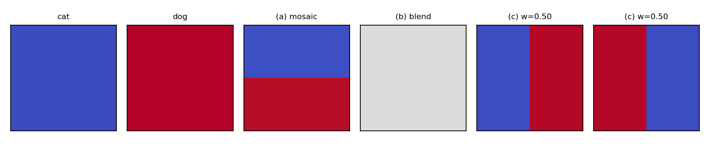
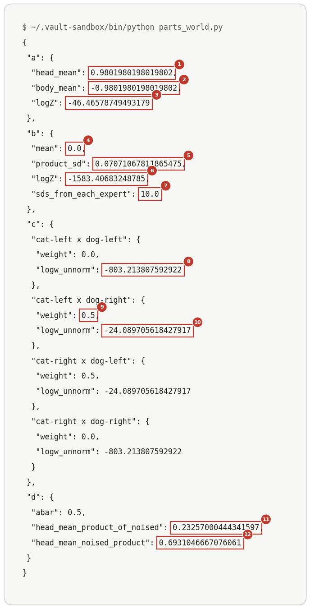
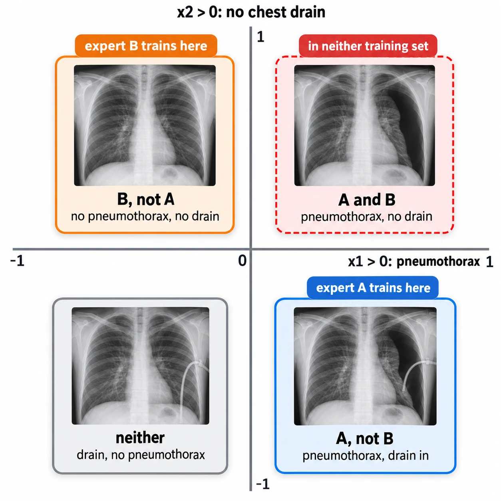
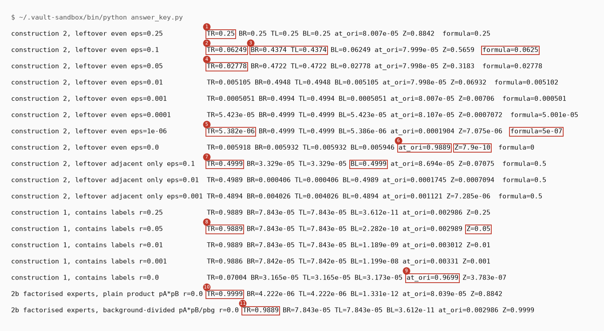
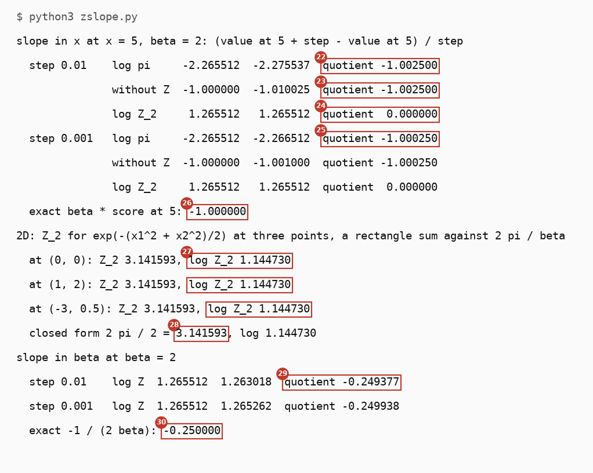

# Diffusion Models

Artificial Intelligence, Generative Modeling. Needs: [[Multivariate Normal Distribution#Sampling a diagonal Gaussian]] for drawing a cloud, [[Multivariate Normal Distribution#Products and quotients of diagonal Gaussians]] for the arithmetic of composing, and [[NumPy#Broadcasting]] for noising many levels in one line.

> [!question] Test yourself
> [The diffusion models quiz](https://claude.ai/artifact/MyTdAaVfZW3wiqhbLKg4wu) covers [[#The forward process in one jump]], [[#Composing models with a background]] with the paper's figures, [[#Kinds of composition]], [[#What an expert learns from its training set]], [[#When neither training set holds A and B]], [[#The four-quadrant answer key]] and [[#Three things called annealing]] apart from [[#The tempered density and its score]], in 81 questions. Your attempts are saved on the page.

> [!warning] Unfinished
> - Seven pictures are stuck after three revisions and wait for a word from the learner, all in the vault's `.prompts/Diffusion Models.md`: prompt 6, the deep-dive sheet for [[#Composing models with a background]], whose last render put the marked points off the note's saved figure; prompt 15, the mechanism for [[#Product, mixture and negation]], whose arrow lengths are off scale; prompt 17, the concept picture for [[#Annealed MCMC]], whose route A and route B bells are not to scale; prompt 25, the mechanism for [[#Three things called annealing]], whose $\beta = 2$ curve is lopsided and whose number line is unevenly spaced; prompt 27, the concept picture for [[#The tempered density and its score]], whose three bells in its third panel sit off their centres; prompt 28, the concept picture for [[#The log of a power and of a quotient]], whose two tangent lines at $x = 5$ are not parallel and whose $x$ ticks are unevenly spaced; and prompt 31, the concept picture for [[#Why the normaliser has no slope in x]], whose left-panel curves are not one shift apart and whose right-panel dot sits off its curve.
> - Two pictures are waiting to be drawn, in the same prompts file: prompts 32 and 33, the concept picture and the mechanism for [[#Mosaic, blend or two animals from one product]].
> - Two pictures for [[#The energy parameterisation]] are rendered but not yet placed in the section: prompt 11, `assets/energy-the-mechanism.webp`, and prompt 12, `assets/energy-deep-dive-sheet.webp`.
> - The quiz page does not cover [[#The product as an intersection]], [[#The order of multiplying and noising]] with [[#Annealed MCMC]], [[#The energy parameterisation]] with [[#Step size and the accept step]], [[#Product, mixture and negation]], [[#The tempered density and its score]], [[#The log of a power and of a quotient]], [[#Why the normaliser has no slope in x]], [[#The four-quadrant answer key]] or [[#Mosaic, blend or two animals from one product]].
> - The reverse process is run in [[#Try the two orders yourself]] without a section of its own; it, the score and the training objective wait for a walk that reaches them.
> - [[#What an expert learns from its training set]] and [[#Three things called annealing]] have not been run: this machine (the cluster) has no prepared environment `~/.vault-sandbox/bin/python`. Make it with `uv venv ~/.vault-sandbox` then `uv pip install --python ~/.vault-sandbox/bin/python pandas numpy scipy matplotlib statsmodels openpyxl`, run `labels.py`, `knobs.py`, `tempered.py` and `logs.py`, and file each real output and its output picture in place of the hand-worked lines. [[#The four-quadrant answer key]]'s steps, `zslope.py` for [[#Why the normaliser has no slope in x]] and the steps of [[#Mosaic, blend or two animals from one product]] were run with the system Python in place of the prepared environment; run them once through it to confirm.
> - Every run below is a sandbox run. The overlap-dial idea and the idea of when a product reaches A and B, both in the reduce-reuse-recycle repository, apply [[#Kinds of composition]], [[#What an expert learns from its training set]] and [[#Mosaic, blend or two animals from one product]], in words only.
>
> Stated, not checked: 16 claims, marked where they sit.

**A diffusion model learns to undo a fixed noising process, and two trained models can be combined by multiplying what each believes and dividing out what they share.** This note covers the noising, written as one jump from a clean point to any noise level, and the composition rule that the Mechanisms of Projective Composition paper names in its Definition 5.1, both worked on the same small two-dimensional Gaussian clouds. It then shows, on a one-dimensional pair, why adding two models' scores and running the usual reverse process misses the product, and how annealed MCMC reaches the product with the same scores, and how a model that outputs one energy per input lets a sampler accept or reject each move, which holds the right width at any step size, and lets models be mixed, all following Reduce, Reuse, Recycle. It names the kinds of composition by which pixels each expert scores, works a 16-pixel toy where one cat-dog product gives a mosaic, a blend or two animals side by side, and ends with what an expert learns from labelled data and what a product can reach when neither training set holds the combination. Last, it separates the three numbers this literature calls annealed: the temperature, the noise level and the guidance scale. Every number can be checked by hand.

**Where you work.**

- Any terminal with Python 3, NumPy and Matplotlib. On the PC, that is Ubuntu under WSL, with the prepared environment `~/.vault-sandbox/bin/python`.
- A new empty folder. Nothing here touches a real project.

**Prepare the sandbox.**

```bash
mkdir -p ~/playground/sandbox/gaussian-clouds && cd ~/playground/sandbox/gaussian-clouds
~/.vault-sandbox/bin/python -c "import numpy; print(numpy.__version__)"
```

You should see a version number. This run printed `2.4.6`. If the environment is missing, [[Multivariate Normal Distribution#Try sampling yourself]] steps 1 and 2 say how to make it, or how to use `uv run` instead.

Both sections use the learner's `toy.py` and `samples.py`. Save them from [[Multivariate Normal Distribution#Try sampling yourself]], steps 3 and 5, into this folder.

## Table of contents

- [[#The forward process in one jump]]
- [[#Composing models with a background]]
- [[#The order of multiplying and noising]]
- [[#The energy parameterisation]]
- [[#Product, mixture and negation]]
- [[#What an expert learns from its training set]]
- [[#Three things called annealing]]

## The forward process in one jump

Navigation: 📋 [[#Table of contents|TOC]] | [[#Composing models with a background]] ➡️

**The forward process noises a clean point $x_0$ to level $\bar\alpha$ in one step, $x_t = \sqrt{\bar\alpha}\,x_0 + \sqrt{1 - \bar\alpha}\,\varepsilon$ with $\varepsilon \sim \mathcal{N}(0, I)$, so a cloud $\mathcal{N}(\mu, \sigma^2)$ becomes $\mathcal{N}(\sqrt{\bar\alpha}\,\mu,\ \bar\alpha\,\sigma^2 + 1 - \bar\alpha)$.** $\bar\alpha = 1$ is the clean data, and $\bar\alpha$ near 0 is almost pure noise. *Cited:* Ho et al., equation (4).

### When to reach for the jump

When you need a cloud at a given noise level without running every small step before it: to make training pairs, to see what a noise level does to two experts before composing them, or to check a toy against the closed form. The paper composes the experts after noising, at every level, so knowing what each level does to a cloud comes first.

### The form of the jump

```text
abar = np.array([<level 1>, <level 2>, ...])                    shape (L,); 1 is clean, near 0 is noise
a    = abar[:, None, None]                                       shape (L, 1, 1), one number per level
xt   = np.sqrt(a) * x0 + np.sqrt(1 - a) * rng.standard_normal((L, N, 2))     shape (L, N, 2)
mean: np.sqrt(level) * mu        variance: level * var + 1 - level            the closed form, per level
```

Both factors are square roots. They make the two parts' variances, $\bar\alpha$ and $1 - \bar\alpha$, add to 1 for unit-variance data.


*The form, one clean cloud and one noise cloud mixed by the two square-root dials into the noised cloud.*

### Try the jump yourself

**1. What you need, and when it is missing.** As in the sandbox preparation above.

**2. Make something to act on.** `toy.py` and `samples.py` in `~/playground/sandbox/gaussian-clouds`, as above. The cloud is expert 1, $\mathcal{N}((-2, 0), \operatorname{diag}(1, 4))$.

**3. The failure: the weights without their square roots.** Save this as `wrong_scale.py`:

```python
import numpy as np
from toy import shared
from samples import sample, rng, N

mu, var = shared[1]
x0 = sample(mu, var, N)
a = 0.5
xt = a * x0 + (1 - a) * rng.standard_normal((N, 2))
print("no square roots, level 0.5: var", np.round(xt.var(0), 2).tolist(), "| closed form", (a * var + 1 - a).tolist())
```

```bash
~/.vault-sandbox/bin/python wrong_scale.py
```

```text
no square roots, level 0.5: var [0.5, 1.25] | closed form [1.0, 2.5]
```

Without the square roots, each part's variance is multiplied by the square of its weight, $0.25$, and the cloud shrinks to half the variance the closed form says.

**4. The technique.** Save this as `noised.py`. It noises one cloud at three levels in one tensor and prints the closed form beside each measured level:

```python
import numpy as np
from toy import shared
from samples import sample, rng, N

mu, var = shared[1]
x0 = sample(mu, var, N)
abar = np.array([1.0, 0.5, 0.0058])
a = abar[:, None, None]
xt = np.sqrt(a) * x0 + np.sqrt(1 - a) * rng.standard_normal((3, N, 2))
print(xt.shape)
for index, level in enumerate(abar):
    print("level", level, "measured", np.round(xt[index].mean(0), 2).tolist(), np.round(xt[index].var(0), 2).tolist(),
          "| closed form", np.round(np.sqrt(level) * mu, 2).tolist(), np.round(level * var + 1 - level, 2).tolist())
```

```bash
~/.vault-sandbox/bin/python noised.py
```

You should see:


Every measured pair sits within 0.01 of the closed form. Nothing else is printed before the shape line, because `samples.py` keeps its own print loop under `if __name__ == "__main__":`. Without that line, the import prints the three clouds first: see [[Modules And Imports#Try it yourself]] step 6.

**5. Another way to get the same answer: many small steps.** The jump stands in for a chain of small steps $x_s = \sqrt{\alpha_s}\,x_{s-1} + \sqrt{1 - \alpha_s}\,\varepsilon_s$, with $\bar\alpha$ the product of the $\alpha_s$. Save this as `stepwise.py`; its four $\alpha$ values are plan 09's:

```python
import numpy as np

rng = np.random.default_rng(1)
alphas = np.array([0.9, 0.8, 0.95, 0.7])
x0 = np.full(200_000, 2.0)
x = x0.copy()
for a in alphas:
    x = np.sqrt(a) * x + np.sqrt(1 - a) * rng.standard_normal(x.shape)
abar = np.prod(alphas)
jump = np.sqrt(abar) * x0 + np.sqrt(1 - abar) * rng.standard_normal(x0.shape)
print("abar", round(float(abar), 4))
print("four steps: mean", round(float(x.mean()), 3), "var", round(float(x.var()), 3))
print("one jump:   mean", round(float(jump.mean()), 3), "var", round(float(jump.var()), 3))
print("closed form: mean", round(float(np.sqrt(abar) * 2.0), 3), "var", round(float(1 - abar), 3))
```

```bash
~/.vault-sandbox/bin/python stepwise.py
```

```text
abar 0.4788
four steps: mean 1.383 var 0.521
one jump:   mean 1.386 var 0.519
closed form: mean 1.384 var 0.521
```

Four steps and one jump land on the same distribution. Why they must is plan 09's derivation, section 3, worked there on paper.

**6. Clean up, and prove it.** Keep the folder if you are going on to [[#Try composing yourself]]. Otherwise:

```bash
cd ~ && rm -r ~/playground/sandbox/gaussian-clouds
ls ~/playground/sandbox/gaussian-clouds; echo $?
```

You should see `No such file or directory`, then `2`.

### Reading the noised output

From step 4:

| # | Field | This run | How to read it | Backing |
|---|---|---|---|---|
| 1 | shape | `(3, 100000, 2)` | three levels, each a full cloud of 100,000 points in two coordinates | shown |
| 2 | level 0.5, measured mean | `[-1.41, 0.0]` | the cloud's centre moved toward 0 by $\sqrt{0.5} = 0.707$ | derived below |
| 3 | level 0.5, measured variance | `[1.0, 2.5]` | the narrow axis stayed at 1, the wide axis shrank from 4 toward 1 | derived below |
| 4 | level 0.5, closed form | `[-1.41, 0.0] [1.0, 2.5]` | $\sqrt{\bar\alpha}\,\mu$ and $\bar\alpha\,\sigma^2 + 1 - \bar\alpha$; equal to fields 2 and 3 | derived below |
| 5 | level 0.0058, measured variance | `[0.99, 1.02]` | almost pure noise: both axes close to 1, whatever the cloud was | derived below |

### How the jump works

One coordinate at a time, with [a Gaussian](../../Mathematics/references/textbooks/linear-algebra/matrix-cookbook.pdf#page=40) $x_0 \sim \mathcal{N}(m, v)$ and $\varepsilon \sim \mathcal{N}(0, 1)$ independent of it:

$$
\begin{aligned}
x_t &= \sqrt{\bar\alpha}\,x_0 + \sqrt{1 - \bar\alpha}\,\varepsilon \\
\mathbb{E}[x_t] &= \sqrt{\bar\alpha}\,\mathbb{E}[x_0] + \sqrt{1 - \bar\alpha}\,\mathbb{E}[\varepsilon] = \sqrt{\bar\alpha}\,m \\
\operatorname{Var}[x_t] &= \bar\alpha \operatorname{Var}[x_0] + (1 - \bar\alpha) \operatorname{Var}[\varepsilon] = \bar\alpha\,v + 1 - \bar\alpha
\end{aligned}
$$

The variances add because $x_0$ and $\varepsilon$ are independent, and each is multiplied by the square of its weight. Without the square roots, step 3's weights $0.5$ and $0.5$ give $0.25\,v + 0.25$ instead: $0.5$ and $1.25$, as it printed.

The worked numbers for expert 1, $m = (-2, 0)$ and $v = (1, 4)$:

$$
\begin{aligned}
\bar\alpha = 0.5: \quad & \text{mean } \sqrt{0.5} \times (-2) = -1.414, & \text{variance } & 0.5 \times 1 + 0.5 = 1.0, \quad 0.5 \times 4 + 0.5 = 2.5 \\
\bar\alpha = 0.0058: \quad & \text{mean } \sqrt{0.0058} \times (-2) = -0.152, & \text{variance } & 0.0058 \times 1 + 0.9942 = 1.0, \quad 0.0058 \times 4 + 0.9942 = 1.017
\end{aligned}
$$

The narrow axis has variance 1 at every level, because noise of variance 1 replaces signal of variance 1. For the step-by-step chain, $\bar\alpha = 0.9 \times 0.8 \times 0.95 \times 0.7 = 0.4788$, and the closed form gives mean $\sqrt{0.4788} \times 2 = 1.384$ and variance $1 - 0.4788 = 0.521$, as step 5 printed.


*The mechanism, expert 1's cloud at the three levels, its centre sliding toward 0 and its two axes heading toward variance 1.*


*The deep-dive sheet composing the form, the mechanism and the run.*

### One small step, fifty of them, and one jump

**Each small step shrinks the point by $\sqrt{1 - \beta_t}$ and adds noise of variance $\beta_t$, $q(x_t \mid x_{t-1}) = \mathcal{N}(\sqrt{1 - \beta_t}\,x_{t-1},\ \beta_t I)$, and chaining the steps up to level $t$ gives the one jump with $\bar\alpha_t = \prod_{s=1}^{t}(1 - \beta_s)$.** After enough steps $q(x_T)$ is close to $\mathcal{N}(0, I)$. *Cited:* Du et al., Reduce, Reuse, Recycle, section 2.1, paragraph 1 (`text/related_work.tex` lines 7 to 8).

On the one-dimensional toy, expert a is $\mathcal{N}(-1, 0.5)$ and the cosine schedule has 100 levels (the schedule built in [[#Try the two orders yourself]]). Save this as `forward_chain.py`, with `betas` and `abar` from that schedule:

```python
rng = np.random.default_rng(0)
x0 = -1.0 + np.sqrt(0.5) * rng.standard_normal((100_000, 1))
xs = x0.copy()
for t in range(1, 51):
    xs = np.sqrt(1 - betas[t]) * xs + np.sqrt(betas[t]) * rng.standard_normal(xs.shape)
jump = np.sqrt(abar[50]) * x0 + np.sqrt(1 - abar[50]) * rng.standard_normal(x0.shape)
```

It printed:

```
expert a after 50 small steps: mean -0.7026, variance 0.7518
expert a after one jump to t = 50: mean -0.7024, variance 0.7445
closed form at abar = 0.493844: mean -0.702740, variance 0.753078
product of (1 - beta_s) for s = 1..50: 0.493844  (this is abar at t = 50)
product of (1 - beta_s) for s = 1..T, as equation A2's text prints it: 2.43e-07  (the same for every t)
```

| # | Field | This run | How to read it | Backing |
|---|---|---|---|---|
| 1 | 50 small steps, mean and variance | `-0.7026`, `0.7518` | the chain's cloud at level 50, from 100,000 points | shown |
| 2 | one jump, mean and variance | `-0.7024`, `0.7445` | the same level reached in one line; within the run's three-standard-error tolerance of 0.0082 for the mean and 0.0101 for the variance of the chain | shown |
| 3 | closed form at $\bar\alpha = 0.493844$ | `-0.702740`, `0.753078` | $\sqrt{\bar\alpha}\,(-1)$ and $0.493844 \times 0.5 + 1 - 0.493844$ | derived in [[#How the jump works]] |
| 4 | product of $(1 - \beta_s)$ up to 50 | `0.493844` | the signal share left at level 50 | shown |
| 5 | product of all 100 factors | `2.43e-07` | the signal share at level 100: nothing of the clean point is left, so $q(x_T)$ is $\mathcal{N}(0, I)$ to within that share | shown |

Level 50 on this schedule leaves $\bar\alpha = 0.4938$, so the "half the signal left" level used in [[#The order of multiplying and noising]] ($\bar\alpha = 0.5$) sits at about level 50. *Inferred* from the 0.4938, not run at exactly 0.5 here; the exact-0.5 closed form is `-0.707107`, `0.750000`.

*Backing for the run:* `checks/forward_chain.py` and `checks/step5_noise_levels.out` in the journey's `sources/reduce-reuse-recycle/`, seed 0, re-run in an empty folder with the prepared environment and the same output.

### Other ways to noise

- **The step-by-step chain**, as in step 5, when the intermediate states matter, as in a sampler that walks back down. One jump is the shortcut when only the end state is needed.
- **A noise scale without the shrink**, $x_t = x_0 + \sigma_t\,\varepsilon$, the variance-exploding form the paper's Appendix K uses. Its $\sigma_t$ corresponds to $\sqrt{1 - \bar\alpha}$ here, and the clean part is not scaled down. *Cited:* the walk's notation table, from the paper's Appendix K.

### Why the jump matters

Training a diffusion model needs pairs of clean and noised points at random levels, and the jump makes each pair in one line. The paper's composition result holds at every noise level, so the clouds being composed in the next section are noised clouds, and this closed form says what they look like.

### The jump taught in, applied in

**Taught in:**

- the `drip-read` walk of the Mechanisms of Projective Composition paper note, step 3c, where the learner's `noised.py` printed level 0.5 as mean `[-1.41, -0]` and variance `[1, 2.51]`, within 0.05 of the closed form, with the closed-form print still owed
- the `drip-read` walk of Du et al., Reduce, Reuse, Recycle, section 2.1 paragraph 1 (the paper note is not written yet; link it here when it is): the single-step transition, and the agreement of 50 small steps with one jump on the toy
- the PoE derivation foundations journey's plan 09, `plans/09-the-forward-process.md`, task 1 at lines 138 to 168 (iterate the steps, then jump, and compare) and section 3 at lines 221 to 277 (derive the jump on paper)

**Applied in:** nothing yet.

**Before this note:** the learner's LibreOffice note `Artificial Intelligence/Machine Learning/Generative Models/Diffusion Models/Diffusion Models.odt` describes the forward process as a fixed Markov chain that adds Gaussian noise over $T = 1000$ steps and writes the single step $q(x_t \mid x_{t-1}) = \mathcal{N}(\sqrt{\alpha_t}\,x_{t-1}, (1 - \alpha_t) I)$, without the one-jump form.

## Composing models with a background

Navigation: ⬅️ [[#The forward process in one jump]] | 📋 [[#Table of contents|TOC]] | [[#The order of multiplying and noising]] ➡️

**Definition 5.1 of the Mechanisms of Projective Composition paper composes experts by multiplying them and dividing out the background once for each expert, $\mathcal{C}[p_b, p_1, p_2](x) = \frac{1}{Z}\,p_b(x)\,\frac{p_1(x)}{p_b(x)}\,\frac{p_2(x)}{p_b(x)}$, so each expert counts only where it differs from the background.** In score form, which is what a diffusion sampler adds, $\nabla \log \mathcal{C} = \nabla \log p_1 + \nabla \log p_2 - \nabla \log p_b$. *Cited:* the paper, equations (5) and (6).

### Words this uses

**Background**, $p_b$. The distribution of scenes with nothing in them: in the paper's images, an empty wall. In the toy below it is the wide round cloud $\mathcal{N}((0, 0), \operatorname{diag}(4, 4))$.

**Expert**, $p_i$. One model's distribution: scenes that contain object $i$. Where object $i$ is absent, an expert looks like the background.

**Co-occurrence.** Both objects in one scene, each in its own place. This is the composition you want.

**Hybrid.** One object that is a blend of both, at a value neither expert put there. This is the failure.

### The two-pixel picture

Treat each point $(x_0, x_1)$ as a tiny image with two pixels: $x_0$ is the left half of the scene and $x_1$ the right half. The paper's appendix maps coordinates to pixel regions the same way, with a mask $M_i$ around each object's location. *Cited:* the paper, Definition 5.2.

| Cloud | Mean | Variance | What it is in the scene |
|---|---|---|---|
| background $p_b$ | $(0, 0)$ | $(4, 4)$ | the empty wall |
| expert 1 | $(-2, 0)$ | $(1, 4)$ | an object in the left half: $x_0$ moves to $-2$, and $x_1$ stays exactly like the wall |
| expert 2, split | $(0, 2)$ | $(4, 1)$ | an object in the right half: $x_1$ moves to $2$, and $x_0$ stays like the wall |
| expert 2, shared | $(2, 0)$ | $(4, 1)$ | a different object in the left half: $x_0$ moves to $+2$. It also narrows the right half from variance 4 to 1, with its mean still 0, so it is not purely a left-half object |

In split, the experts want different pixels. In shared, both want the left pixel, one at $-2$ and the other at $+2$.


> **Figure 2.** Length-generalization, another capability of composition enabled by our framework. Diffusion models trained to generate a single object conditioned on location (left) can be composed at inference-time to generate images of multiple objects at specified locations (right). Notably, such images are strictly out-of-distribution for the individual models being composed. (Additional samples in Figure 10.)
>
> *Bradley et al., Mechanisms of Projective Composition of Diffusion Models, ICML 2025, [arXiv 2502.04549](https://arxiv.org/abs/2502.04549), Figure 2. arXiv non-exclusive distribution licence; copied for study with citation.*

This is split at image scale: each model $p_i$ moves only the patch where its object sits and leaves the rest of the floor like the empty background $p_b$, so composing them puts every object in one scene, as the toy's split puts $-2$ in the left half and $2$ in the right. *Shown* in the figure, with the caption.

### Why the background is divided out

On a half it does not care about, an expert repeats the wall. Multiply two experts and the wall's opinion of that half is counted twice. Dividing by $p_b$ once removes the extra copy. In split's right half, expert 1 is $\mathcal{N}(0, 4)$, identical to the wall, so $p_1 / p_b = 1$ there and only expert 2 decides: the composed right half is $\mathcal{N}(2, 1)$. Left in, the extra copy of the wall pulls it to $1.6$.

### When to reach for the composition rule

When two conditions should both appear in one sample: a cat and a dog, a red cube and a blue sphere. A diffusion sampler adds the two conditional scores and subtracts the unconditional one, and Definition 5.1 says which distribution that sum is the score of. The rule gives co-occurrence when each expert owns its own pixels and differs from the background only there (split). When two experts want the same pixels (shared), it returns a hybrid.


> **Figure 1.** Composing diffusion models via score combination. Given two diffusion models, it is sometimes possible to sample in a way that composes content from one model (e.g. your dog) with style of another model (e.g. oil paintings). We aim to theoretically understand this empirical behavior. Figure generated via score composition with SDXL fine-tuned on the author's dog; details in Appendix C.
>
> *Bradley et al., Mechanisms of Projective Composition of Diffusion Models, ICML 2025, [arXiv 2502.04549](https://arxiv.org/abs/2502.04549), Figure 1. arXiv non-exclusive distribution licence; copied for study with citation.*

The everyday use of the rule: one model supplies what is in the picture, the other how it is painted. The caption's "sometimes" is the question this section answers, and Figure 8 under [[#Why composition matters]] is the paper's guess at when. *Cited:* the caption.

### The form of a composition

```text
C[p_b, p_1, ..., p_k](x) = (1/Z) * p_b(x) * prod_i ( p_i(x) / p_b(x) )     the composed density
grad log C = sum_i grad log p_i  -  (k - 1) * grad log p_b                  the compositional score
for two experts:  C = p_1 * p_2 / p_b                                       one background divided out
```

For diagonal Gaussians, `p_1 * p_2 / p_b` is computed one coordinate at a time by adding and subtracting precisions, as in [[Multivariate Normal Distribution#Products and quotients of diagonal Gaussians]].


*The form, the two-pixel scene as a wall with an object in each half, and the rule multiplying the two experts and dividing out one wall.*

### Try composing yourself

**1. What you need, and when it is missing.** As in the sandbox preparation above, with Matplotlib.

**2. Make something to act on.** `toy.py` in `~/playground/sandbox/gaussian-clouds`. Its `shared` and `split` lists hold the four clouds of [[#The two-pixel picture]].

**3. Look at it before.** The experts as clouds, shared beside split, are drawn in [[Multivariate Normal Distribution#Try sampling yourself]] step 7. Before plotting, the walk asked where expert 1 and expert 2 overlap. The learner predicted "blue and orange overlap more around the origin, and the origin is the centre of the overlap". The answer key's run, in [[Multivariate Normal Distribution#Try composing yourself]] step 3, puts the overlap at $(-1.2, 0)$ for shared and $(-1.6, 1.6)$ for split, with no background in the product.

**4. The failure, and the technique, in one picture.** Save this as `picture.py`. For each version it draws the wall in grey, expert 1 in blue and expert 2 in orange, each as the contour at 30% of its peak height. It marks the plain product $p_1 p_2$ with a purple cross and the composition $p_1 p_2 / p_b$ with a green dot and a green filled contour:

```python
import numpy as np, matplotlib
matplotlib.use("Agg")
import matplotlib.pyplot as plt
from toy import shared, split

g = np.linspace(-7, 7, 401)
X0, X1 = np.meshgrid(g, g)

def dens(m, v):
    return np.exp(-(X0 - m[0])**2 / (2 * v[0]) - (X1 - m[1])**2 / (2 * v[1]))

fig, axes = plt.subplots(1, 2, figsize=(11, 5.4), sharex=True, sharey=True)
for ax, (title, ps) in zip(axes, [("split: expert 2 owns the right half", split), ("shared: both experts want the left half", shared)]):
    (mb, vb), (m1, v1), (m2, v2) = ps
    P = 1 / v1 + 1 / v2 - 1 / vb
    m = (m1 / v1 + m2 / v2 - mb / vb) / P
    Pn = 1 / v1 + 1 / v2
    mn = (m1 / v1 + m2 / v2) / Pn
    ax.contour(X0, X1, dens(mb, vb), levels=[0.3], colors="0.6")
    ax.contour(X0, X1, dens(m1, v1), levels=[0.3], colors="tab:blue")
    ax.contour(X0, X1, dens(m2, v2), levels=[0.3], colors="tab:orange")
    ax.contourf(X0, X1, dens(m, 1 / P), levels=[0.3, 1.01], colors="tab:green", alpha=0.35)
    ax.plot(*m, "o", c="tab:green", ms=8)
    ax.plot(*mn, "x", c="tab:purple", ms=10, mew=2)
    ax.annotate(f"p1 p2 / p_b: ({m[0]:.1f}, {m[1]:.1f})", m, (-6.6, 5.6), color="tab:green", fontsize=11,
                arrowprops=dict(arrowstyle="->", color="tab:green"))
    ax.annotate(f"p1 p2, wall counted twice: ({mn[0]:.1f}, {mn[1]:.1f})", mn, (-6.6, -5.6), color="tab:purple", fontsize=11,
                arrowprops=dict(arrowstyle="->", color="tab:purple"))
    ax.text(2.3, -2.9, "p_b, the wall", color="0.45")
    ax.text(-3.6, -3.6, "p_1", color="tab:blue", fontsize=11)
    ax.text(*((3.6, 3.4) if m2[1] > 0 else (4.2, -1.4)), "p_2", color="tab:orange", fontsize=11)
    ax.axhline(0, c="0.85", lw=0.8); ax.axvline(0, c="0.85", lw=0.8)
    ax.set(title=title, xlim=(-7, 7), ylim=(-7, 7), aspect="equal", xlabel="x0, the left half", ylabel="x1, the right half")
fig.tight_layout()
fig.savefig("composition-split-and-shared.png", dpi=110)
print("saved composition-split-and-shared.png")
```

```bash
~/.vault-sandbox/bin/python picture.py
```

```text
saved composition-split-and-shared.png
```


On the left, split: the green dot sits at $(-2, 2)$, expert 1's left value and expert 2's right value together. That is co-occurrence. The purple cross at $(-1.6, 1.6)$ is the product with the wall left in, pulled 0.4 toward the middle on both halves. On the right, shared: the green dot sits at $(-1.5, 0)$. The left half is $-1.5$, a value neither expert wanted, so the result is a hybrid, and dividing out the wall does not rescue it.

**5. Another way to get the same answer.** `compose.py` in [[Multivariate Normal Distribution#Try composing yourself]] step 5 prints the same four centres by precisions, and `grid_check.py` in step 6 there finds them without any formula.

**6. Clean up, and prove it.**

```bash
cd ~ && rm -r ~/playground/sandbox/gaussian-clouds
ls ~/playground/sandbox/gaussian-clouds; echo $?
```

You should see `No such file or directory`, then `2`.

### Reading the composition picture

| # | Mark | This run | How to read it | Backing |
|---|---|---|---|---|
| 1 | split, green dot | $(-2.0, 2.0)$ | each half took its own expert's value: co-occurrence | derived below |
| 2 | split, purple cross | $(-1.6, 1.6)$ | the plain product: the wall, counted twice, pulls both halves 20% toward 0 | derived below |
| 3 | shared, green dot | $(-1.5, 0.0)$ | the left half lands between $-2$ and $+2$: a hybrid | derived below |
| 4 | shared, purple cross | $(-1.2, 0.0)$ | the plain product, pulled further toward 0 | derived below |
| 5 | green filled contour | variance 1 on each axis | the composed cloud is round in both versions | derived below |

### How composition works

Per coordinate, with precision $P = 1/v_1 + 1/v_2 - 1/v_b$ and $B = m_1/v_1 + m_2/v_2 - m_b/v_b$, the composed mean is $B/P$ and the variance $1/P$. The derivation, step by step, is [[Multivariate Normal Distribution#How the product works]], and the formula in print is the [product of Gaussian densities](../../Mathematics/references/textbooks/linear-algebra/matrix-cookbook.pdf#page=42). The four halves of the toy:

$$
\begin{aligned}
\text{split, left: } & P = \tfrac{1}{1} + \tfrac{1}{4} - \tfrac{1}{4} = 1, & B &= \tfrac{-2}{1} + \tfrac{0}{4} - 0 = -2, & \text{mean } -2 \\
\text{split, right: } & P = \tfrac{1}{4} + \tfrac{1}{1} - \tfrac{1}{4} = 1, & B &= \tfrac{0}{4} + \tfrac{2}{1} - 0 = 2, & \text{mean } 2 \\
\text{shared, left: } & P = \tfrac{1}{1} + \tfrac{1}{4} - \tfrac{1}{4} = 1, & B &= \tfrac{-2}{1} + \tfrac{2}{4} - 0 = -1.5, & \text{mean } -1.5 \\
\text{shared, right: } & P = \tfrac{1}{4} + \tfrac{1}{1} - \tfrac{1}{4} = 1, & B &= \tfrac{0}{4} + \tfrac{0}{1} - 0 = 0, & \text{mean } 0
\end{aligned}
$$

In every half where one expert equals the wall, that expert's precision cancels the wall's, and the other expert decides alone. Shared's right half is $\mathcal{N}(0, 1)$: expert 2 narrowed it. Shared's left half is the one place where neither expert equals the wall, so both pull, weighted by their precisions 1 and $\frac{1}{4}$, and the mean lands at $-1.5$.

With the wall left in, drop the $-\frac{1}{4}$ terms: $P = 1.25$ on every half, and split's right half becomes $2 / 1.25 = 1.6$.

This toy is the paper's simplest setting, where each expert's projection is a coordinate restriction. Its Theorem 5.3 states the condition under which the composition is correct and can be sampled by reverse diffusion. *Cited:* the walk's read-ahead, `read-ahead/05-simple-construction.md`, chunks 47 to 49. The walk reaches it later; this section shows only the composed density.

The paper calls a composition correct when it is projective: seen through each expert's own window, the result looks exactly like that expert.


> **Figure 4.** Distribution $\hat{p}$ is a projective composition of $p_1$ and $p_2$ w.r.t. projection functions $(\Pi_1, \Pi_2)$, because $\hat{p}$ has the same marginals as $p_1$ when both are post-processed by $\Pi_1$, and analogously for $p_2$.
>
> *Bradley et al., Mechanisms of Projective Composition of Diffusion Models, ICML 2025, [arXiv 2502.04549](https://arxiv.org/abs/2502.04549), Figure 4. arXiv non-exclusive distribution licence; copied for study with citation.*

In the toy, $\Pi_1$ keeps $x_0$ and $\Pi_2$ keeps $x_1$. Split passes the test: the composed left half is $\mathcal{N}(-2, 1)$, the same as expert 1's left half, and the composed right half is $\mathcal{N}(2, 1)$, the same as expert 2's right half. Shared fails it: its composed left half, $\mathcal{N}(-1.5, 1)$, matches neither expert 1's $\mathcal{N}(-2, 1)$ nor expert 2's $\mathcal{N}(2, 4)$. *Derived* from the four halves above.


> **Figure 5.** **Composing yellow objects with objects of other colors.** Yellow objects successfully compose with blue, cyan and magenta objects but not with brown, gray, green, or red objects. Per the histograms (left), in RGB-colorspace yellow has R, G distributed like the background (gray) while B has a distinct distribution peaked closer to zero. Taking $M_\text{yellow} \approx \{B\}$, Theorem 5.3 predicts that standard diffusion can sample from compositions of yellow with any color where the B channel is distributed like the background: namely, blue, cyan, magenta per the histograms. (Other colors may theoretically compose per Theorem 6.1, but be difficult to sample.) (Additional samples in Figure 11.)
>
> *Bradley et al., Mechanisms of Projective Composition of Diffusion Models, ICML 2025, [arXiv 2502.04549](https://arxiv.org/abs/2502.04549), Figure 5. arXiv non-exclusive distribution licence; copied for study with citation.*

The same test on colour channels in place of pixels. Yellow differs from the grey background only in its B channel, the way expert 1 differs from the wall only in $x_0$. Blue, cyan and magenta keep B like the background, which is split, and they compose (ticks). Brown, gray, green and red move B too, which is shared, and their samples mostly hold a single object (crosses). The histograms sit on the right of the picture, although the caption says left. *Shown* in the figure, with the caption.


*The mechanism, the wall cancelling in each half an expert does not touch, and the two pulls meeting in shared's left half.*

*🖼️ Diagram wanted: the deep-dive sheet composing the form, the mechanism and the picture. Prompt 6 in the same file.*

### Other ways to compose

- **The plain product $p_1 p_2$**, the product of experts with no background. It counts the wall once per extra expert, so its centres sit nearer the middle, as the purple crosses show.
- **The Bayes composition**, $\nabla \log p_1 + \nabla \log p_2 - \nabla \log p_{\text{uncond}}$, two conditional scores minus the unconditional one. It is Definition 5.1 with the unconditional distribution as the background, and the paper's equation (1) is an instance of it. *Cited:* the walk's read-ahead, `read-ahead/03-prior-definitions.md`, on chunks 13 and 42.
- **Sampling-side corrections**, such as the annealed MCMC samplers of Du et al. (arXiv 2302.11552), which fix how the sum is sampled and leave the target density unchanged. [[#The order of multiplying and noising]] shows why the plain reverse process misses the target and how annealed Langevin reaches it. *Cited:* Du et al., abstract sentence 6 and section 4.1.

Choosing the unconditional model as the background, the Bayes composition, is where the rule most often goes wrong. The paper shows it on images and on exact-score toys.


> **Figure 3.** **Attempted compositional length-generalization up to 9 objects.** We attempt to compose via linear score combination the distributions $p_1$ through $p_9$ shown on the far left, where each $p_i$ is conditioned on a specific object location as described below. Settings (A) and (C) approximately satisfy the conditions of our theory of projective composition, and thus are expected to length-generalize at least somewhat, while setting (B) does not even approximately satisfy our conditions and indeed fails to length-generalize. **Experiment (A):** In this experiment, the distributions $p_i$ each contain a single object at a fixed location, and the background $p_b$ is empty. In this case any successful composition of more than one object represents length-generalization. We find that composition succeeds up to several objects, but then degrades as number of objects increases (see Section 5.3 for details). **Experiment (B):** Here the distributions $p_i$ are identical to (A), but the background $p_b$ is chosen as the unconditional distribution (i.e. a single object at a random location)— this the "Bayes composition" (Section 3). This composition entirely fails— remarkably, trying to compose many objects often produces no objects! **Experiment (C):** Here each distribution $p_i$ contains an object at a fixed location $i$, and 0-4 other objects (sampled uniformly) in random locations. The background distribution $p_b$ is a distribution of 1-5 objects (sampled uniformly) in random locations. In this case length-generalization means composition of more than 5 objects. This composition can length-generalize, but artifacts appear for large numbers of objects. See Section 5.3 for further discussion, and Table 1 for a quantitative analysis. In Section L we explore another configuration that improves length-generalization quality.
>
> *Bradley et al., Mechanisms of Projective Composition of Diffusion Models, ICML 2025, [arXiv 2502.04549](https://arxiv.org/abs/2502.04549), Figure 3. arXiv non-exclusive distribution licence; copied for study with citation.*

Column (A) is the toy's split with the empty wall as background, and it holds up to four objects before the scenes turn to coloured blobs. Column (B) keeps the same experts and swaps the wall for the unconditional model, which holds one object at a random place. Each expert's scene is empty away from its own object and this background is not, so the experts no longer differ from the background only on their own patch, and from two experts on the scenes come out with fewer objects than asked for, often none. *Cited:* the walk's read-ahead, `read-ahead/03-prior-definitions.md`, chunks 28 to 33.

 

> **Figure 12.** Bayes composition vs. projective composition. All experiments use exact scores, which is possible since the diffusion-noised distributions are Gaussian mixtures. (Left) Distributions follow (17): each conditional $p_i$ activates index $i$ only, unconditional $p_u$ averages over the $p_i$, and background $p_b$ is all-zeros. We attempt to compose the conditions $p_0, p_2, p_4, p_6$ and hope to obtain the result $[1, 0, 1, 0, 1, 0]$. This requires length-generalization, since each of the conditionals $p_i$ contains only a single 1. The composition using the empty background $p_b$ (top) achieves this goal, while the Bayes composition using the unconditional $p_u$ (bottom) does not. Note that $[p_b, p_1, p_2, \ldots]$ satisfy Definition 5.2 while $[p_u, p_1, p_2, \ldots]$ does not. (Right) Distributions follow (18), where each conditional $p_i$ activates index $i$ on an independently 'cluttered' background. In this case the unconditional is similar to the cluttered background. Again we attempt to compose $p_0, p_2, p_4, p_6$, and in this case we find that the composition using $p_u$ works similarly well to $p_b$.
>
> *Bradley et al., Mechanisms of Projective Composition of Diffusion Models, ICML 2025, [arXiv 2502.04549](https://arxiv.org/abs/2502.04549), Figure 12, left and right panels. arXiv non-exclusive distribution licence; copied for study with citation.*

Figure 3's (A) against (B), with no trained model in the way. In each heatmap the columns are the eight coordinates; in the right-hand panels each row is one sample. On the left, the empty background lights columns 0, 2, 4 and 6 brightly in every row, and the Bayes composition lights them at about half strength. On the right, with a cluttered background, both light the same columns. The caption's target lists six entries where the panels have eight columns. *Shown:* read by eye from the panels.

### The product as an intersection

**Multiplying experts gives a density that is tall only where every expert is at least somewhat tall, which is why Du et al. call the product an "intersection"; its peak is a compromise between the experts, at a point where none of them is at its best.** *Cited:* Du et al., Reduce, Reuse, Recycle, section 3, paragraph 2 (`text/method.tex` lines 10 to 19): "Regions of high probability under $q^\text{prod}(x)$ will typically have high probability under *all* $q^i(x)$." The word "typically" matters, because the product's peak need not sit where any single expert peaks.

**When to reach for it.** When a composed sample looks like neither concept in full. The product rewards points that are partly like each expert, so a sample that is half of each is what the product asks for. Co-occurrence, a dog and a cat both present, needs places where every expert is high at once. Where those places barely overlap, the product picks the point in between. *Derived* from the product's definition, and shown on numbers below.

**Try it yourself.** The two experts are the pair in [[#The one-dimensional pair]], $a = \mathcal{N}(-1, 0.5)$ and $b = \mathcal{N}(1, 0.8)$, with a second pair of the same widths pulled apart to $\pm 4$.

1. You need the prepared environment: `~/.vault-sandbox/bin/python -c "import numpy, matplotlib"` prints nothing when both are there. If it fails, [[Multivariate Normal Distribution#Try sampling yourself]] steps 1 and 2 say how to make it.
2. Make an empty folder:

   ```bash
   mkdir -p ~/playground/sandbox/product-intersection && cd ~/playground/sandbox/product-intersection
   ```

3. Save this as `intersection.py`. For each pair it multiplies the experts point by point, divides by the area, finds the tallest point, and reads each expert's height there against that expert's own peak:

   ```python
   # Where a product of two experts is tall, and how tall each expert is there.
   import numpy as np
   import matplotlib
   matplotlib.use("Agg")
   import matplotlib.pyplot as plt

   def gauss(x, m, v):
       return np.exp(-(x - m) ** 2 / (2 * v)) / np.sqrt(2 * np.pi * v)

   x = np.linspace(-8, 8, 1601)                     # grid spacing 0.01
   dx = x[1] - x[0]
   pairs = {"near": ((-1.0, 0.5), (1.0, 0.8)),      # the chunk's pair
            "far":  ((-4.0, 0.5), (4.0, 0.8))}      # the same widths, pulled apart

   fig, axes = plt.subplots(1, 2, figsize=(10, 3.6))
   for ax, (name, ((ma, va), (mb, vb))) in zip(axes, pairs.items()):
       qa, qb = gauss(x, ma, va), gauss(x, mb, vb)
       raw = qa * qb
       Z = raw.sum() * dx
       prod = raw / Z
       i = int(prod.argmax())
       peak = (ma / va + mb / vb) / (1 / va + 1 / vb)   # precision-weighted mean
       print(f"{name}: product peaks at x = {x[i]:.2f} (closed form {peak:.4f}), area before dividing Z = {Z:.3g}")
       print(f"{name}: there, a is {qa[i]:.3g} against its own peak {qa.max():.3g}, {100 * qa[i] / qa.max():.3g}%")
       print(f"{name}: there, b is {qb[i]:.3g} against its own peak {qb.max():.3g}, {100 * qb[i] / qb.max():.3g}%")
       ax.plot(x, qa, color="tab:blue", label="expert a")
       ax.plot(x, qb, color="tab:orange", label="expert b")
       ax.plot(x, prod, color="tab:green", label="product, divided by Z")
       ax.axvline(x[i], color="grey", lw=0.8, ls="--")
       ax.set_xlim(-6, 6); ax.set_title(f"{name}: a = N({ma}, {va}), b = N({mb}, {vb})")
       ax.set_xlabel("x"); ax.set_ylabel("height")
   axes[0].legend(frameon=False)
   fig.tight_layout()
   fig.savefig("intersection.png", dpi=120)
   ```

4. Run it:

   ```bash
   ~/.vault-sandbox/bin/python intersection.py
   ```

   You should see:

   ```
   near: product peaks at x = -0.23 (closed form -0.2308), area before dividing Z = 0.0751
   near: there, a is 0.312 against its own peak 0.564, 55.3%
   near: there, b is 0.173 against its own peak 0.446, 38.8%
   far: product peaks at x = -0.92 (closed form -0.9231), area before dividing Z = 7.14e-12
   far: there, a is 4.28e-05 against its own peak 0.564, 0.00759%
   far: there, b is 1.2e-07 against its own peak 0.446, 2.69e-05%
   ```

   

   and the saved `intersection.png`:

   

5. Clean up, and check the folder is gone:

   ```bash
   cd ~ && rm -r ~/playground/sandbox/product-intersection
   ls ~/playground/sandbox/product-intersection; echo $?
   ```

   You should see `No such file or directory` and `2`.

**Reading the intersection output.**

| # | Field | Value | How to read it | Backing |
|---|---|---|---|---|
| 1 | near, product peak | `-0.23` | between the experts' peaks at $-1$ and $1$, nearer $a$ because $a$ is narrower; the closed form agrees | derived below |
| 2 | near, $a$ at the peak | `55.3%` | expert $a$ is at a little over half its own best | shown, derived below |
| 3 | near, $b$ at the peak | `38.8%` | expert $b$ is at under two fifths of its own best. Neither is at its best; both are partly satisfied | shown, derived below |
| 4 | far, product peak | `-0.92` | the same weighted average of $-4$ and $4$, in the gap between them. `Z = 7.14e-12` is the area the raw product had: almost nothing overlaps | derived below |
| 5 | far, $a$ at the peak | `0.00759%` | expert $a$ gives this point almost no weight | shown |
| 6 | far, $b$ at the peak | `2.69e-05%` | nor does expert $b$. After dividing by $Z$ the product is still a full-height bell, centred on a point neither expert believes in | shown |

**How the intersection works.** The product's peak is the [[Multivariate Normal Distribution#How the product works|precision-weighted mean]] of the experts' means, worked there step by step:

$$x^\star = \frac{m_a/v_a + m_b/v_b}{1/v_a + 1/v_b} = \frac{-2 + 1.25}{3.25} = -0.230769$$

A Gaussian's height at $x$, as a share of its own peak, is $e^{-(x - m)^2 / (2v)}$, because the normalising constant cancels in the ratio:

$$\frac{q_a(x^\star)}{q_a(m_a)} = e^{-(0.769231)^2 / 1.0} = e^{-0.591716} = 0.5534$$

$$\frac{q_b(x^\star)}{q_b(m_b)} = e^{-(-1.230769)^2 / 1.6} = e^{-0.946746} = 0.3880$$

*Derived.* These match fields 2 and 3. For the far pair, $x^\star = (-8 + 5)/3.25 = -0.923077$, and the shares are $e^{-9.467456} = 7.73 \times 10^{-5}$ and $e^{-15.147929} = 2.64 \times 10^{-7}$. The run reads them at the grid point $-0.92$, which gives the slightly different $7.59 \times 10^{-5}$ and $2.69 \times 10^{-7}$ of fields 5 and 6.

Moving the experts apart never moves the peak away from the weighted average, and never shrinks the bell after dividing by $Z$. It only drives down how much either expert agrees with the peak. Du et al.'s appendix E shows the failure this leads to: "Our approach fails to generate products of distributions with no overlap". *Cited:* `text/appendix.tex` line 306. The walk reaches that figure at chunk 142.

**Why the intersection matters.** This is the one-dimensional picture of a hybrid. The background-divided toy above lands on $-1.5$ in shared's left half for the same reason: a product lands on points that are partly like each concept. The plain product has no background to divide out, so it shows the compromise with nothing else in the way.


*The product as an intersection, two experts and their product with each expert's share at the product's peak.*

**Taught in:** the `drip-read` walk of Du et al., Reduce, Reuse, Recycle, section 3, paragraph 2, chunk 34 (the product as an intersection, and the heights at its peak from the walk's answer key `checks/step6_product.out`). The walk's paper note, `deep-learning/diffusion-models/02-sampler-correctors-for-composition/papers/reduce-reuse-recycle/reduce-reuse-recycle.md` in this vault, is not written yet; link it here when it is.

### Why composition matters

The rule produces co-occurrence exactly when each expert differs from the background only on its own pixels. When two experts compete for the same pixels, it produces a hybrid, and no sampler can fix that, because the hybrid is the target density itself. This is the reading the learner's PhD proposal tests against the paper.


> **Figure 7.** **Composing Entangled Concepts.** The left image composes the text-conditions "photo of a dog" with "photo of a horse", which both control the subject of the image, and produces unexpected results. In contrast, the right image composes "photo of a dog" with "photo, with red hat," which intuitively correspond to disentangled features. Both samples from SDXL using score-composition with an unconditional background; details in Appendix C.
>
> *Bradley et al., Mechanisms of Projective Composition of Diffusion Models, ICML 2025, [arXiv 2502.04549](https://arxiv.org/abs/2502.04549), Figure 7. arXiv non-exclusive distribution licence; copied for study with citation.*

The left image is the toy's shared case at full scale. Both prompts want the subject, the way both experts want $x_0$, and the result is one animal with a horse's body and stance under a dog's shaggy coat and head: a hybrid, like the toy's $-1.5$. The right image is split. The hat owns the top of the head, the dog owns the rest, and both appear. *Shown:* the animal's description is read by eye from the picture.


> **Figure 8.** Cosine similarity ($\frac{u^tv}{\|u\|\|v\|}$) between mean difference vectors $\mu_i - \mu_b$ and $\mu_j - \mu_b$, for each pair of concepts $i,j$, with $\mu_i$ estimated as either the average CLIP image embedding over several images representative of concept $i$ (left) or the CLIP text embedding for a single text description of concept $i$ (right). Details in Section D. Note that the groups of concepts {"dog", "horse", "cat"}, {"watercolor", "oil-painting"}, {"hat", "sunglasses"} have high intra- and low inter-group similarity. This suggests that concepts from different groups may successfully compose (such as "dog"+"hat" or "dog"+"oil-painting"), while concepts from the same group may not (such as "dog"+"horse"), consistent with the examples in Figures 1 and 7.
>
> *Bradley et al., Mechanisms of Projective Composition of Diffusion Models, ICML 2025, [arXiv 2502.04549](https://arxiv.org/abs/2502.04549), Figure 8. arXiv non-exclusive distribution licence; copied for study with citation.*

A way to tell shared from split before sampling. Each concept's direction away from the background, $\mu_i - \mu_b$, plays the part of the toy's "which half does this expert move". Split experts move different halves, so their directions are perpendicular and the cosine is 0. Read off the colour bar by eye, dog against horse is about 0.55 on image embeddings and 0.7 on text, while dog against hat is about 0.4 and 0.25, and Figures 7 and 1 came out as those numbers predict. The toy's split directions are $(-2, 0)$ and $(0, 2)$, with cosine exactly 0. Shared's are $(-2, 0)$ and $(2, 0)$, with cosine $-1$. *Derived* from the toy's means and the background mean $(0, 0)$.

The learner's [Gaussian Bowl Sketchpad](https://claude.ai/artifact/2TarMifiFoFyoB23eQFR64) shows one Gaussian's density as a surface. A page for this composition, with the wall, the two experts and the composed cloud, is being built in the journey's `artifacts/scenes/mechanisms-of-projective-composition/` and is not published yet.

### Kinds of composition

**"Composition" names at least three different operations, told apart by which variables each expert scores. Co-occurrence is a product over disjoint regions plus a layout. Intersection is a product over the same variables, which is what a product of experts computes. Interaction is the product plus a term that vanishes when the two labels are [conditionally independent](../../Mathematics/references/textbooks/machine-learning/mathematics-for-machine-learning.pdf#page=201) given the image.** The operators are *derived* below. The three names are the walk's working names; the field's words for each are in the table.

**When to reach for it.** Before composing two concepts, ask which kind the pair is. A chest drain beside a pneumothorax edge is mostly different pixels, so it is co-occurrence. A shape that is both square-ish and circle-ish is one object scored by both experts, so it is intersection. A wet dog in the rain, or the lung pattern of tuberculosis with silicosis, is a change neither concept shows alone, so it is interaction. Each kind needs different training data and fails differently, and the plain product serves only intersection as written.

| Kind | What it is | The operator | What it needs from training data | How it fails | The field's words |
|---|---|---|---|---|---|
| co-occurrence | two concepts, each whole, each in its own region: a cat beside a dog | $p(\text{layout})\;p_A(x_S \mid \text{layout})\;p_B(x_{S'} \mid \text{layout})$, with $S$ and $S'$ disjoint sets of pixels | each concept alone, at many positions, over varied backgrounds; never the two together | **contention**: both experts score the same pixels, so the product lands on a chimera, the hybrid of the shared case above | Bradley et al.'s co-occurrence and projective composition (*cited*, above); catastrophic neglect when one subject vanishes and failed attribute binding (Chefer et al. 2023, *cited*); concept bleeding and attribute leakage (*stated*: common usage, no single source checked); region-restricted products in MultiDiffusion (Bar-Tal et al. 2023, *cited*) |
| intersection | one thing that satisfies both concepts on the same pixels | $p_A(x)\,p_B(x)$ | each expert must already give the overlap some density; a product intersects supports and creates none, as [[#When neither training set holds A and B]] runs | **empty intersection**: the supports barely meet, so the product peaks in a gap neither expert believes in, the far pair of [[#The product as an intersection]] | product of experts (Hinton 2002, *cited*); Du et al.'s "intersection" (*cited*, above); Composable Diffusion's AND (Liu et al. 2022, *cited*) |
| interaction | the concepts change each other: rain and a dog give a wet dog | the Bayes composition plus $\log \dfrac{p(A, B \mid x)}{p(A \mid x)\,p(B \mid x)}$ | joint samples showing the change, in whichever model carries it (see below) | **missing interaction**: a dry dog standing in rain | no single name found (*stated*) |

The split and shared toy above is co-occurrence done two ways: split gives each expert its own pixel, which is the operator in the first row, and shared makes both experts score $x_0$, which is contention. The ring-times-bar of Du et al.'s Figure 2, under [[#Product, mixture and negation]], is an intersection toy: both experts score both coordinates.

**How the interaction term arises.** Write each conditional with [Bayes' rule](../../Mathematics/references/textbooks/statistics/introduction-to-probability-for-data-science.pdf#page=105), then divide:

$$
\begin{aligned}
p(x \mid A, B) &= \frac{p(A, B \mid x)\,p(x)}{p(A, B)} \\
\frac{p(x \mid A)\,p(x \mid B)}{p(x)} &= \frac{p(A \mid x)\,p(x)}{p(A)} \cdot \frac{p(B \mid x)\,p(x)}{p(B)} \cdot \frac{1}{p(x)} = \frac{p(A \mid x)\,p(B \mid x)\,p(x)}{p(A)\,p(B)} \\
\frac{p(x \mid A, B)}{p(x \mid A)\,p(x \mid B)/p(x)} &= \frac{p(A, B \mid x)}{p(A \mid x)\,p(B \mid x)} \cdot \frac{p(A)\,p(B)}{p(A, B)}
\end{aligned}
$$

Taking [logs](../../Mathematics/references/textbooks/algebra/algebra-handbook.pdf#page=110) turns the products into sums:

$$
\log p(x \mid A, B) = \log p(x \mid A) + \log p(x \mid B) - \log p(x) + \log \frac{p(A, B \mid x)}{p(A \mid x)\,p(B \mid x)} + \log \frac{p(A)\,p(B)}{p(A, B)}
$$

*Derived.* The last term holds no $x$, so its gradient is zero and the score form is exact without it: $\nabla \log p(x \mid A, B) = s(x \mid A) + s(x \mid B) - s(x) + \nabla \log \frac{p(A, B \mid x)}{p(A \mid x)\,p(B \mid x)}$. The interaction term is zero at every $x$ exactly when $p(A, B \mid x) = p(A \mid x)\,p(B \mid x)$ for every $x$, which is Definition 6.11 on the linked page. Composable Diffusion's AND is the first three terms. *Derived.*

**Where a wet dog has to come from.** When each label is fixed by the image, so $p(A \mid x)$ and $p(B \mid x)$ are each 0 or 1, the joint label is fixed too, $p(A, B \mid x) = p(A \mid x)\,p(B \mid x)$, and the interaction term is zero everywhere. The Bayes composition is then exactly $p(x)$ restricted to images that are both A and B, so wet dogs appear only if $p(x)$, the unconditional model, saw wet dogs. A plain product $p_A\,p_B$ has no $p(x)$ in it, so it can produce a wet dog only if expert A's or expert B's own training images held some. *Derived* from the identity above.


*The kinds of composition as three cards, each showing which pixels each expert scores and its failure.*

### Mosaic, blend or two animals from one product

**The parts world**, also the 16-pixel parts world or the cat-dog parts world, **is a toy where every sample is 16 numbers drawn as a 4 by 4 tile and every expert is a diagonal Gaussian or a mixture of them, so the product of a cat expert and a dog expert is exact. The same product gives a mosaic (a cat head on a dog body), a midpoint blend, or two animals side by side, depending only on which pixels each expert is sure about.** On each pixel the product's mean is the [[Multivariate Normal Distribution#How the product works|precision-weighted mean]], so the expert with the smaller variance there wins that pixel. *Shown* in the run below and *derived* under "How the parts world works".

**When to reach for it.** When a two-dimensional toy has to stand in for an image chimera. A 2D toy holds one number per slot, so the only chimera it can show is a midpoint, as in the shared case of [[#The two-pixel picture]]. Image chimeras are mostly mosaics, where some parts follow the cat and others the dog. *Stated:* the walk's reading of chimera images, not checked against a source. The parts world gives a mosaic, a blend and co-occurrence as exact targets, with no grid and no sampler, so a sampler run on these experts can be scored against them.

**The world.** Pixels 0 to 7 are the top two rows, the head, and pixels 8 to 15 the bottom two rows, the body. The left half is the left two columns. The cat expert's mean is $+1$ on every pixel it is sure of and the dog's is $-1$. Sure means variance 0.01, and loose means variance 1.

| Setting | Cat expert | Dog expert | Training data that would give it |
|---|---|---|---|
| (a) | mean $+1$; variance 0.01 on the head, 1 on the body | mean $-1$; variance 1 on the head, 0.01 on the body | cats whose heads all look alike and whose bodies vary; dogs the other way round |
| (b) | mean $+1$, variance 0.01 on every pixel | mean $-1$, variance 0.01 on every pixel | every cat image alike, every dog image alike |
| (c) | a [mixture](../../Mathematics/references/textbooks/machine-learning/mathematics-for-machine-learning.pdf#page=355) with weight 0.5 each: $+1$ and sure on the left half with mean 0 and loose on the right, or the mirror image | the same with $-1$ | each animal photographed in either half of the frame |

**The form.**

```text
one pair:  N(x; mu_a, S_a) N(x; mu_b, S_b) = Z N(x; mu, S)
           S  = (S_a^-1 + S_b^-1)^-1               precisions add, pixel by pixel
           mu = S (S_a^-1 mu_a + S_b^-1 mu_b)      the precision-weighted mean, pixel by pixel
           Z  = N(mu_a; mu_b, S_a + S_b)           how much the two experts overlap
mixtures:  (sum_i pi_i N(mu_i, S_i)) (sum_j rho_j N(nu_j, L_j))  is proportional to  sum_ij w_ij N(x; mu_ij, S_ij)
           w_ij is proportional to pi_i rho_j N(mu_i; nu_j, S_i + L_j)
```

Both lines are derived in [[Multivariate Normal Distribution#Products of Gaussian mixtures]].



*Each tile is one image: blue is the cat value $+1$, red the dog value $-1$, grey 0. The first two tiles are the experts' means. The next four are the exact product's means: (a) a cat head on a dog body, (b) all grey, and the two heaviest components of (c), each at weight 0.50.*


*Sharp means sure. Each product keeps the sharp part from whichever expert is sure of it: the mosaic costs log Z = -46.5, the blend log Z = -1583.4, and in row (c) the frames that put both animals in one half get weight 0.00.*

**Try it yourself.**

> [!warning] Not run through the prepared environment
> The cluster has no `~/.vault-sandbox`. The writer ran these steps as written with the system Python in its place, and the run's `numbers.json` matched the overlap-dial walk's own byte for byte. The next machine with the prepared environment runs them as written.

1. You need the prepared environment with NumPy, SciPy and Matplotlib: `~/.vault-sandbox/bin/python -c "import numpy, scipy, matplotlib"` prints nothing when it is there.
2. If it is missing, make it once: `uv venv ~/.vault-sandbox` then `uv pip install --python ~/.vault-sandbox/bin/python pandas numpy scipy matplotlib statsmodels openpyxl`.
3. Make an empty folder and copy in the script, about 60 lines, which sits beside this note as `sandbox/parts_world.py`:

   ```bash
   mkdir -p ~/playground/sandbox/parts-world && cd ~/playground/sandbox/parts-world
   cp ~/Obsidian/"Artificial Intelligence/Generative Modeling/sandbox/parts_world.py" .
   ls
   ```

   You should see only `parts_world.py`. Its `gauss_product` is the one-pair line of the form, its `mixture_product` multiplies every pair of components and normalises the weights, and the four blocks after them build settings (a), (b), (c) and the noised setting (d) of "How the parts world works".

4. Run it. It takes a few seconds, most of them importing SciPy:

   ```bash
   ~/.vault-sandbox/bin/python parts_world.py
   ```

   It prints the numbers below, saves them as `numbers.json`, and saves the tile picture above as `parts-world-tiles.png`:

   

   > [!example]- The printed text
   > ```
   > {
   >  "a": {
   >   "head_mean": 0.9801980198019802,
   >   "body_mean": -0.9801980198019802,
   >   "logZ": -46.46578749493179
   >  },
   >  "b": {
   >   "mean": 0.0,
   >   "product_sd": 0.07071067811865475,
   >   "logZ": -1583.40683248785,
   >   "sds_from_each_expert": 10.0
   >  },
   >  "c": {
   >   "cat-left x dog-left": {
   >    "weight": 0.0,
   >    "logw_unnorm": -803.213807592922
   >   },
   >   "cat-left x dog-right": {
   >    "weight": 0.5,
   >    "logw_unnorm": -24.089705618427917
   >   },
   >   "cat-right x dog-left": {
   >    "weight": 0.5,
   >    "logw_unnorm": -24.089705618427917
   >   },
   >   "cat-right x dog-right": {
   >    "weight": 0.0,
   >    "logw_unnorm": -803.213807592922
   >   }
   >  },
   >  "d": {
   >   "abar": 0.5,
   >   "head_mean_product_of_noised": 0.23257000444341597,
   >   "head_mean_noised_product": 0.6931046667076061
   >  }
   > }
   > ```

5. Another way, with no formula. Save this as `grid_check.py`. For each kind of pixel it multiplies the two experts' bells on a grid of 120,001 points, reads the product's mean, and adds up the log of each pixel's area over the 16 pixels:

   ```python
   # The parts world with no closed form: each pixel's product on a grid, its mean, and the log of its area.
   import numpy as np

   x = np.linspace(-6, 6, 120001)                       # grid spacing 0.0001
   dx = x[1] - x[0]

   def bell(m, v):
       return np.exp(-(x - m) ** 2 / (2 * v)) / np.sqrt(2 * np.pi * v)

   def pixel(m1, v1, m2, v2):
       """One pixel of a product of two experts: the mean of the product and the log of its area."""
       prod = bell(m1, v1) * bell(m2, v2)
       area = prod.sum() * dx
       return (x * prod).sum() * dx / area, np.log(area)

   # (a) cat tight on the 8 head pixels, dog tight on the 8 body pixels
   head_mean, head_log = pixel(1, 0.01, -1, 1.0)
   body_mean, body_log = pixel(1, 1.0, -1, 0.01)
   print(f"(a) head pixel {head_mean:+.4f}  body pixel {body_mean:+.4f}  log Z {8 * head_log + 8 * body_log:.1f}")

   # (b) both tight on all 16 pixels
   mean_b, log_b = pixel(1, 0.01, -1, 0.01)
   print(f"(b) every pixel {mean_b:+.4f}  log Z {16 * log_b:.1f}")

   # (c) four pairs of placements; each placement has weight 0.5, so each pair starts at log 0.25
   tight_cat, tight_dog, loose = (1, 0.01), (-1, 0.01), (0, 1.0)
   same_half = 8 * pixel(*tight_cat, *tight_dog)[1] + 8 * pixel(*loose, *loose)[1]
   side_by_side = 8 * pixel(*tight_cat, *loose)[1] + 8 * pixel(*loose, *tight_dog)[1]
   logw = np.log(0.25) + np.array([same_half, side_by_side, side_by_side, same_half])
   w = np.exp(logw - logw.max()); w /= w.sum()
   for name, lw, wi in zip(["cat-left x dog-left", "cat-left x dog-right", "cat-right x dog-left", "cat-right x dog-right"], logw, w):
       print(f"(c) {name:21s} log w {lw:7.1f}  weight {wi:.2f}")
   ```

   ```bash
   ~/.vault-sandbox/bin/python grid_check.py
   ```

   

   ```
   (a) head pixel +0.9802  body pixel -0.9802  log Z -46.5
   (b) every pixel -0.0000  log Z -1583.4
   (c) cat-left x dog-left   log w  -803.2  weight 0.00
   (c) cat-left x dog-right  log w   -24.1  weight 0.50
   (c) cat-right x dog-left  log w   -24.1  weight 0.50
   (c) cat-right x dog-right log w  -803.2  weight 0.00
   ```

   Every number agrees with step 4 to the digits shown. `-0.0000` is a tiny negative number left by the grid's rounding, where the closed form gives exactly 0.

6. Clean up, and prove it:

   ```bash
   cd ~ && rm -r ~/playground/sandbox/parts-world
   ls ~/playground/sandbox/parts-world; echo $?
   ```

   You should see `No such file or directory`, then `2`.

**Reading the parts-world output.** The fields of step 4; step 5's marks 1 to 8 are the same numbers rounded.

| # | Field | This run | How to read it | Backing |
|---|---|---|---|---|
| 1 | a, `head_mean` | `0.9801980198019802` | every head pixel follows the cat, at $99/101$ | derived below |
| 2 | a, `body_mean` | `-0.9801980198019802` | every body pixel follows the dog: the mosaic | derived below |
| 3 | a, `logZ` | `-46.46578749493179` | the log of $Z$, how much the two experts overlap, summed over 16 pixels | derived below |
| 4 | b, `mean` | `0.0` | every pixel grey, neither cat nor dog: the blend | derived below |
| 5 | b, `product_sd` | `0.07071067811865475` | the blend is narrow, because two precisions of 100 add to 200 | derived below |
| 6 | b, `logZ` | `-1583.40683248785` | 1536.9 lower than (a): the blend's experts overlap $e^{-1536.9}$ times as much | derived below |
| 7 | b, `sds_from_each_expert` | `10.0` | the blend sits 10 of each expert's standard deviations (0.1) from that expert's mean on every pixel, so neither expert would ever draw an image near it | derived below |
| 8 | c, cat-left x dog-left, `logw_unnorm` | `-803.213807592922` | both animals in the left half: the two sure halves disagree, so this pair barely overlaps. The cat-right x dog-right pair prints the same | derived below |
| 9 | c, cat-left x dog-right, `weight` | `0.5` | after normalising, the two side-by-side pairs hold all the weight, 0.5 each, and the same-half pairs print `0.0` | derived below |
| 10 | c, cat-left x dog-right, `logw_unnorm` | `-24.089705618427917` | each sure half meets the other expert's loose half, so the pair overlaps well: 779.1 above the same-half pairs | derived below |
| 11 | d, `head_mean_product_of_noised` | `0.23257000444341597` | at $\bar\alpha = 0.5$, where summed scores put a head pixel | derived below |
| 12 | d, `head_mean_noised_product` | `0.6931046667076061` | where the correct target at that level puts it | derived below |

**How the parts world works.** Each setting is the identity of the form, applied one pixel at a time, because every covariance is diagonal. Per pixel the precision is one over the variance: 100 for a sure pixel, 1 for a loose one.

Setting (a), a head pixel and a body pixel:

$$
\mu_\text{head} = \frac{100 \cdot (+1) + 1 \cdot (-1)}{100 + 1} = \frac{99}{101} = 0.980198, \qquad
\mu_\text{body} = \frac{1 \cdot (+1) + 100 \cdot (-1)}{1 + 100} = -0.980198
$$

with variance $1/101 = 0.0099$ on every pixel. Each pixel's overlap is $Z = \mathcal{N}(1; -1, 1.01)$, and [the log of a product](../../Mathematics/references/textbooks/algebra/algebra-handbook.pdf#page=110) is the sum of the logs, so over 16 pixels

$$
\log Z = 16 \left( -\tfrac12 \log(2\pi \cdot 1.01) - \frac{(1 - (-1))^2}{2 \cdot 1.01} \right) = 16\,(-0.923914 - 1.980198) = 16 \cdot (-2.904112) = -46.465787
$$

Setting (b), every pixel alike:

$$
\mu = \frac{100 \cdot (+1) + 100 \cdot (-1)}{200} = 0, \qquad \sigma = \sqrt{1/200} = 0.070711, \qquad \frac{1 - 0}{\sqrt{0.01}} = 10
$$

$$
\log Z = 16 \left( -\tfrac12 \log(2\pi \cdot 0.02) - \frac{4}{0.04} \right) = 16\,(1.037073 - 100) = 16 \cdot (-98.962927) = -1583.406832
$$

The product is well defined and narrow, and it sits 10 standard deviations from each expert on every pixel, where each expert's height is $e^{-50}$ of its own peak. This is the midpoint chimera of [[#The two-pixel picture]]'s shared case, and the empty intersection of the far pair in [[#The product as an intersection]], in sixteen dimensions.

Setting (c), the four pairs of placements. Each pair starts at $\log(0.5 \cdot 0.5) = -1.386294$ and adds its per-pixel overlaps. A side-by-side pair, such as cat left and dog right, puts a sure $\pm 1$ against a loose 0 on every pixel:

$$
\log w = -1.386294 + 16 \left( -\tfrac12 \log(2\pi \cdot 1.01) - \frac{1}{2 \cdot 1.01} \right) = -1.386294 + 16\,(-1.418963) = -24.089706
$$

A same-half pair puts sure $+1$ against sure $-1$ on 8 pixels and loose 0 against loose 0 on the other 8:

$$
\log w = -1.386294 + 8\,(-98.962927) + 8 \left( -\tfrac12 \log(4\pi) \right) = -1.386294 - 791.703416 - 10.124097 = -803.213807
$$

The gap is $779.124$, so a same-half pair carries $e^{-779}$ of a side-by-side pair's weight, and normalising gives $0, 0.5, 0.5, 0$. A side-by-side component's mean is $100/101 = 0.990$ on its cat half and $-0.990$ on its dog half, the two animals in the tiles. *Derived.* The weights come from the same $Z$ that measured (b)'s blend. The operator did not change: the training data showed each animal in more than one place, which gave the product a pair of components where the two animals do not compete for pixels.

Setting (d), setting (a) halfway through reverse diffusion. [[#The forward process in one jump]] turns $\mathcal{N}(\mu, v)$ into $\mathcal{N}(\sqrt{\bar\alpha}\,\mu,\ \bar\alpha v + 1 - \bar\alpha)$, because [variances add](../../Mathematics/references/textbooks/linear-algebra/matrix-cookbook.pdf#page=41) when independent noise is added. At $\bar\alpha = 0.5$ a head pixel's cat becomes $\mathcal{N}(0.707107, 0.505)$ and its dog $\mathcal{N}(-0.707107, 1.0)$, so the cat's precision lead falls from $100 : 1$ to $1.980 : 1$. The product of the noised experts, which is what summed scores follow ([[#The order of multiplying and noising]], equation 12), puts the head at

$$
\frac{1.980198 \cdot 0.707107 + 1 \cdot (-0.707107)}{1.980198 + 1} = 0.232570,
$$

while the noised product, the target the reverse process needs at this level (equation 11), puts it at $\sqrt{0.5} \cdot 0.980198 = 0.693105$. *Derived*, and the run's fields 11 and 12 agree. Halfway through sampling, summed scores put the head pixel 0.46 below the correct target, two thirds of the way from it to the grey blend's 0. How much of the mosaic a full reverse run keeps at $\bar\alpha = 1$ is not computed here. [[#Annealed MCMC]] targets each level's noised product directly, which is the sampler-side repair. *Cited:* Du et al., section 4, equations 11 and 12.

> 🖼️ **Picture on its way**: one head pixel's two precision bars, 100 against 1 on clean data and 1.98 against 1 at noise level 0.5, with the head's value on a number line from -1 to 1 at 0.980, 0.693 and 0.233. <!-- slot: assets/parts-world-the-mechanism.webp · prompt: .prompts/Diffusion Models.md#prompt-33-subject-the-parts-world-the-mechanism -->

**Other ways to make a chimera exact.**

- **The two-pixel picture**, [[#The two-pixel picture]]: two numbers per sample, so a chimera can only be a midpoint, and a mosaic has nowhere to sit.
- **The four-quadrant answer key**, [[#The four-quadrant answer key]]: exact shares on a 2D grid, for asking where the product's mass goes rather than what one sample looks like.
- **Trained experts on real images**: the real case, with no exact target to score a sampler against.

**Why the parts world matters.** Whether a cat-dog product gives a mosaic, a blend or two animals is fixed by where each expert's training data was consistent, before any sampler runs. In (a) both experts score all 16 pixels, with no partition in the operator, and the product is still a mosaic: an expert that is loose on a part leaves that part to the other, the way [[#Kinds of composition]]'s co-occurrence row needs. The blend in (b) is what a product gives when both experts are sure everywhere, and its $\log Z$ of $-1583.4$ says so before anyone looks at a sample. Setting (d) shows that a sampler following summed scores can still drag a correct mosaic toward the blend along the way.

### Composition taught in, applied in

**Taught in:**

- the `drip-read` walk of the Mechanisms of Projective Composition paper note, step 3a: the overlap prediction, the learner's question about the role of the background and the difference between shared and split, the re-teach with two-pixel images, and the per-coordinate derivation traced on paper
- the PoE derivation foundations journey's plan 13, `plans/13-poe-on-two-gaussians.md`, lines 173 to 182, which composes the same pair with the unconditional $\mathcal{N}(0, \operatorname{diag}(4, 4))$ as the background
- the `drip-idea` walk of the overlap dial in the reduce-reuse-recycle research repository, claim 1, round 2 (`artifacts/ideas/poe-overlap-dial/IDEA_MAP.md`): the learner's correction that composition is several operations, and the names co-occurrence, intersection, interaction and contention, for [[#Kinds of composition]]
- the same walk, claim 9 ("an exact toy domain can replicate the cat-dog hybrid", `IDEA_MAP.md` line 93, and its run row, line 167), the `example 9` control, written up in `artifacts/ideas/poe-overlap-dial/example-9-parts-world/example-9-parts-world.tex` with `parts_world.py` and `numbers.json` beside it, for [[#Mosaic, blend or two animals from one product]]

**Applied in:** the overlap-dial idea in the reduce-reuse-recycle research repository, which asks how often a product of two 2D experts lands in the A-and-B region as the share of A-and-B points in each expert's training set is turned up from 0%. Its two-axis quadrant setup (A is $x_1 < 0$, B is $x_2 > 0$) is a co-occurrence toy, and the ring-times-bar it reuses is an intersection toy. Its claim 9 swaps the 2D toys for the parts world to stand in for the cat-dog chimera: a cat expert sure of the head and a dog expert sure of the body give a cat head on a dog body, and two experts sure everywhere give a grey blend 10 standard deviations from each.

## The order of multiplying and noising

Navigation: ⬅️ [[#Composing models with a background]] | 📋 [[#Table of contents|TOC]] | [[#The energy parameterisation]] ➡️

**Multiplying two experts and then noising the product (equation 11 of Du et al.) gives a different curve from noising each expert and then multiplying (equation 12), at every noise level except none. Adding two diffusion models' scores gives the second curve, and the reverse process needs the first.** A mixture of two experts has no such problem: mixing then noising and noising then mixing give the same curve. *Cited:* Du et al., Reduce, Reuse, Recycle, section 4: "For $t>0$, this quantity is *not* equal to the sum of the scores of the two models".

### Words the two orders use

**Score.** The slope of the log of a density, $\nabla_x \log q(x)$. A diffusion model's network estimates it at every noise level. For $\mathcal{N}(m, v)$ it is $-(x - m)/v$, because [the log](../../Mathematics/references/textbooks/algebra/algebra-handbook.pdf#page=110) of the density is $-(x - m)^2 / (2v)$ plus a constant. *Derived.*

**Summed score.** Two models' scores added at the same point and the same level. The log of a product is the sum of the logs, so the summed score is the score of the product of the two *noised* experts. *Derived.* The product's missing area does not enter it: on this pair the clean product has area 0.075126, and dividing by that moves the log by a constant, which has slope 0. See [[Multivariate Normal Distribution#The area a product loses]].

**Multiply, then noise**, equation 11. Multiply the clean experts, then push the product through the forward process to level $\bar\alpha$. This is the curve a model trained on the product's own data would learn, and the one the reverse process assumes it is walking down.

**Noise each, then multiply**, equation 12. Push each expert to level $\bar\alpha$ on its own, then multiply. This is the curve the summed score belongs to.

The sampler correctors journey's notation calls equation 11's curve "noise-then-compose" and equation 12's "compose-then-noise". Those labels name the curves by a different convention from the order the operations run in, so check any use of them against the equation number.

### The one-dimensional pair

Every number below is on two one-dimensional experts, chosen unequal so the product's centre is not 0:

| Cloud | Mean | Variance |
|---|---|---|
| expert a | $-1$ | $0.5$ |
| expert b | $1$ | $0.8$ |
| their product, no noise | $-0.2308$ | $0.3077$ |

The product is narrower than either expert because precisions add: $1/0.5 + 1/0.8 = 3.25$, and $1/3.25 = 0.3077$. See [[Multivariate Normal Distribution#Products and quotients of diagonal Gaussians]].

### When to reach for the two orders

When two diffusion models are composed by adding their scores (a conjunction of two prompts, or a guidance term added to a model) and the samples come out wrong although each model samples well alone. Comparing the two orders on a case with exact scores says whether the fault lies in the models or in the sampler. Without that check, the natural move is to retrain or fine-tune models that were never the problem.

### The form of the two orders

```text
noising kernel:                      q(x_t | x_0) = N(x_t; sqrt(abar) x_0, 1 - abar)
eq 11, multiply, then noise:         q~_t(x_t)  is proportional to  integral of q1(x_0) q2(x_0) q(x_t | x_0) dx_0
eq 12, noise each, then multiply:    q_t(x_t)   is proportional to  [integral of q1(x_0) q(x_t | x_0) dx_0] x [integral of q2(x_0) q(x_t | x_0) dx_0]
score of eq 12:                      s1(x_t, abar) + s2(x_t, abar), the summed score
equal at abar = 1 for a product; equal at every abar for a mixture (q1 + q2) / 2
```


*The form, the clean experts multiplied then noised in green against noised then multiplied in purple.*

### Try the two orders yourself

**1. What you need.** Python with NumPy, through the prepared environment:

```bash
~/.vault-sandbox/bin/python -c "import numpy; print(numpy.__version__)"
```

You should see a version number. This run printed `2.4.6`.

**2. When it is missing.** [[Multivariate Normal Distribution#Try sampling yourself]] steps 1 and 2 say how to make the environment, or how to use `uv run` instead.

**3. Make something to act on.** A new empty folder, and the two experts with the three pieces every script below uses: the forward jump from [[#The forward process in one jump]], the product rule, and the summed score. The last six lines build a 100-level cosine noise schedule for the two samplers in steps 5 and 8.

```bash
mkdir -p ~/playground/sandbox/two-orders && cd ~/playground/sandbox/two-orders
```

Save this as `experts.py`:

```python
import numpy as np

experts = [(-1.0, 0.5), (1.0, 0.8)]          # (mean, variance) of expert a and expert b


def noised(m, v, abar):
    """A Gaussian N(m, v) after the forward jump to level abar."""
    return np.sqrt(abar) * m, abar * v + 1 - abar


def product(m1, v1, m2, v2):
    """N(m1, v1) times N(m2, v2), renormalised: precisions add."""
    v = 1 / (1 / v1 + 1 / v2)
    return v * (m1 / v1 + m2 / v2), v


def summed_score(x, abar):
    """What adding the two models' scores gives at level abar."""
    return sum(-(x - noised(m, v, abar)[0]) / noised(m, v, abar)[1] for m, v in experts)


T = 100                                       # cosine schedule, 100 levels
u = np.arange(T + 1) / T
ac = np.cos((u + 0.008) / 1.008 * np.pi / 2) ** 2
ac = ac / ac[0]
betas = np.concatenate([[0.0], np.clip(1 - ac[1:] / ac[:-1], 0, 0.999)])
abars = np.cumprod(1 - betas)                 # abars[0] = 1 is clean, abars[T] is almost pure noise
```

**4. Look at it before.** Save this as `before.py`:

```python
from experts import experts, product

(ma, va), (mb, vb) = experts
m, v = product(ma, va, mb, vb)
print(f"the product at no noise: mean {m:.6f}, variance {v:.6f}")
```

```bash
~/.vault-sandbox/bin/python before.py
```

```text
the product at no noise: mean -0.230769, variance 0.307692
```

This is the target every sampler below is trying to reach.

**5. The failure: the reverse process on the summed score.** Start 100,000 points from pure noise and take one reverse step per level, each step using the summed score where a single model's score would go. Every score here is exact, so nothing a trained network could get wrong is in play. Save this as `reverse.py`:

```python
import numpy as np
from experts import experts, product, summed_score, T, betas, abars

rng = np.random.default_rng(0)
x = rng.standard_normal((100_000, 1))                      # start from pure noise
for t in range(T, 0, -1):                                  # one reverse step per level
    eps = -np.sqrt(1 - abars[t]) * summed_score(x, abars[t])
    mean = (x - betas[t] / np.sqrt(1 - abars[t]) * eps) / np.sqrt(1 - betas[t])
    x = mean + np.sqrt(betas[t]) * rng.standard_normal(x.shape)
m, v = product(*experts[0], *experts[1])
print(f"reverse process on the summed score: mean {x.mean():.4f}, variance {x.var():.4f}")
print(f"the product it was meant to reach:   mean {m:.4f}, variance {v:.4f}")
```

```bash
~/.vault-sandbox/bin/python reverse.py
```

You should see:


The cloud ends 32% narrower than the product, and its centre sits 0.07 too far toward 0. The line `eps = ...` turns the score into the noise estimate the reverse step of Du et al.'s equation 1 expects.

**6. The technique: build both orders on a grid.** Equations 11 and 12 are integrals over $x_0$. On a grid of 1,601 points, the noising kernel becomes a matrix `K`, whose entry `K[i, j]` is the noising density at `x[i]` given a clean point at `x[j]`, and each integral becomes `K @ density * dx`. Save this as `two_orders.py`:

```python
import numpy as np
from experts import experts

x = np.linspace(-8, 8, 1601)
dx = x[1] - x[0]
abar = 0.5                                                 # half the signal left


def gauss(z, m, v):
    return np.exp(-(z - m) ** 2 / (2 * v)) / np.sqrt(2 * np.pi * v)


def mean_var(p):
    p = p / (p.sum() * dx)
    m = (x * p).sum() * dx
    return m, ((x - m) ** 2 * p).sum() * dx


def slope_of_log(p, at=1.5):
    i = int(round((at - x[0]) / dx))
    return (np.log(p[i + 1]) - np.log(p[i - 1])) / (2 * dx)


(ma, va), (mb, vb) = experts
qa, qb = gauss(x, ma, va), gauss(x, mb, vb)
K = gauss(x[:, None], np.sqrt(abar) * x[None, :], 1 - abar)   # K[i, j] = q(x_t = x[i] | x_0 = x[j])
first = K @ (qa * qb) * dx                                    # equation 11: multiply, then noise
second = (K @ qa * dx) * (K @ qb * dx)                        # equation 12: noise each, then multiply
for name, p in [("multiply, then noise (eq 11)", first), ("noise each, then multiply (eq 12)", second)]:
    m, v = mean_var(p)
    print(f"{name:34s} mean {m:+.4f}  variance {v:.4f}  slope of log at 1.5 {slope_of_log(p):+.4f}")
```

```bash
~/.vault-sandbox/bin/python two_orders.py
```

You should see:


With half the signal left, the curve a reverse process needs has variance 0.654, and the curve summed scores describe has variance 0.409. The two lines differ only in where `*` sits relative to `K @`.

**7. Another way to get the same answer: the closed form, at every level.** Both orders stay Gaussian, so each is two calls: `noised(*product(...))` for equation 11 and `product(*noised(...), *noised(...))` for equation 12. Save this as `closed_form.py`:

```python
from experts import experts, noised, product

(ma, va), (mb, vb) = experts
print("abar   multiply, then noise    noise each, then multiply   gap in variance")
for abar in (1.0, 0.9, 0.5, 0.1, 0.0):
    m1, v1 = noised(*product(ma, va, mb, vb), abar)
    m2, v2 = product(*noised(ma, va, abar), *noised(mb, vb, abar))
    print(f"{abar:4.1f}   mean {m1:+.4f} var {v1:.4f}   mean {m2:+.4f} var {v2:.4f}     {v1 - v2:+.4f}")
```

```bash
~/.vault-sandbox/bin/python closed_form.py
```

You should see:


The abar 0.5 line matches step 6 to four decimals. The gap is zero only with no noise, and it grows to 0.5 at pure noise.

**8. More worked examples on the same setup.**

*A mixture against a product.* The same grid, with the experts averaged instead of multiplied. Save this as `mixture.py`:

```python
import numpy as np
from experts import experts

x = np.linspace(-8, 8, 1601)
dx = x[1] - x[0]
abar = 0.5


def gauss(z, m, v):
    return np.exp(-(z - m) ** 2 / (2 * v)) / np.sqrt(2 * np.pi * v)


(ma, va), (mb, vb) = experts
qa, qb = gauss(x, ma, va), gauss(x, mb, vb)
K = gauss(x[:, None], np.sqrt(abar) * x[None, :], 1 - abar)
mix_then_noise = K @ (0.5 * qa + 0.5 * qb) * dx
noise_then_mix = 0.5 * (K @ qa * dx) + 0.5 * (K @ qb * dx)
print(f"mixture, largest difference in height between the two orders: {np.abs(mix_then_noise - noise_then_mix).max():.1e}")
mult_then_noise = K @ (qa * qb) * dx
noise_then_mult = (K @ qa * dx) * (K @ qb * dx)
a = mult_then_noise / (mult_then_noise.sum() * dx)
b = noise_then_mult / (noise_then_mult.sum() * dx)
print(f"product, largest difference in height between the two orders: {np.abs(a - b).max():.1e}")
```

```bash
~/.vault-sandbox/bin/python mixture.py
```

You should see:


For the mixture the difference is rounding error. For the product it is 0.14 in height, on curves whose peaks are about 0.5 to 0.6 high.

*A sampler that reaches the product with the same summed score.* Annealed Langevin, the paper's Algorithm 1 with the Langevin step as its kernel: at every level, noisiest first, take ten small steps along the summed score, each with fresh noise, then carry the cloud to the next level unchanged. Save this as `annealed.py`:

```python
import numpy as np
from experts import experts, product, summed_score, T, abars

rng = np.random.default_rng(0)
x = rng.standard_normal((100_000, 1))
step = 0.01
for t in range(T, -1, -1):                                 # every level, noisiest first
    for i in range(10):                                    # ten Langevin steps at that level
        x = x + step * summed_score(x, abars[t]) + np.sqrt(2 * step) * rng.standard_normal(x.shape)
m, v = product(*experts[0], *experts[1])
print(f"annealed Langevin on the summed score: mean {x.mean():.4f}, variance {x.var():.4f}")
print(f"the product it was meant to reach:     mean {m:.4f}, variance {v:.4f}")
```

```bash
~/.vault-sandbox/bin/python annealed.py
```

You should see:


The same scores as step 5, a different sampler, and the cloud lands within 1.5% of the product's variance. It costs 1,010 score evaluations per point against the reverse process's 100.

*More levels do not help.* Step 5 used 100 levels. If its 32% error came from steps that are too coarse, more levels would shrink it. Each reverse step on a Gaussian cloud is a linear map plus fresh noise, so the cloud's mean and variance can be followed exactly instead of sampled, and 10,000 levels cost nothing. Save this as `levels.py`:

```python
import numpy as np
from experts import experts, noised


def schedule(T):
    """The cosine schedule of experts.py, with T levels in place of 100."""
    u = np.arange(T + 1) / T
    ac = np.cos((u + 0.008) / 1.008 * np.pi / 2) ** 2
    ac = ac / ac[0]
    betas = np.concatenate([[0.0], np.clip(1 - ac[1:] / ac[:-1], 0, 0.999)])
    return betas, np.cumprod(1 - betas)


def reverse_exact(T, which):
    """The reverse process's mean and variance, followed exactly. The score is -P x + b at every level."""
    betas, abars = schedule(T)
    m, v = 0.0, 1.0                                         # start from pure noise
    for t in range(T, 0, -1):
        parts = [noised(mu, var, abars[t]) for mu, var in which]
        P = sum(1 / vt for mt, vt in parts)                 # precisions add
        b = sum(mt / vt for mt, vt in parts)
        c = 1 - betas[t] * P                                # x + beta * score = c x + beta b
        m = (c * m + betas[t] * b) / np.sqrt(1 - betas[t])
        v = c ** 2 * v / (1 - betas[t]) + betas[t]
    return m, v


print("levels   summed score: mean, variance   expert a alone: mean, variance")
for T in (10, 100, 1000, 10000):
    ms, vs = reverse_exact(T, experts)
    ma, va = reverse_exact(T, experts[:1])
    print(f"{T:6d}   {ms:+.6f}  {vs:.6f}            {ma:+.6f}  {va:.6f}")
print("targets: the product -0.230769  0.307692;  expert a -1.000000  0.500000")
```

```bash
~/.vault-sandbox/bin/python levels.py
```

You should see:


On expert a alone the error shrinks as the levels grow, from 0.545 at 10 levels to 0.500043 at 10,000. On the summed score the variance settles at 0.2074 and stays there, 32.6% below the product. The loop is fine; the curves it follows are the wrong ones.

*Route A and route B, level by level.* Step 7 printed both orders at five values of $\bar\alpha$. This prints them at the schedule's own levels, $t = 0$ clean to $t = 100$ noisiest, and finds where they differ most. Call equation 11's sequence route A and equation 12's route B. Save this as `route_b.py`:

```python
import numpy as np
from experts import experts, noised, product, abars

(ma, va), (mb, vb) = experts
print("  t   abar     route A (eq 11): mean, variance   route B (eq 12): mean, variance")
gaps = []
for t in range(0, 101):
    mA, vA = noised(*product(ma, va, mb, vb), abars[t])          # multiply, then noise
    mB, vB = product(*noised(ma, va, abars[t]), *noised(mb, vb, abars[t]))   # noise each, then multiply
    gaps.append((t, mA - mB, vA - vB))
    if t % 25 == 0:
        print(f"{t:3d}   {abars[t]:.4f}   {mA:+.4f}  {vA:.4f}                {mB:+.4f}  {vB:.4f}")
t_m, g_m, _ = max(gaps, key=lambda g: abs(g[1]))
t_v, _, g_v = max(gaps, key=lambda g: abs(g[2]))
print(f"mean gap, A minus B, largest at t = {t_m}: {g_m:+.6f};  variance gap largest at t = {t_v}: {g_v:+.6f}")
```

```bash
~/.vault-sandbox/bin/python route_b.py
```

You should see:


The two routes start as the same product at $t = 0$. Route B runs smoothly to $\mathcal{N}(0, 1/2)$, narrower than route A at every level past $t = 0$. The centres are furthest apart at $t = 56$, on the noisy side of the middle; a count that starts from the noisiest level puts the same peak at 44.

*Steps per level against step size.* `annealed.py` took 10 steps of size 0.01 at each level. Followed exactly, the same way as `levels.py`, here is what changing each of those two numbers does. Save this as `steps_per_level.py`:

```python
import numpy as np
from experts import experts, noised, T, abars


def annealed_exact(n_steps, step):
    """Annealed Langevin's mean and variance, followed exactly: every level, noisiest first."""
    m, v = 0.0, 1.0
    for t in range(T, -1, -1):
        parts = [noised(mu, var, abars[t]) for mu, var in experts]
        P = sum(1 / vt for mt, vt in parts)
        b = sum(mt / vt for mt, vt in parts)
        for i in range(n_steps):                            # x + step * (-P x + b) + sqrt(2 step) z
            m = (1 - step * P) * m + step * b
            v = (1 - step * P) ** 2 * v + 2 * step
    return m, v


for n, step in [(1, 0.01), (3, 0.01), (10, 0.01), (30, 0.01), (10, 0.001), (10, 0.03), (10, 0.1)]:
    m, v = annealed_exact(n, step)
    print(f"{n:2d} steps per level, step {step:<5}: mean {m:+.6f}, variance {v:.6f}")
P = 1 / 0.5 + 1 / 0.8
for step in (0.01, 0.03, 0.1):
    print(f"where one level's chain settles at step {step:<4} with no noise: variance {1 / (P * (1 - step * P / 2)):.6f}")
print("the product: mean -0.230769, variance 0.307692")
```

```bash
~/.vault-sandbox/bin/python steps_per_level.py
```

You should see:


More steps per level bring the mean onto the product's: $-0.148$ with one step, $-0.2305$ with 30. The variance stops falling at about 0.3128, where an unadjusted chain at step 0.01 settles on the clean product whatever the number of steps. The step size sets the width: 10 steps of 0.1 end at 0.367394, exactly that chain's settled width at step 0.1. A step of 0.001 is too short to travel, and the mean stays at $-0.147$.

**9. Clean up, and prove it.**

```bash
cd ~ && rm -r ~/playground/sandbox/two-orders
ls ~/playground/sandbox/two-orders; echo $?
```

You should see `No such file or directory`, then `2`.

### Reading the two-orders output

**From step 6, `two_orders.py`:**

| # | Field | This run | How to read it | Backing |
|---|---|---|---|---|
| 1 | multiply, then noise: variance | `0.6538` | the noised product's width, the curve the reverse process assumes at $\bar\alpha = 0.5$ | derived below |
| 2 | noise each, then multiply: variance | `0.4091` | the width of the curve the summed score belongs to; 0.245 narrower | derived below |
| 3 | multiply, then noise: slope of log at 1.5 | `-2.5437` | the score a model trained on the product would return at $x_t = 1.5$ | derived below |
| 4 | noise each, then multiply: slope of log at 1.5 | `-3.8238` | the summed score at the same point: $-2.9428 + (-0.8810)$, expert a's noised score plus expert b's | derived below |

**From step 7, `closed_form.py`**, which prints the same two curves at five levels:

| # | Field | This run | How to read it | Backing |
|---|---|---|---|---|
| 1 | gap at abar 1.0 | `+0.0000` | with no noise the two orders are the same product | derived below |
| 2 | gap at abar 0.5 | `+0.2448` | field 1 minus field 2 of step 6 | derived below |
| 3 | multiply, then noise at abar 0.0: variance | `1.0000` | anything noised all the way is $\mathcal{N}(0, 1)$ | derived below |
| 4 | noise each, then multiply at abar 0.0: variance | `0.5000` | two $\mathcal{N}(0, 1)$ multiplied: $\mathcal{N}(0, 1/2)$. The `-0.0000` beside field 3 is a negative zero from rounding | cited, section 4: the summed-score sequence ends at "$\mathcal{N}(0, I/2)$ at $t=T$" |

**From steps 5 and 8, `reverse.py` and `annealed.py`:**

| # | Field | This run | How to read it | Backing |
|---|---|---|---|---|
| 1 | reverse process: variance | `0.2102` | 31.8% narrower than the product; followed exactly, with no sampling, the loop ends at 0.209963 | shown; the exact figure from the journey's answer key, `checks/reverse_diffusion.out` |
| 1 | annealed Langevin: variance | `0.3124` | within 1.5% of the product; followed exactly it ends at 0.313044, 1.7% wide | shown; the exact figure from `checks/annealed_mcmc.out` |
| 2 | the product: variance | `0.3077` | the target, as `before.py` printed | shown |

**From step 8, `mixture.py`:** field 1, `2.8e-16`, is floating-point rounding, so the mixture's two orders are the same curve. Field 2, `1.4e-01`, is the largest height difference between the product's two orders, both normalised to area 1.

**From step 8, `levels.py`:**

| # | Field | This run | How to read it | Backing |
|---|---|---|---|---|
| 1 | summed score, 10,000 levels: variance | `0.207390` | however many levels, the reverse process on summed scores ends 32.6% below the product's 0.307692 | shown; the same figure as `checks/reverse_diffusion.out` |
| 2 | expert a alone, 10,000 levels: variance | `0.500043` | the same loop on one model reaches that model, so the loop is sound | shown; the same figure as `checks/reverse_diffusion.out` |

**From step 8, `route_b.py`:**

| # | Field | This run | How to read it | Backing |
|---|---|---|---|---|
| 1 | route A at $t = 50$: variance | `0.6581` | the curve the reverse process assumes at level 50, $\bar\alpha = 0.4938$ | derived below |
| 2 | route B at $t = 50$: variance | `0.4103` | the curve the summed score belongs to at the same level, 0.248 narrower | derived below |
| 3 | mean gap, largest | `t = 56: -0.101825` | route A's centre sits 0.10 further from 0 than route B's; nowhere are the centres further apart | shown; the same figure as `checks/route_b_path.out` |
| 4 | variance gap, largest | `+0.500000` | at $t = 100$: $\mathcal{N}(0, 1)$ against $\mathcal{N}(0, 1/2)$ | derived below |

**From step 8, `steps_per_level.py`:**

| # | Field | This run | How to read it | Backing |
|---|---|---|---|---|
| 1 | 30 steps per level: mean | `-0.230515` | within 0.0003 of the product's centre | shown; the same figure as `checks/annealed_mcmc.out` |
| 2 | 30 steps per level: variance | `0.312800` | still 1.7% wide, as with 10 steps | shown |
| 3 | where step 0.01 settles | `0.312775` | the width an unadjusted chain at step 0.01 keeps on the clean product, however many steps it takes | derived in [[#How the energy works]] |
| 4 | 10 steps of 0.1: variance | `0.367394` | the same width an unadjusted chain at step 0.1 settles at, 19.4% wide | derived in [[#How the energy works]] |

### How the two orders work

**Why a mixture survives the order and a product does not.** Noising a density is one integral against the kernel:

$$
q_t(x_t) = \int q(x_0)\, q(x_t \mid x_0)\, dx_0
$$

The integral is linear in $q$, so it passes through a weighted sum:

$$
\begin{aligned}
\int \left(\tfrac12 q^1 + \tfrac12 q^2\right)(x_0)\, q(x_t \mid x_0)\, dx_0
&= \tfrac12 \int q^1(x_0)\, q(x_t \mid x_0)\, dx_0 + \tfrac12 \int q^2(x_0)\, q(x_t \mid x_0)\, dx_0 \\
&= \tfrac12 q^1_t(x_t) + \tfrac12 q^2_t(x_t)
\end{aligned}
$$

For a product there is no such step. $\int q^1 q^2\, K\, dx_0$ is one integral of a product, and $\left(\int q^1 K\, dx_0\right)\left(\int q^2 K\, dx_0\right)$ is a product of two integrals; an integral of a product is not in general the product of the integrals. *Derived.* Step 8 shows it: $2.8 \times 10^{-16}$ for the mixture, $0.14$ for the product.

**The worked numbers at $\bar\alpha = 0.5$.** The jump sends $\mathcal{N}(m, v)$ to $\mathcal{N}(\sqrt{\bar\alpha}\,m,\ \bar\alpha v + 1 - \bar\alpha)$ ([[#How the jump works]]), and a product of Gaussians adds precisions.

Equation 11, multiply first:

$$
\begin{aligned}
v_p &= \frac{1}{1/0.5 + 1/0.8} = \frac{1}{3.25} = 0.307692, \qquad m_p = 0.307692 \times \left(\frac{-1}{0.5} + \frac{1}{0.8}\right) = 0.307692 \times (-0.75) = -0.230769 \\
\text{mean} &= \sqrt{0.5} \times (-0.230769) = -0.163178, \qquad \text{variance} = 0.5 \times 0.307692 + 0.5 = 0.653846
\end{aligned}
$$

Equation 12, noise each first:

$$
\begin{aligned}
\text{expert a} &\to \mathcal{N}(-0.707107,\ 0.5 \times 0.5 + 0.5) = \mathcal{N}(-0.707107,\ 0.75) \\
\text{expert b} &\to \mathcal{N}(0.707107,\ 0.5 \times 0.8 + 0.5) = \mathcal{N}(0.707107,\ 0.9) \\
\text{variance} &= \frac{1}{1/0.75 + 1/0.9} = \frac{1}{2.444444} = 0.409091 \\
\text{mean} &= 0.409091 \times \left(\frac{-0.707107}{0.75} + \frac{0.707107}{0.9}\right) = 0.409091 \times (-0.157135) = -0.064282
\end{aligned}
$$

The scores at $x_t = 1.5$:

$$
\begin{aligned}
\text{eq 11:}\quad & -\frac{1.5 - (-0.163178)}{0.653846} = -2.543685 \\
\text{eq 12:}\quad & -\frac{1.5 + 0.707107}{0.75} - \frac{1.5 - 0.707107}{0.9} = -2.942809 - 0.880992 = -3.823802
\end{aligned}
$$

**At the two ends.** With no noise, $\bar\alpha = 1$, the jump does nothing and both orders are the product $\mathcal{N}(-0.230769, 0.307692)$. With pure noise, $\bar\alpha = 0$, equation 11 gives $\mathcal{N}(0, 1)$ whatever was noised, while equation 12 multiplies two $\mathcal{N}(0, 1)$ curves: precision $1 + 1 = 2$, variance $\tfrac12$. In general:

$$
\begin{aligned}
\text{eq 11 variance} &= \bar\alpha\, v_p + 1 - \bar\alpha \\
\text{eq 12 variance} &= \left(\frac{1}{\bar\alpha v_a + 1 - \bar\alpha} + \frac{1}{\bar\alpha v_b + 1 - \bar\alpha}\right)^{-1}
\end{aligned}
$$

These print as the five rows of step 7. *Derived.*

**Why the reverse process misses.** Each reverse step moves a cloud from level $t$ to level $t - 1$ of one forward-noising sequence. Equation 12's curves, taken level by level, are not such a sequence: the paper says they "smoothly interpolate between $q^{\text{prod}}(x)$ at $t=0$ and $\mathcal{N}(0, I/2)$ at $t=T$, though this sequence of distributions does not correspond to the distributions that result from the standard forward diffusion process". *Cited:* section 4, the paragraph after equation 12. On the pair the reverse process ends at variance 0.2102, too narrow. *Shown*, step 5. Equation 12's curves are narrower than equation 11's at every level below none, step 7. That the narrow curves are what make the samples narrow is the writer's reading of the two outputs together. *Stated.*

**More levels do not close the gap.** Write the summed score at level $t$ as $-P_t x + b_t$, with $P_t$ the two noised experts' precisions added. One reverse step is then a linear map of $x$ plus fresh noise, and by the rule for [a linear combination of Gaussians](../../Mathematics/references/textbooks/linear-algebra/matrix-cookbook.pdf#page=41) the cloud's mean and variance move as

$$
\begin{aligned}
x' &= \frac{x + \beta_t\,(-P_t x + b_t)}{\sqrt{1 - \beta_t}} + \sqrt{\beta_t}\, z = \frac{c_t\, x + \beta_t b_t}{\sqrt{1 - \beta_t}} + \sqrt{\beta_t}\, z, \qquad c_t = 1 - \beta_t P_t \\
m' &= \frac{c_t\, m + \beta_t b_t}{\sqrt{1 - \beta_t}} \\
v' &= \frac{c_t^2\, v}{1 - \beta_t} + \beta_t
\end{aligned}
$$

*Derived.* Followed this way, expert a's own loop ends at 0.544959 with 10 levels and 0.500043 with 10,000: its error is the coarseness of the steps and it vanishes. The summed score's loop ends at 0.238425 with 10 levels and 0.207390 with 10,000: its error converges to a wrong width instead. *Shown*, step 8, `levels.py`. The paper's "Reverse (equal steps)" row, a model trained with enough extra levels that reverse diffusion costs as much as the MCMC samplers, makes the same point: "simply adding more time-steps does not solve compositional sampling". *Cited:* `text/results.tex` line 20.

**Route A and route B, level by level.** Route A is equation 11's sequence and route B equation 12's. On the schedule's levels, with $\bar\alpha$ the share of signal left:

| Level $t$ | $\bar\alpha$ | route A variance | route B variance |
|---|---|---|---|
| 0, clean | 1 | 0.308 | 0.308 |
| 25 | 0.847 | 0.414 | 0.340 |
| 50 | 0.494 | 0.658 | 0.410 |
| 75 | 0.144 | 0.900 | 0.475 |
| 100, noisiest | 0 | 1.000 | 0.500 |

Each column comes from the two variance formulas above. Route B runs smoothly from the product to $\mathcal{N}(0, 1/2)$, and the summed score is its exact score at every level. So the summed score is the right score for a different sequence. The mean gap is largest at $t = 56$, $-0.102$, and the variance gap at the noisiest level, 0.5. *Shown*, step 8, `route_b.py`.

**Why annealed Langevin reaches the product.** A Langevin chain that follows one score with small steps settles on the curve that score belongs to, whether or not that curve sits in a forward sequence. Annealed Langevin lets the cloud settle on equation 12's curve at each level, then moves to the next. At the last level, $\bar\alpha = 1$, equation 12's curve is the product. The remaining 1.7% matches the error the step size alone causes: ten times smaller steps at no noise bring a chain on this pair from 19.4% too wide to 1.7%. *Cited:* the journey's read-ahead, `read-ahead/00-abstract.md`, sentence 6, from `checks/langevin_chain.out`.

**The sampler, or the model.** Steps 5 and 8 use the same exact scores. One sampler misses by 31.8% of the product's variance and the other lands within 1.7%, so on this pair the failure is the sampler's. The paper's abstract says "We conclude that the sampler (not the model) is responsible for this failure". Its body is more careful, in section 4.1: the results "further imply that the choice of sampler may be responsible for prior failures in compositional generation". *Cited:* `text/abstract.tex` line 2 and `text/method.tex` line 131 of the paper's source.

The paper's Figure 2 shows the same two samplers on two-dimensional pairs:


> **Figure 2.** **An illustration of product and mixture compositional models, and the improved sampling performance of MCMC in both cases.** Left to right: Component distributions, ground truth composed distribution, reverse diffusion samples, HMC samples. Top: product, bottom: mixture. Reverse diffusion fails to sample from composed models.
>
> *Du, Durkan, Strudel, Tenenbaum, Dieleman, Fergus, Sohl-Dickstein, Doucet, Grathwohl, Reduce, Reuse, Recycle, ICML 2023, [arXiv 2302.11552](https://arxiv.org/abs/2302.11552), Figure 2. arXiv non-exclusive distribution licence; copied for study with citation.*

The top row is this section's failure at full scale: the true product keeps the top and bottom blobs, reverse diffusion with summed scores leaves samples all round the ring, and HMC, another MCMC sampler, recovers the two blobs. *Shown* in the figure. The sampler kept the ring and lost the bar, one of the two experts.

The walk redrew the top row with exact scores in place of trained networks, 5,000 samples per panel, counting a sample as on target when it lies within 0.1 of one of the two true blobs. The true product puts 96.8% there and reverse diffusion 55.6%. HMC with the settings the paper's appendix F prints reaches 69.0%, short of what the paper's panel shows; with 30 HMC steps per noise level it reaches 87.0%, and with 300 it reaches 91.5%, on 400 samples each. *Cited:* the journey's answer keys `checks/ring_times_bar.out` and `checks/ring_times_bar_more_steps.out`, three standard errors at most 2.1 points at 5,000 samples and 5.0 to 6.9 at 400. The same panels on the one-dimensional pair, 20,000 samples each: reverse diffusion ends at variance 0.2100 and annealed MCMC at 0.3076, against the product's 0.3077 (`checks/fig2_on_the_object.out`, tolerance 0.0092).

The bottom row is a mixture, where the noising order does not matter (step 8 above: $2.8 \times 10^{-16}$), and reverse diffusion still smears it. With exact scores the mixture's noised curves are one forward sequence, so the plain reverse process would be the right sampler, and the bottom row's failure has to come from how the two trained models were combined. The paper gives no cause: its appendix C.3 lists "products, tempering, and guidance" as the operators that do not commute with noising and leaves the mixture out, while the caption says reverse diffusion "fails to sample from composed models" of both rows. *Derived* for the commuting; *cited* for the caption and C.3, as the journey's read-ahead quotes them at chunk 36. A mixture's score needs each model's height as well as its slope, and the paper builds it from energy-parameterised models, assuming "this ratio [of normalizers] is 1"; [[#How the energy works]] and [[#Product, mixture and negation]] work that out on this pair. No released code builds this row. *Cited:* section 3, the mixture paragraph.


*The mechanism, the blur passing through a mixture and not through a product.*


*The deep-dive sheet composing the form, the mechanism and the run of `closed_form.py`.*

### Annealed MCMC

**Annealed MCMC, the paper's Algorithm 1, takes a few MCMC steps at every noise level from the noisiest to the clean one, each aimed at that level's composed curve, and carries the cloud down to the next level unchanged.** With summed scores the curve at each level is route B, and route B ends at the product, so the cloud ends there too. *Cited:* section 4.1, Algorithm 1, `text/method.tex` lines 99 and 107 to 121 of the paper's source.

```text
x ~ p_T                                   start from pure noise
for t = T, T-1, ..., 0:                   every level, noisiest first
    repeat N times:  x ~ k_t( . | x)      an MCMC kernel aimed at level t's composed curve
    carry x to level t - 1 unchanged
return x
unadjusted Langevin kernel:  k_t: x + eta * s(x, t) + sqrt(2 eta) z,  s = the summed score
cost: N x (T + 1) score evaluations per sample; 10 x 101 = 1,010 against the reverse process's 100
```

*🖼️ Diagram wanted: the concept, route A and route B bells at five levels with the chain settling on route B at each. Prompt 17 in the vault's `.prompts/Diffusion Models.md`.*

**What each setting controls.** The number of steps per level sets how close the mean gets: $-0.148$ with one step of 0.01 per level, $-0.2286$ with 10, $-0.2305$ with 30, against the product's $-0.2308$. The step size sets the final width: 0.3128 at step 0.01, 0.3235 at 0.03, 0.3674 at 0.1, each the width an unadjusted chain at that step keeps on the clean product, derived in [[#How the energy works]]. More steps per level do not shrink it. A step too small for the steps given, 0.001 with 10 per level, never travels and ends at mean $-0.147$. *Shown*, step 8, `steps_per_level.py`.

**Score models allow only unadjusted kernels.** With the standard noise-predicting network there is no energy, so no Metropolis correction: the paper uses ULA, unadjusted Langevin, and U-HMC, unadjusted Hamiltonian Monte Carlo. ULA at one level is the reverse step "repeatedly running the diffusion reverse process at the same noise level with composed score functions". *Cited:* `text/method.tex` line 127. An accept step removes the width error at any step size; see [[#Step size and the accept step]].

**What is annealed here is the noise level.** Algorithm 1 holds the temperature and the guidance scale fixed and walks only $\bar\alpha_t$; [[#Three things called annealing]] separates the three numbers that are each called annealed.

### Other ways to get the noised product

- **Train one model on the product's own data.** Its score is equation 11's directly, and the plain reverse process works. It needs samples of the composition, which composing two models is meant to avoid. Nothing in the authors' 2D notebook computes equation 11: it would need a model trained on the product itself. *Cited:* the journey's read-ahead, `read-ahead/00-abstract.md`, sentence 5, which read all 47 cells of `notebooks/simple_distributions.ipynb`.
- **Repeat the reverse step at the same level.** Running the reverse process several times at one noise level with the summed score is a form of the Langevin sampler. *Cited:* section 4.1, paragraph 2.
- **Continuous-time samplers run across time** have the same problem as the reverse process, because they too move along the sequence of levels rather than sampling each level's curve. *Cited:* section 4.1, paragraph 3.
- **Metropolis-corrected samplers**, MALA and HMC with an accept-or-reject test, which need each model's energy and not only its score. *Cited:* the abstract, sentence 7. Run on this pair in [[#The energy parameterisation]].

### Why the two orders matter

Products are not the only casualty. The paper's appendix C finds "that products, tempering, and guidance applied to diffused distributions do not give diffusions of the modified target distributions" (*cited:* `text/appendix.tex` line 232). Any composition built by adding or scaling scores therefore asks the reverse process to walk a sequence it was not built for.

[[#Composing models with a background]] asks which density a composition defines, and its shared case is a hybrid that no sampler can turn into co-occurrence. This section asks whether the sampler reaches the density the composition defines. The two failures look alike in samples, and a change of sampler fixes only the second.

### The two orders taught in, applied in

**Taught in:**

- the `drip-read` walk of Du et al., Reduce, Reuse, Recycle, abstract sentences 5 and 6, and section 3, paragraph 1 (products lose their area, mixtures keep it, and the score ignores the area). The walk's paper note, `deep-learning/diffusion-models/02-sampler-correctors-for-composition/papers/reduce-reuse-recycle/reduce-reuse-recycle.md` in this vault, is not written yet; link it here when it is.
- the same walk, section 4, chunks 45 to 51: reverse diffusion on exact summed scores misses the product at any number of levels, equations 11 and 12 as route A and route B level by level, Algorithm 1 and what its steps per level and step size each control, and why only unadjusted samplers are open to a score model. Paper note at the same path, still to be written.
- the same journey's plan 24, `plans/24-what-is-annealed.md`, line 21 (which axis annealed MCMC moves along: the noise level, separated from temperature and guidance scale)
- the sampler correctors for composition journey's plan 14, `plans/14-the-two-gaussian-toy.md`, line 262 (compare the two orders at $\bar\alpha_t = 0.5$ on this pair), and plan 15, `plans/15-the-two-gaps.md`, lines 36 to 44 and 201 to 205 (the gap in mean and the gap in variance, derived in closed form)

**Applied in:** nothing yet.

## The energy parameterisation

Navigation: ⬅️ [[#The order of multiplying and noising]] | 📋 [[#Table of contents|TOC]] | [[#Product, mixture and negation]] ➡️

**An energy-parameterised diffusion model outputs one number per input, $f_\theta(x_t, t)$, and its noise prediction is that number's slope times minus the noise scale, $\epsilon_\theta = -\sigma_t \nabla_x f_\theta$. The number is the log of the noised density's height with its normaliser dropped, and two things need it that a score alone does not carry: the weights of a mixture, and the accept test of a Metropolis-corrected sampler.** *Cited:* Du et al., Reduce, Reuse, Recycle, section 2.3, equation 5 ("we have replaced $\epsilon_\theta(x, t)$ with $-\sigma_t \nabla_x f_\theta(x + \sigma_t \epsilon)$"), and section 4.2, paragraphs 1 and 2.

### Words the energy uses

**Energy $f$.** One number per input: the log of a density's height, up to a constant nobody knows. Du et al. write $e^{f} \propto q$, so $f$ is highest at the mode. A physicist's energy is $-f$, lowest at the mode, and the paper's own appendix D uses that sign, with $\epsilon = +\nabla f$. Check the sign before using a formula from either place. *Cited:* the journey's answer key `checks/energy_parameterisations.out`, last four lines.

**Noise scale $\sigma_t$.** The noise's standard deviation at level $t$: $\sqrt{1 - \bar\alpha}$ in [[#The forward process in one jump]]. Section 2.3 writes $\epsilon_\theta = -\nabla_x f_\theta$ in its sentence 5, with $\sigma_t$ folded into $f$; its equation 5 keeps $\sigma_t$ visible, and so does this note. *Cited:* section 2.3, sentences 3 and 5.

**Score.** As in [[#Words the two orders use]]: $\nabla_x \log q_t(x)$. With an energy model, the score is $\nabla_x f_\theta$ and nothing else.

**Accept step**, or Metropolis correction. Propose a move, keep it with a probability computed from the target's height at both ends, and otherwise stay where you were. **MALA**, the Metropolis-adjusted Langevin algorithm, is a Langevin step used as the proposal with an accept step after it. *Cited:* section 2.2, paragraph 3, sentences 5 and 6.

### When to reach for the energy

When composing models needs more than adding slopes. A mixture ("a cat or a dog") weights each model by how tall it is at the point, and a score carries no height; the paper's section 3 ends by saying the standard parameterisation supports "product and negation composition, but not mixture composition". And when a Langevin sampler at an affordable step size settles on the wrong width: an accept step removes that error, and the accept step compares heights. Without the energy, the only fix for the second problem is a smaller step, paid for in steps. *Cited:* section 3, last sentence, and section 4.2, paragraph 2.

The cost is one backward pass through the network for every noise prediction, because $\epsilon$ is now a gradient. For plain unconditional generation the paper prefers the score form for that reason. *Cited:* section 4.2, paragraph 3.

### The form of the energy parameterisation

```text
network:         f_theta(x_t, t)                      one number per input
noise estimate:  eps_theta(x_t, t) = -sigma_t * grad_x f_theta(x_t, t)       section 2.3, equation 5
score:           grad_x log q_t(x_t) = grad_x f_theta = -eps_theta / sigma_t
product:         f = f_1 + f_2                         the scores add, as in the two-orders section
mixture slope:   w_1(x) grad f_1 + w_2(x) grad f_2,    w_i(x) = q_i(x) / (q_1(x) + q_2(x)),  q_i = e^(f_i) / Z_i
accept test:     keep x_hat with probability  min(1, e^(f(x_hat) - f(x)) * k(x | x_hat) / k(x_hat | x))      section 2.2
the paper's f:   f_theta(x, t) = -||s_theta(x, t)||^2, with s_theta an ordinary vector-output network       section 4.2
```

The mixture line needs each $Z_i$, or at least their ratio. The accept line does not, because both heights belong to the same target and its $Z$ cancels.


*The form, one network giving one number whose slope is the noise estimate and whose height feeds the mixture weights and the accept test.*

### Try the energy yourself

**1. What you need.** Python with NumPy, through the prepared environment:

```bash
~/.vault-sandbox/bin/python -c "import numpy; print(numpy.__version__)"
```

You should see a version number. This run printed `2.4.6`.

**2. When it is missing.** [[Multivariate Normal Distribution#Try sampling yourself]] steps 1 and 2 say how to make the environment, or how to use `uv run` instead.

**3. Make something to act on.** A new empty folder, and the same two experts as [[#The one-dimensional pair]], each now written as an energy beside its score. The product's energy is the two energies added, so its score is the summed score.

```bash
mkdir -p ~/playground/sandbox/energy-parameterisation && cd ~/playground/sandbox/energy-parameterisation
```

Save this as `experts.py`:

```python
import numpy as np

experts = [(-1.0, 0.5), (1.0, 0.8)]          # (mean, variance) of expert a and expert b


def noised(m, v, abar):
    """A Gaussian N(m, v) after the forward jump to level abar."""
    return np.sqrt(abar) * m, abar * v + 1 - abar


def expert_energy(x, m, v, abar=1.0):
    """f for one model: the log of its noised height, normaliser dropped. One number per point."""
    mt, vt = noised(m, v, abar)
    return (-(x - mt) ** 2 / (2 * vt)).sum(-1)


def expert_score(x, m, v, abar=1.0):
    """The gradient of expert_energy, written out. One number per coordinate."""
    mt, vt = noised(m, v, abar)
    return -(x - mt) / vt


def energy(x, abar=1.0):
    """The product's f: the two models' f added."""
    return sum(expert_energy(x, m, v, abar) for m, v in experts)


def summed_score(x, abar=1.0):
    """The product's score: the two models' scores added."""
    return sum(expert_score(x, m, v, abar) for m, v in experts)
```

**4. Look at it before.** Expert a at half the signal, on three points. Save this as `before.py`:

```python
import numpy as np
from experts import experts, expert_energy, expert_score

m, v = experts[0]                                  # expert a
abar = 0.5                                         # half the signal left
sigma = np.sqrt(1 - abar)                          # the noise scale at this level
x = np.array([[1.5], [0.0], [-1.0]])               # three points, one coordinate each
h = 1e-5
f = expert_energy(x, m, v, abar)
s = expert_score(x, m, v, abar)
slope = (expert_energy(x + h, m, v, abar) - expert_energy(x - h, m, v, abar)) / (2 * h)
print("f, one number per point:           ", f.round(6), "shape", f.shape)
print("score, one number per coordinate:  ", s.ravel().round(6), "shape", s.shape)
print("slope of f, difference quotient:   ", slope.round(6))
print("noise estimate eps = -sigma grad f:", (-sigma * slope).round(6))
```

```bash
~/.vault-sandbox/bin/python before.py
```

You should see:


The slope of $f$, measured by nudging $x$, equals the score to six decimals, and minus $\sigma_t$ times it is the noise a network would predict. The energy's shape is `(3,)` where the score's is `(3, 1)`: one number per point against one per coordinate. For a 3 by 64 by 64 image the score has 12,288 numbers and the energy still has one.

**5. The failure: Langevin without an accept step.** A hundred thousand chains take 400 Langevin steps of size 0.1 on the product with no noise, using the summed score alone. Save this as `langevin.py`; it reads the step size from the command line:

```python
import sys
import numpy as np
from experts import summed_score

step = float(sys.argv[1])                          # step size, sigma_L^2 / 2 in equation 4
rng = np.random.default_rng(0)
x = rng.standard_normal((100_000, 1))
for k in range(400):
    x = x + step * summed_score(x) + np.sqrt(2 * step) * rng.standard_normal(x.shape)
P = 1 / 0.5 + 1 / 0.8                              # the product's precision, 3.25
print(f"Langevin, no accept step, step {step}: mean {x.mean():.4f}, variance {x.var():.4f}")
print(f"where this step size settles:         variance {1 / (P * (1 - step * P / 2)):.4f}")
print(f"the product:                          mean -0.2308, variance {1 / P:.4f}")
```

```bash
~/.vault-sandbox/bin/python langevin.py 0.1
```

You should see:


The chains settle 19.4% wider than the product. More steps will not help: 0.3674 is where this step size settles, derived in [[#How the energy works]].

**6. The technique: add the accept step.** The same proposals, each kept or rejected by comparing the product's energy at both ends. Save this as `mala.py`:

```python
import numpy as np
from experts import energy, summed_score

step = 0.1


def log_k(x_to, x_from):
    """Log of the Langevin move's probability from x_from to x_to, up to a constant."""
    return (-(x_to - x_from - step * summed_score(x_from)) ** 2).sum(-1) / (4 * step)


if __name__ == "__main__":
    rng = np.random.default_rng(0)
    x = rng.standard_normal((100_000, 1))
    rates = []
    for k in range(400):
        prop = x + step * summed_score(x) + np.sqrt(2 * step) * rng.standard_normal(x.shape)
        log_a = energy(prop) - energy(x) + log_k(x, prop) - log_k(prop, x)
        accept = np.log(rng.random(len(x))) < log_a            # accept with probability min(1, e^log_a)
        x = np.where(accept[:, None], prop, x)
        rates.append(accept.mean())
    print(f"Langevin with the accept step, step {step}: mean {x.mean():.4f}, variance {x.var():.4f}")
    print(f"share of proposals accepted, last 100 steps:  {np.mean(rates[-100:]):.4f}")
    print(f"the product:                                  mean -0.2308, variance 0.3077")
```

```bash
~/.vault-sandbox/bin/python mala.py
```

You should see:


The same step size now lands within 0.0006 of the product's variance, inside the 0.0041 that sampling 100,000 chains allows. The line `log_a = energy(prop) - energy(x) + ...` is the only place the energy is used, and it is the line two score models could not write.

**7. Another way to get the same answer: a smaller step, with no accept step.** Run step 5 again with a step ten times smaller:

```bash
~/.vault-sandbox/bin/python langevin.py 0.01
```

You should see:


The error falls from 19.4% to 1.7%, and never to zero. Each step moves a tenth as far, so the chain needs about ten times as many steps to travel the same distance: an offset from the centre shrinks by a factor $e$ in about $1/(\text{step} \times 3.25)$ steps, 3.1 steps at 0.1 and 30.8 at 0.01. *Derived* in [[#How the energy works]].

**8. More worked examples on the same setup.**

*One proposal, by hand.* Fix the noise draw at 0.5 and trace one MALA step from $x = 1.5$, so every number can be checked on paper. Save this as `one_proposal.py`:

```python
import numpy as np
from mala import energy, summed_score, log_k, step

x = np.array([[1.5]])
z = 0.5                                                        # the noise draw, fixed for the hand check
prop = x + step * summed_score(x) + np.sqrt(2 * step) * z
d_f = energy(prop) - energy(x)
d_k = log_k(x, prop) - log_k(prop, x)
print(f"summed score at 1.5: {summed_score(x)[0, 0]:.6f}, proposal: {prop[0, 0]:.6f}")
print(f"f(proposal) - f(x): {d_f[0]:.6f}")
print(f"log k(x | proposal) - log k(proposal | x): {d_k[0]:.6f}")
print(f"accept probability: min(1, exp({(d_f + d_k)[0]:.6f})) = {min(1.0, float(np.exp((d_f + d_k)[0]))):.6f}")
```

```bash
~/.vault-sandbox/bin/python one_proposal.py
```

You should see:


*A mixture needs the heights.* The slope of $\tfrac12 q_a + \tfrac12 q_b$ at 0, between the experts, three ways. Save this as `mixture.py`:

```python
import numpy as np
from experts import experts, expert_energy, expert_score

x = np.array([[0.0]])                                          # between the two experts
f = np.array([expert_energy(x, m, v) for m, v in experts])[:, 0]
log_z = np.array([0.5 * np.log(2 * np.pi * v) for m, v in experts])
s = np.array([expert_score(x, m, v) for m, v in experts])[:, 0, 0]
print(f"slopes at 0: expert a {s[0]:.6f}, expert b {s[1]:.6f}")
for name, log_h in [("from f, normalisers dropped", f), ("from f - log Z, true heights", f - log_z)]:
    share = np.exp(log_h) / np.exp(log_h).sum()
    print(f"{name:29s} shares {share.round(6)}  mixture slope {(share * s).sum():.6f}")
print(f"{'fixed weights of one half':29s} shares [0.5 0.5]  mixture slope {s.mean():.6f}")
mix = lambda z: sum(np.exp(expert_energy(z, m, v)) / np.sqrt(2 * np.pi * v) for m, v in experts)
h = 1e-5
print(f"slope of the true mixture's log, difference quotient: {((np.log(mix(x + h)) - np.log(mix(x - h))) / (2 * h))[0]:.6f}")
```

```bash
~/.vault-sandbox/bin/python mixture.py
```

You should see:


Only the true heights give the true slope. The two slopes are fixed numbers, -2 and 1.25; what changes the answer is how much weight each gets, and the weight is a height.

*Step size, with and without the accept step.* Steps 5 and 6 at six step sizes, 200 steps each, on the clean product. Save this as `step_sizes.py`:

```python
import numpy as np
from experts import energy, summed_score

P = 1 / 0.5 + 1 / 0.8                                       # the product's precision, 3.25
print(f"unadjusted Langevin is stable only below step 2 / P = {2 / P:.6f}")


def run(step, accept_step, n_steps=200):
    rng = np.random.default_rng(0)
    x = rng.standard_normal((100_000, 1))
    log_k = lambda to, fr: (-(to - fr - step * summed_score(fr)) ** 2).sum(-1) / (4 * step)
    kept = []
    with np.errstate(over="ignore", invalid="ignore"):
        for k in range(n_steps):
            prop = x + step * summed_score(x) + np.sqrt(2 * step) * rng.standard_normal(x.shape)
            if not accept_step:
                x = prop
                continue
            log_a = energy(prop) - energy(x) + log_k(x, prop) - log_k(prop, x)
            accept = np.log(rng.random(len(x))) < log_a
            x = np.where(accept[:, None], prop, x)
            kept.append(accept.mean())
    return x.var(), np.mean(kept[-100:]) if kept else None


print("step   no accept step: variance (closed form)   with the accept step: variance, share accepted")
for step in (0.01, 0.3, 0.5, 0.6, 0.7, 0.8):
    v_ula, _ = run(step, False)
    v_mala, rate = run(step, True)
    closed = 1 / (P * (1 - step * P / 2)) if step < 2 / P else float("inf")
    print(f"{step:4.2f}   {v_ula:12.4g} ({closed:.4f})              {v_mala:.4f}, {rate:.4f}")
print("the product: variance 0.3077")
```

```bash
~/.vault-sandbox/bin/python step_sizes.py
```

You should see:


Without the accept step the width follows the closed form up to step 0.6 and runs away beyond 0.615. With it, every row ends within 0.0022 of the product's 0.3077, inside the sampling tolerance of 0.0041, and the only thing the step size changes is how many proposals are kept.

*Light tails.* A target whose tails fall faster than a Gaussian's, $q(x) \propto e^{-x^4/4}$, with score $-x^3$. Save this as `light_tails.py`:

```python
import numpy as np

# target proportional to exp(-x^4 / 4): its score is -x^3, and its tails fall faster than a Gaussian's
print("one step with no noise from x = 5 at step 0.1, x - 0.1 x^3:", 5 - 0.1 * 5 ** 3)
for step in (0.01, 0.1, 0.3, 0.5):
    rng = np.random.default_rng(0)
    x = rng.standard_normal(100_000)
    with np.errstate(over="ignore", invalid="ignore"):
        for k in range(1000):
            x = x - step * x ** 3 + np.sqrt(2 * step) * rng.standard_normal(x.shape)
    gone = ~np.isfinite(x) | (np.abs(x) > 1e6)
    print(f"unadjusted, step {step}: {gone.sum()} of 100000 chains gone after 1000 steps")
rng = np.random.default_rng(0)
x = start = rng.standard_normal(100_000)
step, moved = 0.5, np.zeros(100_000, dtype=int)
log_k = lambda to, fr: -(to - fr + step * fr ** 3) ** 2 / (4 * step)
for k in range(200):
    prop = x - step * x ** 3 + np.sqrt(2 * step) * rng.standard_normal(x.shape)
    accept = np.log(rng.random(x.shape)) < -prop ** 4 / 4 + x ** 4 / 4 + log_k(x, prop) - log_k(prop, x)
    x = np.where(accept, prop, x)
    moved += accept
print(f"with the accept step, step 0.5, 200 steps: {(np.abs(x) > 1e6).sum()} chains gone, variance {x.var():.4f}")
print(f"  {(moved == 0).sum()} chains never moved; the ones that moved have variance {x[moved > 0].var():.4f}")
g = np.linspace(-6, 6, 120001)
p = np.exp(-g ** 4 / 4)
print(f"the target's own variance: {(g ** 2 * p).sum() / p.sum():.4f}")
```

```bash
~/.vault-sandbox/bin/python light_tails.py
```

You should see:


Unadjusted Langevin loses one chain in 100,000 at step 0.1 and 99,003 at step 0.3. With the accept step at 0.5 none fly off. 1,317 chains had every proposal rejected in 200 steps and sit where they started, which leaves the overall variance at 0.7771. Their starting points all lie between 2.41 and 4.73 from 0 (`checks/ula_light_tails.out`, the same seed). The chains that moved have 0.6804 against the target's 0.6760.

*Table 1 on the pair.* The paper's Table 1 compares samplers by a log-likelihood column, LL, and a variance column. This runs its samplers on the pair with exact scores, every row seeded the same, through Algorithm 1 with 10 Langevin steps or 3 HMC steps of 3 leapfrog steps per level, the counts of the paper's appendix F. MALA's step 0.6 and HMC's 1.05 are fixed across levels and chosen so that about 63% and 74% of proposals are accepted on average (`checks/sampler_ladder.out`), near the 60% and 70% that appendix B.3 aims for; the paper instead scales each level's step with $\beta_t$. LL here is the mean log height of the samples under the true product; Var gap is the size of the difference between the samples' variance and the product's. Save this as `ladder.py`:

```python
import numpy as np
from experts import energy, summed_score

T = 100                                                     # the cosine schedule of the two-orders section
u = np.arange(T + 1) / T
ac = np.cos((u + 0.008) / 1.008 * np.pi / 2) ** 2
ac = ac / ac[0]
betas = np.concatenate([[0.0], np.clip(1 - ac[1:] / ac[:-1], 0, 0.999)])
abars = np.cumprod(1 - betas)
VP = 1 / (1 / 0.5 + 1 / 0.8)                               # the product: precisions add
MP = VP * (-1 / 0.5 + 1 / 0.8)


def reverse(rng):
    x = rng.standard_normal((100_000, 1))
    for t in range(T, 0, -1):
        x = (x + betas[t] * summed_score(x, abars[t])) / np.sqrt(1 - betas[t]) + np.sqrt(betas[t]) * rng.standard_normal(x.shape)
    return x


def langevin(x, ab, step, rng, adjust):
    prop = x + step * summed_score(x, ab) + np.sqrt(2 * step) * rng.standard_normal(x.shape)
    if not adjust:
        return prop
    log_k = lambda to, fr: (-(to - fr - step * summed_score(fr, ab)) ** 2).sum(-1) / (4 * step)
    log_a = energy(prop, ab) - energy(x, ab) + log_k(x, prop) - log_k(prop, x)
    return np.where((np.log(rng.random(len(x))) < log_a)[:, None], prop, x)


def hmc(x, ab, eps, rng, adjust):
    p = rng.standard_normal(x.shape)
    xn, pn = x, p
    for i in range(3):                                      # 3 leapfrog steps
        pn = pn + 0.5 * eps * summed_score(xn, ab)
        xn = xn + eps * pn
        pn = pn + 0.5 * eps * summed_score(xn, ab)
    log_a = energy(xn, ab) - (pn ** 2).sum(-1) / 2 - energy(x, ab) + (p ** 2).sum(-1) / 2
    keep = (np.log(rng.random(len(x))) < log_a) | (not adjust)
    return np.where(keep[:, None], xn, x)


def annealed(kernel, n_steps, rng):
    """Algorithm 1: every level from noisiest to clean, n_steps of the kernel, the cloud carried down."""
    x = rng.standard_normal((100_000, 1))
    for t in range(T, -1, -1):
        for i in range(n_steps):
            x = kernel(x, abars[t], rng)
    return x


rows = [
    ("Reverse", reverse),
    ("ULA, step 0.01", lambda r: annealed(lambda x, ab, g: langevin(x, ab, 0.01, g, False), 10, r)),
    ("ULA, MALA's step 0.6", lambda r: annealed(lambda x, ab, g: langevin(x, ab, 0.6, g, False), 10, r)),
    ("MALA, step 0.6", lambda r: annealed(lambda x, ab, g: langevin(x, ab, 0.6, g, True), 10, r)),
    ("U-HMC, HMC's step 1.05", lambda r: annealed(lambda x, ab, g: hmc(x, ab, 1.05, g, False), 3, r)),
    ("HMC, step 1.05", lambda r: annealed(lambda x, ab, g: hmc(x, ab, 1.05, g, True), 3, r)),
]
print("sampler                  variance   LL (higher is better)   Var gap (lower is better)")
for name, run in rows:
    x = run(np.random.default_rng(0))
    ll = np.mean(-0.5 * np.log(2 * np.pi * VP) - (x - MP) ** 2 / (2 * VP))
    print(f"{name:24s} {x.var():8.4f}   {ll:8.4f}                {abs(x.var() - VP):.4f}")
print(f"the true product's own LL: {-0.5 * np.log(2 * np.pi * np.e * VP):.4f}")
```

```bash
~/.vault-sandbox/bin/python ladder.py
```

You should see:


By the variance gap the adjusted samplers win: MALA 0.0001, HMC 0.0012, against ULA at a small step 0.0047 and the reverse process 0.0974. By LL the reverse process looks best of all, which is wrong; [[#Step size and the accept step]] works out why.

**9. Clean up, and prove it.**

```bash
cd ~ && rm -r ~/playground/sandbox/energy-parameterisation
ls ~/playground/sandbox/energy-parameterisation; echo $?
```

You should see `No such file or directory`, then `2`.

### Reading the energy output

**From step 4, `before.py`:**

| # | Field | This run | How to read it | Backing |
|---|---|---|---|---|
| 1 | f, and its shape | `[-3.247547 -0.333333 -0.057191] shape (3,)` | one energy per point. At 1.5: $-(1.5 + 0.707107)^2 / (2 \times 0.75) = -3.247547$ | derived below |
| 2 | the score's shape | `shape (3, 1)` | one slope per coordinate of each point | shown |
| 3 | slope of f | `[-2.942809 -0.942809  0.390524]` | equals the score line above it: the score is the energy's gradient | shown |
| 4 | eps at 1.5 | `2.08088` | $-0.707107 \times (-2.942809) = 2.080880$. Positive: a point to the right of the data most likely got there by positive noise | derived below |

**From steps 5, 6 and 7, `langevin.py` and `mala.py`:**

| # | Field | This run | How to read it | Backing |
|---|---|---|---|---|
| 1 | no accept step, step 0.1: variance | `0.3671` | 19.3% wider than the product; the closed form, 0.3674, is 19.4% | shown; the plan 36 reference reading is the same, mean -0.2323 and variance 0.3671 |
| 2 | where step 0.1 settles | `0.3674` | $1 / (3.25 \times (1 - 0.1 \times 3.25 / 2)) = 1 / 2.721875 = 0.367394$ | derived below |
| 3 | with the accept step: variance | `0.3071` | within 0.0006 of the product, inside the sampling tolerance of 0.0041 (three standard errors) | shown; matches `checks/mala_step.out` |
| 4 | share accepted | `0.9582` | about 95,820 of 100,000 proposals kept per step; the rest stay put | shown |
| 5 | no accept step, step 0.01: variance | `0.3134` | the closed form says 0.3128, 1.7% wide; the sampled value is within one standard error, 0.0014, of it | derived below |

**From step 8, `one_proposal.py`:**

| # | Field | This run | How to read it | Backing |
|---|---|---|---|---|
| 1 | proposal | `1.161107` | $1.5 + 0.1 \times (-5.625) + \sqrt{0.2} \times 0.5$ | derived below |
| 2 | height change | `1.719645` | the proposal sits higher on the product than the start | derived below |
| 3 | asymmetry of the move | `-1.440203` | moving back from 1.161107 to 1.5 is less likely than moving forward | derived below |
| 4 | accept probability | `1.000000` | $e^{0.279442} = 1.32$ is above 1, so the move is always kept | derived below |

**From step 8, `mixture.py`:**

| # | Field | This run | How to read it | Backing |
|---|---|---|---|---|
| 1 | normalisers dropped | `-0.073834` | weights from $e^{f}$ alone give expert a a share of 0.407 instead of 0.465 | derived below |
| 2 | true heights | `-0.261437` | the true mixture's slope | derived below |
| 3 | fixed half weights | `-0.375000` | the average of -2 and 1.25; a fixed weighting of scores cannot follow the shares as they change along the axis | derived below |
| 4 | difference quotient | `-0.261437` | measured on the mixture's own log; agrees with field 2 | shown |

**From step 8, `step_sizes.py`:**

| # | Field | This run | How to read it | Backing |
|---|---|---|---|---|
| 1 | the stability limit | `0.615385` | $2 / P = 2 / 3.25$: below it an unadjusted chain settles, above it it runs away | derived below |
| 2 | no accept step, step 0.6: variance | `12.4` | the closed form says 12.3077, forty times the product's width, just under the limit | derived below |
| 3 | no accept step, step 0.7: variance | `5.185e+42` | past the limit every step multiplies the spread; after 200 steps it is astronomical | derived below |
| 4 | with the accept step, step 0.8: variance | `0.3082` | still the product's width, at a step past the limit | shown; `checks/mala_step.out` has 0.3088 after 50 steps |
| 5 | with the accept step, step 0.8: share accepted | `0.3779` | 38% of proposals kept; the step size now trades only how fast chains move | shown; `checks/mala_step.out` has 0.3782 |

**From step 8, `light_tails.py`:**

| # | Field | This run | How to read it | Backing |
|---|---|---|---|---|
| 1 | unadjusted, step 0.3: chains gone | `99003` | 99% of chains past $10^6$ from 0 or overflowed after 1,000 steps | shown; the same figure as `checks/ula_light_tails.out` |
| 2 | with the accept step, step 0.5 | `0 chains gone` | every proposal that lands far out is rejected, because the target's height there is tiny | derived below |
| 3 | chains that never moved | `1317` | started far enough out that every proposal overshot and was rejected; they still carry their starting points | shown |
| 4 | the target's own variance | `0.6760` | a sum of $x^2 e^{-x^4/4}$ over a fine axis; the moving chains' 0.6804 is near it | shown |

**From step 8, `ladder.py`:**

| # | Field | This run | How to read it | Backing |
|---|---|---|---|---|
| 1 | Reverse: LL | `-0.6802` | higher than the true product's own LL, field 2, for a cloud 32% too narrow | derived below |
| 2 | the true product's own LL | `-0.8296` | $-\tfrac12 \log(2\pi e \times 0.307692)$: the LL of perfect samples | derived below |
| 3 | ULA at MALA's step 0.6: variance | `12.1045` | an unadjusted chain at the adjusted sampler's step size, just under the 0.615 limit at the clean level | shown; the same figure as `checks/sampler_ladder.out` |
| 4 | MALA: Var gap | `0.0001` | the accept step holds the width at a step 60 times larger than ULA's 0.01 | shown |

### How the energy works

**The noise estimate is the energy's slope times $-\sigma_t$.** A trained noise predictor gives the score as $-\epsilon_\theta / \sigma_t$ (section 2.3, sentence 4). Define the score as the gradient of one scalar and solve for $\epsilon$:

$$
\begin{aligned}
\nabla_x \log q_t(x) &\approx -\frac{\epsilon_\theta(x, t)}{\sigma_t} \\
\nabla_x \log q_t(x) &= \nabla_x f_\theta(x, t) \\
\epsilon_\theta(x, t) &= -\sigma_t\, \nabla_x f_\theta(x, t)
\end{aligned}
$$

At expert a with half the signal left, $\mathcal{N}(-0.707107, 0.75)$ and $\sigma_t = \sqrt{0.5} = 0.707107$, at $x = 1.5$:

$$
\begin{aligned}
f &= -\frac{(1.5 + 0.707107)^2}{2 \times 0.75} = -\frac{4.871320}{1.5} = -3.247547 \\
\nabla f &= -\frac{1.5 + 0.707107}{0.75} = -2.942809 \\
\epsilon &= -0.707107 \times (-2.942809) = 2.080880
\end{aligned}
$$

*Derived.* Step 4 printed the same three numbers.

**The accept test needs heights, and not their normaliser.** Write the target as $q(x) = e^{f(x)} / Z$. By the [exponent rules](../../Mathematics/references/textbooks/algebra/algebra-handbook.pdf#page=109), dividing two powers of $e$ subtracts their exponents. The test compares the target at the proposal with the target at the start:

$$
\frac{q(\hat x)}{q(x)} = \frac{e^{f(\hat x)} / Z}{e^{f(x)} / Z} = e^{f(\hat x) - f(x)}
$$

$Z$ cancels because both heights belong to the same target, which is why an unnormalised $f$ is enough. *Derived.* Plan 13 of the journey works the same cancellation by hand.

The worked proposal, with the product's energy $f(x) = -(x + 1)^2 / 1 - (x - 1)^2 / 1.6$ and step 0.1:

$$
\begin{aligned}
\text{summed score at } 1.5 &= -\frac{2.5}{0.5} - \frac{0.5}{0.8} = -5 - 0.625 = -5.625 \\
\hat x &= 1.5 + 0.1 \times (-5.625) + \sqrt{0.2} \times 0.5 = 1.5 - 0.5625 + 0.223607 = 1.161107 \\
f(1.5) &= -6.25 - 0.15625 = -6.40625 \\
f(1.161107) &= -\frac{2.161107^2}{1} - \frac{0.161107^2}{1.6} = -4.670383 - 0.016222 = -4.686605 \\
f(\hat x) - f(x) &= -4.686605 + 6.40625 = 1.719645
\end{aligned}
$$

The move's own probability is a Gaussian centred one Langevin step ahead, with $\log k(\text{to} \mid \text{from}) = -(\text{to} - \text{from} - 0.1\, s(\text{from}))^2 / 0.4$:

$$
\begin{aligned}
s(1.161107) &= -\frac{2.161107}{0.5} - \frac{0.161107}{0.8} = -4.322214 - 0.201384 = -4.523598 \\
\log k(x \mid \hat x) &= -\frac{(1.5 - 1.161107 + 0.452360)^2}{0.4} = -\frac{0.791253^2}{0.4} = -1.565203 \\
\log k(\hat x \mid x) &= -\frac{(1.161107 - 1.5 + 0.5625)^2}{0.4} = -\frac{0.223607^2}{0.4} = -0.125000 \\
\log a &= 1.719645 + (-1.565203 + 0.125000) = 1.719645 - 1.440203 = 0.279442
\end{aligned}
$$

$e^{0.279442} = 1.32$, so the accept probability is $\min(1, 1.32) = 1$. *Derived.* Step 8 printed each line.

**Why a score alone cannot supply the height change.** The height change between two points is the integral of the slope along a path between them. A score model would need many evaluations along that path for every proposal, and a network that outputs a vector is not guaranteed to be the slope of any one function. When it is not, different paths give different answers: in the journey's check, a rotating field gives $+3.141593$ along a path over the top and $-3.141593$ along one underneath, between the same two points, so no single height difference exists for an accept test to use. A network that outputs $f$ is the slope of one function by construction. *Cited:* the journey's answer key `checks/curl_field.out`. One dimension cannot show this, because every one-dimensional field is a slope; it needs two.

**Why the accept step makes any step size exact.** Write $a(x \to \hat x) = \min\left(1, \frac{q(\hat x)\, k(x \mid \hat x)}{q(x)\, k(\hat x \mid x)}\right)$. Then the flow from $x$ to $\hat x$ is

$$
q(x)\, k(\hat x \mid x)\, a(x \to \hat x) = \min\big(q(x)\, k(\hat x \mid x),\ q(\hat x)\, k(x \mid \hat x)\big)
$$

which is the same expression with $x$ and $\hat x$ swapped, so the flow back equals the flow forward and $q$ is left unchanged by every step, whatever its size. *Derived.* The step size changes only how many proposals are kept: 95.8% at 0.1 here.

**Why the unadjusted chain settles too wide.** On a Gaussian with precision $P$ and centre $\mu$, one Langevin step is $x' = x - \eta P (x - \mu) + \sqrt{2\eta}\, z$. Its variance at rest $V$ satisfies

$$
\begin{aligned}
V &= (1 - \eta P)^2\, V + 2\eta \\
V &= \frac{2\eta}{1 - (1 - \eta P)^2} = \frac{2\eta}{2\eta P - \eta^2 P^2} = \frac{1}{P\,(1 - \eta P / 2)}
\end{aligned}
$$

With $P = 3.25$: $\eta = 0.1$ gives $1 / 2.721875 = 0.367394$, and $\eta = 0.01$ gives $1 / 3.197188 = 0.312775$. Only $\eta \to 0$ reaches $1/P = 0.307692$. An offset from $\mu$ shrinks by the factor $1 - \eta P$ per step, 0.675 at 0.1 and 0.9675 at 0.01, so it falls by $e$ in about $1/(\eta P)$ steps: 3.1 and 30.8. *Derived.*

**Why a mixture needs the heights.** The log of a sum does not split the way the log of a product does:

$$
\begin{aligned}
\nabla \log\big(\tfrac12 q_a + \tfrac12 q_b\big) &= \frac{\tfrac12 q_a \nabla \log q_a + \tfrac12 q_b \nabla \log q_b}{\tfrac12 q_a + \tfrac12 q_b} \\
&= w_a\, \nabla \log q_a + w_b\, \nabla \log q_b, \qquad w_a = \frac{q_a}{q_a + q_b}
\end{aligned}
$$

At $x = 0$ the heights are $q_a = 0.207554$ and $q_b = 0.238743$, so $w_a = 0.465058$ and the slope is $0.465058 \times (-2) + 0.534942 \times 1.25 = -0.930116 + 0.668678 = -0.261437$ (to rounding). With the normalisers dropped, the weights come from $e^{-1} = 0.367879$ and $e^{-0.625} = 0.535261$, so $w_a = 0.407333$ and the slope is $-0.073834$. *Derived.* The two experts' normalisers differ by $\sqrt{0.8 / 0.5} = 1.264911$; the paper builds its mixtures assuming "this ratio [of normalizers] is 1". *Cited:* section 3, the mixture paragraph. On this pair that assumption moves expert a's share at 0 from 0.465 to 0.407.

### Step size and the accept step

**An unadjusted Langevin chain on a Gaussian of precision $P$ settles at variance $1 / (P(1 - \eta P/2))$ and runs away once its step $\eta$ passes $2/P$. A Metropolis accept step holds the target's width at any step, and turns the share of proposals accepted into the dial for choosing the step.** The settled variance is derived in [[#How the energy works]].


*The concept, settled variance against step size with and without the accept step, and the share accepted above.*

**The stability limit.** One unadjusted step multiplies an offset from the centre by $1 - \eta P$. The offset shrinks only while that factor is between $-1$ and $1$:

$$
\begin{aligned}
|1 - \eta P| < 1 \quad &\Longleftrightarrow \quad 0 < \eta < \frac{2}{P} \\
\frac{2}{P} = \frac{2}{3.25} &= 0.615385 \\
\eta = 0.6: \quad \frac{1}{3.25\,(1 - 0.6 \times 3.25 / 2)} &= \frac{1}{3.25 \times 0.025} = 12.3077
\end{aligned}
$$

*Derived.* Step 8's `step_sizes.py` printed 12.4 at 0.6 and $5.2 \times 10^{42}$ at 0.7. With the accept step the variance stayed between 0.3055 and 0.3084 from step 0.01 to 0.8. *Shown.*

**Light tails break unadjusted Langevin at every step size.** On $q \propto e^{-x^4/4}$ one step without noise is $x \mapsto x - \eta x^3 = x(1 - \eta x^2)$. It overshoots further each time once $|1 - \eta x^2| > 1$, that is once $|x| > \sqrt{2/\eta}$, which is $\sqrt{20} = 4.4721$ at step 0.1. From 5: $5 - 0.1 \times 125 = -7.5$, then 34.69, then $-4139$. *Derived*, with the sequence from `checks/ula_light_tails.out`. A Gaussian's pull grows like $x$, so one small step is safe everywhere; this pull grows like $x^3$, so every step size has a distance past which chains are lost, and the noise eventually carries some chain there: 1 in 100,000 at step 0.1. *Shown*, step 8. The paper names this case: "targets with lighter-than-Gaussian tails where the ULA chain is transient". *Cited:* `text/method.tex` line 142. The accept step rejects a proposal that lands where the target's height is tiny, so no chain leaves; the cost is chains that start far out and stay stuck, 1,317 of 100,000 at step 0.5.

**The share accepted is a dial.** On the clean product:

| Step size | Share accepted | Variance with the accept step |
|---|---|---|
| 0.01 | 99.9% | 0.3055 |
| 0.3 | 79% | 0.3081 |
| 0.5 | 60% | 0.3084 |
| 0.8 | 38% | 0.3082 |

The width is right on every row; only the share changes, and it falls as the step grows. A sampler can therefore raise its step until the share reaches a target. The paper does this, choosing the multiplier of $\beta_t$ in each level's step "so that the average acceptance rate of MALA and HMC samplers across timesteps is approximately 60% and 70% respectively". *Cited:* `text/appendix.tex` line 154. An unadjusted sampler has no such reading, because it accepts every proposal.

**Table 1 on the pair, and where its LL column misleads.** The paper's Table 1 scores samplers on its 2D toys by LL, the "log-likelihood of generated samples under composed distribution", and Var, a difference of variances. For the energy model's product it gives Var 0.064 for reverse diffusion, 0.027 for ULA, 0.022 for U-HMC, 0.013 for MALA and 0.009 for HMC, and LL $-6.03$ for reverse diffusion against 2.73 for MALA. *Cited:* `table/toy2d.tex` and `text/results.tex` line 17. The ladder in step 8 agrees on Var: reverse diffusion worst, the unadjusted samplers next, the two adjusted ones best, with MALA and HMC in the opposite order. On LL it disagrees: reverse diffusion scores highest. The mean log height under the product of samples with mean $m$ and variance $v$ is

$$
\begin{aligned}
\text{LL} &= -\tfrac12 \log(2\pi V_P) - \frac{v + (m - M_P)^2}{2 V_P} \\
\text{reverse, } m = -0.1567,\ v = 0.2102: \quad \text{LL} &= -0.329611 - \frac{0.2102 + 0.005486}{0.615385} = -0.329611 - 0.350490 = -0.680101 \\
\text{the product itself, } v = V_P,\ m = M_P: \quad \text{LL} &= -0.329611 - \tfrac12 = -0.829611
\end{aligned}
$$

with $M_P = -0.230769$ and $V_P = 0.307692$. *Derived*, using [the log](../../Mathematics/references/textbooks/algebra/algebra-handbook.pdf#page=110) of the Gaussian density; the printed $-0.6802$ differs in the last place because $m$ and $v$ are rounded here. LL rises as $v$ falls, so a cloud squeezed onto the product's peak beats samples of the product itself. On the paper's toys reverse diffusion leaves samples where the product has almost no height, as on the ring in Figure 2, and LL punishes that; on the pair its error is a squeeze, and LL rewards it. *Stated*: the paper does not say why its reverse row scores low. LL ranks samplers only beside a measure of width, as Table 1 sets it beside Var.

**The paper's step-size claim does not hold on the pair.** Appendix B.3 says that for the unadjusted variants "we set step sizes to be the same as adjusted samplers, and found limited gains when step sizes were specifically tuned towards the un-adjusted samplers". *Cited:* `text/appendix.tex` line 154. On the pair, at the adjusted samplers' steps, ULA ends at variance 12.1 and U-HMC at 2.96; ULA at its own step of 0.01 ends within 0.0047. Retuning is the whole difference here. *Shown*, step 8, `ladder.py`. Whether the paper's image models behave like the pair is not tested here.

### Other ways to get heights

- **The score parameterisation**, the ordinary $\epsilon_\theta$ network. One forward pass per noise estimate and no backward pass. It supports products and negation, has no mixtures, and allows only unadjusted samplers. *Cited:* section 3, last sentence; section 4.2, paragraphs 2 and 3.
- **A smaller step with no accept step**, as in step 7: the error falls with the step and the cost rises with it. *Shown.*
- **Other energy forms.** Appendix D compares a denoising-autoencoder form $-\tfrac12\|x - s_\theta\|^2$, an L2 form $-\tfrac12\|s_\theta\|^2$ and an inner-product form $x \cdot s_\theta$. Section 4.2 chooses $-\|s_\theta\|^2$, and appendix D gives stability under sampling as the reason: the L2 and autoencoder forms can never exceed 0, while the inner-product form has no ceiling. By Table A1's FID the inner-product form scored 90.9 against 91.5, lower being better. The gradient appendix D prints for the autoencoder form has the opposite sign of a measured difference quotient. The authors' 2D notebook uses a third form, `((score - x) ** 2).sum(-1)`, the autoencoder form without its one half (cell 5, line 14), while their PyTorch reimplementation uses `0.5 * (unet_out ** 2)` (`composable_diffusion/unet.py` line 1401). *Cited:* the journey's read-ahead, `read-ahead/04-scaling-compositional-generation.md`, chunk 57, and `checks/energy_parameterisations.out`.
- **HMC**, Hamiltonian Monte Carlo, another Metropolis-corrected sampler, which adds a momentum to each chain and uses the same kind of accept test. The paper's best compositional results come from MALA and HMC. *Cited:* section 4.2, paragraph 5. Not run here.

### Why the energy matters

[[#The order of multiplying and noising]] shows that reverse diffusion on summed scores misses the product, and that a sampler which settles at each noise level reaches it. The energy is what makes that per-level sampler exact at a step size worth paying for: on this pair, step 0.1 without the accept step settles 19.4% too wide, and with it lands within 0.2%. The acceptance rate is also a dial the sampler can read: the paper tunes its step sizes automatically from it, which unadjusted samplers cannot do. *Cited:* section 4.2, paragraph 5.

It does not explain when, during a run, summed scores go wrong. That is the two-orders section's question; the energy is the corrector run once the error is known to exist.

### The energy taught in, applied in

**Taught in:**

- the `drip-read` walk of Du et al., Reduce, Reuse, Recycle, abstract sentences 2 and 7. The walk's paper note, `deep-learning/diffusion-models/02-sampler-correctors-for-composition/papers/reduce-reuse-recycle/reduce-reuse-recycle.md` in this vault, is not written yet; link it here when it is.
- the same walk, section 4, chunks 50 and 52 to 58: only unadjusted samplers for a score model, Table 1 run on the pair and its LL column, the energy written as minus the gradient of a scalar, the stability limit $2/P$, light tails, and the share accepted as the dial for the step. Paper note at the same path, still to be written.
- the same journey's plan 21, `plans/21-langevin-dynamics.md`, line 143 and lines 215 to 226 (the stability limit 0.615385 and the settled widths at steps 0.1 and 0.01)
- the sampler correctors for composition journey's plans 33 to 36: `plans/33-a-mixture-needs-heights.md`, line 21 (a separate unknown constant per expert changes the mixture's shares); `plans/34-a-scalar-energy-whose-gradient-is-the-score.md`, lines 21 to 23 (a field with and without a height behind it, and the paper's two sign conventions); `plans/35-an-energy-from-an-ordinary-network.md`, line 23 (the appendix D forms and the autoencoder form's sign slip); `plans/36-the-accept-step-needs-the-height.md`, line 21 and line 280 (unadjusted Langevin against MALA on this pair)
- the same journey's plan 13, `plans/13-why-unnormalised-is-enough.md`, lines 133 to 144 (the normaliser cancelling in the acceptance ratio)

**Applied in:** nothing yet.

## Product, mixture and negation

Navigation: ⬅️ [[#The energy parameterisation]] | 📋 [[#Table of contents|TOC]] | [[#What an expert learns from its training set]] ➡️

**Section 3 of Du et al. names three ways to combine models: the product (equation 8), high only where every expert is high; the mixture (equation 9), high wherever any expert is high; and negation (equation 10), high where one expert is high and another is not. The product and negation are built from scores alone. The mixture needs each model's height, so a model that only outputs scores can multiply and negate but cannot mix.** *Cited:* Du et al., Reduce, Reuse, Recycle, section 3 (`text/method.tex` lines 10 to 54): "with the standard $\epsilon_\theta(x, t)$-parameterization we can, in theory, utilize product and negation composition, but *not* mixture composition."

### Words the three operators use

**Product**, $q^\text{prod}(x) = \frac{1}{Z}\prod_i q^i(x)$ with $Z = \int \prod_i q^i(x)\,dx$. The paper calls it an "intersection". Its peak is a compromise between the experts: [[#The product as an intersection]].

**Mixture**, $q^\text{mix}(x) = \frac{1}{N}\sum_i q^i(x)$. The paper calls it a "union". It needs no $Z$, because averaging densities keeps area 1 ([[Multivariate Normal Distribution#The area a product loses]]).

**Negation**, $q^\text{neg}(x) \propto q^0(x) / q^1(x)^\alpha$. The power $\alpha$ sets how hard $q^1$ is pushed away; the paper's experiments use $\alpha = 0.5$. The paragraph names the two densities $p_0$ and $p_1$ and the equation writes $q^0$ and $q^1$; they are the same two.

**Guidance as a product.** Classifier and classifier-free guidance multiply two experts: one for how likely $x$ is at all, one for how likely the label $y$ is given $x$. Their product is proportional to $p(x \mid y)$ by Bayes' rule. *Cited:* section 3, paragraph 3: "The approaches to guidance discussed in Section 2 define product models with only two experts."

### When to reach for the three operators

When a prompt holds AND, OR and NOT, as in Figure 6 below. AND is a product, OR a mixture, NOT a negation, and they nest. Before running one on a diffusion model, ask which operator each word needs. AND and NOT are scores added and subtracted, which any diffusion model supports. OR is not, and adding or averaging scores in its place samples a different distribution from the one asked for, as step 5 shows. *Derived* below.

### The form of the three operators

```text
product   q_prod = (1/Z) * q_1 * q_2         score: s_1 + s_2                     slopes only
mixture   q_mix  = (q_1 + q_2) / 2           score: w_1 s_1 + w_2 s_2,            needs heights
                                             w_i = q_i / (q_1 + q_2)
negation  q_neg  ~ q_0 / q_1^alpha           score: s_0 - alpha * s_1             slopes only
          a density only while  1/v_0 - alpha / v_1 > 0   (Gaussians; the precisions)
guidance  p(x | y) ~ p(x) * p(y | x)         score: s_x + s_(y|x)                 a product of two experts
```


*The form, the three operators as three cards, each with two expert bells and the result bell, and what each needs (slopes or heights).*

### Try the three operators yourself

**1. What you need.** Python with NumPy, through the prepared environment:

```bash
~/.vault-sandbox/bin/python -c "import numpy; print(numpy.__version__)"
```

You should see a version number. This run printed `2.4.6`.

**2. When it is missing.** [[Multivariate Normal Distribution#Try sampling yourself]] steps 1 and 2 say how to make the environment, or how to use `uv run` instead.

**3. Make something to act on.** A new empty folder, and the pair of [[#The one-dimensional pair]] with the pieces every script uses: the density on an axis, its moments, the forward jump, the score, and `power`, which combines two Gaussians raised to any powers ([[Multivariate Normal Distribution#Powers of Gaussians]]).

```bash
mkdir -p ~/playground/sandbox/three-operators && cd ~/playground/sandbox/three-operators
```

Save this as `experts.py`:

```python
import numpy as np

experts = [(-1.0, 0.5), (1.0, 0.8)]          # (mean, variance) of expert a and expert b
x = np.linspace(-8, 8, 1601)                  # the axis, spacing 0.01
dx = x[1] - x[0]


def gauss(z, m, v):
    return np.exp(-(z - m) ** 2 / (2 * v)) / np.sqrt(2 * np.pi * v)


def moments(p):
    """Area, mean and variance of heights p on the axis."""
    area = p.sum() * dx
    mean = (x * p).sum() * dx / area
    return area, mean, ((x - mean) ** 2 * p).sum() * dx / area


def noised(m, v, abar):
    """A Gaussian N(m, v) after the forward jump to level abar."""
    return np.sqrt(abar) * m, abar * v + 1 - abar


def score(z, m, v, abar=1.0):
    mt, vt = noised(m, v, abar)
    return -(z - mt) / vt


def power(m1, v1, w1, m2, v2, w2):
    """q1^w1 * q2^w2 for two Gaussians, renormalised: (mean, variance, precision)."""
    P = w1 / v1 + w2 / v2
    if P <= 0:
        return float("nan"), float("nan"), P
    return (w1 * m1 / v1 + w2 * m2 / v2) / P, 1 / P, P
```

**4. Look at it before: the product, and guidance as a product.** Save this as `product.py`:

```python
from experts import experts, x, dx, gauss, moments, noised, score, power

(ma, va), (mb, vb) = experts
qa, qb = gauss(x, ma, va), gauss(x, mb, vb)
Z = (qa * qb).sum() * dx                                      # equation 8's Z
i = 800                                                       # x[800] is 0
print(f"equation 8 at x = 0: q_a {qa[i]:.6f} times q_b {qb[i]:.6f} = {qa[i] * qb[i]:.6f}; over Z = {Z:.6f}: {qa[i] * qb[i] / Z:.6f}")
area, m, v = moments(qa * qb / Z)
print(f"the product: area {area:.6f}, mean {m:.6f}, variance {v:.6f}; the experts' variances {va} and {vb}")
mp, vp, _ = power(ma, va, 1, mb, vb, 1)
for abar in (1.0, 0.5):
    summed = score(1.5, ma, va, abar) + score(1.5, mb, vb, abar)
    print(f"guidance at x = 1.5, abar {abar}: scores added {summed:.6f}, the noised product's own slope {score(1.5, mp, vp, abar):.6f}")
```

```bash
~/.vault-sandbox/bin/python product.py
```

You should see:


The product is narrower than both experts, 0.308 against 0.5 and 0.8: it is stricter than either alone. With no noise, guidance's added scores are exactly the product's slope. With half the signal left they are not, which is [[#The order of multiplying and noising]] again, because guidance is a product.

**5. The failure, and the technique: a mixture's slope.** Save this as `mixture.py`:

```python
import numpy as np
from experts import experts, x, dx, gauss, moments, score

(ma, va), (mb, vb) = experts
qa, qb = gauss(x, ma, va), gauss(x, mb, vb)
area, m, v = moments(0.5 * qa + 0.5 * qb)                     # equation 9 with N = 2
print(f"the mixture: area {area:.6f}, mean {m:+.6f}, variance {v:.6f}")
ha, hb = gauss(0.0, ma, va), gauss(0.0, mb, vb)
sa, sb = score(0.0, ma, va), score(0.0, mb, vb)
wa = ha / (ha + hb)
print(f"at x = 0: heights {ha:.6f} and {hb:.6f}, shares {wa:.6f} and {1 - wa:.6f}")
print(f"at x = 0: slopes {sa:.6f} and {sb:.6f}")
print(f"  weighted by the shares (the true mixture): {wa * sa + (1 - wa) * sb:.6f}")
print(f"  added, as a product would:                 {sa + sb:.6f}")
print(f"  averaged with fixed halves:                {(sa + sb) / 2:.6f}")
for c in (2.0, 0.5):
    area, m, v = moments(qa + c * qb)                         # expert b's height off by a factor c
    print(f"expert b's height off by a factor {c}: mean {m:+.6f}, variance {v:.6f}")
```

```bash
~/.vault-sandbox/bin/python mixture.py
```

You should see:


The mixture is wider than both experts, 1.65 against 0.5 and 0.8, where the product was narrower. Two ways of building it from scores alone both miss its slope: adding gives the product's $-0.75$, and fixed halves give $-0.375$. Only the shares, which come from the heights, give $-0.261$. And a height known only up to a factor is not enough: doubling expert b's height moves the mixture's centre from 0 to 0.333.

**6. The technique for negation.** Save this as `negation.py`:

```python
from experts import experts, x, gauss, moments, noised, score, power

(ma, va), (mb, vb) = experts
alpha = 0.5
area, m, v = moments(gauss(x, ma, va) / gauss(x, mb, vb) ** alpha)   # equation 10 on the axis
mc, vc, P = power(ma, va, 1, mb, vb, -alpha)
print(f"a over b^{alpha}: on the axis mean {m:.6f}, variance {v:.6f}; closed form mean {mc:.6f}, variance {vc:.6f}, precision {P:.6f}")
print(f"slope at 1.5: score a - {alpha} score b = {score(1.5, ma, va) - alpha * score(1.5, mb, vb):.6f}; closed form {-(1.5 - mc) / vc:.6f}")
for name, args in [("b over a^0.5", (mb, vb, 1, ma, va, -0.5)), ("b over a", (mb, vb, 1, ma, va, -1.0)),
                   ("notebook, a^1.3 / b^0.3", (ma, va, 1.3, mb, vb, -0.3))]:
    mm, vv, PP = power(*args)
    print(f"{name:24s} precision {PP:+.6f}  mean {mm:.6f}  variance {vv:.6f}")
m1, v1 = noised(mc, vc, 0.5)
m2, v2, _ = power(*noised(ma, va, 0.5), 1, *noised(mb, vb, 0.5), -alpha)
print(f"abar 0.5: negate then noise variance {v1:.6f}; noise then negate variance {v2:.6f}")
```

```bash
~/.vault-sandbox/bin/python negation.py
```

You should see:


Dividing by $\sqrt{b}$ moves expert a from $-1$ to $-1.909$, away from b, and widens it from 0.5 to 0.727. Its slope is expert a's score minus half of b's, so scores suffice. Swap the roles and divide b by all of a, and the precision is $-0.75$: the result grows without limit and is no density. With noise, the order matters the other way round from the product: noising first makes the negation too wide, 1.286 against 0.864, where it made the product too narrow.

**7. Another way to get the same answer.** Each script checks itself: `product.py` measures the product on the axis and `power` gives it in closed form; `negation.py` prints the axis and the closed form side by side and they agree to six places; `mixture.py`'s share-weighted slope matches the difference quotient of the mixture's own log in [[#Try the energy yourself]] step 8.

**8. More worked examples on the same setup.** *The paper's code, checked against its equations.* The authors' notebook builds negation in cell 8, line 15, as `1.3 * unorm_1 - 0.3 * unorm_2`, which is $q_a^{1.3} / q_b^{0.3}$. No $\alpha$ in equation 10 gives that. The fourth line of step 6 prints what it does on the pair: mean $-1.337$, variance $0.449$, against equation 10's $-1.909$ and $0.727$. The mixture in cell 7, lines 13 to 19, is `-jax.scipy.special.logsumexp(-concat_energy*3.5, -1)`, which raises each density to the power 3.5 before mixing; equation 9 has no such power. *Cited:* the journey's read-ahead, `read-ahead/03-compositional-generation-beyond-guidance.md`, chunks 38 and 40, quoting `notebooks/simple_distributions.ipynb`.

**9. Clean up, and prove it.**

```bash
cd ~ && rm -r ~/playground/sandbox/three-operators
ls ~/playground/sandbox/three-operators; echo $?
```

You should see `No such file or directory`, then `2`.

### Reading the three-operators output

**From step 4, `product.py`:**

| # | Field | This run | How to read it | Backing |
|---|---|---|---|---|
| 1 | raw product at 0 | `0.049552` | $0.207554 \times 0.238743$: the two heights multiplied, before equation 8 divides | derived below |
| 2 | over $Z$ | `0.659582` | the product's true height at 0, once divided by its area 0.075126 | derived below |
| 3 | variance | `0.307692` | narrower than both experts: precisions add | derived below |
| 4 | guidance, no noise | `-5.625000` both | the added scores are the product's own slope | derived below |
| 5 | guidance, half the signal: added | `-3.823802` | equation 12's slope, the curve summed scores give | derived in [[#How the two orders work]] |
| 6 | the noised product's slope | `-2.543685` | equation 11's slope, the curve the reverse process needs | derived in [[#How the two orders work]] |

**From step 5, `mixture.py`:**

| # | Field | This run | How to read it | Backing |
|---|---|---|---|---|
| 1 | area | `1.000000` | a mixture keeps area 1, with no $Z$ | derived below |
| 2 | variance | `1.650000` | wider than both experts | derived below |
| 3 | shares at 0 | `0.465058`, `0.534942` | each expert's height over the two heights added | derived in [[#How the energy works]] |
| 4 | the true slope | `-0.261437` | shares times slopes, added | derived in [[#How the energy works]] |
| 5 | scores added | `-0.750000` | the product's slope: an AND where an OR was asked for | derived below |
| 6 | scores averaged | `-0.375000` | fixed halves; wrong wherever the heights differ | derived below |
| 7 | height off by 2 | `+0.333333` | the centre moves toward the expert whose height was overstated | derived below |

**From step 6, `negation.py`:**

| # | Field | This run | How to read it | Backing |
|---|---|---|---|---|
| 1 | $a / b^{0.5}$ | mean `-1.909091`, variance `0.727273` | moved away from b and widened; the axis and the closed form agree | derived below |
| 2 | its precision | `1.375000` | $2 - 0.5 \times 1.25$, positive, so a density | derived below |
| 3 | slope at 1.5 | `-4.687500` | $-5 - 0.5 \times (-0.625)$: scores alone | derived below |
| 4 | $b / a^{0.5}$ | precision `+0.25`, mean `9` | a density, but centred past the end of the axis at 8 | derived below |
| 5 | $b / a$ | precision `-0.75` | not a density; `nan` is the script refusing to divide | derived below |
| 6 | the notebook's weights | variance `0.449438` | what cell 8 actually samples on this pair | derived below |
| 7, 8 | the two orders at $\bar\alpha = 0.5$ | `0.863636`, `1.285714` | negate then noise against noise then negate: noising first is 49% too wide | derived below |

### How the three operators work

**Equation 8 at one point.** The heights at 0 are $q_a(0) = e^{-1}/\sqrt{\pi} = 0.207554$ and $q_b(0) = e^{-0.625}/\sqrt{1.6\pi} = 0.238743$:

$$
\begin{aligned}
q_a(0)\,q_b(0) &= 0.207554 \times 0.238743 = 0.049552 \\
Z &= \mathcal{N}(-1;\ 1,\ 1.3) = 0.075126 \\
q^\text{prod}(0) &= 0.049552 / 0.075126 = 0.659582
\end{aligned}
$$

*Derived;* $Z$ is worked in [[Multivariate Normal Distribution#The area a product loses]].

**Why guidance's scores add.** The log of a product is the sum of the logs ([log rules](../../Mathematics/references/textbooks/algebra/algebra-handbook.pdf#page=110)), and $\log p(y)$ does not depend on $x$:

$$
\begin{aligned}
p(x \mid y) &= \frac{p(x)\, p(y \mid x)}{p(y)} \\
\nabla_x \log p(x \mid y) &= \nabla_x \log p(x) + \nabla_x \log p(y \mid x) - 0
\end{aligned}
$$

On the pair, with expert a as $p(x)$ and expert b's shape as $p(y \mid x)$, at 1.5: $-\frac{2.5}{0.5} - \frac{0.5}{0.8} = -5 - 0.625 = -5.625$, and the product $\mathcal{N}(-0.230769, 0.307692)$ has slope $-\frac{1.730769}{0.307692} = -5.625$. *Derived.* That reading of the two experts is the walk's, from the sentence quoted under [[#Words the three operators use]].

**Why guidance shares the two-orders gap.** A guided sampler adds the two models' scores at each noise level, which is equation 12's curve, while the reverse process needs equation 11's. The gap in variance is 0 with no noise, 0.2448 at half the signal and 0.5 at pure noise ([[#Try the two orders yourself]] step 7), so it is largest at the noisiest steps. *Derived* from those rows. How large it is for a trained text-to-image model is not measured here.

**The mixture's moments.** Each expert contributes its own variance plus its mean squared, weighted by its share:

$$
\begin{aligned}
\text{mean} &= \tfrac12(-1) + \tfrac12(1) = 0 \\
\text{variance} &= \tfrac12(0.5 + 1) + \tfrac12(0.8 + 1) - 0^2 = 1.65
\end{aligned}
$$

If expert b's height is overstated by a factor 2, the shares become $\tfrac13$ and $\tfrac23$:

$$
\begin{aligned}
\text{mean} &= \tfrac13(-1) + \tfrac23(1) = 0.333333 \\
\text{variance} &= \tfrac13(1.5) + \tfrac23(1.8) - 0.333333^2 = 1.7 - 0.111111 = 1.588889
\end{aligned}
$$

*Derived.* This is the paper's "a different unknown ratio of normalizers would correspond to a weighted mixture", on numbers. *Cited:* section 3, the mixture paragraph.

**Why no fixed rule on scores builds a mixture.** The mixture's slope is $w_a s_a + w_b s_b$ with $w_a = q_a / (q_a + q_b)$ ([[#How the energy works]]). The shares change along the axis: expert a's is 0.939 at $-1$, 0.465 at 0 and 0.023 at 1 (`checks/mixture_score.out`). Adding scores fixes both weights at 1 and averaging fixes them at $\tfrac12$, and neither follows the shares. *Derived.*

**Negation as a power.** Raising a Gaussian to the power $w$ multiplies its precision by $w$ ([[Multivariate Normal Distribution#Powers of Gaussians]]), so with $\alpha = 0.5$:

$$
\begin{aligned}
P &= \frac{1}{0.5} - 0.5 \times \frac{1}{0.8} = 2 - 0.625 = 1.375, \qquad \text{variance } \frac{1}{1.375} = 0.727273 \\
\text{mean} &= \frac{-1/0.5 - 0.5 \times 1/0.8}{1.375} = \frac{-2.625}{1.375} = -1.909091 \\
\text{slope at } 1.5 &= -\frac{2.5}{0.5} - 0.5 \times \left(-\frac{0.5}{0.8}\right) = -5 + 0.3125 = -4.6875
\end{aligned}
$$

The result is a density only while $P > 0$, so the expert being pushed away must be broad enough, with $\alpha / v_1 < 1 / v_0$. Here $0.625 < 2$. For $b / a$, $1.25 - 2 = -0.75$. *Derived.*

**The two orders for negation.** At $\bar\alpha = 0.5$, negate then noise is $0.5 \times 0.727273 + 0.5 = 0.863636$. Noise each first, $a \to \mathcal{N}(-0.707107, 0.75)$ and $b \to \mathcal{N}(0.707107, 0.9)$, then negate: $P = \frac{1}{0.75} - \frac{0.5}{0.9} = 1.333333 - 0.555556 = 0.777778$, variance $1.285714$. Subtracting a noised precision removes less than subtracting a clean one, so the result is wider. *Derived.*

### Other ways to combine models

- **Background-divided composition**, $p_1 p_2 / p_b$, which is a product with one negation at power 1. [[#Composing models with a background]] works it on two-pixel scenes.
- **Guidance scale**, $\nabla \log p(x) + \lambda \nabla \log p(y \mid x)$, which is the product $p(x)\, p(y \mid x)^\lambda$: $\lambda = 2$ on the pair gives mean 0.111 and variance 0.222. *Cited:* `checks/guidance_on_the_object.out`.
- **A mixture from energy models.** [[#The energy parameterisation]] gives each model a height, which is what the mixture's shares need. The paper assumes the ratio of the normalisers is 1; step 5 shows what a factor of 2 does.

### Why the three operators matter

Which operator a prompt asks for decides whether a score model can serve it at all. AND and NOT can, OR cannot. "A cat or a dog" from a mixture gives one or the other per image, never both in one image, while "a cat and a dog" from a product gives whatever lies in both experts' high regions. If the cat expert is high only on images that are entirely cat, that shared region holds only blends, which is the hybrid of [[#Why composition matters]]. *Stated:* the link between what an expert's high region contains and a hybrid is the writer's reading of the two sections together.


> **Figure 6.** Energy based parameterization enables high-resolution compositional text-to-image synthesis.
>
> *Du, Durkan, Strudel, Tenenbaum, Dieleman, Fergus, Sohl-Dickstein, Doucet, Grathwohl, Reduce, Reuse, Recycle, ICML 2023, [arXiv 2302.11552](https://arxiv.org/abs/2302.11552), Figure 6. arXiv non-exclusive distribution licence; copied for study with citation.*

The labels use all three operators nested: AND a product, OR a mixture, NOT a negation. Column 4's two images each show one place, sand or grass, as a mixture should. In column 5 the bottom horse stands under an overcast sky; the top image's sky is pale blue with no sun in view. The figure has no column sampled without composition, and no model or code was released, so none of it can be rerun. *Shown*, read by eye from the image; *cited* for the release, the journey's read-ahead, chunk 42.

*🖼️ Diagram wanted: the mechanism, slopes adding for the product and negation and height-weighted for the mixture. Prompt 15 in the same file.*


*The deep-dive sheet composing the form, the mechanism and the three runs.*

### The three operators taught in, applied in

**Taught in:** the `drip-read` walk of Du et al., Reduce, Reuse, Recycle, section 3, chunks 35 to 43 (equations 8, 9 and 10, guidance as a product, Figures 2 and 6, and the two notebook slips), with numbers from the walk's answer keys `checks/step6_product.out`, `guidance_on_the_object.out`, `mixture_score.out` and `negation.out`. The walk's paper note, `deep-learning/diffusion-models/02-sampler-correctors-for-composition/papers/reduce-reuse-recycle/reduce-reuse-recycle.md` in this vault, is not written yet; link it here when it is.

**Applied in:** nothing yet.

## What an expert learns from its training set

Navigation: ⬅️ [[#Product, mixture and negation]] | 📋 [[#Table of contents|TOC]] | [[#Three things called annealing]] ➡️

**A diffusion expert trained with the noise-prediction loss learns the density of the points it is shown and never reads their labels. Labels change what is learned only in a part that reads them: a conditional model's rule for which samples train which condition, and a classifier used for guidance.** "An expert trained on A data learns the concept A" is true only in the first sense: it learns its training set, including whatever B points are hidden in it. *Derived* below from the loss, whose arguments hold no label.

### Words this section uses

**Hidden B.** A point that has property B but whose label does not say so. In the toy below, B is $x_2 > 0$ and the point $(-0.5, 0.5)$ is labelled only "A".

**"Contains A" and "exactly A".** Two rules for training a conditional model on points that carry several labels. Under "contains A", every point whose label set includes A trains the condition A. Under "exactly A", only points labelled A alone train it, and a point labelled {A, B} trains a separate condition.

**Guidance.** Adding a second score to steer sampling, here $\nabla \log p(B \mid x)$ from a classifier. [[#Product, mixture and negation]] shows it is a product of two experts.

### When to reach for it

When a plan says an expert "learns concept A", or proposes relabelling data to change what a composition produces. Ask which part of the system reads the label. If nothing does, relabelling changes nothing and only adding or removing points moves the expert. If a classifier reads it, a missing label teaches the classifier the wrong answer in exactly the region the composition is meant to reach.

### The form

```text
loss(theta) = mean over x0, t, eps of  || eps - eps_theta( sqrt(abar_t) * x0 + sqrt(1 - abar_t) * eps, t ) ||^2
                                          arguments: the point x0, the level t, the noise eps; no label
condition A trains on  { x0 : "A" in labels(x0) }        "contains A": every A-and-B point stays
                   or  { x0 : labels(x0) == {"A"} }      "exactly A": labelled A-and-B points leave
classifier p(B | x)  ->  share of training points near x labelled B        what cross-entropy fits
guided score  =  grad log p(x | A)  +  w * grad log p(B | x)                points toward B as labelled
```


*The form, one training set flowing into three readers (the loss, the conditioning rule, the classifier) with the label reaching only the last two.*

### Try it yourself

> [!warning] Not run on this machine
> The cluster has no prepared environment, so nothing below has been run. The expected lines are worked by hand under [[#How the expert's training set works]], and the next machine with `~/.vault-sandbox/bin/python` runs it and files the real output.

1. You need the prepared environment: `~/.vault-sandbox/bin/python -c "import numpy"` prints nothing when it is there.
2. If it is missing, make it once: `uv venv ~/.vault-sandbox` then `uv pip install --python ~/.vault-sandbox/bin/python pandas numpy scipy matplotlib statsmodels openpyxl`.
3. Make an empty folder:

   ```bash
   mkdir -p ~/playground/sandbox/expert-and-labels && cd ~/playground/sandbox/expert-and-labels
   ```

4. Save this as `labels.py`. The three points are all A ($x_1 < 0$), and the third is also B ($x_2 > 0$). Set 1 labels it "A" only; set 2 labels it "A,B". The script computes expert A's loss and gradient for a small linear noise predictor, which set of points each conditioning rule hands to condition A, and what a classifier fit to the labels says about the top-left quadrant:

   ```python
   # What expert A learns under two labellings of the same three points.
   import numpy as np

   points = np.array([[-0.5, -0.5], [-0.6, -0.4], [-0.5, 0.5]])   # every point has x1 < 0, so all are A
   sets = {"set 1": ["A", "A", "A"],         # the third point also has x2 > 0 (B), unlabelled
           "set 2": ["A", "A", "A,B"]}       # the same points, the third labelled with both

   rng = np.random.default_rng(0)
   W = rng.standard_normal((2, 2))            # a linear noise predictor, eps_hat = x_t @ W
   abar = rng.uniform(0.1, 0.9, size=3)       # one noise level per point
   eps = rng.standard_normal((3, 2))          # one noise draw per point, shared by both sets

   def ddpm_loss_and_grad(x0):                # the label is not an argument
       xt = np.sqrt(abar)[:, None] * x0 + np.sqrt(1 - abar)[:, None] * eps
       r = xt @ W - eps
       return (r ** 2).sum(axis=1).mean(), 2 * xt.T @ r / len(x0)

   top_left = (points[:, 0] < 0) & (points[:, 1] > 0)    # the A-and-B quadrant
   results = {}
   for name, labels in sets.items():
       tags = [set(l.split(",")) for l in labels]
       contains = np.array(["A" in t for t in tags])
       exactly = np.array([t == {"A"} for t in tags])
       is_B = np.array(["B" in t for t in tags])
       results[name] = ddpm_loss_and_grad(points)
       print(f"{name}: share of condition A in A and B {top_left[contains].mean():.3f} (contains A), "
             f"{top_left[exactly].mean():.3f} (exactly A); classifier p(B | top-left) {is_B[top_left].mean():.3f}")

   (l1, g1), (l2, g2) = results["set 1"], results["set 2"]
   print(f"expert A: same loss {l1 == l2}, same gradient {np.array_equal(g1, g2)}")
   ```

5. Run it:

   ```bash
   ~/.vault-sandbox/bin/python labels.py
   ```

   You should see, by the hand working below (not yet run):

   ```
   set 1: share of condition A in A and B 0.333 (contains A), 0.333 (exactly A); classifier p(B | top-left) 0.000
   set 2: share of condition A in A and B 0.333 (contains A), 0.000 (exactly A); classifier p(B | top-left) 1.000
   expert A: same loss True, same gradient True
   ```

6. Clean up, and check the folder is gone:

   ```bash
   cd ~ && rm -r ~/playground/sandbox/expert-and-labels
   ls ~/playground/sandbox/expert-and-labels; echo $?
   ```

   You should see `No such file or directory` and `2`.

### Reading the labels output

| # | Field | Expected value | How to read it | Backing |
|---|---|---|---|---|
| 1 | share of condition A in A and B, contains A | `0.333` in both sets | one of the three points condition A trains on sits in the top-left quadrant, whatever its label says | derived below |
| 2 | the same, exactly A | `0.333` in set 1, `0.000` in set 2 | under "exactly A", honest labelling removes the A-and-B point from condition A, so $p(x \mid A)$ loses its mass there | derived below |
| 3 | classifier $p(B \mid \text{top-left})$ | `0.000` in set 1, `1.000` in set 2 | a classifier fit to set 1 learns that the top-left point is not B, which is the labels' mistake | derived below |
| 4 | expert A, same loss and same gradient | `True`, `True` | the unconditional expert sees identical numbers under both labellings, so training follows the same path | derived below |

### How the expert's training set works

1. **The loss holds no label.** The simplified DDPM loss is $L(\theta) = \mathbb{E}_{x_0, t, \varepsilon}\,\lVert \varepsilon - \varepsilon_\theta(\sqrt{\bar\alpha_t}\,x_0 + \sqrt{1 - \bar\alpha_t}\,\varepsilon,\ t) \rVert^2$. *Cited:* Ho et al., equation (14). Two training sets with the same points and different labels give the same $L$ and the same $\nabla_\theta L$ at every $\theta$, so gradient descent from the same start and seed follows the same path. *Derived.* This is field 4.
2. **What the loss fits.** Its minimiser predicts the noise that the noised training density's score implies, so a trained expert matches the training set's density smoothed by the noise. *Cited:* Ho et al., section 3.2, on the link to denoising score matching. In the toy, one point of three sits in the top-left quadrant, so an expert that fits the set well puts roughly a third of its mass there. *Stated:* how close a trained network comes to that third depends on its capacity and training, which is not measured here.
3. **The conditioning rule decides which points train condition A.** Under "contains A" all three points train it, and the top-left share is $1/3 = 0.333$ in both sets. Under "exactly A", set 2's third point is labelled {A, B} and trains another condition, so condition A trains on the two points at $(-0.5, -0.5)$ and $(-0.6, -0.4)$, neither in the top-left, and the share is $0/2 = 0$. The composed score $s(x \mid A) + s(x \mid B) - s(x)$ targets $p(x \mid A)\,p(x \mid B)/p(x)$, a product, and [[#The product as an intersection]] shows a product puts mass only where each factor has some. With $p(x \mid A)$ near zero on the top-left, the composition has little to find there. *Derived.* These are fields 1 and 2.
4. **A classifier learns the labels' share.** Over $n$ training points in a small region, $n_B$ of them labelled B, cross-entropy is $-[\,n_B \log q + (n - n_B) \log(1 - q)\,]$ for a predicted $q = p(B \mid x)$. Its derivative, $-n_B/q + (n - n_B)/(1 - q)$, is zero at $q = n_B / n$. *Derived.* In the top-left, $n = 1$: set 1 has $n_B = 0$, so $q = 0$, and set 2 has $n_B = 1$, so $q = 1$. This is field 3.
5. **Guidance then pushes away.** With $p(B \mid x)$ near 0 in the top-left and near 1 where labelled B points sit, $\nabla_x \log p(B \mid x)$ points out of the top-left toward those points, so the guided score $s(x \mid A) + w\,\nabla_x \log p(B \mid x)$ steers samples away from A-and-B. *Derived* from step 4; a trained classifier's exact gradient is not computed here.

The walk called step 5 a shortcut. Shortcut learning names a decision rule that does well on the training benchmark and fails to transfer, such as a classifier leaning on a feature that travels with the label. *Cited:* Geirhos et al. 2020, abstract. Here the classifier learns the labels' own mistake, which the field calls label noise, or positive-unlabelled data when only some positives carry the label. *Stated:* those two names are the writer's, not checked against a source.


*The mechanism, the three points in their quadrants under set 1 and set 2, with what each reader learns.*

### Other ways to keep labels from steering the result

- **One unconditional expert per concept**, each trained on its own subset. Nothing reads a label, so relabelling is a no-op and only the subset's points matter. This is what the field calls a product of experts.
- **A conditional model with "contains A" labels**, so every point with A in its label set trains condition A, and an A-and-B point keeps its mass in $p(x \mid A)$.
- **Classifier-free guidance** in place of a separate classifier. It still reads labels, through the condition, so the rule above still applies.

### Why the training set matters

The repaired claim: **a density expert learns its training set's density, and labels matter only where something reads them.** Before blaming a composition for missing the A-and-B region, count the A-and-B points each factor was trained on under the conditioning rule actually in use, and check whether a classifier in the loop was trained on labels that miss B.


*The deep-dive sheet composing the form, the mechanism and the expected output.*

### When neither training set holds A and B

**A product of two experts has density only where both experts have density, so it reaches an A-and-B combination that neither training set contains only as far as something gives each expert density there.** If $p_A(x) = 0$ then $p_A(x)\,p_B(x) = 0$ whatever $p_B(x)$ is, so the product's support is the intersection of the two supports. *Derived:* this is the product rule for zero and needs no experiment. The field calls producing combinations never seen together compositional generalisation, or out-of-support generation. *Stated:* the walk's names, not checked against one source.

**When to reach for it.** When a plan hopes composition will produce a combination missing from every training set, such as chest X-rays with a pneumothorax and no chest drain, built from a pneumothorax expert and a no-drain expert. Before training anything, ask where each expert gets density in A-and-B. Turning the share of A-and-B points in each training set down to 0% is no experiment, because the product rule already fixes the answer: the product's mass in A-and-B falls to whatever smoothing leaves.

**The form.**

```text
support(p_A * p_B)  =  support(p_A)  ∩  support(p_B)
p_A(x) = 0   =>   p_A(x) * p_B(x) = 0, whatever p_B(x) is
a trained expert's density in A∩B  =  its training data there  +  the smoothing tail  +  anything the network adds
```

A trained expert matches its training set smoothed by the noise, as step 2 of [[#How the expert's training set works]] says. In 2D, an earlier walk measured trained MLP experts within 0.04 nats of the ideal smoothed-data experts, so there the third term is absent. *Cited:* run 2 of the overlap-dial walk, `artifacts/ideas/poe-overlap-dial/IDEA_MAP.md` line 157 in the reduce-reuse-recycle research repository.

**Try it yourself.** The two experts are the ones the authors' notebook composes in its ring-times-bar toy (`notebooks/simple_distributions.ipynb` in the reduce-reuse-recycle repository). Cell 14 builds a ring of 8 Gaussian modes at radius 0.5, cell 32 line 49 trains it with mode width 0.03, and cell 17 builds a bar uniform on $|x_1| < 0.2$, $|x_2| < 1$. The ring's modes at $(0, \pm 0.5)$ are 2 of the 8, so 25% of the ring's data already sits inside the bar. The script compares that pair with a second pair where neither expert has A-and-B: the ring without those two modes, and the bar with the band $0.4 < |x_2| < 0.6$ cut out. A width $h$ stands in for the smoothing a trained expert adds. The ring is smoothed by adding $h^2$ to each mode's variance, because [variances add](../../Mathematics/references/textbooks/linear-algebra/matrix-cookbook.pdf#page=41) when two independent Gaussians are summed. The bar's edges are blurred with the same width.

1. You need Python 3: `python3 --version` prints a version. The script imports only `math`, so no prepared environment or package is needed.
2. Make an empty folder:

   ```bash
   mkdir -p ~/playground/sandbox/product-support && cd ~/playground/sandbox/product-support
   ```

3. Save this as `support.py`. On a grid with spacing 0.005 it multiplies the two experts point by point and sums the result to get $Z$, the product's raw mass. It also measures the share of that mass within 0.1 of $(0, \pm 0.5)$, the A-and-B combination, and finds where the second pair's product is tallest:

   ```python
   # How much of a product of two experts survives when neither expert has density in A-and-B.
   import math

   S = 0.03                                   # each ring mode's width, as the notebook trains it
   MODES = [(0.5 * math.cos(2 * math.pi * k / 8), 0.5 * math.sin(2 * math.pi * k / 8)) for k in range(8)]
   KEPT = [m for m in MODES if abs(m[0]) > 0.2]            # drops the two modes at (0, +-0.5)

   def gauss1(x, m, s):
       return math.exp(-(x - m) ** 2 / (2 * s * s)) / (math.sqrt(2 * math.pi) * s)

   def ring(x, y, modes, h):                  # the ring, smoothed by width h
       s = math.sqrt(S * S + h * h)
       return sum(gauss1(x, mx, s) * gauss1(y, my, s) for mx, my in modes) / len(modes)

   def box1(x, lo, hi, h):                    # uniform on [lo, hi], smoothed by width h
       if h == 0:
           return 1.0 / (hi - lo) if lo < x < hi else 0.0
       cdf = lambda z: 0.5 * (1 + math.erf(z / (h * math.sqrt(2))))
       return (cdf(x - lo) - cdf(x - hi)) / (hi - lo)

   def bar(x, y, cut, h):                     # |x| < 0.2, |y| < 1; cut removes 0.4 < |y| < 0.6
       pieces = [(-1, -0.6), (-0.4, 0.4), (0.6, 1)] if cut else [(-1, 1)]
       total = sum(hi - lo for lo, hi in pieces)
       return box1(x, -0.2, 0.2, h) * sum(box1(y, lo, hi, h) * (hi - lo) for lo, hi in pieces) / total

   d = 0.005
   grid = [-1.2 + i * d for i in range(int(2.4 / d) + 1)]
   near = lambda x, y: math.hypot(x, abs(y) - 0.5) < 0.1   # within 0.1 of (0, 0.5) or (0, -0.5)
   for h in (0.0, 0.05, 0.1):
       out = []
       for name, modes, cut in (("full", MODES, False), ("overlap removed", KEPT, True)):
           Z = A = top = 0.0
           for x in grid:
               for y in grid:
                   p = ring(x, y, modes, h) * bar(x, y, cut, h) * d * d
                   Z += p
                   A += p if near(x, y) else 0.0
                   if p > top:
                       top, at = p, (x, y)
           out.append((name, Z, A / Z, at))
       (n1, z1, a1, _), (n2, z2, a2, at2) = out
       print(f"h = {h:.2f}  {n1}: Z = {z1:.3g}, share near (0, +-0.5) {a1:.3f}   "
             f"{n2}: Z = {z2:.3g}, share near (0, +-0.5) {a2:.3f}   Z ratio {z2 / z1:.3g}")
       print(f"          overlap removed: the product is tallest at ({at2[0]:.3f}, {at2[1]:.3f})")
   ```

4. Run it. It takes about 7 seconds:

   ```bash
   python3 support.py
   ```

   You should see:

   ```
   h = 0.00  full: Z = 0.313, share near (0, +-0.5) 0.996   overlap removed: Z = 1.6e-07, share near (0, +-0.5) 0.000   Z ratio 5.12e-07
             overlap removed: the product is tallest at (-0.200, 0.355)
   h = 0.05  full: Z = 0.324, share near (0, +-0.5) 0.741   overlap removed: Z = 0.0173, share near (0, +-0.5) 0.000   Z ratio 0.0535
             overlap removed: the product is tallest at (0.250, -0.340)
   h = 0.10  full: Z = 0.356, share near (0, +-0.5) 0.301   overlap removed: Z = 0.11, share near (0, +-0.5) 0.005   Z ratio 0.31
             overlap removed: the product is tallest at (0.240, -0.315)
   ```

   

5. Clean up, and check the folder is gone:

   ```bash
   cd ~ && rm -r ~/playground/sandbox/product-support
   ls ~/playground/sandbox/product-support; echo $?
   ```

   You should see `No such file or directory` and `2`.

**Reading the support output.**

| # | Field | Value | How to read it | Backing |
|---|---|---|---|---|
| 1 | full, $Z$ at $h = 0$ | `0.313` | the product's raw mass: the two ring modes inside the bar carry all of it | derived below |
| 2 | full, share near $(0, \pm 0.5)$ | `0.996` | almost all of the product sits on those two modes, the A-and-B combination | derived below |
| 3 | overlap removed, $Z$ at $h = 0$ | `1.6e-07` | with neither expert holding A-and-B, the product has almost no mass anywhere: only the Gaussian tails of the 45-degree modes reach the bar's edge | derived below |
| 4 | overlap removed, share near $(0, \pm 0.5)$ | `0.000` | none of what is left is at the missing combination | shown |
| 5 | overlap removed, tallest point | `(-0.200, 0.355)` | after dividing by $Z$ the product is a full distribution, centred on the bar's edge beside a 45-degree mode, where neither expert is at its best: the empty intersection of [[#The product as an intersection]] | shown |
| 6 | overlap removed, $Z$ at $h = 0.1$ | `0.11` | smoothing gives the product mass back | shown |
| 7 | overlap removed, share near $(0, \pm 0.5)$ at $h = 0.1$ | `0.005` | the returned mass still lands beside the 45-degree modes, at $(0.240, -0.315)$, and not at the missing combination | shown |
| 8 | $Z$ ratio at $h = 0.1$ | `0.31` | 31% of the full pair's raw mass, which is why a sampler on smoothed experts still returns samples. They sit at the bar's edges | shown |

**How the support rule works.**

1. **The full pair.** At $h = 0$ only the two modes at $(0, \pm 0.5)$ lie inside the bar. Each carries weight $1/8$ and lies wholly where the bar's height is $1/(0.4 \times 2) = 1.25$, so $Z = 2 \times \tfrac18 \times 1.25 = 0.3125$. A 2D Gaussian of width 0.03 keeps $1 - e^{-(0.1/0.03)^2/2} = 1 - e^{-5.556} = 0.9961$ of its mass within 0.1 of its centre. *Derived.* These are fields 1 and 2.
2. **The pair with the overlap removed.** The nearest kept modes sit at $x_1 = \pm 0.5 \cos 45^\circ = \pm 0.3536$, which is $0.1536 = 5.12$ widths outside the bar's edge at 0.2. The share of such a Gaussian that crosses the edge is $\Phi(-5.12) = 1.54 \times 10^{-7}$. Four such modes, each of weight $1/6$, with 0.939 of each inside the kept band $|x_2| < 0.4$, under a bar of height $1/(0.4 \times 1.6)$, give $Z = 4 \times \tfrac16 \times 1.54 \times 10^{-7} \times 0.939 / 0.64 = 1.51 \times 10^{-7}$. *Derived.* The run's `1.6e-07` in field 3 is 6% higher because the grid's spacing of 0.005 is coarse against a tail this steep.
3. **What the rule leaves to smoothing.** The product is zero wherever either factor is zero, so all of field 6's mass comes from the smoothing tails, and those tails are thickest where the two supports are nearest each other. That is the bar's edge beside the 45-degree modes, and the missing combination is not there. *Shown* in fields 5 to 7.


*The product's support as the intersection of supports, the ring-times-bar with and without the overlap.*

**Three ways round it, strongest first.**

**Borrow it, build it, or grade with it.** Each way answers where each expert's density on the A-and-B films comes from. It is borrowed from pretraining, or from rare A-and-B films in one conditional model; it is built from parts each expert saw separately; or, when neither is possible, it comes from nowhere, and the toy becomes a known answer for grading samplers.

- **Support kept from pretraining.** Fine-tune both experts from one model pretrained on every combination. For chest X-rays that is all of NIH's films, which include pneumothorax without a drain. The product then reaches A-and-B through the pretrained density that each expert keeps. The cost is that the answer depends on how long each expert is fine-tuned, since fine-tuning may erase that support. *Stated.* The check in 2D: pretrain on all four quadrant cells, fine-tune copies at 0% overlap for 0 to $N$ steps, and plot the product's mass in A-and-B against steps. [[#The four-quadrant answer key]] fixes what ideal experts give: `0.25` in A-and-B at fine-tune step 0, falling as $\varepsilon/(2 - 4\varepsilon)$ with the leftover $\varepsilon$ each expert keeps, and `0.5` at most when the leftover sits only next door. One conditional model with "contains" labels keeps the pretraining support in its base density and puts `0.989` in A-and-B whenever the combination is rare in the data rather than absent, so it is the stronger form of this rescue.
- **An expert whose density factorises over image parts.** This is projective composition, from Bradley et al. 2025 ([arXiv 2502.04549](https://arxiv.org/abs/2502.04549)), set out above under [[#Composing models with a background]]. *Cited.* A pneumothorax expert that learned the lung and the chest wall as separate parts gives density to "pneumothorax lung, chest wall without a drain", because each part was seen somewhere. *Stated:* applying this to X-rays is the walk's reading. Trained 2D MLP experts do not learn the factorisation by themselves, since they add nothing beyond their smoothed data (the 0.04 nats above), but it can be built in, and [[#The four-quadrant answer key]] builds it and reaches A-and-B with no A-and-B data. Whether a trained image model learns it needs a small image testbed with A and B in separate patches.
- **Fallback: use the 2D curve to calibrate samplers.** The 2D curve of A-and-B mass against overlap is fixed by the product rule before any training, so use it only as a known answer for checking samplers. This is the cheapest, and it gives up the medical question. [[#The four-quadrant answer key]] is one such known answer.

**Why this matters.** The repaired claim is that **a product reaches A-and-B only as far as each expert's density does, and generates combinations missing from training only when something gives each expert density there.** A plan that hopes composition will make the missing X-ray films has to name that something (pretrained support, or an expert that factorises over parts) before it runs.

### The four-quadrant answer key

**On a toy with one blob per quadrant, the composed density can be computed exactly, so each way round a missing A-and-B combination gets a number before anything is trained.** Two separately fine-tuned experts put a quarter of their product in A-and-B at the start of fine-tuning, half if what they keep from pretraining sits only on the quadrants next door, and close to nothing once fine-tuning drains it. One conditional model with "contains" labels puts all of it there while the combination is rare in the data, and none once it is absent. Experts built to model only their own image part reach it with no A-and-B data at all. *Shown* in the run below and *derived* under "How the answer key works".

**The toy, in the chest X-ray's words.** Each axis is one yes-or-no property. A is $x_1 > 0$ and stands for pneumothorax; B is $x_2 > 0$ and stands for no chest drain. Each quadrant holds one Gaussian blob of width (standard deviation) 0.15, centred at $(\pm 0.5, \pm 0.5)$, so each quadrant is one kind of film:

| Quadrant | Blob centre | A: pneumothorax | B: no chest drain | The film | Its name |
|---|---|---|---|---|---|
| top-right | $(0.5, 0.5)$ | yes | yes | a pneumothorax with no drain in yet | A and B, the film the composition is meant to make |
| bottom-right | $(0.5, -0.5)$ | yes | no | a pneumothorax with a drain in | A, not B |
| top-left | $(-0.5, 0.5)$ | no | yes | no pneumothorax and no drain | B, not A |
| bottom-left | $(-0.5, -0.5)$ | no | no | a drain and no pneumothorax | neither |

"A, not B" is a film that has A and lacks B. In the X-ray plan the pneumothorax expert trains on bottom-right films, and every one of them has a drain in, so the expert learns "has a drain" (not B) along with "pneumothorax". The no-drain expert trains on top-left films and learns "no pneumothorax" (not A) the same way. That is why their product lands mostly on bottom-right and top-left. *Derived* in step 3 below.

**Support, in the same words.** A density's support is the set of points where it is above zero: the films a model can produce at all. Every blob here is a Gaussian, which is above zero everywhere, so on the toy the word means where an expert keeps a share worth counting, and the leftover $\varepsilon$ below says how much. Pretraining gives each expert support on all four kinds of film. Fine-tuning shrinks it toward the expert's own quadrant, and an expert trained from scratch keeps only its own. The product's support is where both experts' supports meet, so the product can make the top-right film only while both experts keep some density there. *Derived* from the product rule in [[#When neither training set holds A and B]].



*The two right-hand films have the collapsed lung and the two bottom films have the drain, so the red top-right film, with the collapse and no drain, is the one neither expert trained on.*

**The three ways of building the experts.** The run prints the first two under the idea walk's names, construction (2) and construction (1), and the third as `2b`.

- **Construction (2), two separately fine-tuned experts.** Both start from one model pretrained on all four quadrants equally. After fine-tuning, expert A keeps $1 - 3\varepsilon$ of its weight on bottom-right and a leftover $\varepsilon$ on each other quadrant; expert B keeps $1 - 3\varepsilon$ on top-left. The composed density is the product $p_A(x)\,p_B(x)$.
- **Construction (1), one conditional model with "contains" labels**, composed as $p(x \mid A)\,p(x \mid B)/p(x)$, the score sum $s(x \mid A) + s(x \mid B) - s(x)$ of [[#What an expert learns from its training set]]. A share $r$ of all training films is A and B. Every film with A among its labels trains condition A, so the A-and-B films train both conditions, and the base model $p(x)$ holds all four quadrants.
- **Experts that each model only their own part.** Expert A models $x_1$ (the lung part) from bottom-right films and takes $x_2$ (the chest-wall part) from the [marginal](../../Mathematics/references/textbooks/machine-learning/mathematics-for-machine-learning.pdf#page=190) of all films; expert B does the mirror image. No training film is in top-right.

**What the numbers stand for.**

| Number | What it is |
|---|---|
| a share, the run's `TR=`, `BR=`, `TL=`, `BL=` | the fraction of the composed density within 3 widths (0.45) of that quadrant's blob centre |
| `at_ori=` | the fraction within $3 \times 0.15/\sqrt2 = 0.32$ of the origin, where two far-apart blobs multiply into a blend that is no film at all |
| `Z=` | the composed density's total mass before it is rescaled to 1; a tiny $Z$ means the two experts barely overlap anywhere |
| $\varepsilon$, the run's `eps=` | the leftover: the weight a fine-tuned expert still keeps on each quadrant other than its own. $\varepsilon = 0.25$ is fine-tune step 0, where each expert still holds the four quadrants equally; $\varepsilon = 0.05$ is 5% left on each; $\varepsilon = 0$ is nothing left, as for an expert trained from scratch |
| $r$, the run's `r=` | the share of all training films that are A and B. $r = 0.05$ is one film in 20 a pneumothorax with no drain; $r = 0$ is none at all |
| `0.25` | the top-right share at fine-tune step 0, where the product splits evenly over the four blobs |
| `0.5` | the top-right share when the leftover sits only on the two quadrants next to each expert's own, so top-right ties with bottom-left |
| `0.989` | all of the composed density on one blob. It is $1 - e^{-9/2}$, the share of a 2D Gaussian within 3 widths of its centre, short of 1 only because the circle stops there |

**Try it yourself.**

> [!warning] Not run through the prepared environment
> The cluster has no `~/.vault-sandbox`. The output below is the idea walk's own run, and the writer ran these exact steps with the system Python in its place and got the same 18 lines byte for byte. The next machine with the prepared environment runs them as written.

1. You need the prepared environment: `~/.vault-sandbox/bin/python -c "import numpy"` prints nothing when it is there.
2. If it is missing, make it once: `uv venv ~/.vault-sandbox` then `uv pip install --python ~/.vault-sandbox/bin/python pandas numpy scipy matplotlib statsmodels openpyxl`.
3. Make an empty folder and copy in the script, which is about 100 lines and sits beside this note as `sandbox/answer_key.py`:

   ```bash
   mkdir -p ~/playground/sandbox/answer-key-quadrants && cd ~/playground/sandbox/answer-key-quadrants
   cp ~/Obsidian/"Artificial Intelligence/Generative Modeling/sandbox/answer_key.py" .
   ls
   ```

   You should see only `answer_key.py`. The script builds each expert as a weighted mix of the four blobs on a $441 \times 441$ grid over $[-1.1, 1.1]^2$, multiplies the experts point by point, and measures the shares. Nothing is trained and no sampler runs, so every number is the exact target.

4. Run it. It takes about a second:

   ```bash
   ~/.vault-sandbox/bin/python answer_key.py
   ```

   You should see these 18 lines, and `ls` now also shows `answer_key.json`, the same numbers to full precision:

   ```
   construction 2, leftover even eps=0.25           TR=0.25 BR=0.25 TL=0.25 BL=0.25 at_ori=8.007e-05 Z=0.8842  formula=0.25
   construction 2, leftover even eps=0.1            TR=0.06249 BR=0.4374 TL=0.4374 BL=0.06249 at_ori=7.999e-05 Z=0.5659  formula=0.0625
   construction 2, leftover even eps=0.05           TR=0.02778 BR=0.4722 TL=0.4722 BL=0.02778 at_ori=7.998e-05 Z=0.3183  formula=0.02778
   construction 2, leftover even eps=0.01           TR=0.005105 BR=0.4948 TL=0.4948 BL=0.005105 at_ori=7.998e-05 Z=0.06932  formula=0.005102
   construction 2, leftover even eps=0.001          TR=0.0005051 BR=0.4994 TL=0.4994 BL=0.0005051 at_ori=8.007e-05 Z=0.00706  formula=0.000501
   construction 2, leftover even eps=0.0001         TR=5.423e-05 BR=0.4999 TL=0.4999 BL=5.423e-05 at_ori=8.107e-05 Z=0.0007072  formula=5.001e-05
   construction 2, leftover even eps=1e-06          TR=5.382e-06 BR=0.4999 TL=0.4999 BL=5.386e-06 at_ori=0.0001904 Z=7.075e-06  formula=5e-07
   construction 2, leftover even eps=0.0            TR=0.005918 BR=0.005932 TL=0.005932 BL=0.005946 at_ori=0.9889 Z=7.9e-10  formula=0
   construction 2, leftover adjacent only eps=0.1   TR=0.4999 BR=3.329e-05 TL=3.329e-05 BL=0.4999 at_ori=8.694e-05 Z=0.07075  formula=0.5
   construction 2, leftover adjacent only eps=0.01  TR=0.4989 BR=0.000406 TL=0.000406 BL=0.4989 at_ori=0.0001745 Z=0.0007094  formula=0.5
   construction 2, leftover adjacent only eps=0.001 TR=0.4894 BR=0.004026 TL=0.004026 BL=0.4894 at_ori=0.001121 Z=7.285e-06  formula=0.5
   construction 1, contains labels r=0.25           TR=0.9889 BR=7.843e-05 TL=7.843e-05 BL=3.612e-11 at_ori=0.002986 Z=0.25
   construction 1, contains labels r=0.05           TR=0.9889 BR=7.843e-05 TL=7.843e-05 BL=2.282e-10 at_ori=0.002989 Z=0.05
   construction 1, contains labels r=0.01           TR=0.9889 BR=7.843e-05 TL=7.843e-05 BL=1.189e-09 at_ori=0.003012 Z=0.01
   construction 1, contains labels r=0.001          TR=0.9886 BR=7.842e-05 TL=7.842e-05 BL=1.199e-08 at_ori=0.00331 Z=0.001
   construction 1, contains labels r=0.0            TR=0.07004 BR=3.165e-05 TL=3.165e-05 BL=3.173e-05 at_ori=0.9699 Z=3.783e-07
   2b factorised experts, plain product pA*pB r=0.0 TR=0.9999 BR=4.222e-06 TL=4.222e-06 BL=1.331e-12 at_ori=8.039e-05 Z=0.8842
   2b factorised experts, background-divided pA*pB/pbg r=0.0 TR=0.9889 BR=7.843e-05 TL=7.843e-05 BL=3.612e-11 at_ori=0.002986 Z=0.9999
   ```

   

5. Clean up, and check the folder is gone:

   ```bash
   cd ~ && rm -r ~/playground/sandbox/answer-key-quadrants
   ls ~/playground/sandbox/answer-key-quadrants; echo $?
   ```

   You should see `No such file or directory` and `2`.

**Reading the answer-key output.**

| # | Field | Value | How to read it | Backing |
|---|---|---|---|---|
| 1 | $\varepsilon = 0.25$, `TR` | `0.25` | fine-tune step 0: both experts are the pretrained model, and the product gives each blob a quarter | derived, step 2 |
| 2 | $\varepsilon = 0.1$, `TR` and `formula` | `0.06249`, `0.0625` | with 10% leftover on each other quadrant, the top-right blob gets $\varepsilon/(2 - 4\varepsilon) = 0.0625$ | derived, step 3 |
| 3 | $\varepsilon = 0.1$, `BR` and `TL` | `0.4374` each | the rest lands on "pneumothorax with a drain" and "no pneumothorax, no drain", each expert's own quadrant, because each expert learned "not B" or "not A" along with its own property | derived, step 3 |
| 4 | $\varepsilon = 0.05$, `TR` | `0.02778` | 5% leftover gives $0.05/1.8 = 0.0278$: the share falls with the leftover, close to $\varepsilon/2$ | derived, step 3 |
| 5 | $\varepsilon = 10^{-6}$, `TR` and `formula` | `5.382e-06`, `5e-07` | at a leftover this small the formula no longer holds: the run is about ten times it, because the tails of next-door blobs now outweigh the top-right term | derived, step 3 |
| 6 | $\varepsilon = 0$, `at_ori` and `Z` | `0.9889`, `7.9e-10` | experts trained from scratch: the product is a blend at the origin, a film that is neither a pneumothorax film nor a no-drain film, and the two experts barely overlap | derived, step 4 |
| 7 | leftover next door only, $\varepsilon = 0.1$: `TR` and `BL` | `0.4999` each | each expert keeps leftover only on its two neighbouring quadrants, so top-right ties with bottom-left ("neither") | derived, step 5 |
| 8 | construction (1), $r = 0.05$: `TR` and `Z` | `0.9889`, `0.05` | one film in 20 being A and B is enough: the composed density is the whole top-right blob, and its mass equals $r$ | derived, step 6 |
| 9 | construction (1), $r = 0$: `at_ori` | `0.9699` | with no A-and-B film at all, construction (1) also collapses to the origin blend: rare is enough, absent is not | shown |
| 10 | own-part experts, plain product: `TR` | `0.9999` | with no A-and-B film, experts that each model only their own part put the product on the top-right blob | derived, step 7 |
| 11 | own-part experts, background-divided: `TR` | `0.9889` | dividing by the background leaves exactly the top-right blob, which is projective composition | derived, step 7 |

The rows between fill in each curve. Construction (1) stays at `0.9889` from $r = 0.25$ down to $r = 0.01$ and is `0.9886` at $r = 0.001$.


*Only the conditional model and the own-part experts put the composed density (0.99) inside the red top-right circle; the fine-tuned pair keeps 0.06 there, and the pair trained from scratch puts 0.99 at the origin, on no film at all.*

**How the answer key works.**

1. **A product of far-apart blobs keeps only matching pairs.** Each expert is a mixture over the four blobs $\mathcal N_q$ of width $\sigma = 0.15$ at centres $m_q$, $p_A = \sum_q a_q \mathcal N_q$ and $p_B = \sum_q b_q \mathcal N_q$, so

   $$p_A(x)\,p_B(x) = \sum_q \sum_{q'} a_q\, b_{q'}\, \mathcal N_q(x)\, \mathcal N_{q'}(x).$$

   By [the area under a product of two Gaussians](../../Mathematics/references/textbooks/linear-algebra/matrix-cookbook.pdf#page=42), each pair carries mass

   $$\int \mathcal N_q(x)\, \mathcal N_{q'}(x)\, dx = \frac{1}{4\pi\sigma^2}\, e^{-\lVert m_q - m_{q'} \rVert^2/(4\sigma^2)}.$$

   A blob with itself gives $1/(4\pi\sigma^2) = 3.54$. Blobs next door are 1 apart (6.7 widths) and carry an extra factor $e^{-1/0.09} = e^{-11.1} = 1.5 \times 10^{-5}$; diagonal blobs, $\sqrt2$ apart, carry $e^{-22.2} = 2.2 \times 10^{-10}$. While the weights are well above $10^{-5}$ only the matching pairs count, and blob $q$'s share is

   $$\text{share}_q = \frac{a_q\, b_q}{\sum_{q'} a_{q'}\, b_{q'}}.$$

   Each matching term $\mathcal N_q^2$ is a blob of width $\sigma/\sqrt2$ at $m_q$, and the circle of radius $3\sigma$ holds $1 - e^{-9} = 0.9999$ of it. *Derived.*

2. **Fine-tune step 0.** Both experts are the pretrained model, $a_q = b_q = 1/4$, so each blob gets $\frac{1/16}{4/16} = 0.25$, and field 1 is $0.25 \times 0.9999 = 0.24997$. *Derived.*

3. **Leftover on every other quadrant.** In the order top-right, bottom-right, top-left, bottom-left, $a = (\varepsilon,\ 1 - 3\varepsilon,\ \varepsilon,\ \varepsilon)$ and $b = (\varepsilon,\ \varepsilon,\ 1 - 3\varepsilon,\ \varepsilon)$. The matching products are $\varepsilon^2$, $\varepsilon(1 - 3\varepsilon)$, $\varepsilon(1 - 3\varepsilon)$ and $\varepsilon^2$, which sum to $2\varepsilon - 4\varepsilon^2$, so

   $$\text{share}_{TR} = \frac{\varepsilon^2}{2\varepsilon - 4\varepsilon^2} = \frac{\varepsilon}{2 - 4\varepsilon}, \qquad \text{share}_{BR} = \text{share}_{TL} = \frac{1 - 3\varepsilon}{2 - 4\varepsilon}.$$

   At $\varepsilon = 0.1$ these are $0.1/1.6 = 0.0625$ and $0.7/1.6 = 0.4375$ (fields 2 and 3); at $\varepsilon = 0.05$, $0.05/1.8 = 0.0278$ (field 4). Each expert's own quadrant is multiplied by the other expert's leftover once, and the top-right by leftover twice, so the own quadrants win and the top-right share falls close to $\varepsilon/2$. Support kept from pretraining does not by itself pick A-and-B. The formula drops the next-door pairs, which carry about $1.5 \times 10^{-5}\,\varepsilon$ against the top-right's $\varepsilon^2$; at $\varepsilon = 10^{-6}$ they win, and field 5 is 10.8 times the formula. *Derived.*

4. **No leftover.** At $\varepsilon = 0$ every matching product is 0 and only the diagonal pair bottom-right times top-left is left, so $Z = 2.2 \times 10^{-10} \times 3.54 = 7.9 \times 10^{-10}$ (field 6). That pair's product is a blob of width $\sigma/\sqrt2$ at the midpoint $(0, 0)$, and the circle of radius $3\sigma/\sqrt2$ holds $1 - e^{-9/2} = 0.989$ of it. The blend is symmetric about both axes, so a count by quadrant would give each quadrant 0.25 and report the same 0.25 as step 0. That misreading is why every share here is measured around a blob's centre. *Derived.*

5. **Leftover next door only.** $a = (\varepsilon,\ 1 - 2\varepsilon,\ 0,\ \varepsilon)$ and $b = (\varepsilon,\ 0,\ 1 - 2\varepsilon,\ \varepsilon)$. The matching products are $\varepsilon^2$, 0, 0 and $\varepsilon^2$, so top-right and bottom-left get half each (field 7). *Derived.* Nothing in "A, not B" or "B, not A" films tells an expert the top-right blob from the bottom-left one, so a half is the most this construction can be expected to give. *Stated:* what leftover a trained, fine-tuned expert keeps is not measured here.

6. **One conditional model.** By [Bayes' rule](../../Mathematics/references/textbooks/statistics/introduction-to-probability-for-data-science.pdf#page=105), $p(x \mid A) = p(A \mid x)\,p(x)/p(A)$, so $p(x \mid A)\,p(x \mid B)/p(x)$ is proportional to $p(x, A)\,p(x, B)/p(x)$. With a share $r$ of films in top-right and $o = (1 - r)/3$ in each other quadrant, $p(x, A) = r\,\mathcal N_{TR} + o\,\mathcal N_{BR}$, $p(x, B) = r\,\mathcal N_{TR} + o\,\mathcal N_{TL}$ and $p(x) = r\,\mathcal N_{TR} + o\,(\mathcal N_{BR} + \mathcal N_{TL} + \mathcal N_{BL})$. Near the top-right blob only $\mathcal N_{TR}$ is more than a far tail:

   $$\frac{p(x, A)\,p(x, B)}{p(x)} \approx \frac{r\,\mathcal N_{TR} \cdot r\,\mathcal N_{TR}}{r\,\mathcal N_{TR}} = r\,\mathcal N_{TR}.$$

   Near each other blob one of the two factors on top is a far tail, so the composed density vanishes there. It is the top-right blob itself for every $r > 0$, its mass is $r$, and the $3\sigma$ circle holds $0.989$ of it (field 8). This model does not learn "not B", because condition A trains on every film with A among its labels, the A-and-B films included, and the $r$ in the denominator cancels one of the two on top. At $r = 0$ the top-right term is gone and only the origin blend is left (field 9). *Derived*, apart from field 9's exact `0.9699`, which is *shown*.

7. **Experts that each model only their own part.** Write $\mathcal N(v; m)$ for the 1D Gaussian of width $\sigma$ at $m$, and $p_{bg}(v) = \tfrac12 \mathcal N(v; 0.5) + \tfrac12 \mathcal N(v; -0.5)$ for the marginal of all four quadrants along one axis. Then

   $$p_A(x) = \mathcal N(x_1; 0.5)\, p_{bg}(x_2), \qquad p_B(x) = p_{bg}(x_1)\, \mathcal N(x_2; 0.5), \qquad p_{bg}(x) = p_{bg}(x_1)\, p_{bg}(x_2).$$

   Divided by the background,

   $$\frac{p_A(x)\, p_B(x)}{p_{bg}(x)} = \mathcal N(x_1; 0.5)\, \mathcal N(x_2; 0.5) = \mathcal N_{TR}(x),$$

   exactly the top-right blob, `0.9889` in its circle (field 11). The plain product keeps one $p_{bg}$ factor per axis, and $\mathcal N(x_1; 0.5)\, p_{bg}(x_1) \approx \tfrac12 \mathcal N(x_1; 0.5)^2$ because the far half overlaps it only by $e^{-11.1}$. So the plain product is a blob of width $\sigma/\sqrt2$ at $(0.5, 0.5)$, `0.9999` in the circle (field 10). Expert A never ties $x_2$ to $x_1$, so it gives density to a pneumothorax lung beside any chest wall, including the no-drain chest wall it saw on top-left films through the marginal. This is the factorisation [[#Composing models with a background]] calls projective composition. *Derived.*

**What this settles, and what it leaves open.** Support kept from pretraining starts at a quarter of the product in A-and-B and falls toward $\varepsilon/2$ as fine-tuning drains the leftover, so it holds only as long as fine-tuning is stopped early. How fast a trained expert's leftover falls with fine-tune steps is the trained check in the first rescue above, not yet run. One conditional model with "contains" labels needs the A-and-B films to be rare, not absent. Trained 2D MLP experts do not learn the own-part factorisation by themselves, so it has to be built in, and on chest X-rays a drain changes the lung it treats, so the lung and the chest wall may not be separate parts. *Stated:* that last point is the walk's reading, not checked against a source. Since every number here is exact, a sampler run on these experts can be scored by how far its top-right share lands from the answer key.

**Why this matters.** Before training anything for the missing X-ray films, the answer key says how far each rescue can reach them. A pair of separately fine-tuned experts puts a quarter to a half of the product there at the start of fine-tuning and less as it goes on. One conditional model puts nearly all of it there if the training data holds a few such films, and an expert built to model only its own part needs none.

### The training set taught in, applied in

**Taught in:**

- the `drip-idea` walk of the overlap dial in the reduce-reuse-recycle research repository, claim 1 ("an expert trained on A data learns the concept A"), round 2, the `example` and `break` controls (`artifacts/ideas/poe-overlap-dial/IDEA_MAP.md`)
- the `drip-idea` walk of when a product reaches A and B, in the same repository, claim 2 ("a product can put samples in A∩B that neither training set contains"), the `back 2` control (`artifacts/ideas/when-poe-reaches-a-and-b/IDEA_MAP.md`), for [[#When neither training set holds A and B]]
- the same walk, claim 2's children 2a (support kept from pretraining) and 2b (an expert that factorises over parts), with the run in `artifacts/ideas/when-poe-reaches-a-and-b/runs/answer-key-quadrants/`, for [[#The four-quadrant answer key]]

**Applied in:**

- the overlap-dial idea, which turns the share of A-and-B points in each expert's training set from 0% to 100% and counts how often the product lands in A-and-B. The repair says that dial moves the experts' mass and the labels do not, unless a conditioning rule or a classifier reads them.
- the idea of when a product reaches A and B, which asks whether two diffusion experts can generate chest X-rays with a pneumothorax and no drain when neither training set holds one. The support rule marks that claim wrong as stated: in 2D both of the learner's questions (does a product make A-and-B from hidden overlap, does stripping the overlap stop it) come out yes before training. The open choice is between pretrained support, an expert that factorises over parts, and keeping the 2D curve only for calibrating samplers. The four-quadrant answer key narrows it: two separately fine-tuned experts give a quarter of the product in A-and-B at the start of fine-tuning and less after, one conditional model with "contains" labels gives `0.989` if one film in 20 (or fewer) is a pneumothorax with no drain, and an expert built to model only its own part gives it with no such film.

## Three things called annealing

Navigation: ⬅️ [[#What an expert learns from its training set]] | 📋 [[#Table of contents|TOC]]

**Annealing walks one number along a schedule so that the target density changes a little at each step, and this literature calls three different numbers "annealed": the temperature $\beta$, which raises every height to a power; the noise level, which moves the samples themselves; and the guidance scale, which weighs a conditional density against an unconditional one.** "Annealed" says that some index moves. It does not say which, so the first question about any annealed sampler is which of the three it walks. *Cited* for the three uses: Neal, Annealed Importance Sampling, abstract, for a sequence of intermediate distributions; Song and Ermon, Generative Modeling by Estimating Gradients of the Data Distribution, abstract, "an annealed Langevin dynamics where we use gradients corresponding to gradually decreasing noise levels"; Du et al., Reduce, Reuse, Recycle, appendix C (`text/appendix.tex` line 232), which names "products, tempering, and guidance" as three separate operations.

### Words the three knobs use

**Temperature $\beta$.** The power each height is raised to. It has no subscript. The schedule's $\beta_t$ in [[#One small step, fifty of them, and one jump]] is a different number, the variance added at one forward step.

**Noise level.** Where the run is on the forward process's schedule, read as $\bar\alpha_t$, the share of signal left. $\bar\alpha_t = 1$ is clean and $\bar\alpha_t$ near 0 is almost pure noise, as in [[#The forward process in one jump]].

**Guidance scale.** The power on the conditional density $p(x \mid c)$, where $c$ is the condition (a label or a prompt). It is written out in words in the maths below. [[#Other ways to combine models]] writes the same number as $\lambda$.

**Height.** The value of an unnormalised density at one point, before dividing by the total area. Two heights can be compared without knowing that area.

### When to reach for the three knobs

When a paper, a plan or a line of code says "annealed", "tempered" or "a guidance schedule", and you need to know what is changing between steps. The three knobs can give pictures that look alike: a narrower bell from heating, a bell nearer the origin from noising, a bell pushed toward a prompt from guidance. Without the question "which knob", a result measured along one is easily read as a result about another, for example matching widths and assuming the centres match too.

### The form of the three knobs

```text
temperature    pi_beta(x)   ~ p(x)^beta                                   acts on heights, point by point
               beta = 1 is p itself; beta > 1 sharper; beta < 1 flatter   the highest point never moves
noise level    x_t = sqrt(abar_t) x_0 + sqrt(1 - abar_t) eps              acts on samples
               p_t = the shape the moved samples pile into                not a power of p
guidance       pi_guided(x) ~ p(x | c)^scale * p(x)^(1 - scale)           acts on heights, of two densities
               scale 0 is p(x); scale 1 is p(x | c); scale > 1 pushes mass toward c
```


*The three temperature bells share one peak, the noise-level arrows move dots and never a curve, and the green guided bell sits further toward the condition than the teal one.*

### Try the three knobs yourself

> [!warning] Not run on this machine
> The cluster has no prepared environment, so nothing below has been run. The expected lines are worked by hand under [[#How the three knobs work]], [[#The tempered density and its score]] and [[#The log of a power and of a quotient]], and the next machine with `~/.vault-sandbox/bin/python` runs it and files the real output.

1. You need the prepared environment: `~/.vault-sandbox/bin/python -c "import math"` prints nothing when it is there. The script uses only Python's standard library.
2. If it is missing, make it once: `uv venv ~/.vault-sandbox` then `uv pip install --python ~/.vault-sandbox/bin/python pandas numpy scipy matplotlib statsmodels openpyxl`.
3. Make an empty folder:

   ```bash
   mkdir -p ~/playground/sandbox/three-knobs && cd ~/playground/sandbox/three-knobs
   ```

4. Save this as `knobs.py`. It turns each knob on numbers small enough to check by hand: the standard normal's height $e^{-x^2/2}$ at three points, one sample moved by the forward process, and two points under guidance. Its last block is the mix-up, guidance scale 2 read as temperature 2:

   ```python
   # Three things called annealing, on numbers small enough to check by hand.
   import math

   print("temperature: heights of exp(-x^2/2) raised to beta, at x = 0, 1, 2")
   for beta in (1.0, 2.0, 0.5):
       h = [math.exp(-x * x / 2) ** beta for x in (0, 1, 2)]
       print(f"  beta {beta}: {h[0]:.6f} {h[1]:.6f} {h[2]:.6f}   h(2)/h(0) {h[2] / h[0]:.6f}")

   print("noise level: one sample moved by the forward process")
   x0, eps, abar = 2.0, 0.5, 0.5
   pull, jitter = math.sqrt(abar) * x0, math.sqrt(1 - abar) * eps
   print(f"  sqrt(abar) {math.sqrt(abar):.6f}, pull {pull:.6f}, jitter {jitter:.6f}, x_t {pull + jitter:.6f}")

   print("guidance: heights p(x|c)^scale * p(x)^(1 - scale)")
   points = {"x1": (0.4, 0.1), "x2": (0.1, 0.4)}   # (p(x|c), p(x)) at two points
   for scale in (0, 1, 2):
       row = ", ".join(f"{name} {pc ** scale * p ** (1 - scale):.6f}" for name, (pc, p) in points.items())
       print(f"  scale {scale}: {row}")

   print("the mix-up: guidance scale 2 read as temperature 2 on p(x|c)")
   for name, (pc, p) in points.items():
       print(f"  {name}: p(x|c)^2 {pc ** 2:.6f}, guided {pc ** 2 / p:.6f}")
   ```

5. Run it:

   ```bash
   ~/.vault-sandbox/bin/python knobs.py
   ```

   You should see, by the hand working below (not yet run):

   ```
   temperature: heights of exp(-x^2/2) raised to beta, at x = 0, 1, 2
     beta 1.0: 1.000000 0.606531 0.135335   h(2)/h(0) 0.135335
     beta 2.0: 1.000000 0.367879 0.018316   h(2)/h(0) 0.018316
     beta 0.5: 1.000000 0.778801 0.367879   h(2)/h(0) 0.367879
   noise level: one sample moved by the forward process
     sqrt(abar) 0.707107, pull 1.414214, jitter 0.353553, x_t 1.767767
   guidance: heights p(x|c)^scale * p(x)^(1 - scale)
     scale 0: x1 0.100000, x2 0.400000
     scale 1: x1 0.400000, x2 0.100000
     scale 2: x1 1.600000, x2 0.025000
   the mix-up: guidance scale 2 read as temperature 2 on p(x|c)
     x1: p(x|c)^2 0.160000, guided 1.600000
     x2: p(x|c)^2 0.010000, guided 0.025000
   ```

6. Another way to the temperature rows, by hand: by the [exponent rules](../../Mathematics/references/textbooks/algebra/algebra-handbook.pdf#page=109), $(e^{a})^\beta = e^{\beta a}$, so $\beta = 2$ at $x = 2$ is $e^{-4} = 0.018316$ and $\beta = 0.5$ at $x = 2$ is $e^{-1} = 0.367879$.
7. More worked examples in the same folder, for [[#The tempered density and its score]]. Save this as `tempered.py`. It checks the temperature score two ways, measures $Z_\beta$ with rectangles against $\sqrt{2\pi/\beta}$, shows the area at $\beta = 0$ growing with the range, and bends from a base toward $p$:

   ```python
   # The tempered density pi_beta = p^beta / Z_beta: its score, a powered Gaussian, and Z_beta toward beta = 0.
   import math


   def score(x, mean, var):                      # slope of the log of N(mean, var) at x
       return -(x - mean) / var


   print("temperature score: beta times the score of p")
   for (mean, var), beta, x in [((3, 4), 2, 5), ((-1, 0.5), 0.25, 0)]:
       print(f"  N({mean}, {var}) at x = {x}, beta {beta}: beta * score {beta * score(x, mean, var):+.6f}, "
             f"score of N({mean}, {var / beta:g}) {score(x, mean, var / beta):+.6f}")

   print("Z_beta for exp(-x^2/2): a rectangle sum against sqrt(2 pi / beta)")
   for beta in (1, 0.01):
       half = 12 / math.sqrt(beta)               # 12 standard deviations of the powered bell on each side
       dx = half / 6000
       area = sum(math.exp(-beta * (k * dx) ** 2 / 2) for k in range(-6000, 6001)) * dx
       print(f"  beta {beta}: sum {area:.6f}, closed form {math.sqrt(2 * math.pi / beta):.6f}, variance {1 / beta:g}")

   print("beta = 0: every height is 1, so the area is the width of the range")
   for half in (10, 100, 1000):
       print(f"  from -{half} to {half}: area {2 * half * math.exp(-0 * half ** 2 / 2):g}")

   print("bent from a base N(0, 1) toward p = N(3, 4): base^(1 - beta) * p^beta")
   for beta in (0, 0.5, 1):
       P = (1 - beta) / 1 + beta / 4             # each precision times its power, added
       print(f"  beta {beta}: mean {(beta * 3 / 4) / P:.6f}, variance {1 / P:.6f}")
   ```

   Run it with `~/.vault-sandbox/bin/python tempered.py`. You should see, by the hand working in [[#The tempered density and its score]] (not yet run):

   ```
   temperature score: beta times the score of p
     N(3, 4) at x = 5, beta 2: beta * score -1.000000, score of N(3, 2) -1.000000
     N(-1, 0.5) at x = 0, beta 0.25: beta * score -0.500000, score of N(-1, 2) -0.500000
   Z_beta for exp(-x^2/2): a rectangle sum against sqrt(2 pi / beta)
     beta 1: sum 2.506628, closed form 2.506628, variance 1
     beta 0.01: sum 25.066283, closed form 25.066283, variance 100
   beta = 0: every height is 1, so the area is the width of the range
     from -10 to 10: area 20
     from -100 to 100: area 200
     from -1000 to 1000: area 2000
   bent from a base N(0, 1) toward p = N(3, 4): base^(1 - beta) * p^beta
     beta 0: mean 0.000000, variance 1.000000
     beta 0.5: mean 0.600000, variance 1.600000
     beta 1: mean 3.000000, variance 4.000000
   ```

8. More worked examples in the same folder, for [[#The log of a power and of a quotient]]. Save this as `logs.py`. It works each log by the rules and directly, on the $\mathcal{N}(3, 4)$ height at $x = 7$ with its normaliser $\sqrt{8\pi/\beta}$, on the guidance heights, and on a two-dimensional height:

   ```python
   # The log of a power and of a quotient, checked on the N(3, 4) height at x = 7.
   import math

   h7 = math.exp(-(7 - 3) ** 2 / 8)
   print(f"h(7) {h7:.6f}, log {math.log(h7):.6f}")
   for beta in (2, 0.5):
       Z = math.sqrt(8 * math.pi / beta)
       print(f"beta {beta}: h^beta {h7 ** beta:.6f}, log {math.log(h7 ** beta):.6f}, Z {Z:.6f}, log Z {math.log(Z):.6f}")
       print(f"  pi {h7 ** beta / Z:.6f}, by the rules {beta * math.log(h7) - math.log(Z):.6f}, directly {math.log(h7 ** beta / Z):.6f}")
   print(f"guidance: 2 log 0.4 - log 0.1 {2 * math.log(0.4) - math.log(0.1):.6f}, log 1.6 {math.log(1.6):.6f}")
   h12 = math.exp(-(1 ** 2 + 2 ** 2) / 2)
   print(f"2D at (1, 2): h {h12:.6f}, h^2 {h12 ** 2:.6f}, log h^2 {math.log(h12 ** 2):.6f}, score at beta 2 ({2 * -1}, {2 * -2})")
   ```

   Run it with `~/.vault-sandbox/bin/python logs.py`. You should see, by the working in [[#The log of a power and of a quotient]] (not yet run through the prepared environment):

   ```
   h(7) 0.135335, log -2.000000
   beta 2: h^beta 0.018316, log -4.000000, Z 3.544908, log Z 1.265512
     pi 0.005167, by the rules -5.265512, directly -5.265512
   beta 0.5: h^beta 0.367879, log -1.000000, Z 7.089815, log Z 1.958659
     pi 0.051888, by the rules -2.958659, directly -2.958659
   guidance: 2 log 0.4 - log 0.1 0.470004, log 1.6 0.470004
   2D at (1, 2): h 0.082085, h^2 0.006738, log h^2 -5.000000, score at beta 2 (-2, -4)
   ```

9. More worked examples in the same folder, for [[#Why the normaliser has no slope in x]]. Save this as `zslope.py`. It takes the slope of $\log \pi_2$ at $x = 5$ by a difference quotient with and without $\log Z_2$, computes the two-dimensional $Z_2$ by rectangles at three points that the sum never uses, and takes the slope of $\log Z_\beta$ along $\beta$:

   ```python
   # Z_beta has no slope in x and a real slope in beta, on the N(3, 4) height and a 2D height.
   import math


   def log_Z(beta):                                  # log of sqrt(8 pi / beta), the area under the N(3, 4) height to the power beta
       return 0.5 * (math.log(8 * math.pi) - math.log(beta))


   def log_pi2(x):                                   # log pi_2(x) = 2 log h(x) - log Z_2
       return -(x - 3) ** 2 / 4 - log_Z(2)


   print("slope in x at x = 5, beta = 2: (value at 5 + step - value at 5) / step")
   for step in (0.01, 0.001):
       a, b = log_pi2(5), log_pi2(5 + step)
       a0, b0 = -(5 - 3) ** 2 / 4, -(5 + step - 3) ** 2 / 4
       print(f"  step {step:<6}  log pi     {a:.6f}  {b:.6f}  quotient {(b - a) / step:.6f}")
       print(f"               without Z  {a0:.6f}  {b0:.6f}  quotient {(b0 - a0) / step:.6f}")
       print(f"               log Z_2     {log_Z(2):.6f}   {log_Z(2):.6f}  quotient  {(log_Z(2) - log_Z(2)) / step:.6f}")
   print(f"  exact beta * score at 5: {2 * (-(5 - 3) / 4):.6f}")

   print("2D: Z_2 for exp(-(x1^2 + x2^2)/2) at three points, a rectangle sum against 2 pi / beta")
   dx, n = 0.01, 600                                 # squares of side 0.01 from -6 to 6 in each coordinate


   def Z2_at(x1, x2):                                # the sum runs over u; x1 and x2 are taken and never used
       row = [math.exp(-2 * (k * dx) ** 2 / 2) for k in range(-n, n + 1)]
       return sum(row) ** 2 * dx * dx                # the powered height splits into one factor per coordinate


   for point in ((0, 0), (1, 2), (-3, 0.5)):
       Z = Z2_at(*point)
       print(f"  at {point}: Z_2 {Z:.6f}, log Z_2 {math.log(Z):.6f}")
   print(f"  closed form 2 pi / 2 = {2 * math.pi / 2:.6f}, log {math.log(math.pi):.6f}")

   print("slope in beta at beta = 2")
   for step in (0.01, 0.001):
       print(f"  step {step:<6}  log Z  {log_Z(2):.6f}  {log_Z(2 + step):.6f}  quotient {(log_Z(2 + step) - log_Z(2)) / step:.6f}")
   print(f"  exact -1 / (2 beta): {-1 / (2 * 2):.6f}")
   ```

   Run it with `~/.vault-sandbox/bin/python zslope.py`. This output is from the system `python3`, standard library only:

   ```
   slope in x at x = 5, beta = 2: (value at 5 + step - value at 5) / step
     step 0.01    log pi     -2.265512  -2.275537  quotient -1.002500
                  without Z  -1.000000  -1.010025  quotient -1.002500
                  log Z_2     1.265512   1.265512  quotient  0.000000
     step 0.001   log pi     -2.265512  -2.266512  quotient -1.000250
                  without Z  -1.000000  -1.001000  quotient -1.000250
                  log Z_2     1.265512   1.265512  quotient  0.000000
     exact beta * score at 5: -1.000000
   2D: Z_2 for exp(-(x1^2 + x2^2)/2) at three points, a rectangle sum against 2 pi / beta
     at (0, 0): Z_2 3.141593, log Z_2 1.144730
     at (1, 2): Z_2 3.141593, log Z_2 1.144730
     at (-3, 0.5): Z_2 3.141593, log Z_2 1.144730
     closed form 2 pi / 2 = 3.141593, log 1.144730
   slope in beta at beta = 2
     step 0.01    log Z  1.265512  1.263018  quotient -0.249377
     step 0.001   log Z  1.265512  1.265262  quotient -0.249938
     exact -1 / (2 beta): -0.250000
   ```

   

10. Clean up, and check the folder is gone:

   ```bash
   cd ~ && rm -r ~/playground/sandbox/three-knobs
   ls ~/playground/sandbox/three-knobs; echo $?
   ```

   You should see `No such file or directory` and `2`.

### Reading the three-knobs output

| # | Field | Expected value | How to read it | Backing |
|---|---|---|---|---|
| 1 | `beta 1.0` row | `1.000000 0.606531 0.135335` | the [standard normal](../../Mathematics/references/textbooks/machine-learning/mathematics-for-machine-learning.pdf#page=203)'s unnormalised heights at $x = 0, 1, 2$; $\beta = 1$ changes nothing | derived below |
| 2 | `h(2)/h(0)` at `beta 2.0` | `0.018316` | $0.135335^2$: how much lower the tail sits than the peak; smaller means sharper | derived below |
| 3 | `h(2)/h(0)` at `beta 0.5` | `0.367879` | $\sqrt{0.135335}$: the tail rises toward the peak, so the bell is flatter | derived below |
| 4 | the first height in every row | `1.000000` | the peak stays at $x = 0$ for every $\beta$, because $1^\beta = 1$ | derived below |
| 5 | `pull` | `1.414214` | the clean sample 2 scaled toward 0 by $\sqrt{\bar\alpha} = 0.707107$ | derived below |
| 6 | `jitter`, `x_t` | `0.353553`, `1.767767` | the noise share added on; the sample itself has moved from 2 to 1.767767 | derived below |
| 7 | `scale 2`, `x1` | `1.600000` | where $p(x \mid c)$ is 4 times $p(x)$, scale 2 lifts the conditional height 0.4 by that factor 4 | derived below |
| 8 | `scale 2`, `x2` | `0.025000` | where $p(x \mid c)$ is a quarter of $p(x)$, the conditional height 0.1 is cut to a quarter | derived below |
| 9 | the mix-up rows | `0.160000` against `1.600000`; `0.010000` against `0.025000` | squaring $p(x \mid c)$ makes x1 16 times x2; guidance at scale 2 makes it 64 times, because it also divides by $p(x)$ | derived below |
| 10 | `tempered.py`, the `N(3, 4)` row | `-1.000000` twice | the tempered score at $x = 5$ two ways: $2 \times (-0.5)$, and the slope of $\mathcal{N}(3, 2)$ itself | derived in [[#The tempered density and its score]] |
| 11 | the `N(-1, 0.5)` row | `-0.500000` twice | expert a at $\beta = 0.25$ is $\mathcal{N}(-1, 2)$; both routes give $-0.5$ | derived there |
| 12 | `sum` against `closed form` | `2.506628`, `25.066283` | the area under $e^{-\beta x^2/2}$ by rectangles matches $\sqrt{2\pi/\beta}$; a hundredth of the $\beta$ gives $\sqrt{100} = 10$ times the area | derived there |
| 13 | `variance` | `1`, `100` | $1/\beta$: the bell at $\beta = 0.01$ is 100 times wider in variance | derived there |
| 14 | the `beta = 0` rows | `20`, `200`, `2000` | the area is the width of the range and has no limit, so $p^0$ has no normaliser | derived there |
| 15 | the bent rows | means `0`, `0.6`, `3`; variances `1`, `1.6`, `4` | $\beta = 0$ is the base, $\beta = 1$ is $p$, and every step between is a proper Gaussian | derived there |
| 16 | `logs.py`, `h(7)` and its `log` | `0.135335`, `-2.000000` | the $\mathcal{N}(3, 4)$ height four units from its centre is $e^{-2}$ | derived in [[#The log of a power and of a quotient]] |
| 17 | `log` at `beta 2` and `beta 0.5` | `-4.000000`, `-1.000000` | $\beta$ times $-2$: the log of a power is the power times the log | derived there |
| 18 | `log Z` | `1.265512`, `1.958659` | the logs of $\sqrt{4\pi}$ and $\sqrt{16\pi}$, the areas under $h^2$ and $h^{0.5}$ | derived there |
| 19 | `by the rules` against `directly` | `-5.265512` twice, `-2.958659` twice | $\beta \log h - \log Z$ equals the log of the normalised height: the quotient rule | derived there |
| 20 | the `guidance` row | `0.470004` twice | both rules in one line, on the guidance heights at scale 2 | derived there |
| 21 | the `2D` row | `-5.000000`; score `(-2, -4)` | the power doubles the log in two dimensions too, and the score is $\beta$ times $(-x_1, -x_2)$ | derived there |
| 22 | `zslope.py`, `step 0.01`, `log pi` quotient | `-1.002500` | the slope of $\log \pi_2$ at $x = 5$ by one step of 0.01: $\log \pi_2(5) = -2.265512$, $\log \pi_2(5.01) = -2.275537$, difference $-0.010025$ | shown; derived in [[#Why the normaliser has no slope in x]] |
| 23 | the `without Z` quotient | `-1.002500` | the same quotient with $\log Z_2$ left out: the constant sits in both values and cancels in the difference | shown; derived there |
| 24 | the `log Z_2` quotient | `0.000000` | $(c - c)/\delta$: the difference quotient of a constant is 0 at every step | shown; derived there |
| 25 | the `step 0.001` quotient | `-1.000250` | a step ten times smaller cuts the miss from 0.0025 to 0.00025: the miss is the step divided by 4 | shown; derived there |
| 26 | `exact beta * score at 5` | `-1.000000` | $2 \times (-(5 - 3)/4)$, the slope both quotients approach | derived there |
| 27 | `log Z_2` at three points | `1.144730` three times | the rectangle sum runs over $u$ and is handed the point without using it, so the value is the same everywhere and its gradient is $(0, 0)$ | shown; derived there |
| 28 | `closed form` | `3.141593` | $2\pi/\beta$ at $\beta = 2$ is $\pi$, matching the rectangle sum | derived there |
| 29 | `slope in beta`, `step 0.01` | `-0.249377` | $\log Z_\beta$ does change with $\beta$: from 1.265512 at $\beta = 2$ to 1.263018 at 2.01 | shown; derived there |
| 30 | `exact -1 / (2 beta)` | `-0.250000` | the exact slope of $\log Z_\beta$ in $\beta$ at $\beta = 2$ | derived there |

### How the three knobs work

**Temperature acts on heights, one point at a time.** For the standard normal the unnormalised height is $h(x) = e^{-x^2/2}$, and the exponent rule gives

$$
\begin{aligned}
h(x)^\beta &= \left(e^{-x^2/2}\right)^\beta = e^{-\beta x^2/2} \\
\frac{h(2)^\beta}{h(0)^\beta} &= \left(\frac{h(2)}{h(0)}\right)^\beta = 0.135335^\beta \\
\beta = 2:&\quad 0.135335^2 = 0.018316 \\
\beta = 0.5:&\quad 0.135335^{0.5} = 0.367879
\end{aligned}
$$

A ratio below 1 shrinks when raised to a power above 1 and grows toward 1 under a power below 1, so $\beta > 1$ sharpens and $\beta < 1$ flattens. For any $\beta > 0$, $u \mapsto u^\beta$ is increasing, so the point with the greatest height keeps the greatest height: the peak stays where it was, here at $x = 0$ with height $1^\beta = 1$. *Derived.*

**The noise level acts on samples.** One sample, $x_0 = 2$, $\varepsilon = 0.5$, $\bar\alpha = 0.5$:

$$
\begin{aligned}
\sqrt{\bar\alpha} &= \sqrt{0.5} = 0.707107 \\
\sqrt{\bar\alpha}\,x_0 &= 0.707107 \times 2 = 1.414214 \\
\sqrt{1 - \bar\alpha}\,\varepsilon &= 0.707107 \times 0.5 = 0.353553 \\
x_t &= 1.414214 + 0.353553 = 1.767767
\end{aligned}
$$

Every sample is pulled toward 0 by $\sqrt{\bar\alpha_t}$ and jittered by $\sqrt{1 - \bar\alpha_t}\,\varepsilon$. The density $p_t$ is the shape the moved samples pile into, so it is a property of the whole cloud, never a power of $p$'s heights. A run walks $\bar\alpha_t$ upward from almost 0 at its noisiest step to 1 at its cleanest. *Derived* for the sample.

The standard normal shows how different this is from temperature. By [[#The forward process in one jump]], $\mathcal{N}(0, 1)$ noised to any level is $\mathcal{N}(\sqrt{\bar\alpha}\cdot 0,\ \bar\alpha \cdot 1 + 1 - \bar\alpha) = \mathcal{N}(0, 1)$: every sample moves, and the pile keeps exactly the same shape. Temperature at $\beta = 2$ leaves every sample where it is and changes the shape. *Derived* from that section's closed form.

**Guidance acts on heights of two densities, weighed against each other.** At a point with $p(x \mid c) = 0.4$ and $p(x) = 0.1$:

$$
\begin{aligned}
\text{scale } 0:&\quad 0.4^0 \times 0.1^1 = 0.1 \\
\text{scale } 1:&\quad 0.4^1 \times 0.1^0 = 0.4 \\
\text{scale } 2:&\quad 0.4^2 \times 0.1^{-1} = 0.16 / 0.1 = 1.6
\end{aligned}
$$

At a point with $p(x \mid c) = 0.1$ and $p(x) = 0.4$, scale 2 gives $0.1^2 / 0.4 = 0.025$. Writing the guided height as the conditional one times a factor shows why:

$$
p(x \mid c)^{\text{scale}}\, p(x)^{1 - \text{scale}} = p(x \mid c) \left(\frac{p(x \mid c)}{p(x)}\right)^{\text{scale} - 1}
$$

Above scale 1, heights rise wherever the condition makes $x$ likelier than the baseline does (ratio 4 at the first point, so $0.4 \times 4 = 1.6$) and fall wherever it makes $x$ less likely (ratio 0.25, so $0.1 \times 0.25 = 0.025$). Mass moves toward the condition. *Derived.*

**Guidance is not a temperature on $p(x \mid c)$.** Squaring $p(x \mid c)$ gives 0.16 and 0.01, a ratio of 16 between the two points. Guidance at scale 2 gives 1.6 and 0.025, a ratio of 64. The extra factor is $p(x)^{-1}$, which is 10 at the first point and 2.5 at the second. *Derived.*

**The guided density is the classifier form of [[#Other ways to combine models]].** By [Bayes' rule](../../Mathematics/references/textbooks/statistics/introduction-to-probability-for-data-science.pdf#page=105), $p(x \mid c) / p(x) = p(c \mid x) / p(c)$, and $p(c)$ does not depend on $x$, so

$$
p(x \mid c)^{\text{scale}}\, p(x)^{1 - \text{scale}} = p(x) \left(\frac{p(x \mid c)}{p(x)}\right)^{\text{scale}} \propto p(x)\, p(c \mid x)^{\text{scale}}
$$

which is that section's $p(x)\,p(y \mid x)^\lambda$ with $\lambda$ the guidance scale and the label written $y$. *Derived.* Classifier-free guidance's combination $(1 + w)\,\epsilon_\theta(z, c) - w\,\epsilon_\theta(z)$ is this form's score with $w$ = the scale minus 1. *Cited* for the combination, Ho and Salimans, Classifier-Free Diffusion Guidance, section 3.2, equation 6; the density form above is derived here and is not written out in the paper.

**In one line each.** Temperature sharpens or flattens in place, about a peak that does not move. The noise level moves the samples themselves. Guidance moves mass toward a condition. *Derived* above.

*🖼️ Diagram wanted: the mechanism, the standard normal under each knob side by side: heights raised to a power about a fixed peak, samples pulled toward 0 and jittered, heights lifted where the condition is likelier. Prompt 25 in the same file.*

### The tempered density and its score

**Raising a density to a power $\beta$ and dividing by the new area gives the tempered density $\pi_\beta(x) = p(x)^\beta / Z_\beta$, and its score is $\beta$ times the score of $p$, so a sampler that follows scores never needs $Z_\beta$.** The normaliser $Z_\beta = \int p(x)^\beta\,dx$ is the area under the powered heights. $\beta$ is the inverse temperature, $T = 1/\beta$: a large $\beta$ is a cold, sharp target and a small one a hot, flat target. *Derived* below.

**The log turns the power into a multiplier.** By the [log rules](../../Mathematics/references/textbooks/algebra/algebra-handbook.pdf#page=110), $\log(a^b) = b \log a$ and $\log(a / b) = \log a - \log b$, so

$$
\begin{aligned}
\log \pi_\beta(x) &= \log \frac{p(x)^\beta}{Z_\beta} \\
&= \log p(x)^\beta - \log Z_\beta \\
&= \beta \log p(x) - \log Z_\beta
\end{aligned}
$$

The first term is the old log density scaled by $\beta$. The second is one number, the same at every $x$. *Derived.* [[#The log of a power and of a quotient]] says why both rules hold and checks them on numbers.

**The score drops the normaliser.** The [score](../../Mathematics/references/textbooks/machine-learning/the-little-book-of-generative-ai-foundations.pdf#page=114) is the slope of the log density in $x$. $Z_\beta$ is an integral over $x$, so $x$ has been integrated out of it and its slope in $x$ is 0. This is the same reason [a model's score ignores its partition function](../../Mathematics/references/textbooks/machine-learning/the-little-book-of-generative-ai-foundations.pdf#page=179).

$$
\begin{aligned}
\nabla_x \log \pi_\beta(x) &= \beta\, \nabla_x \log p(x) - \nabla_x \log Z_\beta \\
&= \beta\, \nabla_x \log p(x) - 0 \\
&= \beta\, \mathrm{score}(x)
\end{aligned}
$$

A sampler can walk a temperature schedule by multiplying the score it already has, without computing an area at any step. *Derived.*

**Worked on $\mathcal{N}(3, 4)$.** Its log density is $-(x - 3)^2 / 8$ plus a constant, so its score is $-(x - 3) / 4$:

$$
\begin{aligned}
\mathrm{score}(5) &= -(5 - 3) / 4 = -0.5 \\
\beta = 2: \quad \beta\, \mathrm{score}(5) &= 2 \times (-0.5) = -1.0
\end{aligned}
$$

*Derived.*

**A powered Gaussian is a Gaussian with the same mean and variance $\sigma^2 / \beta$**, which [[Multivariate Normal Distribution#Powers of Gaussians]] derives. That gives a second route to the same score. $\mathcal{N}(3, 4)$ at $\beta = 2$ is $\mathcal{N}(3, 2)$, whose own score at 5 is $-(5 - 3) / 2 = -1.0$, the number the scaled score gave. Expert a, $\mathcal{N}(-1, 0.5)$, at $\beta = 0.25$ is $\mathcal{N}(-1, 2)$:

$$
\begin{aligned}
\beta\, \mathrm{score}_a(0) &= 0.25 \times \left(-\frac{0 + 1}{0.5}\right) = 0.25 \times (-2) = -0.5 \\
\text{score of } \mathcal{N}(-1, 2) \text{ at } 0 &= -\frac{0 + 1}{2} = -0.5
\end{aligned}
$$

*Derived.*

**At $\beta = 0$ there is no density to normalise.** Take the standard normal's heights $e^{-x^2/2}$. Their powered area is a stretched [[Gaussian Integral#The area under the bell|Gaussian integral]], $\int e^{-a x^2}\,dx = \sqrt{\pi / a}$ (*cited:* Wikipedia, Gaussian integral, "The integral of a Gaussian function"), with $a = \beta / 2$:

$$
\begin{aligned}
Z_\beta &= \int_{-\infty}^{\infty} e^{-\beta x^2 / 2}\,dx = \sqrt{2\pi / \beta} \\
\beta = 1: &\quad \sqrt{2\pi} = 2.506628 \\
\beta = 0.01: &\quad \sqrt{200\pi} = 25.066283 \\
\beta \to 0: &\quad Z_\beta \to \infty
\end{aligned}
$$

At $\beta = 0$ every height is $p(x)^0 = 1$: a flat line of height 1 over the whole real line. From $-L$ to $L$ its area is $2L$, which grows without limit, so no $Z_0$ exists. The variance $1/\beta$ says the same thing: 100 at $\beta = 0.01$, and no value at 0. *Derived.*

**So a temperature schedule starts at a positive $\beta$, or bends from a proper base density.** The bent form is

$$
\pi_\beta(x) \propto \mathrm{base}(x)^{1 - \beta}\, p(x)^\beta
$$

At $\beta = 0$ it is the base, which has area 1, and at $\beta = 1$ it is $p$. By the same log rule its score is $(1 - \beta)\,\mathrm{score}_{\text{base}}(x) + \beta\,\mathrm{score}(x)$. With base $\mathcal{N}(0, 1)$ and $p = \mathcal{N}(3, 4)$, the precision rule in [[Multivariate Normal Distribution#Powers of Gaussians]] gives, at $\beta = 0.5$:

$$
\begin{aligned}
P &= \frac{0.5}{1} + \frac{0.5}{4} = 0.625 \\
\text{variance} &= 1 / 0.625 = 1.6 \\
\text{mean} &= \frac{0.5 \times 3 / 4}{0.625} = 0.6
\end{aligned}
$$

*Derived.* Annealed importance sampling moves "from a tractable distribution to a distribution of interest via a sequence of intermediate distributions" (*cited:* Neal, Annealed Importance Sampling, abstract). That its intermediate distributions take this bent form is *stated*, not checked against the paper's body here.

*🖼️ Diagram wanted: the concept, $\mathcal{N}(3, 4)$ and $\mathcal{N}(3, 2)$ on one axis with their score arrows at $x = 5$, the bells of $e^{-\beta x^2/2}$ flattening toward the flat line at $\beta = 0$, and the bent path from the base to $p$. Prompt 27 in the same file.*

### The log of a power and of a quotient

Textbook: [Algebra handbook, ch. 15, p. 110](../../Mathematics/references/textbooks/algebra/algebra-handbook.pdf#page=110)

**The log of a power is the power times the log, $\log(a^b) = b \log a$, and the log of a quotient is the difference of the logs, $\log(a / b) = \log a - \log b$, so $\log \pi_\beta(x) = \log\big(p(x)^\beta / Z_\beta\big)$ becomes $\beta \log p(x) - \log Z_\beta$: the old log density scaled by $\beta$, minus one constant.** *Cited* for both rules: algebra handbook, page 110, "The log of something to a power is the power times the log" and "The log of a quotient is the difference of the logs". [[#The tempered density and its score]] uses them in one line; this subsection says why they hold and checks them on numbers.

**Why the power rule holds.** A whole-number power multiplies $a$ by itself, and a log turns multiplying into adding, $\log(uv) = \log u + \log v$ (the same page: "The log of a product is the sum of the logs"):

$$
\begin{aligned}
\log(a^2) &= \log(a \cdot a) = \log a + \log a = 2 \log a \\
\log(a^3) &= \log(a \cdot a \cdot a) = \log a + \log a + \log a = 3 \log a
\end{aligned}
$$

*Derived* for whole-number powers. The handbook lists the rule for any power, which is how it reaches $\beta = 0.5$ (*cited*); the first row of the table below checks that power on numbers.

**Why the quotient rule holds.** Dividing by $b$ is multiplying by $1/b$, and $\log(1/b) = -\log b$, because the two add to $\log(b \cdot 1/b) = \log 1 = 0$ (the same page: the log of 1 is zero):

$$
\log \frac{a}{b} = \log\left(a \cdot \frac{1}{b}\right) = \log a + \log \frac{1}{b} = \log a - \log b
$$

*Derived* from the product rule.

**Worked on the height of $\mathcal{N}(3, 4)$ at $x = 7$.** The unnormalised height is $h(x) = e^{-(x - 3)^2 / 8}$. The plan behind this walk writes the state as $y$; this note writes $x$.

$$
\begin{aligned}
h(7) &= e^{-(7 - 3)^2 / 8} = e^{-2} = 0.135335, \qquad \log h(7) = -2 \\
\beta = 2: \quad h(7)^2 &= 0.135335^2 = 0.018316 \\
\log h(7)^2 &= \log 0.018316 = -4 = 2 \times (-2)
\end{aligned}
$$

Squaring the height doubles its log. *Derived.*

**With the normaliser.** By the [exponent rules](../../Mathematics/references/textbooks/algebra/algebra-handbook.pdf#page=109), $h(x)^\beta = e^{-\beta (x - 3)^2 / 8}$, a slid and stretched bell. The [[Gaussian Integral#The area under the bell|Gaussian integral]] $\int e^{-a(x + b)^2}\,dx = \sqrt{\pi / a}$, with $a = \beta / 8$, gives its area:

$$
\begin{aligned}
Z_\beta &= \int_{-\infty}^{\infty} e^{-\beta (x - 3)^2 / 8}\,dx = \sqrt{8\pi / \beta} \\
Z_2 &= \sqrt{4\pi} = 3.544908, \qquad \log Z_2 = 1.265512 \\
\pi_2(7) &= 0.018316 / 3.544908 = 0.005167 \\
\log \pi_2(7) &= 2 \log h(7) - \log Z_2 = -4 - 1.265512 = -5.265512
\end{aligned}
$$

The log of 0.005167 taken directly is the same $-5.265512$, to six decimals from the unrounded quotient. Using $h$ in place of $p$ changes nothing: $p = h / Z_1$, so $p^\beta / \int p^\beta\,dx = h^\beta / \int h^\beta\,dx$, because the constant $Z_1^{-\beta}$ sits on the top and inside the area and cancels. *Derived.*

**Four more on the same rules.** Each row works the log by the rules and then directly, and the two agree.

| # | Setting | By the rules | Directly |
|---|---|---|---|
| 1 | $\beta = 0.5$ at $x = 7$ | $\log h(7)^{0.5} = 0.5 \times (-2) = -1$ | $h(7)^{0.5} = 0.367879 = e^{-1}$ |
| 2 | the same, with $Z_{0.5} = \sqrt{16\pi} = 7.089815$, $\log Z_{0.5} = 1.958659$ | $\log \pi_{0.5}(7) = -1 - 1.958659 = -2.958659$ | $0.367879 / 7.089815 = 0.051888$, whose log is $-2.958659$ |
| 3 | the guidance heights of [[#How the three knobs work]], $p(x \mid c) = 0.4$, $p(x) = 0.1$, scale 2 | $\log(0.4^2 / 0.1) = 2 \log 0.4 - \log 0.1 = 2(-0.916291) + 2.302585 = 0.470004$ | $\log 1.6 = 0.470004$ |
| 4 | the two-dimensional height $h(x_1, x_2) = e^{-(x_1^2 + x_2^2)/2}$ at $(1, 2)$, $\beta = 2$ | the exponent is $-2.5$, so $\log h^2 = 2 \times (-2.5) = -5$ | $h = 0.082085$, $h^2 = 0.006738 = e^{-5}$ |

*Derived*, every row.

**The two-dimensional score.** The [score](../../Mathematics/references/textbooks/machine-learning/the-little-book-of-generative-ai-foundations.pdf#page=114) of $\pi_\beta$ is the slope of $\beta \log h - \log Z_\beta$ in each coordinate. With $\log h = -(x_1^2 + x_2^2)/2$:

$$
\begin{aligned}
\nabla_x \big(\beta \log h(x)\big) &= \beta\,(-x_1,\ -x_2) \\
\beta = 2,\ (1, 2): &\quad 2 \times (-1,\ -2) = (-2,\ -4)
\end{aligned}
$$

$\log Z_\beta$ adds the same number at every point, so its slope is 0 in both coordinates and the score is $(-2, -4)$. *Derived.*

**What each number does to the logs.** Changing $\beta$ multiplies every log height by the same factor: the log curve stretches vertically and its slope at every point is multiplied by $\beta$. Changing $Z$ subtracts one number from every log height: the log curve slides down and every slope stays as it was. That is why the score in [[#The tempered density and its score]] keeps $\beta$ and loses $Z_\beta$. *Derived* above.

**Why it matters.** Every sampler in this note works on log densities and their slopes, and every tempered, guided or composed density arrives as a power over an area. These two rules are what turn that into a scaled log minus a constant, and the constant is what a score-only sampler is allowed to ignore.

*🖼️ Diagram wanted: the concept, the log heights of $\mathcal{N}(3, 4)$ at $\beta = 1$ and $\beta = 2$, and then minus $\log Z_2$, on one axis, with the value at $x = 7$ going $-2 \to -4 \to -5.265512$ and a slope that the shift leaves unchanged. Prompt 28 in the same file.*

### Why the normaliser has no slope in x

Textbook: [calculus textbook, Theorem 2.3.1, p. 179](../../Mathematics/references/textbooks/calculus/calculus-textbook.pdf#page=179), and the dummy variable on [p. 392](../../Mathematics/references/textbooks/calculus/calculus-textbook.pdf#page=392)

**$Z_\beta = \int p(u)^\beta\,du$ is one number for each $\beta$, because the integral uses up its variable $u$ and the point $x$ never enters it; a function that stays the same when $x$ changes has slope 0, so $\nabla_x \log Z_\beta = 0$ and the temperature score is $\beta$ times the score.** Other names for the same fact: $Z_\beta$ has zero slope, the normaliser is constant in the state, the normaliser drops out of the score, the derivative of a constant is 0. [[#The tempered density and its score]] uses it in one line. This subsection says why it holds, checks it on numbers, and shows the one direction in which $Z_\beta$ does move. The plan behind this walk writes the state as $y$; this note writes $x$.

**The integral uses up its variable.** Written with its own letter,

$$
Z_\beta = \int_{-\infty}^{\infty} p(u)^\beta\,du
$$

$u$ runs over the whole real line and is summed away, and what is left is an area: one number. The calculus book calls such a letter a [dummy variable](../../Mathematics/references/textbooks/calculus/calculus-textbook.pdf#page=392), since it "plays no role in the end result" (*cited*, p. 392). Writing $\int p(x)^\beta\,dx$ gives the same number, and the $x$ inside that integral is not the point where $\pi_\beta$ is evaluated. Only $\beta$ and the shape of $p$ can change the number. *Derived.*

**A constant has slope 0.** The slope of $f$ at $x$ is the limit of the [difference quotient](../../Mathematics/references/textbooks/calculus/calculus-textbook.pdf#page=167) $\big(f(x + \delta) - f(x)\big)/\delta$ as the step $\delta$ shrinks. When $f(x) = c$ at every $x$,

$$
\frac{f(x + \delta) - f(x)}{\delta} = \frac{c - c}{\delta} = \frac{0}{\delta} = 0 \qquad \text{for every step } \delta \neq 0
$$

so the limit is 0. The calculus book proves its Theorem 2.3.1 the same way (*cited*, p. 179). With $f(x) = \log Z_\beta$:

$$
\begin{aligned}
\nabla_x \log \pi_\beta(x) &= \beta\,\nabla_x \log p(x) - \nabla_x \log Z_\beta \\
&= \beta\,\mathrm{score}(x) - 0
\end{aligned}
$$

*Derived.*

**Worked on $\mathcal{N}(3, 4)$ at $\beta = 2$.** [[#The log of a power and of a quotient]] found $\log Z_2 = 1.265512$, so $\log \pi_2(x) = -(x - 3)^2/4 - 1.265512$. One step of $\delta = 0.01$ from $x = 5$:

$$
\begin{aligned}
\log \pi_2(5) &= -\frac{2^2}{4} - 1.265512 = -1 - 1.265512 = -2.265512 \\
\log \pi_2(5.01) &= -\frac{2.01^2}{4} - 1.265512 = -1.010025 - 1.265512 = -2.275537 \\
\text{quotient} &= \frac{-2.275537 - (-2.265512)}{0.01} = \frac{-0.010025}{0.01} = -1.0025
\end{aligned}
$$

Without the $Z$ term the two logs are $-1$ and $-1.010025$: the same difference, $-0.010025$, and the same quotient. $\log Z_2$ sits in both values, so it cancels when one is subtracted from the other. The exact slope is $\beta\,\mathrm{score}(5) = 2 \times \big(-(5 - 3)/4\big) = -1.0$. The quotient misses it by the step divided by 4:

$$
\frac{-(2 + \delta)^2/4 - (-2^2/4)}{\delta} = \frac{-(4\delta + \delta^2)/4}{\delta} = -1 - \frac{\delta}{4}
$$

which is $-1.0025$ at $\delta = 0.01$ and $-1.00025$ at $\delta = 0.001$. *Derived*, and *shown* by `zslope.py` in step 9 of [[#Try the three knobs yourself]], rows 22 to 26 of [[#Reading the three-knobs output]].

**Worked in two dimensions.** For $h(x_1, x_2) = e^{-(x_1^2 + x_2^2)/2}$, the [exponent rules](../../Mathematics/references/textbooks/algebra/algebra-handbook.pdf#page=109) split the powered height into one factor per coordinate, and each factor is a [[Gaussian Integral#The area under the bell|Gaussian integral]] with area $\sqrt{2\pi/\beta}$:

$$
\begin{aligned}
Z_\beta &= \int\!\!\int e^{-\beta (u_1^2 + u_2^2)/2}\,du_1\,du_2 = \sqrt{2\pi/\beta} \times \sqrt{2\pi/\beta} = \frac{2\pi}{\beta} \\
Z_2 &= \pi = 3.141593, \qquad \log Z_2 = 1.144730
\end{aligned}
$$

Both $u_1$ and $u_2$ are used up, so $\log Z_2$ is 1.144730 at $(0, 0)$, at $(1, 2)$ and at every other point, and its gradient is $(0, 0)$. *Derived*, and *shown* by rows 27 and 28.

**Along $\beta$, $Z_\beta$ does move.** For the $\mathcal{N}(3, 4)$ height, $Z_\beta = \sqrt{8\pi/\beta}$, so by the [log rules](../../Mathematics/references/textbooks/algebra/algebra-handbook.pdf#page=110) and the [derivative of the log](../../Mathematics/references/textbooks/calculus/calculus-textbook.pdf#page=216):

$$
\begin{aligned}
\log Z_\beta &= \tfrac{1}{2}\left(\log 8\pi - \log \beta\right) \\
\log Z_2 &= 1.265512, \qquad \log Z_{2.01} = 1.263018 \\
\text{quotient} &= \frac{1.263018 - 1.265512}{0.01} = -0.2494 \\
\frac{d}{d\beta} \log Z_\beta &= -\frac{1}{2\beta} = -0.25 \quad \text{at } \beta = 2
\end{aligned}
$$

*Derived*, and *shown* by rows 29 and 30. $Z_\beta$ is invisible to the score in $x$ and changes with $\beta$, so a method that compares a density at two temperatures has to account for the ratio of their normalisers. Annealed importance sampling, the sitting after this one in the same journey, derives an unbiased estimate of exactly such a ratio of normalisers across $\beta$. *Cited:* the journey's `plans/25-annealed-importance-sampling.md`, lines 24 and 55.

**Why it matters.** Every score-based sampler in this note follows $\nabla_x \log$ of a density it cannot normalise. The normaliser disappears from that slope because it is a number with no $x$ in it, and it reappears the moment a method moves along $\beta$.

*🖼️ Diagram wanted: the concept, $\log \pi_2$ and $\log \pi_2 + \log Z_2$ as two parallel curves with the same secant from $x = 5$ to $x = 5.01$, a flat line for $\log Z_2$ with slope 0, and beside it $\log Z_\beta$ against $\beta$ falling with slope $-0.25$ at $\beta = 2$. Prompt 31 in the same file.*

### Other ways to move a target

- **Annealed MCMC** walks the noise level, taking a few MCMC steps at each level before moving to the next. [[#Annealed MCMC]] runs it on the one-dimensional pair.
- **Annealed importance sampling** walks a temperature-like index between an easy distribution and the target, reweighting samples at each step. *Cited:* Neal, Annealed Importance Sampling, abstract.
- **Simulated annealing and parallel tempering** use the temperature knob for optimisation and for mixing between modes; they are separate algorithms and are not covered here. *Stated.*

### Why the three knobs matter

The three knobs change a density in different ways, so a result found along one says nothing direct about another. Du et al.'s appendix C finds that "products, tempering, and guidance applied to diffused distributions do not give diffusions of the modified target distributions" (*cited:* `text/appendix.tex` line 232). Tempering and guidance are two of the knobs. Applying either at every noise level does not give the noised version of the tempered or guided target, which is the same gap as [[#The order of multiplying and noising]].


*The deep-dive sheet composing the form, the mechanism and the expected run of `knobs.py`, with the mix-up rows showing guidance at scale 2 is not temperature 2.*

### The three knobs taught in, applied in

**Taught in:**

- the sampler correctors for composition journey's plan 24, `plans/24-what-is-annealed.md`, line 21 (separate temperature, noise level and guidance scale) and line 84 (the failure the sitting opens on: "annealed" names three axes treated as one), through the `drip --math` walk in the journey's `drips/24-what-is-annealed/`, piece 1, "one word, three knobs"
- the same plan, lines 129 to 150 (the powered density, its log and the temperature score) and lines 293 and 298 (why $\beta = 0$ cannot be normalised and a schedule needs a positive start or a proper base), through piece 2 of the same walk, "temperature: the powered density and its score": [[#The tempered density and its score]]
- the same plan, lines 129 to 138 (the powered density's log, and "Taking the logarithm turns the power into a multiplier and the normalising divisor into a constant subtraction"), through piece 2.1 of the same walk, "the log of a power and of a quotient", opened with its example: [[#The log of a power and of a quotient]]
- the same plan, lines 139 to 150 (the temperature score, and "The normaliser has no state dependence, so its derivative vanishes"), through piece 2.2 of the same walk, "why Z_beta has zero slope": [[#Why the normaliser has no slope in x]]

**Applied in:** nothing yet.

> [!note]- How this was checked
> Every output above was run by the writer in an empty folder, `~/playground/sandbox/gaussian-clouds`, on the PC: Ubuntu under WSL2, through the prepared environment `~/.vault-sandbox/bin/python` (Python 3.11.13, NumPy 2.4.6, Matplotlib 3.11.2), on 2026-10-04. The folder was removed afterwards and the clean-up check returned 2.
>
> `toy.py` is the learner's own file from the walk's playground. `noised.py` is the learner's file with its print line rewritten to show the closed form beside each level, which the walk asked for. Its measured values matched the walk's answer key, `checks/noised.out`, to the digits shown. The four $\alpha$ values and $\bar\alpha = 0.4788$ in step 5 are plan 09's, line 143.
>
> The terminal picture was rendered from the captured text by a script in DejaVu Sans Mono, never drawn. The composition picture is `picture.py`'s own saved figure, checked by eye: the green dots sit at $(-2, 2)$ and $(-1.5, 0)$ and the purple crosses at $(-1.6, 1.6)$ and $(-1.2, 0)$.
>
> The paper's Figures 1, 2, 3, 4, 5, 7, 8 and 12 are the authors' own image files, copied byte for byte from the arXiv source package (`paper/source/figures/` in the journey's staged sources) into `references/`, and each was opened before filing. Each caption is the LaTeX caption from `src/intro.tex` (Figures 1, 2, 3), `src/projective_comp.tex` (4, 5), `src/practical.tex` (7, 8) and `src/appendix_notes.tex` (12), with LaTeX markup removed and every cross-reference written as the PDF prints it. The figure numbers are the ones printed in `2502.04549.pdf`, version 3. The paper is under arXiv's non-exclusive distribution licence, which does not grant a reuse licence; the copies are here for study, with citation on every embed. The lines under each caption tying a figure to the toy are the writer's, and each is marked shown, derived or cited.
>
> The runs in [[#The order of multiplying and noising]] were made by the writer in a second empty folder, `~/playground/sandbox/two-orders`, on the same PC and environment (Python 3.11.13, NumPy 2.4.6, Matplotlib 3.11.2), on 2026-10-09; the folder was removed afterwards and the clean-up check returned 2. The six scripts are shortened from the sampler correctors journey's answer keys in `sources/reduce-reuse-recycle/checks/`: `two_routes.py`, `mixture_score.py`, `reverse_diffusion.py` and `annealed_mcmc.py`. Every printed number matched those keys' outputs to the digits shown: variances 0.653846 and 0.409091, mixture difference 2.8e-16, reverse process mean -0.1567 and variance 0.2102, annealed Langevin mean -0.2273 and variance 0.3124, all with seed 0. The keys' exactly-followed figures, 0.209963 and 0.313044, are quoted from their `.out` files. The walk described the pair as two unit-variance experts; the numbers it quoted (0.654, 0.409, 0.308) belong to variances 0.5 and 0.8, which is the pair used here. With unit variances the product would have variance 0.5.
>
> The five output pictures were rendered from the captured text by a script in DejaVu Sans Mono, never drawn, and each was opened before filing. The paper's Figure 2 is the authors' `fig/comp_fig4.pdf` from the arXiv source package, converted to PNG at 150 dpi with `pdftoppm` and opened before filing; its caption is the LaTeX caption from `text/method.tex` lines 36 to 43 with markup removed. Quotations from the paper are from its source: `text/abstract.tex` line 2, `text/method.tex` lines 31 to 131, `text/appendix.tex` line 232. The figure numbers and equation numbers 11 and 12 are as the journey's read-ahead reads them from `2302.11552.pdf`.
>
> The re-teach in the walk described expert 2 in shared as an object in the left half only. It also narrows the right half, from variance 4 to 1, and the table and derivation here carry that.
>
> The runs in [[#The energy parameterisation]] were made by the writer in a third empty folder, `~/playground/sandbox/energy-parameterisation`, on the same PC and environment (Python 3.11.13, NumPy 2.4.6, Matplotlib 3.11.2), on 2026-10-13; the folder was removed afterwards and the clean-up check returned 2. The scripts are shortened from the journey's answer keys `checks/mala_step.py`, `checks/mixture_score.py` and `checks/energy_parameterisations.py`, and every shared number matched those keys' outputs to the digits shown: MALA variance 0.3071 and share accepted 0.9582 with seed 0; the hand proposal 1.161107, 1.719645, -1.440203 and 0.279442; the mixture shares 0.465058 and 0.534942 and slope -0.261437. The unadjusted run at step 0.1, mean -0.2323 and variance 0.3671, matches plan 36's reference reading. The run at step 0.01 and the normalisers-dropped mixture line are new to this note and were checked against the derivations in [[#How the energy works]]. The six output pictures were rendered from the captured text by a script in DejaVu Sans Mono, never drawn, and each was opened before filing. Quotations from Du et al. are as the journey's read-ahead quotes them from the paper's source: `text/related_work.tex` lines 57 to 65 and 89 to 100 (sections 2.2 and 2.3), `text/method.tex` lines 140 to 156 (section 4.2).
>
> The run in [[#The product as an intersection]] was made by the writer in a fourth empty folder, `~/playground/sandbox/product-intersection`, on the same PC and environment, on 2026-10-13; the folder was removed afterwards and the clean-up check returned 2. Its near-pair numbers match the walk's answer key `checks/step6_product.py` and `checks/step6_product.out` in the journey's `sources/reduce-reuse-recycle/`: peak at -0.23, expert a at 0.311840 of 0.564190 and expert b at 0.173266 of 0.446031. The far pair is new to this note and was checked against the derivation in the same subsection. `intersection.png` is the script's own saved figure, opened before filing; the terminal picture was rendered from the captured text by a script in DejaVu Sans Mono, never drawn, and opened before filing. The quotations are from `text/method.tex` lines 10 to 19 and `text/appendix.tex` line 306 of the arXiv source package.
>
> The runs in [[#Product, mixture and negation]] were made by the writer in a fifth empty folder, `~/playground/sandbox/three-operators`, on the same PC and environment (Python 3.11.13, NumPy 2.4.6), on 2026-10-13; the folder was removed afterwards and the clean-up check returned 2. The scripts are shortened from the walk's answer keys `checks/step6_product.py`, `guidance_on_the_object.py`, `mixture_score.py` and `negation.py` in the journey's `sources/reduce-reuse-recycle/`. All four keys were re-run in the same folder and their output matched the saved `.out` files byte for byte, and every number the three scripts print matched them to the digits shown. The three output pictures were rendered from the captured text by a script in DejaVu Sans Mono, never drawn, and each was opened before filing. The Figure 2 redraw numbers (96.8%, 55.6%, 69.0%, 87.0%, 91.5%, 0.2100, 0.3076) are quoted from `checks/ring_times_bar.out`, `ring_times_bar_more_steps.out` and `fig2_on_the_object.out`, not re-run here. The paper's Figure 6 is the authors' `fig/horse5.pdf` from the arXiv source package, converted to PNG at 110 dpi with `pdftoppm` and opened before filing; its caption is the LaTeX caption in `figText/text2im.tex` lines 1 to 7 with markup removed. The notebook lines were opened in the playground's reference copy of the authors' repository, `notebooks/simple_distributions.ipynb`, counting cells from 0: the factor 3.5 is on line 17 of cell 7, inside the method the read-ahead cites as lines 13 to 19, and `1.3 * unorm_1 - 0.3 * unorm_2` is line 15 of cell 8. Quotations from section 3 are from `text/method.tex` lines 10 to 54, read in the staged source.
>
> [[#Kinds of composition]] and [[#What an expert learns from its training set]] were written on 2026-10-14 on the cluster (mscluster, Linux), from one turn of the overlap-dial `drip-idea` walk. Nothing in them was run: the cluster has no `~/.vault-sandbox`, so `labels.py` and its expected output are worked by hand in [[#How the expert's training set works]], and the section stays in the unfinished box until a machine with the environment runs it. The identity for the interaction term is derived in the note; the walk's own draft, `composition-terms.md` in the research repository, writes it without the constant $\log \frac{p(A)\,p(B)}{p(A, B)}$, which changes the density and not the score. The textbook pages were opened before linking: Bayes' theorem on page 105 of the probability book (Theorem 2.7), conditional independence on page 201 of Mathematics for Machine Learning (Definition 6.11), log rules on page 110 of the algebra handbook. The arXiv abstracts of Liu et al., Chefer et al., Bar-Tal et al. and Geirhos et al. were fetched on 2026-10-14, and the quoted phrases ("catastrophic neglect", attribute binding, the definition of shortcuts) are from them; Hinton 2002's DOI resolved to Neural Computation 14(8), pages 1771 to 1800. Ho et al.'s equation (14) and section 3.2 are cited from the paper as already listed, not re-read in this session. No old LibreOffice note was read: `/mnt/c/Users/molef/LibreOffice/Learning/` does not exist on the cluster.
>
> The run in [[#When neither training set holds A and B]] was made by the writer on 2026-10-15 on the cluster (mscluster, Linux) in an empty folder, `~/playground/sandbox/product-support`, with the system `python3` (Python 3.14.4), standard library only. It took 7.2 seconds. The folder was removed afterwards and the clean-up check returned 2. The script and the output on the page were diffed against the files that ran, and both are identical. The ring, the bar and the mode width were read in the research repository's `notebooks/simple_distributions.ipynb`, counting cells from 0: `toy_gmm` in cell 14 (8 modes, radius 0.5), `bar` in cell 17 (uniform on $|x_1| < 0.2$, $|x_2| < 1$), and `toy_gmm(std=.03)` on line 49 of cell 32. The output picture was rendered from the captured text by a script in DejaVu Sans Mono, never drawn, and opened before filing. The 0.04 nats is quoted from the overlap-dial walk's run record, not re-run here. The variances-add link is the shelf index's own row for page 41 of the matrix cookbook. $\Phi$, the standard normal CDF, and the support of a density carry no textbook link, because this machine has no PDF reader to open a page and confirm it.
>
> [[#Three things called annealing]] was written on 2026-10-17 on the cluster (mscluster, Linux), from piece 1 of the `drip --math` walk of plan 24 in the sampler correctors for composition journey. Nothing in it was run: the cluster has no `~/.vault-sandbox`, so `knobs.py` and its expected output are worked by hand in [[#How the three knobs work]]. Every number was checked by the writer with `awk` arithmetic on the same machine before filing, and each matched the walk's numbers to the six decimals shown. The textbook links reuse pages this note already links (exponent rules, Bayes' rule) and the shelf index's row for the Gaussian distribution; the cluster has no PDF reader, so none of the three pages was reopened this time. The three new sources were fetched on 2026-10-17: Neal's and Song and Ermon's abstracts, and Ho and Salimans' section 3.2, equation 6, from the arXiv HTML version.
>
> [[#The tempered density and its score]] was added on 2026-10-17 on the cluster, from piece 2 of the same walk. Nothing in it was run, for the same reason, so `tempered.py` and its expected output are worked by hand; the next machine with the prepared environment runs it and replaces the expected lines. Every printed number, including both rectangle sums, was computed by the writer with `awk` running the same loops in double precision, and each matched the walk's numbers to the digits shown. The base-and-$p$ example at $\beta = 0.5$ is new to this note. The standard normal at $\beta = 0.5$ and $\beta = 2$ is left out on purpose: the walk holds those answers back for the learner's own check. The textbook links are the shelf index's rows for log rules (algebra handbook page 110), the score with its Gaussian example (the little book of generative AI foundations, page 114) and why the score ignores the partition function (the same book, page 179); the cluster has no PDF reader, so none was reopened. The Gaussian integral formula $\int e^{-a(x+b)^2}\,dx = \sqrt{\pi / a}$ was read on Wikipedia's Gaussian integral page, section "The integral of a Gaussian function", on 2026-10-17. Neal's paper was fetched from arXiv, but without a PDF reader only its first page could be read, so the quotation is from the abstract and the bent form's attribution stays stated.
>
> [[#The log of a power and of a quotient]] was added on 2026-10-17 on the cluster, from piece 2.1 of the same walk, "the log of a power and of a quotient", and its example. The cluster still has no `~/.vault-sandbox`, so `logs.py` is filed as not run through the prepared environment. Its expected output is the output of the same lines run by the writer with the system `python3` (standard library only) in an empty scratch folder that was removed afterwards, the clean-up check returning 2; every number matched the walk's to the digits shown. The two areas were also checked with a rectangle sum of 120,001 rectangles of width 0.001 from $x = -60$ to $60$: 3.544908 at $\beta = 2$ and 7.089815 at $\beta = 0.5$, matching $\sqrt{8\pi/\beta}$, and the two-dimensional score $(-2, -4)$ with a central difference. The algebra handbook's page 110 was opened by decompressing its text stream with Python's standard library, since the cluster has no PDF reader: it prints "Page 110 of 187" and lists the log of a product, of a quotient and of a power, and the log of 1, in the words quoted. The exponent-rules link reuses page 109, which this note already links. The standard normal at $\beta = 0.5$ and $\beta = 2$ and the product's powered variances are left out on purpose: the walk holds those answers back for the learner's own check.
>
> [[#Why the normaliser has no slope in x]] was added on 2026-10-17 on the cluster (mscluster, Linux), from piece 2.2 of the same walk, "why Z_beta has zero slope". The cluster still has no `~/.vault-sandbox`, so `zslope.py` was run by the writer with the system `python3` (Python 3.12.10, standard library only) in the empty folder `~/playground/sandbox/z-slope`, which is not inside any repository. It ran in 0.02 seconds; the folder was removed afterwards and the clean-up check returned 2. The script and the output on the page were compared with the files that ran, by script, and both are identical. Every number matched the walk's to the digits it gave: $-2.265512$, $-2.275537$, $-1.0025$, $-1.00025$, $\pi = 3.141593$, $\log \pi = 1.144730$, $\log Z_{2.01} = 1.263018$ and the quotient $-0.2494$ (the run prints $-0.249377$). The output picture was rendered from the captured text by a script in DejaVu Sans Mono with the system `python3` and Matplotlib 3.11.2, never drawn, and opened before filing. The four calculus textbook pages were opened before linking, by reading each page's text stream with a short standard-library script, since the cluster has no PDF reader: page 167 holds Definition 2.2.1 with "the difference quotient", page 179 holds Theorem 2.3.1, "The derivative of a constant function is 0", proved by $(c - c)/h$, page 392 holds "the variable of integration in a definite integral plays no role in the end result, it is often referred to as a dummy variable", and page 216 opens section 3.2, the derivative of $\ln x$. Each got a row in the shelf index's "Pages looked up most". The exponent-rules and log-rules links reuse pages 109 and 110, which this note already links. The standard normal at $\beta = 0.5$ and $\beta = 2$ and the product's powered variances are left out on purpose: the walk holds those answers back for the learner's own check.
>
> [[#The four-quadrant answer key]] was added on 2026-10-17 on the cluster (mscluster, Linux), from one turn of the `drip-idea` walk of when a product reaches A and B, claim 2's children 2a and 2b. Its output is the walk's own run, `run.log` in `artifacts/ideas/when-poe-reaches-a-and-b/runs/answer-key-quadrants/` of the reduce-reuse-recycle research repository, made there with `/home-mscluster/mmolefe/miniforge3/envs/co3/bin/python answer_key.py`. `sandbox/answer_key.py` beside this note is that script, byte for byte (`cmp`). The cluster has no `~/.vault-sandbox`, so the writer ran the section's steps 3 to 5 as written with the system `python3` (Python 3.12.10, NumPy 2.5.4) in place of `~/.vault-sandbox/bin/python`, in the empty folder `~/playground/sandbox/answer-key-quadrants`. The script ran in 0.6 seconds, its 18 lines were identical to `run.log` (`diff`), `ls` showed `answer_key.py` before the run and `answer_key.json` after it, and the clean-up check returned 2. The block on the page was compared with `run.log` by script and matches. Every derived number was recomputed by the writer in Python: $1/(4\pi\sigma^2) = 3.5368$, $e^{-11.11} = 1.4945 \times 10^{-5}$, $e^{-22.22} = 2.2336 \times 10^{-10}$, the $\varepsilon = 0$ normaliser $7.8999 \times 10^{-10}$ against the run's $7.8999 \times 10^{-10}$, $1 - e^{-9} = 0.99988$, $1 - e^{-9/2} = 0.98889$, and the ratio $5.382 \times 10^{-6} / 5 \times 10^{-7} = 10.76$. The output picture was rendered from `run.log` by a script in DejaVu Sans Mono with the system `python3` and Matplotlib, never drawn, and opened before filing. The three textbook pages were opened before linking: the Matrix Cookbook page 42 (section 8.1.8, product of Gaussian densities, equation 371), Mathematics for Machine Learning page 190 (the sum rule and the marginal, equation 6.21) and Introduction to Probability for Data Science page 105 (Theorem 2.7, Bayes' theorem). [Bradley et al. on arXiv](https://arxiv.org/abs/2502.04549) answered 200 on 2026-10-17.
>
> [[#Mosaic, blend or two animals from one product]] was added on 2026-10-17 on the cluster (mscluster, Linux), from the `example 9` turn of the overlap-dial `drip-idea` walk. `sandbox/parts_world.py` beside this note is the walk's `parts_world.py`, byte for byte (`cmp`), the script that wrote the walk's `numbers.json` with `/home-mscluster/mmolefe/miniforge3/envs/co3/bin/python`. The cluster has no `~/.vault-sandbox`, so the writer ran steps 3 to 6 as written with the system `python3` (Python 3.12.10, NumPy 2.4.3, SciPy 1.17.1, Matplotlib 3.10.8) in place of `~/.vault-sandbox/bin/python`, in the empty folder `~/playground/sandbox/parts-world`, which is not inside any repository. `parts_world.py` ran in 14.0 seconds and `grid_check.py` in 0.14 seconds. The run's `numbers.json` and `parts-world-tiles.png` were identical to the walk's files (`cmp`), and the clean-up check returned 2. The printed text and `grid_check.py` on the page were compared with the files that ran, by script, and match. Every derived number was recomputed by the writer in Python: the per-pixel logs $-2.904112$, $-98.962927$, $-1.418963$ and $-1.265512$, the gap $779.124$, the noised precision $1.980198$ and the head means $0.232570$ and $0.693105$. The tile picture is the script's own saved figure, and the two terminal pictures were rendered from the captured text by a script in DejaVu Sans Mono with the system `python3` and Matplotlib, never drawn; all three were opened before filing. The textbook pages were opened before linking, with PyMuPDF: Mathematics for Machine Learning page 355 (section 11.1, the mixture model, equation 11.1), the Matrix Cookbook page 41 (section 8.1.4, a linear combination of Gaussians, equation 355) and the algebra handbook page 110 (the log of a product is the sum of the logs). No old LibreOffice note was read: `/mnt/c/Users/molef/LibreOffice/Learning/` does not exist on the cluster.
>
> References, each answering 200 on 2026-10-04: [Ho et al. on arXiv](https://arxiv.org/abs/2006.11239), [Bradley et al. on arXiv](https://arxiv.org/abs/2502.04549), [Du et al. on arXiv](https://arxiv.org/abs/2302.11552) (checked 2026-10-09), [Product of experts](https://en.wikipedia.org/wiki/Product_of_experts) on Wikipedia, CC BY-SA 4.0. Definition 5.1 and Definition 5.2 were read in the walk's read-ahead, `read-ahead/05-simple-construction.md`, which quotes the paper's source `src/composition.tex` lines 33 to 46. The sketchpad link is the learner's own private artifact and was not fetched. No tldr-pages entry covers this.
