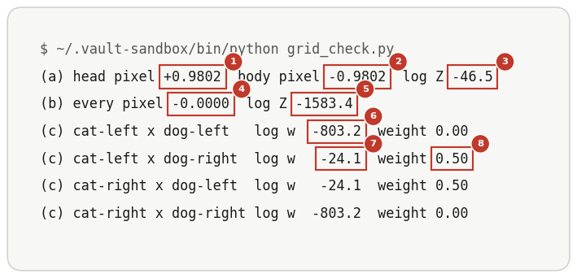

# Kinds Of Composition

Up: [[Composition]] · ⬅️ [[The Product As An Intersection]] · [[The Order Of Multiplying And Noising]] ➡️

Artificial Intelligence, Generative Modeling, Diffusion Models, Composition. Needs: [[Composing Models With A Background]].

> [!question] Test yourself
> [The diffusion models quiz](https://claude.ai/artifact/MyTdAaVfZW3wiqhbLKg4wu) covers this note, with the rest of the [[Diffusion Models]] folder. Your attempts are saved on the page.

> [!warning] Unfinished
> - Prompt 33, the mechanism for [[#Mosaic, blend or two animals from one product]], is stuck after three revisions and waits for a word from the learner: its right number line is not drawn to scale, so the green dot reads about 0.68 where it must be 0.693 and the purple dot about 0.21 where it must be 0.233. The last attempt is `~/.cache/codex-drop/obsidian/parts-world-the-mechanism.png` on mscluster; the prompt is in the vault's `.prompts/Diffusion Models.md`.
> - The overlap-dial idea in the reduce-reuse-recycle repository applies this note in words only.

**"Composition" names at least three different operations, told apart by which variables each expert scores. Co-occurrence is a product over disjoint regions plus a layout. Intersection is a product over the same variables, which is what a product of experts computes. Interaction is the product plus a term that vanishes when the two labels are [conditionally independent](../../../../Mathematics/references/textbooks/machine-learning/mathematics-for-machine-learning.pdf#page=201) given the image.** The operators are *derived* below. The three names are the walk's working names; the field's words for each are in the table.

**When to reach for it.** Before composing two concepts, ask which kind the pair is. A chest drain beside a pneumothorax edge is mostly different pixels, so it is co-occurrence. A shape that is both square-ish and circle-ish is one object scored by both experts, so it is intersection. A wet dog in the rain, or the lung pattern of tuberculosis with silicosis, is a change neither concept shows alone, so it is interaction. Each kind needs different training data and fails differently, and the plain product serves only intersection as written.

| Kind | What it is | The operator | What it needs from training data | How it fails | The field's words |
|---|---|---|---|---|---|
| co-occurrence | two concepts, each whole, each in its own region: a cat beside a dog | $p(\text{layout})\;p_A(x_S \mid \text{layout})\;p_B(x_{S'} \mid \text{layout})$, with $S$ and $S'$ disjoint sets of pixels | each concept alone, at many positions, over varied backgrounds; never the two together | **contention**: both experts score the same pixels, so the product lands on a chimera, the hybrid of the shared case above | Bradley et al.'s co-occurrence and projective composition (*cited*, above); catastrophic neglect when one subject vanishes and failed attribute binding (Chefer et al. 2023, *cited*); concept bleeding and attribute leakage (*stated*: common usage, no single source checked); region-restricted products in MultiDiffusion (Bar-Tal et al. 2023, *cited*) |
| intersection | one thing that satisfies both concepts on the same pixels | $p_A(x)\,p_B(x)$ | each expert must already give the overlap some density; a product intersects supports and creates none, as [[When Neither Training Set Holds A And B]] runs | **empty intersection**: the supports barely meet, so the product peaks in a gap neither expert believes in, the far pair of [[The Product As An Intersection]] | product of experts (Hinton 2002, *cited*); Du et al.'s "intersection" (*cited*, above); Composable Diffusion's AND (Liu et al. 2022, *cited*) |
| interaction | the concepts change each other: rain and a dog give a wet dog | the Bayes composition plus $\log \dfrac{p(A, B \mid x)}{p(A \mid x)\,p(B \mid x)}$ | joint samples showing the change, in whichever model carries it (see below) | **missing interaction**: a dry dog standing in rain | no single name found (*stated*) |

The split and shared toy above is co-occurrence done two ways: split gives each expert its own pixel, which is the operator in the first row, and shared makes both experts score $x_0$, which is contention. The ring-times-bar of Du et al.'s Figure 2, under [[Product, Mixture And Negation]], is an intersection toy: both experts score both coordinates.

**How the interaction term arises.** Write each conditional with [Bayes' rule](../../../../Mathematics/references/textbooks/statistics/introduction-to-probability-for-data-science.pdf#page=105), then divide:

$$
\begin{aligned}
p(x \mid A, B) &= \frac{p(A, B \mid x)\,p(x)}{p(A, B)} \\
\frac{p(x \mid A)\,p(x \mid B)}{p(x)} &= \frac{p(A \mid x)\,p(x)}{p(A)} \cdot \frac{p(B \mid x)\,p(x)}{p(B)} \cdot \frac{1}{p(x)} = \frac{p(A \mid x)\,p(B \mid x)\,p(x)}{p(A)\,p(B)} \\
\frac{p(x \mid A, B)}{p(x \mid A)\,p(x \mid B)/p(x)} &= \frac{p(A, B \mid x)}{p(A \mid x)\,p(B \mid x)} \cdot \frac{p(A)\,p(B)}{p(A, B)}
\end{aligned}
$$

Taking [logs](../../../../Mathematics/references/textbooks/algebra/algebra-handbook.pdf#page=110) turns the products into sums:

$$
\log p(x \mid A, B) = \log p(x \mid A) + \log p(x \mid B) - \log p(x) + \log \frac{p(A, B \mid x)}{p(A \mid x)\,p(B \mid x)} + \log \frac{p(A)\,p(B)}{p(A, B)}
$$

*Derived.* The last term holds no $x$, so its gradient is zero and the score form is exact without it: $\nabla \log p(x \mid A, B) = s(x \mid A) + s(x \mid B) - s(x) + \nabla \log \frac{p(A, B \mid x)}{p(A \mid x)\,p(B \mid x)}$. The interaction term is zero at every $x$ exactly when $p(A, B \mid x) = p(A \mid x)\,p(B \mid x)$ for every $x$, which is Definition 6.11 on the linked page. Composable Diffusion's AND is the first three terms. *Derived.*

<!-- video-table: bayes-theorem rev=1 -->
3Blue1Brown, then StatQuest, on Bayes' theorem, in the order to watch:

| Order | What it covers | Kind | Watch |
|---|---|---|---|
| 1 | From a worked example to the general formula | Intuition | [3Blue1Brown, Bayes theorem, the geometry of changing beliefs, 4:09 to 10:13](https://www.youtube.com/watch?v=HZGCoVF3YvM&t=249s) |
| 2 | Bayes' theorem derived step by step | Proof | [StatQuest, Bayes' Theorem, Clearly Explained, 5:21 to 9:12](https://www.youtube.com/watch?v=9wCnvr7Xw4E&t=321s) |

Both work with events, not densities, so neither divides a conditional density by a prior the way the composition rule does. Times are chapter boundaries read from each video's chapter list, not from captions, so each is good to the chapter and the sentence inside it is not checked.
<!-- /video-table -->

**Where a wet dog has to come from.** When each label is fixed by the image, so $p(A \mid x)$ and $p(B \mid x)$ are each 0 or 1, the joint label is fixed too, $p(A, B \mid x) = p(A \mid x)\,p(B \mid x)$, and the interaction term is zero everywhere. The Bayes composition is then exactly $p(x)$ restricted to images that are both A and B, so wet dogs appear only if $p(x)$, the unconditional model, saw wet dogs. A plain product $p_A\,p_B$ has no $p(x)$ in it, so it can produce a wet dog only if expert A's or expert B's own training images held some. *Derived* from the identity above.


*The kinds of composition as three cards, each showing which pixels each expert scores and its failure.*

## Mosaic, blend or two animals from one product

**The parts world**, also the 16-pixel parts world or the cat-dog parts world, **is a toy where every sample is 16 numbers drawn as a 4 by 4 tile and every expert is a diagonal Gaussian or a mixture of them, so the product of a cat expert and a dog expert is exact. The same product gives a mosaic (a cat head on a dog body), a midpoint blend, or two animals side by side, depending only on which pixels each expert is sure about.** On each pixel the product's mean is the [[Products And Quotients Of Diagonal Gaussians#How the product works|precision-weighted mean]], so the expert with the smaller variance there wins that pixel. *Shown* in the run below and *derived* under "How the parts world works".

<!-- video-table: product-of-two-gaussians rev=1 -->
Michel van Biezen, then Robert Ghrist from the open web, on multiplying two Gaussians, in the order to watch:

| Order | What it covers | Kind | Watch |
|---|---|---|---|
| 1 | The gain is the estimate's error over the sum of both errors, and the new value moves toward the reading by that share, so the surer of the two pulls harder | Intuition | [Van Biezen, Kalman Filter 3 of 55, 0:28 to 3:51](https://www.youtube.com/watch?v=fpRb1sjFz_M&t=28s) |
| 2 | One update with numbers: an estimate of 68 with error 2 and a reading of 75 with error 4 give 70.33 with error 1.33 | Worked example | [Van Biezen, Kalman Filter 6 of 55, 0:13 to 2:14](https://www.youtube.com/watch?v=SIQJaqYVtuE&t=13s) |
| 3 | The product of two one-dimensional Gaussians is a scaled Gaussian, found by simplifying the quadratic in the exponent | Proof, open web | [Ghrist, CalcBLUE 3, 18.4, 0:26 to 4:10](https://www.youtube.com/watch?v=lUORBdNccHc&t=26s) |
| 4 | The same product in several dimensions | Proof, open web | [Ghrist, CalcBLUE 3, 18.4, 4:10 to 5:53](https://www.youtube.com/watch?v=lUORBdNccHc&t=250s) |

Van Biezen works the product as a Kalman filter update and calls the two variances errors: his old value plus the gain times the difference is the precision-weighted mean rearranged, and his new error of 1.33 from 2 and 4 is the two precisions added. No listed creator derives the product of two Gaussian densities, so rows 3 and 4 come from the open web, and no row was found that computes the overlap Z. Rows 1 and 2 are read from automatic captions and good to about 30 seconds; rows 3 and 4 are chapter boundaries, so the sentence inside each is not checked.
<!-- /video-table -->

**When to reach for it.** When a two-dimensional toy has to stand in for an image chimera. A 2D toy holds one number per slot, so the only chimera it can show is a midpoint, as in the shared case of [[Composing Models With A Background#The two-pixel picture]]. Image chimeras are mostly mosaics, where some parts follow the cat and others the dog. *Stated:* the walk's reading of chimera images, not checked against a source. The parts world gives a mosaic, a blend and co-occurrence as exact targets, with no grid and no sampler, so a sampler run on these experts can be scored against them.

**The world.** Pixels 0 to 7 are the top two rows, the head, and pixels 8 to 15 the bottom two rows, the body. The left half is the left two columns. The cat expert's mean is $+1$ on every pixel it is sure of and the dog's is $-1$. Sure means variance 0.01, and loose means variance 1.

| Setting | Cat expert | Dog expert | Training data that would give it |
|---|---|---|---|
| (a) | mean $+1$; variance 0.01 on the head, 1 on the body | mean $-1$; variance 1 on the head, 0.01 on the body | cats whose heads all look alike and whose bodies vary; dogs the other way round |
| (b) | mean $+1$, variance 0.01 on every pixel | mean $-1$, variance 0.01 on every pixel | every cat image alike, every dog image alike |
| (c) | a [mixture](../../../../Mathematics/references/textbooks/machine-learning/mathematics-for-machine-learning.pdf#page=355) with weight 0.5 each: $+1$ and sure on the left half with mean 0 and loose on the right, or the mirror image | the same with $-1$ | each animal photographed in either half of the frame |

<!-- video-table: gaussian-mixture rev=1 -->
ritvikmath on the Gaussian mixture model, in the order to watch:

| Order | What it covers | Kind | Watch |
|---|---|---|---|
| 1 | Each class is its own Gaussian with a mean and a covariance, and π is the share of the data in each class | Intuition | [ritvikmath, Gaussian Mixture Model, 0:31 to 3:33](https://www.youtube.com/watch?v=EWd1xRkyEog&t=31s) |
| 2 | The density of one fish: π for tuna times the tuna Gaussian, plus π for salmon times the salmon Gaussian, because the fish came from one or the other | Worked example | [ritvikmath, Gaussian Mixture Model, 3:36 to 6:23](https://www.youtube.com/watch?v=EWd1xRkyEog&t=216s) |
| 3 | The same sum written for K components | Intuition | [ritvikmath, Gaussian Mixture Model, 7:58 to 8:43](https://www.youtube.com/watch?v=EWd1xRkyEog&t=478s) |

He goes on to fit the mixture with the EM algorithm, which composing experts does not need, and he never multiplies or noises a mixture. Times are read from automatic captions and good to about 30 seconds.
<!-- /video-table -->

**The form.**

```text
one pair:  N(x; mu_a, S_a) N(x; mu_b, S_b) = Z N(x; mu, S)
           S  = (S_a^-1 + S_b^-1)^-1               precisions add, pixel by pixel
           mu = S (S_a^-1 mu_a + S_b^-1 mu_b)      the precision-weighted mean, pixel by pixel
           Z  = N(mu_a; mu_b, S_a + S_b)           how much the two experts overlap
mixtures:  (sum_i pi_i N(mu_i, S_i)) (sum_j rho_j N(nu_j, L_j))  is proportional to  sum_ij w_ij N(x; mu_ij, S_ij)
           w_ij is proportional to pi_i rho_j N(mu_i; nu_j, S_i + L_j)
```

Both lines are derived in [[Products And Quotients Of Diagonal Gaussians#Products of Gaussian mixtures]].

<!-- video-table: product-of-two-mixtures rev=1 -->
Chalmers' multiple object tracking course, from the open web, on multiplying a Gaussian mixture by a second factor, in the order to watch:

| Order | What it covers | Kind | Watch |
|---|---|---|---|
| 1 | Every pair of an old component and a measurement hypothesis becomes one new component, weighted by the old weight times an integral and normalised over all pairs | Intuition, open web | [Chalmers, Gaussian Sum Filtering: Prediction and Update, 2:38 to 3:38](https://www.youtube.com/watch?v=G_X_dMZUkdI&t=158s) |
| 2 | With Gaussian factors the integral is the predicted likelihood, which is the pair's overlap, and each new component's mean and covariance come from a Kalman update | Intuition, open web | [Chalmers, Gaussian Sum Filtering: Prediction and Update, 4:20 to 5:15](https://www.youtube.com/watch?v=G_X_dMZUkdI&t=260s) |
| 3 | Two components and two hypotheses give four numbered components | Worked example, open web | [Chalmers, Gaussian Sum Filtering: Prediction and Update, 6:05 to 7:04](https://www.youtube.com/watch?v=G_X_dMZUkdI&t=365s) |

No listed creator multiplies two mixtures. The second factor in this lecture is a measurement model with a detection probability and clutter rather than a second expert, so read each measurement hypothesis as one component of the second mixture; the Kalman update is the product of the pair's two Gaussians. Times are read from automatic captions and good to about 30 seconds.
<!-- /video-table -->


*Each tile is one image: blue is the cat value $+1$, red the dog value $-1$, grey 0. The first two tiles are the experts' means. The next four are the exact product's means: (a) a cat head on a dog body, (b) all grey, and the two heaviest components of (c), each at weight 0.50.*

**Operate it.** [The parts-world scene](https://claude.ai/artifact/6XzsUMYdEb2eopRyGkpYkh) puts these tiles under four variance sliders, so dragging moves the product from the mosaic of (a) to the blend of (b) while log Z moves with it. A position toggle opens the 2 by 2 grid of component pairs of (c) with their weights ([its pair grid](https://claude.ai/artifact/6XzsUMYdEb2eopRyGkpYkh#p6)), and a noise slider for $\bar\alpha$ sets setting (d)'s summed-score head mean beside the noised product's.


*Sharp means sure. Each product keeps the sharp part from whichever expert is sure of it: the mosaic costs log Z = -46.5, the blend log Z = -1583.4, and in row (c) the frames that put both animals in one half get weight 0.00.*

**Try it yourself.**

> [!warning] Not run through the prepared environment
> The cluster has no `~/.vault-sandbox`. The writer ran these steps as written with the system Python in its place, and the run's `numbers.json` matched the overlap-dial walk's own byte for byte. The next machine with the prepared environment runs them as written.

1. You need the prepared environment with NumPy, SciPy and Matplotlib: `~/.vault-sandbox/bin/python -c "import numpy, scipy, matplotlib"` prints nothing when it is there.
2. If it is missing, make it once: `uv venv ~/.vault-sandbox` then `uv pip install --python ~/.vault-sandbox/bin/python pandas numpy scipy matplotlib statsmodels openpyxl`.
3. Make an empty folder and copy in the script, about 60 lines, which sits beside this note as `sandbox/parts_world.py`:

   ```bash
   mkdir -p ~/playground/sandbox/parts-world && cd ~/playground/sandbox/parts-world
   cp ~/Obsidian/"Artificial Intelligence/Generative Modeling/sandbox/parts_world.py" .
   ls
   ```

   You should see only `parts_world.py`. Its `gauss_product` is the one-pair line of the form, its `mixture_product` multiplies every pair of components and normalises the weights, and the four blocks after them build settings (a), (b), (c) and the noised setting (d) of "How the parts world works".

4. Run it. It takes a few seconds, most of them importing SciPy:

   ```bash
   ~/.vault-sandbox/bin/python parts_world.py
   ```

   It prints the numbers below, saves them as `numbers.json`, and saves the tile picture above as `parts-world-tiles.png`:

   

   > [!example]- The printed text
   > ```
   > {
   >  "a": {
   >   "head_mean": 0.9801980198019802,
   >   "body_mean": -0.9801980198019802,
   >   "logZ": -46.46578749493179
   >  },
   >  "b": {
   >   "mean": 0.0,
   >   "product_sd": 0.07071067811865475,
   >   "logZ": -1583.40683248785,
   >   "sds_from_each_expert": 10.0
   >  },
   >  "c": {
   >   "cat-left x dog-left": {
   >    "weight": 0.0,
   >    "logw_unnorm": -803.213807592922
   >   },
   >   "cat-left x dog-right": {
   >    "weight": 0.5,
   >    "logw_unnorm": -24.089705618427917
   >   },
   >   "cat-right x dog-left": {
   >    "weight": 0.5,
   >    "logw_unnorm": -24.089705618427917
   >   },
   >   "cat-right x dog-right": {
   >    "weight": 0.0,
   >    "logw_unnorm": -803.213807592922
   >   }
   >  },
   >  "d": {
   >   "abar": 0.5,
   >   "head_mean_product_of_noised": 0.23257000444341597,
   >   "head_mean_noised_product": 0.6931046667076061
   >  }
   > }
   > ```

5. Another way, with no formula. Save this as `grid_check.py`. For each kind of pixel it multiplies the two experts' bells on a grid of 120,001 points, reads the product's mean, and adds up the log of each pixel's area over the 16 pixels:

   ```python
   # The parts world with no closed form: each pixel's product on a grid, its mean, and the log of its area.
   import numpy as np

   x = np.linspace(-6, 6, 120001)                       # grid spacing 0.0001
   dx = x[1] - x[0]

   def bell(m, v):
       return np.exp(-(x - m) ** 2 / (2 * v)) / np.sqrt(2 * np.pi * v)

   def pixel(m1, v1, m2, v2):
       """One pixel of a product of two experts: the mean of the product and the log of its area."""
       prod = bell(m1, v1) * bell(m2, v2)
       area = prod.sum() * dx
       return (x * prod).sum() * dx / area, np.log(area)

   # (a) cat tight on the 8 head pixels, dog tight on the 8 body pixels
   head_mean, head_log = pixel(1, 0.01, -1, 1.0)
   body_mean, body_log = pixel(1, 1.0, -1, 0.01)
   print(f"(a) head pixel {head_mean:+.4f}  body pixel {body_mean:+.4f}  log Z {8 * head_log + 8 * body_log:.1f}")

   # (b) both tight on all 16 pixels
   mean_b, log_b = pixel(1, 0.01, -1, 0.01)
   print(f"(b) every pixel {mean_b:+.4f}  log Z {16 * log_b:.1f}")

   # (c) four pairs of placements; each placement has weight 0.5, so each pair starts at log 0.25
   tight_cat, tight_dog, loose = (1, 0.01), (-1, 0.01), (0, 1.0)
   same_half = 8 * pixel(*tight_cat, *tight_dog)[1] + 8 * pixel(*loose, *loose)[1]
   side_by_side = 8 * pixel(*tight_cat, *loose)[1] + 8 * pixel(*loose, *tight_dog)[1]
   logw = np.log(0.25) + np.array([same_half, side_by_side, side_by_side, same_half])
   w = np.exp(logw - logw.max()); w /= w.sum()
   for name, lw, wi in zip(["cat-left x dog-left", "cat-left x dog-right", "cat-right x dog-left", "cat-right x dog-right"], logw, w):
       print(f"(c) {name:21s} log w {lw:7.1f}  weight {wi:.2f}")
   ```

   ```bash
   ~/.vault-sandbox/bin/python grid_check.py
   ```

   

   ```
   (a) head pixel +0.9802  body pixel -0.9802  log Z -46.5
   (b) every pixel -0.0000  log Z -1583.4
   (c) cat-left x dog-left   log w  -803.2  weight 0.00
   (c) cat-left x dog-right  log w   -24.1  weight 0.50
   (c) cat-right x dog-left  log w   -24.1  weight 0.50
   (c) cat-right x dog-right log w  -803.2  weight 0.00
   ```

   Every number agrees with step 4 to the digits shown. `-0.0000` is a tiny negative number left by the grid's rounding, where the closed form gives exactly 0.

6. Clean up, and prove it:

   ```bash
   cd ~ && rm -r ~/playground/sandbox/parts-world
   ls ~/playground/sandbox/parts-world; echo $?
   ```

   You should see `No such file or directory`, then `2`.

**Reading the parts-world output.** The fields of step 4; step 5's marks 1 to 8 are the same numbers rounded.

| # | Field | This run | How to read it | Backing |
|---|---|---|---|---|
| 1 | a, `head_mean` | `0.9801980198019802` | every head pixel follows the cat, at $99/101$ | derived below |
| 2 | a, `body_mean` | `-0.9801980198019802` | every body pixel follows the dog: the mosaic | derived below |
| 3 | a, `logZ` | `-46.46578749493179` | the log of $Z$, how much the two experts overlap, summed over 16 pixels | derived below |
| 4 | b, `mean` | `0.0` | every pixel grey, neither cat nor dog: the blend | derived below |
| 5 | b, `product_sd` | `0.07071067811865475` | the blend is narrow, because two precisions of 100 add to 200 | derived below |
| 6 | b, `logZ` | `-1583.40683248785` | 1536.9 lower than (a): the blend's experts overlap $e^{-1536.9}$ times as much | derived below |
| 7 | b, `sds_from_each_expert` | `10.0` | the blend sits 10 of each expert's standard deviations (0.1) from that expert's mean on every pixel, so neither expert would ever draw an image near it | derived below |
| 8 | c, cat-left x dog-left, `logw_unnorm` | `-803.213807592922` | both animals in the left half: the two sure halves disagree, so this pair barely overlaps. The cat-right x dog-right pair prints the same | derived below |
| 9 | c, cat-left x dog-right, `weight` | `0.5` | after normalising, the two side-by-side pairs hold all the weight, 0.5 each, and the same-half pairs print `0.0` | derived below |
| 10 | c, cat-left x dog-right, `logw_unnorm` | `-24.089705618427917` | each sure half meets the other expert's loose half, so the pair overlaps well: 779.1 above the same-half pairs | derived below |
| 11 | d, `head_mean_product_of_noised` | `0.23257000444341597` | at $\bar\alpha = 0.5$, where summed scores put a head pixel | derived below |
| 12 | d, `head_mean_noised_product` | `0.6931046667076061` | where the correct target at that level puts it | derived below |

**How the parts world works.** Each setting is the identity of the form, applied one pixel at a time, because every covariance is diagonal. Per pixel the precision is one over the variance: 100 for a sure pixel, 1 for a loose one.

Setting (a), a head pixel and a body pixel:

$$
\mu_\text{head} = \frac{100 \cdot (+1) + 1 \cdot (-1)}{100 + 1} = \frac{99}{101} = 0.980198, \qquad
\mu_\text{body} = \frac{1 \cdot (+1) + 100 \cdot (-1)}{1 + 100} = -0.980198
$$

with variance $1/101 = 0.0099$ on every pixel. Each pixel's overlap is $Z = \mathcal{N}(1; -1, 1.01)$, and [the log of a product](../../../../Mathematics/references/textbooks/algebra/algebra-handbook.pdf#page=110) is the sum of the logs, so over 16 pixels

$$
\log Z = 16 \left( -\tfrac12 \log(2\pi \cdot 1.01) - \frac{(1 - (-1))^2}{2 \cdot 1.01} \right) = 16\,(-0.923914 - 1.980198) = 16 \cdot (-2.904112) = -46.465787
$$

Setting (b), every pixel alike:

$$
\mu = \frac{100 \cdot (+1) + 100 \cdot (-1)}{200} = 0, \qquad \sigma = \sqrt{1/200} = 0.070711, \qquad \frac{1 - 0}{\sqrt{0.01}} = 10
$$

$$
\log Z = 16 \left( -\tfrac12 \log(2\pi \cdot 0.02) - \frac{4}{0.04} \right) = 16\,(1.037073 - 100) = 16 \cdot (-98.962927) = -1583.406832
$$

The product is well defined and narrow, and it sits 10 standard deviations from each expert on every pixel, where each expert's height is $e^{-50}$ of its own peak. This is the midpoint chimera of [[Composing Models With A Background#The two-pixel picture]]'s shared case, and the empty intersection of the far pair in [[The Product As An Intersection]], in sixteen dimensions.

Setting (c), the four pairs of placements. Each pair starts at $\log(0.5 \cdot 0.5) = -1.386294$ and adds its per-pixel overlaps. A side-by-side pair, such as cat left and dog right, puts a sure $\pm 1$ against a loose 0 on every pixel:

$$
\log w = -1.386294 + 16 \left( -\tfrac12 \log(2\pi \cdot 1.01) - \frac{1}{2 \cdot 1.01} \right) = -1.386294 + 16\,(-1.418963) = -24.089706
$$

A same-half pair puts sure $+1$ against sure $-1$ on 8 pixels and loose 0 against loose 0 on the other 8:

$$
\log w = -1.386294 + 8\,(-98.962927) + 8 \left( -\tfrac12 \log(4\pi) \right) = -1.386294 - 791.703416 - 10.124097 = -803.213807
$$

The gap is $779.124$, so a same-half pair carries $e^{-779}$ of a side-by-side pair's weight, and normalising gives $0, 0.5, 0.5, 0$. A side-by-side component's mean is $100/101 = 0.990$ on its cat half and $-0.990$ on its dog half, the two animals in the tiles. *Derived.* The weights come from the same $Z$ that measured (b)'s blend. The operator did not change: the training data showed each animal in more than one place, which gave the product a pair of components where the two animals do not compete for pixels.

Setting (d), setting (a) halfway through reverse diffusion. [[The Forward Process]] turns $\mathcal{N}(\mu, v)$ into $\mathcal{N}(\sqrt{\bar\alpha}\,\mu,\ \bar\alpha v + 1 - \bar\alpha)$, because [variances add](../../../../Mathematics/references/textbooks/linear-algebra/matrix-cookbook.pdf#page=41) when independent noise is added. At $\bar\alpha = 0.5$ a head pixel's cat becomes $\mathcal{N}(0.707107, 0.505)$ and its dog $\mathcal{N}(-0.707107, 1.0)$, so the cat's precision lead falls from $100 : 1$ to $1.980 : 1$. The product of the noised experts, which is what summed scores follow ([[The Order Of Multiplying And Noising]], equation 12), puts the head at

$$
\frac{1.980198 \cdot 0.707107 + 1 \cdot (-0.707107)}{1.980198 + 1} = 0.232570,
$$

while the noised product, the target the reverse process needs at this level (equation 11), puts it at $\sqrt{0.5} \cdot 0.980198 = 0.693105$. *Derived*, and the run's fields 11 and 12 agree. Halfway through sampling, summed scores put the head pixel 0.46 below the correct target, two thirds of the way from it to the grey blend's 0. How much of the mosaic a full reverse run keeps at $\bar\alpha = 1$ is not computed here. [[Annealed MCMC]] targets each level's noised product directly, which is the sampler-side repair. *Cited:* Du et al., section 4, equations 11 and 12.

<!-- video-table: forward-process rev=1 -->
Stanford CS236, then Vizuara, on the forward process, in the order to watch:

| Order | What it covers | Kind | Watch |
|---|---|---|---|
| 1 | The noising process that turns data into noise | Intuition | [Stanford CS236, lecture 16, 12:22 to 16:23](https://www.youtube.com/watch?v=VsllsC2JMGY&t=742s) |
| 2 | Many small noising steps combined into one transition to any noise level | Proof | [Stanford CS236, lecture 16, 16:23 to 19:05](https://www.youtube.com/watch?v=VsllsC2JMGY&t=983s) |
| 3 | Why each step scales the mean down as well as adding noise | Intuition | [Vizuara, Principles of Diffusion Models, lecture 3, 33:51 to 42:46](https://www.youtube.com/watch?v=Dx-1agEjlJs&t=2031s) |

Vizuara is added for row 3, which no CS236 chapter covers; neither noises a two-dimensional Gaussian cloud and checks the closed form. Times are chapter boundaries read from each video's chapter list, not from captions, so each is good to the chapter and the sentence inside it is not checked.
<!-- /video-table -->

> 🖼️ **Picture on its way**: one head pixel's two precision bars, 100 against 1 on clean data and 1.98 against 1 at noise level 0.5, with the head's value on a number line from -1 to 1 at 0.980, 0.693 and 0.233. <!-- slot: assets/parts-world-the-mechanism.webp · prompt: .prompts/Diffusion Models.md#prompt-33-subject-the-parts-world-the-mechanism -->

**Other ways to make a chimera exact.**

- **The two-pixel picture**, [[Composing Models With A Background#The two-pixel picture]]: two numbers per sample, so a chimera can only be a midpoint, and a mosaic has nowhere to sit.
- **The four-quadrant answer key**, [[When Neither Training Set Holds A And B#The four-quadrant answer key]]: exact shares on a 2D grid, for asking where the product's mass goes rather than what one sample looks like.
- **Trained experts on real images**: the real case, with no exact target to score a sampler against.

**Why the parts world matters.** Whether a cat-dog product gives a mosaic, a blend or two animals is fixed by where each expert's training data was consistent, before any sampler runs. In (a) both experts score all 16 pixels, with no partition in the operator, and the product is still a mosaic: an expert that is loose on a part leaves that part to the other, the way this note's co-occurrence row needs. The blend in (b) is what a product gives when both experts are sure everywhere, and its $\log Z$ of $-1583.4$ says so before anyone looks at a sample. Setting (d) shows that a sampler following summed scores can still drag a correct mosaic toward the blend along the way.

> [!note]- How this was checked
> Kinds Of Composition and [[What An Expert Learns From Its Training Set]] were written on 2026-10-14 on the cluster (mscluster, Linux), from one turn of the overlap-dial `drip-idea` walk. Nothing in them was run: the cluster has no `~/.vault-sandbox`, so `labels.py` and its expected output are worked by hand in [[What An Expert Learns From Its Training Set#How the expert's training set works]], and the section stays in the unfinished box until a machine with the environment runs it. The identity for the interaction term is derived in the note; the walk's own draft, `composition-terms.md` in the research repository, writes it without the constant $\log \frac{p(A)\,p(B)}{p(A, B)}$, which changes the density and not the score. The textbook pages were opened before linking: Bayes' theorem on page 105 of the probability book (Theorem 2.7), conditional independence on page 201 of Mathematics for Machine Learning (Definition 6.11), log rules on page 110 of the algebra handbook. The arXiv abstracts of Liu et al., Chefer et al., Bar-Tal et al. and Geirhos et al. were fetched on 2026-10-14, and the quoted phrases ("catastrophic neglect", attribute binding, the definition of shortcuts) are from them; Hinton 2002's DOI resolved to Neural Computation 14(8), pages 1771 to 1800. Ho et al.'s equation (14) and section 3.2 are cited from the paper as already listed, not re-read in this session. No old LibreOffice note was read: `/mnt/c/Users/molef/LibreOffice/Learning/` does not exist on the cluster.
>
> [[#Mosaic, blend or two animals from one product]] was added on 2026-10-17 on the cluster (mscluster, Linux), from the `example 9` turn of the overlap-dial `drip-idea` walk. `sandbox/parts_world.py` beside this note is the walk's `parts_world.py`, byte for byte (`cmp`), the script that wrote the walk's `numbers.json` with `/home-mscluster/mmolefe/miniforge3/envs/co3/bin/python`. The cluster has no `~/.vault-sandbox`, so the writer ran steps 3 to 6 as written with the system `python3` (Python 3.12.10, NumPy 2.4.3, SciPy 1.17.1, Matplotlib 3.10.8) in place of `~/.vault-sandbox/bin/python`, in the empty folder `~/playground/sandbox/parts-world`, which is not inside any repository. `parts_world.py` ran in 14.0 seconds and `grid_check.py` in 0.14 seconds. The run's `numbers.json` and `parts-world-tiles.png` were identical to the walk's files (`cmp`), and the clean-up check returned 2. The printed text and `grid_check.py` on the page were compared with the files that ran, by script, and match. Every derived number was recomputed by the writer in Python: the per-pixel logs $-2.904112$, $-98.962927$, $-1.418963$ and $-1.265512$, the gap $779.124$, the noised precision $1.980198$ and the head means $0.232570$ and $0.693105$. The tile picture is the script's own saved figure, and the two terminal pictures were rendered from the captured text by a script in DejaVu Sans Mono with the system `python3` and Matplotlib, never drawn; all three were opened before filing. The textbook pages were opened before linking, with PyMuPDF: Mathematics for Machine Learning page 355 (section 11.1, the mixture model, equation 11.1), the Matrix Cookbook page 41 (section 8.1.4, a linear combination of Gaussians, equation 355) and the algebra handbook page 110 (the log of a product is the sum of the logs). No old LibreOffice note was read: `/mnt/c/Users/molef/LibreOffice/Learning/` does not exist on the cluster.
