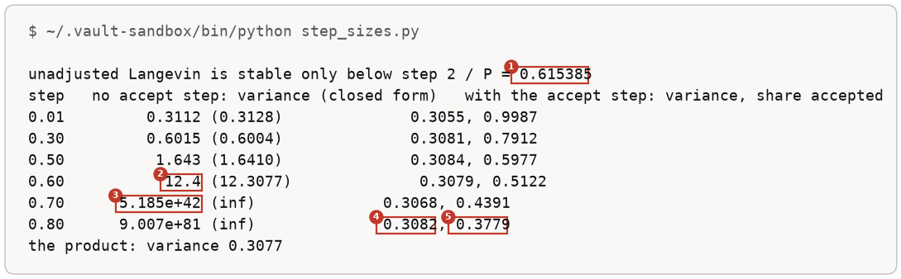
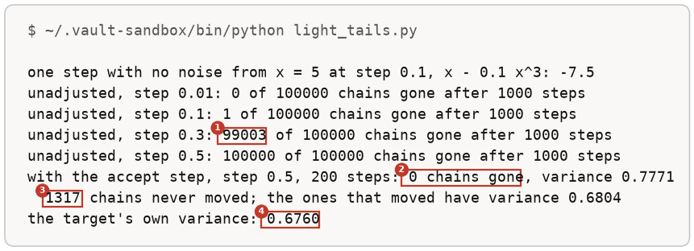
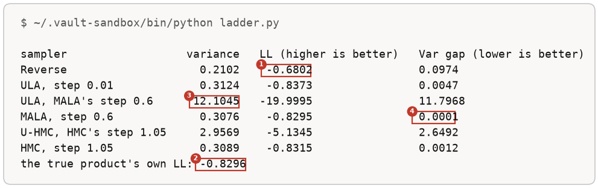

# More Runs Of The Energy Parameterisation

Up: [[Composition]] · ⬅️ [[The Energy Parameterisation]] · [[Product, Mixture And Negation]] ➡️

Artificial Intelligence, Generative Modeling, Diffusion Models, Composition. Needs: [[The Energy Parameterisation]], whose setup these runs reuse.

> [!question] Test yourself
> [The diffusion models quiz](https://claude.ai/artifact/MyTdAaVfZW3wiqhbLKg4wu) covers the [[Diffusion Models]] folder. This note's runs are not in it yet.

**Five more runs on the energy-parameterised experts of [[The Energy Parameterisation]]: one accept step traced by hand, why a mixture needs the heights, the step size with and without the accept step, a target with light tails, and the paper's Table 1 rerun on the pair.** Each run is followed by its output read field by field.

## Where you work

The same folder as [[The Energy Parameterisation#Try the energy yourself]]: its steps 1 to 3 make the folder and `experts.py`, which every run below imports, and its step 9 cleans up afterwards.

## Table of contents

- [[#One proposal, by hand]]
- [[#A mixture needs the heights]]
- [[#Step size, with and without the accept step]]
- [[#Light tails]]
- [[#Table 1 on the pair]]

## One proposal, by hand

Navigation: 📋 [[#Table of contents|TOC]] | [[#A mixture needs the heights]] ➡️

Fix the noise draw at 0.5 and trace one MALA step from $x = 1.5$, so every number can be checked on paper. Save this as `one_proposal.py`:

```python
import numpy as np
from mala import energy, summed_score, log_k, step

x = np.array([[1.5]])
z = 0.5                                                        # the noise draw, fixed for the hand check
prop = x + step * summed_score(x) + np.sqrt(2 * step) * z
d_f = energy(prop) - energy(x)
d_k = log_k(x, prop) - log_k(prop, x)
print(f"summed score at 1.5: {summed_score(x)[0, 0]:.6f}, proposal: {prop[0, 0]:.6f}")
print(f"f(proposal) - f(x): {d_f[0]:.6f}")
print(f"log k(x | proposal) - log k(proposal | x): {d_k[0]:.6f}")
print(f"accept probability: min(1, exp({(d_f + d_k)[0]:.6f})) = {min(1.0, float(np.exp((d_f + d_k)[0]))):.6f}")
```

```bash
~/.vault-sandbox/bin/python one_proposal.py
```

You should see:


### Reading one_proposal.py

| # | Field | This run | How to read it | Backing |
|---|---|---|---|---|
| 1 | proposal | `1.161107` | $1.5 + 0.1 \times (-5.625) + \sqrt{0.2} \times 0.5$ | derived below |
| 2 | height change | `1.719645` | the proposal sits higher on the product than the start | derived below |
| 3 | asymmetry of the move | `-1.440203` | moving back from 1.161107 to 1.5 is less likely than moving forward | derived below |
| 4 | accept probability | `1.000000` | $e^{0.279442} = 1.32$ is above 1, so the move is always kept | derived below |

## A mixture needs the heights

Navigation: ⬅️ [[#One proposal, by hand]] | 📋 [[#Table of contents|TOC]] | [[#Step size, with and without the accept step]] ➡️

The slope of $\tfrac12 q_a + \tfrac12 q_b$ at 0, between the experts, three ways. Save this as `mixture.py`:

```python
import numpy as np
from experts import experts, expert_energy, expert_score

x = np.array([[0.0]])                                          # between the two experts
f = np.array([expert_energy(x, m, v) for m, v in experts])[:, 0]
log_z = np.array([0.5 * np.log(2 * np.pi * v) for m, v in experts])
s = np.array([expert_score(x, m, v) for m, v in experts])[:, 0, 0]
print(f"slopes at 0: expert a {s[0]:.6f}, expert b {s[1]:.6f}")
for name, log_h in [("from f, normalisers dropped", f), ("from f - log Z, true heights", f - log_z)]:
    share = np.exp(log_h) / np.exp(log_h).sum()
    print(f"{name:29s} shares {share.round(6)}  mixture slope {(share * s).sum():.6f}")
print(f"{'fixed weights of one half':29s} shares [0.5 0.5]  mixture slope {s.mean():.6f}")
mix = lambda z: sum(np.exp(expert_energy(z, m, v)) / np.sqrt(2 * np.pi * v) for m, v in experts)
h = 1e-5
print(f"slope of the true mixture's log, difference quotient: {((np.log(mix(x + h)) - np.log(mix(x - h))) / (2 * h))[0]:.6f}")
```

```bash
~/.vault-sandbox/bin/python mixture.py
```

You should see:


Only the true heights give the true slope. The two slopes are fixed numbers, -2 and 1.25; what changes the answer is how much weight each gets, and the weight is a height.

### Reading mixture.py

| # | Field | This run | How to read it | Backing |
|---|---|---|---|---|
| 1 | normalisers dropped | `-0.073834` | weights from $e^{f}$ alone give expert a a share of 0.407 instead of 0.465 | derived below |
| 2 | true heights | `-0.261437` | the true mixture's slope | derived below |
| 3 | fixed half weights | `-0.375000` | the average of -2 and 1.25; a fixed weighting of scores cannot follow the shares as they change along the axis | derived below |
| 4 | difference quotient | `-0.261437` | measured on the mixture's own log; agrees with field 2 | shown |

## Step size, with and without the accept step

Navigation: ⬅️ [[#A mixture needs the heights]] | 📋 [[#Table of contents|TOC]] | [[#Light tails]] ➡️

[[The Energy Parameterisation#Try the energy yourself|Steps 5 and 6]] at six step sizes, 200 steps each, on the clean product. Save this as `step_sizes.py`:

```python
import numpy as np
from experts import energy, summed_score

P = 1 / 0.5 + 1 / 0.8                                       # the product's precision, 3.25
print(f"unadjusted Langevin is stable only below step 2 / P = {2 / P:.6f}")


def run(step, accept_step, n_steps=200):
    rng = np.random.default_rng(0)
    x = rng.standard_normal((100_000, 1))
    log_k = lambda to, fr: (-(to - fr - step * summed_score(fr)) ** 2).sum(-1) / (4 * step)
    kept = []
    with np.errstate(over="ignore", invalid="ignore"):
        for k in range(n_steps):
            prop = x + step * summed_score(x) + np.sqrt(2 * step) * rng.standard_normal(x.shape)
            if not accept_step:
                x = prop
                continue
            log_a = energy(prop) - energy(x) + log_k(x, prop) - log_k(prop, x)
            accept = np.log(rng.random(len(x))) < log_a
            x = np.where(accept[:, None], prop, x)
            kept.append(accept.mean())
    return x.var(), np.mean(kept[-100:]) if kept else None


print("step   no accept step: variance (closed form)   with the accept step: variance, share accepted")
for step in (0.01, 0.3, 0.5, 0.6, 0.7, 0.8):
    v_ula, _ = run(step, False)
    v_mala, rate = run(step, True)
    closed = 1 / (P * (1 - step * P / 2)) if step < 2 / P else float("inf")
    print(f"{step:4.2f}   {v_ula:12.4g} ({closed:.4f})              {v_mala:.4f}, {rate:.4f}")
print("the product: variance 0.3077")
```

```bash
~/.vault-sandbox/bin/python step_sizes.py
```

You should see:



Without the accept step the width follows the closed form up to step 0.6 and runs away beyond 0.615. With it, every row ends within 0.0022 of the product's 0.3077, inside the sampling tolerance of 0.0041, and the only thing the step size changes is how many proposals are kept.

### Reading step_sizes.py

| # | Field | This run | How to read it | Backing |
|---|---|---|---|---|
| 1 | the stability limit | `0.615385` | $2 / P = 2 / 3.25$: below it an unadjusted chain settles, above it it runs away | derived below |
| 2 | no accept step, step 0.6: variance | `12.4` | the closed form says 12.3077, forty times the product's width, just under the limit | derived below |
| 3 | no accept step, step 0.7: variance | `5.185e+42` | past the limit every step multiplies the spread; after 200 steps it is astronomical | derived below |
| 4 | with the accept step, step 0.8: variance | `0.3082` | still the product's width, at a step past the limit | shown; `checks/mala_step.out` has 0.3088 after 50 steps |
| 5 | with the accept step, step 0.8: share accepted | `0.3779` | 38% of proposals kept; the step size now trades only how fast chains move | shown; `checks/mala_step.out` has 0.3782 |

## Light tails

Navigation: ⬅️ [[#Step size, with and without the accept step]] | 📋 [[#Table of contents|TOC]] | [[#Table 1 on the pair]] ➡️

A target whose tails fall faster than a Gaussian's, $q(x) \propto e^{-x^4/4}$, with score $-x^3$. Save this as `light_tails.py`:

```python
import numpy as np

# target proportional to exp(-x^4 / 4): its score is -x^3, and its tails fall faster than a Gaussian's
print("one step with no noise from x = 5 at step 0.1, x - 0.1 x^3:", 5 - 0.1 * 5 ** 3)
for step in (0.01, 0.1, 0.3, 0.5):
    rng = np.random.default_rng(0)
    x = rng.standard_normal(100_000)
    with np.errstate(over="ignore", invalid="ignore"):
        for k in range(1000):
            x = x - step * x ** 3 + np.sqrt(2 * step) * rng.standard_normal(x.shape)
    gone = ~np.isfinite(x) | (np.abs(x) > 1e6)
    print(f"unadjusted, step {step}: {gone.sum()} of 100000 chains gone after 1000 steps")
rng = np.random.default_rng(0)
x = start = rng.standard_normal(100_000)
step, moved = 0.5, np.zeros(100_000, dtype=int)
log_k = lambda to, fr: -(to - fr + step * fr ** 3) ** 2 / (4 * step)
for k in range(200):
    prop = x - step * x ** 3 + np.sqrt(2 * step) * rng.standard_normal(x.shape)
    accept = np.log(rng.random(x.shape)) < -prop ** 4 / 4 + x ** 4 / 4 + log_k(x, prop) - log_k(prop, x)
    x = np.where(accept, prop, x)
    moved += accept
print(f"with the accept step, step 0.5, 200 steps: {(np.abs(x) > 1e6).sum()} chains gone, variance {x.var():.4f}")
print(f"  {(moved == 0).sum()} chains never moved; the ones that moved have variance {x[moved > 0].var():.4f}")
g = np.linspace(-6, 6, 120001)
p = np.exp(-g ** 4 / 4)
print(f"the target's own variance: {(g ** 2 * p).sum() / p.sum():.4f}")
```

```bash
~/.vault-sandbox/bin/python light_tails.py
```

You should see:



Unadjusted Langevin loses one chain in 100,000 at step 0.1 and 99,003 at step 0.3. With the accept step at 0.5 none fly off. 1,317 chains had every proposal rejected in 200 steps and sit where they started, which leaves the overall variance at 0.7771. Their starting points all lie between 2.41 and 4.73 from 0 (`checks/ula_light_tails.out`, the same seed). The chains that moved have 0.6804 against the target's 0.6760.

### Reading light_tails.py

| # | Field | This run | How to read it | Backing |
|---|---|---|---|---|
| 1 | unadjusted, step 0.3: chains gone | `99003` | 99% of chains past $10^6$ from 0 or overflowed after 1,000 steps | shown; the same figure as `checks/ula_light_tails.out` |
| 2 | with the accept step, step 0.5 | `0 chains gone` | every proposal that lands far out is rejected, because the target's height there is tiny | derived below |
| 3 | chains that never moved | `1317` | started far enough out that every proposal overshot and was rejected; they still carry their starting points | shown |
| 4 | the target's own variance | `0.6760` | a sum of $x^2 e^{-x^4/4}$ over a fine axis; the moving chains' 0.6804 is near it | shown |

## Table 1 on the pair

Navigation: ⬅️ [[#Light tails]] | 📋 [[#Table of contents|TOC]]

The paper's Table 1 compares samplers by a log-likelihood column, LL, and a variance column. This runs its samplers on the pair with exact scores, every row seeded the same, through Algorithm 1 with 10 Langevin steps or 3 HMC steps of 3 leapfrog steps per level, the counts of the paper's appendix F. MALA's step 0.6 and HMC's 1.05 are fixed across levels and chosen so that about 63% and 74% of proposals are accepted on average (`checks/sampler_ladder.out`), near the 60% and 70% that appendix B.3 aims for; the paper instead scales each level's step with $\beta_t$. LL here is the mean log height of the samples under the true product; Var gap is the size of the difference between the samples' variance and the product's. Save this as `ladder.py`:

```python
import numpy as np
from experts import energy, summed_score

T = 100                                                     # the cosine schedule of the two-orders section
u = np.arange(T + 1) / T
ac = np.cos((u + 0.008) / 1.008 * np.pi / 2) ** 2
ac = ac / ac[0]
betas = np.concatenate([[0.0], np.clip(1 - ac[1:] / ac[:-1], 0, 0.999)])
abars = np.cumprod(1 - betas)
VP = 1 / (1 / 0.5 + 1 / 0.8)                               # the product: precisions add
MP = VP * (-1 / 0.5 + 1 / 0.8)


def reverse(rng):
    x = rng.standard_normal((100_000, 1))
    for t in range(T, 0, -1):
        x = (x + betas[t] * summed_score(x, abars[t])) / np.sqrt(1 - betas[t]) + np.sqrt(betas[t]) * rng.standard_normal(x.shape)
    return x


def langevin(x, ab, step, rng, adjust):
    prop = x + step * summed_score(x, ab) + np.sqrt(2 * step) * rng.standard_normal(x.shape)
    if not adjust:
        return prop
    log_k = lambda to, fr: (-(to - fr - step * summed_score(fr, ab)) ** 2).sum(-1) / (4 * step)
    log_a = energy(prop, ab) - energy(x, ab) + log_k(x, prop) - log_k(prop, x)
    return np.where((np.log(rng.random(len(x))) < log_a)[:, None], prop, x)


def hmc(x, ab, eps, rng, adjust):
    p = rng.standard_normal(x.shape)
    xn, pn = x, p
    for i in range(3):                                      # 3 leapfrog steps
        pn = pn + 0.5 * eps * summed_score(xn, ab)
        xn = xn + eps * pn
        pn = pn + 0.5 * eps * summed_score(xn, ab)
    log_a = energy(xn, ab) - (pn ** 2).sum(-1) / 2 - energy(x, ab) + (p ** 2).sum(-1) / 2
    keep = (np.log(rng.random(len(x))) < log_a) | (not adjust)
    return np.where(keep[:, None], xn, x)


def annealed(kernel, n_steps, rng):
    """Algorithm 1: every level from noisiest to clean, n_steps of the kernel, the cloud carried down."""
    x = rng.standard_normal((100_000, 1))
    for t in range(T, -1, -1):
        for i in range(n_steps):
            x = kernel(x, abars[t], rng)
    return x


rows = [
    ("Reverse", reverse),
    ("ULA, step 0.01", lambda r: annealed(lambda x, ab, g: langevin(x, ab, 0.01, g, False), 10, r)),
    ("ULA, MALA's step 0.6", lambda r: annealed(lambda x, ab, g: langevin(x, ab, 0.6, g, False), 10, r)),
    ("MALA, step 0.6", lambda r: annealed(lambda x, ab, g: langevin(x, ab, 0.6, g, True), 10, r)),
    ("U-HMC, HMC's step 1.05", lambda r: annealed(lambda x, ab, g: hmc(x, ab, 1.05, g, False), 3, r)),
    ("HMC, step 1.05", lambda r: annealed(lambda x, ab, g: hmc(x, ab, 1.05, g, True), 3, r)),
]
print("sampler                  variance   LL (higher is better)   Var gap (lower is better)")
for name, run in rows:
    x = run(np.random.default_rng(0))
    ll = np.mean(-0.5 * np.log(2 * np.pi * VP) - (x - MP) ** 2 / (2 * VP))
    print(f"{name:24s} {x.var():8.4f}   {ll:8.4f}                {abs(x.var() - VP):.4f}")
print(f"the true product's own LL: {-0.5 * np.log(2 * np.pi * np.e * VP):.4f}")
```

```bash
~/.vault-sandbox/bin/python ladder.py
```

You should see:



By the variance gap the adjusted samplers win: MALA 0.0001, HMC 0.0012, against ULA at a small step 0.0047 and the reverse process 0.0974. By LL the reverse process looks best of all, which is wrong; [[Step Size And The Accept Step]] works out why.

### Reading ladder.py

| # | Field | This run | How to read it | Backing |
|---|---|---|---|---|
| 1 | Reverse: LL | `-0.6802` | higher than the true product's own LL, field 2, for a cloud 32% too narrow | derived below |
| 2 | the true product's own LL | `-0.8296` | $-\tfrac12 \log(2\pi e \times 0.307692)$: the LL of perfect samples | derived below |
| 3 | ULA at MALA's step 0.6: variance | `12.1045` | an unadjusted chain at the adjusted sampler's step size, just under the 0.615 limit at the clean level | shown; the same figure as `checks/sampler_ladder.out` |
| 4 | MALA: Var gap | `0.0001` | the accept step holds the width at a step 60 times larger than ULA's 0.01 | shown |

> [!note]- How this was checked
> These runs were made with the rest of [[The Energy Parameterisation]], in the same folder and environment; the box at the end of that note says where, on what and when.
