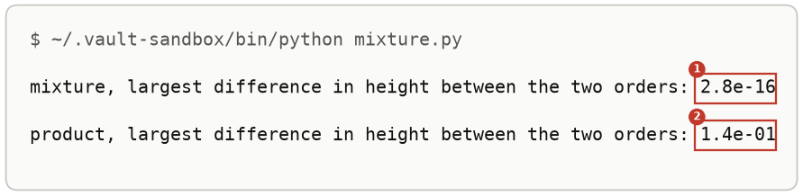
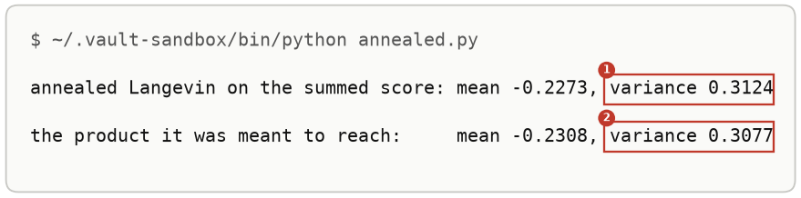
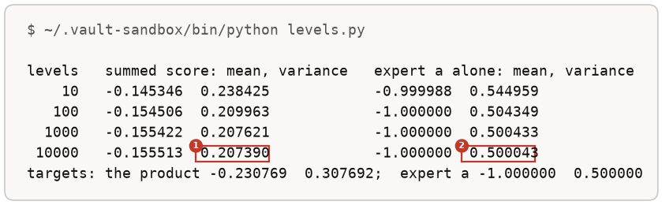
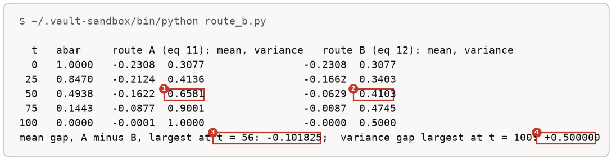

# More Runs Of The Two Orders

Up: [[Composition]] · ⬅️ [[The Order Of Multiplying And Noising]] · [[The Energy Parameterisation]] ➡️

Artificial Intelligence, Generative Modeling, Diffusion Models, Composition. Needs: [[The Order Of Multiplying And Noising]], whose setup these runs reuse.

> [!question] Test yourself
> [The diffusion models quiz](https://claude.ai/artifact/MyTdAaVfZW3wiqhbLKg4wu) covers the [[Diffusion Models]] folder. This note's runs are not in it yet.

**Five more runs on the two experts of [[The Order Of Multiplying And Noising]], each answering one question the main runs leave open: does a mixture's order matter, does a sampler reach the product with the same summed score, would more levels fix the reverse process, where along the levels the two orders part, and how steps per level trade against step size.** Each run is followed by its output read field by field.

## Where you work

The same folder as [[The Order Of Multiplying And Noising#Try the two orders yourself]]: its steps 1 to 3 make the folder and `experts.py`, which every run below imports, and its step 9 cleans up afterwards.

## Table of contents

- [[#A mixture against a product]]
- [[#A sampler that reaches the product with the same summed score]]
- [[#More levels do not help]]
- [[#Route A and route B, level by level]]
- [[#Steps per level against step size]]

## A mixture against a product

Navigation: 📋 [[#Table of contents|TOC]] | [[#A sampler that reaches the product with the same summed score]] ➡️

The same grid, with the experts averaged instead of multiplied. Save this as `mixture.py`:

```python
import numpy as np
from experts import experts

x = np.linspace(-8, 8, 1601)
dx = x[1] - x[0]
abar = 0.5


def gauss(z, m, v):
    return np.exp(-(z - m) ** 2 / (2 * v)) / np.sqrt(2 * np.pi * v)


(ma, va), (mb, vb) = experts
qa, qb = gauss(x, ma, va), gauss(x, mb, vb)
K = gauss(x[:, None], np.sqrt(abar) * x[None, :], 1 - abar)
mix_then_noise = K @ (0.5 * qa + 0.5 * qb) * dx
noise_then_mix = 0.5 * (K @ qa * dx) + 0.5 * (K @ qb * dx)
print(f"mixture, largest difference in height between the two orders: {np.abs(mix_then_noise - noise_then_mix).max():.1e}")
mult_then_noise = K @ (qa * qb) * dx
noise_then_mult = (K @ qa * dx) * (K @ qb * dx)
a = mult_then_noise / (mult_then_noise.sum() * dx)
b = noise_then_mult / (noise_then_mult.sum() * dx)
print(f"product, largest difference in height between the two orders: {np.abs(a - b).max():.1e}")
```

```bash
~/.vault-sandbox/bin/python mixture.py
```

You should see:



For the mixture the difference is rounding error. For the product it is 0.14 in height, on curves whose peaks are about 0.5 to 0.6 high.

### Reading mixture.py

field 1, `2.8e-16`, is floating-point rounding, so the mixture's two orders are the same curve. Field 2, `1.4e-01`, is the largest height difference between the product's two orders, both normalised to area 1.

## A sampler that reaches the product with the same summed score

Navigation: ⬅️ [[#A mixture against a product]] | 📋 [[#Table of contents|TOC]] | [[#More levels do not help]] ➡️

Annealed Langevin, the paper's Algorithm 1 with the Langevin step as its kernel: at every level, noisiest first, take ten small steps along the summed score, each with fresh noise, then carry the cloud to the next level unchanged. Save this as `annealed.py`:

```python
import numpy as np
from experts import experts, product, summed_score, T, abars

rng = np.random.default_rng(0)
x = rng.standard_normal((100_000, 1))
step = 0.01
for t in range(T, -1, -1):                                 # every level, noisiest first
    for i in range(10):                                    # ten Langevin steps at that level
        x = x + step * summed_score(x, abars[t]) + np.sqrt(2 * step) * rng.standard_normal(x.shape)
m, v = product(*experts[0], *experts[1])
print(f"annealed Langevin on the summed score: mean {x.mean():.4f}, variance {x.var():.4f}")
print(f"the product it was meant to reach:     mean {m:.4f}, variance {v:.4f}")
```

```bash
~/.vault-sandbox/bin/python annealed.py
```

You should see:



The same scores as [[The Order Of Multiplying And Noising#Try the two orders yourself|step 5]], a different sampler, and the cloud lands within 1.5% of the product's variance. It costs 1,010 score evaluations per point against the reverse process's 100.

## More levels do not help

Navigation: ⬅️ [[#A sampler that reaches the product with the same summed score]] | 📋 [[#Table of contents|TOC]] | [[#Route A and route B, level by level]] ➡️

[[The Order Of Multiplying And Noising#Try the two orders yourself|Step 5]] used 100 levels. If its 32% error came from steps that are too coarse, more levels would shrink it. Each reverse step on a Gaussian cloud is a linear map plus fresh noise, so the cloud's mean and variance can be followed exactly instead of sampled, and 10,000 levels cost nothing. Save this as `levels.py`:

```python
import numpy as np
from experts import experts, noised


def schedule(T):
    """The cosine schedule of experts.py, with T levels in place of 100."""
    u = np.arange(T + 1) / T
    ac = np.cos((u + 0.008) / 1.008 * np.pi / 2) ** 2
    ac = ac / ac[0]
    betas = np.concatenate([[0.0], np.clip(1 - ac[1:] / ac[:-1], 0, 0.999)])
    return betas, np.cumprod(1 - betas)


def reverse_exact(T, which):
    """The reverse process's mean and variance, followed exactly. The score is -P x + b at every level."""
    betas, abars = schedule(T)
    m, v = 0.0, 1.0                                         # start from pure noise
    for t in range(T, 0, -1):
        parts = [noised(mu, var, abars[t]) for mu, var in which]
        P = sum(1 / vt for mt, vt in parts)                 # precisions add
        b = sum(mt / vt for mt, vt in parts)
        c = 1 - betas[t] * P                                # x + beta * score = c x + beta b
        m = (c * m + betas[t] * b) / np.sqrt(1 - betas[t])
        v = c ** 2 * v / (1 - betas[t]) + betas[t]
    return m, v


print("levels   summed score: mean, variance   expert a alone: mean, variance")
for T in (10, 100, 1000, 10000):
    ms, vs = reverse_exact(T, experts)
    ma, va = reverse_exact(T, experts[:1])
    print(f"{T:6d}   {ms:+.6f}  {vs:.6f}            {ma:+.6f}  {va:.6f}")
print("targets: the product -0.230769  0.307692;  expert a -1.000000  0.500000")
```

```bash
~/.vault-sandbox/bin/python levels.py
```

You should see:



On expert a alone the error shrinks as the levels grow, from 0.545 at 10 levels to 0.500043 at 10,000. On the summed score the variance settles at 0.2074 and stays there, 32.6% below the product. The loop is fine; the curves it follows are the wrong ones.

### Reading levels.py

| # | Field | This run | How to read it | Backing |
|---|---|---|---|---|
| 1 | summed score, 10,000 levels: variance | `0.207390` | however many levels, the reverse process on summed scores ends 32.6% below the product's 0.307692 | shown; the same figure as `checks/reverse_diffusion.out` |
| 2 | expert a alone, 10,000 levels: variance | `0.500043` | the same loop on one model reaches that model, so the loop is sound | shown; the same figure as `checks/reverse_diffusion.out` |

## Route A and route B, level by level

Navigation: ⬅️ [[#More levels do not help]] | 📋 [[#Table of contents|TOC]] | [[#Steps per level against step size]] ➡️

[[The Order Of Multiplying And Noising#Try the two orders yourself|Step 7]] printed both orders at five values of $\bar\alpha$. This prints them at the schedule's own levels, $t = 0$ clean to $t = 100$ noisiest, and finds where they differ most. Call equation 11's sequence route A and equation 12's route B. Save this as `route_b.py`:

```python
import numpy as np
from experts import experts, noised, product, abars

(ma, va), (mb, vb) = experts
print("  t   abar     route A (eq 11): mean, variance   route B (eq 12): mean, variance")
gaps = []
for t in range(0, 101):
    mA, vA = noised(*product(ma, va, mb, vb), abars[t])          # multiply, then noise
    mB, vB = product(*noised(ma, va, abars[t]), *noised(mb, vb, abars[t]))   # noise each, then multiply
    gaps.append((t, mA - mB, vA - vB))
    if t % 25 == 0:
        print(f"{t:3d}   {abars[t]:.4f}   {mA:+.4f}  {vA:.4f}                {mB:+.4f}  {vB:.4f}")
t_m, g_m, _ = max(gaps, key=lambda g: abs(g[1]))
t_v, _, g_v = max(gaps, key=lambda g: abs(g[2]))
print(f"mean gap, A minus B, largest at t = {t_m}: {g_m:+.6f};  variance gap largest at t = {t_v}: {g_v:+.6f}")
```

```bash
~/.vault-sandbox/bin/python route_b.py
```

You should see:



The two routes start as the same product at $t = 0$. Route B runs smoothly to $\mathcal{N}(0, 1/2)$, narrower than route A at every level past $t = 0$. The centres are furthest apart at $t = 56$, on the noisy side of the middle; a count that starts from the noisiest level puts the same peak at 44.

### Reading route_b.py

| # | Field | This run | How to read it | Backing |
|---|---|---|---|---|
| 1 | route A at $t = 50$: variance | `0.6581` | the curve the reverse process assumes at level 50, $\bar\alpha = 0.4938$ | derived below |
| 2 | route B at $t = 50$: variance | `0.4103` | the curve the summed score belongs to at the same level, 0.248 narrower | derived below |
| 3 | mean gap, largest | `t = 56: -0.101825` | route A's centre sits 0.10 further from 0 than route B's; nowhere are the centres further apart | shown; the same figure as `checks/route_b_path.out` |
| 4 | variance gap, largest | `+0.500000` | at $t = 100$: $\mathcal{N}(0, 1)$ against $\mathcal{N}(0, 1/2)$ | derived below |

## Steps per level against step size

Navigation: ⬅️ [[#Route A and route B, level by level]] | 📋 [[#Table of contents|TOC]]

`annealed.py` took 10 steps of size 0.01 at each level. Followed exactly, the same way as `levels.py`, here is what changing each of those two numbers does. Save this as `steps_per_level.py`:

```python
import numpy as np
from experts import experts, noised, T, abars


def annealed_exact(n_steps, step):
    """Annealed Langevin's mean and variance, followed exactly: every level, noisiest first."""
    m, v = 0.0, 1.0
    for t in range(T, -1, -1):
        parts = [noised(mu, var, abars[t]) for mu, var in experts]
        P = sum(1 / vt for mt, vt in parts)
        b = sum(mt / vt for mt, vt in parts)
        for i in range(n_steps):                            # x + step * (-P x + b) + sqrt(2 step) z
            m = (1 - step * P) * m + step * b
            v = (1 - step * P) ** 2 * v + 2 * step
    return m, v


for n, step in [(1, 0.01), (3, 0.01), (10, 0.01), (30, 0.01), (10, 0.001), (10, 0.03), (10, 0.1)]:
    m, v = annealed_exact(n, step)
    print(f"{n:2d} steps per level, step {step:<5}: mean {m:+.6f}, variance {v:.6f}")
P = 1 / 0.5 + 1 / 0.8
for step in (0.01, 0.03, 0.1):
    print(f"where one level's chain settles at step {step:<4} with no noise: variance {1 / (P * (1 - step * P / 2)):.6f}")
print("the product: mean -0.230769, variance 0.307692")
```

```bash
~/.vault-sandbox/bin/python steps_per_level.py
```

You should see:


More steps per level bring the mean onto the product's: $-0.148$ with one step, $-0.2305$ with 30. The variance stops falling at about 0.3128, where an unadjusted chain at step 0.01 settles on the clean product whatever the number of steps. The step size sets the width: 10 steps of 0.1 end at 0.367394, exactly that chain's settled width at step 0.1. A step of 0.001 is too short to travel, and the mean stays at $-0.147$.

### Reading steps_per_level.py

| # | Field | This run | How to read it | Backing |
|---|---|---|---|---|
| 1 | 30 steps per level: mean | `-0.230515` | within 0.0003 of the product's centre | shown; the same figure as `checks/annealed_mcmc.out` |
| 2 | 30 steps per level: variance | `0.312800` | still 1.7% wide, as with 10 steps | shown |
| 3 | where step 0.01 settles | `0.312775` | the width an unadjusted chain at step 0.01 keeps on the clean product, however many steps it takes | derived in [[The Energy Parameterisation#How the energy works]] |
| 4 | 10 steps of 0.1: variance | `0.367394` | the same width an unadjusted chain at step 0.1 settles at, 19.4% wide | derived in [[The Energy Parameterisation#How the energy works]] |

> [!note]- How this was checked
> These runs were made with the rest of [[The Order Of Multiplying And Noising]], in the same folder and environment; the box at the end of that note says where, on what and when.
