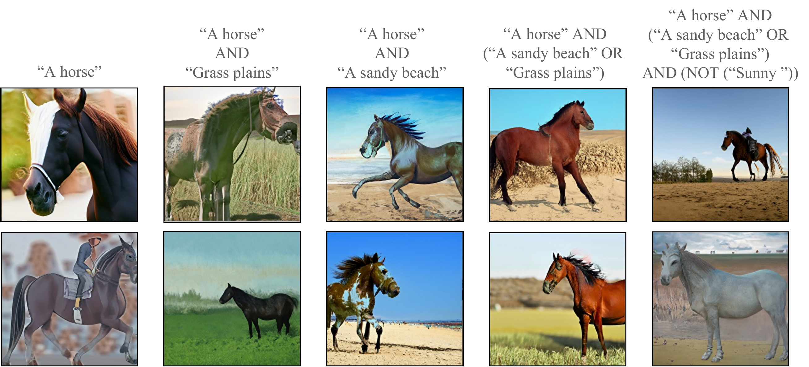
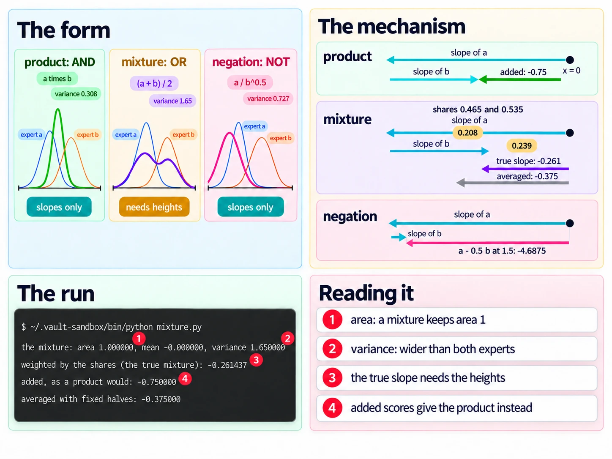

# Product, Mixture And Negation

Up: [[Composition]] · ⬅️ [[The Energy Parameterisation]] · [[What An Expert Learns From Its Training Set]] ➡️

Artificial Intelligence, Generative Modeling, Diffusion Models, Composition. Needs: [[The Energy Parameterisation]] for the heights a mixture needs.

> [!question] Test yourself
> [The diffusion models quiz](https://claude.ai/artifact/MyTdAaVfZW3wiqhbLKg4wu) covers the [[Diffusion Models]] folder. This note's sections are not in it yet.

> [!warning] Unfinished
> - Three pictures are waiting to be drawn: prompts 14, 15 and 16 in the vault's `.prompts/Diffusion Models.md`.
>
> Stated, not checked: 1 claim, marked where it sits.

**Section 3 of Du et al. names three ways to combine models: the product (equation 8), high only where every expert is high; the mixture (equation 9), high wherever any expert is high; and negation (equation 10), high where one expert is high and another is not. The product and negation are built from scores alone. The mixture needs each model's height, so a model that only outputs scores can multiply and negate but cannot mix.** *Cited:* Du et al., Reduce, Reuse, Recycle, section 3 (`text/method.tex` lines 10 to 54): "with the standard $\epsilon_\theta(x, t)$-parameterization we can, in theory, utilize product and negation composition, but *not* mixture composition."

## Where you work

The setup is in [[Diffusion Models#Where you work]]: any terminal with Python 3, NumPy and Matplotlib, a new empty folder, and the learner's `toy.py` and `samples.py` saved into it.

## Table of contents

- [[#Words the three operators use]]
- [[#When to reach for the three operators]]
- [[#The form of the three operators]]
- [[#Try the three operators yourself]]
- [[#Reading the three-operators output]]
- [[#How the three operators work]]
- [[#Other ways to combine models]]
- [[#Why the three operators matter]]
- [[#The three operators taught in, applied in]]

## Words the three operators use

Navigation: 📋 [[#Table of contents|TOC]] | [[#When to reach for the three operators]] ➡️

**Product**, $q^\text{prod}(x) = \frac{1}{Z}\prod_i q^i(x)$ with $Z = \int \prod_i q^i(x)\,dx$. The paper calls it an "intersection". Its peak is a compromise between the experts: [[The Product As An Intersection]].

**Mixture**, $q^\text{mix}(x) = \frac{1}{N}\sum_i q^i(x)$. The paper calls it a "union". It needs no $Z$, because averaging densities keeps area 1 ([[Multivariate Normal Distribution#The area a product loses]]).

**Negation**, $q^\text{neg}(x) \propto q^0(x) / q^1(x)^\alpha$. The power $\alpha$ sets how hard $q^1$ is pushed away; the paper's experiments use $\alpha = 0.5$. The paragraph names the two densities $p_0$ and $p_1$ and the equation writes $q^0$ and $q^1$; they are the same two.

**Guidance as a product.** Classifier and classifier-free guidance multiply two experts: one for how likely $x$ is at all, one for how likely the label $y$ is given $x$. Their product is proportional to $p(x \mid y)$ by Bayes' rule. *Cited:* section 3, paragraph 3: "The approaches to guidance discussed in Section 2 define product models with only two experts."

## When to reach for the three operators

Navigation: ⬅️ [[#Words the three operators use]] | 📋 [[#Table of contents|TOC]] | [[#The form of the three operators]] ➡️

When a prompt holds AND, OR and NOT, as in Figure 6 below. AND is a product, OR a mixture, NOT a negation, and they nest. Before running one on a diffusion model, ask which operator each word needs. AND and NOT are scores added and subtracted, which any diffusion model supports. OR is not, and adding or averaging scores in its place samples a different distribution from the one asked for, as step 5 shows. *Derived* below.

## The form of the three operators

Navigation: ⬅️ [[#When to reach for the three operators]] | 📋 [[#Table of contents|TOC]] | [[#Try the three operators yourself]] ➡️

```text
product   q_prod = (1/Z) * q_1 * q_2         score: s_1 + s_2                     slopes only
mixture   q_mix  = (q_1 + q_2) / 2           score: w_1 s_1 + w_2 s_2,            needs heights
                                             w_i = q_i / (q_1 + q_2)
negation  q_neg  ~ q_0 / q_1^alpha           score: s_0 - alpha * s_1             slopes only
          a density only while  1/v_0 - alpha / v_1 > 0   (Gaussians; the precisions)
guidance  p(x | y) ~ p(x) * p(y | x)         score: s_x + s_(y|x)                 a product of two experts
```


*The form, the three operators as three cards, each with two expert bells and the result bell, and what each needs (slopes or heights).*

## Try the three operators yourself

Navigation: ⬅️ [[#The form of the three operators]] | 📋 [[#Table of contents|TOC]] | [[#Reading the three-operators output]] ➡️

**1. What you need.** Python with NumPy, through the prepared environment:

```bash
~/.vault-sandbox/bin/python -c "import numpy; print(numpy.__version__)"
```

You should see a version number. This run printed `2.4.6`.

**2. When it is missing.** [[Multivariate Normal Distribution#Try sampling yourself]] steps 1 and 2 say how to make the environment, or how to use `uv run` instead.

**3. Make something to act on.** A new empty folder, and the pair of [[The Order Of Multiplying And Noising#The one-dimensional pair]] with the pieces every script uses: the density on an axis, its moments, the forward jump, the score, and `power`, which combines two Gaussians raised to any powers ([[Multivariate Normal Distribution#Powers of Gaussians]]).

```bash
mkdir -p ~/playground/sandbox/three-operators && cd ~/playground/sandbox/three-operators
```

Save this as `experts.py`:

```python
import numpy as np

experts = [(-1.0, 0.5), (1.0, 0.8)]          # (mean, variance) of expert a and expert b
x = np.linspace(-8, 8, 1601)                  # the axis, spacing 0.01
dx = x[1] - x[0]


def gauss(z, m, v):
    return np.exp(-(z - m) ** 2 / (2 * v)) / np.sqrt(2 * np.pi * v)


def moments(p):
    """Area, mean and variance of heights p on the axis."""
    area = p.sum() * dx
    mean = (x * p).sum() * dx / area
    return area, mean, ((x - mean) ** 2 * p).sum() * dx / area


def noised(m, v, abar):
    """A Gaussian N(m, v) after the forward jump to level abar."""
    return np.sqrt(abar) * m, abar * v + 1 - abar


def score(z, m, v, abar=1.0):
    mt, vt = noised(m, v, abar)
    return -(z - mt) / vt


def power(m1, v1, w1, m2, v2, w2):
    """q1^w1 * q2^w2 for two Gaussians, renormalised: (mean, variance, precision)."""
    P = w1 / v1 + w2 / v2
    if P <= 0:
        return float("nan"), float("nan"), P
    return (w1 * m1 / v1 + w2 * m2 / v2) / P, 1 / P, P
```

**4. Look at it before: the product, and guidance as a product.** Save this as `product.py`:

```python
from experts import experts, x, dx, gauss, moments, noised, score, power

(ma, va), (mb, vb) = experts
qa, qb = gauss(x, ma, va), gauss(x, mb, vb)
Z = (qa * qb).sum() * dx                                      # equation 8's Z
i = 800                                                       # x[800] is 0
print(f"equation 8 at x = 0: q_a {qa[i]:.6f} times q_b {qb[i]:.6f} = {qa[i] * qb[i]:.6f}; over Z = {Z:.6f}: {qa[i] * qb[i] / Z:.6f}")
area, m, v = moments(qa * qb / Z)
print(f"the product: area {area:.6f}, mean {m:.6f}, variance {v:.6f}; the experts' variances {va} and {vb}")
mp, vp, _ = power(ma, va, 1, mb, vb, 1)
for abar in (1.0, 0.5):
    summed = score(1.5, ma, va, abar) + score(1.5, mb, vb, abar)
    print(f"guidance at x = 1.5, abar {abar}: scores added {summed:.6f}, the noised product's own slope {score(1.5, mp, vp, abar):.6f}")
```

```bash
~/.vault-sandbox/bin/python product.py
```

You should see:


The product is narrower than both experts, 0.308 against 0.5 and 0.8: it is stricter than either alone. With no noise, guidance's added scores are exactly the product's slope. With half the signal left they are not, which is [[The Order Of Multiplying And Noising]] again, because guidance is a product.

**5. The failure, and the technique: a mixture's slope.** Save this as `mixture.py`:

```python
import numpy as np
from experts import experts, x, dx, gauss, moments, score

(ma, va), (mb, vb) = experts
qa, qb = gauss(x, ma, va), gauss(x, mb, vb)
area, m, v = moments(0.5 * qa + 0.5 * qb)                     # equation 9 with N = 2
print(f"the mixture: area {area:.6f}, mean {m:+.6f}, variance {v:.6f}")
ha, hb = gauss(0.0, ma, va), gauss(0.0, mb, vb)
sa, sb = score(0.0, ma, va), score(0.0, mb, vb)
wa = ha / (ha + hb)
print(f"at x = 0: heights {ha:.6f} and {hb:.6f}, shares {wa:.6f} and {1 - wa:.6f}")
print(f"at x = 0: slopes {sa:.6f} and {sb:.6f}")
print(f"  weighted by the shares (the true mixture): {wa * sa + (1 - wa) * sb:.6f}")
print(f"  added, as a product would:                 {sa + sb:.6f}")
print(f"  averaged with fixed halves:                {(sa + sb) / 2:.6f}")
for c in (2.0, 0.5):
    area, m, v = moments(qa + c * qb)                         # expert b's height off by a factor c
    print(f"expert b's height off by a factor {c}: mean {m:+.6f}, variance {v:.6f}")
```

```bash
~/.vault-sandbox/bin/python mixture.py
```

You should see:


The mixture is wider than both experts, 1.65 against 0.5 and 0.8, where the product was narrower. Two ways of building it from scores alone both miss its slope: adding gives the product's $-0.75$, and fixed halves give $-0.375$. Only the shares, which come from the heights, give $-0.261$. And a height known only up to a factor is not enough: doubling expert b's height moves the mixture's centre from 0 to 0.333.

**6. The technique for negation.** Save this as `negation.py`:

```python
from experts import experts, x, gauss, moments, noised, score, power

(ma, va), (mb, vb) = experts
alpha = 0.5
area, m, v = moments(gauss(x, ma, va) / gauss(x, mb, vb) ** alpha)   # equation 10 on the axis
mc, vc, P = power(ma, va, 1, mb, vb, -alpha)
print(f"a over b^{alpha}: on the axis mean {m:.6f}, variance {v:.6f}; closed form mean {mc:.6f}, variance {vc:.6f}, precision {P:.6f}")
print(f"slope at 1.5: score a - {alpha} score b = {score(1.5, ma, va) - alpha * score(1.5, mb, vb):.6f}; closed form {-(1.5 - mc) / vc:.6f}")
for name, args in [("b over a^0.5", (mb, vb, 1, ma, va, -0.5)), ("b over a", (mb, vb, 1, ma, va, -1.0)),
                   ("notebook, a^1.3 / b^0.3", (ma, va, 1.3, mb, vb, -0.3))]:
    mm, vv, PP = power(*args)
    print(f"{name:24s} precision {PP:+.6f}  mean {mm:.6f}  variance {vv:.6f}")
m1, v1 = noised(mc, vc, 0.5)
m2, v2, _ = power(*noised(ma, va, 0.5), 1, *noised(mb, vb, 0.5), -alpha)
print(f"abar 0.5: negate then noise variance {v1:.6f}; noise then negate variance {v2:.6f}")
```

```bash
~/.vault-sandbox/bin/python negation.py
```

You should see:


Dividing by $\sqrt{b}$ moves expert a from $-1$ to $-1.909$, away from b, and widens it from 0.5 to 0.727. Its slope is expert a's score minus half of b's, so scores suffice. Swap the roles and divide b by all of a, and the precision is $-0.75$: the result grows without limit and is no density. With noise, the order matters the other way round from the product: noising first makes the negation too wide, 1.286 against 0.864, where it made the product too narrow.

**7. Another way to get the same answer.** Each script checks itself: `product.py` measures the product on the axis and `power` gives it in closed form; `negation.py` prints the axis and the closed form side by side and they agree to six places; `mixture.py`'s share-weighted slope matches the difference quotient of the mixture's own log in [[The Energy Parameterisation#Try the energy yourself]] step 8.

**8. More worked examples on the same setup.** *The paper's code, checked against its equations.* The authors' notebook builds negation in cell 8, line 15, as `1.3 * unorm_1 - 0.3 * unorm_2`, which is $q_a^{1.3} / q_b^{0.3}$. No $\alpha$ in equation 10 gives that. The fourth line of step 6 prints what it does on the pair: mean $-1.337$, variance $0.449$, against equation 10's $-1.909$ and $0.727$. The mixture in cell 7, lines 13 to 19, is `-jax.scipy.special.logsumexp(-concat_energy*3.5, -1)`, which raises each density to the power 3.5 before mixing; equation 9 has no such power. *Cited:* the journey's read-ahead, `read-ahead/03-compositional-generation-beyond-guidance.md`, chunks 38 and 40, quoting `notebooks/simple_distributions.ipynb`.

**9. Clean up, and prove it.**

```bash
cd ~ && rm -r ~/playground/sandbox/three-operators
ls ~/playground/sandbox/three-operators; echo $?
```

You should see `No such file or directory`, then `2`.

## Reading the three-operators output

Navigation: ⬅️ [[#Try the three operators yourself]] | 📋 [[#Table of contents|TOC]] | [[#How the three operators work]] ➡️

**From step 4, `product.py`:**

| # | Field | This run | How to read it | Backing |
|---|---|---|---|---|
| 1 | raw product at 0 | `0.049552` | $0.207554 \times 0.238743$: the two heights multiplied, before equation 8 divides | derived below |
| 2 | over $Z$ | `0.659582` | the product's true height at 0, once divided by its area 0.075126 | derived below |
| 3 | variance | `0.307692` | narrower than both experts: precisions add | derived below |
| 4 | guidance, no noise | `-5.625000` both | the added scores are the product's own slope | derived below |
| 5 | guidance, half the signal: added | `-3.823802` | equation 12's slope, the curve summed scores give | derived in [[The Order Of Multiplying And Noising#How the two orders work]] |
| 6 | the noised product's slope | `-2.543685` | equation 11's slope, the curve the reverse process needs | derived in [[The Order Of Multiplying And Noising#How the two orders work]] |

**From step 5, `mixture.py`:**

| # | Field | This run | How to read it | Backing |
|---|---|---|---|---|
| 1 | area | `1.000000` | a mixture keeps area 1, with no $Z$ | derived below |
| 2 | variance | `1.650000` | wider than both experts | derived below |
| 3 | shares at 0 | `0.465058`, `0.534942` | each expert's height over the two heights added | derived in [[The Energy Parameterisation#How the energy works]] |
| 4 | the true slope | `-0.261437` | shares times slopes, added | derived in [[The Energy Parameterisation#How the energy works]] |
| 5 | scores added | `-0.750000` | the product's slope: an AND where an OR was asked for | derived below |
| 6 | scores averaged | `-0.375000` | fixed halves; wrong wherever the heights differ | derived below |
| 7 | height off by 2 | `+0.333333` | the centre moves toward the expert whose height was overstated | derived below |

**From step 6, `negation.py`:**

| # | Field | This run | How to read it | Backing |
|---|---|---|---|---|
| 1 | $a / b^{0.5}$ | mean `-1.909091`, variance `0.727273` | moved away from b and widened; the axis and the closed form agree | derived below |
| 2 | its precision | `1.375000` | $2 - 0.5 \times 1.25$, positive, so a density | derived below |
| 3 | slope at 1.5 | `-4.687500` | $-5 - 0.5 \times (-0.625)$: scores alone | derived below |
| 4 | $b / a^{0.5}$ | precision `+0.25`, mean `9` | a density, but centred past the end of the axis at 8 | derived below |
| 5 | $b / a$ | precision `-0.75` | not a density; `nan` is the script refusing to divide | derived below |
| 6 | the notebook's weights | variance `0.449438` | what cell 8 actually samples on this pair | derived below |
| 7, 8 | the two orders at $\bar\alpha = 0.5$ | `0.863636`, `1.285714` | negate then noise against noise then negate: noising first is 49% too wide | derived below |

## How the three operators work

Navigation: ⬅️ [[#Reading the three-operators output]] | 📋 [[#Table of contents|TOC]] | [[#Other ways to combine models]] ➡️

**Equation 8 at one point.** The heights at 0 are $q_a(0) = e^{-1}/\sqrt{\pi} = 0.207554$ and $q_b(0) = e^{-0.625}/\sqrt{1.6\pi} = 0.238743$:

$$
\begin{aligned}
q_a(0)\,q_b(0) &= 0.207554 \times 0.238743 = 0.049552 \\
Z &= \mathcal{N}(-1;\ 1,\ 1.3) = 0.075126 \\
q^\text{prod}(0) &= 0.049552 / 0.075126 = 0.659582
\end{aligned}
$$

*Derived;* $Z$ is worked in [[Multivariate Normal Distribution#The area a product loses]].

**Why guidance's scores add.** The log of a product is the sum of the logs ([log rules](../../../../Mathematics/references/textbooks/algebra/algebra-handbook.pdf#page=110)), and $\log p(y)$ does not depend on $x$:

$$
\begin{aligned}
p(x \mid y) &= \frac{p(x)\, p(y \mid x)}{p(y)} \\
\nabla_x \log p(x \mid y) &= \nabla_x \log p(x) + \nabla_x \log p(y \mid x) - 0
\end{aligned}
$$

On the pair, with expert a as $p(x)$ and expert b's shape as $p(y \mid x)$, at 1.5: $-\frac{2.5}{0.5} - \frac{0.5}{0.8} = -5 - 0.625 = -5.625$, and the product $\mathcal{N}(-0.230769, 0.307692)$ has slope $-\frac{1.730769}{0.307692} = -5.625$. *Derived.* That reading of the two experts is the walk's, from the sentence quoted under [[#Words the three operators use]].

**Why guidance shares the two-orders gap.** A guided sampler adds the two models' scores at each noise level, which is equation 12's curve, while the reverse process needs equation 11's. The gap in variance is 0 with no noise, 0.2448 at half the signal and 0.5 at pure noise ([[The Order Of Multiplying And Noising#Try the two orders yourself]] step 7), so it is largest at the noisiest steps. *Derived* from those rows. How large it is for a trained text-to-image model is not measured here.

**The mixture's moments.** Each expert contributes its own variance plus its mean squared, weighted by its share:

$$
\begin{aligned}
\text{mean} &= \tfrac12(-1) + \tfrac12(1) = 0 \\
\text{variance} &= \tfrac12(0.5 + 1) + \tfrac12(0.8 + 1) - 0^2 = 1.65
\end{aligned}
$$

If expert b's height is overstated by a factor 2, the shares become $\tfrac13$ and $\tfrac23$:

$$
\begin{aligned}
\text{mean} &= \tfrac13(-1) + \tfrac23(1) = 0.333333 \\
\text{variance} &= \tfrac13(1.5) + \tfrac23(1.8) - 0.333333^2 = 1.7 - 0.111111 = 1.588889
\end{aligned}
$$

*Derived.* This is the paper's "a different unknown ratio of normalizers would correspond to a weighted mixture", on numbers. *Cited:* section 3, the mixture paragraph.

**Why no fixed rule on scores builds a mixture.** The mixture's slope is $w_a s_a + w_b s_b$ with $w_a = q_a / (q_a + q_b)$ ([[The Energy Parameterisation#How the energy works]]). The shares change along the axis: expert a's is 0.939 at $-1$, 0.465 at 0 and 0.023 at 1 (`checks/mixture_score.out`). Adding scores fixes both weights at 1 and averaging fixes them at $\tfrac12$, and neither follows the shares. *Derived.*

**Negation as a power.** Raising a Gaussian to the power $w$ multiplies its precision by $w$ ([[Multivariate Normal Distribution#Powers of Gaussians]]), so with $\alpha = 0.5$:

$$
\begin{aligned}
P &= \frac{1}{0.5} - 0.5 \times \frac{1}{0.8} = 2 - 0.625 = 1.375, \qquad \text{variance } \frac{1}{1.375} = 0.727273 \\
\text{mean} &= \frac{-1/0.5 - 0.5 \times 1/0.8}{1.375} = \frac{-2.625}{1.375} = -1.909091 \\
\text{slope at } 1.5 &= -\frac{2.5}{0.5} - 0.5 \times \left(-\frac{0.5}{0.8}\right) = -5 + 0.3125 = -4.6875
\end{aligned}
$$

The result is a density only while $P > 0$, so the expert being pushed away must be broad enough, with $\alpha / v_1 < 1 / v_0$. Here $0.625 < 2$. For $b / a$, $1.25 - 2 = -0.75$. *Derived.*

**The two orders for negation.** At $\bar\alpha = 0.5$, negate then noise is $0.5 \times 0.727273 + 0.5 = 0.863636$. Noise each first, $a \to \mathcal{N}(-0.707107, 0.75)$ and $b \to \mathcal{N}(0.707107, 0.9)$, then negate: $P = \frac{1}{0.75} - \frac{0.5}{0.9} = 1.333333 - 0.555556 = 0.777778$, variance $1.285714$. Subtracting a noised precision removes less than subtracting a clean one, so the result is wider. *Derived.*

## Other ways to combine models

Navigation: ⬅️ [[#How the three operators work]] | 📋 [[#Table of contents|TOC]] | [[#Why the three operators matter]] ➡️

- **Background-divided composition**, $p_1 p_2 / p_b$, which is a product with one negation at power 1. [[Composing Models With A Background]] works it on two-pixel scenes.
- **Guidance scale**, $\nabla \log p(x) + \lambda \nabla \log p(y \mid x)$, which is the product $p(x)\, p(y \mid x)^\lambda$: $\lambda = 2$ on the pair gives mean 0.111 and variance 0.222. *Cited:* `checks/guidance_on_the_object.out`.
- **A mixture from energy models.** [[The Energy Parameterisation]] gives each model a height, which is what the mixture's shares need. The paper assumes the ratio of the normalisers is 1; step 5 shows what a factor of 2 does.

## Why the three operators matter

Navigation: ⬅️ [[#Other ways to combine models]] | 📋 [[#Table of contents|TOC]] | [[#The three operators taught in, applied in]] ➡️

Which operator a prompt asks for decides whether a score model can serve it at all. AND and NOT can, OR cannot. "A cat or a dog" from a mixture gives one or the other per image, never both in one image, while "a cat and a dog" from a product gives whatever lies in both experts' high regions. If the cat expert is high only on images that are entirely cat, that shared region holds only blends, which is the hybrid of [[Composing Models With A Background#Why composition matters]]. *Stated:* the link between what an expert's high region contains and a hybrid is the writer's reading of the two sections together.



> **Figure 6.** Energy based parameterization enables high-resolution compositional text-to-image synthesis.
>
> *Du, Durkan, Strudel, Tenenbaum, Dieleman, Fergus, Sohl-Dickstein, Doucet, Grathwohl, Reduce, Reuse, Recycle, ICML 2023, [arXiv 2302.11552](https://arxiv.org/abs/2302.11552), Figure 6. arXiv non-exclusive distribution licence; copied for study with citation.*

The labels use all three operators nested: AND a product, OR a mixture, NOT a negation. Column 4's two images each show one place, sand or grass, as a mixture should. In column 5 the bottom horse stands under an overcast sky; the top image's sky is pale blue with no sun in view. The figure has no column sampled without composition, and no model or code was released, so none of it can be rerun. *Shown*, read by eye from the image; *cited* for the release, the journey's read-ahead, chunk 42.

*🖼️ Diagram wanted: the mechanism, slopes adding for the product and negation and height-weighted for the mixture. Prompt 15 in the same file.*



*The deep-dive sheet composing the form, the mechanism and the three runs.*

## The three operators taught in, applied in

Navigation: ⬅️ [[#Why the three operators matter]] | 📋 [[#Table of contents|TOC]]

**Taught in:** the `drip-read` walk of Du et al., Reduce, Reuse, Recycle, section 3, chunks 35 to 43 (equations 8, 9 and 10, guidance as a product, Figures 2 and 6, and the two notebook slips), with numbers from the walk's answer keys `checks/step6_product.out`, `guidance_on_the_object.out`, `mixture_score.out` and `negation.out`. The walk's paper note, `deep-learning/diffusion-models/02-sampler-correctors-for-composition/papers/reduce-reuse-recycle/reduce-reuse-recycle.md` in this vault, is not written yet; link it here when it is.

**Applied in:** nothing yet.

> [!note]- How this was checked
> The runs in Product, Mixture And Negation were made by the writer in a fifth empty folder, `~/playground/sandbox/three-operators`, on the same PC and environment (Python 3.11.13, NumPy 2.4.6), on 2026-10-13; the folder was removed afterwards and the clean-up check returned 2. The scripts are shortened from the walk's answer keys `checks/step6_product.py`, `guidance_on_the_object.py`, `mixture_score.py` and `negation.py` in the journey's `sources/reduce-reuse-recycle/`. All four keys were re-run in the same folder and their output matched the saved `.out` files byte for byte, and every number the three scripts print matched them to the digits shown. The three output pictures were rendered from the captured text by a script in DejaVu Sans Mono, never drawn, and each was opened before filing. The Figure 2 redraw numbers (96.8%, 55.6%, 69.0%, 87.0%, 91.5%, 0.2100, 0.3076) are quoted from `checks/ring_times_bar.out`, `ring_times_bar_more_steps.out` and `fig2_on_the_object.out`, not re-run here. The paper's Figure 6 is the authors' `fig/horse5.pdf` from the arXiv source package, converted to PNG at 110 dpi with `pdftoppm` and opened before filing; its caption is the LaTeX caption in `figText/text2im.tex` lines 1 to 7 with markup removed. The notebook lines were opened in the playground's reference copy of the authors' repository, `notebooks/simple_distributions.ipynb`, counting cells from 0: the factor 3.5 is on line 17 of cell 7, inside the method the read-ahead cites as lines 13 to 19, and `1.3 * unorm_1 - 0.3 * unorm_2` is line 15 of cell 8. Quotations from section 3 are from `text/method.tex` lines 10 to 54, read in the staged source.
