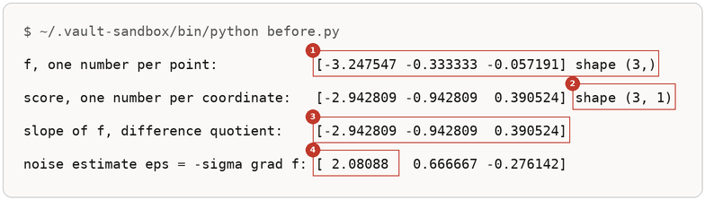
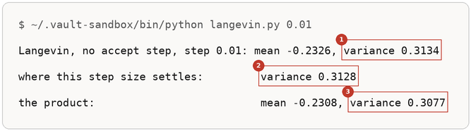

# The Energy Parameterisation

Up: [[Composition]] · ⬅️ [[More Runs Of The Two Orders]] · [[More Runs Of The Energy Parameterisation]] ➡️

Artificial Intelligence, Generative Modeling, Diffusion Models, Composition. Needs: [[The Order Of Multiplying And Noising]], and [[Step Size And The Accept Step]] for the sampler's accept step.

> [!question] Test yourself
> [The diffusion models quiz](https://claude.ai/artifact/MyTdAaVfZW3wiqhbLKg4wu) covers the [[Diffusion Models]] folder. This note's sections are not in it yet.

> [!warning] Unfinished
> - Three pictures are waiting to be drawn: prompts 10, 11 and 12 in the vault's `.prompts/Diffusion Models.md`.

**An energy-parameterised diffusion model outputs one number per input, $f_\theta(x_t, t)$, and its noise prediction is that number's slope times minus the noise scale, $\epsilon_\theta = -\sigma_t \nabla_x f_\theta$. The number is the log of the noised density's height with its normaliser dropped, and two things need it that a score alone does not carry: the weights of a mixture, and the accept test of a Metropolis-corrected sampler.** *Cited:* Du et al., Reduce, Reuse, Recycle, section 2.3, equation 5 ("we have replaced $\epsilon_\theta(x, t)$ with $-\sigma_t \nabla_x f_\theta(x + \sigma_t \epsilon)$"), and section 4.2, paragraphs 1 and 2.

## Where you work

The setup is in [[Diffusion Models#Where you work]]: any terminal with Python 3, NumPy and Matplotlib, a new empty folder, and the learner's `toy.py` and `samples.py` saved into it.

## Table of contents

- [[#Words the energy uses]]
- [[#When to reach for the energy]]
- [[#The form of the energy parameterisation]]
- [[#Try the energy yourself]]
- [[#Reading the energy output]]
- [[#How the energy works]]
- [[Step Size And The Accept Step]]
- [[#Other ways to get heights]]
- [[#Why the energy matters]]
- [[#The energy taught in, applied in]]

## Words the energy uses

Navigation: 📋 [[#Table of contents|TOC]] | [[#When to reach for the energy]] ➡️

**Energy $f$.** One number per input: the log of a density's height, up to a constant nobody knows. Du et al. write $e^{f} \propto q$, so $f$ is highest at the mode. A physicist's energy is $-f$, lowest at the mode, and the paper's own appendix D uses that sign, with $\epsilon = +\nabla f$. Check the sign before using a formula from either place. *Cited:* the journey's answer key `checks/energy_parameterisations.out`, last four lines.

**Noise scale $\sigma_t$.** The noise's standard deviation at level $t$: $\sqrt{1 - \bar\alpha}$ in [[The Forward Process]]. Section 2.3 writes $\epsilon_\theta = -\nabla_x f_\theta$ in its sentence 5, with $\sigma_t$ folded into $f$; its equation 5 keeps $\sigma_t$ visible, and so does this note. *Cited:* section 2.3, sentences 3 and 5.

**Score.** As in [[The Order Of Multiplying And Noising#Words the two orders use]]: $\nabla_x \log q_t(x)$. With an energy model, the score is $\nabla_x f_\theta$ and nothing else.

**Accept step**, or Metropolis correction. Propose a move, keep it with a probability computed from the target's height at both ends, and otherwise stay where you were. **MALA**, the Metropolis-adjusted Langevin algorithm, is a Langevin step used as the proposal with an accept step after it. *Cited:* section 2.2, paragraph 3, sentences 5 and 6.

## When to reach for the energy

Navigation: ⬅️ [[#Words the energy uses]] | 📋 [[#Table of contents|TOC]] | [[#The form of the energy parameterisation]] ➡️

When composing models needs more than adding slopes. A mixture ("a cat or a dog") weights each model by how tall it is at the point, and a score carries no height; the paper's section 3 ends by saying the standard parameterisation supports "product and negation composition, but not mixture composition". And when a Langevin sampler at an affordable step size settles on the wrong width: an accept step removes that error, and the accept step compares heights. Without the energy, the only fix for the second problem is a smaller step, paid for in steps. *Cited:* section 3, last sentence, and section 4.2, paragraph 2.

The cost is one backward pass through the network for every noise prediction, because $\epsilon$ is now a gradient. For plain unconditional generation the paper prefers the score form for that reason. *Cited:* section 4.2, paragraph 3.

## The form of the energy parameterisation

Navigation: ⬅️ [[#When to reach for the energy]] | 📋 [[#Table of contents|TOC]] | [[#Try the energy yourself]] ➡️

```text
network:         f_theta(x_t, t)                      one number per input
noise estimate:  eps_theta(x_t, t) = -sigma_t * grad_x f_theta(x_t, t)       section 2.3, equation 5
score:           grad_x log q_t(x_t) = grad_x f_theta = -eps_theta / sigma_t
product:         f = f_1 + f_2                         the scores add, as in the two-orders section
mixture slope:   w_1(x) grad f_1 + w_2(x) grad f_2,    w_i(x) = q_i(x) / (q_1(x) + q_2(x)),  q_i = e^(f_i) / Z_i
accept test:     keep x_hat with probability  min(1, e^(f(x_hat) - f(x)) * k(x | x_hat) / k(x_hat | x))      section 2.2
the paper's f:   f_theta(x, t) = -||s_theta(x, t)||^2, with s_theta an ordinary vector-output network       section 4.2
```

The mixture line needs each $Z_i$, or at least their ratio. The accept line does not, because both heights belong to the same target and its $Z$ cancels.


*The form, one network giving one number whose slope is the noise estimate and whose height feeds the mixture weights and the accept test.*

## Try the energy yourself

Navigation: ⬅️ [[#The form of the energy parameterisation]] | 📋 [[#Table of contents|TOC]] | [[#Reading the energy output]] ➡️

**1. What you need.** Python with NumPy, through the prepared environment:

```bash
~/.vault-sandbox/bin/python -c "import numpy; print(numpy.__version__)"
```

You should see a version number. This run printed `2.4.6`.

**2. When it is missing.** [[Sampling A Diagonal Gaussian#Try sampling yourself]] steps 1 and 2 say how to make the environment, or how to use `uv run` instead.

**3. Make something to act on.** A new empty folder, and the same two experts as [[The Order Of Multiplying And Noising#The one-dimensional pair]], each now written as an energy beside its score. The product's energy is the two energies added, so its score is the summed score.

```bash
mkdir -p ~/playground/sandbox/energy-parameterisation && cd ~/playground/sandbox/energy-parameterisation
```

Save this as `experts.py`:

```python
import numpy as np

experts = [(-1.0, 0.5), (1.0, 0.8)]          # (mean, variance) of expert a and expert b


def noised(m, v, abar):
    """A Gaussian N(m, v) after the forward jump to level abar."""
    return np.sqrt(abar) * m, abar * v + 1 - abar


def expert_energy(x, m, v, abar=1.0):
    """f for one model: the log of its noised height, normaliser dropped. One number per point."""
    mt, vt = noised(m, v, abar)
    return (-(x - mt) ** 2 / (2 * vt)).sum(-1)


def expert_score(x, m, v, abar=1.0):
    """The gradient of expert_energy, written out. One number per coordinate."""
    mt, vt = noised(m, v, abar)
    return -(x - mt) / vt


def energy(x, abar=1.0):
    """The product's f: the two models' f added."""
    return sum(expert_energy(x, m, v, abar) for m, v in experts)


def summed_score(x, abar=1.0):
    """The product's score: the two models' scores added."""
    return sum(expert_score(x, m, v, abar) for m, v in experts)
```

**4. Look at it before.** Expert a at half the signal, on three points. Save this as `before.py`:

```python
import numpy as np
from experts import experts, expert_energy, expert_score

m, v = experts[0]                                  # expert a
abar = 0.5                                         # half the signal left
sigma = np.sqrt(1 - abar)                          # the noise scale at this level
x = np.array([[1.5], [0.0], [-1.0]])               # three points, one coordinate each
h = 1e-5
f = expert_energy(x, m, v, abar)
s = expert_score(x, m, v, abar)
slope = (expert_energy(x + h, m, v, abar) - expert_energy(x - h, m, v, abar)) / (2 * h)
print("f, one number per point:           ", f.round(6), "shape", f.shape)
print("score, one number per coordinate:  ", s.ravel().round(6), "shape", s.shape)
print("slope of f, difference quotient:   ", slope.round(6))
print("noise estimate eps = -sigma grad f:", (-sigma * slope).round(6))
```

```bash
~/.vault-sandbox/bin/python before.py
```

You should see:



The slope of $f$, measured by nudging $x$, equals the score to six decimals, and minus $\sigma_t$ times it is the noise a network would predict. The energy's shape is `(3,)` where the score's is `(3, 1)`: one number per point against one per coordinate. For a 3 by 64 by 64 image the score has 12,288 numbers and the energy still has one.

**5. The failure: Langevin without an accept step.** A hundred thousand chains take 400 Langevin steps of size 0.1 on the product with no noise, using the summed score alone. Save this as `langevin.py`; it reads the step size from the command line:

```python
import sys
import numpy as np
from experts import summed_score

step = float(sys.argv[1])                          # step size, sigma_L^2 / 2 in equation 4
rng = np.random.default_rng(0)
x = rng.standard_normal((100_000, 1))
for k in range(400):
    x = x + step * summed_score(x) + np.sqrt(2 * step) * rng.standard_normal(x.shape)
P = 1 / 0.5 + 1 / 0.8                              # the product's precision, 3.25
print(f"Langevin, no accept step, step {step}: mean {x.mean():.4f}, variance {x.var():.4f}")
print(f"where this step size settles:         variance {1 / (P * (1 - step * P / 2)):.4f}")
print(f"the product:                          mean -0.2308, variance {1 / P:.4f}")
```

```bash
~/.vault-sandbox/bin/python langevin.py 0.1
```

You should see:


The chains settle 19.4% wider than the product. More steps will not help: 0.3674 is where this step size settles, derived in [[#How the energy works]].

**6. The technique: add the accept step.** The same proposals, each kept or rejected by comparing the product's energy at both ends. Save this as `mala.py`:

```python
import numpy as np
from experts import energy, summed_score

step = 0.1


def log_k(x_to, x_from):
    """Log of the Langevin move's probability from x_from to x_to, up to a constant."""
    return (-(x_to - x_from - step * summed_score(x_from)) ** 2).sum(-1) / (4 * step)


if __name__ == "__main__":
    rng = np.random.default_rng(0)
    x = rng.standard_normal((100_000, 1))
    rates = []
    for k in range(400):
        prop = x + step * summed_score(x) + np.sqrt(2 * step) * rng.standard_normal(x.shape)
        log_a = energy(prop) - energy(x) + log_k(x, prop) - log_k(prop, x)
        accept = np.log(rng.random(len(x))) < log_a            # accept with probability min(1, e^log_a)
        x = np.where(accept[:, None], prop, x)
        rates.append(accept.mean())
    print(f"Langevin with the accept step, step {step}: mean {x.mean():.4f}, variance {x.var():.4f}")
    print(f"share of proposals accepted, last 100 steps:  {np.mean(rates[-100:]):.4f}")
    print(f"the product:                                  mean -0.2308, variance 0.3077")
```

```bash
~/.vault-sandbox/bin/python mala.py
```

You should see:


The same step size now lands within 0.0006 of the product's variance, inside the 0.0041 that sampling 100,000 chains allows. The line `log_a = energy(prop) - energy(x) + ...` is the only place the energy is used, and it is the line two score models could not write.

**7. Another way to get the same answer: a smaller step, with no accept step.** Run step 5 again with a step ten times smaller:

```bash
~/.vault-sandbox/bin/python langevin.py 0.01
```

You should see:



The error falls from 19.4% to 1.7%, and never to zero. Each step moves a tenth as far, so the chain needs about ten times as many steps to travel the same distance: an offset from the centre shrinks by a factor $e$ in about $1/(\text{step} \times 3.25)$ steps, 3.1 steps at 0.1 and 30.8 at 0.01. *Derived* in [[#How the energy works]].

**8. More worked examples on the same setup.** Five more runs on this folder, each with its output read field by field, are in [[More Runs Of The Energy Parameterisation]]: [[More Runs Of The Energy Parameterisation#One proposal, by hand|one proposal, by hand]], [[More Runs Of The Energy Parameterisation#A mixture needs the heights|a mixture needs the heights]], [[More Runs Of The Energy Parameterisation#Step size, with and without the accept step|step size, with and without the accept step]], [[More Runs Of The Energy Parameterisation#Light tails|light tails]], [[More Runs Of The Energy Parameterisation#Table 1 on the pair|table 1 on the pair]].

**9. Clean up, and prove it.**

```bash
cd ~ && rm -r ~/playground/sandbox/energy-parameterisation
ls ~/playground/sandbox/energy-parameterisation; echo $?
```

You should see `No such file or directory`, then `2`.

## Reading the energy output

Navigation: ⬅️ [[#Try the energy yourself]] | 📋 [[#Table of contents|TOC]] | [[#How the energy works]] ➡️

**From step 4, `before.py`:**

| # | Field | This run | How to read it | Backing |
|---|---|---|---|---|
| 1 | f, and its shape | `[-3.247547 -0.333333 -0.057191] shape (3,)` | one energy per point. At 1.5: $-(1.5 + 0.707107)^2 / (2 \times 0.75) = -3.247547$ | derived below |
| 2 | the score's shape | `shape (3, 1)` | one slope per coordinate of each point | shown |
| 3 | slope of f | `[-2.942809 -0.942809  0.390524]` | equals the score line above it: the score is the energy's gradient | shown |
| 4 | eps at 1.5 | `2.08088` | $-0.707107 \times (-2.942809) = 2.080880$. Positive: a point to the right of the data most likely got there by positive noise | derived below |

**From steps 5, 6 and 7, `langevin.py` and `mala.py`:**

| # | Field | This run | How to read it | Backing |
|---|---|---|---|---|
| 1 | no accept step, step 0.1: variance | `0.3671` | 19.3% wider than the product; the closed form, 0.3674, is 19.4% | shown; the plan 36 reference reading is the same, mean -0.2323 and variance 0.3671 |
| 2 | where step 0.1 settles | `0.3674` | $1 / (3.25 \times (1 - 0.1 \times 3.25 / 2)) = 1 / 2.721875 = 0.367394$ | derived below |
| 3 | with the accept step: variance | `0.3071` | within 0.0006 of the product, inside the sampling tolerance of 0.0041 (three standard errors) | shown; matches `checks/mala_step.out` |
| 4 | share accepted | `0.9582` | about 95,820 of 100,000 proposals kept per step; the rest stay put | shown |
| 5 | no accept step, step 0.01: variance | `0.3134` | the closed form says 0.3128, 1.7% wide; the sampled value is within one standard error, 0.0014, of it | derived below |

## How the energy works

Navigation: ⬅️ [[#Reading the energy output]] | 📋 [[#Table of contents|TOC]] | [[Step Size And The Accept Step]] ➡️

**The noise estimate is the energy's slope times $-\sigma_t$.** A trained noise predictor gives the score as $-\epsilon_\theta / \sigma_t$ (section 2.3, sentence 4). Define the score as the gradient of one scalar and solve for $\epsilon$:

$$
\begin{aligned}
\nabla_x \log q_t(x) &\approx -\frac{\epsilon_\theta(x, t)}{\sigma_t} \\
\nabla_x \log q_t(x) &= \nabla_x f_\theta(x, t) \\
\epsilon_\theta(x, t) &= -\sigma_t\, \nabla_x f_\theta(x, t)
\end{aligned}
$$

At expert a with half the signal left, $\mathcal{N}(-0.707107, 0.75)$ and $\sigma_t = \sqrt{0.5} = 0.707107$, at $x = 1.5$:

$$
\begin{aligned}
f &= -\frac{(1.5 + 0.707107)^2}{2 \times 0.75} = -\frac{4.871320}{1.5} = -3.247547 \\
\nabla f &= -\frac{1.5 + 0.707107}{0.75} = -2.942809 \\
\epsilon &= -0.707107 \times (-2.942809) = 2.080880
\end{aligned}
$$

*Derived.* Step 4 printed the same three numbers.

**The accept test needs heights, and not their normaliser.** Write the target as $q(x) = e^{f(x)} / Z$. By the [exponent rules](../../../../Mathematics/references/textbooks/algebra/algebra-handbook.pdf#page=109), dividing two powers of $e$ subtracts their exponents. The test compares the target at the proposal with the target at the start:

$$
\frac{q(\hat x)}{q(x)} = \frac{e^{f(\hat x)} / Z}{e^{f(x)} / Z} = e^{f(\hat x) - f(x)}
$$

$Z$ cancels because both heights belong to the same target, which is why an unnormalised $f$ is enough. *Derived.* Plan 13 of the journey works the same cancellation by hand.

The worked proposal, with the product's energy $f(x) = -(x + 1)^2 / 1 - (x - 1)^2 / 1.6$ and step 0.1:

$$
\begin{aligned}
\text{summed score at } 1.5 &= -\frac{2.5}{0.5} - \frac{0.5}{0.8} = -5 - 0.625 = -5.625 \\
\hat x &= 1.5 + 0.1 \times (-5.625) + \sqrt{0.2} \times 0.5 = 1.5 - 0.5625 + 0.223607 = 1.161107 \\
f(1.5) &= -6.25 - 0.15625 = -6.40625 \\
f(1.161107) &= -\frac{2.161107^2}{1} - \frac{0.161107^2}{1.6} = -4.670383 - 0.016222 = -4.686605 \\
f(\hat x) - f(x) &= -4.686605 + 6.40625 = 1.719645
\end{aligned}
$$

The move's own probability is a Gaussian centred one Langevin step ahead, with $\log k(\text{to} \mid \text{from}) = -(\text{to} - \text{from} - 0.1\, s(\text{from}))^2 / 0.4$:

$$
\begin{aligned}
s(1.161107) &= -\frac{2.161107}{0.5} - \frac{0.161107}{0.8} = -4.322214 - 0.201384 = -4.523598 \\
\log k(x \mid \hat x) &= -\frac{(1.5 - 1.161107 + 0.452360)^2}{0.4} = -\frac{0.791253^2}{0.4} = -1.565203 \\
\log k(\hat x \mid x) &= -\frac{(1.161107 - 1.5 + 0.5625)^2}{0.4} = -\frac{0.223607^2}{0.4} = -0.125000 \\
\log a &= 1.719645 + (-1.565203 + 0.125000) = 1.719645 - 1.440203 = 0.279442
\end{aligned}
$$

$e^{0.279442} = 1.32$, so the accept probability is $\min(1, 1.32) = 1$. *Derived.* [[More Runs Of The Energy Parameterisation#One proposal, by hand]] printed each line.

**Why a score alone cannot supply the height change.** The height change between two points is the integral of the slope along a path between them. A score model would need many evaluations along that path for every proposal, and a network that outputs a vector is not guaranteed to be the slope of any one function. When it is not, different paths give different answers: in the journey's check, a rotating field gives $+3.141593$ along a path over the top and $-3.141593$ along one underneath, between the same two points, so no single height difference exists for an accept test to use. A network that outputs $f$ is the slope of one function by construction. *Cited:* the journey's answer key `checks/curl_field.out`. One dimension cannot show this, because every one-dimensional field is a slope; it needs two.

**Why the accept step makes any step size exact.** Write $a(x \to \hat x) = \min\left(1, \frac{q(\hat x)\, k(x \mid \hat x)}{q(x)\, k(\hat x \mid x)}\right)$. Then the flow from $x$ to $\hat x$ is

$$
q(x)\, k(\hat x \mid x)\, a(x \to \hat x) = \min\big(q(x)\, k(\hat x \mid x),\ q(\hat x)\, k(x \mid \hat x)\big)
$$

which is the same expression with $x$ and $\hat x$ swapped, so the flow back equals the flow forward and $q$ is left unchanged by every step, whatever its size. *Derived.* The step size changes only how many proposals are kept: 95.8% at 0.1 here.

**Why the unadjusted chain settles too wide.** On a Gaussian with precision $P$ and centre $\mu$, one Langevin step is $x' = x - \eta P (x - \mu) + \sqrt{2\eta}\, z$. Its variance at rest $V$ satisfies

$$
\begin{aligned}
V &= (1 - \eta P)^2\, V + 2\eta \\
V &= \frac{2\eta}{1 - (1 - \eta P)^2} = \frac{2\eta}{2\eta P - \eta^2 P^2} = \frac{1}{P\,(1 - \eta P / 2)}
\end{aligned}
$$

With $P = 3.25$: $\eta = 0.1$ gives $1 / 2.721875 = 0.367394$, and $\eta = 0.01$ gives $1 / 3.197188 = 0.312775$. Only $\eta \to 0$ reaches $1/P = 0.307692$. An offset from $\mu$ shrinks by the factor $1 - \eta P$ per step, 0.675 at 0.1 and 0.9675 at 0.01, so it falls by $e$ in about $1/(\eta P)$ steps: 3.1 and 30.8. *Derived.*

**Why a mixture needs the heights.** The log of a sum does not split the way the log of a product does:

$$
\begin{aligned}
\nabla \log\big(\tfrac12 q_a + \tfrac12 q_b\big) &= \frac{\tfrac12 q_a \nabla \log q_a + \tfrac12 q_b \nabla \log q_b}{\tfrac12 q_a + \tfrac12 q_b} \\
&= w_a\, \nabla \log q_a + w_b\, \nabla \log q_b, \qquad w_a = \frac{q_a}{q_a + q_b}
\end{aligned}
$$

At $x = 0$ the heights are $q_a = 0.207554$ and $q_b = 0.238743$, so $w_a = 0.465058$ and the slope is $0.465058 \times (-2) + 0.534942 \times 1.25 = -0.930116 + 0.668678 = -0.261437$ (to rounding). With the normalisers dropped, the weights come from $e^{-1} = 0.367879$ and $e^{-0.625} = 0.535261$, so $w_a = 0.407333$ and the slope is $-0.073834$. *Derived.* The two experts' normalisers differ by $\sqrt{0.8 / 0.5} = 1.264911$; the paper builds its mixtures assuming "this ratio [of normalizers] is 1". *Cited:* section 3, the mixture paragraph. On this pair that assumption moves expert a's share at 0 from 0.465 to 0.407.

## Step size and the accept step

Navigation: ⬅️ [[#How the energy works]] | 📋 [[#Table of contents|TOC]] | [[#Other ways to get heights]] ➡️

**An unadjusted Langevin chain on a Gaussian of precision $P$ settles at variance $1 / (P(1 - \eta P/2))$ and runs away once its step $\eta$ passes $2/P$. A Metropolis accept step holds the target's width at any step, and turns the share of proposals accepted into the dial for choosing the step.** Taught in full in [[Step Size And The Accept Step]].

## Other ways to get heights

Navigation: ⬅️ [[Step Size And The Accept Step]] | 📋 [[#Table of contents|TOC]] | [[#Why the energy matters]] ➡️

- **The score parameterisation**, the ordinary $\epsilon_\theta$ network. One forward pass per noise estimate and no backward pass. It supports products and negation, has no mixtures, and allows only unadjusted samplers. *Cited:* section 3, last sentence; section 4.2, paragraphs 2 and 3.
- **A smaller step with no accept step**, as in step 7: the error falls with the step and the cost rises with it. *Shown.*
- **Other energy forms.** Appendix D compares a denoising-autoencoder form $-\tfrac12\|x - s_\theta\|^2$, an L2 form $-\tfrac12\|s_\theta\|^2$ and an inner-product form $x \cdot s_\theta$. Section 4.2 chooses $-\|s_\theta\|^2$, and appendix D gives stability under sampling as the reason: the L2 and autoencoder forms can never exceed 0, while the inner-product form has no ceiling. By Table A1's FID the inner-product form scored 90.9 against 91.5, lower being better. The gradient appendix D prints for the autoencoder form has the opposite sign of a measured difference quotient. The authors' 2D notebook uses a third form, `((score - x) ** 2).sum(-1)`, the autoencoder form without its one half (cell 5, line 14), while their PyTorch reimplementation uses `0.5 * (unet_out ** 2)` (`composable_diffusion/unet.py` line 1401). *Cited:* the journey's read-ahead, `read-ahead/04-scaling-compositional-generation.md`, chunk 57, and `checks/energy_parameterisations.out`.
- **HMC**, Hamiltonian Monte Carlo, another Metropolis-corrected sampler, which adds a momentum to each chain and uses the same kind of accept test. The paper's best compositional results come from MALA and HMC. *Cited:* section 4.2, paragraph 5. Not run here.

## Why the energy matters

Navigation: ⬅️ [[#Other ways to get heights]] | 📋 [[#Table of contents|TOC]] | [[#The energy taught in, applied in]] ➡️

[[The Order Of Multiplying And Noising]] shows that reverse diffusion on summed scores misses the product, and that a sampler which settles at each noise level reaches it. The energy is what makes that per-level sampler exact at a step size worth paying for: on this pair, step 0.1 without the accept step settles 19.4% too wide, and with it lands within 0.2%. The acceptance rate is also a dial the sampler can read: the paper tunes its step sizes automatically from it, which unadjusted samplers cannot do. *Cited:* section 4.2, paragraph 5.

It does not explain when, during a run, summed scores go wrong. That is the two-orders section's question; the energy is the corrector run once the error is known to exist.

## The energy taught in, applied in

Navigation: ⬅️ [[#Why the energy matters]] | 📋 [[#Table of contents|TOC]]

**Taught in:**

- the `drip-read` walk of Du et al., Reduce, Reuse, Recycle, abstract sentences 2 and 7. The walk's paper note, `deep-learning/diffusion-models/02-sampler-correctors-for-composition/papers/reduce-reuse-recycle/reduce-reuse-recycle.md` in this vault, is not written yet; link it here when it is.
- the same walk, section 4, chunks 50 and 52 to 58: only unadjusted samplers for a score model, Table 1 run on the pair and its LL column, the energy written as minus the gradient of a scalar, the stability limit $2/P$, light tails, and the share accepted as the dial for the step. Paper note at the same path, still to be written.
- the same journey's plan 21, `plans/21-langevin-dynamics.md`, line 143 and lines 215 to 226 (the stability limit 0.615385 and the settled widths at steps 0.1 and 0.01)
- the sampler correctors for composition journey's plans 33 to 36: `plans/33-a-mixture-needs-heights.md`, line 21 (a separate unknown constant per expert changes the mixture's shares); `plans/34-a-scalar-energy-whose-gradient-is-the-score.md`, lines 21 to 23 (a field with and without a height behind it, and the paper's two sign conventions); `plans/35-an-energy-from-an-ordinary-network.md`, line 23 (the appendix D forms and the autoencoder form's sign slip); `plans/36-the-accept-step-needs-the-height.md`, line 21 and line 280 (unadjusted Langevin against MALA on this pair)
- the same journey's plan 13, `plans/13-why-unnormalised-is-enough.md`, lines 133 to 144 (the normaliser cancelling in the acceptance ratio)

**Applied in:** nothing yet.

> [!note]- How this was checked
> The runs in The Energy Parameterisation were made by the writer in a third empty folder, `~/playground/sandbox/energy-parameterisation`, on the same PC and environment (Python 3.11.13, NumPy 2.4.6, Matplotlib 3.11.2), on 2026-10-13; the folder was removed afterwards and the clean-up check returned 2. The scripts are shortened from the journey's answer keys `checks/mala_step.py`, `checks/mixture_score.py` and `checks/energy_parameterisations.py`, and every shared number matched those keys' outputs to the digits shown: MALA variance 0.3071 and share accepted 0.9582 with seed 0; the hand proposal 1.161107, 1.719645, -1.440203 and 0.279442; the mixture shares 0.465058 and 0.534942 and slope -0.261437. The unadjusted run at step 0.1, mean -0.2323 and variance 0.3671, matches plan 36's reference reading. The run at step 0.01 and the normalisers-dropped mixture line are new to this note and were checked against the derivations in [[#How the energy works]]. The six output pictures were rendered from the captured text by a script in DejaVu Sans Mono, never drawn, and each was opened before filing. Quotations from Du et al. are as the journey's read-ahead quotes them from the paper's source: `text/related_work.tex` lines 57 to 65 and 89 to 100 (sections 2.2 and 2.3), `text/method.tex` lines 140 to 156 (section 4.2).
