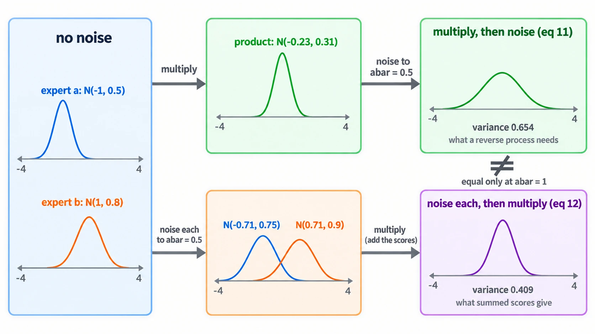
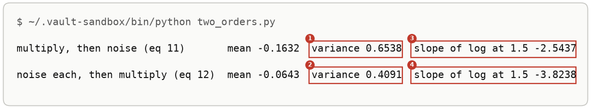
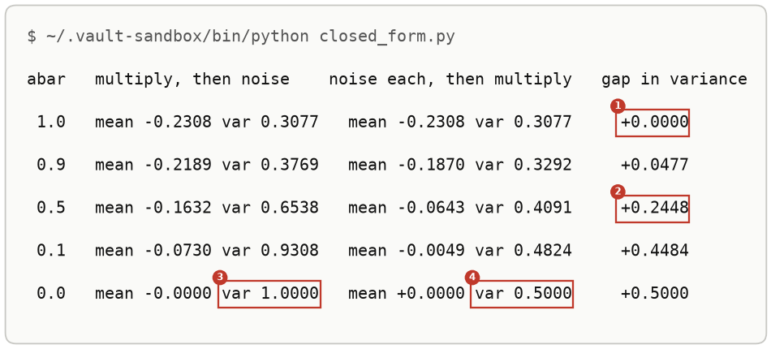
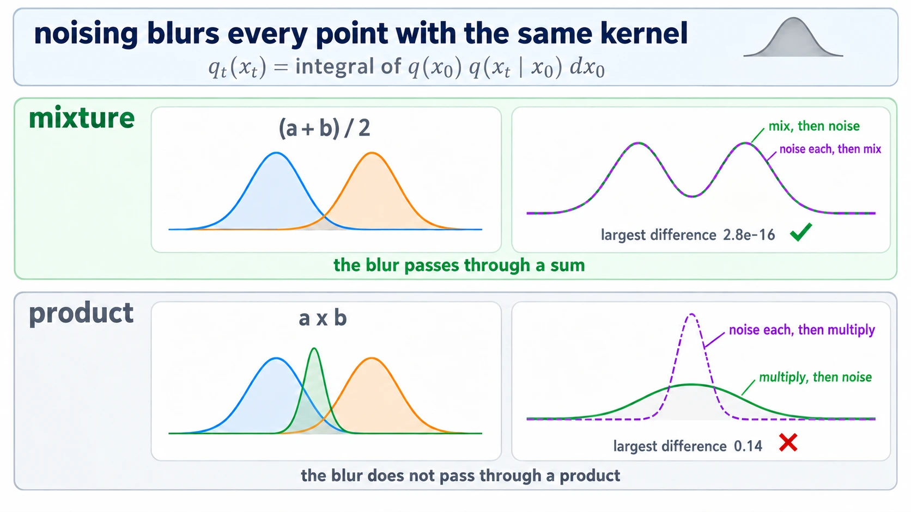
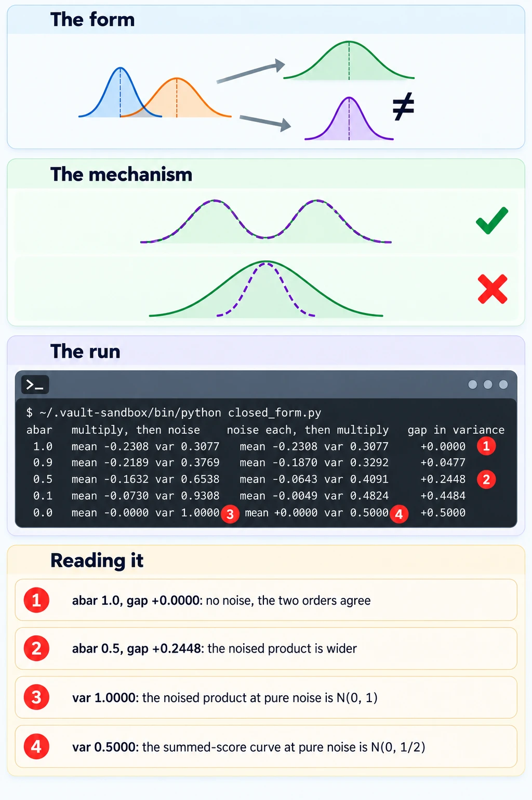

# The Order Of Multiplying And Noising

Up: [[Composition]] · ⬅️ [[Kinds Of Composition]] · [[More Runs Of The Two Orders]] ➡️

Artificial Intelligence, Generative Modeling, Diffusion Models, Composition. Needs: [[The Forward Process]] and [[Composing Models With A Background]].

> [!question] Test yourself
> [The diffusion models quiz](https://claude.ai/artifact/MyTdAaVfZW3wiqhbLKg4wu) covers the [[Diffusion Models]] folder. This note's sections are not in it yet.

> [!warning] Unfinished
> - The reverse process is run in [[#Try the two orders yourself]] without a note of its own; it, the score and the training objective wait for a walk that reaches them.
>
> Stated, not checked: 1 claim, marked where it sits.

**Multiplying two experts and then noising the product (equation 11 of Du et al.) gives a different curve from noising each expert and then multiplying (equation 12), at every noise level except none. Adding two diffusion models' scores gives the second curve, and the reverse process needs the first.** A mixture of two experts has no such problem: mixing then noising and noising then mixing give the same curve. *Cited:* Du et al., Reduce, Reuse, Recycle, section 4: "For $t>0$, this quantity is *not* equal to the sum of the scores of the two models".

## Where you work

The setup is in [[Diffusion Models#Where you work]]: any terminal with Python 3, NumPy and Matplotlib, a new empty folder, and the learner's `toy.py` and `samples.py` saved into it.

## Table of contents

- [[#Words the two orders use]]
- [[#The one-dimensional pair]]
- [[#When to reach for the two orders]]
- [[#The form of the two orders]]
- [[#Try the two orders yourself]]
- [[#Reading the two-orders output]]
- [[#How the two orders work]]
- [[Annealed MCMC]]
- [[#Other ways to get the noised product]]
- [[#Why the two orders matter]]
- [[#The two orders taught in, applied in]]

## Words the two orders use

Navigation: 📋 [[#Table of contents|TOC]] | [[#The one-dimensional pair]] ➡️

**Score.** The slope of the log of a density, $\nabla_x \log q(x)$. A diffusion model's network estimates it at every noise level. For $\mathcal{N}(m, v)$ it is $-(x - m)/v$, because [the log](../../../../Mathematics/references/textbooks/algebra/algebra-handbook.pdf#page=110) of the density is $-(x - m)^2 / (2v)$ plus a constant. *Derived.*

**Summed score.** Two models' scores added at the same point and the same level. The log of a product is the sum of the logs, so the summed score is the score of the product of the two *noised* experts. *Derived.* The product's missing area does not enter it: on this pair the clean product has area 0.075126, and dividing by that moves the log by a constant, which has slope 0. See [[The Area A Product Loses]].

**Multiply, then noise**, equation 11. Multiply the clean experts, then push the product through the forward process to level $\bar\alpha$. This is the curve a model trained on the product's own data would learn, and the one the reverse process assumes it is walking down.

**Noise each, then multiply**, equation 12. Push each expert to level $\bar\alpha$ on its own, then multiply. This is the curve the summed score belongs to.

The sampler correctors journey names the curves by the order the operations run in, the same as here: equation 11's curve is "compose-then-noise" and equation 12's is "noise-then-compose".

## The one-dimensional pair

Navigation: ⬅️ [[#Words the two orders use]] | 📋 [[#Table of contents|TOC]] | [[#When to reach for the two orders]] ➡️

Every number below is on two one-dimensional experts, chosen unequal so the product's centre is not 0:

| Cloud | Mean | Variance |
|---|---|---|
| expert a | $-1$ | $0.5$ |
| expert b | $1$ | $0.8$ |
| their product, no noise | $-0.2308$ | $0.3077$ |

The product is narrower than either expert because precisions add: $1/0.5 + 1/0.8 = 3.25$, and $1/3.25 = 0.3077$. See [[Products And Quotients Of Diagonal Gaussians]].

## When to reach for the two orders

Navigation: ⬅️ [[#The one-dimensional pair]] | 📋 [[#Table of contents|TOC]] | [[#The form of the two orders]] ➡️

When two diffusion models are composed by adding their scores (a conjunction of two prompts, or a guidance term added to a model) and the samples come out wrong although each model samples well alone. Comparing the two orders on a case with exact scores says whether the fault lies in the models or in the sampler. Without that check, the natural move is to retrain or fine-tune models that were never the problem.

## The form of the two orders

Navigation: ⬅️ [[#When to reach for the two orders]] | 📋 [[#Table of contents|TOC]] | [[#Try the two orders yourself]] ➡️

```text
noising kernel:                      q(x_t | x_0) = N(x_t; sqrt(abar) x_0, 1 - abar)
eq 11, multiply, then noise:         q~_t(x_t)  is proportional to  integral of q1(x_0) q2(x_0) q(x_t | x_0) dx_0
eq 12, noise each, then multiply:    q_t(x_t)   is proportional to  [integral of q1(x_0) q(x_t | x_0) dx_0] x [integral of q2(x_0) q(x_t | x_0) dx_0]
score of eq 12:                      s1(x_t, abar) + s2(x_t, abar), the summed score
equal at abar = 1 for a product; equal at every abar for a mixture (q1 + q2) / 2
```



*The form, the clean experts multiplied then noised in green against noised then multiplied in purple.*

## Try the two orders yourself

Navigation: ⬅️ [[#The form of the two orders]] | 📋 [[#Table of contents|TOC]] | [[#Reading the two-orders output]] ➡️

**1. What you need.** Python with NumPy, through the prepared environment:

```bash
~/.vault-sandbox/bin/python -c "import numpy; print(numpy.__version__)"
```

You should see a version number. This run printed `2.4.6`.

**2. When it is missing.** [[Sampling A Diagonal Gaussian#Try sampling yourself]] steps 1 and 2 say how to make the environment, or how to use `uv run` instead.

**3. Make something to act on.** A new empty folder, and the two experts with the three pieces every script below uses: the forward jump from [[The Forward Process]], the product rule, and the summed score. The last six lines build a 100-level cosine noise schedule for the two samplers, step 5's and [[More Runs Of The Two Orders#A sampler that reaches the product with the same summed score|the annealed run]]'s.

```bash
mkdir -p ~/playground/sandbox/two-orders && cd ~/playground/sandbox/two-orders
```

Save this as `experts.py`:

```python
import numpy as np

experts = [(-1.0, 0.5), (1.0, 0.8)]          # (mean, variance) of expert a and expert b


def noised(m, v, abar):
    """A Gaussian N(m, v) after the forward jump to level abar."""
    return np.sqrt(abar) * m, abar * v + 1 - abar


def product(m1, v1, m2, v2):
    """N(m1, v1) times N(m2, v2), renormalised: precisions add."""
    v = 1 / (1 / v1 + 1 / v2)
    return v * (m1 / v1 + m2 / v2), v


def summed_score(x, abar):
    """What adding the two models' scores gives at level abar."""
    return sum(-(x - noised(m, v, abar)[0]) / noised(m, v, abar)[1] for m, v in experts)


T = 100                                       # cosine schedule, 100 levels
u = np.arange(T + 1) / T
ac = np.cos((u + 0.008) / 1.008 * np.pi / 2) ** 2
ac = ac / ac[0]
betas = np.concatenate([[0.0], np.clip(1 - ac[1:] / ac[:-1], 0, 0.999)])
abars = np.cumprod(1 - betas)                 # abars[0] = 1 is clean, abars[T] is almost pure noise
```

**4. Look at it before.** Save this as `before.py`:

```python
from experts import experts, product

(ma, va), (mb, vb) = experts
m, v = product(ma, va, mb, vb)
print(f"the product at no noise: mean {m:.6f}, variance {v:.6f}")
```

```bash
~/.vault-sandbox/bin/python before.py
```

```text
the product at no noise: mean -0.230769, variance 0.307692
```

This is the target every sampler below is trying to reach.

**5. The failure: the reverse process on the summed score.** Start 100,000 points from pure noise and take one reverse step per level, each step using the summed score where a single model's score would go. Every score here is exact, so nothing a trained network could get wrong is in play. Save this as `reverse.py`:

```python
import numpy as np
from experts import experts, product, summed_score, T, betas, abars

rng = np.random.default_rng(0)
x = rng.standard_normal((100_000, 1))                      # start from pure noise
for t in range(T, 0, -1):                                  # one reverse step per level
    eps = -np.sqrt(1 - abars[t]) * summed_score(x, abars[t])
    mean = (x - betas[t] / np.sqrt(1 - abars[t]) * eps) / np.sqrt(1 - betas[t])
    x = mean + np.sqrt(betas[t]) * rng.standard_normal(x.shape)
m, v = product(*experts[0], *experts[1])
print(f"reverse process on the summed score: mean {x.mean():.4f}, variance {x.var():.4f}")
print(f"the product it was meant to reach:   mean {m:.4f}, variance {v:.4f}")
```

```bash
~/.vault-sandbox/bin/python reverse.py
```

You should see:


The cloud ends 32% narrower than the product, and its centre sits 0.07 too far toward 0. The line `eps = ...` turns the score into the noise estimate<sub>[1](/home/molef/goal-setting/learning/deep-learning/diffusion-models/01-poe-derivation-foundations/textbook/09-the-forward-process-by-hand.md#95-eps---sigma_t-grad-log-q "PoE derivation foundations, chapter 9.5, eps = -sigma_t grad log q"), [2](../../../../Mathematics/references/textbooks/machine-learning/the-little-book-of-generative-ai-foundations.pdf#page=134 "the little book of generative AI foundations p. 134")</sub> the reverse step of Du et al.'s equation 1 expects.

<!-- video-table: reverse-step-and-sampler rev=1 -->
The reverse step and sampler loop, in lecture and in code, to compare against task 2.2:

| Order | What it covers | Kind | Code it writes | Watch |
|---|---|---|---|---|
| 1 | Diffusion and the reverse process | Proof | | [Stanford CS236, lecture 16, 19:05 to 29:42](https://www.youtube.com/watch?v=VsllsC2JMGY&t=1145s) |
| 2 | The reverse loop from noise to image | Code walk | the sampler loop | [Vizuara, DDPM practical, 39:32 to 41:43](https://www.youtube.com/watch?v=6to_EG3SJgs&t=2372s) |
| 3 | Sampling function of a small DDPM | Code walk | the sampling function | [Umar Jamil, 13:00 to 21:11](https://www.youtube.com/watch?v=I1sPXkm2NH4&t=780s) |

Start and end times are chapter boundaries from each video; what is said inside was judged from the chapter titles and not read from captions.
<!-- /video-table -->

**6. The technique: build both orders on a grid.** Equations 11 and 12 are integrals<sub>[1](/home/molef/goal-setting/learning/mathematics/statistics/conditional-expectation/textbook/conditional-expectation.pdf#page=12 "conditional expectation from the ground up p. 12"), [2](../../../../Mathematics/references/textbooks/statistics/introduction-to-probability-for-data-science.pdf#page=266 "introduction to probability for data science p. 266")</sub> over $x_0$. On a grid of 1,601 points, the noising kernel becomes a matrix `K`, whose entry `K[i, j]` is the noising density at `x[i]` given a clean point at `x[j]`, and each integral becomes `K @ density * dx`. Save this as `two_orders.py`:

```python
import numpy as np
from experts import experts

x = np.linspace(-8, 8, 1601)
dx = x[1] - x[0]
abar = 0.5                                                 # half the signal left


def gauss(z, m, v):
    return np.exp(-(z - m) ** 2 / (2 * v)) / np.sqrt(2 * np.pi * v)


def mean_var(p):
    p = p / (p.sum() * dx)
    m = (x * p).sum() * dx
    return m, ((x - m) ** 2 * p).sum() * dx


def slope_of_log(p, at=1.5):
    i = int(round((at - x[0]) / dx))
    return (np.log(p[i + 1]) - np.log(p[i - 1])) / (2 * dx)


(ma, va), (mb, vb) = experts
qa, qb = gauss(x, ma, va), gauss(x, mb, vb)
K = gauss(x[:, None], np.sqrt(abar) * x[None, :], 1 - abar)   # K[i, j] = q(x_t = x[i] | x_0 = x[j])
first = K @ (qa * qb) * dx                                    # equation 11: multiply, then noise
second = (K @ qa * dx) * (K @ qb * dx)                        # equation 12: noise each, then multiply
for name, p in [("multiply, then noise (eq 11)", first), ("noise each, then multiply (eq 12)", second)]:
    m, v = mean_var(p)
    print(f"{name:34s} mean {m:+.4f}  variance {v:.4f}  slope of log at 1.5 {slope_of_log(p):+.4f}")
```

```bash
~/.vault-sandbox/bin/python two_orders.py
```

You should see:



With half the signal left, the curve a reverse process needs has variance 0.654, and the curve summed scores describe has variance 0.409. The two lines differ only in where `*` sits relative to `K @`.

**7. Another way to get the same answer: the closed form, at every level.** Both orders stay Gaussian, so each is two calls: `noised(*product(...))` for equation 11 and `product(*noised(...), *noised(...))` for equation 12. Save this as `closed_form.py`:

```python
from experts import experts, noised, product

(ma, va), (mb, vb) = experts
print("abar   multiply, then noise    noise each, then multiply   gap in variance")
for abar in (1.0, 0.9, 0.5, 0.1, 0.0):
    m1, v1 = noised(*product(ma, va, mb, vb), abar)
    m2, v2 = product(*noised(ma, va, abar), *noised(mb, vb, abar))
    print(f"{abar:4.1f}   mean {m1:+.4f} var {v1:.4f}   mean {m2:+.4f} var {v2:.4f}     {v1 - v2:+.4f}")
```

```bash
~/.vault-sandbox/bin/python closed_form.py
```

You should see:



The abar 0.5 line matches step 6 to four decimals. The gap is zero only with no noise, and it grows to 0.5 at pure noise.

**8. More worked examples on the same setup.** Five more runs on this folder, each with its output read field by field, are in [[More Runs Of The Two Orders]]: [[More Runs Of The Two Orders#A mixture against a product|a mixture against a product]], [[More Runs Of The Two Orders#A sampler that reaches the product with the same summed score|a sampler that reaches the product with the same summed score]], [[More Runs Of The Two Orders#More levels do not help|more levels do not help]], [[More Runs Of The Two Orders#Route A and route B, level by level|route A and route B, level by level]], [[More Runs Of The Two Orders#Steps per level against step size|steps per level against step size]].

**9. Clean up, and prove it.**

```bash
cd ~ && rm -r ~/playground/sandbox/two-orders
ls ~/playground/sandbox/two-orders; echo $?
```

You should see `No such file or directory`, then `2`.

## Reading the two-orders output

Navigation: ⬅️ [[#Try the two orders yourself]] | 📋 [[#Table of contents|TOC]] | [[#How the two orders work]] ➡️

**From step 6, `two_orders.py`:**

| # | Field | This run | How to read it | Backing |
|---|---|---|---|---|
| 1 | multiply, then noise: variance | `0.6538` | the noised product's width, the curve the reverse process assumes at $\bar\alpha = 0.5$ | derived below |
| 2 | noise each, then multiply: variance | `0.4091` | the width of the curve the summed score belongs to; 0.245 narrower | derived below |
| 3 | multiply, then noise: slope of log at 1.5 | `-2.5437` | the score a model trained on the product would return at $x_t = 1.5$ | derived below |
| 4 | noise each, then multiply: slope of log at 1.5 | `-3.8238` | the summed score at the same point: $-2.9428 + (-0.8810)$, expert a's noised score plus expert b's | derived below |

**From step 7, `closed_form.py`**, which prints the same two curves at five levels:

| # | Field | This run | How to read it | Backing |
|---|---|---|---|---|
| 1 | gap at abar 1.0 | `+0.0000` | with no noise the two orders are the same product | derived below |
| 2 | gap at abar 0.5 | `+0.2448` | field 1 minus field 2 of step 6 | derived below |
| 3 | multiply, then noise at abar 0.0: variance | `1.0000` | anything noised all the way is $\mathcal{N}(0, 1)$ | derived below |
| 4 | noise each, then multiply at abar 0.0: variance | `0.5000` | two $\mathcal{N}(0, 1)$ multiplied: $\mathcal{N}(0, 1/2)$. The `-0.0000` beside field 3 is a negative zero from rounding | cited, section 4: the summed-score sequence ends at "$\mathcal{N}(0, I/2)$ at $t=T$" |

**From step 5, `reverse.py`, and `annealed.py` in [[More Runs Of The Two Orders#A sampler that reaches the product with the same summed score]]:**

| # | Field | This run | How to read it | Backing |
|---|---|---|---|---|
| 1 | reverse process: variance | `0.2102` | 31.8% narrower than the product; followed exactly, with no sampling, the loop ends at 0.209963 | shown; the exact figure from the journey's answer key, `checks/reverse_diffusion.out` |
| 1 | annealed Langevin: variance | `0.3124` | within 1.5% of the product; followed exactly it ends at 0.313044, 1.7% wide | shown; the exact figure from `checks/annealed_mcmc.out` |
| 2 | the product: variance | `0.3077` | the target, as `before.py` printed | shown |

## How the two orders work

Navigation: ⬅️ [[#Reading the two-orders output]] | 📋 [[#Table of contents|TOC]] | [[Annealed MCMC]] ➡️

**Why a mixture survives the order and a product does not.** Noising a density is one integral<sub>[1](/home/molef/goal-setting/learning/mathematics/statistics/conditional-expectation/textbook/conditional-expectation.pdf#page=12 "conditional expectation from the ground up p. 12"), [2](../../../../Mathematics/references/textbooks/statistics/introduction-to-probability-for-data-science.pdf#page=266 "introduction to probability for data science p. 266")</sub> against the kernel:

$$
q_t(x_t) = \int q(x_0)\, q(x_t \mid x_0)\, dx_0
$$

The integral is linear in $q$, so it passes through a weighted sum:

$$
\begin{aligned}
\int \left(\tfrac12 q^1 + \tfrac12 q^2\right)(x_0)\, q(x_t \mid x_0)\, dx_0
&= \tfrac12 \int q^1(x_0)\, q(x_t \mid x_0)\, dx_0 + \tfrac12 \int q^2(x_0)\, q(x_t \mid x_0)\, dx_0 \\
&= \tfrac12 q^1_t(x_t) + \tfrac12 q^2_t(x_t)
\end{aligned}
$$

For a product there is no such step. $\int q^1 q^2\, K\, dx_0$ is one integral of a product, and $\left(\int q^1 K\, dx_0\right)\left(\int q^2 K\, dx_0\right)$ is a product of two integrals; an integral of a product is not in general the product of the integrals. *Derived.* [[More Runs Of The Two Orders#A mixture against a product]] shows it: $2.8 \times 10^{-16}$ for the mixture, $0.14$ for the product.

**The worked numbers at $\bar\alpha = 0.5$.** The jump sends $\mathcal{N}(m, v)$ to $\mathcal{N}(\sqrt{\bar\alpha}\,m,\ \bar\alpha v + 1 - \bar\alpha)$ ([[The Forward Process#How the jump works]]), and a product of Gaussians adds precisions<sub>[1](/home/molef/goal-setting/learning/deep-learning/diffusion-models/01-poe-derivation-foundations/textbook/10-completing-the-square.md#101-the-product-of-two-gaussians-precisions-add "PoE derivation foundations, chapter 10.1, the product of two Gaussians"), [2](../../../../Mathematics/references/textbooks/linear-algebra/matrix-cookbook.pdf#page=42 "matrix cookbook p. 42")</sub>.

Equation 11, multiply first:

$$
\begin{aligned}
v_p &= \frac{1}{1/0.5 + 1/0.8} = \frac{1}{3.25} = 0.307692, \qquad m_p = 0.307692 \times \left(\frac{-1}{0.5} + \frac{1}{0.8}\right) = 0.307692 \times (-0.75) = -0.230769 \\
\text{mean} &= \sqrt{0.5} \times (-0.230769) = -0.163178, \qquad \text{variance} = 0.5 \times 0.307692 + 0.5 = 0.653846
\end{aligned}
$$

Equation 12, noise each first:

$$
\begin{aligned}
\text{expert a} &\to \mathcal{N}(-0.707107,\ 0.5 \times 0.5 + 0.5) = \mathcal{N}(-0.707107,\ 0.75) \\
\text{expert b} &\to \mathcal{N}(0.707107,\ 0.5 \times 0.8 + 0.5) = \mathcal{N}(0.707107,\ 0.9) \\
\text{variance} &= \frac{1}{1/0.75 + 1/0.9} = \frac{1}{2.444444} = 0.409091 \\
\text{mean} &= 0.409091 \times \left(\frac{-0.707107}{0.75} + \frac{0.707107}{0.9}\right) = 0.409091 \times (-0.157135) = -0.064282
\end{aligned}
$$

The scores at $x_t = 1.5$:

$$
\begin{aligned}
\text{eq 11:}\quad & -\frac{1.5 - (-0.163178)}{0.653846} = -2.543685 \\
\text{eq 12:}\quad & -\frac{1.5 + 0.707107}{0.75} - \frac{1.5 - 0.707107}{0.9} = -2.942809 - 0.880992 = -3.823802
\end{aligned}
$$

**At the two ends.** With no noise, $\bar\alpha = 1$, the jump does nothing and both orders are the product $\mathcal{N}(-0.230769, 0.307692)$. With pure noise, $\bar\alpha = 0$, equation 11 gives $\mathcal{N}(0, 1)$ whatever was noised, while equation 12 multiplies two $\mathcal{N}(0, 1)$ curves: precision $1 + 1 = 2$, variance $\tfrac12$. In general:

$$
\begin{aligned}
\text{eq 11 variance} &= \bar\alpha\, v_p + 1 - \bar\alpha \\
\text{eq 12 variance} &= \left(\frac{1}{\bar\alpha v_a + 1 - \bar\alpha} + \frac{1}{\bar\alpha v_b + 1 - \bar\alpha}\right)^{-1}
\end{aligned}
$$

These print as the five rows of step 7. *Derived.*

**Why the reverse process misses.** Each reverse step moves a cloud from level $t$ to level $t - 1$ of one forward-noising sequence. Equation 12's curves, taken level by level, are not such a sequence: the paper says they "smoothly interpolate between $q^{\text{prod}}(x)$ at $t=0$ and $\mathcal{N}(0, I/2)$ at $t=T$, though this sequence of distributions does not correspond to the distributions that result from the standard forward diffusion process". *Cited:* section 4, the paragraph after equation 12. On the pair the reverse process ends at variance 0.2102, too narrow. *Shown*, step 5. Equation 12's curves are narrower than equation 11's at every level below none, step 7. That the narrow curves are what make the samples narrow is the writer's reading of the two outputs together. *Stated.*

**More levels do not close the gap, the two routes level by level, and why annealed Langevin reaches the product** are each derived beside their run in [[More Runs Of The Two Orders]]: [[More Runs Of The Two Orders#More levels do not close the gap|more levels]], [[More Runs Of The Two Orders#The two routes, derived|the two routes]] and [[More Runs Of The Two Orders#Why annealed Langevin reaches the product|annealed Langevin]].

**The sampler, or the model.** Step 5 and [[More Runs Of The Two Orders#A sampler that reaches the product with the same summed score|the annealed run]] use the same exact scores. One sampler misses by 31.8% of the product's variance and the other lands within 1.7%, so on this pair the failure is the sampler's. The paper's abstract says "We conclude that the sampler (not the model) is responsible for this failure". Its body is more careful, in section 4.1: the results "further imply that the choice of sampler may be responsible for prior failures in compositional generation". *Cited:* `text/abstract.tex` line 2 and `text/method.tex` line 131 of the paper's source.

The paper's Figure 2 shows the same two samplers on two-dimensional pairs:


> **Figure 2.** **An illustration of product and mixture compositional models, and the improved sampling performance of MCMC in both cases.** Left to right: Component distributions, ground truth composed distribution, reverse diffusion samples, HMC samples. Top: product, bottom: mixture. Reverse diffusion fails to sample from composed models.
>
> *Du, Durkan, Strudel, Tenenbaum, Dieleman, Fergus, Sohl-Dickstein, Doucet, Grathwohl, Reduce, Reuse, Recycle, ICML 2023, [arXiv 2302.11552](https://arxiv.org/abs/2302.11552), Figure 2. arXiv non-exclusive distribution licence; copied for study with citation.*

The top row is this section's failure at full scale: the true product keeps the top and bottom blobs, reverse diffusion with summed scores leaves samples all round the ring, and HMC<sub>[1](/home/molef/goal-setting/learning/deep-learning/diffusion-models/00-from-scratch-to-sdxl/textbook/l3-stochastic-processes/l3-stochastic-processes.pdf#page=70 "volume L3, stochastic processes, p. 70"), [2](../../../../Mathematics/references/textbooks/machine-learning/pattern-recognition-and-machine-learning.pdf#page=568 "pattern recognition and machine learning p. 568")</sub>, another MCMC sampler, recovers the two blobs. *Shown* in the figure. The sampler kept the ring and lost the bar, one of the two experts.

The walk redrew the top row with exact scores in place of trained networks, 5,000 samples per panel, counting a sample as on target when it lies within 0.1 of one of the two true blobs. The true product puts 96.8% there and reverse diffusion 55.6%. HMC with the settings the paper's appendix F prints reaches 69.0%, short of what the paper's panel shows; with 30 HMC steps per noise level it reaches 87.0%, and with 300 it reaches 91.5%, on 400 samples each. *Cited:* the journey's answer keys `checks/ring_times_bar.out` and `checks/ring_times_bar_more_steps.out`, three standard errors at most 2.1 points at 5,000 samples and 5.0 to 6.9 at 400. The same panels on the one-dimensional pair, 20,000 samples each: reverse diffusion ends at variance 0.2100 and annealed MCMC at 0.3076, against the product's 0.3077 (`checks/fig2_on_the_object.out`, tolerance 0.0092).

The bottom row is a mixture, where the noising order does not matter ([[More Runs Of The Two Orders#A mixture against a product]]: $2.8 \times 10^{-16}$), and reverse diffusion still smears it. With exact scores the mixture's noised curves are one forward sequence, so the plain reverse process would be the right sampler, and the bottom row's failure has to come from how the two trained models were combined. The paper gives no cause: its appendix C.3 lists "products, tempering, and guidance" as the operators that do not commute with noising and leaves the mixture out, while the caption says reverse diffusion "fails to sample from composed models" of both rows. *Derived* for the commuting; *cited* for the caption and C.3, as the journey's read-ahead quotes them at chunk 36. A mixture's score needs each model's height as well as its slope, and the paper builds it from energy-parameterised models, assuming "this ratio [of normalizers] is 1"; [[The Energy Parameterisation#How the energy works]] and [[Product, Mixture And Negation]] work that out on this pair. No released code builds this row. *Cited:* section 3, the mixture paragraph.



*The mechanism, the blur passing through a mixture and not through a product.*



*The deep-dive sheet composing the form, the mechanism and the run of `closed_form.py`.*

## Annealed MCMC

Navigation: ⬅️ [[#How the two orders work]] | 📋 [[#Table of contents|TOC]] | [[#Other ways to get the noised product]] ➡️

**Annealed MCMC, the paper's Algorithm 1, takes a few MCMC steps at every noise level from the noisiest to the clean one, each aimed at that level's composed curve, and carries the cloud down to the next level unchanged.** Taught in full in [[Annealed MCMC]].

## Other ways to get the noised product

Navigation: ⬅️ [[Annealed MCMC]] | 📋 [[#Table of contents|TOC]] | [[#Why the two orders matter]] ➡️

- **Train one model on the product's own data.** Its score is equation 11's directly, and the plain reverse process works. It needs samples of the composition, which composing two models is meant to avoid. Nothing in the authors' 2D notebook computes equation 11: it would need a model trained on the product itself. *Cited:* the journey's read-ahead, `read-ahead/00-abstract.md`, sentence 5, which read all 47 cells of `notebooks/simple_distributions.ipynb`.
- **Repeat the reverse step at the same level.** Running the reverse process several times at one noise level with the summed score is a form of the Langevin sampler. *Cited:* section 4.1, paragraph 2.
- **Continuous-time samplers run across time** have the same problem as the reverse process, because they too move along the sequence of levels rather than sampling each level's curve. *Cited:* section 4.1, paragraph 3.
- **Metropolis-corrected samplers**, MALA and HMC with an [accept-or-reject test](/home/molef/goal-setting/learning/deep-learning/diffusion-models/00-from-scratch-to-sdxl/textbook/l3-stochastic-processes/l3-stochastic-processes.pdf#page=21), which need each model's energy and not only its score. *Cited:* the abstract, sentence 7. Run on this pair in [[The Energy Parameterisation]].

## Why the two orders matter

Navigation: ⬅️ [[#Other ways to get the noised product]] | 📋 [[#Table of contents|TOC]] | [[#The two orders taught in, applied in]] ➡️

Products are not the only casualty. The paper's appendix C finds "that products, tempering, and guidance applied to diffused distributions do not give diffusions of the modified target distributions" (*cited:* `text/appendix.tex` line 232). Any composition built by adding or scaling scores therefore asks the reverse process to walk a sequence it was not built for.

[[Composing Models With A Background]] asks which density a composition defines, and its shared case is a hybrid that no sampler can turn into co-occurrence. This section asks whether the sampler reaches the density the composition defines. The two failures look alike in samples, and a change of sampler fixes only the second.

## The two orders taught in, applied in

Navigation: ⬅️ [[#Why the two orders matter]] | 📋 [[#Table of contents|TOC]]

**Taught in:**

- the `drip-read` walk of Du et al., Reduce, Reuse, Recycle, abstract sentences 5 and 6, and section 3, paragraph 1 (products lose their area, mixtures keep it, and the score ignores the area). The walk's paper note, `deep-learning/diffusion-models/02-sampler-correctors-for-composition/papers/reduce-reuse-recycle/reduce-reuse-recycle.md` in this vault, is not written yet; link it here when it is.
- the same walk, section 4, chunks 45 to 51: reverse diffusion on exact summed scores misses the product at any number of levels, equations 11 and 12 as route A and route B level by level, Algorithm 1 and what its steps per level and step size each control, and why only unadjusted samplers are open to a score model. Paper note at the same path, still to be written.
- the same journey's [plan 24](/home/molef/goal-setting/learning/deep-learning/diffusion-models/02-sampler-correctors-for-composition/plans/24-what-is-annealed.md), line 21 (which axis annealed MCMC moves along: the noise level, separated from temperature and guidance scale)
- the sampler correctors for composition journey's [plan 14](/home/molef/goal-setting/learning/deep-learning/diffusion-models/02-sampler-correctors-for-composition/plans/14-the-two-gaussian-toy.md), line 262 (compare the two orders at $\bar\alpha_t = 0.5$ on this pair), and [plan 15](/home/molef/goal-setting/learning/deep-learning/diffusion-models/02-sampler-correctors-for-composition/plans/15-the-two-gaps.md), lines 36 to 44 and 201 to 205 (the gap in mean and the gap in variance, derived in closed form)

**Applied in:** nothing yet.

> [!note]- How this was checked
> The runs in The Order Of Multiplying And Noising were made by the writer in a second empty folder, `~/playground/sandbox/two-orders`, on the same PC and environment (Python 3.11.13, NumPy 2.4.6, Matplotlib 3.11.2), on 2026-10-09; the folder was removed afterwards and the clean-up check returned 2. The six scripts are shortened from the sampler correctors journey's answer keys in `sources/reduce-reuse-recycle/checks/`: `two_routes.py`, `mixture_score.py`, `reverse_diffusion.py` and `annealed_mcmc.py`. Every printed number matched those keys' outputs to the digits shown: variances 0.653846 and 0.409091, mixture difference 2.8e-16, reverse process mean -0.1567 and variance 0.2102, annealed Langevin mean -0.2273 and variance 0.3124, all with seed 0. The keys' exactly-followed figures, 0.209963 and 0.313044, are quoted from their `.out` files. The walk described the pair as two unit-variance experts; the numbers it quoted (0.654, 0.409, 0.308) belong to variances 0.5 and 0.8, which is the pair used here. With unit variances the product would have variance 0.5.
