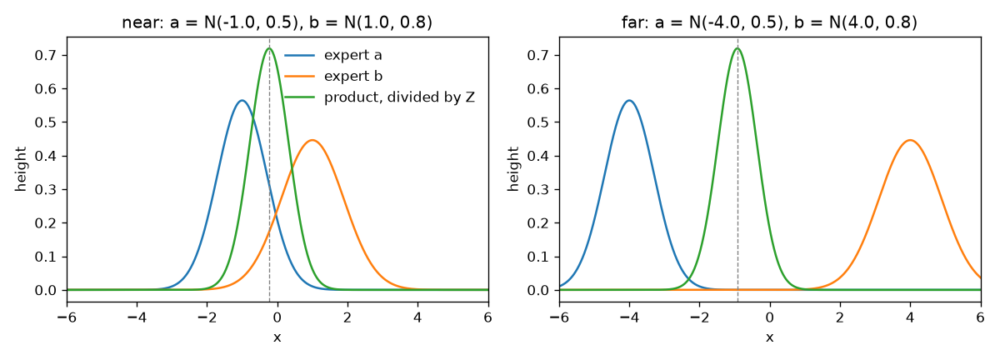
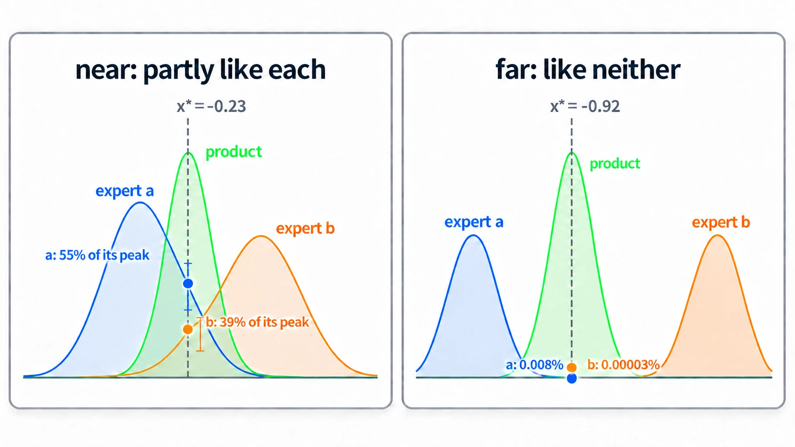

# The Product As An Intersection

Up: [[Composition]] · ⬅️ [[Composing Models With A Background]] · [[Kinds Of Composition]] ➡️

Artificial Intelligence, Generative Modeling, Diffusion Models, Composition. Needs: [[Composing Models With A Background]].

> [!question] Test yourself
> [The diffusion models quiz](https://claude.ai/artifact/MyTdAaVfZW3wiqhbLKg4wu) covers the [[Diffusion Models]] folder. This note's sections are not in it yet.

> [!warning] Unfinished
> - One picture is waiting to be drawn: prompt 13 in the vault's `.prompts/Diffusion Models.md`.

**Multiplying experts gives a density that is tall only where every expert is at least somewhat tall, which is why Du et al. call the product an "intersection"; its peak is a compromise between the experts, at a point where none of them is at its best.** *Cited:* Du et al., Reduce, Reuse, Recycle, section 3, paragraph 2 (`text/method.tex` lines 10 to 19): "Regions of high probability under $q^\text{prod}(x)$ will typically have high probability under *all* $q^i(x)$." The word "typically" matters, because the product's peak need not sit where any single expert peaks.

**When to reach for it.** When a composed sample looks like neither concept in full. The product rewards points that are partly like each expert, so a sample that is half of each is what the product asks for. Co-occurrence, a dog and a cat both present, needs places where every expert is high at once. Where those places barely overlap, the product picks the point in between. *Derived* from the product's definition, and shown on numbers below.

**Try it yourself.** The two experts are the pair in [[The Order Of Multiplying And Noising#The one-dimensional pair]], $a = \mathcal{N}(-1, 0.5)$ and $b = \mathcal{N}(1, 0.8)$, with a second pair of the same widths pulled apart to $\pm 4$.

1. You need the prepared environment: `~/.vault-sandbox/bin/python -c "import numpy, matplotlib"` prints nothing when both are there. If it fails, [[Sampling A Diagonal Gaussian#Try sampling yourself]] steps 1 and 2 say how to make it.
2. Make an empty folder:

   ```bash
   mkdir -p ~/playground/sandbox/product-intersection && cd ~/playground/sandbox/product-intersection
   ```

3. Save this as `intersection.py`. For each pair it multiplies the experts point by point, divides by the area, finds the tallest point, and reads each expert's height there against that expert's own peak:

   ```python
   # Where a product of two experts is tall, and how tall each expert is there.
   import numpy as np
   import matplotlib
   matplotlib.use("Agg")
   import matplotlib.pyplot as plt

   def gauss(x, m, v):
       return np.exp(-(x - m) ** 2 / (2 * v)) / np.sqrt(2 * np.pi * v)

   x = np.linspace(-8, 8, 1601)                     # grid spacing 0.01
   dx = x[1] - x[0]
   pairs = {"near": ((-1.0, 0.5), (1.0, 0.8)),      # the chunk's pair
            "far":  ((-4.0, 0.5), (4.0, 0.8))}      # the same widths, pulled apart

   fig, axes = plt.subplots(1, 2, figsize=(10, 3.6))
   for ax, (name, ((ma, va), (mb, vb))) in zip(axes, pairs.items()):
       qa, qb = gauss(x, ma, va), gauss(x, mb, vb)
       raw = qa * qb
       Z = raw.sum() * dx
       prod = raw / Z
       i = int(prod.argmax())
       peak = (ma / va + mb / vb) / (1 / va + 1 / vb)   # precision-weighted mean
       print(f"{name}: product peaks at x = {x[i]:.2f} (closed form {peak:.4f}), area before dividing Z = {Z:.3g}")
       print(f"{name}: there, a is {qa[i]:.3g} against its own peak {qa.max():.3g}, {100 * qa[i] / qa.max():.3g}%")
       print(f"{name}: there, b is {qb[i]:.3g} against its own peak {qb.max():.3g}, {100 * qb[i] / qb.max():.3g}%")
       ax.plot(x, qa, color="tab:blue", label="expert a")
       ax.plot(x, qb, color="tab:orange", label="expert b")
       ax.plot(x, prod, color="tab:green", label="product, divided by Z")
       ax.axvline(x[i], color="grey", lw=0.8, ls="--")
       ax.set_xlim(-6, 6); ax.set_title(f"{name}: a = N({ma}, {va}), b = N({mb}, {vb})")
       ax.set_xlabel("x"); ax.set_ylabel("height")
   axes[0].legend(frameon=False)
   fig.tight_layout()
   fig.savefig("intersection.png", dpi=120)
   ```

4. Run it:

   ```bash
   ~/.vault-sandbox/bin/python intersection.py
   ```

   You should see:

   ```
   near: product peaks at x = -0.23 (closed form -0.2308), area before dividing Z = 0.0751
   near: there, a is 0.312 against its own peak 0.564, 55.3%
   near: there, b is 0.173 against its own peak 0.446, 38.8%
   far: product peaks at x = -0.92 (closed form -0.9231), area before dividing Z = 7.14e-12
   far: there, a is 4.28e-05 against its own peak 0.564, 0.00759%
   far: there, b is 1.2e-07 against its own peak 0.446, 2.69e-05%
   ```

   

   and the saved `intersection.png`:

   

5. Clean up, and check the folder is gone:

   ```bash
   cd ~ && rm -r ~/playground/sandbox/product-intersection
   ls ~/playground/sandbox/product-intersection; echo $?
   ```

   You should see `No such file or directory` and `2`.

**Reading the intersection output.**

| # | Field | Value | How to read it | Backing |
|---|---|---|---|---|
| 1 | near, product peak | `-0.23` | between the experts' peaks at $-1$ and $1$, nearer $a$ because $a$ is narrower; the closed form agrees | derived below |
| 2 | near, $a$ at the peak | `55.3%` | expert $a$ is at a little over half its own best | shown, derived below |
| 3 | near, $b$ at the peak | `38.8%` | expert $b$ is at under two fifths of its own best. Neither is at its best; both are partly satisfied | shown, derived below |
| 4 | far, product peak | `-0.92` | the same weighted average of $-4$ and $4$, in the gap between them. `Z = 7.14e-12` is the area the raw product had: almost nothing overlaps | derived below |
| 5 | far, $a$ at the peak | `0.00759%` | expert $a$ gives this point almost no weight | shown |
| 6 | far, $b$ at the peak | `2.69e-05%` | nor does expert $b$. After dividing by $Z$ the product is still a full-height bell, centred on a point neither expert believes in | shown |

**How the intersection works.** The product's peak is the [[Products And Quotients Of Diagonal Gaussians#How the product works|precision-weighted mean]] of the experts' means, worked there step by step:

$$x^\star = \frac{m_a/v_a + m_b/v_b}{1/v_a + 1/v_b} = \frac{-2 + 1.25}{3.25} = -0.230769$$

A Gaussian's height at $x$, as a share of its own peak, is $e^{-(x - m)^2 / (2v)}$, because the normalising constant cancels in the ratio:

$$\frac{q_a(x^\star)}{q_a(m_a)} = e^{-(0.769231)^2 / 1.0} = e^{-0.591716} = 0.5534$$

$$\frac{q_b(x^\star)}{q_b(m_b)} = e^{-(-1.230769)^2 / 1.6} = e^{-0.946746} = 0.3880$$

*Derived.* These match fields 2 and 3. For the far pair, $x^\star = (-8 + 5)/3.25 = -0.923077$, and the shares are $e^{-9.467456} = 7.73 \times 10^{-5}$ and $e^{-15.147929} = 2.64 \times 10^{-7}$. The run reads them at the grid point $-0.92$, which gives the slightly different $7.59 \times 10^{-5}$ and $2.69 \times 10^{-7}$ of fields 5 and 6.

Moving the experts apart never moves the peak away from the weighted average, and never shrinks the bell after dividing by $Z$. It only drives down how much either expert agrees with the peak. Du et al.'s appendix E shows the failure this leads to: "Our approach fails to generate products of distributions with no overlap". *Cited:* `text/appendix.tex` line 306. The walk reaches that figure at chunk 142.

**Why the intersection matters.** This is the one-dimensional picture of a hybrid. The background-divided toy above lands on $-1.5$ in shared's left half for the same reason: a product lands on points that are partly like each concept. The plain product has no background to divide out, so it shows the compromise with nothing else in the way.



*The product as an intersection, two experts and their product with each expert's share at the product's peak.*

**Taught in:** the `drip-read` walk of Du et al., Reduce, Reuse, Recycle, section 3, paragraph 2, chunk 34 (the product as an intersection, and the heights at its peak from the walk's answer key `checks/step6_product.out`). The walk's paper note, `deep-learning/diffusion-models/02-sampler-correctors-for-composition/papers/reduce-reuse-recycle/reduce-reuse-recycle.md` in this vault, is not written yet; link it here when it is.

> [!note]- How this was checked
> The run in The Product As An Intersection was made by the writer in a fourth empty folder, `~/playground/sandbox/product-intersection`, on the same PC and environment, on 2026-10-13; the folder was removed afterwards and the clean-up check returned 2. Its near-pair numbers match the walk's answer key `checks/step6_product.py` and `checks/step6_product.out` in the journey's `sources/reduce-reuse-recycle/`: peak at -0.23, expert a at 0.311840 of 0.564190 and expert b at 0.173266 of 0.446031. The far pair is new to this note and was checked against the derivation in the same subsection. `intersection.png` is the script's own saved figure, opened before filing; the terminal picture was rendered from the captured text by a script in DejaVu Sans Mono, never drawn, and opened before filing. The quotations are from `text/method.tex` lines 10 to 19 and `text/appendix.tex` line 306 of the arXiv source package.
