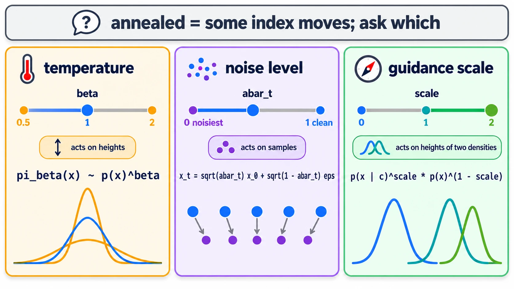
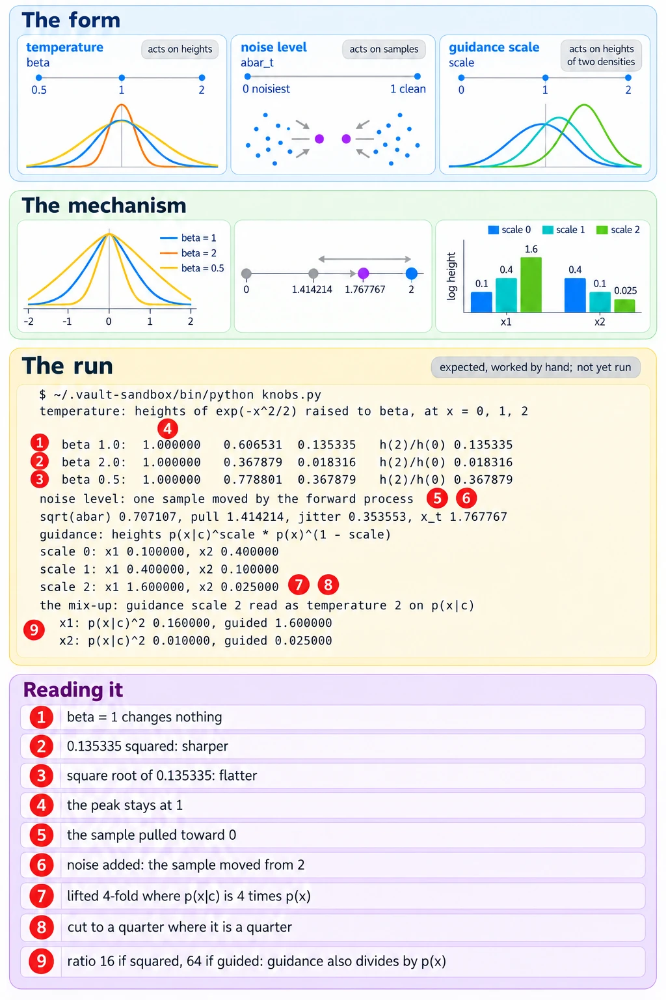

# Three Things Called Annealing

Up: [[Composition]] · ⬅️ [[When Neither Training Set Holds A And B]] · [[The Tempered Density And Its Score]] ➡️

Artificial Intelligence, Generative Modeling, Diffusion Models, Composition. Needs: [[Annealed MCMC]] and [[Powers Of Gaussians]].

> [!question] Test yourself
> [The diffusion models quiz](https://claude.ai/artifact/MyTdAaVfZW3wiqhbLKg4wu) covers this note, with the rest of the [[Diffusion Models]] folder. Your attempts are saved on the page.

> [!warning] Unfinished
> - Prompt 25, the mechanism, is stuck after three revisions and waits for a word from the learner (⚠️ stuck: pixel and text check), in the vault's `.prompts/Diffusion Models.md`.
>
> Stated, not checked: 1 claim, marked where it sits.

**Annealing walks one number along a schedule so that the target density changes a little at each step, and this literature calls three different numbers "annealed": the temperature $\beta$, which raises every height to a power; the noise level, which moves the samples themselves; and the guidance scale, which weighs a conditional density against an unconditional one.** "Annealed" says that some index moves. It does not say which, so the first question about any annealed sampler is which of the three it walks. *Cited* for the three uses: Neal, Annealed Importance Sampling, abstract, for a sequence of intermediate distributions; Song and Ermon, Generative Modeling by Estimating Gradients of the Data Distribution, abstract, "an annealed Langevin dynamics where we use gradients corresponding to gradually decreasing noise levels"; Du et al., Reduce, Reuse, Recycle, appendix C (`text/appendix.tex` line 232), which names "products, tempering, and guidance" as three separate operations.

## Where you work

The setup is in [[Diffusion Models#Where you work]].

## Table of contents

- [[#Words the three knobs use]]
- [[#When to reach for the three knobs]]
- [[#The form of the three knobs]]
- [[#Try the three knobs yourself]]
- [[#Reading the three-knobs output]]
- [[#How the three knobs work]]
- [[The Tempered Density And Its Score]]
- [[The Log Of A Power And Of A Quotient]]
- [[Why The Normaliser Has No Slope In X]]
- [[#Other ways to move a target]]
- [[#Why the three knobs matter]]
- [[#The three knobs taught in, applied in]]

## Words the three knobs use

Navigation: 📋 [[#Table of contents|TOC]] | [[#When to reach for the three knobs]] ➡️

**Temperature $\beta$.** The power each height is raised to. It has no subscript. The schedule's $\beta_t$ in [[The Forward Process#One small step, fifty of them, and one jump]] is a different number, the variance added at one forward step.

**Noise level.** Where the run is on the forward process's schedule, read as $\bar\alpha_t$, the share of signal left. $\bar\alpha_t = 1$ is clean and $\bar\alpha_t$ near 0 is almost pure noise, as in [[The Forward Process]].

**Guidance scale.** The power on the conditional density $p(x \mid c)$, where $c$ is the condition (a label or a prompt). It is written out in words in the maths below. [[Product, Mixture And Negation#Other ways to combine models]] writes the same number as $\lambda$.

**Height.** The value of an unnormalised density at one point, before dividing by the total area. Two heights can be compared without knowing that area.

## When to reach for the three knobs

Navigation: ⬅️ [[#Words the three knobs use]] | 📋 [[#Table of contents|TOC]] | [[#The form of the three knobs]] ➡️

When a paper, a plan or a line of code says "annealed", "tempered" or "a guidance schedule", and you need to know what is changing between steps. The three knobs can give pictures that look alike: a narrower bell from heating, a bell nearer the origin from noising, a bell pushed toward a prompt from guidance. Without the question "which knob", a result measured along one is easily read as a result about another, for example matching widths and assuming the centres match too.

## The form of the three knobs

Navigation: ⬅️ [[#When to reach for the three knobs]] | 📋 [[#Table of contents|TOC]] | [[#Try the three knobs yourself]] ➡️

```text
temperature    pi_beta(x)   ~ p(x)^beta                                   acts on heights, point by point
               beta = 1 is p itself; beta > 1 sharper; beta < 1 flatter   the highest point never moves
noise level    x_t = sqrt(abar_t) x_0 + sqrt(1 - abar_t) eps              acts on samples
               p_t = the shape the moved samples pile into                not a power of p
guidance       pi_guided(x) ~ p(x | c)^scale * p(x)^(1 - scale)           acts on heights, of two densities
               scale 0 is p(x); scale 1 is p(x | c); scale > 1 pushes mass toward c
```



*The three temperature bells share one peak, the noise-level arrows move dots and never a curve, and the green guided bell sits further toward the condition than the teal one.*

## Try the three knobs yourself

Navigation: ⬅️ [[#The form of the three knobs]] | 📋 [[#Table of contents|TOC]] | [[#Reading the three-knobs output]] ➡️

> [!warning] Not run on this machine
> The cluster has no prepared environment, so nothing below has been run. The expected lines are worked by hand under [[#How the three knobs work]], [[The Tempered Density And Its Score]] and [[The Log Of A Power And Of A Quotient]], and the next machine with `~/.vault-sandbox/bin/python` runs it and files the real output.

1. You need the prepared environment: `~/.vault-sandbox/bin/python -c "import math"` prints nothing when it is there. The script uses only Python's standard library.
2. If it is missing, make it once: `uv venv ~/.vault-sandbox` then `uv pip install --python ~/.vault-sandbox/bin/python pandas numpy scipy matplotlib statsmodels openpyxl`.
3. Make an empty folder:

   ```bash
   mkdir -p ~/playground/sandbox/three-knobs && cd ~/playground/sandbox/three-knobs
   ```

4. Save this as `knobs.py`. It turns each knob on numbers small enough to check by hand: the standard normal's height $e^{-x^2/2}$ at three points, one sample moved by the forward process, and two points under guidance. Its last block is the mix-up, guidance scale 2 read as temperature 2:

   ```python
   # Three things called annealing, on numbers small enough to check by hand.
   import math

   print("temperature: heights of exp(-x^2/2) raised to beta, at x = 0, 1, 2")
   for beta in (1.0, 2.0, 0.5):
       h = [math.exp(-x * x / 2) ** beta for x in (0, 1, 2)]
       print(f"  beta {beta}: {h[0]:.6f} {h[1]:.6f} {h[2]:.6f}   h(2)/h(0) {h[2] / h[0]:.6f}")

   print("noise level: one sample moved by the forward process")
   x0, eps, abar = 2.0, 0.5, 0.5
   pull, jitter = math.sqrt(abar) * x0, math.sqrt(1 - abar) * eps
   print(f"  sqrt(abar) {math.sqrt(abar):.6f}, pull {pull:.6f}, jitter {jitter:.6f}, x_t {pull + jitter:.6f}")

   print("guidance: heights p(x|c)^scale * p(x)^(1 - scale)")
   points = {"x1": (0.4, 0.1), "x2": (0.1, 0.4)}   # (p(x|c), p(x)) at two points
   for scale in (0, 1, 2):
       row = ", ".join(f"{name} {pc ** scale * p ** (1 - scale):.6f}" for name, (pc, p) in points.items())
       print(f"  scale {scale}: {row}")

   print("the mix-up: guidance scale 2 read as temperature 2 on p(x|c)")
   for name, (pc, p) in points.items():
       print(f"  {name}: p(x|c)^2 {pc ** 2:.6f}, guided {pc ** 2 / p:.6f}")
   ```

5. Run it:

   ```bash
   ~/.vault-sandbox/bin/python knobs.py
   ```

   You should see, by the hand working below (not yet run):

   ```
   temperature: heights of exp(-x^2/2) raised to beta, at x = 0, 1, 2
     beta 1.0: 1.000000 0.606531 0.135335   h(2)/h(0) 0.135335
     beta 2.0: 1.000000 0.367879 0.018316   h(2)/h(0) 0.018316
     beta 0.5: 1.000000 0.778801 0.367879   h(2)/h(0) 0.367879
   noise level: one sample moved by the forward process
     sqrt(abar) 0.707107, pull 1.414214, jitter 0.353553, x_t 1.767767
   guidance: heights p(x|c)^scale * p(x)^(1 - scale)
     scale 0: x1 0.100000, x2 0.400000
     scale 1: x1 0.400000, x2 0.100000
     scale 2: x1 1.600000, x2 0.025000
   the mix-up: guidance scale 2 read as temperature 2 on p(x|c)
     x1: p(x|c)^2 0.160000, guided 1.600000
     x2: p(x|c)^2 0.010000, guided 0.025000
   ```

6. Another way to the temperature rows, by hand: by the [exponent rules](../../../../Mathematics/references/textbooks/algebra/algebra-handbook.pdf#page=109), $(e^{a})^\beta = e^{\beta a}$, so $\beta = 2$ at $x = 2$ is $e^{-4} = 0.018316$ and $\beta = 0.5$ at $x = 2$ is $e^{-1} = 0.367879$.
7. More worked examples in the same folder, for [[The Tempered Density And Its Score]]. Save this as `tempered.py`. It checks the temperature score two ways, measures $Z_\beta$ with rectangles against $\sqrt{2\pi/\beta}$, shows the area at $\beta = 0$ growing with the range, and bends from a base toward $p$:

   ```python
   # The tempered density pi_beta = p^beta / Z_beta: its score, a powered Gaussian, and Z_beta toward beta = 0.
   import math


   def score(x, mean, var):                      # slope of the log of N(mean, var) at x
       return -(x - mean) / var


   print("temperature score: beta times the score of p")
   for (mean, var), beta, x in [((3, 4), 2, 5), ((-1, 0.5), 0.25, 0)]:
       print(f"  N({mean}, {var}) at x = {x}, beta {beta}: beta * score {beta * score(x, mean, var):+.6f}, "
             f"score of N({mean}, {var / beta:g}) {score(x, mean, var / beta):+.6f}")

   print("Z_beta for exp(-x^2/2): a rectangle sum against sqrt(2 pi / beta)")
   for beta in (1, 0.01):
       half = 12 / math.sqrt(beta)               # 12 standard deviations of the powered bell on each side
       dx = half / 6000
       area = sum(math.exp(-beta * (k * dx) ** 2 / 2) for k in range(-6000, 6001)) * dx
       print(f"  beta {beta}: sum {area:.6f}, closed form {math.sqrt(2 * math.pi / beta):.6f}, variance {1 / beta:g}")

   print("beta = 0: every height is 1, so the area is the width of the range")
   for half in (10, 100, 1000):
       print(f"  from -{half} to {half}: area {2 * half * math.exp(-0 * half ** 2 / 2):g}")

   print("bent from a base N(0, 1) toward p = N(3, 4): base^(1 - beta) * p^beta")
   for beta in (0, 0.5, 1):
       P = (1 - beta) / 1 + beta / 4             # each precision times its power, added
       print(f"  beta {beta}: mean {(beta * 3 / 4) / P:.6f}, variance {1 / P:.6f}")
   ```

   Run it with `~/.vault-sandbox/bin/python tempered.py`. You should see, by the hand working in [[The Tempered Density And Its Score]] (not yet run):

   ```
   temperature score: beta times the score of p
     N(3, 4) at x = 5, beta 2: beta * score -1.000000, score of N(3, 2) -1.000000
     N(-1, 0.5) at x = 0, beta 0.25: beta * score -0.500000, score of N(-1, 2) -0.500000
   Z_beta for exp(-x^2/2): a rectangle sum against sqrt(2 pi / beta)
     beta 1: sum 2.506628, closed form 2.506628, variance 1
     beta 0.01: sum 25.066283, closed form 25.066283, variance 100
   beta = 0: every height is 1, so the area is the width of the range
     from -10 to 10: area 20
     from -100 to 100: area 200
     from -1000 to 1000: area 2000
   bent from a base N(0, 1) toward p = N(3, 4): base^(1 - beta) * p^beta
     beta 0: mean 0.000000, variance 1.000000
     beta 0.5: mean 0.600000, variance 1.600000
     beta 1: mean 3.000000, variance 4.000000
   ```

8. More worked examples in the same folder, for [[The Log Of A Power And Of A Quotient]]. Save this as `logs.py`. It works each log by the rules and directly, on the $\mathcal{N}(3, 4)$ height at $x = 7$ with its normaliser $\sqrt{8\pi/\beta}$, on the guidance heights, and on a two-dimensional height:

   ```python
   # The log of a power and of a quotient, checked on the N(3, 4) height at x = 7.
   import math

   h7 = math.exp(-(7 - 3) ** 2 / 8)
   print(f"h(7) {h7:.6f}, log {math.log(h7):.6f}")
   for beta in (2, 0.5):
       Z = math.sqrt(8 * math.pi / beta)
       print(f"beta {beta}: h^beta {h7 ** beta:.6f}, log {math.log(h7 ** beta):.6f}, Z {Z:.6f}, log Z {math.log(Z):.6f}")
       print(f"  pi {h7 ** beta / Z:.6f}, by the rules {beta * math.log(h7) - math.log(Z):.6f}, directly {math.log(h7 ** beta / Z):.6f}")
   print(f"guidance: 2 log 0.4 - log 0.1 {2 * math.log(0.4) - math.log(0.1):.6f}, log 1.6 {math.log(1.6):.6f}")
   h12 = math.exp(-(1 ** 2 + 2 ** 2) / 2)
   print(f"2D at (1, 2): h {h12:.6f}, h^2 {h12 ** 2:.6f}, log h^2 {math.log(h12 ** 2):.6f}, score at beta 2 ({2 * -1}, {2 * -2})")
   ```

   Run it with `~/.vault-sandbox/bin/python logs.py`. You should see, by the working in [[The Log Of A Power And Of A Quotient]] (not yet run through the prepared environment):

   ```
   h(7) 0.135335, log -2.000000
   beta 2: h^beta 0.018316, log -4.000000, Z 3.544908, log Z 1.265512
     pi 0.005167, by the rules -5.265512, directly -5.265512
   beta 0.5: h^beta 0.367879, log -1.000000, Z 7.089815, log Z 1.958659
     pi 0.051888, by the rules -2.958659, directly -2.958659
   guidance: 2 log 0.4 - log 0.1 0.470004, log 1.6 0.470004
   2D at (1, 2): h 0.082085, h^2 0.006738, log h^2 -5.000000, score at beta 2 (-2, -4)
   ```

9. More worked examples in the same folder, for [[Why The Normaliser Has No Slope In X]]. Save this as `zslope.py`. It takes the slope of $\log \pi_2$ at $x = 5$ by a difference quotient with and without $\log Z_2$, computes the two-dimensional $Z_2$ by rectangles at three points that the sum never uses, and takes the slope of $\log Z_\beta$ along $\beta$:

   ```python
   # Z_beta has no slope in x and a real slope in beta, on the N(3, 4) height and a 2D height.
   import math


   def log_Z(beta):                                  # log of sqrt(8 pi / beta), the area under the N(3, 4) height to the power beta
       return 0.5 * (math.log(8 * math.pi) - math.log(beta))


   def log_pi2(x):                                   # log pi_2(x) = 2 log h(x) - log Z_2
       return -(x - 3) ** 2 / 4 - log_Z(2)


   print("slope in x at x = 5, beta = 2: (value at 5 + step - value at 5) / step")
   for step in (0.01, 0.001):
       a, b = log_pi2(5), log_pi2(5 + step)
       a0, b0 = -(5 - 3) ** 2 / 4, -(5 + step - 3) ** 2 / 4
       print(f"  step {step:<6}  log pi     {a:.6f}  {b:.6f}  quotient {(b - a) / step:.6f}")
       print(f"               without Z  {a0:.6f}  {b0:.6f}  quotient {(b0 - a0) / step:.6f}")
       print(f"               log Z_2     {log_Z(2):.6f}   {log_Z(2):.6f}  quotient  {(log_Z(2) - log_Z(2)) / step:.6f}")
   print(f"  exact beta * score at 5: {2 * (-(5 - 3) / 4):.6f}")

   print("2D: Z_2 for exp(-(x1^2 + x2^2)/2) at three points, a rectangle sum against 2 pi / beta")
   dx, n = 0.01, 600                                 # squares of side 0.01 from -6 to 6 in each coordinate


   def Z2_at(x1, x2):                                # the sum runs over u; x1 and x2 are taken and never used
       row = [math.exp(-2 * (k * dx) ** 2 / 2) for k in range(-n, n + 1)]
       return sum(row) ** 2 * dx * dx                # the powered height splits into one factor per coordinate


   for point in ((0, 0), (1, 2), (-3, 0.5)):
       Z = Z2_at(*point)
       print(f"  at {point}: Z_2 {Z:.6f}, log Z_2 {math.log(Z):.6f}")
   print(f"  closed form 2 pi / 2 = {2 * math.pi / 2:.6f}, log {math.log(math.pi):.6f}")

   print("slope in beta at beta = 2")
   for step in (0.01, 0.001):
       print(f"  step {step:<6}  log Z  {log_Z(2):.6f}  {log_Z(2 + step):.6f}  quotient {(log_Z(2 + step) - log_Z(2)) / step:.6f}")
   print(f"  exact -1 / (2 beta): {-1 / (2 * 2):.6f}")
   ```

   Run it with `~/.vault-sandbox/bin/python zslope.py`. This output is from the system `python3`, standard library only:

   ```
   slope in x at x = 5, beta = 2: (value at 5 + step - value at 5) / step
     step 0.01    log pi     -2.265512  -2.275537  quotient -1.002500
                  without Z  -1.000000  -1.010025  quotient -1.002500
                  log Z_2     1.265512   1.265512  quotient  0.000000
     step 0.001   log pi     -2.265512  -2.266512  quotient -1.000250
                  without Z  -1.000000  -1.001000  quotient -1.000250
                  log Z_2     1.265512   1.265512  quotient  0.000000
     exact beta * score at 5: -1.000000
   2D: Z_2 for exp(-(x1^2 + x2^2)/2) at three points, a rectangle sum against 2 pi / beta
     at (0, 0): Z_2 3.141593, log Z_2 1.144730
     at (1, 2): Z_2 3.141593, log Z_2 1.144730
     at (-3, 0.5): Z_2 3.141593, log Z_2 1.144730
     closed form 2 pi / 2 = 3.141593, log 1.144730
   slope in beta at beta = 2
     step 0.01    log Z  1.265512  1.263018  quotient -0.249377
     step 0.001   log Z  1.265512  1.265262  quotient -0.249938
     exact -1 / (2 beta): -0.250000
   ```

   

10. Clean up, and check the folder is gone:

   ```bash
   cd ~ && rm -r ~/playground/sandbox/three-knobs
   ls ~/playground/sandbox/three-knobs; echo $?
   ```

   You should see `No such file or directory` and `2`.

## Reading the three-knobs output

Navigation: ⬅️ [[#Try the three knobs yourself]] | 📋 [[#Table of contents|TOC]] | [[#How the three knobs work]] ➡️

| # | Field | Expected value | How to read it | Backing |
|---|---|---|---|---|
| 1 | `beta 1.0` row | `1.000000 0.606531 0.135335` | the [standard normal](../../../../Mathematics/references/textbooks/machine-learning/mathematics-for-machine-learning.pdf#page=203)'s unnormalised heights at $x = 0, 1, 2$; $\beta = 1$ changes nothing | derived below |
| 2 | `h(2)/h(0)` at `beta 2.0` | `0.018316` | $0.135335^2$: how much lower the tail sits than the peak; smaller means sharper | derived below |
| 3 | `h(2)/h(0)` at `beta 0.5` | `0.367879` | $\sqrt{0.135335}$: the tail rises toward the peak, so the bell is flatter | derived below |
| 4 | the first height in every row | `1.000000` | the peak stays at $x = 0$ for every $\beta$, because $1^\beta = 1$ | derived below |
| 5 | `pull` | `1.414214` | the clean sample 2 scaled toward 0 by $\sqrt{\bar\alpha} = 0.707107$ | derived below |
| 6 | `jitter`, `x_t` | `0.353553`, `1.767767` | the noise share added on; the sample itself has moved from 2 to 1.767767 | derived below |
| 7 | `scale 2`, `x1` | `1.600000` | where $p(x \mid c)$ is 4 times $p(x)$, scale 2 lifts the conditional height 0.4 by that factor 4 | derived below |
| 8 | `scale 2`, `x2` | `0.025000` | where $p(x \mid c)$ is a quarter of $p(x)$, the conditional height 0.1 is cut to a quarter | derived below |
| 9 | the mix-up rows | `0.160000` against `1.600000`; `0.010000` against `0.025000` | squaring $p(x \mid c)$ makes x1 16 times x2; guidance at scale 2 makes it 64 times, because it also divides by $p(x)$ | derived below |
| 10 | `tempered.py`, the `N(3, 4)` row | `-1.000000` twice | the tempered score at $x = 5$ two ways: $2 \times (-0.5)$, and the slope of $\mathcal{N}(3, 2)$ itself | derived in [[The Tempered Density And Its Score]] |
| 11 | the `N(-1, 0.5)` row | `-0.500000` twice | expert a at $\beta = 0.25$ is $\mathcal{N}(-1, 2)$; both routes give $-0.5$ | derived there |
| 12 | `sum` against `closed form` | `2.506628`, `25.066283` | the area under $e^{-\beta x^2/2}$ by rectangles matches $\sqrt{2\pi/\beta}$; a hundredth of the $\beta$ gives $\sqrt{100} = 10$ times the area | derived there |
| 13 | `variance` | `1`, `100` | $1/\beta$: the bell at $\beta = 0.01$ is 100 times wider in variance | derived there |
| 14 | the `beta = 0` rows | `20`, `200`, `2000` | the area is the width of the range and has no limit, so $p^0$ has no normaliser | derived there |
| 15 | the bent rows | means `0`, `0.6`, `3`; variances `1`, `1.6`, `4` | $\beta = 0$ is the base, $\beta = 1$ is $p$, and every step between is a proper Gaussian | derived there |
| 16 | `logs.py`, `h(7)` and its `log` | `0.135335`, `-2.000000` | the $\mathcal{N}(3, 4)$ height four units from its centre is $e^{-2}$ | derived in [[The Log Of A Power And Of A Quotient]] |
| 17 | `log` at `beta 2` and `beta 0.5` | `-4.000000`, `-1.000000` | $\beta$ times $-2$: the log of a power is the power times the log | derived there |
| 18 | `log Z` | `1.265512`, `1.958659` | the logs of $\sqrt{4\pi}$ and $\sqrt{16\pi}$, the areas under $h^2$ and $h^{0.5}$ | derived there |
| 19 | `by the rules` against `directly` | `-5.265512` twice, `-2.958659` twice | $\beta \log h - \log Z$ equals the log of the normalised height: the quotient rule | derived there |
| 20 | the `guidance` row | `0.470004` twice | both rules in one line, on the guidance heights at scale 2 | derived there |
| 21 | the `2D` row | `-5.000000`; score `(-2, -4)` | the power doubles the log in two dimensions too, and the score is $\beta$ times $(-x_1, -x_2)$ | derived there |
| 22 | `zslope.py`, `step 0.01`, `log pi` quotient | `-1.002500` | the slope of $\log \pi_2$ at $x = 5$ by one step of 0.01: $\log \pi_2(5) = -2.265512$, $\log \pi_2(5.01) = -2.275537$, difference $-0.010025$ | shown; derived in [[Why The Normaliser Has No Slope In X]] |
| 23 | the `without Z` quotient | `-1.002500` | the same quotient with $\log Z_2$ left out: the constant sits in both values and cancels in the difference | shown; derived there |
| 24 | the `log Z_2` quotient | `0.000000` | $(c - c)/\delta$: the difference quotient of a constant is 0 at every step | shown; derived there |
| 25 | the `step 0.001` quotient | `-1.000250` | a step ten times smaller cuts the miss from 0.0025 to 0.00025: the miss is the step divided by 4 | shown; derived there |
| 26 | `exact beta * score at 5` | `-1.000000` | $2 \times (-(5 - 3)/4)$, the slope both quotients approach | derived there |
| 27 | `log Z_2` at three points | `1.144730` three times | the rectangle sum runs over $u$ and is handed the point without using it, so the value is the same everywhere and its gradient is $(0, 0)$ | shown; derived there |
| 28 | `closed form` | `3.141593` | $2\pi/\beta$ at $\beta = 2$ is $\pi$, matching the rectangle sum | derived there |
| 29 | `slope in beta`, `step 0.01` | `-0.249377` | $\log Z_\beta$ does change with $\beta$: from 1.265512 at $\beta = 2$ to 1.263018 at 2.01 | shown; derived there |
| 30 | `exact -1 / (2 beta)` | `-0.250000` | the exact slope of $\log Z_\beta$ in $\beta$ at $\beta = 2$ | derived there |

## How the three knobs work

Navigation: ⬅️ [[#Reading the three-knobs output]] | 📋 [[#Table of contents|TOC]] | [[The Tempered Density And Its Score]] ➡️

**Temperature acts on heights, one point at a time.** For the standard normal the unnormalised height is $h(x) = e^{-x^2/2}$, and the exponent rule gives

$$
\begin{aligned}
h(x)^\beta &= \left(e^{-x^2/2}\right)^\beta = e^{-\beta x^2/2} \\
\frac{h(2)^\beta}{h(0)^\beta} &= \left(\frac{h(2)}{h(0)}\right)^\beta = 0.135335^\beta \\
\beta = 2:&\quad 0.135335^2 = 0.018316 \\
\beta = 0.5:&\quad 0.135335^{0.5} = 0.367879
\end{aligned}
$$

A ratio below 1 shrinks when raised to a power above 1 and grows toward 1 under a power below 1, so $\beta > 1$ sharpens and $\beta < 1$ flattens. For any $\beta > 0$, $u \mapsto u^\beta$ is increasing, so the point with the greatest height keeps the greatest height: the peak stays where it was, here at $x = 0$ with height $1^\beta = 1$. *Derived.*

**The noise level acts on samples.** One sample, $x_0 = 2$, $\varepsilon = 0.5$, $\bar\alpha = 0.5$:

$$
\begin{aligned}
\sqrt{\bar\alpha} &= \sqrt{0.5} = 0.707107 \\
\sqrt{\bar\alpha}\,x_0 &= 0.707107 \times 2 = 1.414214 \\
\sqrt{1 - \bar\alpha}\,\varepsilon &= 0.707107 \times 0.5 = 0.353553 \\
x_t &= 1.414214 + 0.353553 = 1.767767
\end{aligned}
$$

Every sample is pulled toward 0 by $\sqrt{\bar\alpha_t}$ and jittered by $\sqrt{1 - \bar\alpha_t}\,\varepsilon$. The density $p_t$ is the shape the moved samples pile into, so it is a property of the whole cloud, never a power of $p$'s heights. A run walks $\bar\alpha_t$ upward from almost 0 at its noisiest step to 1 at its cleanest. *Derived* for the sample.

The standard normal shows how different this is from temperature. By [[The Forward Process]], $\mathcal{N}(0, 1)$ noised to any level is $\mathcal{N}(\sqrt{\bar\alpha}\cdot 0,\ \bar\alpha \cdot 1 + 1 - \bar\alpha) = \mathcal{N}(0, 1)$: every sample moves, and the pile keeps exactly the same shape. Temperature at $\beta = 2$ leaves every sample where it is and changes the shape. *Derived* from that section's closed form.

**Guidance acts on heights of two densities, weighed against each other.** At a point with $p(x \mid c) = 0.4$ and $p(x) = 0.1$:

$$
\begin{aligned}
\text{scale } 0:&\quad 0.4^0 \times 0.1^1 = 0.1 \\
\text{scale } 1:&\quad 0.4^1 \times 0.1^0 = 0.4 \\
\text{scale } 2:&\quad 0.4^2 \times 0.1^{-1} = 0.16 / 0.1 = 1.6
\end{aligned}
$$

At a point with $p(x \mid c) = 0.1$ and $p(x) = 0.4$, scale 2 gives $0.1^2 / 0.4 = 0.025$. Writing the guided height as the conditional one times a factor shows why:

$$
p(x \mid c)^{\text{scale}}\, p(x)^{1 - \text{scale}} = p(x \mid c) \left(\frac{p(x \mid c)}{p(x)}\right)^{\text{scale} - 1}
$$

Above scale 1, heights rise wherever the condition makes $x$ likelier than the baseline does (ratio 4 at the first point, so $0.4 \times 4 = 1.6$) and fall wherever it makes $x$ less likely (ratio 0.25, so $0.1 \times 0.25 = 0.025$). Mass moves toward the condition. *Derived.*

**Guidance is not a temperature on $p(x \mid c)$.** Squaring $p(x \mid c)$ gives 0.16 and 0.01, a ratio of 16 between the two points. Guidance at scale 2 gives 1.6 and 0.025, a ratio of 64. The extra factor is $p(x)^{-1}$, which is 10 at the first point and 2.5 at the second. *Derived.*

**The guided density is the classifier form of [[Product, Mixture And Negation#Other ways to combine models]].** By [Bayes' rule](../../../../Mathematics/references/textbooks/statistics/introduction-to-probability-for-data-science.pdf#page=105), $p(x \mid c) / p(x) = p(c \mid x) / p(c)$, and $p(c)$ does not depend on $x$, so

$$
p(x \mid c)^{\text{scale}}\, p(x)^{1 - \text{scale}} = p(x) \left(\frac{p(x \mid c)}{p(x)}\right)^{\text{scale}} \propto p(x)\, p(c \mid x)^{\text{scale}}
$$

which is that section's $p(x)\,p(y \mid x)^\lambda$ with $\lambda$ the guidance scale and the label written $y$. *Derived.* Classifier-free guidance's combination $(1 + w)\,\epsilon_\theta(z, c) - w\,\epsilon_\theta(z)$ is this form's score with $w$ = the scale minus 1. *Cited* for the combination, Ho and Salimans, Classifier-Free Diffusion Guidance, section 3.2, equation 6; the density form above is derived here and is not written out in the paper.

**In one line each.** Temperature sharpens or flattens in place, about a peak that does not move. The noise level moves the samples themselves. Guidance moves mass toward a condition. *Derived* above.

*🖼️ Diagram wanted: the mechanism, the standard normal under each knob side by side: heights raised to a power about a fixed peak, samples pulled toward 0 and jittered, heights lifted where the condition is likelier. Prompt 25 in the same file.*

## The tempered density and its score

Navigation: ⬅️ [[#How the three knobs work]] | 📋 [[#Table of contents|TOC]] | [[The Log Of A Power And Of A Quotient]] ➡️

**Raising a density to a power $\beta$ and dividing by the new area gives the tempered density $\pi_\beta(x) = p(x)^\beta / Z_\beta$, and its score is $\beta$ times the score of $p$, so a sampler that follows scores never needs $Z_\beta$.** Taught in full in [[The Tempered Density And Its Score]].

## The log of a power and of a quotient

Navigation: ⬅️ [[The Tempered Density And Its Score]] | 📋 [[#Table of contents|TOC]] | [[Why The Normaliser Has No Slope In X]] ➡️

**The log of a power is the power times the log, $\log(a^b) = b \log a$, and the log of a quotient is the difference of the logs, $\log(a / b) = \log a - \log b$, so $\log \pi_\beta(x) = \log\big(p(x)^\beta / Z_\beta\big)$ becomes $\beta \log p(x) - \log Z_\beta$: the old log density scaled by $\beta$, minus one constant.** Taught in full in [[The Log Of A Power And Of A Quotient]].

## Why the normaliser has no slope in x

Navigation: ⬅️ [[The Log Of A Power And Of A Quotient]] | 📋 [[#Table of contents|TOC]] | [[#Other ways to move a target]] ➡️

**$Z_\beta = \int p(u)^\beta\,du$ is one number for each $\beta$, because the integral uses up its variable $u$ and the point $x$ never enters it; a function that stays the same when $x$ changes has slope 0, so $\nabla_x \log Z_\beta = 0$ and the temperature score is $\beta$ times the score.** Taught in full in [[Why The Normaliser Has No Slope In X]].

## Other ways to move a target

Navigation: ⬅️ [[Why The Normaliser Has No Slope In X]] | 📋 [[#Table of contents|TOC]] | [[#Why the three knobs matter]] ➡️

- **Annealed MCMC** walks the noise level, taking a few MCMC steps at each level before moving to the next. [[Annealed MCMC]] runs it on the one-dimensional pair.
- **Annealed importance sampling** walks a temperature-like index between an easy distribution and the target, reweighting samples at each step. *Cited:* Neal, Annealed Importance Sampling, abstract.
- **Simulated annealing and parallel tempering** use the temperature knob for optimisation and for mixing between modes; they are separate algorithms and are not covered here. *Stated.*

## Why the three knobs matter

Navigation: ⬅️ [[#Other ways to move a target]] | 📋 [[#Table of contents|TOC]] | [[#The three knobs taught in, applied in]] ➡️

The three knobs change a density in different ways, so a result found along one says nothing direct about another. Du et al.'s appendix C finds that "products, tempering, and guidance applied to diffused distributions do not give diffusions of the modified target distributions" (*cited:* `text/appendix.tex` line 232). Tempering and guidance are two of the knobs. Applying either at every noise level does not give the noised version of the tempered or guided target, which is the same gap as [[The Order Of Multiplying And Noising]].



*The deep-dive sheet composing the form, the mechanism and the expected run of `knobs.py`, with the mix-up rows showing guidance at scale 2 is not temperature 2.*

## The three knobs taught in, applied in

Navigation: ⬅️ [[#Why the three knobs matter]] | 📋 [[#Table of contents|TOC]]

**Taught in:**

- the sampler correctors for composition journey's plan 24, `plans/24-what-is-annealed.md`, line 21 (separate temperature, noise level and guidance scale) and line 84 (the failure the sitting opens on: "annealed" names three axes treated as one), through the `drip --math` walk in the journey's `drips/24-what-is-annealed/`, piece 1, "one word, three knobs"
- the same plan, lines 129 to 150 (the powered density, its log and the temperature score) and lines 293 and 298 (why $\beta = 0$ cannot be normalised and a schedule needs a positive start or a proper base), through piece 2 of the same walk, "temperature: the powered density and its score": [[The Tempered Density And Its Score]]
- the same plan, lines 129 to 138 (the powered density's log, and "Taking the logarithm turns the power into a multiplier and the normalising divisor into a constant subtraction"), through piece 2.1 of the same walk, "the log of a power and of a quotient", opened with its example: [[The Log Of A Power And Of A Quotient]]
- the same plan, lines 139 to 150 (the temperature score, and "The normaliser has no state dependence, so its derivative vanishes"), through piece 2.2 of the same walk, "why Z_beta has zero slope": [[Why The Normaliser Has No Slope In X]]

**Applied in:** nothing yet.

> [!note]- How this was checked
> This note was written on 2026-10-17 on the cluster (mscluster, Linux), from piece 1 of the `drip --math` walk of plan 24 in the sampler correctors for composition journey. Nothing in it was run: the cluster has no `~/.vault-sandbox`, so `knobs.py` and its expected output are worked by hand in [[#How the three knobs work]]. Every number was checked by the writer with `awk` arithmetic on the same machine before filing, and each matched the walk's numbers to the six decimals shown. The textbook links reuse pages this note already links (exponent rules, Bayes' rule) and the shelf index's row for the Gaussian distribution; the cluster has no PDF reader, so none of the three pages was reopened this time. The three new sources were fetched on 2026-10-17: Neal's and Song and Ermon's abstracts, and Ho and Salimans' section 3.2, equation 6, from the arXiv HTML version.
