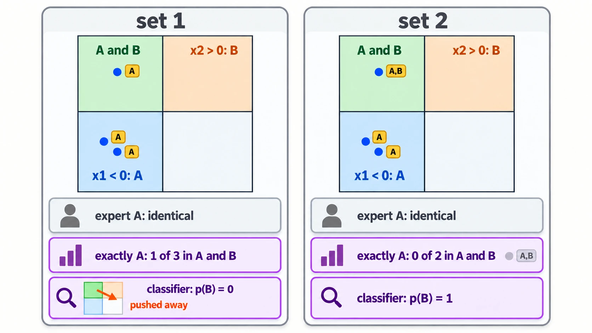

# What An Expert Learns From Its Training Set

Up: [[Composition]] · ⬅️ [[Product, Mixture And Negation]] · [[When Neither Training Set Holds A And B]] ➡️

Artificial Intelligence, Generative Modeling, Diffusion Models, Composition. Needs: [[Kinds Of Composition]].

> [!question] Test yourself
> [The diffusion models quiz](https://claude.ai/artifact/MyTdAaVfZW3wiqhbLKg4wu) covers this note, with the rest of the [[Diffusion Models]] folder. Your attempts are saved on the page.

> [!warning] Unfinished
> - This note has not been run: the cluster, where it was written, has no prepared environment `~/.vault-sandbox/bin/python`. Make it with `uv venv ~/.vault-sandbox` then `uv pip install --python ~/.vault-sandbox/bin/python pandas numpy scipy matplotlib statsmodels openpyxl`, run `labels.py`, and file its real output and output picture in place of the hand-worked lines.
> - Three pictures are waiting to be drawn: prompts 19, 20 and 21 in the vault's `.prompts/Diffusion Models.md`.
> - The overlap-dial idea and the idea of when a product reaches A and B, both in the reduce-reuse-recycle repository, apply this note in words only.
>
> Stated, not checked: 2 claims, marked where they sit.

**A diffusion expert trained with the noise-prediction loss learns the density of the points it is shown and never reads their labels. Labels change what is learned only in a part that reads them: a conditional model's rule for which samples train which condition, and a classifier used for guidance.** "An expert trained on A data learns the concept A" is true only in the first sense: it learns its training set, including whatever B points are hidden in it. *Derived* below from the loss, whose arguments hold no label.

## Where you work

The setup is in [[Diffusion Models#Where you work]]: any terminal with Python 3, NumPy and Matplotlib, a new empty folder, and the learner's `toy.py` and `samples.py` saved into it.

## Table of contents

- [[#Words this section uses]]
- [[#When to reach for it]]
- [[#The form]]
- [[#Try it yourself]]
- [[#Reading the labels output]]
- [[#How the expert's training set works]]
- [[#Other ways to keep labels from steering the result]]
- [[#Why the training set matters]]
- [[When Neither Training Set Holds A And B]]
- [[#The training set taught in, applied in]]

## Words this section uses

Navigation: 📋 [[#Table of contents|TOC]] | [[#When to reach for it]] ➡️

**Hidden B.** A point that has property B but whose label does not say so. In the toy below, B is $x_2 > 0$ and the point $(-0.5, 0.5)$ is labelled only "A".

**"Contains A" and "exactly A".** Two rules for training a conditional model on points that carry several labels. Under "contains A", every point whose label set includes A trains the condition A. Under "exactly A", only points labelled A alone train it, and a point labelled {A, B} trains a separate condition.

**Guidance.** Adding a second score to steer sampling, here $\nabla \log p(B \mid x)$ from a classifier. [[Product, Mixture And Negation]] shows it is a product of two experts.

## When to reach for it

Navigation: ⬅️ [[#Words this section uses]] | 📋 [[#Table of contents|TOC]] | [[#The form]] ➡️

When a plan says an expert "learns concept A", or proposes relabelling data to change what a composition produces. Ask which part of the system reads the label. If nothing does, relabelling changes nothing and only adding or removing points moves the expert. If a classifier reads it, a missing label teaches the classifier the wrong answer in exactly the region the composition is meant to reach.

## The form

Navigation: ⬅️ [[#When to reach for it]] | 📋 [[#Table of contents|TOC]] | [[#Try it yourself]] ➡️

```text
loss(theta) = mean over x0, t, eps of  || eps - eps_theta( sqrt(abar_t) * x0 + sqrt(1 - abar_t) * eps, t ) ||^2
                                          arguments: the point x0, the level t, the noise eps; no label
condition A trains on  { x0 : "A" in labels(x0) }        "contains A": every A-and-B point stays
                   or  { x0 : labels(x0) == {"A"} }      "exactly A": labelled A-and-B points leave
classifier p(B | x)  ->  share of training points near x labelled B        what cross-entropy fits
guided score  =  grad log p(x | A)  +  w * grad log p(B | x)                points toward B as labelled
```


*The form, one training set flowing into three readers (the loss, the conditioning rule, the classifier) with the label reaching only the last two.*

## Try it yourself

Navigation: ⬅️ [[#The form]] | 📋 [[#Table of contents|TOC]] | [[#Reading the labels output]] ➡️

> [!warning] Not run on this machine
> The cluster has no prepared environment, so nothing below has been run. The expected lines are worked by hand under [[#How the expert's training set works]], and the next machine with `~/.vault-sandbox/bin/python` runs it and files the real output.

1. You need the prepared environment: `~/.vault-sandbox/bin/python -c "import numpy"` prints nothing when it is there.
2. If it is missing, make it once: `uv venv ~/.vault-sandbox` then `uv pip install --python ~/.vault-sandbox/bin/python pandas numpy scipy matplotlib statsmodels openpyxl`.
3. Make an empty folder:

   ```bash
   mkdir -p ~/playground/sandbox/expert-and-labels && cd ~/playground/sandbox/expert-and-labels
   ```

4. Save this as `labels.py`. The three points are all A ($x_1 < 0$), and the third is also B ($x_2 > 0$). Set 1 labels it "A" only; set 2 labels it "A,B". The script computes expert A's loss and gradient for a small linear noise predictor, which set of points each conditioning rule hands to condition A, and what a classifier fit to the labels says about the top-left quadrant:

   ```python
   # What expert A learns under two labellings of the same three points.
   import numpy as np

   points = np.array([[-0.5, -0.5], [-0.6, -0.4], [-0.5, 0.5]])   # every point has x1 < 0, so all are A
   sets = {"set 1": ["A", "A", "A"],         # the third point also has x2 > 0 (B), unlabelled
           "set 2": ["A", "A", "A,B"]}       # the same points, the third labelled with both

   rng = np.random.default_rng(0)
   W = rng.standard_normal((2, 2))            # a linear noise predictor, eps_hat = x_t @ W
   abar = rng.uniform(0.1, 0.9, size=3)       # one noise level per point
   eps = rng.standard_normal((3, 2))          # one noise draw per point, shared by both sets

   def ddpm_loss_and_grad(x0):                # the label is not an argument
       xt = np.sqrt(abar)[:, None] * x0 + np.sqrt(1 - abar)[:, None] * eps
       r = xt @ W - eps
       return (r ** 2).sum(axis=1).mean(), 2 * xt.T @ r / len(x0)

   top_left = (points[:, 0] < 0) & (points[:, 1] > 0)    # the A-and-B quadrant
   results = {}
   for name, labels in sets.items():
       tags = [set(l.split(",")) for l in labels]
       contains = np.array(["A" in t for t in tags])
       exactly = np.array([t == {"A"} for t in tags])
       is_B = np.array(["B" in t for t in tags])
       results[name] = ddpm_loss_and_grad(points)
       print(f"{name}: share of condition A in A and B {top_left[contains].mean():.3f} (contains A), "
             f"{top_left[exactly].mean():.3f} (exactly A); classifier p(B | top-left) {is_B[top_left].mean():.3f}")

   (l1, g1), (l2, g2) = results["set 1"], results["set 2"]
   print(f"expert A: same loss {l1 == l2}, same gradient {np.array_equal(g1, g2)}")
   ```

5. Run it:

   ```bash
   ~/.vault-sandbox/bin/python labels.py
   ```

   You should see, by the hand working below (not yet run):

   ```
   set 1: share of condition A in A and B 0.333 (contains A), 0.333 (exactly A); classifier p(B | top-left) 0.000
   set 2: share of condition A in A and B 0.333 (contains A), 0.000 (exactly A); classifier p(B | top-left) 1.000
   expert A: same loss True, same gradient True
   ```

6. Clean up, and check the folder is gone:

   ```bash
   cd ~ && rm -r ~/playground/sandbox/expert-and-labels
   ls ~/playground/sandbox/expert-and-labels; echo $?
   ```

   You should see `No such file or directory` and `2`.

## Reading the labels output

Navigation: ⬅️ [[#Try it yourself]] | 📋 [[#Table of contents|TOC]] | [[#How the expert's training set works]] ➡️

| # | Field | Expected value | How to read it | Backing |
|---|---|---|---|---|
| 1 | share of condition A in A and B, contains A | `0.333` in both sets | one of the three points condition A trains on sits in the top-left quadrant, whatever its label says | derived below |
| 2 | the same, exactly A | `0.333` in set 1, `0.000` in set 2 | under "exactly A", honest labelling removes the A-and-B point from condition A, so $p(x \mid A)$ loses its mass there | derived below |
| 3 | classifier $p(B \mid \text{top-left})$ | `0.000` in set 1, `1.000` in set 2 | a classifier fit to set 1 learns that the top-left point is not B, which is the labels' mistake | derived below |
| 4 | expert A, same loss and same gradient | `True`, `True` | the unconditional expert sees identical numbers under both labellings, so training follows the same path | derived below |

## How the expert's training set works

Navigation: ⬅️ [[#Reading the labels output]] | 📋 [[#Table of contents|TOC]] | [[#Other ways to keep labels from steering the result]] ➡️

1. **The loss holds no label.** The simplified DDPM loss is $L(\theta) = \mathbb{E}_{x_0, t, \varepsilon}\,\lVert \varepsilon - \varepsilon_\theta(\sqrt{\bar\alpha_t}\,x_0 + \sqrt{1 - \bar\alpha_t}\,\varepsilon,\ t) \rVert^2$. *Cited:* Ho et al., equation (14). Two training sets with the same points and different labels give the same $L$ and the same $\nabla_\theta L$ at every $\theta$, so gradient descent from the same start and seed follows the same path. *Derived.* This is field 4.
2. **What the loss fits.** Its minimiser predicts the noise that the noised training density's score<sub>[1](/home/molef/goal-setting/learning/deep-learning/diffusion-models/01-poe-derivation-foundations/textbook/09-the-forward-process-by-hand.md#95-eps---sigma_t-grad-log-q "PoE derivation foundations, chapter 9.5, eps = -sigma_t grad log q"), [2](../../../../Mathematics/references/textbooks/machine-learning/the-little-book-of-generative-ai-foundations.pdf#page=134 "the little book of generative AI foundations p. 134")</sub> implies, so a trained expert matches the training set's density smoothed by the noise. *Cited:* Ho et al., section 3.2, on the link to denoising score matching. In the toy, one point of three sits in the top-left quadrant, so an expert that fits the set well puts roughly a third of its mass there. *Stated:* how close a trained network comes to that third depends on its capacity and training, which is not measured here.
3. **The conditioning rule decides which points train condition A.** Under "contains A" all three points train it, and the top-left share is $1/3 = 0.333$ in both sets. Under "exactly A", set 2's third point is labelled {A, B} and trains another condition, so condition A trains on the two points at $(-0.5, -0.5)$ and $(-0.6, -0.4)$, neither in the top-left, and the share is $0/2 = 0$. The composed score $s(x \mid A) + s(x \mid B) - s(x)$ targets $p(x \mid A)\,p(x \mid B)/p(x)$, a product, and [[The Product As An Intersection]] shows a product puts mass only where each factor has some. With $p(x \mid A)$ near zero on the top-left, the composition has little to find there. *Derived.* These are fields 1 and 2.
4. **A classifier learns the labels' share.** Over $n$ training points in a small region, $n_B$ of them labelled B, cross-entropy is $-[\,n_B \log q + (n - n_B) \log(1 - q)\,]$ for a predicted $q = p(B \mid x)$. Its derivative, $-n_B/q + (n - n_B)/(1 - q)$, is zero at $q = n_B / n$. *Derived.* In the top-left, $n = 1$: set 1 has $n_B = 0$, so $q = 0$, and set 2 has $n_B = 1$, so $q = 1$. This is field 3.
5. **Guidance then pushes away.** With $p(B \mid x)$ near 0 in the top-left and near 1 where labelled B points sit, $\nabla_x \log p(B \mid x)$ points out of the top-left toward those points, so the guided score $s(x \mid A) + w\,\nabla_x \log p(B \mid x)$ steers samples away from A-and-B. *Derived* from step 4; a trained classifier's exact gradient is not computed here.

<!-- video-table: epsilon-loss-as-code rev=1 -->
The epsilon loss written as code, in the order to watch:

| Order | What it covers | Kind | Code it writes | Watch |
|---|---|---|---|---|
| 1 | Adding noise to a batch and training the network to predict that noise | Code walk | the training step | [Vizuara, DDPM practical, 30:07 to 39:32](https://www.youtube.com/watch?v=6to_EG3SJgs&t=1807s) |
| 2 | A small DDPM end to end, training function first | Code walk | the training function and the sampling function | [Umar Jamil, 13:00 to 21:11](https://www.youtube.com/watch?v=I1sPXkm2NH4&t=780s) |

Start and end times are chapter boundaries from each video; what is said inside was judged from the chapter titles and not read from captions.
<!-- /video-table -->

The walk called step 5 a shortcut. Shortcut learning names a decision rule that does well on the training benchmark and fails to transfer, such as a classifier leaning on a feature that travels with the label. *Cited:* Geirhos et al. 2020, abstract. Here the classifier learns the labels' own mistake, which the field calls label noise, or positive-unlabelled data when only some positives carry the label. *Stated:* those two names are the writer's, not checked against a source.



*The mechanism, the three points in their quadrants under set 1 and set 2, with what each reader learns.*

## Other ways to keep labels from steering the result

Navigation: ⬅️ [[#How the expert's training set works]] | 📋 [[#Table of contents|TOC]] | [[#Why the training set matters]] ➡️

- **One unconditional expert per concept**, each trained on its own subset. Nothing reads a label, so relabelling is a no-op and only the subset's points matter. This is what the field calls a product of experts.
- **A conditional model with "contains A" labels**, so every point with A in its label set trains condition A, and an A-and-B point keeps its mass in $p(x \mid A)$.
- **Classifier-free guidance** in place of a separate classifier. It still reads labels, through the condition, so the rule above still applies.

## Why the training set matters

Navigation: ⬅️ [[#Other ways to keep labels from steering the result]] | 📋 [[#Table of contents|TOC]] | [[When Neither Training Set Holds A And B]] ➡️

The repaired claim: **a density expert learns its training set's density, and labels matter only where something reads them.** Before blaming a composition for missing the A-and-B region, count the A-and-B points each factor was trained on under the conditioning rule actually in use, and check whether a classifier in the loop was trained on labels that miss B.


*The deep-dive sheet composing the form, the mechanism and the expected output.*

## When neither training set holds A and B

Navigation: ⬅️ [[#Why the training set matters]] | 📋 [[#Table of contents|TOC]] | [[#The training set taught in, applied in]] ➡️

**A product of two experts has density only where both experts have density, so it reaches an A-and-B combination that neither training set contains only as far as something gives each expert density there.** Taught in full in [[When Neither Training Set Holds A And B]].

## The training set taught in, applied in

Navigation: ⬅️ [[When Neither Training Set Holds A And B]] | 📋 [[#Table of contents|TOC]]

**Taught in:**

- the `drip-idea` walk of the overlap dial in the reduce-reuse-recycle research repository, claim 1 ("an expert trained on A data learns the concept A"), round 2, the `example` and `break` controls (`artifacts/ideas/poe-overlap-dial/IDEA_MAP.md`)
- the `drip-idea` walk of when a product reaches A and B, in the same repository, claim 2 ("a product can put samples in A∩B that neither training set contains"), the `back 2` control (`artifacts/ideas/when-poe-reaches-a-and-b/IDEA_MAP.md`), for [[When Neither Training Set Holds A And B]]

**Applied in:**

- the overlap-dial idea, which turns the share of A-and-B points in each expert's training set from 0% to 100% and counts how often the product lands in A-and-B. The repair says that dial moves the experts' mass and the labels do not, unless a conditioning rule or a classifier reads them.
- the idea of when a product reaches A and B, which asks whether two diffusion experts can generate chest X-rays with a pneumothorax and no drain when neither training set holds one. The support rule marks that claim wrong as stated: in 2D both of the learner's questions (does a product make A-and-B from hidden overlap, does stripping the overlap stop it) come out yes before training. The open choice is between pretrained support, an expert that factorises over parts, and keeping the 2D curve only for calibrating samplers.

> [!note]- How this was checked
> The shared setup and sources are in the box at the end of [[Diffusion Models]].
