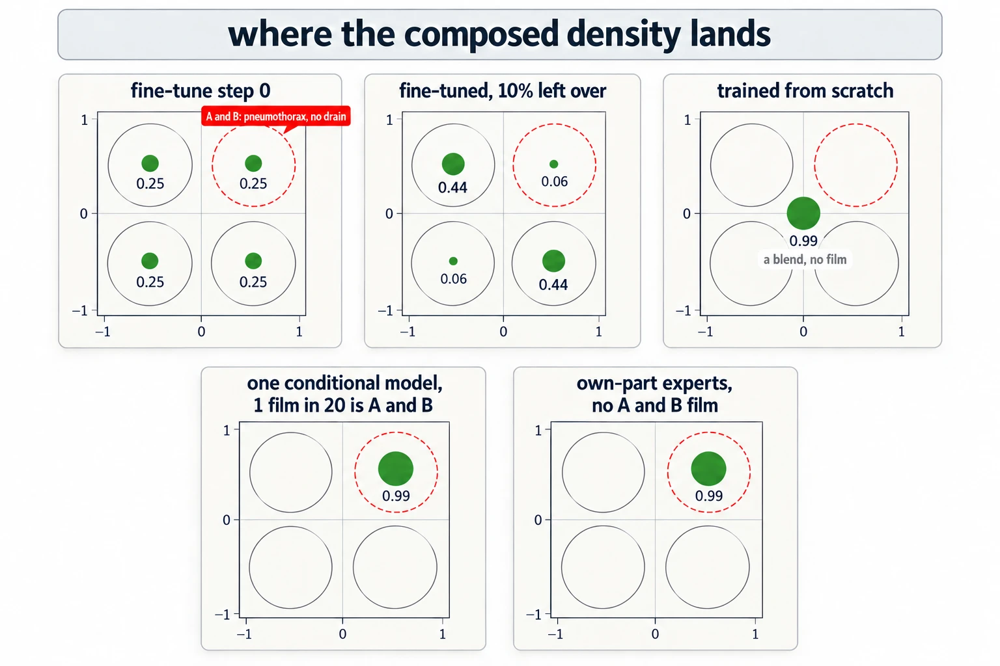

# When Neither Training Set Holds A And B

Up: [[Composition]] · ⬅️ [[What An Expert Learns From Its Training Set]] · [[Three Things Called Annealing]] ➡️

Artificial Intelligence, Generative Modeling, Diffusion Models, Composition. Needs: [[What An Expert Learns From Its Training Set]].

> [!question] Test yourself
> [The diffusion models quiz](https://claude.ai/artifact/MyTdAaVfZW3wiqhbLKg4wu) covers this note, with the rest of the [[Diffusion Models]] folder. Your attempts are saved on the page.

> [!warning] Unfinished
>
> Stated, not checked: 3 claims, marked where they sit.

**A product of two experts has density only where both experts have density, so it reaches an A-and-B combination that neither training set contains only as far as something gives each expert density there.** If $p_A(x) = 0$ then $p_A(x)\,p_B(x) = 0$ whatever $p_B(x)$ is, so the product's support is the intersection of the two supports. *Derived:* this is the product rule for zero and needs no experiment. The field calls producing combinations never seen together compositional generalisation, or out-of-support generation. *Stated:* the walk's names, not checked against one source.

**When to reach for it.** When a plan hopes composition will produce a combination missing from every training set, such as chest X-rays with a pneumothorax and no chest drain, built from a pneumothorax expert and a no-drain expert. Before training anything, ask where each expert gets density in A-and-B. Turning the share of A-and-B points in each training set down to 0% is no experiment, because the product rule already fixes the answer: the product's mass in A-and-B falls to whatever smoothing leaves.

**The form.**

```text
support(p_A * p_B)  =  support(p_A)  ∩  support(p_B)
p_A(x) = 0   =>   p_A(x) * p_B(x) = 0, whatever p_B(x) is
a trained expert's density in A∩B  =  its training data there  +  the smoothing tail  +  anything the network adds
```

A trained expert matches its training set smoothed by the noise, as step 2 of [[What An Expert Learns From Its Training Set#How the expert's training set works]] says. In 2D, an earlier walk measured trained MLP experts within 0.04 nats of the ideal smoothed-data experts, so there the third term is absent. *Cited:* run 2 of the overlap-dial walk, `artifacts/ideas/poe-overlap-dial/IDEA_MAP.md` line 157 in the reduce-reuse-recycle research repository.

**Try it yourself.** The two experts are the ones the authors' notebook composes in its ring-times-bar toy (`notebooks/simple_distributions.ipynb` in the reduce-reuse-recycle repository). Cell 14 builds a ring of 8 Gaussian modes at radius 0.5, cell 32 line 49 trains it with mode width 0.03, and cell 17 builds a bar uniform on $|x_1| < 0.2$, $|x_2| < 1$. The ring's modes at $(0, \pm 0.5)$ are 2 of the 8, so 25% of the ring's data already sits inside the bar. The script compares that pair with a second pair where neither expert has A-and-B: the ring without those two modes, and the bar with the band $0.4 < |x_2| < 0.6$ cut out. A width $h$ stands in for the smoothing a trained expert adds. The ring is smoothed by adding $h^2$ to each mode's variance, because [variances add](../../../../Mathematics/references/textbooks/linear-algebra/matrix-cookbook.pdf#page=41) when two independent Gaussians are summed. The bar's edges are blurred with the same width.

1. You need Python 3: `python3 --version` prints a version. The script imports only `math`, so no prepared environment or package is needed.
2. Make an empty folder:

   ```bash
   mkdir -p ~/playground/sandbox/product-support && cd ~/playground/sandbox/product-support
   ```

3. Save this as `support.py`. On a grid with spacing 0.005 it multiplies the two experts point by point and sums the result to get $Z$, the product's raw mass. It also measures the share of that mass within 0.1 of $(0, \pm 0.5)$, the A-and-B combination, and finds where the second pair's product is tallest:

   ```python
   # How much of a product of two experts survives when neither expert has density in A-and-B.
   import math

   S = 0.03                                   # each ring mode's width, as the notebook trains it
   MODES = [(0.5 * math.cos(2 * math.pi * k / 8), 0.5 * math.sin(2 * math.pi * k / 8)) for k in range(8)]
   KEPT = [m for m in MODES if abs(m[0]) > 0.2]            # drops the two modes at (0, +-0.5)

   def gauss1(x, m, s):
       return math.exp(-(x - m) ** 2 / (2 * s * s)) / (math.sqrt(2 * math.pi) * s)

   def ring(x, y, modes, h):                  # the ring, smoothed by width h
       s = math.sqrt(S * S + h * h)
       return sum(gauss1(x, mx, s) * gauss1(y, my, s) for mx, my in modes) / len(modes)

   def box1(x, lo, hi, h):                    # uniform on [lo, hi], smoothed by width h
       if h == 0:
           return 1.0 / (hi - lo) if lo < x < hi else 0.0
       cdf = lambda z: 0.5 * (1 + math.erf(z / (h * math.sqrt(2))))
       return (cdf(x - lo) - cdf(x - hi)) / (hi - lo)

   def bar(x, y, cut, h):                     # |x| < 0.2, |y| < 1; cut removes 0.4 < |y| < 0.6
       pieces = [(-1, -0.6), (-0.4, 0.4), (0.6, 1)] if cut else [(-1, 1)]
       total = sum(hi - lo for lo, hi in pieces)
       return box1(x, -0.2, 0.2, h) * sum(box1(y, lo, hi, h) * (hi - lo) for lo, hi in pieces) / total

   d = 0.005
   grid = [-1.2 + i * d for i in range(int(2.4 / d) + 1)]
   near = lambda x, y: math.hypot(x, abs(y) - 0.5) < 0.1   # within 0.1 of (0, 0.5) or (0, -0.5)
   for h in (0.0, 0.05, 0.1):
       out = []
       for name, modes, cut in (("full", MODES, False), ("overlap removed", KEPT, True)):
           Z = A = top = 0.0
           for x in grid:
               for y in grid:
                   p = ring(x, y, modes, h) * bar(x, y, cut, h) * d * d
                   Z += p
                   A += p if near(x, y) else 0.0
                   if p > top:
                       top, at = p, (x, y)
           out.append((name, Z, A / Z, at))
       (n1, z1, a1, _), (n2, z2, a2, at2) = out
       print(f"h = {h:.2f}  {n1}: Z = {z1:.3g}, share near (0, +-0.5) {a1:.3f}   "
             f"{n2}: Z = {z2:.3g}, share near (0, +-0.5) {a2:.3f}   Z ratio {z2 / z1:.3g}")
       print(f"          overlap removed: the product is tallest at ({at2[0]:.3f}, {at2[1]:.3f})")
   ```

4. Run it. It takes about 7 seconds:

   ```bash
   python3 support.py
   ```

   You should see:

   ```
   h = 0.00  full: Z = 0.313, share near (0, +-0.5) 0.996   overlap removed: Z = 1.6e-07, share near (0, +-0.5) 0.000   Z ratio 5.12e-07
             overlap removed: the product is tallest at (-0.200, 0.355)
   h = 0.05  full: Z = 0.324, share near (0, +-0.5) 0.741   overlap removed: Z = 0.0173, share near (0, +-0.5) 0.000   Z ratio 0.0535
             overlap removed: the product is tallest at (0.250, -0.340)
   h = 0.10  full: Z = 0.356, share near (0, +-0.5) 0.301   overlap removed: Z = 0.11, share near (0, +-0.5) 0.005   Z ratio 0.31
             overlap removed: the product is tallest at (0.240, -0.315)
   ```

   

5. Clean up, and check the folder is gone:

   ```bash
   cd ~ && rm -r ~/playground/sandbox/product-support
   ls ~/playground/sandbox/product-support; echo $?
   ```

   You should see `No such file or directory` and `2`.

**Reading the support output.**

| # | Field | Value | How to read it | Backing |
|---|---|---|---|---|
| 1 | full, $Z$ at $h = 0$ | `0.313` | the product's raw mass: the two ring modes inside the bar carry all of it | derived below |
| 2 | full, share near $(0, \pm 0.5)$ | `0.996` | almost all of the product sits on those two modes, the A-and-B combination | derived below |
| 3 | overlap removed, $Z$ at $h = 0$ | `1.6e-07` | with neither expert holding A-and-B, the product has almost no mass anywhere: only the Gaussian tails of the 45-degree modes reach the bar's edge | derived below |
| 4 | overlap removed, share near $(0, \pm 0.5)$ | `0.000` | none of what is left is at the missing combination | shown |
| 5 | overlap removed, tallest point | `(-0.200, 0.355)` | after dividing by $Z$ the product is a full distribution, centred on the bar's edge beside a 45-degree mode, where neither expert is at its best: the empty intersection of [[The Product As An Intersection]] | shown |
| 6 | overlap removed, $Z$ at $h = 0.1$ | `0.11` | smoothing gives the product mass back | shown |
| 7 | overlap removed, share near $(0, \pm 0.5)$ at $h = 0.1$ | `0.005` | the returned mass still lands beside the 45-degree modes, at $(0.240, -0.315)$, and not at the missing combination | shown |
| 8 | $Z$ ratio at $h = 0.1$ | `0.31` | 31% of the full pair's raw mass, which is why a sampler on smoothed experts still returns samples. They sit at the bar's edges | shown |

**How the support rule works.**

1. **The full pair.** At $h = 0$ only the two modes at $(0, \pm 0.5)$ lie inside the bar. Each carries weight $1/8$ and lies wholly where the bar's height is $1/(0.4 \times 2) = 1.25$, so $Z = 2 \times \tfrac18 \times 1.25 = 0.3125$. A 2D Gaussian of width 0.03 keeps $1 - e^{-(0.1/0.03)^2/2} = 1 - e^{-5.556} = 0.9961$ of its mass within 0.1 of its centre. *Derived.* These are fields 1 and 2.
2. **The pair with the overlap removed.** The nearest kept modes sit at $x_1 = \pm 0.5 \cos 45^\circ = \pm 0.3536$, which is $0.1536 = 5.12$ widths outside the bar's edge at 0.2. The share of such a Gaussian that crosses the edge is $\Phi(-5.12) = 1.54 \times 10^{-7}$. Four such modes, each of weight $1/6$, with 0.939 of each inside the kept band $|x_2| < 0.4$, under a bar of height $1/(0.4 \times 1.6)$, give $Z = 4 \times \tfrac16 \times 1.54 \times 10^{-7} \times 0.939 / 0.64 = 1.51 \times 10^{-7}$. *Derived.* The run's `1.6e-07` in field 3 is 6% higher because the grid's spacing of 0.005 is coarse against a tail this steep.
3. **What the rule leaves to smoothing.** The product is zero wherever either factor is zero, so all of field 6's mass comes from the smoothing tails, and those tails are thickest where the two supports are nearest each other. That is the bar's edge beside the 45-degree modes, and the missing combination is not there. *Shown* in fields 5 to 7.


*The product's support as the intersection of supports, the ring-times-bar with and without the overlap.*

**Three ways round it, strongest first.**

**Borrow it, build it, or grade with it.** Each way answers where each expert's density on the A-and-B films comes from. It is borrowed from pretraining, or from rare A-and-B films in one conditional model; it is built from parts each expert saw separately; or, when neither is possible, it comes from nowhere, and the toy becomes a known answer for grading samplers.

- **Support kept from pretraining.** Fine-tune both experts from one model pretrained on every combination. For chest X-rays that is all of NIH's films, which include pneumothorax without a drain. The product then reaches A-and-B through the pretrained density that each expert keeps. The cost is that the answer depends on how long each expert is fine-tuned, since fine-tuning may erase that support. *Stated.* The check in 2D: pretrain on all four quadrant cells, fine-tune copies at 0% overlap for 0 to $N$ steps, and plot the product's mass in A-and-B against steps. [[#The four-quadrant answer key]] fixes what ideal experts give: `0.25` in A-and-B at fine-tune step 0, falling as $\varepsilon/(2 - 4\varepsilon)$ with the leftover $\varepsilon$ each expert keeps, and `0.5` at most when the leftover sits only next door. One conditional model with "contains" labels keeps the pretraining support in its base density and puts `0.989` in A-and-B whenever the combination is rare in the data rather than absent, so it is the stronger form of this rescue.
- **An expert whose density factorises over image parts.** This is projective composition, from Bradley et al. 2025 ([arXiv 2502.04549](https://arxiv.org/abs/2502.04549)), set out above under [[Composing Models With A Background]]. *Cited.* A pneumothorax expert that learned the lung and the chest wall as separate parts gives density to "pneumothorax lung, chest wall without a drain", because each part was seen somewhere. *Stated:* applying this to X-rays is the walk's reading. Trained 2D MLP experts do not learn the factorisation by themselves, since they add nothing beyond their smoothed data (the 0.04 nats above), but it can be built in, and [[#The four-quadrant answer key]] builds it and reaches A-and-B with no A-and-B data. Whether a trained image model learns it needs a small image testbed with A and B in separate patches.
- **Fallback: use the 2D curve to calibrate samplers.** The 2D curve of A-and-B mass against overlap is fixed by the product rule before any training, so use it only as a known answer for checking samplers. This is the cheapest, and it gives up the medical question. [[#The four-quadrant answer key]] is one such known answer.

**Why this matters.** The repaired claim is that **a product reaches A-and-B only as far as each expert's density does, and generates combinations missing from training only when something gives each expert density there.** A plan that hopes composition will make the missing X-ray films has to name that something (pretrained support, or an expert that factorises over parts) before it runs.

## The four-quadrant answer key

**On a toy with one blob per quadrant, the composed density can be computed exactly, so each way round a missing A-and-B combination gets a number before anything is trained.** Two separately fine-tuned experts put a quarter of their product in A-and-B at the start of fine-tuning, half if what they keep from pretraining sits only on the quadrants next door, and close to nothing once fine-tuning drains it. One conditional model with "contains" labels puts all of it there while the combination is rare in the data, and none once it is absent. Experts built to model only their own image part reach it with no A-and-B data at all. *Shown* in the run below and *derived* under "How the answer key works".

**The toy, in the chest X-ray's words.** Each axis is one yes-or-no property. A is $x_1 > 0$ and stands for pneumothorax; B is $x_2 > 0$ and stands for no chest drain. Each quadrant holds one Gaussian blob of width (standard deviation) 0.15, centred at $(\pm 0.5, \pm 0.5)$, so each quadrant is one kind of film:

| Quadrant | Blob centre | A: pneumothorax | B: no chest drain | The film | Its name |
|---|---|---|---|---|---|
| top-right | $(0.5, 0.5)$ | yes | yes | a pneumothorax with no drain in yet | A and B, the film the composition is meant to make |
| bottom-right | $(0.5, -0.5)$ | yes | no | a pneumothorax with a drain in | A, not B |
| top-left | $(-0.5, 0.5)$ | no | yes | no pneumothorax and no drain | B, not A |
| bottom-left | $(-0.5, -0.5)$ | no | no | a drain and no pneumothorax | neither |

"A, not B" is a film that has A and lacks B. In the X-ray plan the pneumothorax expert trains on bottom-right films, and every one of them has a drain in, so the expert learns "has a drain" (not B) along with "pneumothorax". The no-drain expert trains on top-left films and learns "no pneumothorax" (not A) the same way. That is why their product lands mostly on bottom-right and top-left. *Derived* in step 3 below.

**Support, in the same words.** A density's support is the set of points where it is above zero: the films a model can produce at all. Every blob here is a Gaussian, which is above zero everywhere, so on the toy the word means where an expert keeps a share worth counting, and the leftover $\varepsilon$ below says how much. Pretraining gives each expert support on all four kinds of film. Fine-tuning shrinks it toward the expert's own quadrant, and an expert trained from scratch keeps only its own. The product's support is where both experts' supports meet, so the product can make the top-right film only while both experts keep some density there. *Derived* from the product rule in this note.


*The two right-hand films have the collapsed lung and the two bottom films have the drain, so the red top-right film, with the collapse and no drain, is the one neither expert trained on.*

**The three ways of building the experts.** The run prints the first two under the idea walk's names, construction (2) and construction (1), and the third as `2b`.

- **Construction (2), two separately fine-tuned experts.** Both start from one model pretrained on all four quadrants equally. After fine-tuning, expert A keeps $1 - 3\varepsilon$ of its weight on bottom-right and a leftover $\varepsilon$ on each other quadrant; expert B keeps $1 - 3\varepsilon$ on top-left. The composed density is the product $p_A(x)\,p_B(x)$.
- **Construction (1), one conditional model with "contains" labels**, composed as $p(x \mid A)\,p(x \mid B)/p(x)$, the score sum $s(x \mid A) + s(x \mid B) - s(x)$ of [[What An Expert Learns From Its Training Set]]. A share $r$ of all training films is A and B. Every film with A among its labels trains condition A, so the A-and-B films train both conditions, and the base model $p(x)$ holds all four quadrants.
- **Experts that each model only their own part.** Expert A models $x_1$ (the lung part) from bottom-right films and takes $x_2$ (the chest-wall part) from the [marginal](../../../../Mathematics/references/textbooks/machine-learning/mathematics-for-machine-learning.pdf#page=190) of all films; expert B does the mirror image. No training film is in top-right.

**What the numbers stand for.**

| Number | What it is |
|---|---|
| a share, the run's `TR=`, `BR=`, `TL=`, `BL=` | the fraction of the composed density within 3 widths (0.45) of that quadrant's blob centre |
| `at_ori=` | the fraction within $3 \times 0.15/\sqrt2 = 0.32$ of the origin, where two far-apart blobs multiply into a blend that is no film at all |
| `Z=` | the composed density's total mass before it is rescaled to 1; a tiny $Z$ means the two experts barely overlap anywhere |
| $\varepsilon$, the run's `eps=` | the leftover: the weight a fine-tuned expert still keeps on each quadrant other than its own. $\varepsilon = 0.25$ is fine-tune step 0, where each expert still holds the four quadrants equally; $\varepsilon = 0.05$ is 5% left on each; $\varepsilon = 0$ is nothing left, as for an expert trained from scratch |
| $r$, the run's `r=` | the share of all training films that are A and B. $r = 0.05$ is one film in 20 a pneumothorax with no drain; $r = 0$ is none at all |
| `0.25` | the top-right share at fine-tune step 0, where the product splits evenly over the four blobs |
| `0.5` | the top-right share when the leftover sits only on the two quadrants next to each expert's own, so top-right ties with bottom-left |
| `0.989` | all of the composed density on one blob. It is $1 - e^{-9/2}$, the share of a 2D Gaussian within 3 widths of its centre, short of 1 only because the circle stops there |

**Try it yourself.**

> [!warning] Not run through the prepared environment
> The cluster has no `~/.vault-sandbox`. The output below is the idea walk's own run, and the writer ran these exact steps with the system Python in its place and got the same 18 lines byte for byte. The next machine with the prepared environment runs them as written.

1. You need the prepared environment: `~/.vault-sandbox/bin/python -c "import numpy"` prints nothing when it is there.
2. If it is missing, make it once: `uv venv ~/.vault-sandbox` then `uv pip install --python ~/.vault-sandbox/bin/python pandas numpy scipy matplotlib statsmodels openpyxl`.
3. Make an empty folder and copy in the script, which is about 100 lines and sits beside this note as `sandbox/answer_key.py`:

   ```bash
   mkdir -p ~/playground/sandbox/answer-key-quadrants && cd ~/playground/sandbox/answer-key-quadrants
   cp ~/Obsidian/"Artificial Intelligence/Generative Modeling/sandbox/answer_key.py" .
   ls
   ```

   You should see only `answer_key.py`. The script builds each expert as a weighted mix of the four blobs on a $441 \times 441$ grid over $[-1.1, 1.1]^2$, multiplies the experts point by point, and measures the shares. Nothing is trained and no sampler runs, so every number is the exact target.

4. Run it. It takes about a second:

   ```bash
   ~/.vault-sandbox/bin/python answer_key.py
   ```

   You should see these 18 lines, and `ls` now also shows `answer_key.json`, the same numbers to full precision:

   ```
   construction 2, leftover even eps=0.25           TR=0.25 BR=0.25 TL=0.25 BL=0.25 at_ori=8.007e-05 Z=0.8842  formula=0.25
   construction 2, leftover even eps=0.1            TR=0.06249 BR=0.4374 TL=0.4374 BL=0.06249 at_ori=7.999e-05 Z=0.5659  formula=0.0625
   construction 2, leftover even eps=0.05           TR=0.02778 BR=0.4722 TL=0.4722 BL=0.02778 at_ori=7.998e-05 Z=0.3183  formula=0.02778
   construction 2, leftover even eps=0.01           TR=0.005105 BR=0.4948 TL=0.4948 BL=0.005105 at_ori=7.998e-05 Z=0.06932  formula=0.005102
   construction 2, leftover even eps=0.001          TR=0.0005051 BR=0.4994 TL=0.4994 BL=0.0005051 at_ori=8.007e-05 Z=0.00706  formula=0.000501
   construction 2, leftover even eps=0.0001         TR=5.423e-05 BR=0.4999 TL=0.4999 BL=5.423e-05 at_ori=8.107e-05 Z=0.0007072  formula=5.001e-05
   construction 2, leftover even eps=1e-06          TR=5.382e-06 BR=0.4999 TL=0.4999 BL=5.386e-06 at_ori=0.0001904 Z=7.075e-06  formula=5e-07
   construction 2, leftover even eps=0.0            TR=0.005918 BR=0.005932 TL=0.005932 BL=0.005946 at_ori=0.9889 Z=7.9e-10  formula=0
   construction 2, leftover adjacent only eps=0.1   TR=0.4999 BR=3.329e-05 TL=3.329e-05 BL=0.4999 at_ori=8.694e-05 Z=0.07075  formula=0.5
   construction 2, leftover adjacent only eps=0.01  TR=0.4989 BR=0.000406 TL=0.000406 BL=0.4989 at_ori=0.0001745 Z=0.0007094  formula=0.5
   construction 2, leftover adjacent only eps=0.001 TR=0.4894 BR=0.004026 TL=0.004026 BL=0.4894 at_ori=0.001121 Z=7.285e-06  formula=0.5
   construction 1, contains labels r=0.25           TR=0.9889 BR=7.843e-05 TL=7.843e-05 BL=3.612e-11 at_ori=0.002986 Z=0.25
   construction 1, contains labels r=0.05           TR=0.9889 BR=7.843e-05 TL=7.843e-05 BL=2.282e-10 at_ori=0.002989 Z=0.05
   construction 1, contains labels r=0.01           TR=0.9889 BR=7.843e-05 TL=7.843e-05 BL=1.189e-09 at_ori=0.003012 Z=0.01
   construction 1, contains labels r=0.001          TR=0.9886 BR=7.842e-05 TL=7.842e-05 BL=1.199e-08 at_ori=0.00331 Z=0.001
   construction 1, contains labels r=0.0            TR=0.07004 BR=3.165e-05 TL=3.165e-05 BL=3.173e-05 at_ori=0.9699 Z=3.783e-07
   2b factorised experts, plain product pA*pB r=0.0 TR=0.9999 BR=4.222e-06 TL=4.222e-06 BL=1.331e-12 at_ori=8.039e-05 Z=0.8842
   2b factorised experts, background-divided pA*pB/pbg r=0.0 TR=0.9889 BR=7.843e-05 TL=7.843e-05 BL=3.612e-11 at_ori=0.002986 Z=0.9999
   ```

   

5. Clean up, and check the folder is gone:

   ```bash
   cd ~ && rm -r ~/playground/sandbox/answer-key-quadrants
   ls ~/playground/sandbox/answer-key-quadrants; echo $?
   ```

   You should see `No such file or directory` and `2`.

**Reading the answer-key output.**

| # | Field | Value | How to read it | Backing |
|---|---|---|---|---|
| 1 | $\varepsilon = 0.25$, `TR` | `0.25` | fine-tune step 0: both experts are the pretrained model, and the product gives each blob a quarter | derived, step 2 |
| 2 | $\varepsilon = 0.1$, `TR` and `formula` | `0.06249`, `0.0625` | with 10% leftover on each other quadrant, the top-right blob gets $\varepsilon/(2 - 4\varepsilon) = 0.0625$ | derived, step 3 |
| 3 | $\varepsilon = 0.1$, `BR` and `TL` | `0.4374` each | the rest lands on "pneumothorax with a drain" and "no pneumothorax, no drain", each expert's own quadrant, because each expert learned "not B" or "not A" along with its own property | derived, step 3 |
| 4 | $\varepsilon = 0.05$, `TR` | `0.02778` | 5% leftover gives $0.05/1.8 = 0.0278$: the share falls with the leftover, close to $\varepsilon/2$ | derived, step 3 |
| 5 | $\varepsilon = 10^{-6}$, `TR` and `formula` | `5.382e-06`, `5e-07` | at a leftover this small the formula no longer holds: the run is about ten times it, because the tails of next-door blobs now outweigh the top-right term | derived, step 3 |
| 6 | $\varepsilon = 0$, `at_ori` and `Z` | `0.9889`, `7.9e-10` | experts trained from scratch: the product is a blend at the origin, a film that is neither a pneumothorax film nor a no-drain film, and the two experts barely overlap | derived, step 4 |
| 7 | leftover next door only, $\varepsilon = 0.1$: `TR` and `BL` | `0.4999` each | each expert keeps leftover only on its two neighbouring quadrants, so top-right ties with bottom-left ("neither") | derived, step 5 |
| 8 | construction (1), $r = 0.05$: `TR` and `Z` | `0.9889`, `0.05` | one film in 20 being A and B is enough: the composed density is the whole top-right blob, and its mass equals $r$ | derived, step 6 |
| 9 | construction (1), $r = 0$: `at_ori` | `0.9699` | with no A-and-B film at all, construction (1) also collapses to the origin blend: rare is enough, absent is not | shown |
| 10 | own-part experts, plain product: `TR` | `0.9999` | with no A-and-B film, experts that each model only their own part put the product on the top-right blob | derived, step 7 |
| 11 | own-part experts, background-divided: `TR` | `0.9889` | dividing by the background leaves exactly the top-right blob, which is projective composition | derived, step 7 |

The rows between fill in each curve. Construction (1) stays at `0.9889` from $r = 0.25$ down to $r = 0.01$ and is `0.9886` at $r = 0.001$.



*Only the conditional model and the own-part experts put the composed density (0.99) inside the red top-right circle; the fine-tuned pair keeps 0.06 there, and the pair trained from scratch puts 0.99 at the origin, on no film at all.*

**How the answer key works.**

1. **A product of far-apart blobs keeps only matching pairs.** Each expert is a mixture over the four blobs $\mathcal N_q$ of width $\sigma = 0.15$ at centres $m_q$, $p_A = \sum_q a_q \mathcal N_q$ and $p_B = \sum_q b_q \mathcal N_q$, so

   $$p_A(x)\,p_B(x) = \sum_q \sum_{q'} a_q\, b_{q'}\, \mathcal N_q(x)\, \mathcal N_{q'}(x).$$

   By [the area under a product of two Gaussians](../../../../Mathematics/references/textbooks/linear-algebra/matrix-cookbook.pdf#page=42), each pair carries mass

   $$\int \mathcal N_q(x)\, \mathcal N_{q'}(x)\, dx = \frac{1}{4\pi\sigma^2}\, e^{-\lVert m_q - m_{q'} \rVert^2/(4\sigma^2)}.$$

   A blob with itself gives $1/(4\pi\sigma^2) = 3.54$. Blobs next door are 1 apart (6.7 widths) and carry an extra factor $e^{-1/0.09} = e^{-11.1} = 1.5 \times 10^{-5}$; diagonal blobs, $\sqrt2$ apart, carry $e^{-22.2} = 2.2 \times 10^{-10}$. While the weights are well above $10^{-5}$ only the matching pairs count, and blob $q$'s share is

   $$\text{share}_q = \frac{a_q\, b_q}{\sum_{q'} a_{q'}\, b_{q'}}.$$

   Each matching term $\mathcal N_q^2$ is a blob of width $\sigma/\sqrt2$ at $m_q$, and the circle of radius $3\sigma$ holds $1 - e^{-9} = 0.9999$ of it. *Derived.*

2. **Fine-tune step 0.** Both experts are the pretrained model, $a_q = b_q = 1/4$, so each blob gets $\frac{1/16}{4/16} = 0.25$, and field 1 is $0.25 \times 0.9999 = 0.24997$. *Derived.*

3. **Leftover on every other quadrant.** In the order top-right, bottom-right, top-left, bottom-left, $a = (\varepsilon,\ 1 - 3\varepsilon,\ \varepsilon,\ \varepsilon)$ and $b = (\varepsilon,\ \varepsilon,\ 1 - 3\varepsilon,\ \varepsilon)$. The matching products are $\varepsilon^2$, $\varepsilon(1 - 3\varepsilon)$, $\varepsilon(1 - 3\varepsilon)$ and $\varepsilon^2$, which sum to $2\varepsilon - 4\varepsilon^2$, so

   $$\text{share}_{TR} = \frac{\varepsilon^2}{2\varepsilon - 4\varepsilon^2} = \frac{\varepsilon}{2 - 4\varepsilon}, \qquad \text{share}_{BR} = \text{share}_{TL} = \frac{1 - 3\varepsilon}{2 - 4\varepsilon}.$$

   At $\varepsilon = 0.1$ these are $0.1/1.6 = 0.0625$ and $0.7/1.6 = 0.4375$ (fields 2 and 3); at $\varepsilon = 0.05$, $0.05/1.8 = 0.0278$ (field 4). Each expert's own quadrant is multiplied by the other expert's leftover once, and the top-right by leftover twice, so the own quadrants win and the top-right share falls close to $\varepsilon/2$. Support kept from pretraining does not by itself pick A-and-B. The formula drops the next-door pairs, which carry about $1.5 \times 10^{-5}\,\varepsilon$ against the top-right's $\varepsilon^2$; at $\varepsilon = 10^{-6}$ they win, and field 5 is 10.8 times the formula. *Derived.*

4. **No leftover.** At $\varepsilon = 0$ every matching product is 0 and only the diagonal pair bottom-right times top-left is left, so $Z = 2.2 \times 10^{-10} \times 3.54 = 7.9 \times 10^{-10}$ (field 6). That pair's product is a blob of width $\sigma/\sqrt2$ at the midpoint $(0, 0)$, and the circle of radius $3\sigma/\sqrt2$ holds $1 - e^{-9/2} = 0.989$ of it. The blend is symmetric about both axes, so a count by quadrant would give each quadrant 0.25 and report the same 0.25 as step 0. That misreading is why every share here is measured around a blob's centre. *Derived.*

5. **Leftover next door only.** $a = (\varepsilon,\ 1 - 2\varepsilon,\ 0,\ \varepsilon)$ and $b = (\varepsilon,\ 0,\ 1 - 2\varepsilon,\ \varepsilon)$. The matching products are $\varepsilon^2$, 0, 0 and $\varepsilon^2$, so top-right and bottom-left get half each (field 7). *Derived.* Nothing in "A, not B" or "B, not A" films tells an expert the top-right blob from the bottom-left one, so a half is the most this construction can be expected to give. *Stated:* what leftover a trained, fine-tuned expert keeps is not measured here.

6. **One conditional model.** By [Bayes' rule](../../../../Mathematics/references/textbooks/statistics/introduction-to-probability-for-data-science.pdf#page=105), $p(x \mid A) = p(A \mid x)\,p(x)/p(A)$, so $p(x \mid A)\,p(x \mid B)/p(x)$ is proportional to $p(x, A)\,p(x, B)/p(x)$. With a share $r$ of films in top-right and $o = (1 - r)/3$ in each other quadrant, $p(x, A) = r\,\mathcal N_{TR} + o\,\mathcal N_{BR}$, $p(x, B) = r\,\mathcal N_{TR} + o\,\mathcal N_{TL}$ and $p(x) = r\,\mathcal N_{TR} + o\,(\mathcal N_{BR} + \mathcal N_{TL} + \mathcal N_{BL})$. Near the top-right blob only $\mathcal N_{TR}$ is more than a far tail:

   $$\frac{p(x, A)\,p(x, B)}{p(x)} \approx \frac{r\,\mathcal N_{TR} \cdot r\,\mathcal N_{TR}}{r\,\mathcal N_{TR}} = r\,\mathcal N_{TR}.$$

   Near each other blob one of the two factors on top is a far tail, so the composed density vanishes there. It is the top-right blob itself for every $r > 0$, its mass is $r$, and the $3\sigma$ circle holds $0.989$ of it (field 8). This model does not learn "not B", because condition A trains on every film with A among its labels, the A-and-B films included, and the $r$ in the denominator cancels one of the two on top. At $r = 0$ the top-right term is gone and only the origin blend is left (field 9). *Derived*, apart from field 9's exact `0.9699`, which is *shown*.

7. **Experts that each model only their own part.** Write $\mathcal N(v; m)$ for the 1D Gaussian of width $\sigma$ at $m$, and $p_{bg}(v) = \tfrac12 \mathcal N(v; 0.5) + \tfrac12 \mathcal N(v; -0.5)$ for the marginal of all four quadrants along one axis. Then

   $$p_A(x) = \mathcal N(x_1; 0.5)\, p_{bg}(x_2), \qquad p_B(x) = p_{bg}(x_1)\, \mathcal N(x_2; 0.5), \qquad p_{bg}(x) = p_{bg}(x_1)\, p_{bg}(x_2).$$

   Divided by the background,

   $$\frac{p_A(x)\, p_B(x)}{p_{bg}(x)} = \mathcal N(x_1; 0.5)\, \mathcal N(x_2; 0.5) = \mathcal N_{TR}(x),$$

   exactly the top-right blob, `0.9889` in its circle (field 11). The plain product keeps one $p_{bg}$ factor per axis, and $\mathcal N(x_1; 0.5)\, p_{bg}(x_1) \approx \tfrac12 \mathcal N(x_1; 0.5)^2$ because the far half overlaps it only by $e^{-11.1}$. So the plain product is a blob of width $\sigma/\sqrt2$ at $(0.5, 0.5)$, `0.9999` in the circle (field 10). Expert A never ties $x_2$ to $x_1$, so it gives density to a pneumothorax lung beside any chest wall, including the no-drain chest wall it saw on top-left films through the marginal. This is the factorisation [[Composing Models With A Background]] calls projective composition. *Derived.*

**What this settles, and what it leaves open.** Support kept from pretraining starts at a quarter of the product in A-and-B and falls toward $\varepsilon/2$ as fine-tuning drains the leftover, so it holds only as long as fine-tuning is stopped early. How fast a trained expert's leftover falls with fine-tune steps is the trained check in the first rescue above, not yet run. One conditional model with "contains" labels needs the A-and-B films to be rare, not absent. Trained 2D MLP experts do not learn the own-part factorisation by themselves, so it has to be built in, and on chest X-rays a drain changes the lung it treats, so the lung and the chest wall may not be separate parts. *Stated:* that last point is the walk's reading, not checked against a source. Since every number here is exact, a sampler run on these experts can be scored by how far its top-right share lands from the answer key.

**Why this matters.** Before training anything for the missing X-ray films, the answer key says how far each rescue can reach them. A pair of separately fine-tuned experts puts a quarter to a half of the product there at the start of fine-tuning and less as it goes on. One conditional model puts nearly all of it there if the training data holds a few such films, and an expert built to model only its own part needs none.

> [!note]- How this was checked
> The run in When Neither Training Set Holds A And B was made by the writer on 2026-10-15 on the cluster (mscluster, Linux) in an empty folder, `~/playground/sandbox/product-support`, with the system `python3` (Python 3.14.4), standard library only. It took 7.2 seconds. The folder was removed afterwards and the clean-up check returned 2. The script and the output on the page were diffed against the files that ran, and both are identical. The ring, the bar and the mode width were read in the research repository's `notebooks/simple_distributions.ipynb`, counting cells from 0: `toy_gmm` in cell 14 (8 modes, radius 0.5), `bar` in cell 17 (uniform on $|x_1| < 0.2$, $|x_2| < 1$), and `toy_gmm(std=.03)` on line 49 of cell 32. The output picture was rendered from the captured text by a script in DejaVu Sans Mono, never drawn, and opened before filing. The 0.04 nats is quoted from the overlap-dial walk's run record, not re-run here. The variances-add link is the shelf index's own row for page 41 of the matrix cookbook. $\Phi$, the standard normal CDF, and the support of a density carry no textbook link, because this machine has no PDF reader to open a page and confirm it.
>
> [[#The four-quadrant answer key]] was added on 2026-10-17 on the cluster (mscluster, Linux), from one turn of the `drip-idea` walk of when a product reaches A and B, claim 2's children 2a and 2b. Its output is the walk's own run, `run.log` in `artifacts/ideas/when-poe-reaches-a-and-b/runs/answer-key-quadrants/` of the reduce-reuse-recycle research repository, made there with `/home-mscluster/mmolefe/miniforge3/envs/co3/bin/python answer_key.py`. `sandbox/answer_key.py` beside this note is that script, byte for byte (`cmp`). The cluster has no `~/.vault-sandbox`, so the writer ran the section's steps 3 to 5 as written with the system `python3` (Python 3.12.10, NumPy 2.5.4) in place of `~/.vault-sandbox/bin/python`, in the empty folder `~/playground/sandbox/answer-key-quadrants`. The script ran in 0.6 seconds, its 18 lines were identical to `run.log` (`diff`), `ls` showed `answer_key.py` before the run and `answer_key.json` after it, and the clean-up check returned 2. The block on the page was compared with `run.log` by script and matches. Every derived number was recomputed by the writer in Python: $1/(4\pi\sigma^2) = 3.5368$, $e^{-11.11} = 1.4945 \times 10^{-5}$, $e^{-22.22} = 2.2336 \times 10^{-10}$, the $\varepsilon = 0$ normaliser $7.8999 \times 10^{-10}$ against the run's $7.8999 \times 10^{-10}$, $1 - e^{-9} = 0.99988$, $1 - e^{-9/2} = 0.98889$, and the ratio $5.382 \times 10^{-6} / 5 \times 10^{-7} = 10.76$. The output picture was rendered from `run.log` by a script in DejaVu Sans Mono with the system `python3` and Matplotlib, never drawn, and opened before filing. The three textbook pages were opened before linking: the Matrix Cookbook page 42 (section 8.1.8, product of Gaussian densities, equation 371), Mathematics for Machine Learning page 190 (the sum rule and the marginal, equation 6.21) and Introduction to Probability for Data Science page 105 (Theorem 2.7, Bayes' theorem). [Bradley et al. on arXiv](https://arxiv.org/abs/2502.04549) answered 200 on 2026-10-17.
