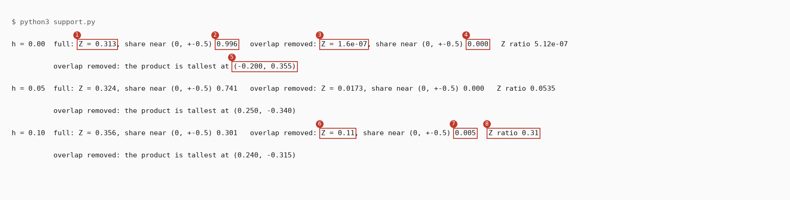
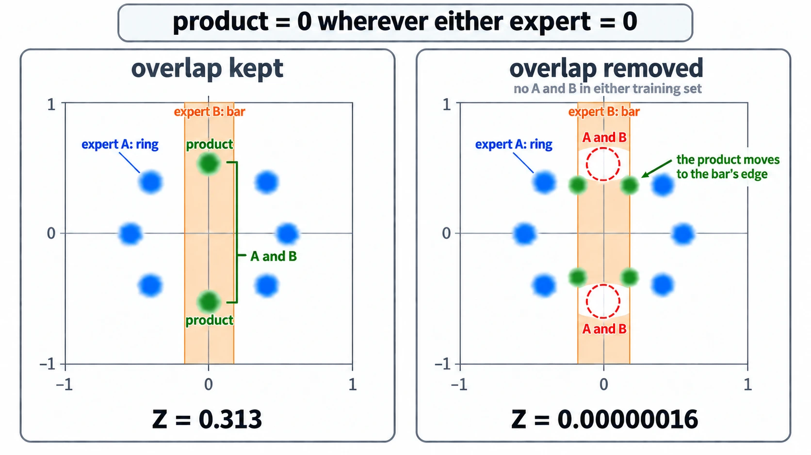

# When Neither Training Set Holds A And B

Up: [[Composition]] · ⬅️ [[What An Expert Learns From Its Training Set]]

Artificial Intelligence, Generative Modeling, Diffusion Models, Composition. Needs: [[What An Expert Learns From Its Training Set]].

> [!question] Test yourself
> [The diffusion models quiz](https://claude.ai/artifact/MyTdAaVfZW3wiqhbLKg4wu) covers this note, with the rest of the [[Diffusion Models]] folder. Your attempts are saved on the page.

> [!warning] Unfinished
> - One concept picture is waiting to be drawn: prompt 23 in the vault's `.prompts/Diffusion Models.md`.
>
> Stated, not checked: 3 claims, marked where they sit.

**A product of two experts has density only where both experts have density, so it reaches an A-and-B combination that neither training set contains only as far as something gives each expert density there.** If $p_A(x) = 0$ then $p_A(x)\,p_B(x) = 0$ whatever $p_B(x)$ is, so the product's support is the intersection of the two supports. *Derived:* this is the product rule for zero and needs no experiment. The field calls producing combinations never seen together compositional generalisation, or out-of-support generation. *Stated:* the walk's names, not checked against one source.

**When to reach for it.** When a plan hopes composition will produce a combination missing from every training set, such as chest X-rays with a pneumothorax and no chest drain, built from a pneumothorax expert and a no-drain expert. Before training anything, ask where each expert gets density in A-and-B. Turning the share of A-and-B points in each training set down to 0% is no experiment, because the product rule already fixes the answer: the product's mass in A-and-B falls to whatever smoothing leaves.

**The form.**

```text
support(p_A * p_B)  =  support(p_A)  ∩  support(p_B)
p_A(x) = 0   =>   p_A(x) * p_B(x) = 0, whatever p_B(x) is
a trained expert's density in A∩B  =  its training data there  +  the smoothing tail  +  anything the network adds
```

A trained expert matches its training set smoothed by the noise, as step 2 of [[What An Expert Learns From Its Training Set#How the expert's training set works]] says. In 2D, an earlier walk measured trained MLP experts within 0.04 nats of the ideal smoothed-data experts, so there the third term is absent. *Cited:* run 2 of the overlap-dial walk, `artifacts/ideas/poe-overlap-dial/IDEA_MAP.md` line 157 in the reduce-reuse-recycle research repository.

**Try it yourself.** The two experts are the ones the authors' notebook composes in its ring-times-bar toy (`notebooks/simple_distributions.ipynb` in the reduce-reuse-recycle repository). Cell 14 builds a ring of 8 Gaussian modes at radius 0.5, cell 32 line 49 trains it with mode width 0.03, and cell 17 builds a bar uniform on $|x_1| < 0.2$, $|x_2| < 1$. The ring's modes at $(0, \pm 0.5)$ are 2 of the 8, so 25% of the ring's data already sits inside the bar. The script compares that pair with a second pair where neither expert has A-and-B: the ring without those two modes, and the bar with the band $0.4 < |x_2| < 0.6$ cut out. A width $h$ stands in for the smoothing a trained expert adds. The ring is smoothed by adding $h^2$ to each mode's variance, because [variances add](../../../../Mathematics/references/textbooks/linear-algebra/matrix-cookbook.pdf#page=41) when two independent Gaussians are summed. The bar's edges are blurred with the same width.

1. You need Python 3: `python3 --version` prints a version. The script imports only `math`, so no prepared environment or package is needed.
2. Make an empty folder:

   ```bash
   mkdir -p ~/playground/sandbox/product-support && cd ~/playground/sandbox/product-support
   ```

3. Save this as `support.py`. On a grid with spacing 0.005 it multiplies the two experts point by point and sums the result to get $Z$, the product's raw mass. It also measures the share of that mass within 0.1 of $(0, \pm 0.5)$, the A-and-B combination, and finds where the second pair's product is tallest:

   ```python
   # How much of a product of two experts survives when neither expert has density in A-and-B.
   import math

   S = 0.03                                   # each ring mode's width, as the notebook trains it
   MODES = [(0.5 * math.cos(2 * math.pi * k / 8), 0.5 * math.sin(2 * math.pi * k / 8)) for k in range(8)]
   KEPT = [m for m in MODES if abs(m[0]) > 0.2]            # drops the two modes at (0, +-0.5)

   def gauss1(x, m, s):
       return math.exp(-(x - m) ** 2 / (2 * s * s)) / (math.sqrt(2 * math.pi) * s)

   def ring(x, y, modes, h):                  # the ring, smoothed by width h
       s = math.sqrt(S * S + h * h)
       return sum(gauss1(x, mx, s) * gauss1(y, my, s) for mx, my in modes) / len(modes)

   def box1(x, lo, hi, h):                    # uniform on [lo, hi], smoothed by width h
       if h == 0:
           return 1.0 / (hi - lo) if lo < x < hi else 0.0
       cdf = lambda z: 0.5 * (1 + math.erf(z / (h * math.sqrt(2))))
       return (cdf(x - lo) - cdf(x - hi)) / (hi - lo)

   def bar(x, y, cut, h):                     # |x| < 0.2, |y| < 1; cut removes 0.4 < |y| < 0.6
       pieces = [(-1, -0.6), (-0.4, 0.4), (0.6, 1)] if cut else [(-1, 1)]
       total = sum(hi - lo for lo, hi in pieces)
       return box1(x, -0.2, 0.2, h) * sum(box1(y, lo, hi, h) * (hi - lo) for lo, hi in pieces) / total

   d = 0.005
   grid = [-1.2 + i * d for i in range(int(2.4 / d) + 1)]
   near = lambda x, y: math.hypot(x, abs(y) - 0.5) < 0.1   # within 0.1 of (0, 0.5) or (0, -0.5)
   for h in (0.0, 0.05, 0.1):
       out = []
       for name, modes, cut in (("full", MODES, False), ("overlap removed", KEPT, True)):
           Z = A = top = 0.0
           for x in grid:
               for y in grid:
                   p = ring(x, y, modes, h) * bar(x, y, cut, h) * d * d
                   Z += p
                   A += p if near(x, y) else 0.0
                   if p > top:
                       top, at = p, (x, y)
           out.append((name, Z, A / Z, at))
       (n1, z1, a1, _), (n2, z2, a2, at2) = out
       print(f"h = {h:.2f}  {n1}: Z = {z1:.3g}, share near (0, +-0.5) {a1:.3f}   "
             f"{n2}: Z = {z2:.3g}, share near (0, +-0.5) {a2:.3f}   Z ratio {z2 / z1:.3g}")
       print(f"          overlap removed: the product is tallest at ({at2[0]:.3f}, {at2[1]:.3f})")
   ```

4. Run it. It takes about 7 seconds:

   ```bash
   python3 support.py
   ```

   You should see:

   ```
   h = 0.00  full: Z = 0.313, share near (0, +-0.5) 0.996   overlap removed: Z = 1.6e-07, share near (0, +-0.5) 0.000   Z ratio 5.12e-07
             overlap removed: the product is tallest at (-0.200, 0.355)
   h = 0.05  full: Z = 0.324, share near (0, +-0.5) 0.741   overlap removed: Z = 0.0173, share near (0, +-0.5) 0.000   Z ratio 0.0535
             overlap removed: the product is tallest at (0.250, -0.340)
   h = 0.10  full: Z = 0.356, share near (0, +-0.5) 0.301   overlap removed: Z = 0.11, share near (0, +-0.5) 0.005   Z ratio 0.31
             overlap removed: the product is tallest at (0.240, -0.315)
   ```

   

5. Clean up, and check the folder is gone:

   ```bash
   cd ~ && rm -r ~/playground/sandbox/product-support
   ls ~/playground/sandbox/product-support; echo $?
   ```

   You should see `No such file or directory` and `2`.

**Reading the support output.**

| # | Field | Value | How to read it | Backing |
|---|---|---|---|---|
| 1 | full, $Z$ at $h = 0$ | `0.313` | the product's raw mass: the two ring modes inside the bar carry all of it | derived below |
| 2 | full, share near $(0, \pm 0.5)$ | `0.996` | almost all of the product sits on those two modes, the A-and-B combination | derived below |
| 3 | overlap removed, $Z$ at $h = 0$ | `1.6e-07` | with neither expert holding A-and-B, the product has almost no mass anywhere: only the Gaussian tails of the 45-degree modes reach the bar's edge | derived below |
| 4 | overlap removed, share near $(0, \pm 0.5)$ | `0.000` | none of what is left is at the missing combination | shown |
| 5 | overlap removed, tallest point | `(-0.200, 0.355)` | after dividing by $Z$ the product is a full distribution, centred on the bar's edge beside a 45-degree mode, where neither expert is at its best: the empty intersection of [[The Product As An Intersection]] | shown |
| 6 | overlap removed, $Z$ at $h = 0.1$ | `0.11` | smoothing gives the product mass back | shown |
| 7 | overlap removed, share near $(0, \pm 0.5)$ at $h = 0.1$ | `0.005` | the returned mass still lands beside the 45-degree modes, at $(0.240, -0.315)$, and not at the missing combination | shown |
| 8 | $Z$ ratio at $h = 0.1$ | `0.31` | 31% of the full pair's raw mass, which is why a sampler on smoothed experts still returns samples. They sit at the bar's edges | shown |

**How the support rule works.**

1. **The full pair.** At $h = 0$ only the two modes at $(0, \pm 0.5)$ lie inside the bar. Each carries weight $1/8$ and lies wholly where the bar's height is $1/(0.4 \times 2) = 1.25$, so $Z = 2 \times \tfrac18 \times 1.25 = 0.3125$. A 2D Gaussian of width 0.03 keeps $1 - e^{-(0.1/0.03)^2/2} = 1 - e^{-5.556} = 0.9961$ of its mass within 0.1 of its centre. *Derived.* These are fields 1 and 2.
2. **The pair with the overlap removed.** The nearest kept modes sit at $x_1 = \pm 0.5 \cos 45^\circ = \pm 0.3536$, which is $0.1536 = 5.12$ widths outside the bar's edge at 0.2. The share of such a Gaussian that crosses the edge is $\Phi(-5.12) = 1.54 \times 10^{-7}$. Four such modes, each of weight $1/6$, with 0.939 of each inside the kept band $|x_2| < 0.4$, under a bar of height $1/(0.4 \times 1.6)$, give $Z = 4 \times \tfrac16 \times 1.54 \times 10^{-7} \times 0.939 / 0.64 = 1.51 \times 10^{-7}$. *Derived.* The run's `1.6e-07` in field 3 is 6% higher because the grid's spacing of 0.005 is coarse against a tail this steep.
3. **What the rule leaves to smoothing.** The product is zero wherever either factor is zero, so all of field 6's mass comes from the smoothing tails, and those tails are thickest where the two supports are nearest each other. That is the bar's edge beside the 45-degree modes, and the missing combination is not there. *Shown* in fields 5 to 7.



*The product's support as the intersection of supports, the ring-times-bar with and without the overlap.*

**Three ways round it, strongest first.**

- **Support kept from pretraining.** Fine-tune both experts from one model pretrained on every combination. For chest X-rays that is all of NIH's films, which include pneumothorax without a drain. The product then reaches A-and-B through the pretrained density that each expert keeps. The cost is that the answer depends on how long each expert is fine-tuned, since fine-tuning may erase that support. *Stated.* The check in 2D: pretrain on all four quadrant cells, fine-tune copies at 0% overlap for 0 to $N$ steps, and plot the product's mass in A-and-B against steps.
- **An expert whose density factorises over image parts.** This is projective composition, from Bradley et al. 2025 ([arXiv 2502.04549](https://arxiv.org/abs/2502.04549)), set out above under [[Composing Models With A Background]]. *Cited.* A pneumothorax expert that learned the lung and the chest wall as separate parts gives density to "pneumothorax lung, chest wall without a drain", because each part was seen somewhere. *Stated:* applying this to X-rays is the walk's reading. It cannot be tested on 2D MLP experts, which add nothing beyond their smoothed data (the 0.04 nats above). It needs a small image testbed with A and B in separate patches.
- **Fallback: use the 2D curve to calibrate samplers.** The 2D curve of A-and-B mass against overlap is fixed by the product rule before any training, so use it only as a known answer for checking samplers. This is the cheapest, and it gives up the medical question.

**Why this matters.** The repaired claim is that **a product reaches A-and-B only as far as each expert's density does, and generates combinations missing from training only when something gives each expert density there.** A plan that hopes composition will make the missing X-ray films has to name that something (pretrained support, or an expert that factorises over parts) before it runs.

> [!note]- How this was checked
> The run in When Neither Training Set Holds A And B was made by the writer on 2026-10-15 on the cluster (mscluster, Linux) in an empty folder, `~/playground/sandbox/product-support`, with the system `python3` (Python 3.14.4), standard library only. It took 7.2 seconds. The folder was removed afterwards and the clean-up check returned 2. The script and the output on the page were diffed against the files that ran, and both are identical. The ring, the bar and the mode width were read in the research repository's `notebooks/simple_distributions.ipynb`, counting cells from 0: `toy_gmm` in cell 14 (8 modes, radius 0.5), `bar` in cell 17 (uniform on $|x_1| < 0.2$, $|x_2| < 1$), and `toy_gmm(std=.03)` on line 49 of cell 32. The output picture was rendered from the captured text by a script in DejaVu Sans Mono, never drawn, and opened before filing. The 0.04 nats is quoted from the overlap-dial walk's run record, not re-run here. The variances-add link is the shelf index's own row for page 41 of the matrix cookbook. $\Phi$, the standard normal CDF, and the support of a density carry no textbook link, because this machine has no PDF reader to open a page and confirm it.
