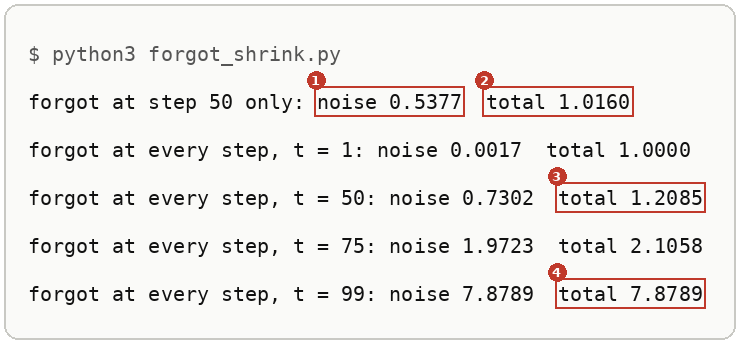
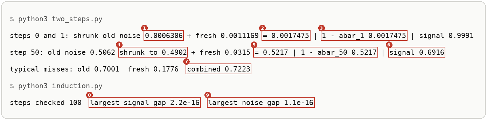
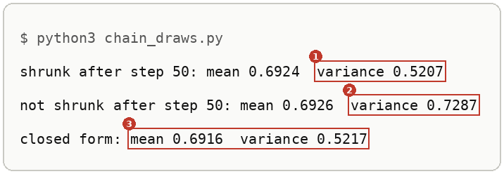

# From Many Steps To One Jump

Up: [[Diffusion Models]] · ⬅️ [[The Forward Process]] · [[The Density Of The One Jump]] ➡️

Artificial Intelligence, Generative Modeling, Diffusion Models. Needs: [[The Forward Process]] for the one jump this note proves, [[Variance#Scaling a draw scales its variance by the square|the scaling rule for variance]] for why the old noise shrinks, and [[Sums Of Independent Gaussians#Why independence kills the cross term|independent variances add]] for why the two noise pieces add.

> [!question] Test yourself
> [The diffusion models quiz](https://claude.ai/artifact/MyTdAaVfZW3wiqhbLKg4wu) covers the [[Diffusion Models]] folder. It has no questions on this note yet.

> [!warning] Unfinished
> - The form, the mechanism and the deep-dive sheet are waiting: prompts 34, 35 and 36 in the vault's `.prompts/Diffusion Models.md`.
> - The diffusion models quiz has no questions on this note yet.

Stated claims: 0.

**Each small forward step shrinks everything already in the state by $\sqrt{1 - \beta_t}$, the old noise as well as the clean part, then adds fresh noise of variance $\beta_t$. Two steps show the pattern, and induction carries it to every step: after steps $0$ to $t$ the state is $\sqrt{\bar\alpha_t}\,x_0$ plus noise of variance $1 - \bar\alpha_t$, with $\bar\alpha_t = \prod_{j=0}^{t}(1 - \beta_j)$.** That is why a hundred small steps can be replaced by the one jump in [[The Forward Process]]. The one step is *cited* from Ho et al., equation (2); the paper states the jump as equation (4) without the steps between, and they are *derived* below.

Steps are counted as the rebuild's code counts them: step 0 is the first step, `betas[0]` is its noise, and `abar = np.cumprod(1 - betas)`, so $\bar\alpha_t$ multiplies the factors for steps 0 through $t$. Ho et al. and [[The Forward Process#One small step, fifty of them, and one jump]] count from 1, so their level 50 ($\bar\alpha = 0.4938$) is $\bar\alpha_{49}$ here, as step 4 below prints.

## Where you work

Any terminal with Python 3. The scripts use the standard library only, so `python3` runs them, and so does the prepared environment `~/.vault-sandbox/bin/python` where it exists. A new empty folder; nothing here touches a real project.

## Table of contents

- [[#One step, written as a recursion]]
- [[#Try the two steps yourself]]
- [[#Reading the two-step output]]
- [[#How two steps become every step]]
- [[#Other ways to see it]]
- [[#Why the induction matters]]
- [[#The induction taught in, applied in]]

## One step, written as a recursion

Navigation: 📋 [[#Table of contents|TOC]] | [[#Try the two steps yourself]] ➡️

**Write the state after step $t$ as $s_t$, with $s_t = \sqrt{1 - \beta_t}\,s_{t-1} + \sqrt{\beta_t}\,\varepsilon_t$ and $\varepsilon_t$ a fresh standard normal draw independent of everything before it.** $x_0$ is the clean point and step 0 starts from it; $s_t$ is the step file's $x_t$. Track the clean part and the noise variance separately, and each step updates them like this:

```text
s_t      = sqrt(1 - beta_t) * s_{t-1} + sqrt(beta_t) * eps_t     one step; eps_t fresh, independent of everything before
signal_t = sqrt(1 - beta_t) * signal_{t-1}                         the multiplier on x_0, shrunk once more
noise_t  = (1 - beta_t) * noise_{t-1} + beta_t                     old noise variance shrunk by the square, plus the fresh variance
result:    signal_t = sqrt(abar_t),  noise_t = 1 - abar_t,  abar_t = (1 - beta_0)(1 - beta_1) ... (1 - beta_t)
```

The factor on the old noise is $1 - \beta_t$, the square of the multiplier $\sqrt{1 - \beta_t}$, by [[Variance#Scaling a draw scales its variance by the square|the scaling rule]].

*🖼️ Diagram wanted: the form, one step as two stacked bars, the old state's signal and noise both scaled by sqrt(1 - beta_t), then a fresh noise bar of height beta_t added on top. Prompt 34 in the vault's `.prompts/Diffusion Models.md`.*

## Try the two steps yourself

Navigation: ⬅️ [[#One step, written as a recursion]] | 📋 [[#Table of contents|TOC]] | [[#Reading the two-step output]] ➡️

**1. What you need.** Python 3:

```bash
python3 --version
```

This run printed `Python 3.12.10`.

**2. When it is missing.** Install Python 3 from python.org, or run `uv python install 3.12`. Not run on this machine, which already has it.

**3. Make something to act on: the cosine schedule.** Make the empty folder and confirm it is empty:

```bash
mkdir ~/playground/sandbox/forward-induction && cd ~/playground/sandbox/forward-induction && ls -A | wc -l
```

You should see `0`. Save this as `schedule.py`. It is the rebuild's `cosine_beta_schedule` ($T = 100$, offset $0.008$, $\beta$ clipped to at most $0.999$) in plain Python:

```python
import math

T, s = 100, 0.008
C = [math.cos((k / T + s) / (1 + s) * math.pi / 2) ** 2 for k in range(T + 1)]
C = [c / C[0] for c in C]
betas = [min(max(1 - C[k + 1] / C[k], 0.0), 0.999) for k in range(T)]
abar = []
kept = 1.0
for b in betas:
    kept *= 1 - b
    abar.append(kept)
```

**4. A look before.** Save this as `look.py`:

```python
from schedule import betas, abar

print("beta_0", round(betas[0], 7), " beta_1", round(betas[1], 7), " abar_1", round(abar[1], 7))
print("abar_49", round(abar[49], 4), " beta_50", round(betas[50], 5), " abar_50", round(abar[50], 4))
```

```bash
python3 look.py
```

```text
beta_0 0.0006313  beta_1 0.0011169  abar_1 0.9982525
abar_49 0.4938  beta_50 0.03155  abar_50 0.4783
```

These are the numbers the derivation below works with. `abar_49` is the $0.4938$ that [[The Forward Process#One small step, fifty of them, and one jump]] calls level 50.

**5. The failure: forgetting to shrink the old noise.** Adding each step's $\beta_t$ to the noise without first multiplying the old noise by $1 - \beta_t$ is the usual slip. Save this as `forgot_shrink.py`. Its first line makes the slip at step 50 only; the loop makes it at every step:

```python
from schedule import betas, abar

old = 1 - abar[49]
print(f"forgot at step 50 only: noise {old + betas[50]:.4f}  total {abar[50] + old + betas[50]:.4f}")
noise = 0.0
for t, b in enumerate(betas):
    noise = noise + b
    if t in (1, 50, 75, 99):
        print(f"forgot at every step, t = {t}: noise {noise:.4f}  total {abar[t] + noise:.4f}")
```

```bash
python3 forgot_shrink.py
```



| # | Field | This run | How to read it | Backing |
|---|---|---|---|---|
| 1 | step 50 only, noise | `0.5377` | the old $0.5062$ kept whole plus the fresh $0.0315$, where the right answer is $0.5217$ | shown |
| 2 | step 50 only, total | `1.0160` | signal share $0.4783$ plus that noise: unit-variance data would come out with variance above 1 | shown |
| 3 | every step, $t = 50$, total | `1.2085` | the noise is now just $\beta_0 + \dots + \beta_{50} = 0.7302$, and the total has drifted 0.21 above 1 | shown |
| 4 | every step, $t = 99$, total | `7.8789` | it keeps climbing with every step; the sum of all hundred $\beta$ values is $7.88$, and nothing pulls it back to 1 | shown |

**6. The technique: two steps by hand, then every step.** Save this as `two_steps.py`. It does the two-step arithmetic at steps 0 and 1 and at step 50:

```python
import math
from schedule import betas, abar

b0, b1 = betas[0], betas[1]
old = (1 - b1) * b0
print("steps 0 and 1: shrunk old noise", round(old, 7), "+ fresh", round(b1, 7), "=", round(old + b1, 7),
      "| 1 - abar_1", round(1 - abar[1], 7), "| signal", round(math.sqrt((1 - b0) * (1 - b1)), 4))
b = betas[50]
old = (1 - b) * (1 - abar[49])
print("step 50: old noise", round(1 - abar[49], 4), "shrunk to", round(old, 4), "+ fresh", round(b, 4), "=", round(old + b, 4),
      "| 1 - abar_50", round(1 - abar[50], 4), "| signal", round(math.sqrt((1 - b) * abar[49]), 4))
print("typical misses: old", round(math.sqrt(old), 4), " fresh", round(math.sqrt(b), 4), " combined", round(math.sqrt(old + b), 4))
```

Save this as `induction.py`. It runs the recursion from [[#One step, written as a recursion]] through all hundred steps and records the largest gap from the closed form:

```python
import math
from schedule import betas, abar

signal, noise = 1.0, 0.0
worst_signal = worst_noise = 0.0
for t, b in enumerate(betas):
    signal = math.sqrt(1 - b) * signal
    noise = (1 - b) * noise + b
    worst_signal = max(worst_signal, abs(signal - math.sqrt(abar[t])))
    worst_noise = max(worst_noise, abs(noise - (1 - abar[t])))
print("steps checked", len(betas), " largest signal gap", f"{worst_signal:.1e}", " largest noise gap", f"{worst_noise:.1e}")
```

```bash
python3 two_steps.py
python3 induction.py
```

You should see:



[[#Reading the two-step output]] reads each numbered field.

**7. Another way to get the same answer: draw the chain.** Save this as `chain_draws.py`. It pushes 200,000 copies of the clean point $x_0 = 1$ through steps 0 to 50 with real random draws, once correctly and once with the old noise left unshrunk:

```python
import math
import random
from schedule import betas, abar

random.seed(0)
N = 200_000
right, broken = [], []
for _ in range(N):
    x, signal, noise = 1.0, 1.0, 0.0
    for t in range(51):
        e = random.gauss(0, 1)
        x = math.sqrt(1 - betas[t]) * x + math.sqrt(betas[t]) * e
        signal = math.sqrt(1 - betas[t]) * signal
        noise = noise + math.sqrt(betas[t]) * e
    right.append(x)
    broken.append(signal + noise)
for name, xs in (("shrunk", right), ("not shrunk", broken)):
    m = sum(xs) / N
    v = sum((x - m) ** 2 for x in xs) / N
    print(name, "after step 50: mean", round(m, 4), " variance", round(v, 4))
print("closed form: mean", round(math.sqrt(abar[50]), 4), " variance", round(1 - abar[50], 4))
```

```bash
python3 chain_draws.py
```

It takes about 6 seconds. You should see:



| # | Field | This run | How to read it | Backing |
|---|---|---|---|---|
| 1 | shrunk, variance | `0.5207` | within one standard error ($0.0017$ for 200,000 draws) of the closed form's $0.5217$; the mean $0.6924$ is within one standard error ($0.0016$) of $0.6916$ | shown, standard errors derived as $0.5217\sqrt{2/200000}$ and $\sqrt{0.5217/200000}$ |
| 2 | not shrunk, variance | `0.7287` | the every-step slip of step 5, whose noise was $0.7302$; the gap is within one standard error ($0.0023$) | shown |
| 3 | closed form | `0.6916`, `0.5217` | $\sqrt{\bar\alpha_{50}}$ and $1 - \bar\alpha_{50}$ | derived in [[#How two steps become every step]] |

**8. More worked examples.** The walk used two forms, two steps starting from the clean point (steps 0 and 1) and one step in the middle of the schedule (step 50). Both are in step 6's output.

**9. Clean up, and prove it.**

```bash
cd ~ && rm -r ~/playground/sandbox/forward-induction
ls ~/playground/sandbox/forward-induction; echo $?
```

You should see `ls: cannot access '/home-mscluster/mmolefe/playground/sandbox/forward-induction': No such file or directory` (with your own home folder in the path), then `2`.

## Reading the two-step output

Navigation: ⬅️ [[#Try the two steps yourself]] | 📋 [[#Table of contents|TOC]] | [[#How two steps become every step]] ➡️

From step 6:

| # | Field | This run | How to read it | Backing |
|---|---|---|---|---|
| 1 | steps 0 and 1, shrunk old noise | `0.0006306` | step 0's noise $\beta_0 = 0.0006313$ times $1 - \beta_1 = 0.9988831$: the old noise is shrunk by step 1 too | derived below |
| 2 | steps 0 and 1, total noise | `= 0.0017475` | the shrunk old noise plus the fresh $\beta_1 = 0.0011169$; the two pieces are independent, so their variances add | derived below |
| 3 | $1 - \bar\alpha_1$ | `0.0017475` | the closed form, equal to field 2 to seven places | derived below |
| 4 | step 50, old noise shrunk | `0.4902` | $1 - \bar\alpha_{49} = 0.5062$ times $1 - \beta_{50} = 0.96845$ | derived below |
| 5 | step 50, total against closed form | `0.5217`, `0.5217` | $0.4902 + 0.0315$ equals $1 - \bar\alpha_{50}$ | derived below |
| 6 | step 50, signal | `0.6916` | $\sqrt{0.96845 \times 0.4938} = \sqrt{0.4783}$: the share of $x_0$ left after step 50 | derived below |
| 7 | typical misses, combined | `0.7223` | the standard deviation of the total noise, $\sqrt{0.5217}$. The old piece's $0.7001$ and the fresh piece's $0.1776$ do not add to it; their squares do. Adding the standard deviations would give $0.8777$ | derived below |
| 8 | largest signal gap | `2.2e-16` | the recursion's signal and $\sqrt{\bar\alpha_t}$ agree at all 100 steps to the last bit a 64-bit float holds | shown |
| 9 | largest noise gap | `1.1e-16` | the same for the noise variance and $1 - \bar\alpha_t$ | shown |

## How two steps become every step

Navigation: ⬅️ [[#Reading the two-step output]] | 📋 [[#Table of contents|TOC]] | [[#Other ways to see it]] ➡️

Textbook: [Chan, Introduction to Probability for Data Science, an induction proof worked in full, PDF p. 25](../../../Mathematics/references/textbooks/statistics/introduction-to-probability-for-data-science.pdf#page=25)

**Two steps from any state $z$.** Put one step inside the next:

$$
\begin{aligned}
s_{j} &= \sqrt{1-\beta_j}\,z + \sqrt{\beta_j}\,\varepsilon_j \\
s_{j+1} &= \sqrt{1-\beta_{j+1}}\,\big[\sqrt{1-\beta_j}\,z + \sqrt{\beta_j}\,\varepsilon_j\big] + \sqrt{\beta_{j+1}}\,\varepsilon_{j+1} \\
&= \underbrace{\sqrt{(1-\beta_{j+1})(1-\beta_j)}}_{\text{signal multiplier}}\,z
 + \underbrace{\sqrt{(1-\beta_{j+1})\,\beta_j}\;\varepsilon_j}_{\text{old noise, shrunk}}
 + \underbrace{\sqrt{\beta_{j+1}}\;\varepsilon_{j+1}}_{\text{fresh noise}}
\end{aligned}
$$

The old noise piece has variance $(1-\beta_{j+1})\,\beta_j$ by [[Variance#Scaling a draw scales its variance by the square|the scaling rule]], and the fresh piece has variance $\beta_{j+1}$. $\varepsilon_j$ and $\varepsilon_{j+1}$ are independent, so [[Sums Of Independent Gaussians#Why independence kills the cross term|the variances add]] and the sum is again Gaussian:

$$
\begin{aligned}
(1-\beta_{j+1})\,\beta_j + \beta_{j+1} &= \beta_j + \beta_{j+1} - \beta_j\,\beta_{j+1} \\
&= 1 - (1-\beta_j)(1-\beta_{j+1})
\end{aligned}
$$

Two steps are one step with keep-factor $(1-\beta_j)(1-\beta_{j+1})$: the signal multiplier is its square root and the noise variance is one minus it.

**Every step, by induction.** The claim for step $t$ is $s_t = \sqrt{\bar\alpha_t}\,x_0 + n_t$, where $n_t$ is Gaussian noise of mean 0 and variance $1 - \bar\alpha_t$, built only from $\varepsilon_0, \dots, \varepsilon_t$, with $\bar\alpha_t = \prod_{j=0}^{t}(1 - \beta_j)$.

*Base, $t = 0$.* $s_0 = \sqrt{1-\beta_0}\,x_0 + \sqrt{\beta_0}\,\varepsilon_0$. Here $\bar\alpha_0 = 1 - \beta_0$, so the multiplier is $\sqrt{\bar\alpha_0}$ and the noise variance $\beta_0 = 1 - \bar\alpha_0$.

*Step, from $t-1$ to $t$.* Assume the claim at $t-1$ and take one more step. $\varepsilon_t$ is fresh, so it is independent of $n_{t-1}$:

$$
\begin{aligned}
s_t &= \sqrt{1-\beta_t}\,\big[\sqrt{\bar\alpha_{t-1}}\,x_0 + n_{t-1}\big] + \sqrt{\beta_t}\,\varepsilon_t \\
\text{signal:}\quad & \sqrt{1-\beta_t}\,\sqrt{\bar\alpha_{t-1}} = \sqrt{(1-\beta_t)\,\bar\alpha_{t-1}} = \sqrt{\bar\alpha_t} \\
\text{noise:}\quad & (1-\beta_t)(1-\bar\alpha_{t-1}) + \beta_t = 1 - (1-\beta_t)\,\bar\alpha_{t-1} = 1 - \bar\alpha_t
\end{aligned}
$$

The claim holds at $t$, so it holds at every step. The same expansion as the two-step case gives the middle equality of the noise line: $(1-\beta_t)(1-\bar\alpha_{t-1}) + \beta_t = 1 - \bar\alpha_{t-1} + \beta_t\,\bar\alpha_{t-1}$.

**The worked numbers.** Steps 0 and 1 of the cosine schedule:

$$
\begin{aligned}
\text{noise:}\quad & 0.9988831 \times 0.0006313 + 0.0011169 = 0.0006306 + 0.0011169 = 0.0017475 = 1 - \bar\alpha_1, \quad \bar\alpha_1 = 0.9982525 \\
\text{signal:}\quad & \sqrt{0.9982525} = 0.9991
\end{aligned}
$$

Step 50, with $\bar\alpha_{49} = 0.4938$ and $\beta_{50} = 0.03155$:

$$
\begin{aligned}
\text{noise:}\quad & 0.96845 \times 0.5062 + 0.0315 = 0.4902 + 0.0315 = 0.5217 = 1 - \bar\alpha_{50} \\
\text{signal:}\quad & \sqrt{0.96845 \times 0.4938} = \sqrt{0.4783} = 0.6916 \\
\text{typical misses:}\quad & \sqrt{0.4902} = 0.7001, \quad \sqrt{0.0315} = 0.1776, \quad \sqrt{0.5217} = 0.7223 \ne 0.7001 + 0.1776 = 0.8777
\end{aligned}
$$

**The broken run.** Leave the old noise unshrunk at step 50 and the noise is $0.5062 + 0.0315 = 0.5377$, so unit-variance data comes out with total variance $0.4783 + 0.5377 = 1.0160$. Make the same slip at every step and the noise becomes the plain sum of the $\beta$ values, which passes 1 and keeps climbing: $1.2085$ at $t = 50$ and $7.8789$ at $t = 99$, as step 5 printed.

*🖼️ Diagram wanted: the mechanism, steps 0 to 2 as three stacked bars of height 1, the signal share shrinking and the noise share growing, with the old noise visibly squeezed by each step before the fresh piece lands on top. Prompt 35 in the vault's `.prompts/Diffusion Models.md`.*

*🖼️ Diagram wanted: the deep-dive sheet composing the form, the mechanism and step 6's run. Prompt 36 in the vault's `.prompts/Diffusion Models.md`.*

## Other ways to see it

Navigation: ⬅️ [[#How two steps become every step]] | 📋 [[#Table of contents|TOC]] | [[#Why the induction matters]] ➡️

- **Draw it**, as in step 7, when you want to see the distribution itself rather than its two numbers. It costs 200,000 × 51 draws and agrees only to sampling error.
- **The [[The Forward Process#One small step, fifty of them, and one jump|fifty-step chain in NumPy]]**, which compares a whole cloud after 50 small steps against one jump, counted from 1.
- **Telescoping the [[The Cosine Noise Schedule#The boundary values C_k|cosine schedule]].** For this schedule each $1 - \beta_j$ is a ratio $C_{j+1}/C_j$ of consecutive boundary values, so the product cancels to $\bar\alpha_t = C_{t+1}$ while no $\beta$ is clipped. That shortcut is specific to the cosine schedule; the induction holds for any schedule.

## Why the induction matters

Navigation: ⬅️ [[#Other ways to see it]] | 📋 [[#Table of contents|TOC]] | [[#The induction taught in, applied in]] ➡️

It is what turns a hundred small steps into one jump with signal $\sqrt{\bar\alpha_t}$ and noise variance $1 - \bar\alpha_t$. [[The Density Of The One Jump#The one-shot draw and its density|The next rung]] writes that jump as one Gaussian draw and its density $q(x_t \mid x_0)$, which is how training makes a noised point at any step in one line instead of running every step before it.

## The induction taught in, applied in

Navigation: ⬅️ [[#Why the induction matters]] | 📋 [[#Table of contents|TOC]]

**Taught in:**

- the PoE derivation foundations journey's [plan 09](/home/molef/goal-setting/learning/deep-learning/diffusion-models/01-poe-derivation-foundations/plans/09-the-forward-process.md), instruction 3 at lines 232 to 288 (substitute $x_1$ into $x_2$, check the noise variance is 0.28 both ways for $\alpha_1 = 0.9$ and $\alpha_2 = 0.8$, then continue to $x_4$ and name the pattern), and its [chapter 9.2 on the one-jump form](/home/molef/goal-setting/learning/deep-learning/diffusion-models/01-poe-derivation-foundations/textbook/09-the-forward-process-by-hand.md#92-reading-the-image-ladder-and-the-one-jump-form)
- the `drip --math` walk of the forward process and the score in the reduce-reuse-recycle research repository (`artifacts/drips/forward-process-and-the-score/`), piece 1, rung 3: two steps from a state $z$, then induction, worked at steps 0 and 1 and at step 50, with the unshrunk old noise as the broken run

**Applied in:** step 4 of the one-expert rebuild walk in the reduce-reuse-recycle research repository (`artifacts/drips/simple-distributions-rebuild/01-one-expert-from-scratch.md#step-4-the-forward-process-and-the-cosine-schedule`), whose line `abar = np.cumprod(1 - betas)` is the product this note proves, so the training pairs for one diffusion expert can be made at any of the 100 steps in one line.

> [!note]- How this was checked
> The six scripts were run on 2026-10-21 on mscluster (Linux), with Python 3.12.10 and the standard library only, in the empty folder `~/playground/sandbox/forward-induction`, by vault-writer. `chain_draws.py` and `forgot_shrink.py` were each run twice with identical output. The folder was removed afterwards and the clean-up check returned 2. The prepared environment `~/.vault-sandbox` is missing on this machine and was not needed.
>
> `schedule.py` is the step file's `cosine_beta_schedule` (`01-one-expert-from-scratch.md`, the Build block of step 4) written without NumPy. Its numbers match the rebuild's `rebuild/out/walk-numbers.json`: $\beta_0 = 0.000631$, $\bar\alpha_{50} = 0.4783$, $\sqrt{\beta_{50}} = 0.1776$, $\sqrt{1 - \bar\alpha_{50}} = 0.7223$. Every number in the walk's turn (steps 0 and 1, step 50, the typical misses and the broken run's $0.5377$ and $1.0160$) was reproduced by these scripts.
>
> The three terminal pictures were rendered from the captured text by a script in DejaVu Sans Mono, never drawn, and each was opened before filing.
>
> Ho et al.'s equations (2) and (4) were read from the arXiv PDF of 2006.11239, page 2, fetched on 2026-10-21. Chan's PDF p. 25 was opened and read as text: it proves the binomial theorem by induction, with the base case, the assumption at $n$ and the case $n + 1$ written out. No shelf book has a page teaching product notation $\prod$, so it carries no link.
