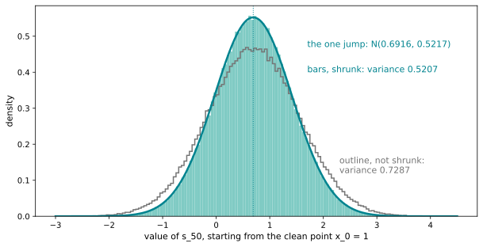

# Running From Many Steps To One Jump

Up: [[Diffusion Models]] · ⬅️ [[From Many Steps To One Jump]] · [[The Density Of The One Jump]] ➡️

Artificial Intelligence, Generative Modeling, Diffusion Models. Needs: [[From Many Steps To One Jump]], the derivation these runs check.

**The two steps and the induction, run in an empty folder from the cosine schedule to 200,000 drawn chains.**

> [!question]- Test yourself
> [The diffusion models quiz](https://claude.ai/artifact/MyTdAaVfZW3wiqhbLKg4wu) covers the [[Diffusion Models]] folder. It has no questions on this note yet.

> [!warning]- Unfinished
> - The diffusion models quiz has no questions on this note yet.

Stated claims: 0.

**How each run is read.** The forgotten shrink and the drawn chains are read field by field under their own output, and the two steps in [[#Reading the two-step output]]. The toy numbers are the table in [[From Many Steps To One Jump#Many steps collapse into one jump]].

**Colours in this note.** <span style="color:#00838f">**Teal is the state $s_t$**</span>, <span style="color:#2e7d32">**green is the kept signal share $\bar\alpha_t$ and its root**</span>, and <span style="color:#ef6c00">**orange is noise: its scale and its variance pieces**</span>, as in [[From Many Steps To One Jump]].

## Try the two steps yourself

Navigation: [[#Reading the two-step output]] ➡️

**Where you work.** Any terminal with Python 3, and a new empty folder; nothing here touches a real project. The scripts use the standard library only, so `python3` runs them, and so does the prepared environment `~/.vault-sandbox/bin/python` where it exists.

**The pictures.** The two figure scripts beside steps 6 and 7 also need matplotlib.

**1. What you need.** Python 3:

```bash
python3 --version
```

This run printed `Python 3.12.10`.

**2. When it is missing.** Install Python 3 from python.org, or run `uv python install 3.12`. Not run on this machine, which already has it.

**3. Make something to act on: the cosine schedule.** Make the empty folder and confirm it is empty:

```bash
mkdir ~/playground/sandbox/forward-induction && cd ~/playground/sandbox/forward-induction && ls -A | wc -l
```

You should see `0`. Save this as `schedule.py`. It is the rebuild's `cosine_beta_schedule` ($T = 100$, offset $0.008$, $\beta$ clipped to at most $0.999$) in plain Python:

```python
import math

T, s = 100, 0.008
C = [math.cos((k / T + s) / (1 + s) * math.pi / 2) ** 2 for k in range(T + 1)]
C = [c / C[0] for c in C]
betas = [min(max(1 - C[k + 1] / C[k], 0.0), 0.999) for k in range(T)]
abar = []
kept = 1.0
for b in betas:
    kept *= 1 - b
    abar.append(kept)
```

**4. A look before.** Save this as `look.py`:

```python
from schedule import betas, abar

print("beta_0", round(betas[0], 7), " beta_1", round(betas[1], 7), " abar_1", round(abar[1], 7))
print("abar_49", round(abar[49], 4), " beta_50", round(betas[50], 5), " abar_50", round(abar[50], 4))
```

```bash
python3 look.py
```

```text
beta_0 0.0006313  beta_1 0.0011169  abar_1 0.9982525
abar_49 0.4938  beta_50 0.03155  abar_50 0.4783
```

These are the numbers [[From Many Steps To One Jump#How two steps become every step]] works with. `abar_49` is the $0.4938$ that [[The Forward Process#One small step, fifty of them, and one jump]] calls level 50.

**5. The failure: forgetting to shrink the old noise.** Adding each step's $\beta_t$ to the noise without first multiplying the old noise by $1 - \beta_t$ is the usual slip. Save this as `forgot_shrink.py`. Its first line makes the slip at step 50 only; the loop makes it at every step:

```python
from schedule import betas, abar

old = 1 - abar[49]
print(f"forgot at step 50 only: noise {old + betas[50]:.4f}  total {abar[50] + old + betas[50]:.4f}")
noise = 0.0
for t, b in enumerate(betas):
    noise = noise + b
    if t in (1, 50, 75, 99):
        print(f"forgot at every step, t = {t}: noise {noise:.4f}  total {abar[t] + noise:.4f}")
```

```bash
python3 forgot_shrink.py
```


| # | Field | This run | How to read it | Backing |
|---|---|---|---|---|
| 1 | step 50 only, noise | `0.5377` | the old $0.5062$ kept whole plus the fresh $0.0315$, where the right answer is $0.5217$ | shown |
| 2 | step 50 only, total | `1.0160` | signal share $0.4783$ plus that noise: unit-variance data would come out with variance above 1 | shown |
| 3 | every step, $t = 50$, total | `1.2085` | the noise is now just $\beta_0 + \dots + \beta_{50} = 0.7302$, and the total has drifted 0.21 above 1 | shown |
| 4 | every step, $t = 99$, total | `7.8789` | it keeps climbing with every step; the sum of all hundred $\beta$ values is $7.88$, and nothing pulls it back to 1 | shown |

**6. The technique: two steps by hand, then every step.** Save this as `two_steps.py`. It does the two-step arithmetic at steps 0 and 1 and at step 50:

```python
import math
from schedule import betas, abar

b0, b1 = betas[0], betas[1]
old = (1 - b1) * b0
print("steps 0 and 1: shrunk old noise", round(old, 7), "+ fresh", round(b1, 7), "=", round(old + b1, 7),
      "| 1 - abar_1", round(1 - abar[1], 7), "| signal", round(math.sqrt((1 - b0) * (1 - b1)), 4))
b = betas[50]
old = (1 - b) * (1 - abar[49])
print("step 50: old noise", round(1 - abar[49], 4), "shrunk to", round(old, 4), "+ fresh", round(b, 4), "=", round(old + b, 4),
      "| 1 - abar_50", round(1 - abar[50], 4), "| signal", round(math.sqrt((1 - b) * abar[49]), 4))
print("typical misses: old", round(math.sqrt(old), 4), " fresh", round(math.sqrt(b), 4), " combined", round(math.sqrt(old + b), 4))
```

Save this as `induction.py`. It runs the recursion from [[From Many Steps To One Jump#One step, written as a recursion]] through all hundred steps and records the largest gap from the closed form:

```python
import math
from schedule import betas, abar

signal, noise = 1.0, 0.0
worst_signal = worst_noise = 0.0
for t, b in enumerate(betas):
    signal = math.sqrt(1 - b) * signal
    noise = (1 - b) * noise + b
    worst_signal = max(worst_signal, abs(signal - math.sqrt(abar[t])))
    worst_noise = max(worst_noise, abs(noise - (1 - abar[t])))
print("steps checked", len(betas), " largest signal gap", f"{worst_signal:.1e}", " largest noise gap", f"{worst_noise:.1e}")
```

```bash
python3 two_steps.py
python3 induction.py
```

You should see:


[[#Reading the two-step output]] reads each numbered field.

**The picture.** The recursion's hundred points on the closed-form curves, and the gap at every step. Save this as `recursion_picture.py` in the same folder:

```python
import math
import matplotlib.pyplot as plt
from schedule import betas, abar

SIG, NOISE = "#2e7d32", "#ef6c00"
signal, noise, rec_s, rec_n = 1.0, 0.0, [], []
for b in betas:                                          # the recursion of induction.py
    signal = math.sqrt(1 - b) * signal
    noise = (1 - b) * noise + b
    rec_s.append(signal)
    rec_n.append(noise)
t = list(range(len(betas)))
closed_s = [math.sqrt(a) for a in abar]
closed_n = [1 - a for a in abar]
fig, (left, right) = plt.subplots(1, 2, figsize=(13, 4.8), gridspec_kw={"width_ratios": [1.5, 1]})
left.plot(t, closed_s, color="#a5d6a7", lw=6)
left.plot(t, rec_s, "o", ms=3, color=SIG)
left.plot(t, closed_n, color="#ffcc80", lw=6)
left.plot(t, rec_n, "o", ms=3, color=NOISE)
left.text(5, 0.72, "signal multiplier √ᾱ_t", color=SIG, fontsize=12)
left.text(38, 0.08, "noise variance 1 − ᾱ_t", color=NOISE, fontsize=12)
for y in (rec_s[50], rec_n[50]):
    left.annotate(f"t = 50: {y:.4f}", (50, y), (62, y + 0.12), fontsize=11, arrowprops=dict(arrowstyle="-"))
left.set_title("dots: the recursion, step by step; wide lines: the closed form", fontsize=12)
left.set_ylabel("value", fontsize=11)
gs = [abs(r - c) / 1e-16 for r, c in zip(rec_s, closed_s)]
gn = [abs(r - c) / 1e-16 for r, c in zip(rec_n, closed_n)]
right.plot(t, gs, "o", ms=4, color=SIG)
right.plot(t, gn, "s", ms=4, color=NOISE, mfc="white")
right.text(38, 2.5, f"largest signal gap {max(gs) * 1e-16:.1e}", color=SIG, fontsize=11)
right.text(38, 2.3, f"largest noise gap {max(gn) * 1e-16:.1e}", color=NOISE, fontsize=11)
right.set_ylim(-0.1, 2.7); right.set_ylabel("gap from the closed form, units of 10⁻¹⁶", fontsize=11)
right.set_title("the gaps: rounding in the last bit", fontsize=12)
for ax in (left, right):
    ax.set_xlabel("code step t", fontsize=11)
fig.savefig("forward-induction-recursion-on-the-closed-form.svg", format="svg", bbox_inches="tight")
```


**How to read this.** Both x-axes are the code step $t$. On the left each dot is one step of `induction.py`'s recursion and the wide light line under it is the closed form: green for the signal multiplier $\sqrt{\bar\alpha_t}$, orange for the noise variance $1 - \bar\alpha_t$, 0.6916 and 0.5217 at $t = 50$. On the right the y-axis is the gap between the two in units of $10^{-16}$, and no gap passes $2.2 \times 10^{-16}$ for the signal or $1.1 \times 10^{-16}$ for the noise.

**7. Another way to get the same answer: draw the chain.** Save this as `chain_draws.py`. It pushes 200,000 copies of the clean point $x_0 = 1$ through steps 0 to 50 with real random draws, once correctly and once with the old noise left unshrunk:

```python
import math
import random
from schedule import betas, abar

random.seed(0)
N = 200_000
right, broken = [], []
for _ in range(N):
    x, signal, noise = 1.0, 1.0, 0.0
    for t in range(51):
        e = random.gauss(0, 1)
        x = math.sqrt(1 - betas[t]) * x + math.sqrt(betas[t]) * e
        signal = math.sqrt(1 - betas[t]) * signal
        noise = noise + math.sqrt(betas[t]) * e
    right.append(x)
    broken.append(signal + noise)
for name, xs in (("shrunk", right), ("not shrunk", broken)):
    m = sum(xs) / N
    v = sum((x - m) ** 2 for x in xs) / N
    print(name, "after step 50: mean", round(m, 4), " variance", round(v, 4))
print("closed form: mean", round(math.sqrt(abar[50]), 4), " variance", round(1 - abar[50], 4))
```

```bash
python3 chain_draws.py
```

It takes about 6 seconds. You should see:


| # | Field | This run | How to read it | Backing |
|---|---|---|---|---|
| 1 | shrunk, variance | `0.5207` | within one standard error ($0.0017$ for 200,000 draws) of the closed form's $0.5217$; the mean $0.6924$ is within one standard error ($0.0016$) of $0.6916$ | shown, standard errors derived as $0.5217\sqrt{2/200000}$ and $\sqrt{0.5217/200000}$ |
| 2 | not shrunk, variance | `0.7287` | the every-step slip of step 5, whose noise was $0.7302$; the gap is within one standard error ($0.0023$) | shown |
| 3 | closed form | `0.6916`, `0.5217` | $\sqrt{\bar\alpha_{50}}$ and $1 - \bar\alpha_{50}$ | derived in [[From Many Steps To One Jump#How two steps become every step]] |

**The picture.** The same 200,000 chains as histograms. Save this as `chain_picture.py`; it repeats the draws, so it also takes about 6 seconds:

```python
import math
import random
import matplotlib.pyplot as plt
from schedule import betas, abar

TEAL, GHOST = "#00838f", "#757575"
random.seed(0)                                            # the same draws as chain_draws.py
N = 200_000
right, broken = [], []
for _ in range(N):
    x, signal, noise = 1.0, 1.0, 0.0
    for t in range(51):
        e = random.gauss(0, 1)
        x = math.sqrt(1 - betas[t]) * x + math.sqrt(betas[t]) * e
        signal = math.sqrt(1 - betas[t]) * signal
        noise = noise + math.sqrt(betas[t]) * e
    right.append(x)
    broken.append(signal + noise)
def var(xs):
    m = sum(xs) / len(xs)
    return sum((v - m) ** 2 for v in xs) / len(xs)
mean, v = math.sqrt(abar[50]), 1 - abar[50]
fig, ax = plt.subplots(figsize=(10, 4.8))
ax.hist(right, bins=150, range=(-3, 4.5), density=True, color="#80cbc4")
ax.hist(broken, bins=150, range=(-3, 4.5), density=True, histtype="step", color=GHOST, lw=1.5)
xs = [-3 + i * 7.5 / 600 for i in range(601)]
ax.plot(xs, [math.exp(-(x - mean) ** 2 / (2 * v)) / math.sqrt(2 * math.pi * v) for x in xs], color=TEAL, lw=2.5)
ax.axvline(mean, color=TEAL, ls=":", lw=1)
ax.text(1.7, 0.47, f"the one jump: N({mean:.4f}, {v:.4f})", color=TEAL, fontsize=11)
ax.text(1.7, 0.40, f"bars, shrunk: variance {var(right):.4f}", color=TEAL, fontsize=11)
ax.text(2.3, 0.12, f"outline, not shrunk:\nvariance {var(broken):.4f}", color=GHOST, fontsize=11)
ax.set_xlabel("value of s_50, starting from the clean point x_0 = 1", fontsize=11)
ax.set_ylabel("density", fontsize=11)
fig.savefig("forward-induction-shrunk-and-unshrunk-draws.svg", format="svg", bbox_inches="tight")
```



**How to read this.** The x-axis is the value of $s_{50}$ after 51 steps from $x_0 = 1$, and the y-axis the density. The light teal bars are the 200,000 chains with the shrink, under the teal curve of the one jump $\mathcal{N}(0.6916, 0.5217)$ with its mean dotted; the grey outline is the same draws with the old noise never shrunk. The bars fill the curve with variance 0.5207, while the outline sits lower and wider with variance 0.7287.

**8. More worked examples.** The walk used two forms, two steps starting from the clean point (steps 0 and 1) and one step in the middle of the schedule (step 50). Both are in step 6's output.

**9. Clean up, and prove it.**

```bash
cd ~ && rm -r ~/playground/sandbox/forward-induction
ls ~/playground/sandbox/forward-induction; echo $?
```

You should see `ls: cannot access '/home-mscluster/mmolefe/playground/sandbox/forward-induction': No such file or directory` (with your own home folder in the path), then `2`.

## Reading the two-step output

Navigation: ⬅️ [[#Try the two steps yourself]]

**Where "derived" points.** Every field marked derived is derived in [[From Many Steps To One Jump#How two steps become every step]].

From step 6:

| # | Field | This run | How to read it | Backing |
|---|---|---|---|---|
| 1 | steps 0 and 1, shrunk old noise | `0.0006306` | step 0's noise $\beta_0 = 0.0006313$ times $1 - \beta_1 = 0.9988831$: the old noise is shrunk by step 1 too | derived |
| 2 | steps 0 and 1, total noise | `= 0.0017475` | the shrunk old noise plus the fresh $\beta_1 = 0.0011169$; the two pieces are independent, so their variances add | derived |
| 3 | $1 - \bar\alpha_1$ | `0.0017475` | the closed form, equal to field 2 to seven places | derived |
| 4 | step 50, old noise shrunk | `0.4902` | $1 - \bar\alpha_{49} = 0.5062$ times $1 - \beta_{50} = 0.96845$ | derived |
| 5 | step 50, total against closed form | `0.5217`, `0.5217` | $0.4902 + 0.0315$ equals $1 - \bar\alpha_{50}$ | derived |
| 6 | step 50, signal | `0.6916` | $\sqrt{0.96845 \times 0.4938} = \sqrt{0.4783}$: the share of $x_0$ left after step 50 | derived |
| 7 | typical misses, combined | `0.7223` | the standard deviation of the total noise, $\sqrt{0.5217}$. The old piece's $0.7001$ and the fresh piece's $0.1776$ do not add to it; their squares do. Adding the standard deviations would give $0.8777$ | derived |
| 8 | largest signal gap | `2.2e-16` | the recursion's signal and $\sqrt{\bar\alpha_t}$ agree at all 100 steps to the last bit a 64-bit float holds | shown |
| 9 | largest noise gap | `1.1e-16` | the same for the noise variance and $1 - \bar\alpha_t$ | shown |

**Field 7, worked.** The standard deviations of the two noise pieces after step 50, and of their sum:

$$
\sqrt{0.4902} = 0.7001, \quad \sqrt{0.0315} = 0.1776, \quad \sqrt{0.5217} = 0.7223 \ne 0.7001 + 0.1776 = 0.8777
$$

$$
\underbrace{\textcolor{#ef6c00}{\sqrt{0.5217}}}_{\text{combined miss}} = 0.7223 = \sqrt{\underbrace{0.7001^2}_{\text{old}} + \underbrace{0.1776^2}_{\text{fresh}}}
\;\ne\;
\underbrace{0.7001 + 0.1776}_{\text{misses added}} = 0.8777
$$

**What the equation says.** Variances add, so the typical misses combine like the legs of a right triangle. Adding the misses themselves overshoots by 0.1554.

```python
import math
import matplotlib.pyplot as plt

OLD, FRESH, BOTH, GHOST = "#ef6c00", "#ffb74d", "#bf360c", "#757575"
old = math.sqrt(0.4901890)                        # the old noise's typical miss after step 50
fresh = math.sqrt(0.0315463)                      # the fresh noise's typical miss
both = math.hypot(old, fresh)                     # the combined typical miss, sqrt(0.5217)
fig, ax = plt.subplots(figsize=(10, 4.2))
ax.plot([0, old], [0, 0], color=OLD, lw=4)
ax.plot([old, old], [0, fresh], color=FRESH, lw=4)
ax.plot([0, old], [0, fresh], color=BOTH, lw=2.5)
ax.text(old / 2, -0.035, f"old noise, shrunk: {old:.4f}", ha="center", va="top", color=OLD, fontsize=11)
ax.text(old + 0.015, fresh / 2, f"fresh: {fresh:.4f}", va="center", color="#e65100", fontsize=11)
ax.text(0.33, 0.13, f"combined: √(0.4902 + 0.0315) = {both:.4f}", ha="center", color=BOTH, fontsize=11)
ax.plot([0, old + fresh], [-0.16, -0.16], color=GHOST, lw=3, ls="--")
ax.text(old + fresh + 0.015, -0.16, f"misses added: {old + fresh:.4f}", va="center", color=GHOST, fontsize=11)
ax.plot([both, both], [-0.19, -0.13], color=BOTH, lw=2)
ax.text(both, -0.21, f"{both:.4f}", ha="center", va="top", color=BOTH, fontsize=11)
ax.set_xlim(-0.02, 1.15); ax.set_ylim(-0.27, 0.25); ax.set_aspect("equal")
ax.set_xlabel("typical miss (standard deviation)", fontsize=11); ax.set_yticks([])
fig.savefig("forward-induction-misses-as-a-right-triangle.svg", format="svg", bbox_inches="tight")
```


**How to read this.** The x-axis is a typical miss, one standard deviation, drawn to scale. The horizontal leg is the shrunk old noise's 0.7001 and the vertical leg the fresh noise's 0.1776, and the hypotenuse is their combined 0.7223. The grey line below is the two misses laid end to end, 0.8777, and the tick on it marks where the true 0.7223 falls.


> [!note]- How this was checked
> The six scripts were first run on 2026-10-21 on mscluster (Linux), with Python 3.12.10 and the standard library only, in the empty folder `~/playground/sandbox/forward-induction`, by vault-writer, and re-run byte for byte the same day in a fresh empty folder of that name, printing the same lines. `chain_draws.py` and `forgot_shrink.py` were each run twice with identical output. The folder was removed afterwards and the clean-up check returned 2. The prepared environment `~/.vault-sandbox` is missing on this machine and was not needed.
>
> `schedule.py` is the step file's `cosine_beta_schedule` (`01-one-expert-from-scratch.md`, the Build block of step 4) written without NumPy. Its numbers match the rebuild's `rebuild/out/walk-numbers.json`: $\beta_0 = 0.000631$, $\bar\alpha_{50} = 0.4783$, $\sqrt{\beta_{50}} = 0.1776$, $\sqrt{1 - \bar\alpha_{50}} = 0.7223$. Every number in the walk's turn (steps 0 and 1, step 50, the typical misses and the broken run's $0.5377$ and $1.0160$) was reproduced by these scripts.
>
> The three terminal pictures were rendered from the captured text by a script in DejaVu Sans Mono, never drawn, and each was opened before filing and again on 2026-10-21 against the re-run's output. The three figure scripts were run on 2026-10-21 on mscluster with Python 3.12.10, matplotlib 3.10.8 and numpy 2.4.3 in the sandbox folder, and each SVG was opened (rendered to PNG by PyMuPDF 1.27.2) before filing; the histogram's printed variances, 0.5207 and 0.7287, equal step 7's.
