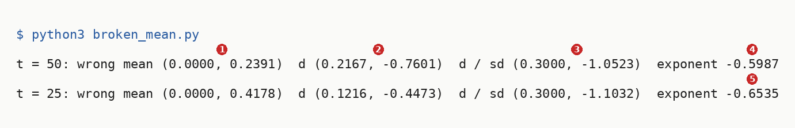
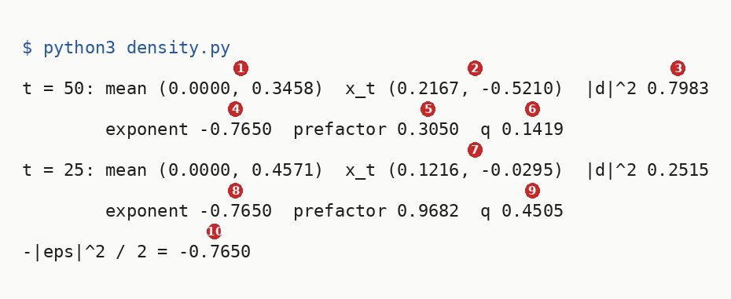
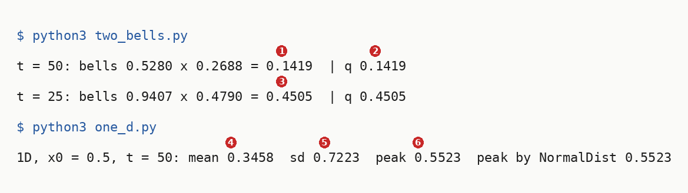
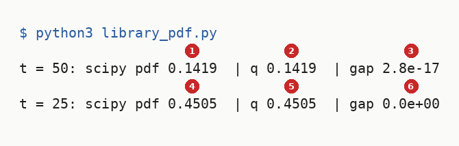
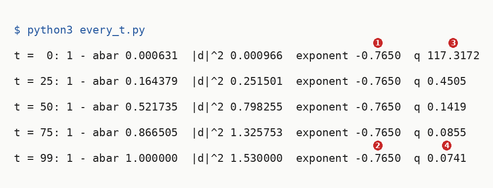

# Running The Density Of The One Jump

Up: [[Diffusion Models]] · ⬅️ [[How The Density Follows From The Draw]] · [[The Cosine Noise Schedule]] ➡️

Artificial Intelligence, Generative Modeling, Diffusion Models. Needs: [[The Density Of The One Jump]], the derivation these runs check.

**The one jump's density, run in an empty folder from the cosine schedule to SciPy's check and the same draw at five steps.**

> [!question]- Test yourself
> [The diffusion models quiz](https://claude.ai/artifact/MyTdAaVfZW3wiqhbLKg4wu) covers the [[Diffusion Models]] folder. It has no questions on this note yet.

> [!warning]- Unfinished
> - The diffusion models quiz has no questions on this note yet.

Stated claims: 0.

**How each run is read.** The centre without its root, the two bells, SciPy's check and the five steps are read field by field under their own output, and the density at two steps in [[#Reading the density output]]. The toy numbers are the table in [[The Density Of The One Jump#The one-shot draw and its density]].

**Colours in this note.** <span style="color:#1565c0">**Blue is the clean point $x_0$**</span>, <span style="color:#00838f">**teal is the noisy point $x_t$ and its density**</span>, <span style="color:#ef6c00">**orange is the noise scale $\sqrt{1 - \bar\alpha_t}$**</span>, <span style="color:#3949ab">**indigo is the front factor**</span>, and <span style="color:#757575">**grey is the centre without its square root**</span>, as in [[The Density Of The One Jump]].

## Try the density yourself

Navigation: [[#Reading the density output]] ➡️

**Where you work.** Any terminal with Python 3, and a new empty folder; nothing here touches a real project. The scripts in steps 3 to 8 use the standard library only (`math` and `statistics`), so `python3` runs them, and so does the prepared environment `~/.vault-sandbox/bin/python` where it exists.

**The pictures and SciPy.** Step 7's `library_pdf.py` also needs NumPy and SciPy, and the two figure scripts beside steps 7 and 8 need NumPy and matplotlib.

**1. What you need.** Python 3, and for the extras SciPy, NumPy and matplotlib:

```bash
python3 --version
python3 -c "import scipy, numpy, matplotlib; print(scipy.__version__, numpy.__version__, matplotlib.__version__)"
```

This run printed `Python 3.12.10`, then `1.17.1 2.4.3 3.10.8`.

**2. When it is missing.** Install Python 3 from python.org, or run `uv python install 3.12`. Not run on this machine, which already has Python and all three libraries.

**When the libraries are missing.** Make the prepared environment once with `uv venv ~/.vault-sandbox` and `uv pip install --python ~/.vault-sandbox/bin/python pandas numpy scipy matplotlib statsmodels openpyxl`. Then run every script with `~/.vault-sandbox/bin/python` in place of `python3`.

**3. Make something to act on: the cosine schedule.** Make the empty folder and confirm it is empty:

```bash
mkdir ~/playground/sandbox/forward-density && cd ~/playground/sandbox/forward-density && ls -A | wc -l
```

You should see `0`. Save this as `schedule.py`, the same 100-step cosine schedule as [[Running From Many Steps To One Jump#Try the two steps yourself]]:

```python
import math

T, s = 100, 0.008
C = [math.cos((k / T + s) / (1 + s) * math.pi / 2) ** 2 for k in range(T + 1)]
C = [c / C[0] for c in C]
betas = [min(max(1 - C[k + 1] / C[k], 0.0), 0.999) for k in range(T)]
abar = []
kept = 1.0
for b in betas:
    kept *= 1 - b
    abar.append(kept)
```

**4. A look before.** Save this as `look.py`:

```python
import math
from schedule import abar

for t in (25, 50):
    print(f"t = {t}: abar {abar[t]:.4f}  sqrt(abar) {math.sqrt(abar[t]):.4f}  1 - abar {1 - abar[t]:.4f}  sd {math.sqrt(1 - abar[t]):.4f}")
```

```bash
python3 look.py
```

```text
t = 25: abar 0.8356  sqrt(abar) 0.9141  1 - abar 0.1644  sd 0.4054
t = 50: abar 0.4783  sqrt(abar) 0.6916  1 - abar 0.5217  sd 0.7223
```

**5. The failure: the mean without its square root.** Writing the centre as $\bar\alpha_t\,x_0$ is the usual slip. The toy's clean point is $x_0 = (0, 0.5)$ and the draw is $\varepsilon = (0.3, -1.2)$. Save this as `broken_mean.py`:

```python
import math
from schedule import abar

x0, eps = (0.0, 0.5), (0.3, -1.2)
for t in (50, 25):
    a = abar[t]
    sd = math.sqrt(1 - a)
    xt = [math.sqrt(a) * c + sd * e for c, e in zip(x0, eps)]
    wrong = [a * c for c in x0]
    d = [x - m for x, m in zip(xt, wrong)]
    sq = d[0] ** 2 + d[1] ** 2
    print(f"t = {t}: wrong mean ({wrong[0]:.4f}, {wrong[1]:.4f})  d ({d[0]:.4f}, {d[1]:.4f})  d / sd ({d[0] / sd:.4f}, {d[1] / sd:.4f})  exponent {-sq / (2 * (1 - a)):.4f}")
```

```bash
python3 broken_mean.py
```



| # | Field | This run | How to read it | Backing |
|---|---|---|---|---|
| 1 | wrong mean, $t = 50$ | `(0.0000, 0.2391)` | $0.4783 \times 0.5$ (`sqrt(abar)` is the factor that belongs there), where the right centre is $0.6916 \times 0.5 = 0.3458$ | shown |
| 2 | displacement | `(0.2167, -0.7601)` | the drawn point $(0.2167, -0.5210)$ minus the wrong centre | shown |
| 3 | displacement over sd | `(0.3000, -1.0523)` | should give back $\varepsilon = (0.3, -1.2)$; the second coordinate is off by about $0.148$, the extra $(\sqrt{\bar\alpha} - \bar\alpha)\,x_0$ divided by $0.7223$ | derived in [[How The Density Follows From The Draw#The exponent on the toy]] |
| 4 | exponent, $t = 50$ | `-0.5987` | no longer $-|\varepsilon|^2/2 = -0.765$ | shown |
| 5 | exponent, $t = 25$ | `-0.6535` | and it now changes with $t$, so the cancellation the score uses is gone | shown |

**6. The technique: the draw and its density at two steps.** Save this as `density.py`. The function `q` is the formula from [[The Density Of The One Jump#The form of the density]]; the `if __name__ == "__main__":` line keeps its worked example from running when steps 7 and 8 import it:

```python
import math
from schedule import abar


def q(x, x0, a):
    """The one jump's density N(x; sqrt(a) x0, (1 - a) I) in 2D, with a the kept share abar_t."""
    var = 1 - a
    mean = [math.sqrt(a) * c for c in x0]
    sq = sum((xi - mi) ** 2 for xi, mi in zip(x, mean))
    return 1 / (2 * math.pi * var) * math.exp(-sq / (2 * var)), mean, sq


if __name__ == "__main__":
    x0, eps = (0.0, 0.5), (0.3, -1.2)
    for t in (50, 25):
        a = abar[t]
        sd = math.sqrt(1 - a)
        xt = [math.sqrt(a) * c + sd * e for c, e in zip(x0, eps)]
        dens, mean, sq = q(xt, x0, a)
        print(f"t = {t}: mean ({mean[0]:.4f}, {mean[1]:.4f})  x_t ({xt[0]:.4f}, {xt[1]:.4f})  |d|^2 {sq:.4f}")
        print(f"        exponent {-sq / (2 * (1 - a)):.4f}  prefactor {1 / (2 * math.pi * (1 - a)):.4f}  q {dens:.4f}")
    print(f"-|eps|^2 / 2 = {-(eps[0] ** 2 + eps[1] ** 2) / 2:.4f}")
```

```bash
python3 density.py
```



[[#Reading the density output]] reads each numbered field.

**7. Another way to get the same answer: two one-dimensional bells, and a library density.** The covariance $(1 - \bar\alpha_t) I$ is diagonal, so the 2D density is the product of one bell per coordinate, as [[Diagonal Covariance#How it works]] derives. Python's own `statistics.NormalDist` gives each bell. Save this as `two_bells.py`:

```python
import math
from statistics import NormalDist
from schedule import abar
from density import q

x0, eps = (0.0, 0.5), (0.3, -1.2)
for t in (50, 25):
    a = abar[t]
    sd = math.sqrt(1 - a)
    xt = [math.sqrt(a) * c + sd * e for c, e in zip(x0, eps)]
    bells = [NormalDist(math.sqrt(a) * c, sd).pdf(x) for c, x in zip(x0, xt)]
    print(f"t = {t}: bells {bells[0]:.4f} x {bells[1]:.4f} = {bells[0] * bells[1]:.4f}  | q {q(xt, x0, a)[0]:.4f}")
```

Save this as `one_d.py`, the one-dimensional case the walk worked first, a clean point $0.5$ at $t = 50$:

```python
import math
from statistics import NormalDist
from schedule import abar

a = abar[50]
mean, sd = math.sqrt(a) * 0.5, math.sqrt(1 - a)
print(f"1D, x0 = 0.5, t = 50: mean {mean:.4f}  sd {sd:.4f}  peak {1 / (math.sqrt(2 * math.pi) * sd):.4f}  peak by NormalDist {NormalDist(mean, sd).pdf(mean):.4f}")
```

```bash
python3 two_bells.py
python3 one_d.py
```



| # | Field | This run | How to read it | Backing |
|---|---|---|---|---|
| 1 | product of bells, $t = 50$ | `= 0.1419` | the horizontal bell's $0.5280$ times the vertical bell's $0.2688$ | shown |
| 2 | `q`, $t = 50$ | `0.1419` | step 6's 2D formula, equal to field 1 | derived in [[Diagonal Covariance#How it works]] |
| 3 | product of bells, $t = 25$ | `= 0.4505` | equal to step 6's $q$ at $t = 25$ | shown |
| 4 | 1D mean | `0.3458` | $\sqrt{0.4783} \times 0.5 = 0.6916 \times 0.5$ | derived |
| 5 | 1D sd | `0.7223` | $\sqrt{1 - 0.4783}$, the width of the bell | derived |
| 6 | 1D peak | `0.5523` | the bell's height at its centre, $1/(\sqrt{2\pi} \times 0.7223)$; `NormalDist` agrees | shown |

**The picture.** The 1D bell, with 200,000 draws from the clean value 0.5 at $t = 50$ under it. Save this as `one_d_picture.py`:

```python
import math
import numpy as np
import matplotlib.pyplot as plt
from schedule import abar

BLUE, TEAL, ORANGE = "#1565c0", "#00838f", "#ef6c00"
a = abar[50]
mean, sd = math.sqrt(a) * 0.5, math.sqrt(1 - a)          # 0.3458 and 0.7223
draws = mean + sd * np.random.default_rng(0).standard_normal(200_000)
x = np.linspace(-3, 3.6, 661)
bell = np.exp(-(x - mean) ** 2 / (2 * sd ** 2)) / (math.sqrt(2 * math.pi) * sd)
peak = 1 / (math.sqrt(2 * math.pi) * sd)
fig, ax = plt.subplots(figsize=(10, 4.8))
ax.hist(draws, bins=132, range=(-3, 3.6), density=True, color="#80cbc4")
ax.plot(x, bell, color=TEAL, lw=2.5)
ax.plot(mean, peak, "o", color=TEAL, ms=8)
ax.text(mean + 0.1, peak + 0.012, f"peak 1/(√(2π) · {sd:.4f}) = {peak:.4f}", color=TEAL, fontsize=11)
ax.axvline(0.5, color=BLUE, lw=1.5)
ax.text(0.55, 0.06, "x₀ = 0.5", color=BLUE, fontsize=11)
ax.axvline(mean, color=TEAL, ls=":", lw=1.2)
ax.annotate("", (mean + sd, peak * math.exp(-0.5)), (mean, peak * math.exp(-0.5)),
            arrowprops=dict(arrowstyle="<->", color=ORANGE, lw=2))
ax.text(mean + sd + 0.08, peak * math.exp(-0.5), f"1 sd = {sd:.4f}", color=ORANGE, fontsize=11, va="center")
ax.text(1.45, 0.47, f"bell N({mean:.4f}, {sd ** 2:.4f})\nbars: 200,000 draws of\n0.6916 · 0.5 + 0.7223 ε\ndrawn mean {draws.mean():.4f}, variance {draws.var():.4f}",
        color=TEAL, fontsize=11, va="top")
ax.set_xlabel("value of x₅₀ for the clean value x₀ = 0.5", fontsize=11)
ax.set_ylabel("density", fontsize=11)
ax.set_ylim(0, 0.62)
fig.savefig("forward-density-one-dimension-bell-and-draws.svg", format="svg", bbox_inches="tight")
```


**How to read this.** The x-axis is the value of $x_{50}$ for the clean value $x_0 = 0.5$, and the y-axis the density. The bars are 200,000 draws and the teal curve is the bell $\mathcal{N}(0.3458, 0.5217)$, peaking at 0.5523 on the dotted centre, left of the blue clean value because the centre is shrunk by 0.6916. The draws' mean 0.3459 and variance 0.5230 sit within one standard error ($0.0016$ and $0.0017$) of the bell's 0.3458 and 0.5217.

**SciPy's density.** Save this as `library_pdf.py`. It asks SciPy's multivariate normal for the density at the same drawn points and prints it beside step 6's `q`:

```python
import math
import numpy as np
from scipy.stats import multivariate_normal
from schedule import abar
from density import q

x0, eps = (0.0, 0.5), (0.3, -1.2)
for t in (50, 25):
    a = abar[t]
    centre = [math.sqrt(a) * c for c in x0]
    xt = [m + math.sqrt(1 - a) * e for m, e in zip(centre, eps)]
    pdf = multivariate_normal(mean=centre, cov=(1 - a) * np.eye(2)).pdf(xt)
    print(f"t = {t}: scipy pdf {pdf:.4f}  | q {q(xt, x0, a)[0]:.4f}  | gap {abs(pdf - q(xt, x0, a)[0]):.1e}")
```

```bash
python3 library_pdf.py
```



| # | Field | This run | How to read it | Backing |
|---|---|---|---|---|
| 1 | SciPy, $t = 50$ | `0.1419` | `multivariate_normal(mean=(0, 0.3458), cov=0.5217 I).pdf` at $x_{50} = (0.2167, -0.5210)$ | shown |
| 2 | `q`, $t = 50$ | `0.1419` | step 6's hand formula, equal to field 1 | shown |
| 3 | gap, $t = 50$ | `2.8e-17` | the two differ only in the last bit a 64-bit float holds | shown |
| 4 | SciPy, $t = 25$ | `0.4505` | the same call with mean $(0, 0.4571)$ and covariance $0.1644\,I$ | shown |
| 5 | `q`, $t = 25$ | `0.4505` | equal to field 4 | shown |
| 6 | gap, $t = 25$ | `0.0e+00` | identical to the last bit | shown |

**8. More worked examples: the same draw at five steps.** The walk used two forms, the 1D bell (step 7) and the 2D toy at two steps (step 6). This one runs the 2D toy across the schedule to show the exponent holding still. Save this as `every_t.py`:

```python
import math
from schedule import abar
from density import q

x0, eps = (0.0, 0.5), (0.3, -1.2)
for t in (0, 25, 50, 75, 99):
    a = abar[t]
    xt = [math.sqrt(a) * c + math.sqrt(1 - a) * e for c, e in zip(x0, eps)]
    dens, mean, sq = q(xt, x0, a)
    print(f"t = {t:2d}: 1 - abar {1 - a:.6f}  |d|^2 {sq:.6f}  exponent {-sq / (2 * (1 - a)):.4f}  q {dens:.4f}")
```

```bash
python3 every_t.py
```



| # | Field | This run | How to read it | Backing |
|---|---|---|---|---|
| 1 | exponent, $t = 0$ | `-0.7650` | $-1.53/2$, with a variance of only $0.000631$ | derived |
| 2 | exponent, $t = 99$ | `-0.7650` | the same, with a variance of $1.000000$; $\bar\alpha_{99}$ is $2.4 \times 10^{-7}$ | derived |
| 3 | `q`, $t = 0$ | `117.3172` | a density, not a probability: the bell is so narrow ($0.0251$ wide) that its height passes 1 | shown |
| 4 | `q`, $t = 99$ | `0.0741` | the front factor alone, $1/(2\pi) = 0.1592$, times $e^{-0.765} = 0.4653$: everything that changes with $t$ sits in the front factor | derived |

**The picture.** The exponent and the height at all 100 steps, with the centre's square root kept and dropped. Save this as `every_t_picture.py`:

```python
import math
import matplotlib.pyplot as plt
from schedule import abar
from density import q

TEAL, INDIGO, GHOST = "#00838f", "#3949ab", "#757575"
x0, eps = (0.0, 0.5), (0.3, -1.2)
right, broken, dens, front = [], [], [], []
for a in abar:                                            # all 100 steps, t = 0 to 99
    var = 1 - a
    xt = [math.sqrt(a) * c + math.sqrt(var) * e for c, e in zip(x0, eps)]
    sq = q(xt, x0, a)[2]
    sq_wrong = sum((x - a * c) ** 2 for x, c in zip(xt, x0))  # the centre without its root
    right.append(-sq / (2 * var))
    broken.append(-sq_wrong / (2 * var))
    dens.append(q(xt, x0, a)[0])
    front.append(1 / (2 * math.pi * var))
t = list(range(100))
fig, (left, height) = plt.subplots(1, 2, figsize=(13, 4.8))
left.plot(t, right, color=TEAL, lw=2.5)
left.text(30, -0.79, "with the root: −0.7650 at every step", color=TEAL, fontsize=11, va="top")
left.plot(t, broken, color=GHOST, lw=2, ls="--")
for m in (25, 50):
    left.plot(m, broken[m], "o", color=GHOST)
    left.text(m + 2, broken[m] - 0.015, f"t = {m}: {broken[m]:.4f}", color=GHOST, fontsize=10.5)
left.text(2, -0.59, "centre without the root,\ngrey dashed: moves with t", color=GHOST, fontsize=11)
left.set_ylabel("exponent of q at the drawn point", fontsize=11)
left.set_ylim(-0.84, -0.57)
height.semilogy(t, front, color=INDIGO, lw=1.5, ls=":")
height.semilogy(t, dens, color=TEAL, lw=2.5)
for m, dx, dy in ((0, 3, 0.55), (25, 2, 0.38), (50, 2, 0.45), (99, -2, 0.5)):
    height.plot(m, dens[m], "o", color=TEAL)
    height.text(m + dx, dens[m] * dy, f"t = {m}: q {dens[m]:.4f}", ha="left" if dx > 0 else "right", color=TEAL, fontsize=10.5)
height.text(8, 300, "front factor 1/(2π(1 − ᾱₜ)), indigo dotted", color=INDIGO, fontsize=11)
height.text(14, 12, "teal: q = front factor × e^(−0.765)\n= front factor × 0.4653", color=TEAL, fontsize=10.5)
height.set_ylabel("density at the drawn point (log scale)", fontsize=11)
height.set_ylim(0.02, 1000)
for ax in (left, height):
    ax.set_xlabel("code step t of the 100-step cosine schedule", fontsize=11)
fig.savefig("forward-density-exponent-and-height-at-every-step.svg", format="svg", bbox_inches="tight")
```


**How to read this.** Both x-axes are the code step $t$, all 100 of them. On the left the y-axis is the exponent of $q$ at the drawn point: teal, with the root, sits at −0.7650 everywhere, while grey dashed, without it, starts at −0.7575, peaks at −0.5961 at $t = 56$ and returns to −0.7647 at $t = 99$. On the right the y-axis is the density at the drawn point on a log scale, so the teal curve is the indigo front factor shifted down by the same factor 0.4653 at every step.

**9. Clean up, and prove it.**

```bash
cd ~ && rm -r ~/playground/sandbox/forward-density
ls ~/playground/sandbox/forward-density; echo $?
```

You should see `ls: cannot access '/home-mscluster/mmolefe/playground/sandbox/forward-density': No such file or directory` (with your own home folder in the path), then `2`.

## Reading the density output

Navigation: ⬅️ [[#Try the density yourself]]

**Where "derived" points.** Every field marked derived is derived in [[How The Density Follows From The Draw]].

From step 6:

| # | Field | This run | How to read it | Backing |
|---|---|---|---|---|
| 1 | mean, $t = 50$ | `(0.0000, 0.3458)` | the centre $\sqrt{\bar\alpha_{50}}\,x_0 = 0.6916 \times (0, 0.5)$: shrinking $x_0$ moves the centre toward the origin | derived |
| 2 | $x_t$, $t = 50$ | `(0.2167, -0.5210)` | the centre plus $0.7223 \times (0.3, -1.2) = (0.2167, -0.8668)$; equal to `p1.example_x_t` in the rebuild's `walk-numbers.json` | derived |
| 3 | $\lvert d \rvert^2$ | `0.7983` | squared distance from the centre, $0.5217 \times 1.53$ | derived |
| 4 | exponent, $t = 50$ | `-0.7650` | $-0.7983 / (2 \times 0.5217)$ | derived |
| 5 | prefactor, $t = 50$ | `0.3050` | $1/(2\pi \times 0.5217)$, the front factor that makes the volume 1 | derived |
| 6 | `q`, $t = 50$ | `0.1419` | $0.3050 \times e^{-0.765} = 0.3050 \times 0.4653$ | derived |
| 7 | $x_t$, $t = 25$ | `(0.1216, -0.0295)` | the same $\varepsilon$ scaled by $0.4054$, added to the centre $(0, 0.4571)$ | derived |
| 8 | exponent, $t = 25$ | `-0.7650` | $-0.2515 / (2 \times 0.1644)$: the same number as field 4 | derived |
| 9 | `q`, $t = 25$ | `0.4505` | $0.9682 \times 0.4653$: a narrower bell, so a larger front factor | derived |
| 10 | $-\lvert\varepsilon\rvert^2/2$ | `-0.7650` | $-(0.3^2 + 1.2^2)/2 = -1.53/2$, equal to fields 4 and 8 | derived |

> [!note]- How this was checked
> The seven scripts were first run on 2026-10-21 on mscluster (Linux), with Python 3.12.10 and the standard library only, in the empty folder `~/playground/sandbox/forward-density`, by vault-writer, and re-run byte for byte the same day in a fresh empty folder of that name, printing the same lines. `library_pdf.py` was run twice with identical output, then a third time in the fresh folder, with SciPy 1.17.1 and numpy 2.4.3. The fresh folder was built from the code blocks of this note and [[The Density Of The One Jump]] as filed, and the four figure scripts drew SVGs pixel-identical to the ones embedded. The folder was removed afterwards and the clean-up check returned 2. The prepared environment `~/.vault-sandbox` is missing on this machine and was not needed: the system `python3` has SciPy, numpy and matplotlib.
>
> `schedule.py` is the same plain-Python cosine schedule as [[From Many Steps To One Jump]]. Its numbers match the rebuild's `rebuild/out/walk-numbers.json`: $\bar\alpha_{25} = 0.8356$, $\bar\alpha_{50} = 0.4783$, $\sqrt{1 - \bar\alpha_{25}} = 0.4054$, $\sqrt{1 - \bar\alpha_{50}} = 0.7223$, and the toy's $x_{50} = (0.2167, -0.521)$ is `p1.example_x_t`. Every number in the walk's turn (the 1D mean, sd and peak, both 2D worked examples, the exponent $-0.765$ and the broken centre $(0, 0.2391)$ with its displacement $(0.2167, -0.7601)$) was reproduced by these scripts.
>
> The five terminal pictures were rendered from the captured text by a script in DejaVu Sans Mono, never drawn, and each was opened before filing; the four older ones were opened again on 2026-10-21 against the re-run's output and match it character for character. The two figure scripts were run on 2026-10-21 with matplotlib 3.10.8 and numpy 2.4.3 in the sandbox folder, and each SVG was opened (rendered to PNG by PyMuPDF 1.27.2) before filing. The grey dashed curve's values at $t = 0$, 56 and 99 (−0.7575, −0.5961, −0.7647) were read off the same arrays by a throwaway script.
