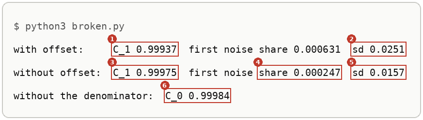
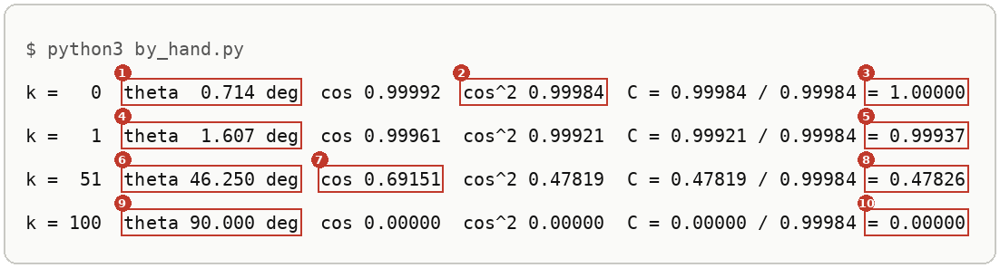
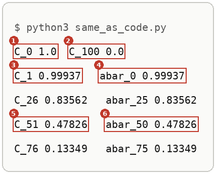
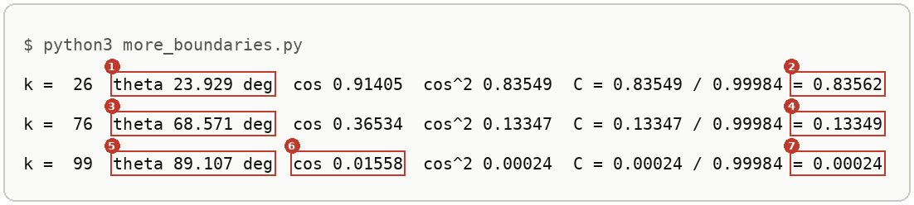

# The Cosine Noise Schedule

Up: [[Diffusion Models]] · ⬅️ [[The Density Of The One Jump]] · [[The Quarter Circle Under The Cosine Schedule]] ➡️

Artificial Intelligence, Generative Modeling, Diffusion Models. Needs: [[The Forward Process]] for $\bar\alpha_t$ as the share of the clean signal's variance kept at step $t$, and [[From Many Steps To One Jump]] for why the noise share is $1 - \bar\alpha_t$.

> [!question] Test yourself
> [The diffusion models quiz](https://claude.ai/artifact/MyTdAaVfZW3wiqhbLKg4wu) covers the [[Diffusion Models]] folder. It has no questions on this note yet.

> [!warning] Unfinished
> - The form, the mechanism and the deep-dive sheet are waiting: prompts 40, 41 and 42 in the vault's `.prompts/Diffusion Models.md`.
> - The diffusion models quiz has no questions on this note yet.

Stated claims: 0.

**The cosine schedule is the timetable of noise levels: for $T = 100$ steps it lists 101 boundary values $C_0, \dots, C_{100}$, like fence posts around 100 gaps, and $C_k$ is the share of the clean signal's variance still kept at boundary $k$.** Each value is the squared cosine of an angle that sweeps a quarter turn, rescaled so the first one is exactly 1. The formula is *cited* from Nichol and Dhariwal, equation (17); this note takes it as given and computes it by hand. Why a squared cosine was chosen is not derived here, and the paper itself calls the choice arbitrary: "many other functions with similar shapes would work as well" (*cited*, p. 4).

Steps are counted as the rebuild's code counts them, from 0, so the kept share after step $t$ is $\bar\alpha_t = C_{t+1}$: $C_{51} = 0.47826$ is the $\bar\alpha_{50} = 0.4783$ of [[From Many Steps To One Jump]]. This note *shows* that match in step 7; why it holds is the telescoping product in [[From Many Steps To One Jump#Other ways to see it]].

## Where you work

Any terminal with Python 3. The scripts use the standard library only (`math`), so `python3` runs them, and so does the prepared environment `~/.vault-sandbox/bin/python` where it exists. A new empty folder; nothing here touches a real project.

## Table of contents

- [[#The boundary values C_k]]
- [[#Try the boundary values yourself]]
- [[#Reading the boundary-value output]]
- [[#How each piece of C_k works]]
- [[#Other ways to get the boundary values]]
- [[#Why the boundary values matter]]
- [[#The cosine schedule taught in, applied in]]

## The boundary values C_k

Navigation: 📋 [[#Table of contents|TOC]] | [[#Try the boundary values yourself]] ➡️

Textbook: [Whitney, Trigonometry handbook, the unit circle, PDF p. 10](../../../Mathematics/references/textbooks/trigonometry/trigonometry-handbook.pdf#page=10)

**A boundary value $C_k$**, also the cosine boundary value or the paper's $\bar\alpha_t = f(t)/f(0)$, is the share of the clean signal's variance kept at post $k$ of the noise timetable.

### The posts and their table

<table>
<tr><th>post k</th><th style="color:#1565c0">angle θ<sub>k</sub></th><th style="color:#2e7d32">C<sub>k</sub></th><th>kept share after step</th><th style="color:#ef6c00">noise β of the step ending at post k</th></tr>
<tr><td>0</td><td>0.714°</td><td style="border:2px solid #212121">1</td><td>before step 0</td><td></td></tr>
<tr><td>1</td><td>1.607°</td><td style="border:2px solid #212121">0.99937</td><td>ᾱ<sub>0</sub></td><td style="border:2px solid #212121">0.00063</td></tr>
<tr><td>26</td><td>23.929°</td><td>0.83562</td><td>ᾱ<sub>25</sub></td><td>0.01345</td></tr>
<tr style="background:#fff8e1"><td><b>51</b></td><td>46.25°</td><td style="border:2px solid #212121"><b>0.47826</b></td><td>ᾱ<sub>50</sub></td><td style="border:2px solid #212121">0.03155</td></tr>
<tr><td>76</td><td>68.571°</td><td>0.13349</td><td>ᾱ<sub>75</sub></td><td>0.0747</td></tr>
<tr><td>99</td><td>89.107°</td><td>0.00024</td><td>ᾱ<sub>98</sub></td><td>0.74994</td></tr>
<tr><td>100</td><td>90°</td><td style="border:2px solid #212121">0</td><td>ᾱ<sub>99</sub>, clipped</td><td style="border:2px dashed #212121">0.999</td></tr>
</table>

**How to read this table.** Each row is one post of the 100-step timetable. $C_k$ is the share of the clean signal's variance still kept there; it is the kept share $\bar\alpha$ after the step that ends at that post. The last column is that step's noise, $\beta_{k-1} = 1 - C_k / C_{k-1}$.

**What to look for.** The boxed column falls from 1 to 0. The highlighted row is the toy, $\bar\alpha_{50} = 0.4783$. The dashed cell is the clip: the raw last step would remove everything.

### The base word: schedule

A schedule is a timetable. $T = 100$ steps have 101 posts between and around them, the way 100 gaps need 101 fence posts, and the timetable lists one value per post:

$$
\underbrace{C_0,\ C_1,\ \dots,\ C_{100}}_{101\text{ posts}},
\qquad
\underbrace{\text{step }t}_{t\,=\,0,\dots,99}\ \text{runs from post }t\text{ to post }t+1
$$

**What the equation says.** A value sits on a post and a step sits between two posts. Step 50 runs from post 50 to post 51, so its kept share is $C_{51} = 0.47826$.

### Then the word: noise

Each step replaces a share of what is left with noise. That share is read off two neighbouring posts:

$$
\underbrace{\textcolor{#ef6c00}{\beta_t}}_{\text{noise share of step }t}
=
1-\underbrace{\frac{\textcolor{#2e7d32}{C_{t+1}}}{\textcolor{#2e7d32}{C_t}}}_{\text{fraction that survives the step}},
\qquad
\beta_{50} = 1 - \frac{0.47826}{0.49385} = 0.03155
$$

**What the equation says.** The ratio is the part of the signal that survives one step, so one minus it is the part replaced. The schedule is written in terms of the kept shares and the $\beta$s are derived from them, as the paper does (*cited*, p. 4).

### Then the shape word: cosine

The kept share follows a squared cosine as the post walks a quarter turn, from 0.714° to 90°. [[The Cosine Wave#The quarter turn: where the square is flat|The square is flat at both ends]], so the schedule loses little signal in its first and last steps and most in the middle: 0.00063 at step 0, 0.03155 at step 50. [[The Quarter Turn And The Fraction#Step 3: the quarter turn, squared|Step 3 of the schedule build]] draws $C_k$ at all 101 posts.

### All the words together: the formula

$$
\underbrace{\textcolor{#2e7d32}{C_k}}_{\text{share kept at post }k}
=
\frac{
\underbrace{
\cos^2\!\left(
\underbrace{\frac{k/T+\delta}{1+\delta}}_{\text{position on the arc}}
\cdot
\underbrace{\frac{\pi}{2}}_{\text{quarter turn}}
\right)
}_{\text{squared cosine at post }k}
}{
\underbrace{
\textcolor{#6a1b9a}{\cos^2\!\left(\frac{\delta}{1+\delta}\cdot\frac{\pi}{2}\right)}
}_{\text{the same at post }0\text{, }0.99984}
},
\qquad k = 0, 1, \dots, T
$$

**What the equation says.** Find the post's [position](../../../../PhD/reduce-reuse-recycle/artifacts/drips/simple-distributions-rebuild/01-one-expert-from-scratch.md#step4-where-the-position-goes) on a quarter arc, turn it into an angle, square its cosine, and divide by the same square at post 0. At post 51: position 0.5139, angle 46.25°, $\cos^2 = 0.47819$, divided by 0.99984 gives 0.47826.

**Why $k/T$ is there.** It turns post numbers 0 to 100 into positions 0 to 1. Without it the angle at post 51 would be 51 quarter turns.

**Why δ is there.** The offset 0.008 moves post 0 to 0.714°, off the flat start. Without it the first step's noise share is 0.000247 instead of 0.000631.

**Why the division by 1 + δ is there.** It keeps post 100 at exactly 90°. Without it post 100 sits at 90.72° and keeps 0.000158 of the signal.

**Why π/2 and the square are there.** π/2 is [[Radians#Then the conversion: degrees to radians|the quarter turn in radians]], 90°. The square turns the [[The Unit Circle#The point: from length and angle to x and y|horizontal leg]] into [[The Cosine Wave#The two shares|its share of 1]]: 0.6915 becomes 0.47819.

**Why the denominator is there.** It makes $C_0 = 1$ exactly and cancels out of every $\beta_t$, [[The Quarter Turn And The Fraction#Step 4: the fraction|drawn as bars in step 4 of the schedule build]]. [[The Quarter Turn And The Fraction#The consequence: remove a piece|Removing each piece in turn]] shows that only the offset and the square change any step's noise.

**When to reach for it.** Whenever a diffusion model's noise levels have to be written down, or a number like $\bar\alpha_{50} = 0.4783$ has to be [traced to where it came from](../../../../PhD/reduce-reuse-recycle/artifacts/drips/simple-distributions-rebuild/01-one-expert-from-scratch.md#step4-four-posts-by-hand). Without the timetable, the forward jump in [[The Forward Process]] has no $\bar\alpha_t$ to use.

It is the rebuild's `cosine_beta_schedule` up to the line that rescales (`rebuild/model.py`, lines 13 to 17), written with the angle in degrees, which is easier by hand.

*🖼️ Diagram wanted: the form, the formula with one card under each piece and 101 fence posts around 100 gaps beneath it. Prompt 40 in the vault's `.prompts/Diffusion Models.md`.*

## Try the boundary values yourself

Navigation: ⬅️ [[#The boundary values C_k]] | 📋 [[#Table of contents|TOC]] | [[#Reading the boundary-value output]] ➡️

**1. What you need.** Python 3:

```bash
python3 --version
```

This run printed `Python 3.12.10`.

**2. When it is missing.** Install Python 3 from python.org, or run `uv python install 3.12`. Not run on this machine, which already has it.

**3. Make something to act on: the formula as three functions.** Make the empty folder and confirm it is empty:

```bash
mkdir ~/playground/sandbox/cosine-boundaries && cd ~/playground/sandbox/cosine-boundaries && ls -A | wc -l
```

You should see `0`. Save this as `cosine.py`. `d` lets a script switch the offset off:

```python
import math

T, delta = 100, 0.008


def theta_deg(k, d=delta):
    return (k / T + d) / (1 + d) * 90


def f(k, d=delta):
    return math.cos(math.radians(theta_deg(k, d))) ** 2


def C(k, d=delta):
    return f(k, d) / f(0, d)
```

**4. A look before: the angle, piece by piece.** Save this as `look.py`:

```python
from cosine import T, delta

print("boundary values", T + 1, " steps between them", T)
for k in (0, 1, 51, 100):
    pos = k / T
    shifted = pos + delta
    squeezed = shifted / (1 + delta)
    print(f"k = {k:3d}  k/T {pos:.2f}  + delta {shifted:.3f}  / (1 + delta) {squeezed:.5f}  x 90 = {squeezed * 90:.3f} deg")
```

```bash
python3 look.py
```

```text
boundary values 101  steps between them 100
k =   0  k/T 0.00  + delta 0.008  / (1 + delta) 0.00794  x 90 = 0.714 deg
k =   1  k/T 0.01  + delta 0.018  / (1 + delta) 0.01786  x 90 = 1.607 deg
k =  51  k/T 0.51  + delta 0.518  / (1 + delta) 0.51389  x 90 = 46.250 deg
k = 100  k/T 1.00  + delta 1.008  / (1 + delta) 1.00000  x 90 = 90.000 deg
```

101 posts for 100 gaps. The offset moves $k = 0$ to $0.714^\circ$, and dividing by $1.008$ brings $k = 100$ back to exactly $90^\circ$.

**5. The failure: no offset, and no denominator.** Save this as `broken.py`. It computes $C_1$ with $\delta = 0$, and $C_0$ without dividing by $\cos^2\theta_0$:

```python
import math
from cosine import C, f

right, plain = C(1), C(1, d=0.0)
print(f"with offset:     C_1 {right:.5f}  first noise share {1 - right:.6f}  sd {math.sqrt(1 - right):.4f}")
print(f"without offset:  C_1 {plain:.5f}  first noise share {1 - plain:.6f}  sd {math.sqrt(1 - plain):.4f}")
print(f"without the denominator:  C_0 {f(0):.5f}")
```

```bash
python3 broken.py
```



| # | Field | This run | How to read it | Backing |
|---|---|---|---|---|
| 1 | with offset, $C_1$ | `0.99937` | the share kept after the first step | shown |
| 2 | with offset, sd | `0.0251` | the first step's noise share is $1 - C_1 = 0.000631$, because the total variance is 1 and $C_0 = 1$; its square root is the typical size of the first step's noise | derived in [[From Many Steps To One Jump#How two steps become every step]] |
| 3 | without offset, $C_1$ | `0.99975` | $\cos^2 0.9^\circ$: the angle starts at $0^\circ$, so the first step barely moves | shown |
| 4 | without offset, share | `0.000247` | the first step's noise variance falls to about 0.39 of $0.000631$ | shown |
| 5 | without offset, sd | `0.0157` | against $0.0251$: the first step adds noise about 0.63 times as large | shown |
| 6 | without the denominator, $C_0$ | `0.99984` | $\cos^2 0.714^\circ$: the clean point would already have lost 0.016 % of its variance before any step | shown |

**6. The technique: four boundaries by hand.** Save this as `by_hand.py`. It prints every piece of the hand calculation at $k = 0, 1, 51, 100$:

```python
import math
from cosine import theta_deg, f

f0 = f(0)
for k in (0, 1, 51, 100):
    th = theta_deg(k)
    c = math.cos(math.radians(th))
    print(f"k = {k:3d}  theta {th:6.3f} deg  cos {c:.5f}  cos^2 {c * c:.5f}  C = {c * c:.5f} / {f0:.5f} = {c * c / f0:.5f}")
```

```bash
python3 by_hand.py
```

You should see:



[[#Reading the boundary-value output]] reads each numbered field.

**7. Another way to get the same answer: the code's form, beside $\bar\alpha$.** Save this as `same_as_code.py`. It is the rebuild's `cosine_beta_schedule` in radians, followed by the product that makes $\bar\alpha$, so each boundary sits beside the kept share one step earlier:

```python
import math

T, s = 100, 0.008
C = [math.cos((k / T + s) / (1 + s) * math.pi / 2) ** 2 for k in range(T + 1)]
C = [c / C[0] for c in C]
betas = [min(max(1 - C[k + 1] / C[k], 0.0), 0.999) for k in range(T)]
abar, kept = [], 1.0
for b in betas:
    kept *= 1 - b
    abar.append(kept)
print("C_0", round(C[0], 5), " C_100", round(C[100], 5))
for k in (1, 26, 51, 76):
    print(f"C_{k} {C[k]:.5f}   abar_{k - 1} {abar[k - 1]:.5f}")
```

```bash
python3 same_as_code.py
```



| # | Field | This run | How to read it | Backing |
|---|---|---|---|---|
| 1 | $C_0$ | `1.0` | the radians form agrees with step 6 | shown |
| 2 | $C_{100}$ | `0.0` | the quarter turn ends at $\pi/2$ | shown |
| 3, 4 | $C_1$, $\bar\alpha_0$ | `0.99937`, `0.99937` | the share kept after code step 0 is boundary 1: the rebuild's `walk-numbers.json` rounds it to $0.9994$ | shown |
| 5, 6 | $C_{51}$, $\bar\alpha_{50}$ | `0.47826`, `0.47826` | the $0.4783$ the other notes in this folder use | shown |

The rows for $k = 26$ and $k = 76$ match the same way: $0.83562$ and $0.13349$ are the $\bar\alpha_{25} = 0.8356$ and $\bar\alpha_{75} = 0.1335$ of `walk-numbers.json`.

**8. More worked examples.** The walk used $k = 0, 1, 51, 100$ and the broken run without the offset, all above. The scene's Timetable 2 frame also offers $k = 99$. Save this as `more_boundaries.py`, which runs the same hand calculation at $k = 26$, $76$ and $99$:

```python
import math
from cosine import theta_deg, f

f0 = f(0)
for k in (26, 76, 99):
    th = theta_deg(k)
    c = math.cos(math.radians(th))
    print(f"k = {k:3d}  theta {th:6.3f} deg  cos {c:.5f}  cos^2 {c * c:.5f}  C = {c * c:.5f} / {f0:.5f} = {c * c / f0:.5f}")
```

```bash
python3 more_boundaries.py
```



| # | Field | This run | How to read it | Backing |
|---|---|---|---|---|
| 1, 2 | $k = 26$ | `23.929 deg`, `0.83562` | about a quarter of the way through, about five sixths of the variance is still kept: the curve is flat near the start | shown |
| 3, 4 | $k = 76$ | `68.571 deg`, `0.13349` | three quarters through, under a seventh is kept | shown |
| 5, 6 | $k = 99$, angle and cosine | `89.107 deg`, `0.01558` | less than one degree short of the quarter turn, the cosine is small | shown |
| 7 | $C_{99}$ | `0.00024` | squaring a small cosine makes it much smaller: $0.01558^2 = 0.00024$. One gap later, $C_{100} = 0$ | shown |

**9. Clean up, and prove it.**

```bash
cd ~ && rm -r ~/playground/sandbox/cosine-boundaries
ls ~/playground/sandbox/cosine-boundaries; echo $?
```

You should see `ls: cannot access '/home-mscluster/mmolefe/playground/sandbox/cosine-boundaries': No such file or directory` (with your own home folder in the path), then `2`.

## Reading the boundary-value output

Navigation: ⬅️ [[#Try the boundary values yourself]] | 📋 [[#Table of contents|TOC]] | [[#How each piece of C_k works]] ➡️

From step 6:

| # | Field | This run | How to read it | Backing |
|---|---|---|---|---|
| 1 | $\theta_0$ | `0.714 deg` | $\frac{0.008}{1.008} \times 90^\circ$: the offset alone | derived below |
| 2 | $\cos^2\theta_0$ | `0.99984` | the denominator every $C_k$ shares | derived below |
| 3 | $C_0$ | `1.00000` | $0.99984 / 0.99984$: nothing lost before the first step | derived below |
| 4 | $\theta_1$ | `1.607 deg` | $\frac{0.018}{1.008} \times 90^\circ$ | derived below |
| 5 | $C_1$ | `0.99937` | $0.99921 / 0.99984$, the share kept after code step 0 | derived below |
| 6 | $\theta_{51}$ | `46.250 deg` | $\frac{0.518}{1.008} \times 90^\circ$, just past halfway round | derived below |
| 7 | $\cos\theta_{51}$ | `0.69151` | the horizontal reach of the angle on the unit circle | cited, trigonometry handbook p. 10 |
| 8 | $C_{51}$ | `0.47826` | $0.47819 / 0.99984$: a little under half the variance kept | derived below |
| 9 | $\theta_{100}$ | `90.000 deg` | $\frac{1.008}{1.008} \times 90^\circ$, exactly a quarter turn | derived below |
| 10 | $C_{100}$ | `0.00000` | $\cos 90^\circ = 0$: nothing of the clean signal is kept at the last boundary | derived below |

## How each piece of C_k works

Navigation: ⬅️ [[#Reading the boundary-value output]] | 📋 [[#Table of contents|TOC]] | [[#Other ways to get the boundary values]] ➡️

Textbook: [Whitney, Trigonometry handbook, radians and degrees, PDF p. 7](../../../Mathematics/references/textbooks/trigonometry/trigonometry-handbook.pdf#page=7)

Write $p_k$ for [the position](../../../../PhD/reduce-reuse-recycle/artifacts/drips/simple-distributions-rebuild/01-one-expert-from-scratch.md#step4-where-the-position-goes) and read the formula from the inside out:

$$
\begin{aligned}
p_k &= \frac{k/T + \delta}{1 + \delta} \\
\theta_k &= p_k \cdot \frac{\pi}{2} = p_k \cdot 90^\circ \\
f(k) &= \cos^2\theta_k \\
C_k &= \frac{f(k)}{f(0)}
\end{aligned}
$$

Each line is one piece of [[#All the words together: the formula]], where every piece has its reason and its number.

The geometry under these six moves, built by hand from an empty sheet (the circle, the legs $\cos\theta$ and $\sin\theta$ as the signal and noise multipliers, the angle as a string along the arc, the position ruler, the quarter turn and the fraction's two bars), is [[The Quarter Circle Under The Cosine Schedule#Build the quarter circle by hand]].

**The worked numbers** at posts 0, 1, 51 and 100 are the fields of [[#Reading the boundary-value output]]: $C_1 = 0.99937$ is the $\bar\alpha_0 = 0.9994$ in the rebuild's `walk-numbers.json`, and $C_{51} = 0.47826$ is its $\bar\alpha_{50} = 0.4783$, as step 7 printed.

**The broken runs.** With $\delta = 0$ the angles start at $0^\circ$, so $\theta_1 = 0.9^\circ$ and $C_1 = \cos^2 0.9^\circ = 0.99975$. The first step's noise share is then $1 - 0.99975 = 0.000247$, with standard deviation $\sqrt{0.000247} = 0.0157$, against $0.000631$ and $0.0251$ with the offset. Nichol and Dhariwal add the offset because "having tiny amounts of noise at the beginning of the process made it hard for the network to predict ϵ accurately enough", and pick $s = 0.008$ so that $\sqrt{\beta_0}$ sits just under the pixel bin size $1/127.5 = 0.0078$ (*cited*, p. 4). With this note's $T = 100$ the first step's standard deviation is $0.0251$, about three times that bin size (*derived*: $0.0251 / 0.0078 = 3.2$). Without the denominator, $C_0$ would be $0.99984$ instead of 1.

*🖼️ Diagram wanted: the mechanism, a quarter circle with the angles for k = 0, 1, 51 and 100, each cosine as a horizontal reach and cos² as a share bar, and the δ = 0 angle beside k = 1. Prompt 41 in the vault's `.prompts/Diffusion Models.md`.*

*🖼️ Diagram wanted: the deep-dive sheet composing the form, the mechanism and step 6's run. Prompt 42 in the vault's `.prompts/Diffusion Models.md`.*

## Other ways to get the boundary values

Navigation: ⬅️ [[#How each piece of C_k works]] | 📋 [[#Table of contents|TOC]] | [[#Why the boundary values matter]] ➡️

- **The code's form, in radians**, as in step 7: `np.cos(((x / timesteps) + s) / (1 + s) * np.pi * 0.5) ** 2`, then divided by its first entry. It is what the rebuild runs, and it gives every boundary at once.
- **Read them off $\bar\alpha$.** If a schedule's $\bar\alpha$ values are already printed, $C_{t+1} = \bar\alpha_t$ for this schedule while no $\beta$ is clipped, as step 7 shows.
- **Drag them.** [Dissolving the Dog](https://claude.ai/artifact/X7QGLTxssbz41G7iTiRxC9#timetable-2), Timetable 2 of 5, "Compute one Cₖ, piece by piece", has presets for $k = 0, 1, 51, 99$ and $\delta = 0$, and draws the angle on a quarter circle.

## Why the boundary values matter

Navigation: ⬅️ [[#Other ways to get the boundary values]] | 📋 [[#Table of contents|TOC]] | [[#The cosine schedule taught in, applied in]] ➡️

Every number the forward process uses comes from these 101 values. The kept share $\bar\alpha_t$ is $C_{t+1}$, and each step's noise $\beta_t$ is read off two neighbouring boundaries, which is why the paper builds the schedule "in terms of $\bar\alpha_t$" and derives the $\beta$s from it (*cited*, p. 4). Tracing $0.4783$ back to $\cos^2 46.25^\circ$ is what makes the numbers in [[The Forward Process]], [[From Many Steps To One Jump]] and [[The Density Of The One Jump]] checkable by hand.

## The cosine schedule taught in, applied in

Navigation: ⬅️ [[#Why the boundary values matter]] | 📋 [[#Table of contents|TOC]]

**Taught in:**

- the PoE derivation foundations journey's [chapter 9.3 on ᾱ from a β schedule](/home/molef/goal-setting/learning/deep-learning/diffusion-models/01-poe-derivation-foundations/textbook/09-the-forward-process-by-hand.md#93-abar-from-a-beta-schedule-including-the-log-sum-shortcut), its paragraph "Where a schedule's βs come from": the schedule built from the curve ᾱ should follow, with $C_{51} = 0.4783$ computed by hand
- the `drip --math` walk of the forward process and the score in the reduce-reuse-recycle research repository (`artifacts/drips/forward-process-and-the-score/`), piece 2, rung 1: the definition with $T = 100$ and $\delta = 0.008$, the angle in degrees, $C_0 = 1$, $C_1 = 0.99937$, $C_{51} = 0.47826$ and $C_{100} = 0$ by hand, and the broken run without the offset

**Applied in:** step 4 of the one-expert rebuild walk in the reduce-reuse-recycle research repository (`artifacts/drips/simple-distributions-rebuild/01-one-expert-from-scratch.md#step-4-the-forward-process-and-the-cosine-schedule`), whose `cosine_beta_schedule` (`rebuild/model.py`, lines 13 to 19) lays out the 100 noise levels one diffusion expert is trained on.

> [!note]- How this was checked
> The six scripts were run on 2026-10-21 on mscluster (Linux), with Python 3.12.10 and the standard library only, in the empty folder `~/playground/sandbox/cosine-boundaries`, by vault-writer. The folder was removed afterwards and the clean-up check returned 2. The prepared environment `~/.vault-sandbox` is missing on this machine and was not needed.
>
> `same_as_code.py` is the rebuild's `cosine_beta_schedule` (`rebuild/model.py`, lines 13 to 19) written without NumPy. Its values match the rebuild's `rebuild/out/walk-numbers.json`: $\bar\alpha_0 = 0.9994$, $\bar\alpha_{25} = 0.8356$, $\bar\alpha_{50} = 0.4783$, $\bar\alpha_{75} = 0.1335$, $\beta_0 = 0.000631$, $\sqrt{1 - \bar\alpha_0} = 0.0251$. Every number in the walk's turn ($\theta_0$, $\theta_1$, $\theta_{51}$, their cosines and squares, $C_0$, $C_1$, $C_{51}$, $C_{100}$, and the broken run's $0.99975$, $0.000247$, $0.0157$ and $0.99984$) was reproduced by these scripts.
>
> The four terminal pictures were rendered from the captured text by a script in DejaVu Sans Mono, never drawn, and each was opened before filing.
>
> Nichol and Dhariwal's section 3.2 and equation (17) were read from the arXiv PDF of 2102.09672 (version 1), page 4, fetched on 2026-10-21; the quotations are from that page. The trigonometry handbook's PDF pages 7 (radians and degrees, 360° and 2π in one rotation) and 10 (the unit circle, the x-coordinate is the cosine of the angle) were opened and read as text. The scene's Timetable 2 frame was read from its page source; its presets are $k = 0, 1, 51, 99$ and $\delta = 0$. No tldr-pages entry covers this.
