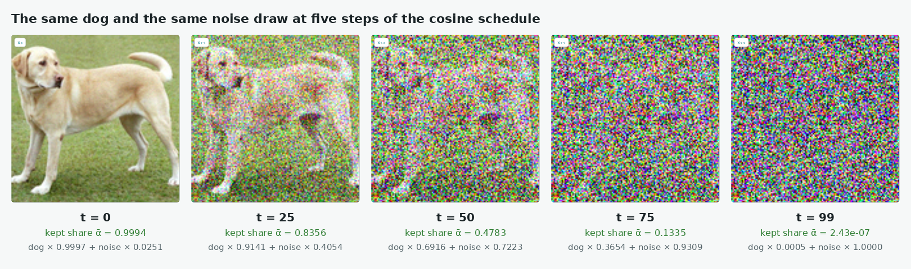
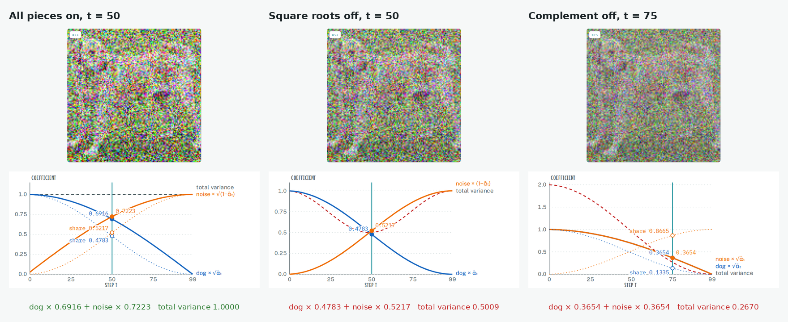

# The Forward Process

Up: [[Diffusion Models]] · [[From Many Steps To One Jump]] ➡️

Artificial Intelligence, Generative Modeling, Diffusion Models. Needs: [[Sampling A Diagonal Gaussian]] for drawing a cloud, [[Sums Of Independent Gaussians]] for why the noise variances add, [[Variance#Scaling a draw scales its variance by the square|the scaling rule for variance]] for why each weight is a square root, and [[Broadcasting]] for noising many levels in one line.

> [!question] Test yourself
> [The diffusion models quiz](https://claude.ai/artifact/MyTdAaVfZW3wiqhbLKg4wu) covers this note, with the rest of the [[Diffusion Models]] folder. Your attempts are saved on the page.

**The forward process noises a clean point $x_0$ to level $\bar\alpha$ in one step, $x_t = \sqrt{\bar\alpha}\,x_0 + \sqrt{1 - \bar\alpha}\,\varepsilon$ with $\varepsilon \sim \mathcal{N}(0, I)$, so a cloud $\mathcal{N}(\mu, \sigma^2)$ becomes $\mathcal{N}(\sqrt{\bar\alpha}\,\mu,\ \bar\alpha\,\sigma^2 + 1 - \bar\alpha)$.** $\bar\alpha = 1$ is the clean data, and $\bar\alpha$ near 0 is almost pure noise. *Cited:* Ho et al., equation (4).

## Where you work

The setup is in [[Diffusion Models#Where you work]]: any terminal with Python 3, NumPy and Matplotlib, a new empty folder, and the learner's `toy.py` and `samples.py` saved into it.

## Table of contents

- [[#When to reach for the jump]]
- [[#The form of the jump]]
- [[#Try the jump yourself]]
- [[#Reading the noised output]]
- [[#How the jump works]]
- [[#One small step, fifty of them, and one jump]]
- [[#Other ways to noise]]
- [[#Why the jump matters]]
- [[#The jump taught in, applied in]]
- [[#Where to learn this]]

## When to reach for the jump

Navigation: 📋 [[#Table of contents|TOC]] | [[#The form of the jump]] ➡️

When you need a cloud at a given noise level without running every small step before it: to make training pairs, to see what a noise level does to two experts before composing them, or to check a toy against the closed form. The paper composes the experts after noising, at every level, so knowing what each level does to a cloud comes first.

## The form of the jump

Navigation: ⬅️ [[#When to reach for the jump]] | 📋 [[#Table of contents|TOC]] | [[#Try the jump yourself]] ➡️

```text
abar = np.array([<level 1>, <level 2>, ...])                    shape (L,); 1 is clean, near 0 is noise
a    = abar[:, None, None]                                       shape (L, 1, 1), one number per level
xt   = np.sqrt(a) * x0 + np.sqrt(1 - a) * rng.standard_normal((L, N, 2))     shape (L, N, 2)
mean: np.sqrt(level) * mu        variance: level * var + 1 - level            the closed form, per level
```

Both factors are square roots. They make the two parts' variances, $\bar\alpha$ and $1 - \bar\alpha$, add to 1 for unit-variance data.


*The form, one clean cloud and one noise cloud mixed by the two square-root dials into the noised cloud.*

## Try the jump yourself

Navigation: ⬅️ [[#The form of the jump]] | 📋 [[#Table of contents|TOC]] | [[#Reading the noised output]] ➡️

**1. What you need, and when it is missing.** As in the sandbox preparation above.

**2. Make something to act on.** `toy.py` and `samples.py` in `~/playground/sandbox/gaussian-clouds`, as above. The cloud is expert 1, $\mathcal{N}((-2, 0), \operatorname{diag}(1, 4))$.

**3. The failure: the weights without their square roots.** Save this as `wrong_scale.py`:

```python
import numpy as np
from toy import shared
from samples import sample, rng, N

mu, var = shared[1]
x0 = sample(mu, var, N)
a = 0.5
xt = a * x0 + (1 - a) * rng.standard_normal((N, 2))
print("no square roots, level 0.5: var", np.round(xt.var(0), 2).tolist(), "| closed form", (a * var + 1 - a).tolist())
```

```bash
~/.vault-sandbox/bin/python wrong_scale.py
```

```text
no square roots, level 0.5: var [0.5, 1.25] | closed form [1.0, 2.5]
```

Without the square roots, each part's variance is multiplied by the square of its weight, $0.25$, and the cloud shrinks to half the variance the closed form says.

**4. The technique.** Save this as `noised.py`. It noises one cloud at three levels in one tensor and prints the closed form beside each measured level:

```python
import numpy as np
from toy import shared
from samples import sample, rng, N

mu, var = shared[1]
x0 = sample(mu, var, N)
abar = np.array([1.0, 0.5, 0.0058])
a = abar[:, None, None]
xt = np.sqrt(a) * x0 + np.sqrt(1 - a) * rng.standard_normal((3, N, 2))
print(xt.shape)
for index, level in enumerate(abar):
    print("level", level, "measured", np.round(xt[index].mean(0), 2).tolist(), np.round(xt[index].var(0), 2).tolist(),
          "| closed form", np.round(np.sqrt(level) * mu, 2).tolist(), np.round(level * var + 1 - level, 2).tolist())
```

```bash
~/.vault-sandbox/bin/python noised.py
```

You should see:


Every measured pair sits within 0.01 of the closed form. Nothing else is printed before the shape line, because `samples.py` keeps its own print loop under `if __name__ == "__main__":`. Without that line, the import prints the three clouds first: see [[Modules And Imports#Try it yourself]] step 6.

**5. Another way to get the same answer: many small steps.** The jump stands in for a chain of small steps $x_s = \sqrt{\alpha_s}\,x_{s-1} + \sqrt{1 - \alpha_s}\,\varepsilon_s$, with $\bar\alpha$ the product of the $\alpha_s$. Save this as `stepwise.py`; its four $\alpha$ values are plan 09's:

```python
import numpy as np

rng = np.random.default_rng(1)
alphas = np.array([0.9, 0.8, 0.95, 0.7])
x0 = np.full(200_000, 2.0)
x = x0.copy()
for a in alphas:
    x = np.sqrt(a) * x + np.sqrt(1 - a) * rng.standard_normal(x.shape)
abar = np.prod(alphas)
jump = np.sqrt(abar) * x0 + np.sqrt(1 - abar) * rng.standard_normal(x0.shape)
print("abar", round(float(abar), 4))
print("four steps: mean", round(float(x.mean()), 3), "var", round(float(x.var()), 3))
print("one jump:   mean", round(float(jump.mean()), 3), "var", round(float(jump.var()), 3))
print("closed form: mean", round(float(np.sqrt(abar) * 2.0), 3), "var", round(float(1 - abar), 3))
```

```bash
~/.vault-sandbox/bin/python stepwise.py
```

```text
abar 0.4788
four steps: mean 1.383 var 0.521
one jump:   mean 1.386 var 0.519
closed form: mean 1.384 var 0.521
```

Four steps and one jump land on the same distribution. Why they must is plan 09's derivation, section 3, worked there on paper, and in [[From Many Steps To One Jump#How two steps become every step]].

**6. Clean up, and prove it.** Keep the folder if you are going on to [[Composing Models With A Background#Try composing yourself]]. Otherwise:

```bash
cd ~ && rm -r ~/playground/sandbox/gaussian-clouds
ls ~/playground/sandbox/gaussian-clouds; echo $?
```

You should see `No such file or directory`, then `2`.

## Reading the noised output

Navigation: ⬅️ [[#Try the jump yourself]] | 📋 [[#Table of contents|TOC]] | [[#How the jump works]] ➡️

From step 4:

| # | Field | This run | How to read it | Backing |
|---|---|---|---|---|
| 1 | shape | `(3, 100000, 2)` | three levels, each a full cloud of 100,000 points in two coordinates | shown |
| 2 | level 0.5, measured mean | `[-1.41, 0.0]` | the cloud's centre moved toward 0 by $\sqrt{0.5} = 0.707$ | derived below |
| 3 | level 0.5, measured variance | `[1.0, 2.5]` | the narrow axis stayed at 1, the wide axis shrank from 4 toward 1 | derived below |
| 4 | level 0.5, closed form | `[-1.41, 0.0] [1.0, 2.5]` | $\sqrt{\bar\alpha}\,\mu$ and $\bar\alpha\,\sigma^2 + 1 - \bar\alpha$; equal to fields 2 and 3 | derived below |
| 5 | level 0.0058, measured variance | `[0.99, 1.02]` | almost pure noise: both axes close to 1, whatever the cloud was | derived below |

## How the jump works

Navigation: ⬅️ [[#Reading the noised output]] | 📋 [[#Table of contents|TOC]] | [[#One small step, fifty of them, and one jump]] ➡️

One coordinate at a time, with [a Gaussian](../../../Mathematics/references/textbooks/linear-algebra/matrix-cookbook.pdf#page=40) $x_0 \sim \mathcal{N}(m, v)$ and $\varepsilon \sim \mathcal{N}(0, 1)$ independent of it:

$$
\begin{aligned}
x_t &= \sqrt{\bar\alpha}\,x_0 + \sqrt{1 - \bar\alpha}\,\varepsilon \\
\mathbb{E}[x_t] &= \sqrt{\bar\alpha}\,\mathbb{E}[x_0] + \sqrt{1 - \bar\alpha}\,\mathbb{E}[\varepsilon] = \sqrt{\bar\alpha}\,m \\
\operatorname{Var}[x_t] &= \bar\alpha \operatorname{Var}[x_0] + (1 - \bar\alpha) \operatorname{Var}[\varepsilon] = \bar\alpha\,v + 1 - \bar\alpha
\end{aligned}
$$

The variances add<sub>[1](/home/molef/goal-setting/learning/deep-learning/diffusion-models/01-poe-derivation-foundations/textbook/09-the-forward-process-by-hand.md#91-independent-gaussian-noises-add-their-variances "PoE derivation foundations, chapter 9.1, independent Gaussian noises add their variances"), [2](../../../Mathematics/references/textbooks/linear-algebra/matrix-cookbook.pdf#page=41 "matrix cookbook p. 41")</sub> because $x_0$ and $\varepsilon$ are independent, and each is [multiplied by the square of its weight](../../../Mathematics/references/textbooks/statistics/introduction-to-probability-for-data-science.pdf#page=151), as [[Scaling And Shifting A Random Variable#Why the rule matters]] reads off for a fixed $x_0$. Without the square roots, step 3's weights $0.5$ and $0.5$ give $0.25\,v + 0.25$ instead: $0.5$ and $1.25$, as it printed.

<!-- video-table: sum-of-independent-gaussians rev=1 -->
3Blue1Brown on why adding two independent Gaussians gives a Gaussian, in the order to watch:

| Order | What it covers | Kind | Watch |
|---|---|---|---|
| 1 | What computing the sum of two random variables directly would look like | Intuition | [3Blue1Brown, Gaussian + Gaussian = Gaussian, 2:10 to 3:38](https://www.youtube.com/watch?v=d_qvLDhkg00&t=130s) |
| 2 | A visual argument that the sum of two independent Gaussians is again a Gaussian | Proof | [3Blue1Brown, Gaussian + Gaussian = Gaussian, 3:38 to 8:27](https://www.youtube.com/watch?v=d_qvLDhkg00&t=218s) |

No listed creator works the variance rule Var(aX + bY) = a²Var(X) + b²Var(Y) for independent X and Y, which gives the forward process its square roots. Times are chapter boundaries read from each video's chapter list, not from captions, so each is good to the chapter and the sentence inside it is not checked.
<!-- /video-table -->

The worked numbers for expert 1, $m = (-2, 0)$ and $v = (1, 4)$:

$$
\begin{aligned}
\bar\alpha = 0.5: \quad & \text{mean } \sqrt{0.5} \times (-2) = -1.414, & \text{variance } & 0.5 \times 1 + 0.5 = 1.0, \quad 0.5 \times 4 + 0.5 = 2.5 \\
\bar\alpha = 0.0058: \quad & \text{mean } \sqrt{0.0058} \times (-2) = -0.152, & \text{variance } & 0.0058 \times 1 + 0.9942 = 1.0, \quad 0.0058 \times 4 + 0.9942 = 1.017
\end{aligned}
$$

The narrow axis has variance 1 at every level, because noise of variance 1 replaces signal of variance 1. For the step-by-step chain, $\bar\alpha = 0.9 \times 0.8 \times 0.95 \times 0.7 = 0.4788$, and the closed form gives mean $\sqrt{0.4788} \times 2 = 1.384$ and variance $1 - 0.4788 = 0.521$, as step 5 printed.


*The mechanism, expert 1's cloud at the three levels, its centre sliding toward 0 and its two axes heading toward variance 1.*


*The deep-dive sheet composing the form, the mechanism and the run.*

<!-- worked-examples-table: forward-draw-mean-and-variance rev=1 -->
Problems on the mean and variance of $a X + b$ and of a sum of independent Gaussians, the rule that makes $\sqrt{\bar\alpha}\,x_0 + \sqrt{1-\bar\alpha}\,\varepsilon$ a Gaussian with mean $\sqrt{\bar\alpha}\,x_0$ and variance $1-\bar\alpha$, from the easiest to the hardest:

| Order | What it asks | Kind | Where | Difficulty | Full-steps solution | Quiz question |
|---|---|---|---|---|---|---|
| 1 | $Y = aX + b$ for a standard Gaussian $X$: write its CDF as $\Phi((y-b)/a)$ and its density | Worked example | [[introduction-to-probability-for-data-science.pdf#page=241\|Chan, follow-up to Example 4.26, PDF pp. 241 to 242]] | Easy | In the book, PDF p. 242 | quiz 1.1, B1.1 |
| 2 | The mean and variance of a sum of two independent variables, then the covariance matrix of a sum of two independent random vectors | Exercise without one | [[pattern-recognition-and-machine-learning.pdf#page=78\|Bishop, Exercise 1.10, PDF p. 78]] and [[pattern-recognition-and-machine-learning.pdf#page=151\|Exercise 2.27, PDF p. 151]] | Easy | [S1 in the quiz 1.1 solutions](/home-mscluster/mmolefe/PhD/reduce-reuse-recycle/artifacts/drips/simple-distributions-rebuild/.quiz-prep/quiz-1-1-solutions.md#s1-the-mean-and-variance-of-a-sum-of-independent-variables-b12-bishop-110-and-227), numbers printed by its check script | quiz 1.1, B1.2 |
| 3 | Show that $Y = \Sigma^{1/2}X + \mu$ has mean $\mu$ and covariance $\Sigma$ for $X \sim \mathcal N(0, I)$, which is how a Gaussian sample is made | Worked example | [[introduction-to-probability-for-data-science.pdf#page=315\|Chan, Theorem 5.19, PDF p. 315]] | Medium | In the book, PDF p. 315 | quiz 1.1, B1.4 |
| 4 | $y = Ax + b + w$ with independent Gaussian noise: write $p(y \mid x)$, then derive the mean and covariance of $p(y)$; with $A = \sqrt{\bar\alpha_{50}}\,I$ this is the forward process | Exercise without one | [[mathematics-for-machine-learning.pdf#page=229\|Mathematics for Machine Learning, Exercise 6.12 (a) and (b), PDF p. 229]] | Hard | [S2 in the quiz 1.1 solutions](/home-mscluster/mmolefe/PhD/reduce-reuse-recycle/artifacts/drips/simple-distributions-rebuild/.quiz-prep/quiz-1-1-solutions.md#s2-a-linear-map-plus-independent-noise-b16-mml-612) | quiz 1.1, B1.6 |
| 5 | Chan states that $X_1 + X_2 \sim \mathcal N(\mu_1 + \mu_2, \sigma_1^2 + \sigma_2^2)$ but proves only $\sigma_1 = \sigma_2$: prove the general case | Exercise without one | [[introduction-to-probability-for-data-science.pdf#page=299\|Chan, Theorem 5.12, PDF pp. 299 to 300]] | Hard | [S3 in the quiz 1.1 solutions](/home-mscluster/mmolefe/PhD/reduce-reuse-recycle/artifacts/drips/simple-distributions-rebuild/.quiz-prep/quiz-1-1-solutions.md#s3-two-gaussians-with-unequal-variances-b17-chan-theorem-512), by generating functions | quiz 1.1, B1.7 |
| 6 | Noise one cloud at three levels in one tensor and print the measured mean and variance beside the closed form, first with the square roots left off | Programming exercise, Python: `noised.py` | [[The Forward Process#Try the jump yourself]], steps 3 and 4 | Medium | In the note, with the expected output (variance 0.5 and 1.25 without the roots, 1.0 and 2.5 with them) | quiz 1.1, B1.8 |

The chapter's worked examples 9.1 (0.28 both ways) and 9.2a (the four-step schedule) are banked by quiz 1.2 in [[Worked Examples#The forward process, from one step to one jump]], so they are not repeated here. No book problem asks for the variance of the forward draw at a named step; rows 6 and 7 are the nearest, and the quiz's own numbers ($\bar\alpha_{50} = 0.4783$) are worked into their solutions. Chan's convolution proof of Theorem 5.12 is the reason for row 7: it is a special case printed as the general one.
Read in full: Chan PDF pp. 241 to 243, 298 to 300 and 309 to 316, Bishop's exercise statements 1.10 and 2.27, Mathematics for Machine Learning PDF pp. 228 to 230, the chapter's sections 9.1 and 9.2, and the vault note's steps 3 and 4. Only found: Mathematics for Machine Learning's variance under an affine map (PDF p. 200), stated without an exercise.
<!-- /worked-examples-table -->

## One small step, fifty of them, and one jump

Navigation: ⬅️ [[#How the jump works]] | 📋 [[#Table of contents|TOC]] | [[#Other ways to noise]] ➡️

**Each small step shrinks the point by $\sqrt{1 - \beta_t}$ and adds noise of variance $\beta_t$, $q(x_t \mid x_{t-1}) = \mathcal{N}(\sqrt{1 - \beta_t}\,x_{t-1},\ \beta_t I)$, and [chaining the steps](/home/molef/goal-setting/learning/deep-learning/diffusion-models/01-poe-derivation-foundations/textbook/09-the-forward-process-by-hand.md#92-reading-the-image-ladder-and-the-one-jump-form) up to level $t$ gives the one jump with $\bar\alpha_t = \prod_{s=1}^{t}(1 - \beta_s)$.** After enough steps $q(x_T)$ is close to $\mathcal{N}(0, I)$. *Cited:* Du et al., Reduce, Reuse, Recycle, section 2.1, paragraph 1 (`text/related_work.tex` lines 7 to 8).

On the one-dimensional toy, expert a is $\mathcal{N}(-1, 0.5)$ and the cosine schedule has 100 levels (the schedule built in [[The Order Of Multiplying And Noising#Try the two orders yourself]]). Save this as `forward_chain.py`, with `betas` and `abar` from that schedule:

```python
rng = np.random.default_rng(0)
x0 = -1.0 + np.sqrt(0.5) * rng.standard_normal((100_000, 1))
xs = x0.copy()
for t in range(1, 51):
    xs = np.sqrt(1 - betas[t]) * xs + np.sqrt(betas[t]) * rng.standard_normal(xs.shape)
jump = np.sqrt(abar[50]) * x0 + np.sqrt(1 - abar[50]) * rng.standard_normal(x0.shape)
```

It printed:

```
expert a after 50 small steps: mean -0.7026, variance 0.7518
expert a after one jump to t = 50: mean -0.7024, variance 0.7445
closed form at abar = 0.493844: mean -0.702740, variance 0.753078
product of (1 - beta_s) for s = 1..50: 0.493844  (this is abar at t = 50)
product of (1 - beta_s) for s = 1..T, as equation A2's text prints it: 2.43e-07  (the same for every t)
```

| # | Field | This run | How to read it | Backing |
|---|---|---|---|---|
| 1 | 50 small steps, mean and variance | `-0.7026`, `0.7518` | the chain's cloud at level 50, from 100,000 points | shown |
| 2 | one jump, mean and variance | `-0.7024`, `0.7445` | the same level reached in one line; within the run's three-standard-error tolerance of 0.0082 for the mean and 0.0101 for the variance of the chain | shown |
| 3 | closed form at $\bar\alpha = 0.493844$ | `-0.702740`, `0.753078` | $\sqrt{\bar\alpha}\,(-1)$ and $0.493844 \times 0.5 + 1 - 0.493844$ | derived in [[#How the jump works]] |
| 4 | product of $(1 - \beta_s)$ up to 50 | `0.493844` | the signal share left at level 50 | shown |
| 5 | product of all 100 factors | `2.43e-07` | the signal share at level 100: nothing of the clean point is left, so $q(x_T)$ is $\mathcal{N}(0, I)$ to within that share | shown |

Level 50 on this schedule leaves $\bar\alpha = 0.4938$, so the "half the signal left" level used in [[The Order Of Multiplying And Noising]] ($\bar\alpha = 0.5$) sits at about level 50. *Inferred* from the 0.4938, not run at exactly 0.5 here; the exact-0.5 closed form is `-0.707107`, `0.750000`.

*Backing for the run:* `checks/forward_chain.py` and `checks/step5_noise_levels.out` in the journey's `sources/reduce-reuse-recycle/`, seed 0, re-run in an empty folder with the prepared environment and the same output.

Why fifty small steps must equal one jump, two steps by hand and then induction on every step, is [[From Many Steps To One Jump]]. It counts steps from 0 as the rebuild's code does, so this section's level 50 is its $\bar\alpha_{49}$.



The same chain on a photo: one dog, one noise draw, five levels of the 100-level cosine schedule. The scene counts levels from 0, so its t = 50 is this note's level 51, which is why it reads 0.4783 against the 0.4938 above. [Dissolving the Dog](https://claude.ai/artifact/X7QGLTxssbz41G7iTiRxC9) is the live version: drag t, or switch off a piece of the jump.



Each piece of the jump protects the total variance. With every piece on, the two scales square to 1.0000. Without the square roots they square to 0.5009 at t = 50. With ᾱ in place of 1 − ᾱ they square to 0.2670 at t = 75.

## Other ways to noise

Navigation: ⬅️ [[#One small step, fifty of them, and one jump]] | 📋 [[#Table of contents|TOC]] | [[#Why the jump matters]] ➡️

- **The step-by-step chain**, as in step 5, when the intermediate states matter, as in a sampler that walks back down. One jump is the shortcut when only the end state is needed.
- **A noise scale without the shrink**, $x_t = x_0 + \sigma_t\,\varepsilon$, the variance-exploding form the paper's Appendix K uses. Its $\sigma_t$ corresponds to $\sqrt{1 - \bar\alpha}$ here, and the clean part is not scaled down. *Cited:* the walk's notation table, from the paper's Appendix K.

## Why the jump matters

Navigation: ⬅️ [[#Other ways to noise]] | 📋 [[#Table of contents|TOC]] | [[#The jump taught in, applied in]] ➡️

Training a diffusion model needs pairs of clean and noised points at random levels, and the jump makes each pair in one line. The paper's composition result holds at every noise level, so the clouds being composed in the next section are noised clouds, and this closed form says what they look like.

## The jump taught in, applied in

Navigation: ⬅️ [[#Why the jump matters]] | 📋 [[#Table of contents|TOC]] | [[#Where to learn this]] ➡️

**Taught in:**

- the `drip-read` walk of the Mechanisms of Projective Composition paper note, step 3c, where the learner's `noised.py` printed level 0.5 as mean `[-1.41, -0]` and variance `[1, 2.51]`, within 0.05 of the closed form, with the closed-form print still owed
- the `drip-read` walk of Du et al., Reduce, Reuse, Recycle, section 2.1 paragraph 1 (the paper note is not written yet; link it here when it is): the single-step transition, and the agreement of 50 small steps with one jump on the toy
- the PoE derivation foundations journey's [plan 09](/home/molef/goal-setting/learning/deep-learning/diffusion-models/01-poe-derivation-foundations/plans/09-the-forward-process.md), task 1 at lines 138 to 168 (iterate the steps, then jump, and compare) and section 3 at lines 221 to 277 (derive the jump on paper)

**Applied in:** step 4 of the one-expert rebuild walk in the reduce-reuse-recycle research repository (`artifacts/drips/simple-distributions-rebuild/01-one-expert-from-scratch.md#step-4-the-forward-process-and-the-cosine-schedule`), which noises one clean 2D point along a 100-step cosine schedule to make the training pairs for one diffusion expert; at t = 50 the kept share $\bar\alpha$ is 0.4783 and the noise standard deviation is 0.7223.

**Before this note:** the learner's LibreOffice note `Artificial Intelligence/Machine Learning/Generative Models/Diffusion Models/Diffusion Models.odt` describes the forward process as a fixed Markov chain that adds Gaussian noise over $T = 1000$ steps and writes the single step $q(x_t \mid x_{t-1}) = \mathcal{N}(\sqrt{\alpha_t}\,x_{t-1}, (1 - \alpha_t) I)$, without the one-jump form.

## Where to learn this

**The forward process**, q(x_t | x_0) = N(√ᾱ_t x_0, (1 − ᾱ_t) I), the noisy latent at step t in one jump. Also: forward diffusion, noising process, diffusion kernel.

**Textbooks**

- Understanding deep learning, sections 18.2 and 18.2.1: [pages 363 to 366](../../../Mathematics/references/textbooks/machine-learning/understanding-deep-learning.pdf#page=363). Works it on one-dimensional data with T = 100 steps at β = 0.03 (figure 18.2), then derives the diffusion kernel q(z_t | x) by adding the first two steps' noises and draws it for x* = 2.0 at t = 20, 40 and 80 (figure 18.3).
- The little book of generative AI foundations, section 4.1.1, Gaussian noising and the closed-form forward process: [pages 70 to 72](../../../Mathematics/references/textbooks/machine-learning/the-little-book-of-generative-ai-foundations.pdf#page=70). The one-step rule, the closed form x_t = √ᾱ_t x_0 + √(1 − ᾱ_t) ε, and figure 4.1 with the signal coefficient falling as the noise coefficient rises.

**Videos**

- CME296 lecture 1, 38:51 to 46:03: [watch](https://www.youtube.com/watch?v=tr-CUpw--ck&t=2331s). Derives x_t = √ᾱ_t x_0 + √(1 − ᾱ_t) ε on the board by merging independent Gaussian noise terms, with ᾱ_t the product of α_i = 1 − β_i. Caption-read.
- CS229 lecture 11, 13:57 to 22:39: [watch](https://www.youtube.com/watch?v=dqUMCzWjZSI&t=837s). Unrolls the recursion with α_t = 1 − β_t to the same closed form, finding the noise coefficient from the variance. Caption-read.
- CS229 lecture 11, 22:39 to 25:55: [watch](https://www.youtube.com/watch?v=dqUMCzWjZSI&t=1359s). Shows ᾱ_t → 0 as t grows, so x_T given x_0 tends to N(0, I). Caption-read.
- Stanford CS236 lecture 16, 16:23 to 19:05: [watch](https://www.youtube.com/watch?v=VsllsC2JMGY&t=983s). Many small noising steps combined into one transition to any noise level. Chapter-timed, from the video lessons index.
- Vizuara, Principles of Diffusion Models, lecture 3, 33:51 to 42:46: [watch](https://www.youtube.com/watch?v=Dx-1agEjlJs&t=2031s). Why each step scales the mean down as well as adding noise. Chapter-timed, from the video lessons index.

**Papers**

- Chan 2024, Tutorial on diffusion models for imaging and vision, Theorem 2.2: [pages 23 to 24](/home/molef/goal-setting/learning/papers/deep-learning/diffusion-models/tutorial-on-diffusion-models-for-imaging-and-vision.pdf#page=23). States q(x_t | x_0) = N(√ᾱ_t x_0, (1 − ᾱ_t) I) (equation 2.8) and proves it by unrolling the recursion to x_t = √ᾱ_t x_0 + √(1 − ᾱ_t) ε_0 (equation 2.11).
- Chan 2024, the same tutorial, section 2.1: [pages 20 to 21](/home/molef/goal-setting/learning/papers/deep-learning/diffusion-models/tutorial-on-diffusion-models-for-imaging-and-vision.pdf#page=20). The one-step transition q(x_t | x_{t−1}) (equation 2.1), then a two-component Gaussian mixture noised step by step, each component's mean shrinking by √α_t and its variance moving toward 1 (Example 2.1, equation 2.2).

**Our plans and chapters**

- [Chapter 9: The forward process, the schedule, and eps = -sigma grad log p by hand](/home/molef/goal-setting/learning/deep-learning/diffusion-models/01-poe-derivation-foundations/textbook/09-the-forward-process-by-hand.md), deep-learning/diffusion-models/01-poe-derivation-foundations, chapter 9. Why independent Gaussian noises add their variances, and the one-jump form derived from it.
- [The forward process, derived and coded](/home/molef/goal-setting/learning/deep-learning/diffusion-models/01-poe-derivation-foundations/plans/09-the-forward-process.md), the same journey, plan 09. Iterates the small steps, then jumps, and compares the two before deriving the jump on paper.
- [The forward process, derived and coded](/home/molef/goal-setting/learning/deep-learning/diffusion-models/02-sampler-correctors-for-composition/plans/06-the-forward-process.md), deep-learning/diffusion-models/02-sampler-correctors-for-composition, plan 06. The same derivation and code, as the step before one reverse step on the project's own ᾱ_t.
- [VP and VE, one forward process, two schedules](/home/molef/goal-setting/learning/deep-learning/diffusion-models/00-from-scratch-to-sdxl/textbook/l4-continuous-time/05-vp-and-ve-one-forward-process-two-schedules.md), deep-learning/diffusion-models/00-from-scratch-to-sdxl, volume L4, section 5. The variance-preserving form that shrinks x_0 against the variance-exploding form that only adds noise, as two schedules of one process.

**Figures**

- <a href="/home/molef/goal-setting/learning/deep-learning/diffusion-models/04-schrodinger-bridges/artifacts/figures/foundations-of-schrodinger-bridges/hero-diffusion-against-bridge.jpg"></a> Sophia Tang, Foundations of Schrödinger Bridges for Generative Modeling, hero figure: [the paper](https://arxiv.org/abs/2603.18992), [what it shows](/home/molef/goal-setting/learning/deep-learning/diffusion-models/04-schrodinger-bridges/artifacts/figures/foundations-of-schrodinger-bridges/README.md#hero-diffusion-against-bridgejpg). The top row is the forward process: a cat fades over nine frames to grey noise, ending at a concentric isotropic Gaussian, with the forward SDE dX_t = f(X_t, t)dt + σ_t dB_t above it. The figure writes the process in continuous time, so ᾱ_t never appears on it; the closed form above is what that SDE gives at each t under the variance-preserving choice of f and σ_t ([the reading](/home/molef/goal-setting/learning/deep-learning/diffusion-models/04-schrodinger-bridges/sources/foundations-of-schrodinger-bridges/SOURCES.md#foundations-of-schrödinger-bridges-for-generative-modeling)).

> [!note]- How this was checked
> The shared setup and sources are in the box at the end of [[Diffusion Models]].
>
> The card under Where to learn this was built on 2026-10-28, and every line was opened before it was written. The two textbook page ranges were read with pdftotext, found through Understanding deep learning's back-of-book entry "diffusion model, forward process" and the shelf index's section titles. The CME296 and CS229 rows were read in their caption-read lecture maps under `~/.claude/cache/captions/` and paraphrase the map. The CS236 and Vizuara rows are copied from the video lessons index section "The forward process", whose times are chapter boundaries. The two Chan rows were read with pdftotext and match the paper shelf's rows for the one-step transition and the jump. Each plan and chapter was read at its title and opening lines. The figure was opened and its card and source reading read; the sentence tying its SDE to the closed form is this card's own reading, not the figure's.
