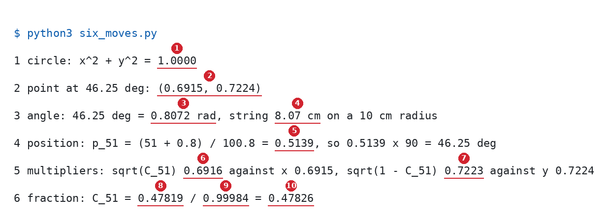

# The Quarter Circle Under The Cosine Schedule

Up: [[Diffusion Models]] · ⬅️ [[The Cosine Noise Schedule]] · [[The Quarter Turn And The Fraction]] ➡️

Artificial Intelligence, Generative Modeling, Diffusion Models. Needs: [[The Unit Circle]] for $(\cos\theta, \sin\theta)$ as a point's two legs, [[Radians]] for π/2 as the quarter arc, [[The Cosine Noise Schedule]] for the boundary values $C_k$, and [[The Forward Process]] for the jump $x_t = \sqrt{\bar\alpha_t}\,x_0 + \sqrt{1 - \bar\alpha_t}\,\varepsilon$.

> [!question] Test yourself
> [The diffusion models quiz](https://claude.ai/artifact/MyTdAaVfZW3wiqhbLKg4wu) covers the [[Diffusion Models]] folder. It has no questions on this note yet.

> [!warning] Unfinished
> - The mechanism and the deep-dive sheet are waiting: prompts 44 and 45 in the vault's `.prompts/Diffusion Models.md`. The form is drawn by the scripts of steps 1 and 2.
> - The diffusion models quiz has no questions on this note yet.

Stated claims: 0.

**Every boundary value of the cosine schedule sits at a post on a quarter of the unit circle, and the point at that post is the forward jump's two multipliers.** This note draws the first two steps of the build: where the 101 posts go, and what the point at post 51 means. [[The Quarter Turn And The Fraction]] draws the last two.

**Colours, the same in every equation and figure.** Green is $\cos\theta$ and the clean point's multiplier $\sqrt{\bar\alpha}$. Orange is $\sin\theta$ and the noise multiplier $\sqrt{1 - \bar\alpha}$. Blue is a post, its position and its angle. Purple is arc length. Grey is the schedule with δ = 0, drawn for comparison.

## Where you work

Python 3 with matplotlib, in a new empty folder; nothing here touches a real project. The scripts import `plane.py` and `cosine.py`, set up in [[#Try the quarter circle yourself]], step 3. For the build by hand: paper, a ruler, a protractor and a piece of string.

## Table of contents

- [[#The quarter circle under C_k]]
- [[#Try the quarter circle yourself]]
- [[#Reading the quarter-circle output]]
- [[#How the quarter circle gives the multipliers]]
- [[#Other ways to see the quarter circle]]
- [[#Why the quarter circle matters]]
- [[#The quarter circle taught in, applied in]]

## The quarter circle under C_k

Navigation: 📋 [[#Table of contents|TOC]] | [[#Try the quarter circle yourself]] ➡️

Textbook: [Whitney, Trigonometry handbook, polar coordinates, PDF p. 68](../../../Mathematics/references/textbooks/trigonometry/trigonometry-handbook.pdf#page=68)

### The posts and their table

<table>
<tr><th>post k</th><th style="color:#1565c0">position p<sub>k</sub></th><th style="color:#1565c0">angle θ<sub>k</sub></th><th style="color:#2e7d32">cos θ<sub>k</sub></th><th style="color:#ef6c00">sin θ<sub>k</sub></th><th>angle with δ = 0</th></tr>
<tr><td>0</td><td style="border:2px solid #212121">0.0079</td><td style="border:2px solid #212121">0.714°</td><td>0.99992</td><td>0.0125</td><td style="border:2px dashed #212121">0°</td></tr>
<tr><td>1</td><td>0.0179</td><td>1.607°</td><td>0.99961</td><td>0.0280</td><td>0.9°</td></tr>
<tr style="background:#fff8e1"><td><b>51</b></td><td>0.5139</td><td>46.25°</td><td style="border:2px solid #212121"><b>0.6915</b></td><td style="border:2px solid #212121"><b>0.7224</b></td><td>45.9°</td></tr>
<tr><td>100</td><td style="border:2px solid #212121">1</td><td style="border:2px solid #212121">90°</td><td>0</td><td>1</td><td style="border:2px dashed #212121">90°</td></tr>
</table>

**How to read this table.** Each row is one fence post of the 100-step timetable. The position runs from 0 to 1 along the quarter arc, the angle is that position times 90°, and the last column is where the post would sit without the offset.

**What to look for.** The solid boxes at posts 0 and 100: the offset slides post 0 off the axis while post 100 stays on 90°. The highlighted row is the toy: its point is step 50's two multipliers.

### Build the quarter circle by hand

The quarter arc is a piece of [[The Unit Circle#The circle: every point at distance 1|the unit circle]]. A point on it at angle θ is $(\cos\theta, \sin\theta)$, [[The Unit Circle#The point: from length and angle to x and y|its two legs]], and the legs' squares add to 1, [[The Cosine Wave#The two shares|the two shares]]. The angle can be read as [[Radians#Then the conversion: degrees to radians|an arc length]], so the quarter turn is π/2. Without the circle, $\cos^2$ is a function someone chose; with it, it is [a length you can measure with a ruler](../../../../PhD/reduce-reuse-recycle/artifacts/drips/simple-distributions-rebuild/01-one-expert-from-scratch.md#step4-the-quarter-circle-by-hand), as the rebuild walk's "On paper 1 to 3" do by hand.

### Step 1: the position ruler

Treat the quarter arc as a ruler, 0 on the x-axis and 1 on the y-axis. Post $k$ sits at [the schedule's position](../../../../PhD/reduce-reuse-recycle/artifacts/drips/simple-distributions-rebuild/01-one-expert-from-scratch.md#step4-where-the-position-goes)

$$
\underbrace{\textcolor{#1565c0}{p_k}}_{\text{position on the arc}}
=
\frac{
\underbrace{k/T}_{\text{post number as a fraction}}
+
\underbrace{\delta}_{\text{offset }0.008}
}{
\underbrace{1+\delta}_{\text{keeps post }T\text{ at }1}
}
=
\frac{k + 0.8}{100.8},
\qquad
\underbrace{\textcolor{#1565c0}{\theta_k}}_{\text{angle}}
=
p_k \cdot \underbrace{90^\circ}_{\pi/2}.
$$

**What the equation says.** 101 posts mark the ends of 100 steps, like fence posts round 100 gaps. Post 0 sits at 0.0079 of the way round (0.714°), post 51 at 0.5139 (46.25°) and post 100 at exactly 1 (90°).

**Why the offset δ is there.** Adding 0.008 slides every post forward, so post 0 starts just off the x-axis, where $\cos^2$ is already falling. Without it the first step adds a noise share of 0.000247 instead of 0.000631, [[The Quarter Turn And The Fraction#The consequence: remove a piece|drawn in the next note]].

**Why the division by 1 + δ is there.** It pulls the last post back to exactly 90°. Without it post 100 sits at 90.72° and keeps a share of 0.000158 instead of 0.

```python
import math
import matplotlib.pyplot as plt
from plane import save, BLUE, GREY, LIGHT_GREY
from cosine import T, position, theta_deg

for k in (0, 1, 51, 100):
    print(f"post {k:3d}  p {position(k):.4f}  {theta_deg(k):6.3f} deg    delta = 0: p {position(k, 0):.4f}  {theta_deg(k, 0):6.3f} deg")

fig, axs = plt.subplot_mosaic([["arc", "start"], ["arc", "end"]], figsize=(11, 5.5), width_ratios=[1.1, 1])
ax = axs["arc"]
ts = [math.radians(d / 4) for d in range(361)]
ax.plot([math.cos(t) for t in ts], [math.sin(t) for t in ts], color=LIGHT_GREY, lw=6)
for k in range(T + 1):
    t = math.radians(theta_deg(k))
    ax.plot(math.cos(t), math.sin(t), "o", color=BLUE, ms=3)
for p in (0, 0.25, 0.5, 0.75, 1):
    t = math.radians(p * 90)
    ax.plot([0.97 * math.cos(t), 1.03 * math.cos(t)], [0.97 * math.sin(t), 1.03 * math.sin(t)], color="black")
    ax.text(0.88 * math.cos(t), 0.88 * math.sin(t), f"{p:g}", ha="center", va="center", fontsize=10)
for k, label in ((0, "post 0, p = 0.0079, 0.714°"), (51, "post 51, p = 0.5139, 46.25°"), (100, "post 100, p = 1, 90°")):
    t = math.radians(theta_deg(k))
    ax.plot(math.cos(t), math.sin(t), "o", color=BLUE, ms=8)
    ax.text(1.08 * math.cos(t), 1.08 * math.sin(t) + 0.03, label, color=BLUE, fontsize=10)
ax.set_xlim(-0.05, 1.75)
ax.set_ylim(-0.1, 1.2)
ax.set_aspect("equal")
ax.spines[["top", "right"]].set_visible(False)
ax.set_title("the quarter arc as a ruler from 0 to 1: 101 posts", fontsize=12)

for name, lo, ks in (("start", 0, range(0, 6)), ("end", 86, range(95, 101))):
    a = axs[name]
    for k in ks:
        for d, y, color, size in ((0.008, 1, BLUE, 8), (0.0, 0, GREY, 7)):
            a.plot(theta_deg(k, d), y, "o", color=color, ms=size)
            a.text(theta_deg(k, d), y + 0.32, str(k), ha="center", fontsize=9, color=color, clip_on=True)
    a.set_xlim(lo - 0.2, lo + 4.2)
    a.set_ylim(-0.6, 1.8)
    a.set_yticks([0, 1], ["δ = 0", "δ = 0.008"])
    a.set_xlabel("angle in degrees")
    a.spines[["top", "right", "left"]].set_visible(False)
axs["start"].set_title("first posts: δ slides post 0 from 0° to 0.714°", fontsize=11)
axs["end"].set_title("last posts: dividing by 1 + δ lands both on 90°", fontsize=11)
fig.tight_layout()
save(fig, "s1-position-ruler-posts.svg")
```


**How to read this.** On the left both axes are in units of the radius and each blue dot is one post; the black ticks are the ruler's 0, 0.25, 0.5, 0.75 and 1. On the right the x-axis is the angle in degrees, the top row is the schedule's posts and the grey row the posts with δ = 0, each dot numbered by its post. Look at the first strip: grey post 0 sits on 0°, blue post 0 on 0.714°. In the second, both post 100s sit on 90°.

### Step 2: the point is the two multipliers

At post 51 the point on the arc is, to within 0.0001, the pair of numbers the forward jump at step 50 multiplies by:

$$
\big(\textcolor{#2e7d32}{\cos 46.25^\circ},\ \textcolor{#ef6c00}{\sin 46.25^\circ}\big)
=
(0.6915,\ 0.7224)
\approx
\Big(
\underbrace{\textcolor{#2e7d32}{\sqrt{\bar\alpha_{50}}}}_{\text{clean point's multiplier, }0.6916},\
\underbrace{\textcolor{#ef6c00}{\sqrt{1-\bar\alpha_{50}}}}_{\text{noise multiplier, }0.7223}
\Big)
$$

**What the equation says.** The horizontal leg is how much of the clean image survives in $x_{50}$, and the vertical leg is how much noise is mixed in. Their squares, 0.4782 and 0.5218, are the kept share and the noise share, and they add to 1.

**Why only to within 0.0001.** The schedule divides by $\cos^2\theta_0 = 0.99984$, which stretches every multiplier $\sqrt{C_k}$ by $1/0.99992 = 1.00008$. At post 51 that moves 0.6915 to 0.6916.

**Why the string is there.** The angle 46.25° is 0.8072 rad, an arc 8.07 cm long on a 10 cm radius: the walk's "On paper 3" measures it with a string.

```python
import math
from plane import plane, save, circle, angle, GREEN, ORANGE, BLUE, PURPLE
from cosine import theta_deg, C

deg = theta_deg(51)
x, y = math.cos(math.radians(deg)), math.sin(math.radians(deg))
print(f"post 51 at {deg:.2f} deg: point ({x:.4f}, {y:.4f})")
print(f"multipliers: sqrt(abar_50) = sqrt(C_51) = {math.sqrt(C(51)):.4f}   sqrt(1 - abar_50) = {math.sqrt(1 - C(51)):.4f}")
print(f"string along the arc: {math.radians(deg):.4f} rad = {10 * math.radians(deg):.2f} cm on a 10 cm radius")

fig, ax = plane((-0.3, 1.75), (-0.35, 1.3), width=8)
circle(ax, upto=90)
ts = [math.radians(d / 10) for d in range(0, int(deg * 10) + 1)]
ax.plot([1.04 * math.cos(t) for t in ts], [1.04 * math.sin(t) for t in ts], color=PURPLE, lw=3)
ax.text(1.06, 0.3, "string 0.8072 rad\n= 8.07 cm at 10 cm = 1", color=PURPLE, fontsize=10)
for k, label in ((0, "post 0"), (100, "post 100")):
    t = math.radians(theta_deg(k))
    ax.plot(math.cos(t), math.sin(t), "o", color=BLUE, ms=6)
    ax.text(math.cos(t) + 0.04, math.sin(t) + 0.04, label, color=BLUE, fontsize=9)
ax.plot([0, x], [0, y], color=BLUE, lw=2)
ax.plot([0, x], [0, 0], color=GREEN, lw=6)
ax.plot([x, x], [0, y], color=ORANGE, lw=6)
ax.plot(x, y, "o", color=BLUE, ms=9)
angle(ax, deg, r=0.2)
ax.text(0.22, 0.06, "46.25°", color=BLUE, fontsize=10)
ax.text(x / 2, -0.13, "cos 46.25° = 0.6915", color=GREEN, ha="center")
ax.text(x / 2, -0.25, "√ᾱ₅₀ = 0.6916: the clean point's multiplier", color=GREEN, ha="center", fontsize=10)
ax.text(x - 0.03, y / 2, "sin 46.25° = 0.7224\n√(1 − ᾱ₅₀) = 0.7223:\nthe noise multiplier", color=ORANGE, ha="right", va="center", fontsize=10)
ax.text(x + 0.04, y + 0.05, "post 51", color=BLUE, fontsize=10)
ax.text(0.03, 1.15, "x² + y² = 0.4782 + 0.5218 = 1", fontsize=11)
ax.set_title("the point at post 51 is step 50's two multipliers, to within 0.0001", fontsize=12)
save(fig, "s2-circle-point-is-the-multipliers.svg")
```


**How to read this.** Both axes are in units of the radius. The green leg's length is the clean point's multiplier and the orange leg's length is the noise multiplier. Look at the two pairs of numbers on each leg: they differ in the fourth decimal only.

### The consequence: move the posts

With δ = 0 the grey posts of step 1 start on the x-axis, and the first step is 0.9° wide instead of 0.893°, beginning where $\cos^2$ is flat. Without the division by 1 + δ, post 100 overshoots to 90.72°. The point at each post moves with it, so both changes alter the multipliers; [[The Quarter Turn And The Fraction#The consequence: remove a piece|the next note]] counts what each does to the noise.

## Try the quarter circle yourself

Navigation: ⬅️ [[#The quarter circle under C_k]] | 📋 [[#Table of contents|TOC]] | [[#Reading the quarter-circle output]] ➡️

**1. What you need.** Python 3 with matplotlib:

```bash
python3 -c "import matplotlib; print(matplotlib.__version__)"
```

This run printed `3.10.8`.

**2. When it is missing.** Make the prepared environment once, `uv venv ~/.vault-sandbox` then `uv pip install --python ~/.vault-sandbox/bin/python pandas numpy scipy matplotlib statsmodels openpyxl`, and run every script with `~/.vault-sandbox/bin/python` in place of `python3`. Not run on this machine, whose `python3` already has matplotlib.

**3. The setup: the plane and the schedule.** Make the empty folder and confirm it is empty:

```bash
mkdir -p ~/playground/sandbox && mkdir ~/playground/sandbox/schedule-figures && cd ~/playground/sandbox/schedule-figures && ls -A | wc -l
```

You should see `0`. Copy [plane.py](../../../Mathematics/Trigonometry/sandbox/plane.py), the figure helper of the [[Trigonometry]] notes, into it. Save this as `cosine.py`:

```python
import math

T, delta = 100, 0.008


def position(k, d=delta):
    return (k / T + d) / (1 + d)


def theta_deg(k, d=delta):
    return position(k, d) * 90


def f(k, d=delta):
    return math.cos(math.radians(theta_deg(k, d))) ** 2


def C(k, d=delta):
    return f(k, d) / f(0, d)
```

Save the two scripts above as `s1_posts.py` and `s2_point.py`. [[The Quarter Turn And The Fraction]] runs its `s3_curve.py` and `s4_fraction.py` in this same folder.

**4. A look before: where the posts sit.**

```bash
python3 s1_posts.py
```

```text
post   0  p 0.0079   0.714 deg    delta = 0: p 0.0000   0.000 deg
post   1  p 0.0179   1.607 deg    delta = 0: p 0.0100   0.900 deg
post  51  p 0.5139  46.250 deg    delta = 0: p 0.5100  45.900 deg
post 100  p 1.0000  90.000 deg    delta = 0: p 1.0000  90.000 deg
saved s1-position-ruler-posts.svg
```

**5. The failure: no offset.** The right-hand column of step 4 is the schedule with δ = 0: post 0 sits on the axis at 0.000°, and post 51 moves only 0.35°, to 45.900°.

**6. The technique: the point at post 51 and its multipliers.**

```bash
python3 s2_point.py
```

```text
post 51 at 46.25 deg: point (0.6915, 0.7224)
multipliers: sqrt(abar_50) = sqrt(C_51) = 0.6916   sqrt(1 - abar_50) = 0.7223
string along the arc: 0.8072 rad = 8.07 cm on a 10 cm radius
saved s2-circle-point-is-the-multipliers.svg
```

**7. Another way: all six moves at post 51 in one run.** Save this as `six_moves.py`:

```python
import math
from cosine import position, theta_deg

k = 51
p = position(k)
deg = theta_deg(k)
rad = math.radians(deg)
x, y = math.cos(rad), math.sin(rad)
f0 = math.cos(math.radians(theta_deg(0))) ** 2
C = x * x / f0
print(f"1 circle: x^2 + y^2 = {x * x + y * y:.4f}")
print(f"2 point at {deg:.2f} deg: ({x:.4f}, {y:.4f})")
print(f"3 angle: {deg:.2f} deg = {rad:.4f} rad, string {rad * 10:.2f} cm on a 10 cm radius")
print(f"4 position: p_{k} = ({k} + 0.8) / 100.8 = {p:.4f}, so {p:.4f} x 90 = {deg:.2f} deg")
print(f"5 multipliers: sqrt(C_{k}) {math.sqrt(C):.4f} against x {x:.4f}, sqrt(1 - C_{k}) {math.sqrt(1 - C):.4f} against y {y:.4f}")
print(f"6 fraction: C_{k} = {x * x:.5f} / {f0:.5f} = {C:.5f}")
```

```bash
python3 six_moves.py
```



**8. More worked examples.** [[The Cosine Noise Schedule#Try the boundary values yourself]], steps 6 to 8, runs the same formula at posts 0, 1, 26, 51, 76, 99 and 100.

**9. Clean up, and prove it.** After [[The Quarter Turn And The Fraction]] has run its two scripts here:

```bash
cd ~ && rm -r ~/playground/sandbox/schedule-figures
ls ~/playground/sandbox/schedule-figures; echo $?
```

You should see `ls: cannot access '/home-mscluster/mmolefe/playground/sandbox/schedule-figures': No such file or directory` (with your own home folder in the path), then `2`.

## Reading the quarter-circle output

Navigation: ⬅️ [[#Try the quarter circle yourself]] | 📋 [[#Table of contents|TOC]] | [[#How the quarter circle gives the multipliers]] ➡️

| Step | Field | This run | How to read it | Backing |
|---|---|---|---|---|
| 4 | post 0, `p` | `0.0079`, `0.714 deg` | $0.8 / 100.8$: the offset alone | derived above |
| 4 | post 100, `p` | `1.0000` both ways | dividing by $1 + \delta$ lands both schedules on the last post | derived above |
| 6 | `point` | `(0.6915, 0.7224)` | $\cos 46.25^\circ$ and $\sin 46.25^\circ$ | cited, trigonometry handbook p. 10 |
| 6 | `multipliers` | `0.6916`, `0.7223` | $\sqrt{C_{51}} = \sqrt{\bar\alpha_{50}}$ and $\sqrt{1 - C_{51}}$ | derived below |
| 6 | `string` | `0.8072 rad`, `8.07 cm` | $46.25 \times \pi/180$, and 10 times that on a 10 cm radius | derived in [[Radians]] |
| 7, line 1 | `x^2 + y^2` | `1.0000` | the point is on the circle of radius 1 | derived in [[The Cosine Wave]] |
| 7, line 4 | `p_51` | `0.5139` | $51.8 / 100.8$, just past halfway along the arc | derived above |
| 7, line 6 | `C_51` | `0.47819 / 0.99984 = 0.47826` | the fraction of [[The Quarter Turn And The Fraction]], the $\bar\alpha_{50} = 0.4783$ of [[From Many Steps To One Jump]] | shown in [[The Cosine Noise Schedule#Try the boundary values yourself]], step 7 |

## How the quarter circle gives the multipliers

Navigation: ⬅️ [[#Reading the quarter-circle output]] | 📋 [[#Table of contents|TOC]] | [[#Other ways to see the quarter circle]] ➡️

Textbook: [Whitney, Trigonometry handbook, the unit circle, PDF p. 10](../../../Mathematics/references/textbooks/trigonometry/trigonometry-handbook.pdf#page=10)

**The two multipliers are a point on the same circle.** The forward jump is $x_t = \sqrt{\bar\alpha_t}\,x_0 + \sqrt{1 - \bar\alpha_t}\,\varepsilon$ ([[The Forward Process]]), with $\bar\alpha_t = C_{t+1}$. Its two multipliers satisfy

$$
\big(\sqrt{C_k}\big)^2 + \big(\sqrt{1 - C_k}\big)^2 = C_k + 1 - C_k = 1,
$$

so at every post the pair (signal multiplier, noise multiplier) lies exactly on the circle of radius 1. It sits close to the drawn point $(\cos\theta_k, \sin\theta_k)$ but not on it, because $\sqrt{C_k} = \cos\theta_k / \cos\theta_0$ is the drawn $x$ times $1/0.99992 = 1.00008$. At post 51 the two agree to 0.0001. At post 0 the stretch does more: the drawn point is $(0.9999, 0.0125)$, while $C_0 = 1$ puts the multipliers at $(1, 0)$, so the clean image enters the first step unnoised.

**Share = multiplier².** Scaling a draw by $c$ scales its variance by $c^2$ ([[Variance#Scaling a draw scales its variance by the square|the scaling rule]]). So $\cos\theta_k$ multiplies the clean image and $\cos^2\theta_k$ is the share of its variance that survives; $\sin\theta_k$ multiplies the noise and $\sin^2\theta_k$ is the noise's share. [[The Cosine Wave#The two shares|The Pythagorean identity]] is the statement that the two shares add to 1.

**The worked numbers at post 51.** $p_{51} = 51.8 / 100.8 = 0.5139$; $\theta_{51} = 0.5139 \times 90^\circ = 46.25^\circ$; $\cos 46.25^\circ = 0.6915$, $\sin 46.25^\circ = 0.7224$; $C_{51} = 0.47826$, so $\sqrt{C_{51}} = 0.6916$ and $\sqrt{1 - C_{51}} = \sqrt{0.52174} = 0.7223$.

## Other ways to see the quarter circle

Navigation: ⬅️ [[#How the quarter circle gives the multipliers]] | 📋 [[#Table of contents|TOC]] | [[#Why the quarter circle matters]] ➡️

- **Drag it.** The scene Dissolving the Dog, [frame "the posts"](https://claude.ai/artifact/X7QGLTxssbz41G7iTiRxC9#timetable-posts), slides the posts with δ, and [frame "polar coordinates"](https://claude.ai/artifact/X7QGLTxssbz41G7iTiRxC9#timetable-polar) draws the point's two legs.
- **Only the numbers.** [[The Cosine Noise Schedule]] reads the same formula without the drawing, and is faster once the picture is in your head.

## Why the quarter circle matters

Navigation: ⬅️ [[#Other ways to see the quarter circle]] | 📋 [[#Table of contents|TOC]] | [[#The quarter circle taught in, applied in]] ➡️

The forward process mixes a clean image and noise so that their variance shares always add to 1, and a point on a circle of radius 1 is the simplest object with that property. Once the schedule is a point walking a quarter turn, $0.6916$ and $0.7223$ at step 50 are two lengths you can measure on a 10 cm drawing, and the offset is a small correction to where the walk begins.

## The quarter circle taught in, applied in

Navigation: ⬅️ [[#Why the quarter circle matters]] | 📋 [[#Table of contents|TOC]]

**Taught in:**

- the `drip --math` walk of the forward process and the score in the reduce-reuse-recycle research repository (`artifacts/drips/forward-process-and-the-score/`), piece 2, rung 1: the learner's request to rebuild the boundary values from a Cartesian plane (the circle, the legs, the angle in degrees and radians, the position ruler), and then to see each step as a Python-drawn figure beside the code that drew it
- step 4 of the one-expert rebuild walk in the same repository (`artifacts/drips/simple-distributions-rebuild/01-one-expert-from-scratch.md`), "On paper 4: where the position goes" and "On paper 5", the point at 46.25°

**Applied in:** wherever [[The Cosine Noise Schedule]] is applied: step 4 of the one-expert rebuild walk, whose `cosine_beta_schedule` (`rebuild/model.py`, lines 13 to 19) lays out the 100 noise levels one diffusion expert is trained on.

> [!note]- How this was checked
> The three scripts were run on 2026-10-21 on mscluster (Linux), with Python 3.12.10 and matplotlib 3.10.8 from the machine's `python3`, in the empty folder `~/playground/sandbox/schedule-figures`, by vault-writer, which was removed afterwards (clean-up check returned 2). The prepared environment `~/.vault-sandbox` is missing on this machine. Every output above is that run's text; `six_moves.py` printed the same six lines as the earlier run its picture was rendered from, in DejaVu Sans Mono. Each SVG was rasterised with PyMuPDF and opened, and a matplotlib PNG twin was opened beside it.
>
> The table's sine column and the stretch 1.00008 come from the same `cosine.py`; the share 0.000158 at 90.72° is $\cos^2 90.72^\circ / \cos^2 0.72^\circ$, run in the same folder. The trigonometry handbook's PDF pages 10 (the unit circle) and 68 (polar coordinates) were opened and read as text. Nichol and Dhariwal's page 4 was read as for [[The Cosine Noise Schedule]]. The scene frame anchors are as the walk's `dispatch.md` records them. No tldr-pages entry covers this.
