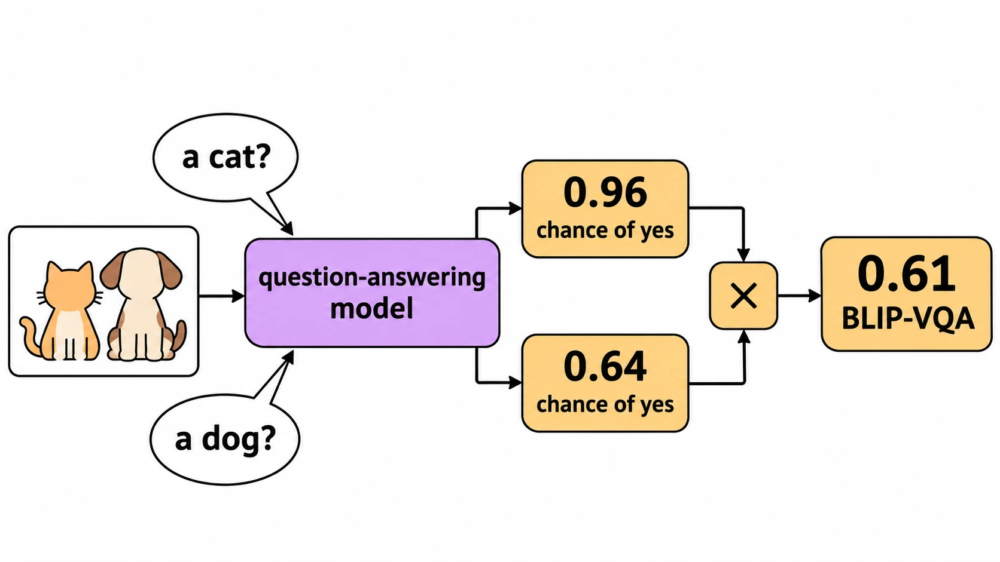
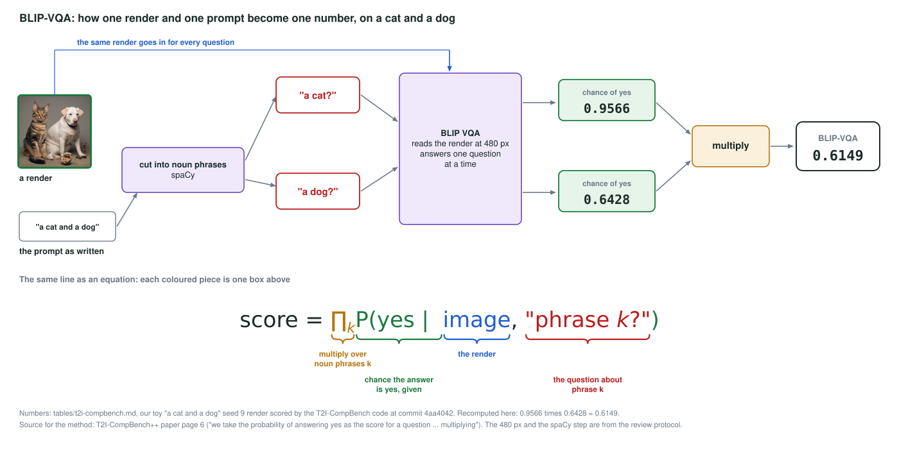

# BLIP-VQA

Up: [[Evaluating Text-To-Image Models]] · ⬅️ [[ImageReward]] · [[GenEval]] ➡️

Artificial Intelligence, Generative Modeling. Needs: [[Visual Question Answering]] for the model that answers, [[Noun Phrase]] for how the prompt is cut, [[Probability]] for multiplying chances.

**BLIP-VQA asks a question-answering model one yes or no question per thing the prompt names and multiplies the chances of yes, giving one number between 0 and 1.**

> [!question]- Test yourself
> No quiz page covers this folder yet. It is waiting to be built.

> [!warning]- Unfinished
> - No sandbox was built: scoring needs BLIP's VQA checkpoint and spaCy's `en_core_web_sm`, which were not downloaded for this note. Every number comes from the journey's runs.
> - The deep-dive sheet picture is not drawn. The form picture (a storyboard) and the mechanism picture (a code-drawn SVG) are filed.
> - No quiz page yet.
> - No claim is marked stated; every claim is cited, derived or shown.

## Table of contents

- [What BLIP-VQA is](#what-blip-vqa-is)
- [How the number is made](#how-the-number-is-made)
- [A good and a bad render](#a-good-and-a-bad-render)
- [What goes in and how to read the number](#what-goes-in-and-how-to-read-the-number)
- [Which T2I-CompBench rows use it](#which-t2i-compbench-rows-use-it)

## What BLIP-VQA is

Navigation: 📋 [TOC](#table-of-contents) | [How the number is made](#how-the-number-is-made) ➡️

**BLIP-VQA** (also the disentangled BLIP-VQA of T2I-CompBench++) cuts the prompt into noun phrases, asks "a cat?" and "a dog?" of one render, and multiplies the chances of yes. It is the scorer behind the paper's verdict, so it is the one to know best.

**What the picture shows.** The model is asked one question per thing in the prompt. Each answer is a chance of yes, and the chances are multiplied.

### Words the name uses

**BLIP.** The model family. The files read give its checkpoint, `model_base_vqa_capfilt_large`, and nothing about what the letters stand for, which is unknown here. The BLIP paper is now on the paper shelf but was not read for this note.

**VQA.** Visual question answering: a model is given an image and a question about it and answers. See [[Visual Question Answering]].

**All the words together.** BLIP used as a visual question answerer, once per noun phrase.

**The consequence.** The yes and no are not counted. Each question gives a chance, and the product of the chances is the number *(cited: T2I-CompBench++ page 6)*.

## How the number is made

Navigation: ⬅️ [What BLIP-VQA is](#what-blip-vqa-is) | 📋 [TOC](#table-of-contents) | [A good and a bad render](#a-good-and-a-bad-render) ➡️

**How to read this.** The picture reads left to right. A language tool, spaCy, cuts the prompt into [[Noun Phrase|noun phrases]]. Each phrase becomes a question and the same render goes to BLIP's question-answering model for every question. The two chances of yes, 0.9566 and 0.6428, multiply to 0.6149. The figure is drawn by `make_blip.py` in the journey's `artifacts/figures/metric-sheets/blip-vqa/` folder. The paper's own sketch is [page 6, Figure 3](/home/molef/goal-setting/learning/papers/deep-learning/diffusion-models/compositional-diffusion-models/benchmarks/t2i-compbench-benchmark-for-compositional-text-to-image-generation.pdf#page=6), which asks "a green bench?" and "a red car?" of one image.

**Colour key.** Orange is each question, blue the render.

$$
\mathrm{score}=\underbrace{\prod_{k}}_{\text{multiply over every noun phrase}}\ \underbrace{P\big(\text{yes}\ \big|\ {\color{#2b6cb0}\text{image}},\ {\color{#dd6b20}\text{"phrase } k\text{?"}}\big)}_{\text{the chance BLIP answers yes}}
$$

**What the equation says.** For each noun phrase k in the prompt, take the chance that BLIP answers yes to "phrase k?" about this image, and multiply all of them. The paper states the rule on page 6: the probability of answering yes is the score for a question, and the question scores are multiplied *(cited: T2I-CompBench++ page 6)*.

**Why the product is there.** One low chance drags the product down, so a render missing one thing scores near zero. On the journey's toy: the fused animal answers "a cat?" with 0.0332 and "a dog?" with 0.4207, and the product is 0.0140. The clear pair answers 0.9566 and 0.6428, and the product is 0.6149. *(shown: toy renders scored with the T2I-CompBench code at commit `4aa4042`)*

**Why mid values are normal.** Two good chances give a lower number than either: two chances of 0.8 give 0.64. *(derived: 0.8 times 0.8)*

## A good and a bad render

Navigation: ⬅️ [How the number is made](#how-the-number-is-made) | 📋 [TOC](#table-of-contents) | [What goes in and how to read the number](#what-goes-in-and-how-to-read-the-number) ➡️

<table>
<tr><th>Render</th><th>"a cat?"</th><th>"a dog?"</th><th>BLIP-VQA</th></tr>
<tr><td>fused animal (toy)</td><td>0.0332</td><td>0.4207</td><td>0.0140</td></tr>
<tr style="background:#fff8dc"><td><b>clear cat and dog (toy)</b></td><td>0.9566</td><td>0.6428</td><td><b>0.6149</b></td></tr>
<tr><td>mug and wine glass, two-object render</td><td colspan="2">not held per question</td><td>0.3641</td></tr>
<tr><td>mug and wine glass, render with no mug</td><td colspan="2">not held per question</td><td>0.0044</td></tr>
</table>

**How to read this table.** Each row is one render. The probe file holds only the product, so the mug pair is not shown question by question.

**What to look for.** The two-object render scores 0.3641 and the render with no mug 0.0044. A product near 0 means the model is nearly sure at least one thing is missing.

## What goes in and how to read the number

Navigation: ⬅️ [A good and a bad render](#a-good-and-a-bad-render) | 📋 [TOC](#table-of-contents) | [Which T2I-CompBench rows use it](#which-t2i-compbench-rows-use-it) ➡️

**The image.** The render, which BLIP reads at 480 pixels *(cited: protocol)*.

**The text.** The prompt is cut into noun phrases by spaCy and each phrase becomes a question. The benchmark prompts name two things, "{a} and {b}" or "{a} with {b}". In the colour and shape sets the question carries the attribute: "a red flower?".

**Conditioning.** Yes. The number is the chance of yes given the image and that one question. The paper asks one object and attribute pair per question so the model is not confused by a long prompt *(cited: page 6)*. The questions do not see each other.

**What it looks at.** One named thing at a time, and its colour or shape if the question names one. It draws no boxes and does not count.

| Reading | What the files give | Example |
|---|---|---|
| Bad | near 0 | the render with no mug, 0.0044; the fused animal, 0.0140; plain [[Product Of Experts]] on the animals set, 0.23 |
| Good | at or near the reference render for that prompt set | the joint prompt: 0.71 on animals, 0.88 on animals with objects, 0.48 on objects; on T2I-CompBench colour the paper's best models reach 0.78 and 0.81 *(cited: page 12)* |
| Ideal | 1.0, which needs certainty of yes on every question; no row reaches it | the highest value in our files is 0.88; even a clean dog got only 0.64 in the toy |
| A pass mark | none in any file read | not available |

**The rule that follows.** The same reference scores 0.48 to 0.88 depending on the prompt set, so a number has no meaning without a reference for the same prompts. Read a gap between two methods as a [[Paired Difference]], which is what the verdict does. CO3 notes the scorer can be unreliable on rare concepts *(cited: CO3 page 6)*.

**What it misses.** It asks whether a thing is there, so a fused animal still answers 0.4207 on "a dog?". *(shown: the toy table)*

**One model everywhere.** The same commit, models and environment for every row, on the RTX 3090 `bigbatch` nodes. See [[Comparing Methods Fairly]].

## Which T2I-CompBench rows use it

Navigation: ⬅️ [What goes in and how to read the number](#what-goes-in-and-how-to-read-the-number) | 📋 [TOC](#table-of-contents)

**Colour, shape and texture are scored by this same BLIP-VQA** *(cited: T2I-CompBench++ page 6)*. So "T2I-CompBench colour" and "T2I-CompBench shape" are BLIP-VQA on a colour prompt set and a shape prompt set, and nothing else changes. The other sub-categories use other scorers: see [[T2I-CompBench]].

**Prompts in those sets.** 1,000 prompts each; 800 follow the template "a {adj} {noun} and a {adj} {noun}", such as "a red flower and a yellow vase", and 200 are natural sentences such as "a room with blue curtains and a yellow chair" *(cited: page 4)*. The paper's models run from 0.38 (Stable Diffusion v1.4) to 0.81 (Stable Diffusion 3) on colour and from 0.36 to 0.62 on shape *(cited: Table XIII, page 12)*.

**Other ways.** [[CLIP Score]] looks at the whole picture once. [[GenEval]] checks boxes.

**Why this matters.** This is the number the paper's verdict is read from, so the way it multiplies and what it cannot see decide how far a verdict can be trusted.

**Taught in.**

- [Journey chapter 3, BLIP-VQA with T2I-CompBench colour and shape](/home/molef/goal-setting/learning/deep-learning/diffusion-models/12-scoring-and-rival-methods/textbook/03-blip-vqa.md#how-the-number-is-made), deep-learning/diffusion-models, plan folder 12: the questions, the product, the toy pair and the ruler.
- [Journey plan 3, run BLIP-VQA and read its yes score](/home/molef/goal-setting/learning/deep-learning/diffusion-models/12-scoring-and-rival-methods/plans/03-blip-vqa-asking-a-question-per-phrase.md): the sitting that runs it.
- The T2I-CompBench++ paper, [page 6](/home/molef/goal-setting/learning/papers/deep-learning/diffusion-models/compositional-diffusion-models/benchmarks/t2i-compbench-benchmark-for-compositional-text-to-image-generation.pdf#page=6).

**Applied in.** The research project's tables R1, R3 and R5 carry this column, and it carries R1's verdict: the paired difference of ours minus plain PoE on this score, with a 95% interval. In words only; the verdict is written to its own file.

> [!note]- How this was checked
> Every number and claim was copied from `textbook/03-blip-vqa.md`, `textbook/05-the-four-side-by-side.md` and `sources/metric-answer-sheets/facts.md` in the journey on 2026-11-12, and nothing was run. The two figures are copies of the journey's own.
