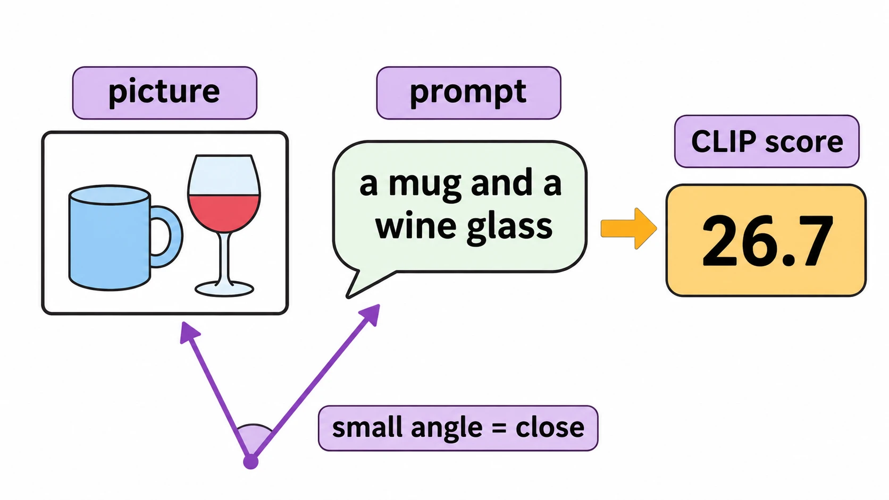
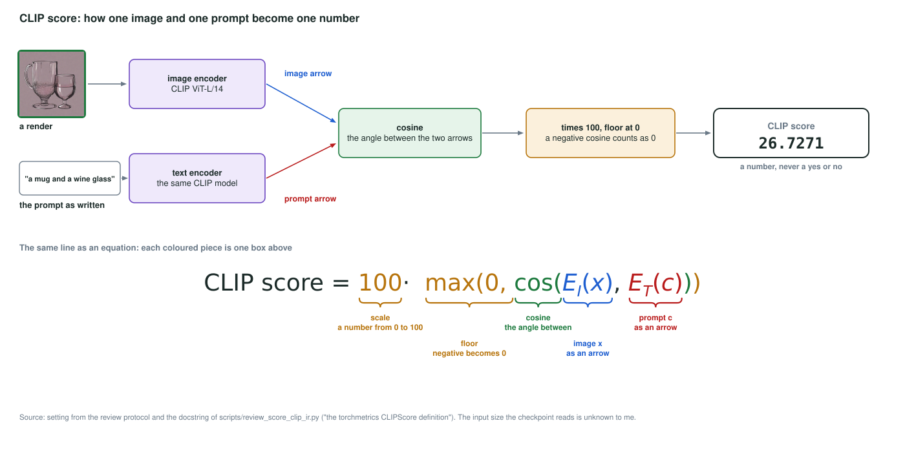

# CLIP Score

Up: [[Evaluating Text-To-Image Models]] · [[ImageReward]] ➡️

Artificial Intelligence, Generative Modeling. Needs: [[Contrastive Image-Text Training]] for the CLIP model, [[Embedding]] and [[Cosine Similarity]] for the arrows and the angle.

**CLIP score turns one image and one prompt into one number, the angle between their two CLIP arrows scaled to run from 0 to 100, and it never answers yes or no.**

> [!question]- Test yourself
> No quiz page covers this folder yet. It is waiting to be built (see the unfinished box).

> [!warning]- Unfinished
> - No sandbox was built: the score needs the CLIP checkpoint `openai/clip-vit-large-patch14` and no model weights were downloaded for this note. Every number below comes from the journey's probe run, not from a run made here.
> - The deep-dive sheet picture is not drawn. The form picture (a storyboard) and the mechanism picture (a code-drawn SVG) are filed.
> - No quiz page yet.
> - No claim is marked stated; every claim is cited, derived or shown.

## Table of contents

- [What CLIP score is](#what-clip-score-is)
- [How the number is made](#how-the-number-is-made)
- [A good and a bad render](#a-good-and-a-bad-render)
- [What goes in and how to read the number](#what-goes-in-and-how-to-read-the-number)
- [What it misses](#what-it-misses)

## What CLIP score is

Navigation: 📋 [TOC](#table-of-contents) | [How the number is made](#how-the-number-is-made) ➡️

**CLIP score** (also CLIPScore, the torchmetrics CLIPScore) is the cosine between the image's CLIP arrow and the prompt's CLIP arrow, times 100, floored at 0.

**What the picture shows.** The picture and the prompt each become an arrow, and the score is how small the angle between the two arrows is. A single model, CLIP, makes both arrows *(cited: journey chapter 1)*.

**Why you reach for it.** You have a render and the sentence it was made from, and you want one number for how close they land. Without a number you compare renders by eye.

### Words the name uses

**Score.** The output is one number, never a pass or fail. Higher means the picture lands closer to the prompt in CLIP's shared space *(cited: facts table, section 1)*.

**CLIP.** The model that makes both arrows. What its letters stand for is not given in the files this note was built from, so it is unknown here. Its training idea is in [[Contrastive Image-Text Training]].

**All the words together.** "CLIP score" means the CLIP model's picture arrow and prompt arrow, compared by angle, as a score. The formula below is that sentence.

**The consequence.** Because the two arrows come from separate encoders, the prompt cannot tell the model where to look in the picture. They meet only at the end *(cited: journey chapter 1)*.

Textbook: [Linear algebra textbook, the cosine, p. 159](../../../Mathematics/references/textbooks/linear-algebra/linear-algebra-textbook.pdf#page=159)

## How the number is made

Navigation: ⬅️ [What CLIP score is](#what-clip-score-is) | 📋 [TOC](#table-of-contents) | [A good and a bad render](#a-good-and-a-bad-render) ➡️

**How to read this.** The picture reads left to right. The render goes through CLIP's image [[Encoder-Decoder|encoder]] and the prompt through its text encoder. One point on the right is the final number, 26.7271 for the two-object render below. The figure is drawn by `make_clip.py` in the journey's `artifacts/figures/metric-sheets/clip-score/` folder.

**Colour key.** Blue is the image arrow, green is the prompt arrow.

$$
\mathrm{CLIP\ score}=\underbrace{100}_{\text{scale}}\cdot\max\Big(\underbrace{0}_{\text{floor}},\ \underbrace{\cos\big({\color{#2b6cb0}E_I(x)},\,{\color{#2f855a}E_T(c)}\big)}_{\text{how close the two arrows point}}\Big)
$$

**What the equation says.** Take the image x as an arrow and the prompt c as an arrow, and measure the cosine of the angle between them. Scale it by 100 and replace a negative value with 0. *(cited: the definition the review protocol names, "the torchmetrics CLIPScore definition", in the docstring of `scripts/review_score_clip_ir.py`)*

**Why the 100 is there.** It makes the number run from 0 to 100. On the two-object render the cosine is 0.267271 and the score is 26.7271, so without the 100 the number would sit on a 0 to 1 ruler. *(derived: 26.7271 divided by 100)*

**Why the floor is there.** A negative cosine means the arrows point away from each other, and the floor counts it as 0, so the score never goes below 0. No negative case appears in the files read.

**Why the cosine is there.** It is 1 when the arrows point the same way and compares direction, not length. See [[Cosine Similarity]] and [[Dot Product]].

**What the original paper does not say.** The CLIP paper does not score generated images. Using the picture-to-prompt cosine as a score for a render is a later use *(cited: journey paper reading, CLIP)*. The original CLIPScore paper is not on the shelf, so how its weight compares with 100 is unknown.

## A good and a bad render

Navigation: ⬅️ [How the number is made](#how-the-number-is-made) | 📋 [TOC](#table-of-contents) | [What goes in and how to read the number](#what-goes-in-and-how-to-read-the-number) ➡️

**One probe pair, scored at the protocol's own settings.** The prompt is "a mug and a wine glass", seed 11. The two renders are in the journey's probe folder as `mono.png` and `poe.png`; GenEval's boxes on those files confirm which is which.

<table>
<tr><th>Render</th><th>CLIP score</th><th>ImageReward</th><th>BLIP-VQA</th><th>GenEval two-object</th></tr>
<tr style="background:#fff8dc"><td><b>two-object render</b> (<code>mono.png</code>)</td><td><b>26.7271</b></td><td>+0.5668</td><td>0.3641</td><td>pass</td></tr>
<tr><td>render with no mug (<code>poe.png</code>)</td><td>23.5954</td><td>-2.2534</td><td>0.0044</td><td>fail</td></tr>
</table>

**How to read this table.** Each row is one render, each column one scorer. The CLIP score column is the one this note explains. The other three are in [[ImageReward]], [[BLIP-VQA]] and [[GenEval]].

**What to look for.** The render with both objects scores 26.7271 and the render with no mug 23.5954, a gap of 3.1317 points. Higher means closer to the prompt. *(derived: 26.7271 minus 23.5954; the numbers are the repository's probe values, `probe_clip_ir.csv`)*

## What goes in and how to read the number

Navigation: ⬅️ [A good and a bad render](#a-good-and-a-bad-render) | 📋 [TOC](#table-of-contents) | [What it misses](#what-it-misses) ➡️

**The image.** The render made by the method under test, 1024 pixels from SDXL and 512 pixels from SD 1.5 in the benchmark. The size CLIP reads is not stated in any file read, so it is unknown.

**The text.** The full prompt as one string, not split into parts. In the benchmark the prompts are short lists of two things, "{a} and {b}" or "{a} with {b}".

**Conditioning.** None. The image and the text go through separate encoders and never see each other.

**What it looks at.** The whole picture, as one arrow. It has no boxes and no per-object check. The CLIP paper lists counting as a weakness *(cited: CLIP paper page 19)*.

| Reading | What the files give | Example |
|---|---|---|
| Bad | the bottom of what our renders reach, and below the reference for the same prompts | plain [[Product Of Experts]] on the animals set, 21.6, against the joint prompt's 27.0; the render with no mug, 23.6 |
| Good | at or near the reference render for that prompt set | the joint prompt: 27.0 on animals, 30.0 on animals with objects, 31.1 on objects |
| Ideal | 100, which needs the two arrows to point exactly the same way; the highest number in our files is 31.1 | no file read gives the cosine of a perfect match |
| A cut-off for good | none in any file read | not available |

**Is 0.25 good or bad.** A cosine of 0.25 is 25 on this scale. That sits inside the 21.6 to 31.1 band that all the journey's benchmark renders fall in, below the reference's 27.0 on the animals set and above the render with no mug. It is a render that lost something against its prompt, and no number says how much without the same prompt's reference beside it. *(derived from the journey's chapter 1)*

**A second grounding.** The ImageReward paper's Table 1 lists a CLIP score for each of six models, averaging 0.2044 to 0.2763 on the raw cosine scale *(cited: ImageReward paper page 4)*. The same table ranks Stable Diffusion 1.4 first by CLIP score although people ranked it fourth, so the number can disagree with human preference *(cited: ImageReward paper page 4)*. Which CLIP model that column uses is unknown.

**The rule that follows.** Read the number only against another render of the same prompt. In the GenEval paper the six models' CLIPScore runs from 27.3 to 36.7 with a different CLIP model, OpenCLIP ViT-H/14, which puts our band in the same range without making the two comparable *(cited: GenEval paper page 8)*.

**Who uses it.** T2I-CompBench++ uses CLIPScore for the non-spatial relationships *(cited: page 7)*, see [[T2I-CompBench]]. The GenEval paper uses it as its baseline, the ImageReward paper compares against it, and CO3 does not report it.

**One checkpoint everywhere.** The protocol runs one checkpoint and one code path for every row, on CPU. See [[Comparing Methods Fairly]].

## What it misses

Navigation: ⬅️ [What goes in and how to read the number](#what-goes-in-and-how-to-read-the-number) | 📋 [TOC](#table-of-contents)

**It cannot count.** The CLIP paper names counting among its weak tasks *(cited: page 19)*. In the journey's earlier toy run on "a cat and a dog" with the smaller ViT-B/32 model, the fused animal scored 0.2720 on "a dog" against 0.2294 and 0.2304 for the two clear renders, so a fused animal outscored a clear pair. Those toy numbers are not on the protocol's scale. *(shown: the journey's table file `clip-score.md`)*

**Other ways.** [[ImageReward]] adds the prompt into how the image is read. [[BLIP-VQA]] asks one question per named thing. [[GenEval]] checks object boxes.

**Why this matters.** A number that cannot count rewards a render that looks like both animals in one body. Read it as how close the picture lands to the sentence and nothing more.

**Taught in.**

- [Journey chapter 1, CLIP score](/home/molef/goal-setting/learning/deep-learning/diffusion-models/12-scoring-and-rival-methods/textbook/01-clip-score.md#how-the-number-is-made), deep-learning/diffusion-models, plan folder 12: the arrow picture, the equation, the probe pair and the reading ruler.
- [Journey plan 1, run CLIP score and say what it cannot tell apart](/home/molef/goal-setting/learning/deep-learning/diffusion-models/12-scoring-and-rival-methods/plans/01-clip-score-and-what-it-cannot-tell-apart.md): the sitting that runs it.
- [Chapter 5, the four side by side](/home/molef/goal-setting/learning/deep-learning/diffusion-models/12-scoring-and-rival-methods/textbook/05-the-four-side-by-side.md#side-by-side): where the number sits against the other three.
- The CLIP paper, [page 2](/home/molef/goal-setting/learning/papers/deep-learning/diffusion-models/compositional-diffusion-models/scorers/learning-transferable-visual-models-from-natural-language-supervision.pdf#page=2) and [page 19](/home/molef/goal-setting/learning/papers/deep-learning/diffusion-models/compositional-diffusion-models/scorers/learning-transferable-visual-models-from-natural-language-supervision.pdf#page=19).

**Applied in.** The research project's paper-review tables R1, R3 and R5 carry this column, reported with no verdict because the verdict rests on [[BLIP-VQA]]. Where: the review protocol's "The scorers" section, in words only.

> [!note]- How this was checked
> Every number and claim was copied from `textbook/01-clip-score.md`, `textbook/05-the-four-side-by-side.md`, `sources/metric-answer-sheets/facts.md` and `sources/paper-readings/clip.md` in the journey on 2026-11-12, and nothing was run. The probe values are the repository's. The two figures are copies of the journey's own, drawn by its scripts.
