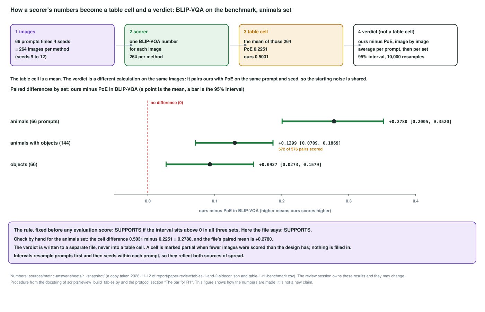

# Comparing Methods Fairly

Up: [[Evaluating Text-To-Image Models]] · ⬅️ [[T2I-CompBench]]

Artificial Intelligence, Generative Modeling. Needs: [[Paired Difference]], [[Bootstrap]] and [[Confidence Interval]] for the verdict, and the four scorers: [[CLIP Score]], [[ImageReward]], [[BLIP-VQA]], [[GenEval]].

**Two methods are compared fairly when the same scorer, the same code version and the same hardware measure both, a cell that differs in more than one axis carries a dagger, and the verdict is a paired difference with an interval, written to its own file.**

> [!question]- Test yourself
> No quiz page covers this folder yet. It is waiting to be built.

> [!warning]- Unfinished
> - No sandbox was built: nothing in this note is a command, and the review protocol itself was not opened, only the journey's chapter that quotes it.
> - The mechanism picture is the journey's code-drawn SVG; the form picture and the deep-dive sheet are not drawn.
> - Why one GPU model per table matters is not given in the chapter, so it is unknown here.
> - No quiz page yet.
> - No claim is marked stated.

## Table of contents

- [The rules](#the-rules)
- [From images to a cell and a verdict](#from-images-to-a-cell-and-a-verdict)
- [The verdict, step by step](#the-verdict-step-by-step)

## The rules

Navigation: 📋 [TOC](#table-of-contents) | [From images to a cell and a verdict](#from-images-to-a-cell-and-a-verdict) ➡️

**A fair comparison** is the protocol the journey's tables follow. Each rule is one line and each one is something a reader can check in the table.

| Rule | What it means in a table | Backing |
|---|---|---|
| One scorer model per column | the same checkpoint and code path for every row of every table: CLIP score, ImageReward, BLIP-VQA and GenEval each use one, the same for every method | cited: chapter 5 and the facts table, "Same model for every row? yes" |
| One code version | the protocol fixes one code version per scorer, such as the T2I-CompBench code at commit `4aa4042`, unchanged | cited: facts table, section 3 |
| One GPU model per table | one kind of GPU measures a whole table, for example the RTX 3090 `bigbatch` nodes for BLIP-VQA | cited: chapter 5 and the facts table |
| A dagger on a mixed comparison | a cell that differs from its comparison in more than one axis carries a dagger | cited: chapter 5 |
| Resolutions kept apart | SDXL rows are 1024 px and Stable Diffusion 1.5 rows are 512 px, kept in separate tables | cited: the mirror's README of measured tables |
| A partial cell is marked | when fewer images were scored than the design has, the cell says so: the animals-with-objects set had 572 of 576 pairs at the time of writing | cited: chapter 5 |
| A verdict is a paired difference, written to its own file | never into a table cell | cited: chapter 5 |

**What a dagger is for.** A comparison is clean when exactly one axis differs between the two rows. If two or more differ, the gap between them cannot be set down to one cause, so the cell is marked and each side is read on its own. *(derived: the dagger rule above)*

**What one scorer for every row is for.** A scorer has no threshold for good, so every number is read against a reference for the same prompts. The same reference scores 27.0 to 31.1 on [[CLIP Score]] and 0.48 to 0.88 on [[BLIP-VQA]] depending on the prompt set. Changing the scorer between rows changes the ruler. *(cited: chapter 5)*

## From images to a cell and a verdict

Navigation: ⬅️ [The rules](#the-rules) | 📋 [TOC](#table-of-contents) | [The verdict, step by step](#the-verdict-step-by-step) ➡️

**How to read this.** The path has four stages. The animals set has 66 prompts, each rendered at 4 seeds, so each method has 264 images. The scorer gives one number per image. A cell is the mean of those numbers. The verdict is a different calculation on the same images. The figure is drawn by `make_comparison.py` in the journey's `artifacts/figures/metric-sheets/comparison/` folder, and shows how the numbers are made, not a new claim.

**The worked cell.** On BLIP-VQA the animals set's cell is 0.2251 for plain [[Product Of Experts]] and 0.5031 for ours *(cited: chapter 5, the review session's result as it stood on 2026-11-12, which may change)*.

## The verdict, step by step

Navigation: ⬅️ [From images to a cell and a verdict](#from-images-to-a-cell-and-a-verdict) | 📋 [TOC](#table-of-contents)

**The calculation.**

1. For each prompt and seed, take ours minus plain PoE, with the starting noise shared.
2. Average over seeds for each prompt.
3. Average over prompts for the set.
4. Put a 95% interval on that average by [[Bootstrap|resampling]] prompts and then seeds, 10,000 times.

*(cited: chapter 5)*

**The rule was fixed before any evaluation score.** The result supports the claim if the interval sits above zero in all three prompt sets. *(cited: chapter 5)*

**The hand check on the animals set.** 0.5031 minus 0.2251 is 0.2780, which is the file's paired mean *(derived: the subtraction; cited: chapter 5)*. The mean of a difference equals the difference of the two cells here because the same prompts and seeds sit under both.

**Why pairing is there.** Each difference is taken on the same prompt and seed with shared starting noise, so what varies between the two numbers is the method. See [[Paired Difference]].

**Why the verdict has its own file.** A cell is one scorer's mean for one method. A verdict is a statement about a difference and carries an interval, so it is kept apart from the table and cannot be adjusted by editing a cell. *(derived from the chapter's rule that the verdict is never written into a cell)*

**Why this matters.** A table of means invites reading a gap as cause and effect. These rules say which gaps may be read that way and where the evidence for it lives.

**Taught in.**

- [Journey chapter 5, the four side by side and from a score to a table cell](/home/molef/goal-setting/learning/deep-learning/diffusion-models/12-scoring-and-rival-methods/textbook/05-the-four-side-by-side.md#from-a-score-to-a-table-cell), deep-learning/diffusion-models, plan folder 12.
- [The textbook index, Words this uses](/home/molef/goal-setting/learning/deep-learning/diffusion-models/12-scoring-and-rival-methods/textbook/00-INDEX.md#words-this-uses): render, prompt, reference render and verdict.
- [Journey plan 12, build one runner and fill the results table](/home/molef/goal-setting/learning/deep-learning/diffusion-models/12-scoring-and-rival-methods/plans/12-one-runner-and-the-results-table.md): the sitting that runs it.

**Applied in.** The research project's paper-review tables R1, R3, R5 and R14: the verdict for R1 is the BLIP-VQA paired difference with a 95% interval, in words only. Its numbers are in the project's review files, not here.

> [!note]- How this was checked
> Every rule and number was copied from `textbook/05-the-four-side-by-side.md`, `textbook/00-INDEX.md` and the facts table in the journey on 2026-11-12, and nothing was run. The results quoted are the review session's as they stood that day. The figure is a copy of the journey's own.
