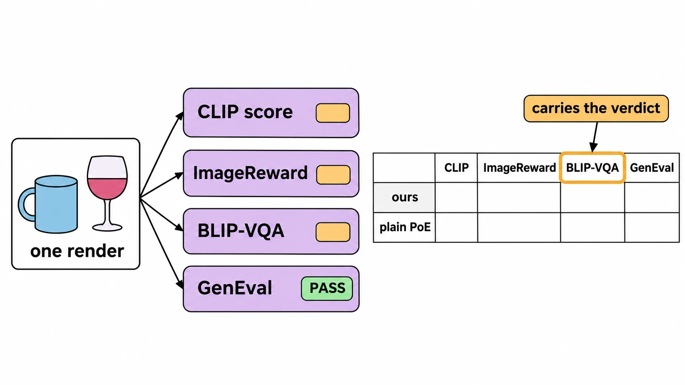
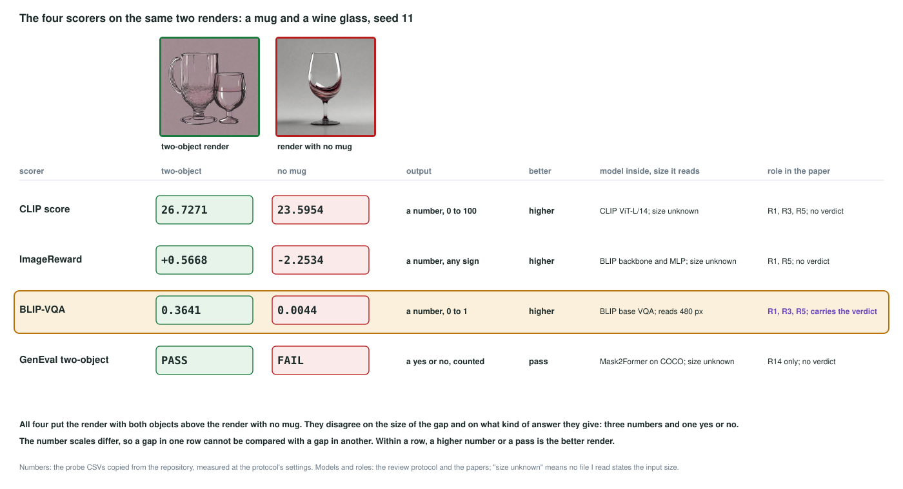

# Evaluating Text-To-Image Models

Up: [[Generative Modeling]]

Artificial Intelligence, Generative Modeling. How a render becomes a number or a pass, and how two methods are set side by side.

**A scorer takes one render and the prompt it was made from and returns a number or a pass, and none of the four here has a threshold for good, so every number is read against a reference render for the same prompts.** One render goes to four scorers: CLIP score, ImageReward and BLIP-VQA give numbers and GenEval gives a pass or a fail. The BLIP-VQA column is the one that carries the project's verdict.

> [!question]- Test yourself
> No quiz page covers this folder yet. It is waiting to be built.

## The notes, in reading order

- [[CLIP Score]]: how close the picture lands to the prompt, the angle between two CLIP arrows scaled to 0 to 100.
- [[ImageReward]]: which picture people would prefer, a number learned from people's rankings.
- [[BLIP-VQA]]: one yes or no question per named thing, with the chances of yes multiplied; the scorer behind the verdict.
- [[GenEval]]: did a detector find the named objects, with six tasks and a pass or fail per image.
- [[T2I-CompBench]]: eight sub-categories of 1,000 prompts and which scorer measures each.
- [[Comparing Methods Fairly]]: the same scorer, code and hardware, a dagger on a mixed comparison, and a verdict that is a paired difference with an interval.

## The four on the same two renders

**How to read this.** The same two renders, a mug and a wine glass at seed 11, go through all four scorers at the protocol's settings. All four put the render with both objects above the render with no mug. The scales differ, so a gap in one row cannot be set against a gap in another. Within one row, higher or a pass is the better render. *(cited: journey chapter 5)*

## Words this uses

**Render.** One image made by a method for one prompt and one seed, see [[Comparing Methods Fairly#From images to a cell and a verdict|from images to a cell]].

**Prompt.** The text the render was made from, such as "a mug and a wine glass".

**Reference render.** The render made from the full prompt written as one sentence, the joint prompt. The numbers are read against it, since no scorer has a threshold for good.

**Verdict.** The paired difference between ours and plain [[Product Of Experts]] on BLIP-VQA, with a 95% interval, fixed before any evaluation score and written to its own file, see [[Paired Difference]].

**Concepts the notes lean on.** [[Contrastive Image-Text Training]], [[Vision Transformer]], [[Multilayer Perceptron]], [[Visual Question Answering]], [[Noun Phrase]], [[Object Detector]], [[Preference Ranking]], [[Benchmark]], [[Zero-Shot]].

**Taught in.** The journey's [textbook index](/home/molef/goal-setting/learning/deep-learning/diffusion-models/12-scoring-and-rival-methods/textbook/00-INDEX.md), deep-learning/diffusion-models, plan folder 12, holds the five chapters these notes were filed from. Its measured tables and runner stay in the journey's mirror folder, whose [README](/home/molef/Obsidian/deep-learning/12-scoring-and-rival-methods/README.md) points here.
