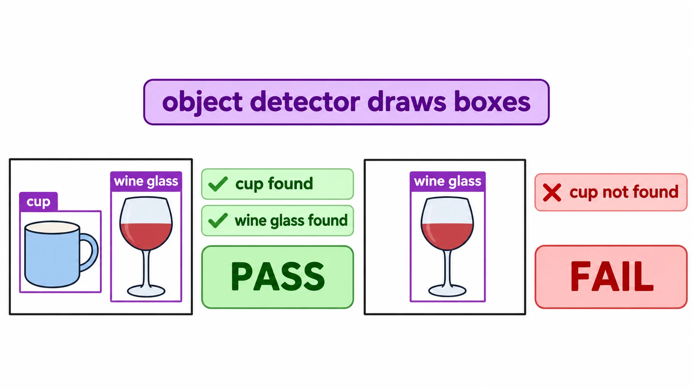
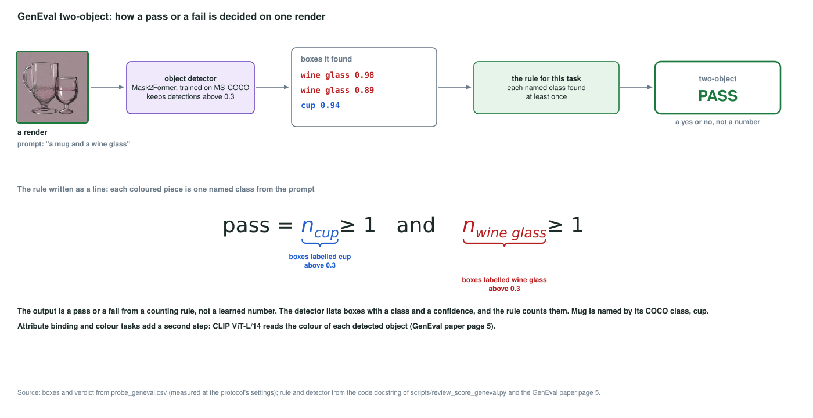
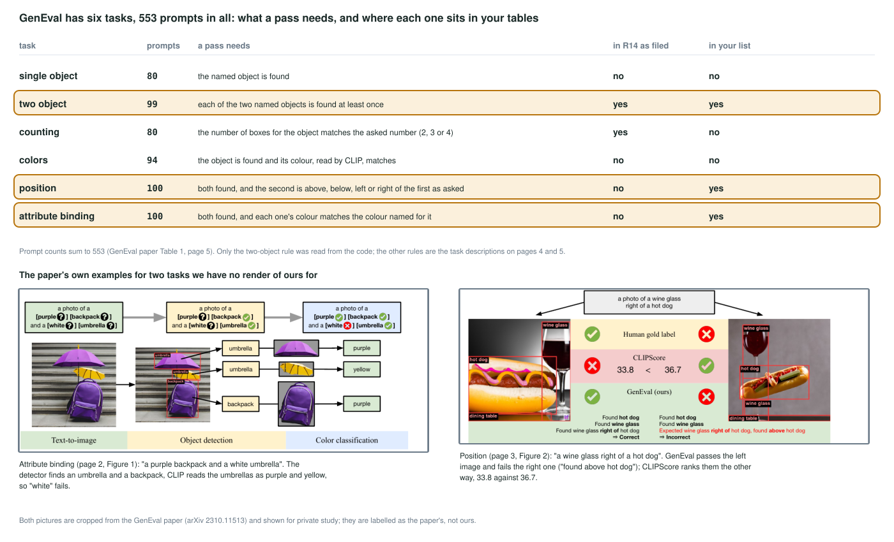

# GenEval

Up: [[Evaluating Text-To-Image Models]] · ⬅️ [[BLIP-VQA]] · [[T2I-CompBench]] ➡️

Artificial Intelligence, Generative Modeling. Needs: [[Object Detector]] for the boxes and Mask2Former, [[Benchmark]] for what a task set is, [[Zero-Shot]] for the colour step.

**GenEval checks a render against its prompt with an object detector and a rule per task, and returns pass or fail per image, so its results are counted, not averaged.**

> [!question]- Test yourself
> No quiz page covers this folder yet. It is waiting to be built.

> [!warning]- Unfinished
> - No sandbox was built: GenEval's evaluator needs a Mask2Former checkpoint and CLIP ViT-L/14, not downloaded for this note. Every number comes from the journey's probe run and the paper.
> - The deep-dive sheet picture is not drawn. The form picture (a storyboard) and the mechanism pictures (code-drawn SVGs) are filed.
> - No quiz page yet.
> - 1 claim is marked stated and keeps nothing unfinished.

## Table of contents

- [What GenEval is](#what-geneval-is)
- [How a pass is decided](#how-a-pass-is-decided)
- [A pass and a fail](#a-pass-and-a-fail)
- [The six tasks](#the-six-tasks)
- [What goes in and how to read the number](#what-goes-in-and-how-to-read-the-number)

## What GenEval is

Navigation: 📋 [TOC](#table-of-contents) | [How a pass is decided](#how-a-pass-is-decided) ➡️

**GenEval** (also the GenEval benchmark) lists the objects an [[Object Detector]] finds in a render, each with a class name, a box and a confidence, and a rule compares that list with what the prompt asked for. It is the only one of the four scorers here whose output is a yes or no per image.

**What the picture shows.** The detector draws a box round each object it finds. The rule checks the boxes against what the prompt named, and the answer is pass or fail.

### Words the name uses

**Gen.** Short for generated, the images being judged *(stated: the name read in its plain sense; the files do not take it apart)*. **Eval.** Evaluation: the framework checks them. The paper's own title is "an object-focused framework for evaluating text-to-image alignment".

**All the words together.** An evaluation of generated images, built round objects.

**The consequence.** A pass means the named classes were found, not that the picture is good *(shown: below)*.

## How a pass is decided

Navigation: ⬅️ [What GenEval is](#what-geneval-is) | 📋 [TOC](#table-of-contents) | [A pass and a fail](#a-pass-and-a-fail) ➡️

**How to read this.** The picture reads left to right: a render, the detector's boxes with class and confidence, the rule, and PASS. The figure is drawn by `make_geneval.py` in the journey's `artifacts/figures/metric-sheets/geneval/` folder. The paper's own picture of the chain, for an umbrella and a backpack, is [page 2, Figure 1](/home/molef/goal-setting/learning/papers/deep-learning/diffusion-models/compositional-diffusion-models/benchmarks/geneval-object-focused-framework-for-evaluating-text-to-image-alignment.pdf#page=2).

**The detector.** A Mask2Former trained on MS-COCO, from the MMDetection toolbox. The repository keeps detections above 0.3 confidence, and the paper uses 0.9 for counting *(cited: paper page 5; code docstring)*. A mug is named by its COCO class, cup.

**The colour step.** The colour tasks add a second step: CLIP ViT-L/14 classifies the colour of each detected object *(cited: paper page 5)*, with no training on the task, see [[Zero-Shot]].

$$
\mathrm{pass}=\underbrace{n(\text{cup})\ \ge\ 1}_{\text{first named class found}}\ \ \text{and}\ \ \underbrace{n(\text{wine glass})\ \ge\ 1}_{\text{second named class found}}
$$

**What the rule says.** n(class) is the number of boxes the detector gave that class above the confidence cutoff, and the render passes if every named class has at least one. There is no learned number on top of the detector, so there is no equation for a score. *(cited: code docstring)*

**Why the "at least 1" is there.** It asks only whether each class is present, so two cups and one wine glass still pass. Counting is a different task, see below.

## A pass and a fail

Navigation: ⬅️ [How a pass is decided](#how-a-pass-is-decided) | 📋 [TOC](#table-of-contents) | [The six tasks](#the-six-tasks) ➡️

<table>
<tr><th>Render, "a mug and a wine glass", seed 11</th><th>Boxes found</th><th>Verdict</th></tr>
<tr style="background:#e6ffed"><td><b>two-object render</b></td><td>cup 0.94, wine glass 0.98, wine glass 0.89</td><td><b>pass</b></td></tr>
<tr><td>render with no mug</td><td>wine glass 0.98</td><td>fail: "expected cup at least 1, found 0"</td></tr>
</table>

**How to read this table.** Each row is one render. The confidence is the detector's, between 0 and 1. *(shown: `probe_geneval.csv`, copied from the repository)*

**What to look for.** The mug carries two boxes at the same place, cup 0.94 and wine glass 0.89. One object can hold two labels, and the verdict hides it. In the journey's toy run a fused animal also passed because one animal got both a cat box and a dog box.

## The six tasks

Navigation: ⬅️ [A pass and a fail](#a-pass-and-a-fail) | 📋 [TOC](#table-of-contents) | [What goes in and how to read the number](#what-goes-in-and-how-to-read-the-number) ➡️

GenEval has six tasks and 553 prompts *(cited: Table 1, page 5)*.

| Task | Prompts | What it checks |
|---|---|---|
| single object | 80 | one named class is found |
| two object | 99 | each of two named classes is found at least once (the rule above, read from the code) |
| counting | 80 | 2, 3 or 4 of one object |
| colors | 94 | the colour of each detected object, read by CLIP |
| position | 100 | two objects and one of above, below, left of or right of |
| attribute binding | 100 | both objects found and each object's colour matches its own |

**What is read from code and what is not.** Only the two-object rule was read from the code. The other rows come from the task descriptions on pages 4 and 5, so check them against the evaluator before quoting them. *(cited: paper pages 4 and 5)*

**The paper's own examples.** The learner's renders have none for attribute binding or position, so the figure shows the paper's. For a purple backpack and a white umbrella the detector finds both objects, CLIP reads the umbrellas as purple and yellow, and the white one fails. For "a wine glass right of a hot dog" GenEval passes the picture with the glass on the right and fails the one where it is above, while CLIPScore ranks them the other way, 33.8 against 36.7 *(cited: paper pages 2 and 3)*. See [[CLIP Score]].

**Prompts.** They are templates over MS-COCO object names, such as "a photo of a/an [OBJECT A] and a/an [OBJECT B]" for two-object, with 11 basic colour terms. The detector never sees the sentence; the harness reads classes, colours, counts and positions out of it. A concept with no COCO class cannot be judged, so each benchmark concept is mapped by hand: a mug is a cup. *(cited: paper page 5)*

## What goes in and how to read the number

Navigation: ⬅️ [The six tasks](#the-six-tasks) | 📋 [TOC](#table-of-contents)

**The image.** The render. The size the detector reads is not stated in any file read, so it is unknown.

**Conditioning.** None inside the detector. The prompt only decides what the rule checks afterwards.

**How to read a number.** One image gets a pass or a fail. A task score is the share of that task's prompts that passed *(cited: paper Table 2, page 8)*. How the six tasks combine into one overall number is unknown here.

| Reading | What the files give | Example |
|---|---|---|
| Bad | at the floor of the six systems on that task | position 0.02 to 0.04 for minDALL-E, the real photos and SD v1.5; attribute binding 0.00 to 0.01 for the real photos and minDALL-E |
| Good | the best of the six on that task | two object 0.74 (SD-XL and IF-XL), counting 0.66 (IF-XL), position 0.15 (SD-XL), attribute binding 0.35 (IF-XL) |
| Ideal | 1.0, a pass on every prompt; only single object comes near it (0.97 to 0.98 for the modern models) | on the harder tasks even the best system is far from it |
| A pass mark | none in any file read | not available |

**What the ruler tells you.** Single object does not separate the models. Position and attribute binding are low for every system. Real photos retrieved from LAION score 0.22 on two-object and 0.00 on attribute binding, so the prompts or the detector are demanding even for real photographs, and which is the cause is unknown. *(cited: paper page 8)*

**Agreement with people.** In the paper's own study it agrees with human annotators 83% of the time overall and 91% on the images where annotators agree unanimously, against CLIPScore's 87% on those same images *(cited: paper pages 2 and 7)*.

**What it misses.** It is only as good as the detector and its COCO classes *(cited: page 9)*. Holes in objects mislead the colour step, overlapping same-type objects merge, and clip art is out of distribution *(cited: page 7)*. In the journey's toy runs it passed a fused animal with two boxes, passed a render with no dog, failed a cartoon dog, and failed a white dog's pink paws. *(shown: the journey's GenEval table file)*

**Other ways.** [[BLIP-VQA]] gives a number per image instead of a count. See [[Comparing Methods Fairly]] for how a share becomes a cell.

**Why this matters.** It is the only scorer here that gives a count, so a cell is a fraction of images that passed, but a pass is not proof that both objects are really there.

**Taught in.**

- [Journey chapter 4, GenEval](/home/molef/goal-setting/learning/deep-learning/diffusion-models/12-scoring-and-rival-methods/textbook/04-geneval.md#how-a-pass-is-decided), deep-learning/diffusion-models, plan folder 12: the detector, the rule, the six tasks and the ruler.
- [Journey plan 5, run GenEval and read pass or fail per object](/home/molef/goal-setting/learning/deep-learning/diffusion-models/12-scoring-and-rival-methods/plans/05-geneval-a-detector-checks-the-objects.md): the sitting that runs it.
- The GenEval paper, [page 5](/home/molef/goal-setting/learning/papers/deep-learning/diffusion-models/compositional-diffusion-models/benchmarks/geneval-object-focused-framework-for-evaluating-text-to-image-alignment.pdf#page=5) and [page 7](/home/molef/goal-setting/learning/papers/deep-learning/diffusion-models/compositional-diffusion-models/benchmarks/geneval-object-focused-framework-for-evaluating-text-to-image-alignment.pdf#page=7).

**Applied in.** The research project's appendix table R14 only, on GenEval's own prompts, reporting passes with no verdict. In words only.

> [!note]- How this was checked
> Every number and claim was copied from `textbook/04-geneval.md`, `textbook/05-the-four-side-by-side.md`, `sources/metric-answer-sheets/facts.md` and `sources/paper-readings/geneval.md` in the journey on 2026-11-12, and nothing was run. One claim is stated: the plain reading of "Gen", marked where it sits. The three figures are copies of the journey's own.
