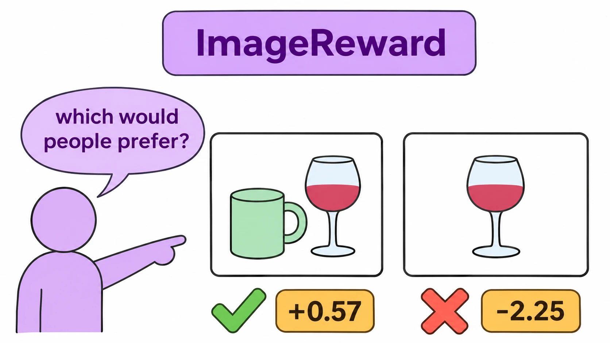
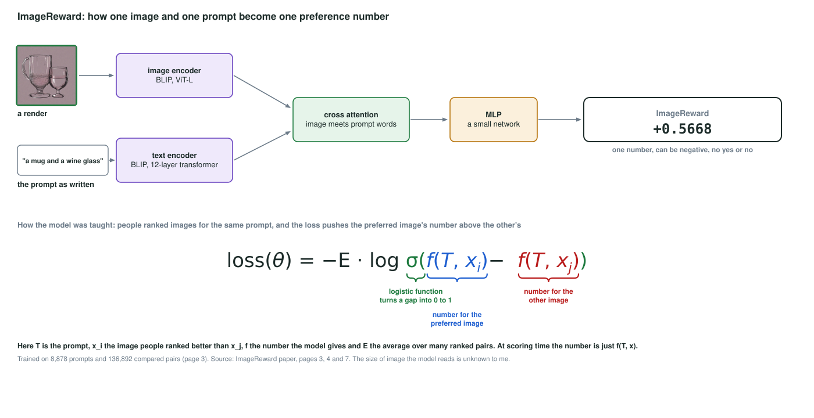

# ImageReward

Up: [[Evaluating Text-To-Image Models]] · ⬅️ [[CLIP Score]] · [[BLIP-VQA]] ➡️

Artificial Intelligence, Generative Modeling. Needs: [[Preference Ranking]] for how it was taught, [[Cross-Attention]] and [[Multilayer Perceptron]] for how the number is made, [[Contrastive Image-Text Training]] for the CLIP number it is compared with.

**ImageReward is a model trained on people's rankings of images, so its one number for an image and a prompt is a prediction of how much a person would prefer that image.**

> [!question]- Test yourself
> No quiz page covers this folder yet. It is waiting to be built.

> [!warning]- Unfinished
> - No sandbox was built: scoring needs the `ImageReward-v1.0` weights, which were not downloaded for this note. Every number comes from the journey's probe run.
> - The deep-dive sheet picture is not drawn. The form picture (a storyboard) and the mechanism picture (a code-drawn SVG) are filed.
> - No quiz page yet.
> - 1 claim is marked stated and keeps nothing unfinished.

## Table of contents

- [What ImageReward is](#what-imagereward-is)
- [How the number is made](#how-the-number-is-made)
- [How it was taught](#how-it-was-taught)
- [A good and a bad render](#a-good-and-a-bad-render)
- [What goes in and how to read the number](#what-goes-in-and-how-to-read-the-number)

## What ImageReward is

Navigation: 📋 [TOC](#table-of-contents) | [How the number is made](#how-the-number-is-made) ➡️

**ImageReward** (version `ImageReward-v1.0`) gives an image and a prompt one number for how much a person would prefer that image for that prompt, and never answers yes or no.

**What the picture shows.** ImageReward stands in for a person choosing between two pictures made for the same prompt, and the better pick gets the higher number.

### Words the name uses

**Image.** What is scored: the render. **Reward.** The word for the number the model gives, in the sense a person's pick rewards the image they preferred *(stated: the name read in its plain English sense; the files do not take the name apart)*.

**All the words together.** A reward for an image, given by a model that learned what people pick.

**The consequence.** The number blends what the annotators rated, so a change in it cannot be assigned to one cause, see below.

## How the number is made

Navigation: ⬅️ [What ImageReward is](#what-imagereward-is) | 📋 [TOC](#table-of-contents) | [How it was taught](#how-it-was-taught) ➡️

**How to read this.** The picture reads left to right: a render and a prompt in, one number out. The render goes through BLIP's image [[Encoder-Decoder|encoder]], so the image features can look at the prompt's words by [[Cross-Attention]], and a small network, an [[Multilayer Perceptron|MLP]], turns the result into one number *(cited: ImageReward paper pages 4 and 7)*. The figure is drawn by `make_ir.py` in the journey's `artifacts/figures/metric-sheets/imagereward/` folder. The paper's own overview is [page 3, Figure 2](/home/molef/goal-setting/learning/papers/deep-learning/diffusion-models/compositional-diffusion-models/scorers/imagereward-human-preferences-for-text-to-image-generation.pdf#page=3).

**Conditioning.** Yes, and this separates it from [[CLIP Score]]. The prompt steers how the image is read, because the two are combined by cross-attention before the number is produced. CLIP score lets them meet only at the end *(cited: paper page 4)*.

**What it looks at.** The annotators who taught it rated three things per image and then ranked: how well the picture matches the prompt, how well made it looks, and whether it is harmful *(cited: paper page 3)*. The model learned from those rankings, so its number blends all three.

## How it was taught

Navigation: ⬅️ [How the number is made](#how-the-number-is-made) | 📋 [TOC](#table-of-contents) | [A good and a bad render](#a-good-and-a-bad-render) ➡️

**People ranked several images made for the same prompt.** The paper collected 136,892 compared pairs over 8,878 prompts *(cited: paper page 3)*. Training pushes the number for the image people ranked higher above the number for the other image. That rule is the [[Preference Ranking#The ranked-pairs loss|ranked-pairs loss]].

**Colour key.** Green is the preferred image, red the other.

$$
\underbrace{\mathrm{loss}(\theta)}_{\text{what training lowers}}=-\underbrace{E}_{\text{average over ranked pairs}}\ \log\ \underbrace{\sigma}_{\text{squeeze to 0..1}}\Big(\underbrace{f(T,{\color{#2f855a}x_i})-f(T,{\color{#c53030}x_j})}_{\text{how far the preferred image sits above}}\Big)
$$

**What the equation says.** f(T, x) is the number the model gives image x for prompt T, x_i the image people ranked better and x_j the one ranked worse. The loss is small when the preferred image's number sits well above the other's. *(cited: ImageReward paper page 4)*

**Why the subtraction is there.** It is the gap between the two numbers, so only the order of the pair matters, not the size of either number alone.

**Why the sigma is there.** The logistic function turns that gap into a value between 0 and 1, near 1 when the preferred image is far above.

**Why the minus and the log are there.** The loss is small when σ is near 1, so the model is rewarded for putting the preferred image higher. The E averages over many ranked pairs.

**At scoring time none of the training is run.** The number is just f(T, x).

Textbook: [Probabilistic machine learning: an introduction, the logistic function, p. 76](../../../Mathematics/references/textbooks/machine-learning/probabilistic-machine-learning-an-introduction.pdf#page=76)

## A good and a bad render

Navigation: ⬅️ [How it was taught](#how-it-was-taught) | 📋 [TOC](#table-of-contents) | [What goes in and how to read the number](#what-goes-in-and-how-to-read-the-number) ➡️

<table>
<tr><th>Render, "a mug and a wine glass", seed 11</th><th>CLIP score</th><th>ImageReward</th></tr>
<tr style="background:#fff8dc"><td><b>two-object render</b></td><td>26.7271</td><td><b>+0.5668</b></td></tr>
<tr><td>render with no mug</td><td>23.5954</td><td>-2.2534</td></tr>
</table>

**How to read this table.** Each row is one render. The ImageReward column is the one this note explains, and the CLIP score is beside it for the same renders.

**What to look for.** The two-object render scores +0.5668 and the render with no mug -2.2534, a gap of 2.8202. Higher is preferred. *(derived: +0.5668 minus -2.2534; values from the repository's `probe_clip_ir.csv`)*

## What goes in and how to read the number

Navigation: ⬅️ [A good and a bad render](#a-good-and-a-bad-render) | 📋 [TOC](#table-of-contents)

**The image.** The render made by the method under test. The size ImageReward reads is not stated in any file read, so it is unknown.

**The text.** The full prompt as written. The model was trained on prompts from DiffusionDB *(cited: paper page 3)*. Whether a short two-object prompt is typical of them is unknown.

| Reading | What the files give | Example |
|---|---|---|
| Bad | negative, and well below the reference for the same prompts | the render with no mug, -2.25; plain [[Product Of Experts]] on the animals set, -1.31; CogView 2 at -1.24, the worst of the six models in the paper's Table 1 and the one people ranked last |
| Good | positive, at or near the reference | the joint prompt: +0.77 on objects, +0.89 on animals, +1.60 on animals with objects; Openjourney at +0.26, the best of the six and the one people ranked first |
| Ideal | no maximum is stated in the pages read; the highest value in our files is +1.60 | not available |
| A pass mark | none in any file read; zero is not one, since five of the paper's six model averages sit between -0.25 and +0.26 | not available |

**What the paper's own table shows.** Table 1 on page 4 ranks six models by average ImageReward and, beside it, by how often people picked each. The two rankings agree in all six places. CLIP score, in the same table, does not agree. *(cited: paper page 4)*

**The rule that follows.** A positive number does not mean a good picture. It means the picture was preferred over what the model has seen, and the gap is only meaningful against a reference for the same prompts. In the journey's own runs the same picture re-made in a different library stack moved the number by about 0.08, so gaps smaller than that are not evidence. *(shown: the journey's CONFORM table file)*

**Who uses it.** CO3 reports it beside BLIP-VQA and DINOv2 and adds it because BLIP-VQA can be unreliable on rare concepts *(cited: CO3 pages 6 and 7)*. The ImageReward paper compares it with CLIP, aesthetic and BLIP scores *(cited: Table 1, page 4)*. The limits section of the paper was not read, so what it says it misses is unknown.

**Other ways.** [[CLIP Score]] has no preference training. [[BLIP-VQA]] answers per thing. See [[Comparing Methods Fairly]] for how it sits in a table.

**Why this matters.** It is the one scorer here that predicts a person's pick, so it can disagree with the other three, and its blend of alignment, fidelity and harm means a gap cannot be traced to one of them.

**Taught in.**

- [Journey chapter 2, ImageReward](/home/molef/goal-setting/learning/deep-learning/diffusion-models/12-scoring-and-rival-methods/textbook/02-imagereward.md#how-it-was-taught), deep-learning/diffusion-models, plan folder 12: the number, the ranked-pairs loss, the probe pair and the ruler.
- [Journey plan 2, run ImageReward and say what its number prefers](/home/molef/goal-setting/learning/deep-learning/diffusion-models/12-scoring-and-rival-methods/plans/02-imagereward-the-preference-number.md): the sitting that runs it.
- The ImageReward paper, [page 3](/home/molef/goal-setting/learning/papers/deep-learning/diffusion-models/compositional-diffusion-models/scorers/imagereward-human-preferences-for-text-to-image-generation.pdf#page=3) and [page 4](/home/molef/goal-setting/learning/papers/deep-learning/diffusion-models/compositional-diffusion-models/scorers/imagereward-human-preferences-for-text-to-image-generation.pdf#page=4).

**Applied in.** The research project's paper-review tables R1 and R5 carry this column with no verdict, so the table can sit beside CO3's own, whose numbers come from its own seeds and settings. In words only.

> [!note]- How this was checked
> Every number and claim was copied from `textbook/02-imagereward.md`, `textbook/05-the-four-side-by-side.md` and `sources/metric-answer-sheets/facts.md` in the journey on 2026-11-12, and nothing was run. One claim is stated, the plain-English reading of the word "reward", marked where it sits. The two figures are copies of the journey's own.
