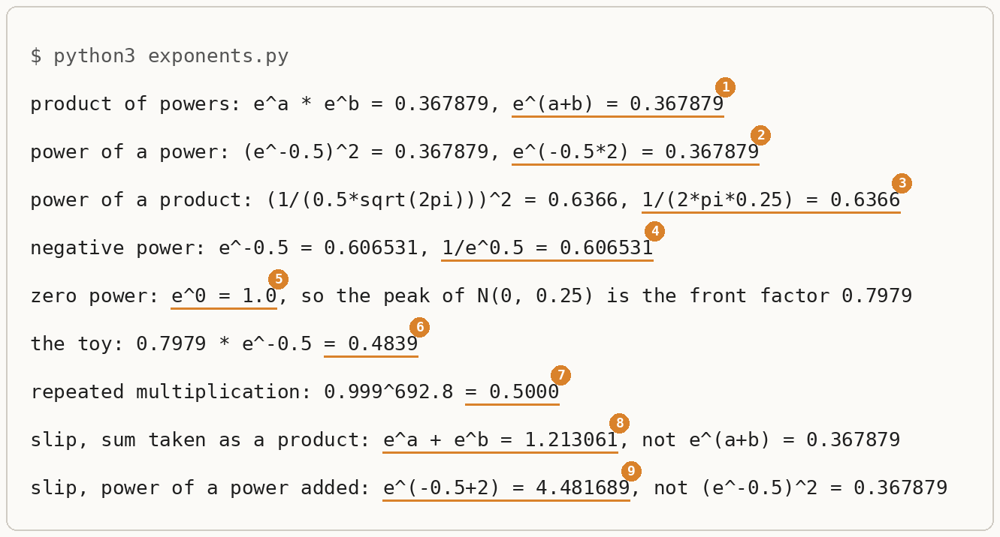

# The Exponent Rules

Up: [[Algebra]] · [[Logarithms]] ➡️

Mathematics, Algebra. Needs: multiplying and dividing decimals, and what a square root is.

> [!question] Test yourself
> No quiz page covers this note yet. Quiz 0 of the composition ladder (layer 1, one diffusion expert) asks three questions that send a reader here: why the log of a product is a sum, the moving average's half-life, and a half-life worked out from mixed log bases.

> [!warning] Unfinished
> - The three drawn pictures (the form, the mechanism, the deep-dive sheet) are waiting: prompts 1 to 3 in the vault's `.prompts/The Exponent Rules.md`, for `render-diagrams` to draw.
> - `exponents.py` has not been run through the prepared environment `~/.vault-sandbox/bin/python`, which this machine (the cluster) does not have. Make it with `uv venv ~/.vault-sandbox` then `uv pip install --python ~/.vault-sandbox/bin/python pandas numpy scipy matplotlib statsmodels openpyxl`, and run it there. The output in this note is from the system `python3`, which is enough for a script that uses the standard library only.
> - No quiz page for this note yet.

Claims marked stated: 1, in 1 place. It does not keep the note unfinished.

**An exponent counts how many times a number is multiplied by itself, and five rules say what happens to that count when powers are multiplied together, raised to a further power, or given a count of zero or below zero.** Every height of a Gaussian is a front factor times the number e raised to a negative number, so these five rules are what turn a product of Gaussian heights into one exponent, and what let a log read that exponent back out.

**Where you work.** Any empty folder on a machine with Python 3. The check script uses the standard library only, and every number in it is the composition ladder's own toy: the Gaussian with mean 0 and variance 0.25.

## Table of contents

- [What the rules are and why they are here](#what-the-rules-are-and-why-they-are-here)
- [The five rules and why each holds](#the-five-rules-and-why-each-holds)
- [Worked example on the toy Gaussian](#worked-example-on-the-toy-gaussian)
- [The method, step by step](#the-method-step-by-step)
- [Where it goes wrong](#where-it-goes-wrong)
- [Check it with the script](#check-it-with-the-script)
- [Reading the output](#reading-the-output)
- [Other ways](#other-ways)
- [Why this matters](#why-this-matters)
- [Taught in, applied in](#taught-in-applied-in)
- [How this was checked](#how-this-was-checked)

## What the rules are and why they are here

Navigation: 📋 [[#Table of contents]] | [[#The five rules and why each holds]] ➡️

Textbook: [Algebra handbook, ch. 15, p. 109, the table of exponent formulas](../references/textbooks/algebra/algebra-handbook.pdf#page=109)

**The exponent rules**, also the laws of exponents or the index laws, are five facts about repeated multiplication. Multiplying two powers of the same number adds their counts. Raising a power to a further power multiplies the counts. Raising a product to a power gives every factor in it that power. A count of zero means nothing was multiplied, which leaves 1. A count below zero means divide by the number that many times instead of multiplying.

**Why they are here.** A Gaussian's height at a point is a fixed front factor times the number e (about 2.718282) raised to minus the squared distance from the centre over twice the variance. That exponent is never positive, so every height is e to a negative number. The composition work multiplies heights all the time: a two-dimensional Gaussian with independent coordinates is the product of two one-dimensional heights, and a product of experts multiplies the experts' densities ([[Product, Mixture And Negation#The form of the three operators|the product operator]]). The product of powers rule turns each such product into e raised to one sum, and the [[Logarithms|natural log]] undoes e, so the log of a product of heights is the sum of their exponents. The moving average in the ladder's training loop is a third use: keeping 0.999 of a weight per step for n steps is a power of a power.

**When to reach for them.** Whenever two or more expressions with e in them are multiplied, squared or divided, before evaluating anything. Without the rules the only route is to evaluate every factor to a decimal and multiply, which hides the structure (a sum in the exponent) that the derivations need.

> 🖼️ **Picture on its way**: the five rules as five cards, each with its plain-words line, its symbol form and its toy number, with the count of e factors drawn as beads. <!-- slot: assets/the-exponent-rules-the-form.webp · prompt: .prompts/The Exponent Rules.md#prompt-1-subject-the-five-rules-the-form -->

## The five rules and why each holds

Navigation: ⬅️ [[#What the rules are and why they are here]] | 📋 [[#Table of contents]] | [[#Worked example on the toy Gaussian]] ➡️

Each rule below is derived by counting factors for whole-number counts, then checked on the toy's numbers, where the counts are $-0.5$ and $2$. The handbook's table states each rule with letters for the exponents (*cited*, p. 109), and the script in [[#Check it with the script]] confirms the fractional and negative cases on numbers (*shown*).

### Product of powers

**Multiplying two powers of the same base adds the exponents:** $e^a e^b = e^{a+b}$. With whole counts, the factors simply line up:

$$
e^2 \cdot e^3 = (e \cdot e)(e \cdot e \cdot e) = e^5 = e^{2+3}
$$

On the toy, $a = b = -0.5$: $e^{-0.5} \cdot e^{-0.5} = 0.606531 \times 0.606531 = 0.367879 = e^{-1}$. *Derived*, and *shown* by line 1 of the run.

### Power of a power

**Raising a power to a further power multiplies the exponents:** $(e^a)^b = e^{ab}$. It is the product rule used $b$ times:

$$
(e^2)^3 = e^2 \cdot e^2 \cdot e^2 = e^{2+2+2} = e^{2 \times 3} = e^6
$$

On the toy: $(e^{-0.5})^2 = 0.606531^2 = 0.367879 = e^{-0.5 \times 2} = e^{-1}$. *Derived*, and *shown* by line 2.

### Power of a product

**A power on a product goes onto every factor:** $(uv)^p = u^p v^p$. Write the factors out and regroup them, which multiplication allows:

$$
(uv)^2 = (uv)(uv) = (u \cdot u)(v \cdot v) = u^2 v^2
$$

On the toy's front factor $\frac{1}{\sigma\sqrt{2\pi}}$ with $\sigma = 0.5$, squaring squares each piece of the bottom:

$$
\left(0.5 \cdot \sqrt{2\pi}\right)^2 = 0.5^2 \cdot \left(\sqrt{2\pi}\right)^2 = 0.25 \times 2\pi = 1.570796, \qquad \frac{1}{1.570796} = 0.636620
$$

That is the two-dimensional front factor $\frac{1}{2\pi\sigma^2}$. *Derived*, and *shown* by line 3, which prints both sides as 0.6366.

### Zero exponent

**Anything (except 0) to the power 0 is 1:** $e^0 = 1$. The product rule forces it: $e^0 \cdot e^a = e^{0 + a} = e^a$, so multiplying by $e^0$ changes nothing, and the only number that does that is 1.

On the toy, at the centre $x = 0$ the exponent is $-\frac{(0 - 0)^2}{2 \times 0.25} = 0$, so the height is the front factor times $e^0 = 1$: the peak is the front factor itself, 0.7979. *Derived*, and *shown* by line 5.

### Negative exponent

**A negative exponent is one over the positive one:** $e^{-a} = \frac{1}{e^a}$. The product and zero rules force it: $e^{-a} \cdot e^{a} = e^{-a + a} = e^0 = 1$, so $e^{-a}$ is the number that multiplies $e^a$ up to 1, which is $\frac{1}{e^a}$.

On the toy: $e^{-0.5} = \frac{1}{e^{0.5}} = \frac{1}{1.648721} = 0.606531$. A negative exponent always gives a number between 0 and 1, which is why every Gaussian height is at most its front factor. *Derived*, and *shown* by line 4.

> 🖼️ **Picture on its way**: the mechanism, the factors of e counted as beads: two strings joined into one (product), one string copied twice (power of a power), an empty string as 1 (zero) and a string moved under a fraction bar (negative). <!-- slot: assets/the-exponent-rules-the-mechanism.webp · prompt: .prompts/The Exponent Rules.md#prompt-2-subject-the-five-rules-the-mechanism -->

## Worked example on the toy Gaussian

Navigation: ⬅️ [[#The five rules and why each holds]] | 📋 [[#Table of contents]] | [[#The method, step by step]] ➡️

**One height.** The [Gaussian density](../references/textbooks/machine-learning/mathematics-for-machine-learning.pdf#page=204) with mean $\mu$ and variance $\sigma^2$ is $p(x) = \frac{1}{\sigma\sqrt{2\pi}}\, e^{-\frac{(x - \mu)^2}{2\sigma^2}}$; where the front factor comes from is in [[The Front Factor Of A Gaussian Density#The front factor from the bell's area|the front factor from the bell's area]]. The toy has $\mu = 0$ and $\sigma = 0.5$, so $\sigma^2 = 0.25$:

$$
\begin{aligned}
\sigma\sqrt{2\pi} &= 0.5 \times 2.506628 = 1.253314 \\
\text{front factor} &= \frac{1}{1.253314} = 0.797885 \approx 0.7979 \\[4pt]
x = 0: \quad \text{exponent} &= -\frac{0^2}{2 \times 0.25} = 0, \qquad e^0 = 1 \quad \text{(zero exponent)} \\
p(0) &= 0.797885 \times 1 = 0.7979 \\[4pt]
x = 0.5: \quad \text{exponent} &= -\frac{0.5^2}{2 \times 0.25} = -\frac{0.25}{0.5} = -0.5 \\
e^{-0.5} &= \frac{1}{e^{0.5}} = \frac{1}{1.648721} = 0.606531 \quad \text{(negative exponent)} \\
p(0.5) &= 0.797885 \times 0.606531 = 0.483941 \approx 0.4839
\end{aligned}
$$

These are the ladder's two heights, 0.7979 at the centre and 0.4839 one standard deviation out. *Derived*, and *shown* by lines 5 and 6.

**Two heights multiplied.** A two-dimensional Gaussian with independent coordinates, each the toy, has height $p(x_1)\,p(x_2)$. At $(0.5, 0.5)$:

$$
\begin{aligned}
p(0.5)\,p(0.5) &= \left(0.797885\, e^{-0.5}\right)\left(0.797885\, e^{-0.5}\right) \\
&= 0.797885^2 \cdot e^{-0.5}\, e^{-0.5} && \text{(regroup the factors)} \\
&= \frac{1}{2\pi \times 0.25} \cdot e^{-0.5 + (-0.5)} && \text{(power of a product; product of powers)} \\
&= 0.636620 \cdot e^{-1} \\
&= 0.636620 \times 0.367879 = 0.234199
\end{aligned}
$$

Squaring the single height directly gives the same: $0.483941^2 = 0.234199$. The rules turned two exponentials into one, $e^{-1}$, and two front factors into one, $\frac{1}{2\pi\sigma^2}$. *Derived*.

**The moving average.** The ladder's training loop keeps 0.999 of an old weight's share at each step, so after $n$ steps the share is $0.999^n$. Writing 0.999 as a power of e (its natural log is $\ln 0.999 = -0.0010005$) makes this a power of a power:

$$
\begin{aligned}
0.999 &= e^{\ln 0.999} = e^{-0.0010005} \\
0.999^{692.8} &= \left(e^{-0.0010005}\right)^{692.8} = e^{-0.0010005 \times 692.8} && \text{(power of a power)} \\
&= e^{-0.693147} = 0.5000
\end{aligned}
$$

So after 692.8 steps the share has halved: the ladder's half-life. Finding 692.8 in the first place means solving for the exponent, which is [[Solving For The Exponent With Logarithms#The method: take logs of both sides|taking logs of both sides]]. *Derived*, and *shown* by line 7.

## The method, step by step

Navigation: ⬅️ [[#Worked example on the toy Gaussian]] | 📋 [[#Table of contents]] | [[#Where it goes wrong]] ➡️

To multiply, square or divide expressions that contain e, without evaluating each one first:

1. Write every factor as a plain number times e to something: a front factor and an exponential part. A plain number like 0.999 becomes $e^{\ln 0.999}$ when it is being raised to a power.
2. Collect the front factors together and the exponential parts together. Multiplication can be done in any order, so this regrouping changes nothing.
3. Where a front factor is raised to a power, give that power to every piece of it (power of a product).
4. Multiply the exponential parts by adding their exponents (product of powers). Where one is raised to a power, multiply its exponent by that power (power of a power).
5. Read an exponent of 0 as 1, and a negative exponent as one over the positive one.
6. Evaluate e to the single final exponent once, and multiply by the collected front factor.
7. Check the answer by evaluating the original expression directly, factor by factor. The two must agree to the digits shown.

**Redo it on new numbers.** Take the standard Gaussian, $\mu = 0$ and $\sigma = 1$. Find its height at $x = 1$, then the two-dimensional height at $(1, 1)$, and then the half-life of a moving average that keeps 0.99 per step.

> [!example]- Answers, with every value
> - Front factor: $\frac{1}{1 \times \sqrt{2\pi}} = \frac{1}{2.506628} = 0.398942$. Exponent at $x = 1$: $-\frac{1^2}{2 \times 1} = -0.5$, so $e^{-0.5} = 0.606531$. Height: $0.398942 \times 0.606531 = 0.241971$.
> - Two dimensions: front factor $0.398942^2 = \frac{1}{2\pi} = 0.159155$; exponential part $e^{-0.5}e^{-0.5} = e^{-1} = 0.367879$; height $0.159155 \times 0.367879 = 0.058550$. Directly, $0.241971^2 = 0.058550$.
> - Moving average: $\ln 0.99 = -0.010050$, so $0.99^n = e^{-0.010050\,n}$, which is $0.5 = e^{-0.693147}$ when $n = 0.693147 / 0.010050 = 68.97$ steps. Check: $0.99^{68.97} = 0.5000$.

## Where it goes wrong

Navigation: ⬅️ [[#The method, step by step]] | 📋 [[#Table of contents]] | [[#Check it with the script]] ➡️

### Adding exponents for a sum

**The product of powers rule is for a product. A sum of two powers of e has no single exponent.** Taking $e^a + e^b$ as $e^{a+b}$ on the toy:

$$
e^{-0.5} + e^{-0.5} = 0.606531 + 0.606531 = 1.213061, \qquad e^{-0.5 + (-0.5)} = e^{-1} = 0.367879
$$

The slip is off by a factor of $1.213061 / 0.367879 = 3.30$. It betrays itself: multiplying two numbers below 1 gives something smaller than either, so a "product" of 1.213061 cannot be right. In the composition work this is the line between the two operators: the product of experts multiplies densities, so their exponents add, while the mixture adds densities ([[Product, Mixture And Negation#The form of the three operators|the mixture operator]]), and its log is not the sum of the logs. *Shown* by line 8.

### Adding exponents for a power of a power

**A power on a power multiplies the exponents.** Adding them instead turns $(e^{-0.5})^2$ into $e^{-0.5 + 2} = e^{1.5} = 4.481689$, where the right value is $e^{-0.5 \times 2} = e^{-1} = 0.367879$. It betrays itself the same way: squaring a number below 1 makes it smaller, and 4.481689 is above 1. *Shown* by line 9.

## Check it with the script

Navigation: ⬅️ [[#Where it goes wrong]] | 📋 [[#Table of contents]] | [[#Reading the output]] ➡️

The script works each rule both ways on the toy's numbers, then works the two slips, so a wrong rule shows as two numbers that disagree.

1. **What you need.** Python 3. Check with `python3 -V`; this run printed `Python 3.12.10`.
2. **When it is missing.** Install Python 3 from python.org or the system's package manager (*stated*). Nothing else is needed: the script imports only `math`.
3. **The setup.** Make an empty folder and go into it:

   ```bash
   mkdir exponent-rules && cd exponent-rules
   ```

   Save this as `exponents.py`:

   ```python
   # The exponent rules, checked on the ladder's own numbers.
   import math

   a, b = -0.5, -0.5
   print(f"product of powers: e^a * e^b = {math.exp(a) * math.exp(b):.6f}, e^(a+b) = {math.exp(a + b):.6f}")
   print(f"power of a power: (e^-0.5)^2 = {math.exp(-0.5) ** 2:.6f}, e^(-0.5*2) = {math.exp(-1.0):.6f}")
   front = 1 / (0.5 * math.sqrt(2 * math.pi))
   print(f"power of a product: (1/(0.5*sqrt(2pi)))^2 = {front ** 2:.4f}, 1/(2*pi*0.25) = {1 / (2 * math.pi * 0.25):.4f}")
   print(f"negative power: e^-0.5 = {math.exp(-0.5):.6f}, 1/e^0.5 = {1 / math.exp(0.5):.6f}")
   print(f"zero power: e^0 = {math.exp(0):.1f}, so the peak of N(0, 0.25) is the front factor {front:.4f}")
   print(f"the toy: {front:.4f} * e^-0.5 = {front * math.exp(-0.5):.4f}")
   print(f"repeated multiplication: 0.999^692.8 = {0.999 ** 692.8:.4f}")
   print(f"slip, sum taken as a product: e^a + e^b = {math.exp(a) + math.exp(b):.6f}, not e^(a+b) = {math.exp(a + b):.6f}")
   print(f"slip, power of a power added: e^(-0.5+2) = {math.exp(1.5):.6f}, not (e^-0.5)^2 = {math.exp(-1.0):.6f}")
   ```

4. **A look before.** Before running, work line 6 by hand from [[#Worked example on the toy Gaussian]]: you should predict $0.7979 \times 0.606531 = 0.4839$.
5. **The failure without the rules.** Lines 8 and 9 of the output are the two slips from [[#Where it goes wrong]], computed so you can see how far off they land.
6. **The run.** `python3 exponents.py` prints:

   ```
   product of powers: e^a * e^b = 0.367879, e^(a+b) = 0.367879
   power of a power: (e^-0.5)^2 = 0.367879, e^(-0.5*2) = 0.367879
   power of a product: (1/(0.5*sqrt(2pi)))^2 = 0.6366, 1/(2*pi*0.25) = 0.6366
   negative power: e^-0.5 = 0.606531, 1/e^0.5 = 0.606531
   zero power: e^0 = 1.0, so the peak of N(0, 0.25) is the front factor 0.7979
   the toy: 0.7979 * e^-0.5 = 0.4839
   repeated multiplication: 0.999^692.8 = 0.5000
   slip, sum taken as a product: e^a + e^b = 1.213061, not e^(a+b) = 0.367879
   slip, power of a power added: e^(-0.5+2) = 4.481689, not (e^-0.5)^2 = 0.367879
   ```

   

7. **Another way to the same answer.** Take the log of the product instead of evaluating it: the log should be the summed exponent, $-1$.

   ```bash
   python3 -c "import math; print(math.log(math.exp(-0.5) * math.exp(-0.5)), math.exp(-1))"
   ```

   ```
   -1.0 0.36787944117144233
   ```

8. **More worked examples on the same setup.** Line 3 is the two-dimensional front factor and line 7 is the moving average's half-life, both from [[#Worked example on the toy Gaussian]]. The new numbers in [[#The method, step by step]] can be checked by editing `a`, `b`, `0.5` and `0.999` in the script.
9. **The clean-up**, proven by looking for the folder afterwards:

   ```bash
   cd .. && rm -r exponent-rules && ls -d exponent-rules
   ```

   ```
   ls: cannot access 'exponent-rules': No such file or directory
   ```

> 🖼️ **Picture on its way**: the deep-dive sheet, with the five rule cards, the bead mechanism, the `exponents.py` run with markers 1 to 9, and the two slips shown landing above 1. <!-- slot: assets/the-exponent-rules-deep-dive-sheet.webp · prompt: .prompts/The Exponent Rules.md#prompt-3-subject-capstone-the-five-rules-the-deep-dive-sheet -->

## Reading the output

Navigation: ⬅️ [[#Check it with the script]] | 📋 [[#Table of contents]] | [[#Other ways]] ➡️

The numbers match the markers in the picture above.

| # | Field | Value in this run | How to read it | Backing |
|---|---|---|---|---|
| 1 | `e^(a+b)` against `e^a * e^b` | `0.367879` both | adding the exponents gives the product of the two powers | derived in [[#Product of powers]] |
| 2 | `e^(-0.5*2)` against `(e^-0.5)^2` | `0.367879` both | multiplying the exponents gives the square | derived in [[#Power of a power]] |
| 3 | `1/(2*pi*0.25)` against the squared front factor | `0.6366` both | squaring $0.5\sqrt{2\pi}$ squares each piece, giving the 2D front factor $\frac{1}{2\pi\sigma^2}$ | derived in [[#Power of a product]] |
| 4 | `1/e^0.5` against `e^-0.5` | `0.606531` both | a negative exponent is one over the positive one | derived in [[#Negative exponent]] |
| 5 | `e^0` | `1.0` | the exponent at the centre is 0, so the peak is the front factor, `0.7979` | derived in [[#Zero exponent]] |
| 6 | the toy's height | `0.4839` | the front factor times $e^{-0.5}$: the ladder's height one standard deviation out | derived in [[#Worked example on the toy Gaussian]] |
| 7 | `0.999^692.8` | `0.5000` | 692.8 steps at 0.999 per step halve the share: the half-life | derived there, as a power of a power |
| 8 | `e^a + e^b` | `1.213061` | the sum slip: 3.30 times the right `0.367879`, and above 1 | [[#Adding exponents for a sum]] |
| 9 | `e^(-0.5+2)` | `4.481689` | the power-of-a-power slip: above 1, where a square of $0.606531$ must be below it | [[#Adding exponents for a power of a power]] |

## Other ways

Navigation: ⬅️ [[#Reading the output]] | 📋 [[#Table of contents]] | [[#Why this matters]] ➡️

**Evaluate every factor first.** Turning each power of e into a decimal and multiplying gives the right number, as the direct column of every line does. It wins when only one number is wanted, and it loses whenever the shape of the answer matters, because a sum in the exponent is invisible in a decimal.

**Work in logs.** Taking the [[Logarithms|log]] of both sides turns the product of powers into the log of a product being a sum, and the power of a power into the log of a power being a multiple ([[The Log Of A Power And Of A Quotient]]). The two sets of rules are the same facts read in opposite directions, and step 7 of the check uses that.

## Why this matters

Navigation: ⬅️ [[#Other ways]] | 📋 [[#Table of contents]] | [[#Taught in, applied in]] ➡️

Every derivation in the composition work multiplies Gaussian heights or densities and then takes a log. The product of powers rule is what makes the log of a product of experts the sum of their log densities, which is why their scores add ([[Product, Mixture And Negation#How the three operators work|how the three operators work]]). The power of a product rule is what turns two front factors into the $\frac{1}{2\pi\sigma^2}$ of a two-dimensional Gaussian, and the power of a power rule is what makes a moving average decay by a fixed fraction of its exponent at every step.

## Taught in, applied in

Navigation: ⬅️ [[#Why this matters]] | 📋 [[#Table of contents]] | [[#How this was checked]] ➡️

**Taught in.** No plan or chapter in the learning tree teaches the rules themselves. These lines in the PoE derivation foundations journey lean on them and link the handbook's p. 109:

- [Chapter 3, moving into logs](/home-mscluster/mmolefe/goal-setting/learning/deep-learning/diffusion-models/01-poe-derivation-foundations/textbook/03-moving-into-logs.md), section 3.1, step 2: "Multiply. Powers of the same base add", the product of powers.
- [Chapter 8, assembling the PoE rule](/home-mscluster/mmolefe/goal-setting/learning/deep-learning/diffusion-models/01-poe-derivation-foundations/textbook/08-assembling-the-poe-rule.md): classifier-free guidance and the product written as products of powers with exponents summing to 1.
- [Chapter 10, completing the square](/home-mscluster/mmolefe/goal-setting/learning/deep-learning/diffusion-models/01-poe-derivation-foundations/textbook/10-completing-the-square.md), step 1 of the product and step 1 of the quotient: only the exponents matter for the shape, and dividing by a Gaussian adds its exponent with the sign flipped.
- [Chapter 13, the training loss two ways](/home-mscluster/mmolefe/goal-setting/learning/deep-learning/diffusion-models/01-poe-derivation-foundations/textbook/13-the-training-loss-two-ways.md), step 7: the posterior's exponent as a sum of two quadratics.
- [Plan 13, PoE on two Gaussians](/home-mscluster/mmolefe/goal-setting/learning/deep-learning/diffusion-models/01-poe-derivation-foundations/plans/13-poe-on-two-gaussians.md): add both exponents and complete the square in $x$.

**Applied in.**

- The composition ladder in the reduce-reuse-recycle research repo, layer 1, one diffusion expert: the toy Gaussian's heights 0.7979 at its centre and 0.4839 one standard deviation out, the two-dimensional front factor $\frac{1}{2\pi\sigma^2}$, and the moving average that keeps 0.999 per step and halves after 692.8 steps. Its quiz 0 questions on the log of a product and on the half-life rest on this note.

## How this was checked

Navigation: ⬅️ [[#Taught in, applied in]] | 📋 [[#Table of contents]]

> [!note]- How this was checked
> Written on 2026-10-20 on the cluster (mscluster, Linux), from a quiz-preparation audit of the composition ladder's quiz 0, which found no passage teaching the exponent rules. `exponents.py` was copied byte for byte from the audit's script and run twice with the system Python 3.12.10 (standard library only), each time in an empty scratch folder that was removed afterwards, with the check afterwards reporting the folder gone. Both runs printed the nine lines above exactly; so did the second-route one-liner in step 7 and the clean-up message in step 9. The prepared environment `~/.vault-sandbox` does not exist on this machine, so the run is not through it. The output picture was rendered from the captured text with Pillow and DejaVu Sans Mono, and looked at before filing.
>
> The toy's numbers were checked against the ladder's `rebuild/out/walk-numbers.json`: `p1.normal_pdf_0_mu0_sd0.5` is 0.7979, `p1.normal_pdf_0.5_mu0_sd0.5` is 0.4839 and `p1.ema_half_life_steps` is 692.8. Every other value in the worked example and the answers (1.253314, 0.797885, 1.648721, 0.483941, 1.570796, 0.636620, 0.234199, $-0.0010005$, $-0.693147$, 0.398942, 0.241971, 0.159155, 0.058550, $-0.010050$, 68.97) was recomputed with Python's `math` module to the digits shown.
>
> The algebra handbook's page 109 was opened by decompressing its text stream with Python's standard library, since the cluster has no PDF reader: it is the table of exponent formulas, with rows for the product of powers, the quotient of powers, the power of a power, anything to the zero power being 1, negative powers giving the reciprocal, the power of a product, the power of a quotient and converting a root to a power. The formulas themselves are drawn in a font the extraction cannot read, so the rule statements in this note are derived here rather than quoted. Mathematics for Machine Learning's PDF page 204 was opened the same way and carries the univariate Gaussian density, equation 6.62. The handbook's page 111 (e and the natural log) could not be read that way and is not linked.
>
> Claims marked stated, 1: that Python 3 can be installed from python.org or a package manager (step 2 of the check).
