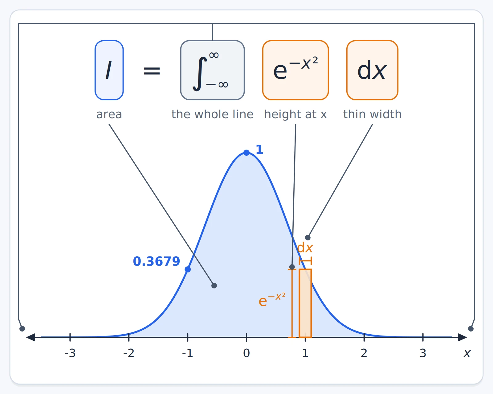
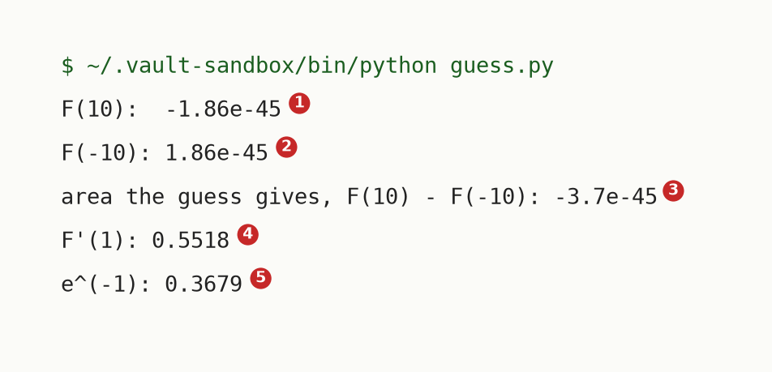
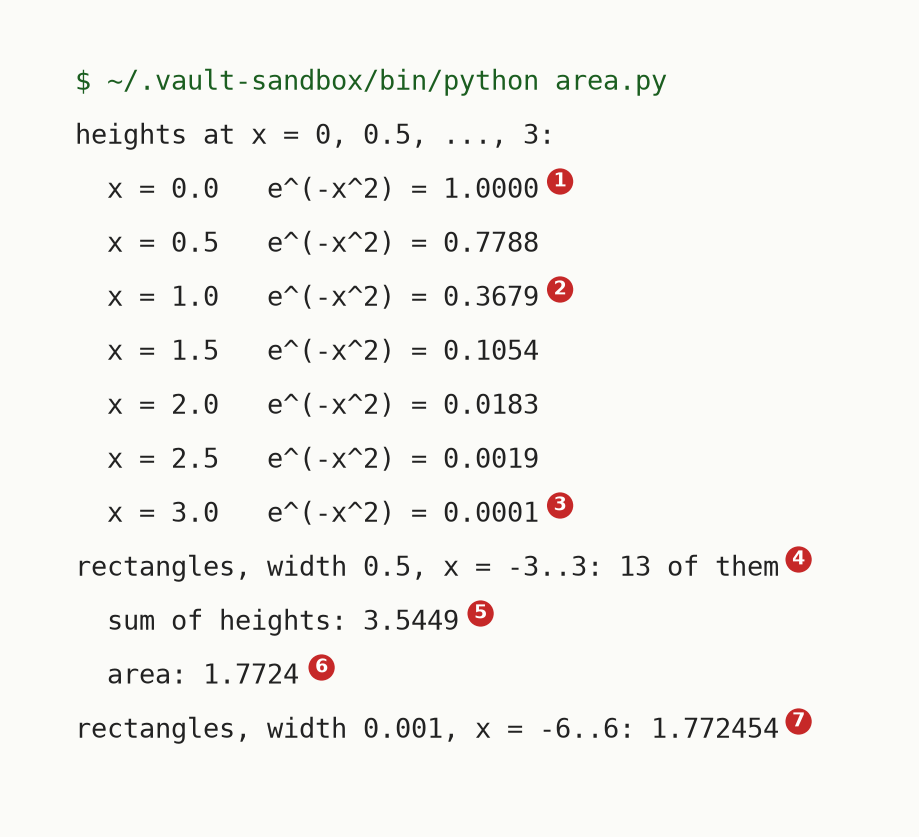
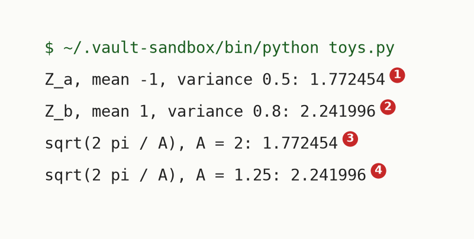
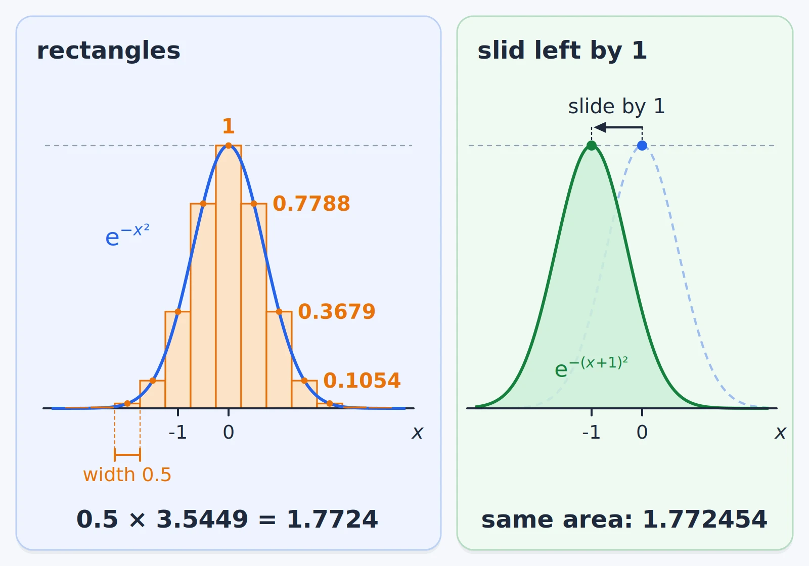
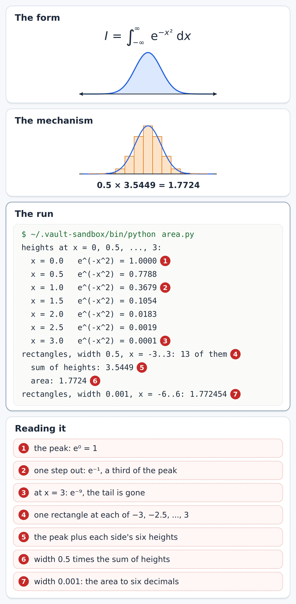

# Gaussian Integral

Mathematics, Calculus, Integration. Needs: what $e^{x}$ is, from the calculus textbook's [exponential functions](../../references/textbooks/calculus/calculus-textbook.pdf#page=76), and the idea of an integral as an area.

> [!question] Test yourself
> [The Gaussian integral quiz](https://claude.ai/artifact/X9aXtHxYmNEtTQ6dsCskpr) covers [[#The area under the bell]] in 16 questions. Your attempts are saved on the page.

> [!warning] Unfinished
> - The value $\sqrt{\pi}$ is shown numerically here and not yet derived. The derivation (square the integral into a volume, measure the plane in rings, do the ring integral) and the step from $\sqrt{\pi}$ to the normaliser $\sqrt{2\pi/A}$ wait for the walk to reach them.
>
> Stated, not checked: 0 claims.

**The Gaussian integral is the area under the bell $e^{-x^2}$ over the whole number line, and it equals $\sqrt{\pi} = 1.772454$.** Every Gaussian density divides by a stretched and slid copy of this area, so it is the number behind every normalising constant of a normal distribution.

$$
I = \int_{-\infty}^{\infty} e^{-x^2}\,dx = \sqrt{\pi} \approx 1.772454
$$

*Shown* numerically below; the closed form is derived in sections still to come. *Cited:* the Wikipedia page in the sources.

**Where you work.**

- Any terminal on a machine with the prepared Python environment, `~/.vault-sandbox/bin/python`. On the PC, that is Ubuntu under WSL.
- A new empty folder. Nothing here touches a real project.

**Prepare the sandbox.**

```bash
mkdir -p ~/playground/sandbox/gaussian-integral && cd ~/playground/sandbox/gaussian-integral
~/.vault-sandbox/bin/python -c "import numpy, scipy; print(numpy.__version__, scipy.__version__)"
```

You should see two version numbers; this run printed `2.4.6 1.17.1`. If the first command says `No such file or directory`, the prepared environment is missing on this machine. Make it once, by hand:

```bash
uv venv ~/.vault-sandbox
uv pip install --python ~/.vault-sandbox/bin/python pandas numpy scipy matplotlib statsmodels openpyxl
```

## Table of contents

- [[#The area under the bell]]

## The area under the bell

Navigation: 📋 [[#Table of contents|TOC]]

Textbook: [Calculus textbook, section 5.5 The Definite Integral, p. 377](../../references/textbooks/calculus/calculus-textbook.pdf#page=377)

**The area under $e^{-x^2}$ is finite and can be found to any accuracy with rectangles, but no antiderivative written with powers, exponentials, logs or trig functions gives it.** So the usual route through the fundamental theorem of calculus stops here, and the exact value needs a different idea.

### What the integral adds up

$e^{-x^2}$ is the height of the bell at position $x$. The integral adds height times a thin width $dx$, so $I$ is the area under the bell. The limits $-\infty$ and $\infty$ mean the whole line, which makes it an [improper integral](../../references/textbooks/calculus/calculus-textbook.pdf#page=574). The textbook defines it by splitting the line at a point, here 0, and letting each end run out on its own. When both ends settle on a finite area, as they do for this bell, that is the same as the area from $-b$ to $b$ as $b$ grows without end.

$$
\begin{aligned}
I &= \lim_{a \to -\infty} \int_{a}^{0} e^{-x^2}\,dx + \lim_{b \to \infty} \int_{0}^{b} e^{-x^2}\,dx \\[4pt]
&= \lim_{b \to \infty} \int_{-b}^{b} e^{-x^2}\,dx
\end{aligned}
$$

The heights fall fast. At $x = 3$ the bell is already at 0.0001 of its peak, so the endless range adds only a finite amount. [[#How the area is found]] proves that bound, which is what lets the two lines above agree.

### When to reach for it

Whenever a Gaussian has to be turned into a density, or a product of Gaussians has to be weighed. The density $\mathcal{N}(x; \mu, \sigma^2)$ carries $1/\sqrt{2\pi\sigma^2}$ in front, and that factor is one over this area, slid by $\mu$ and stretched by $\sigma$. Without it, an energy $E(x)$ gives the shape $e^{-E(x)}$ but not how much area that shape holds, which is what a normaliser $Z$ records.

### The form

$$
\underbrace{\int_{-\infty}^{\infty}}_{\text{the whole line}}\;
\underbrace{e^{-x^2}}_{\text{height at } x}\;
\underbrace{dx}_{\text{thin width}}
= \underbrace{I}_{\text{area}}
$$

```text
I    = integral from -inf to inf of e^(-x^2) dx     the area under the bell
x                                                    a position on the line
e^(-x^2)                                             the bell's height there: 1 at x = 0, 0.3679 at x = 1
dx                                                   the width of one thin strip
```



### Try it yourself

**1. Make something to act on.** In the sandbox folder, save this as `area.py`. It prints the bell's heights, then adds up rectangles under it.

```python
import numpy as np

def bell(x):
    return np.exp(-x**2)

print("heights at x = 0, 0.5, ..., 3:")
for x in np.arange(0, 3.5, 0.5):
    print(f"  x = {x:.1f}   e^(-x^2) = {bell(x):.4f}")

xs = np.arange(-3, 3.25, 0.5)
print("rectangles, width 0.5, x = -3..3:", len(xs), "of them")
print("  sum of heights:", round(float(bell(xs).sum()), 4))
print("  area:", round(float(0.5 * bell(xs).sum()), 4))

fine = np.arange(-6, 6, 0.001)
print("rectangles, width 0.001, x = -6..6:", round(float(0.001 * bell(fine).sum()), 6))
```

Save this as `guess.py`. It tries the usual route with an antiderivative guessed by running the chain rule backwards.

```python
import numpy as np

def F(x):
    return -np.exp(-x**2) / (2 * x)

def F_slope(x, h=1e-6):
    return (F(x + h) - F(x - h)) / (2 * h)

print(f"F(10):  {F(10.0):.2e}")
print(f"F(-10): {F(-10.0):.2e}")
print(f"area the guess gives, F(10) - F(-10): {F(10.0) - F(-10.0):.1e}")
print("F'(1):", round(float(F_slope(1.0)), 4))
print("e^(-1):", round(float(np.exp(-1.0)), 4))
```

Save this as `toys.py`. It measures the two bells the diffusion journey's plan 05 uses.

```python
import numpy as np

dx = 0.001
x = np.arange(-8, 8, dx)
Z_a = dx * np.exp(-(x + 1)**2 / (2 * 0.5)).sum()
Z_b = dx * np.exp(-(x - 1)**2 / (2 * 0.8)).sum()
print("Z_a, mean -1, variance 0.5:", round(float(Z_a), 6))
print("Z_b, mean 1, variance 0.8:", round(float(Z_b), 6))
print("sqrt(2 pi / A), A = 2:", round(float(np.sqrt(2 * np.pi / 2)), 6))
print("sqrt(2 pi / A), A = 1.25:", round(float(np.sqrt(2 * np.pi / 1.25)), 6))
```

**2. The failure without the technique.** The [fundamental theorem of calculus](../../references/textbooks/calculus/calculus-textbook.pdf#page=387) says: find $F$ with $F'(x) = e^{-x^2}$, then the area is $F(\infty) - F(-\infty)$. Differentiating $e^{-x^2}$ by the [chain rule](../../references/textbooks/calculus/calculus-textbook.pdf#page=198) brings down a factor $-2x$, so dividing by $-2x$ looks like it undoes that. Predict what area the guess gives before you run it.

```bash
~/.vault-sandbox/bin/python guess.py
```

You should see:



The guess claims an area of 0 for a curve that is above 0 everywhere, and its slope at $x = 1$ is 0.5518 where the bell's height is 0.3679. It is not an antiderivative at all. [[#How the area is found]] shows why.

**3. The technique: rectangles.**

```bash
~/.vault-sandbox/bin/python area.py
```

You should see:



Thirteen rectangles of width 0.5 already give 1.7724. Width 0.001 over $-6$ to $6$ gives 1.772454.

**4. Another way to get the same answer.** SciPy's `quad` integrates over the infinite range directly:

```bash
~/.vault-sandbox/bin/python -c "from scipy.integrate import quad; import numpy as np; print(quad(lambda x: np.exp(-x**2), -np.inf, np.inf))"
```

```text
(1.7724538509055159, 1.4202636780944923e-08)
```

The first number is the area, and the second is `quad`'s own estimate of its error. *Cited:* the SciPy reference in the sources. Compare it with $\sqrt{\pi}$:

```bash
~/.vault-sandbox/bin/python -c "import math; print(math.sqrt(math.pi))"
```

```text
1.7724538509055159
```

The two agree to all 17 printed digits. Why the area is $\sqrt{\pi}$ is what the sections still to come derive.

**5. More worked examples: the normalisers plan 05 uses.** The diffusion journey's plan 05 has two experts. Expert a has mean $-1$ and variance 0.5, and expert b has mean 1 and variance 0.8. Their energies are

$$
\begin{aligned}
E_a(x) &= \frac{(x+1)^2}{2 \cdot 0.5} = (x+1)^2 \\[4pt]
E_b(x) &= \frac{(x-1)^2}{2 \cdot 0.8} = \frac{(x-1)^2}{1.6}
\end{aligned}
$$

so $e^{-E_a(x)} = e^{-(x+1)^2}$ is this note's bell slid left by 1, and $e^{-E_b(x)}$ is the bell slid right by 1 and stretched. Their areas are the normalisers $Z_a$ and $Z_b$.

```bash
~/.vault-sandbox/bin/python toys.py
```

You should see:



$Z_a = 1.772454$, the same as $I$: sliding the bell leaves its area alone. $Z_b = 2.241996$, larger, because the stretched bell is wider. Plan 05's equation 5.4 writes both through one formula, $\sqrt{2\pi/A}$, where $A$ is one over the variance: $A = 2$ for expert a and $A = 1.25$ for expert b. The rectangle sums agree with it to six decimals. The formula itself is derived in a later section.

**6. Clean up, and prove it.**

```bash
cd ~ && rm -r ~/playground/sandbox/gaussian-integral
ls ~/playground/sandbox/gaussian-integral; echo $?
```

You should see `No such file or directory`, then `2`.

### Reading the output

`area.py`:

| # | Field | This run | How to read it | Backing |
|---|---|---|---|---|
| 1 | height at x = 0 | `1.0000` | the peak: $e^{0} = 1$ | derived |
| 2 | height at x = 1 | `0.3679` | $e^{-1}$: one step out, the bell is at about a third of its peak | shown |
| 3 | height at x = 3 | `0.0001` | $e^{-9}$: the tail is already negligible at this width | shown |
| 4 | rectangles | `13 of them` | one rectangle centred at each of $-3, -2.5, \dots, 3$ | shown |
| 5 | sum of heights | `3.5449` | $1 + 2 \times 1.272449$, the peak plus each side's six heights; adding the heights already rounded to 4 places gives 3.5448 | derived below |
| 6 | area | `1.7724` | width times the sum of heights, $0.5 \times 3.5449$ | derived below |
| 7 | width 0.001 | `1.772454` | 12,000 thinner rectangles: the area to six decimals | shown |

`guess.py`:

| # | Field | This run | How to read it | Backing |
|---|---|---|---|---|
| 1 | F(10) | `-1.86e-45` | the guess far right: as good as 0 | shown |
| 2 | F(-10) | `1.86e-45` | the guess far left: as good as 0 | shown |
| 3 | F(10) - F(-10) | `-3.7e-45` | the area the guess claims: 0, for a positive curve | shown |
| 4 | F'(1) | `0.5518` | the guess's slope at 1, measured by a small step either side | derived below |
| 5 | e^(-1) | `0.3679` | the height the slope should have been | shown |

`toys.py`:

| # | Field | This run | How to read it | Backing |
|---|---|---|---|---|
| 1 | Z_a | `1.772454` | expert a's area: the bell slid left by 1, so the same as $I$ | derived below |
| 2 | Z_b | `2.241996` | expert b's area: wider, so more area | shown |
| 3 | sqrt(2 pi / A), A = 2 | `1.772454` | plan 05's formula for expert a, equal to field 1 | shown |
| 4 | sqrt(2 pi / A), A = 1.25 | `2.241996` | plan 05's formula for expert b, equal to field 2 | shown |

### How the area is found

**The rectangles.** The sum of 13 rectangles of width 0.5, using that the bell is the same on both sides of 0:

$$
\begin{aligned}
\text{sum of heights} &= e^{0} + 2\left(e^{-0.25} + e^{-1} + e^{-2.25} + e^{-4} + e^{-6.25} + e^{-9}\right) \\[4pt]
&= 1 + 2\,(0.7788 + 0.3679 + 0.1054 + 0.0183 + 0.0019 + 0.0001) \\[4pt]
&= 1 + 2 \times 1.2724 \\[4pt]
&= 3.5448 \\[4pt]
\text{area} &\approx 0.5 \times 3.5448 \\[4pt]
&= 1.7724
\end{aligned}
$$

As the width shrinks, these sums close in on the integral, because $e^{-x^2}$ is continuous. *Cited:* the `Textbook:` page above, where a definite integral is defined as the limit of such sums.

**Why the endless range adds only a finite amount.** Past any point $b > 0$, every $x \ge b$ has $x^2 \ge bx$, so the bell sits under a falling exponential that has a known area:

$$
\begin{aligned}
\int_{b}^{\infty} e^{-x^2}\,dx &\le \int_{b}^{\infty} e^{-bx}\,dx \\[4pt]
&= \frac{e^{-b^2}}{b}
\end{aligned}
$$

At $b = 3$ that is $e^{-9}/3 = 0.000041$ for each tail, and at $b = 6$ it is $e^{-36}/6 = 3.9 \times 10^{-17}$, so the sum over $-6$ to $6$ misses nothing a printed digit can show. *Derived.*

**Why the guess fails.** Differentiate the guess with the [quotient rule](../../references/textbooks/calculus/calculus-textbook.pdf#page=189):

$$
\begin{aligned}
F(x) &= -\frac{e^{-x^2}}{2x} \\[4pt]
F'(x) &= -\frac{(-2x\,e^{-x^2})(2x) - e^{-x^2}(2)}{(2x)^2} \\[4pt]
&= \frac{4x^2 e^{-x^2} + 2e^{-x^2}}{4x^2} \\[4pt]
&= e^{-x^2}\left(1 + \frac{1}{2x^2}\right) \\[4pt]
F'(1) &= e^{-1} \times 1.5 \\[4pt]
&= 0.3679 \times 1.5 \\[4pt]
&= 0.5518
\end{aligned}
$$

The extra $1/(2x^2)$ comes from the $x$ in the denominator: the chain rule's factor $-2x$ is not a constant, so dividing by it does not undo it. $F$ also has no value at $x = 0$, where it divides by zero, so it cannot stand in for an antiderivative across the middle of the bell. *Derived.*

**Why no guess can work.** No function built from powers, roots, exponentials, logs and trig functions has derivative $e^{-x^2}$. The textbook calls those [elementary functions](../../references/textbooks/calculus/calculus-textbook.pdf#page=427) and states that the integral of $e^{-t^2}$ has no elementary form, on its [page on functions defined by integrals](../../references/textbooks/calculus/calculus-textbook.pdf#page=428). *Cited.* Liouville's theorem of 1835 is the proof that no such elementary antiderivative exists. *Cited:* the Nonelementary integral page in the sources. So the rectangles give 1.7724, and no formula yet says why it is that number.

**Why sliding does not change the area.** Expert a's bell is $e^{-(x+1)^2}$. Put $u = x + 1$, by [substitution](../../references/textbooks/calculus/calculus-textbook.pdf#page=414): $du = dx$, and as $x$ runs over the whole line so does $u$.

$$
\begin{aligned}
Z_a &= \int_{-\infty}^{\infty} e^{-(x+1)^2}\,dx \\[4pt]
&= \int_{-\infty}^{\infty} e^{-u^2}\,du \\[4pt]
&= I \\[4pt]
&\approx 1.772454
\end{aligned}
$$

*Derived.* Stretching does change the area, which is why $Z_b$ is larger; the stretch factor is derived with the step from $\sqrt{\pi}$ to $\sqrt{2\pi/A}$.





### Other ways

- **`scipy.integrate.quad`**, when the number is all you need: it handles the infinite limits itself and reports its error, as step 4 shows.
- **A wider, finer rectangle sum**, when you want to see the area build up and control every choice.
- **The closed form $\sqrt{\pi}$, or $\sqrt{2\pi/A}$ for a stretched and slid bell**, whenever the bell is exactly Gaussian. It is exact and costs nothing, and the sections still to come derive it.

### Why this matters

Every normalising constant of a Gaussian is this area slid and stretched. The diffusion journey's plan 05 uses it for $Z_a$ and $Z_b$, and [[Multivariate Normal Distribution#The area a product loses]] needs it when the bell left after completing the square "integrates to $\sqrt{2\pi/P}$". The failure of the usual route matters too: it is the reason the exact value comes from squaring the integral into a two-dimensional volume rather than from an antiderivative.

### Taught in, applied in

**Taught in:**

- the `drip --math` walk "the Gaussian integral", piece 1 of 5, "the area we want, and why the usual route fails": its thread is `artifacts/drips/the-gaussian-integral/dispatch.md` in the learning tree, with the heights, the rectangle sum 1.7724, expert a's bell as the toy and the guessed antiderivative as its broken run
- the diffusion journey's plan 05, `deep-learning/diffusion-models/02-sampler-correctors-for-composition/plans/05-gaussian-integrals.md`, lines 189 to 201 (equation 5.4 uses $\int e^{-\frac{A}{2}(x-\mu)^2}\,dx = \sqrt{2\pi/A}$ without deriving it) and line 206 ($Z_a = 1.772454$, $Z_b = 2.241996$)

**Applied in:** nothing yet.

**Before this note:** the learner's LibreOffice note `Mathematics/Calculus/Calculus.odt` states the area problem ("given a function f, find the area between the graph of f and an interval [a, b] on the x-axis") and describes integration, chapter 5 of the same textbook, as "the process of finding the antiderivative". This section is where that route stops working.

> [!note]- How this was checked
> Every output in [[#The area under the bell]] was run by the writer in an empty folder, `~/playground/sandbox/gaussian-integral`, on the PC: Ubuntu under WSL2, through the prepared environment `~/.vault-sandbox/bin/python` (Python 3.11.13, NumPy 2.4.6, SciPy 1.17.1, Matplotlib 3.11.2), on 2026-10-16. The folder was removed afterwards and the clean-up check returned 2. The worked numbers in the derivations were computed in the same environment.
>
> The walk's numbers agree with these runs: the heights, the area 1.7724, $F'(1) = 0.5518$ and $e^{-1} = 0.3679$, and $Z_a$ and $Z_b$ as plan 05 prints them. One difference: the walk added the heights after rounding them to 4 places and got 3.5448, and the unrounded sum prints 3.5449. The area is 1.7724 either way.
>
> The three terminal pictures were rendered from the captured text by a script in DejaVu Sans Mono and opened before filing.
>
> Textbook pages were opened before linking: p. 377 (section 5.5, Riemann sums and the definite integral), p. 574 (Definition 7.8.3, the integral over the whole line as two one-sided limits split at a point), p. 387 (Theorem 5.6.1, the fundamental theorem of calculus, part 1: evaluating with an antiderivative), p. 198 (Theorem 2.6.1, the chain rule), p. 189 (Theorem 2.4.2, the quotient rule), p. 427 (elementary functions defined), p. 428 (the integral of $e^{-t^2}$ has no elementary form), p. 414 (section 5.9, substitution in definite integrals) and p. 76 (section 0.5, exponential functions). These are PDF page numbers; the printed page is 24 less.
>
> References: [Gaussian integral](https://en.wikipedia.org/wiki/Gaussian_integral) and [Nonelementary integral](https://en.wikipedia.org/wiki/Nonelementary_integral) on Wikipedia, CC BY-SA 4.0, and [scipy.integrate.quad](https://docs.scipy.org/doc/scipy/reference/generated/scipy.integrate.quad.html), BSD 3-Clause. Each answered 200 on 2026-10-16. No tldr-pages entry covers this.
