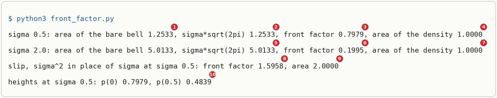
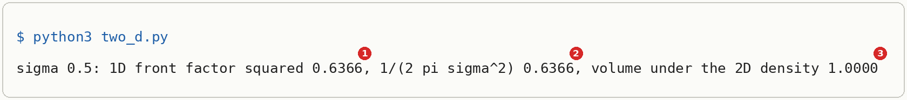

# The Front Factor Of A Gaussian Density

Up: [[Integration]] · ⬅️ [[Gaussian Integral]]

Mathematics, Calculus, Integration. Needs: [[Gaussian Integral#The area under the bell]], and [substitution in a definite integral](../../references/textbooks/calculus/calculus-textbook.pdf#page=415).

> [!question] Test yourself
> [The Gaussian integral quiz](https://claude.ai/artifact/X9aXtHxYmNEtTQ6dsCskpr) covers [[Gaussian Integral#The area under the bell]]. [[#The front factor from the bell's area]] is not on it yet.

> [!warning] Unfinished
> - Three drawn pictures are waiting: the form, the mechanism and the deep-dive sheet. Their prompts are in the vault's `.prompts/The Front Factor Of A Gaussian Density.md`.
>
> Stated, not checked: 1 claim.

**A probability density must enclose an area of exactly 1, so the number written in front of a Gaussian density is one divided by the area its bare bell encloses.** A wider bell encloses more area, so its front number is smaller. At width 0.5 the bare bell encloses 1.2533 and the front number is 0.7979; at width 2 it encloses 5.0133 and the front number is 0.1995.

**Where you work.**

- Any terminal with Python 3. The scripts use only Python's standard library, so the system `python3` runs them, and so does the prepared environment `~/.vault-sandbox/bin/python`.
- A new empty folder. Nothing here touches a real project.

**Prepare the sandbox.**

```bash
mkdir -p ~/playground/sandbox/gaussian-front-factor && cd ~/playground/sandbox/gaussian-front-factor
python3 --version
```

You should see a version starting `Python 3.`; this run printed `Python 3.12.10`. If it says `command not found`, put `~/.vault-sandbox/bin/python` in place of `python3` in every command below, and if that is missing too, make it once by hand with the two commands in [[Gaussian Integral]]'s setup.

## The front factor from the bell's area

Navigation: Up: [[Integration]] · ⬅️ [[Gaussian Integral#The area under the bell]]

Textbook: [Calculus textbook, section 5.9 Evaluating Definite Integrals by Substitution, p. 415](../../references/textbooks/calculus/calculus-textbook.pdf#page=415), and [Introduction to probability for data science, Definition 4.1, p. 190](../../references/textbooks/statistics/introduction-to-probability-for-data-science.pdf#page=190)

**Front factor**, also the normalising constant of a normal density, or $1/(\sigma\sqrt{2\pi})$: **the number in front of a Gaussian density that makes the area under it 1.** It is one over the bare bell's area, and a substitution shows that area is $\sigma\sqrt{2\pi}$.

### What the front factor is for

A density says how likely each stretch of the number line is: the area over a stretch is the chance of landing in it. Landing somewhere is certain, so the area over the whole line must be 1. Chan's Definition 4.1 lists this as the density's "unity" property, on the `Textbook:` page above. *Cited.*

So a density is scaled by its area, and its peak height is whatever that scaling makes it. The bare bell has height 1 at its centre whatever its width. A wider bell spreads that height over more of the line and encloses more area, so the number put in front to bring the area back to 1 has to be smaller. This is why a narrow Gaussian can peak above 1 while a wide one sits low.

### When to reach for it

Whenever a normal density is written from its centre and width and needs the number in front, or a height of one has to be checked. The composition ladder's toy, the normal with mean 0 and variance 0.25 (width 0.5), has height 0.7979 at its centre because of this factor. Without the factor the curve keeps its shape, but at width 0.5 its area is 1.2533, so every chance added up from it (a probability, an expectation, a mixture weight) comes out 1.2533 times too large. A product of Gaussians leaves a bell whose area is found the same way, in [[The Area A Product Loses]].

### The form

$$
p(x) = \underbrace{\frac{1}{\sigma\sqrt{2\pi}}}_{\text{front factor}}\;
\underbrace{e^{-\frac{(x-\mu)^2}{2\sigma^2}}}_{\text{bare bell, height 1 at } \mu}
\qquad\qquad
\underbrace{\int_{-\infty}^{\infty} e^{-\frac{(x-\mu)^2}{2\sigma^2}}\,dx}_{\text{area of the bare bell}} = \sigma\sqrt{2\pi}
$$

```text
mu       the centre of the bell
sigma    its width, the standard deviation; the toy N(0, 0.25) has sigma = 0.5, since its 0.25 is the variance sigma^2
bell     e^(-(x - mu)^2 / (2 sigma^2)), height 1 at x = mu
area     sigma * sqrt(2 pi): 1.2533 at sigma 0.5, 5.0133 at sigma 2
C        the front factor, 1 / area: 0.7979 at sigma 0.5, 0.1995 at sigma 2
```

> 🖼️ **Picture on its way**: the density split into its front factor and its bare bell, with the bare bell's shaded area marked sigma times root two pi and the front factor marked one over that area. <!-- slot: assets/the-front-factor-the-form.webp · prompt: .prompts/The Front Factor Of A Gaussian Density.md#prompt-1-subject-the-form -->

### The method

1. Write the density as an unknown number $C$ times the bare bell: $p(x) = C\,e^{-(x-\mu)^2/(2\sigma^2)}$.
2. Require the area to be 1, and take $C$ outside the integral, since it does not change with $x$.
3. Substitute $u = (x-\mu)/\sigma$, so $x = \mu + \sigma u$ and $dx = \sigma\,du$. As $x$ runs over the whole line so does $u$, because $\sigma > 0$. The exponent becomes $u^2/2$.
4. Take $\sigma$ outside the integral: it is a constant.
5. Use the Gaussian integral in the form $\int_{-\infty}^{\infty} e^{-u^2/2}\,du = \sqrt{2\pi}$.
6. Solve $C\,\sigma\sqrt{2\pi} = 1$ for $C$.
7. In two dimensions with the same $\sigma$ on both axes, the density is a product of two such bells, so the two front factors multiply to $1/(2\pi\sigma^2)$.

### Try it yourself

**1. Make something to act on.** In the sandbox folder, save this as `front_factor.py`. It adds up 200,000 thin rectangles under each curve, for two widths, for the slip in [[#The slip, sigma squared in place of sigma]], and prints two heights.

```python
# From the area under the bell to the front factor 1/(sigma*sqrt(2*pi)), checked by a rectangle sum.
import math

def area(f, lo, hi, n=200_000):
    w = (hi - lo) / n
    return sum(f(lo + (k + 0.5) * w) for k in range(n)) * w

for s in (0.5, 2.0):
    bell = lambda x: math.exp(-x * x / (2 * s * s))
    A = area(bell, -12 * s, 12 * s)
    C = 1 / (s * math.sqrt(2 * math.pi))
    print(f"sigma {s}: area of the bare bell {A:.4f}, sigma*sqrt(2pi) {s * math.sqrt(2 * math.pi):.4f}, front factor {C:.4f}, area of the density {area(lambda x: C * bell(x), -12 * s, 12 * s):.4f}")
s = 0.5
wrong = 1 / (s * s * math.sqrt(2 * math.pi))
print(f"slip, sigma^2 in place of sigma at sigma 0.5: front factor {wrong:.4f}, area {area(lambda x: wrong * math.exp(-x * x / (2 * s * s)), -6, 6):.4f}")
print(f"heights at sigma 0.5: p(0) {1 / (s * math.sqrt(2 * math.pi)):.4f}, p(0.5) {math.exp(-0.5) / (s * math.sqrt(2 * math.pi)):.4f}")
```

Save this as `two_d.py`. It adds up a 600 by 600 grid of squares under the two-dimensional density.

```python
# The 2D density with the same sigma on both axes: front factor 1/(2 pi sigma^2), checked by a square-grid sum.
import math

s = 0.5
C1 = 1 / (s * math.sqrt(2 * math.pi))
C2 = 1 / (2 * math.pi * s * s)
n = 600
w = 12 * s / n
total = 0.0
for i in range(n):
    x = -6 * s + (i + 0.5) * w
    for j in range(n):
        y = -6 * s + (j + 0.5) * w
        total += C2 * math.exp(-(x * x + y * y) / (2 * s * s))
print(f"sigma {s}: 1D front factor squared {C1 * C1:.4f}, 1/(2 pi sigma^2) {C2:.4f}, volume under the 2D density {total * w * w:.4f}")
```

**2. The technique, and the failures without it.** Before you run it, predict the front factor at $\sigma = 2$ from the one at $\sigma = 0.5$.

```bash
python3 front_factor.py
```

You should see:



The first two lines are the technique: the rectangle sum and $\sigma\sqrt{2\pi}$ agree, and with the front factor in place the area is 1.0000. The bare bell's own area, 1.2533 at width 0.5, is the failure when the factor is dropped, and line three is the failure when $\sigma^2$ stands in for $\sigma$.

**3. Another way to get the same answer.** Python's `statistics.NormalDist` takes the mean and the standard deviation and computes the density with its front factor. *Cited:* the Python reference in the sources.

```bash
python3 -c "from statistics import NormalDist; d = NormalDist(0, 0.5); print(round(d.pdf(0), 4), round(d.pdf(0.5), 4), round(d.cdf(6) - d.cdf(-6), 4))"
```

```text
0.7979 0.4839 1.0
```

The two heights match marker 10's line, and the chance between $-6$ and $6$ is 1.0. Handing it the variance where the standard deviation goes is the slip again:

```bash
python3 -c "from statistics import NormalDist; print(round(NormalDist(0, 0.25).pdf(0), 4))"
```

```text
1.5958
```

That is a proper density of width 0.25, so its own area is 1, and its peak is the slip's front factor, 1.5958 (marker 8). The toy N(0, 0.25) names its variance, and `NormalDist` wants its standard deviation, 0.5.

**4. More worked examples: two dimensions.**

```bash
python3 two_d.py
```

You should see:



**5. Clean up, and prove it.**

```bash
cd ~ && rm -r ~/playground/sandbox/gaussian-front-factor
ls ~/playground/sandbox/gaussian-front-factor; echo $?
```

You should see `No such file or directory`, then `2`.

### Reading the output

`front_factor.py`:

| # | Field | This run | How to read it | Backing |
|---|---|---|---|---|
| 1 | area of the bare bell, sigma 0.5 | `1.2533` | the rectangle sum under $e^{-x^2/(2 \cdot 0.25)}$ over $-6$ to $6$: what the density would enclose with no front factor | shown |
| 2 | sigma*sqrt(2pi), sigma 0.5 | `1.2533` | the closed form $0.5 \times 2.506628$, equal to field 1 | derived below |
| 3 | front factor, sigma 0.5 | `0.7979` | one over field 2 | derived below |
| 4 | area of the density, sigma 0.5 | `1.0000` | the rectangle sum with the front factor in place | shown |
| 5 | sigma*sqrt(2pi), sigma 2 | `5.0133` | four times field 2, because the bell is four times wider; the rectangle sum before it agrees | derived below |
| 6 | front factor, sigma 2 | `0.1995` | one over field 5, a quarter of field 3 | derived below |
| 7 | area of the density, sigma 2 | `1.0000` | the wider density also encloses 1 | shown |
| 8 | slip front factor | `1.5958` | $1/(\sigma^2\sqrt{2\pi})$ at $\sigma = 0.5$: field 3 divided by 0.5 | derived below |
| 9 | slip area | `2.0000` | the slipped curve encloses $1/\sigma = 2$ | shown |
| 10 | heights at sigma 0.5 | `0.7979`, `0.4839` | $p(0)$ is the front factor itself; $p(0.5)$ is one standard deviation out, the front factor times $e^{-1/2}$ | derived below |

`two_d.py`:

| # | Field | This run | How to read it | Backing |
|---|---|---|---|---|
| 1 | 1D front factor squared | `0.6366` | $0.797885^2$, the two one-dimensional factors multiplied | derived below |
| 2 | 1/(2 pi sigma^2) | `0.6366` | the closed form, equal to field 1 | derived below |
| 3 | volume under the 2D density | `1.0000` | the grid sum over the square from $-3$ to $3$ on both axes: the two-dimensional density encloses 1 | shown |

### How it works

**From $\sqrt{\pi}$ to $\sqrt{2\pi}$.** The Gaussian integral is $\int_{-\infty}^{\infty} e^{-v^2}\,dv = \sqrt{\pi}$, which [[Gaussian Integral#The area under the bell]] shows numerically and cites. The bell in a density has $u^2/2$ in its exponent. Put $u = \sqrt{2}\,v$, so $u^2/2 = v^2$ and $du = \sqrt{2}\,dv$, and as $v$ runs over the whole line so does $u$:

$$
\begin{aligned}
\int_{-\infty}^{\infty} e^{-u^2/2}\,du &= \int_{-\infty}^{\infty} e^{-v^2}\,\sqrt{2}\,dv \\[4pt]
&= \sqrt{2}\,\sqrt{\pi} \\[4pt]
&= \sqrt{2\pi} \\[4pt]
&= 1.414214 \times 1.772454 = 2.506628
\end{aligned}
$$

*Derived*, from the cited $\sqrt{\pi}$.

**The front factor, one step per line.** The step numbers are those of [[#The method]].

$$
\begin{aligned}
1 &= \int_{-\infty}^{\infty} C\,e^{-\frac{(x-\mu)^2}{2\sigma^2}}\,dx && \text{steps 1 and 2} \\[4pt]
&= C\int_{-\infty}^{\infty} e^{-\frac{u^2}{2}}\,\sigma\,du && \text{step 3: } u = \tfrac{x-\mu}{\sigma},\ dx = \sigma\,du \\[4pt]
&= C\,\sigma\int_{-\infty}^{\infty} e^{-\frac{u^2}{2}}\,du && \text{step 4} \\[4pt]
&= C\,\sigma\sqrt{2\pi} && \text{step 5} \\[4pt]
C &= \frac{1}{\sigma\sqrt{2\pi}} && \text{step 6}
\end{aligned}
$$

*Derived.* The mean $\mu$ left at step 3: sliding a bell leaves its area alone, as [[Gaussian Integral#How the area is found]] shows for expert a. The same lines with $C = 1$ say the bare bell's area is $\sigma\sqrt{2\pi}$, which is field 2.

**Worked: $\sigma = 0.5$**, the composition ladder's toy N(0, 0.25):

$$
\begin{aligned}
\text{area of the bare bell} &= 0.5 \times 2.506628 = 1.253314 \\[4pt]
C &= 1 / 1.253314 = 0.797885 \\[4pt]
\text{area of the density} &= 0.797885 \times 1.253314 = 1 \\[4pt]
p(0) &= 0.797885 \times e^{0} = 0.797885 \\[4pt]
p(0.5) &= 0.797885 \times e^{-0.5^2/(2 \times 0.25)} \\[4pt]
&= 0.797885 \times e^{-0.5} \\[4pt]
&= 0.797885 \times 0.606531 = 0.483941
\end{aligned}
$$

**Worked: $\sigma = 2$:**

$$
\begin{aligned}
\text{area of the bare bell} &= 2 \times 2.506628 = 5.013257 \\[4pt]
C &= 1 / 5.013257 = 0.199471 \\[4pt]
&= 0.797885 / 4 \\[4pt]
\text{area of the density} &= 0.199471 \times 5.013257 = 1
\end{aligned}
$$

The bell four times wider encloses four times the area, so its front factor is a quarter.

**Two dimensions.** With the same $\sigma$ on both axes and centre $(\mu_1, \mu_2)$, the density is a product of two one-dimensional bells; [[Diagonal Covariance#How it works]] shows that product for any two variances. Write one unknown $C_2$ in front. By the [exponent rules](../../references/textbooks/algebra/algebra-handbook.pdf#page=109), the exponential of a sum is the product of the two exponentials ([[The Exponent Rules#Product of powers]]), so the bell splits into an $x$ part and a $y$ part. The area becomes a volume over the plane, worked as an [iterated integral](../../references/textbooks/calculus/calculus-textbook.pdf#page=1027): integrate over $x$ with $y$ held fixed, and the $y$ part comes out as a constant. Every integral below runs over the whole line.

$$
\begin{aligned}
1 &= \int\!\!\int C_2\, e^{-\frac{(x-\mu_1)^2}{2\sigma^2}}\, e^{-\frac{(y-\mu_2)^2}{2\sigma^2}}\,dx\,dy \\[4pt]
&= C_2 \int e^{-\frac{(y-\mu_2)^2}{2\sigma^2}} \left( \int e^{-\frac{(x-\mu_1)^2}{2\sigma^2}}\,dx \right) dy \\[4pt]
&= C_2\,\sigma\sqrt{2\pi} \int e^{-\frac{(y-\mu_2)^2}{2\sigma^2}}\,dy \\[4pt]
&= C_2\,\sigma\sqrt{2\pi} \cdot \sigma\sqrt{2\pi} \\[4pt]
&= C_2 \cdot 2\pi\sigma^2 \\[4pt]
C_2 &= \frac{1}{2\pi\sigma^2}
\end{aligned}
$$

At $\sigma = 0.5$: $2\pi \times 0.25 = 1.570796$, and $C_2 = 1 / 1.570796 = 0.636620$, which is $0.797885^2$. *Derived.* The textbook's iterated integrals run over a rectangle; that the same split holds over the whole plane is *shown* by `two_d.py`'s field 3.

**The link to $\sqrt{2\pi/A}$.** The diffusion journey's plan 05 writes the bell as $e^{-\frac{A}{2}(x-\mu)^2}$, where $A$ is one over the variance. Then $\sigma = 1/\sqrt{A}$, and $\sigma\sqrt{2\pi} = \sqrt{2\pi/A}$. For expert b, variance 0.8: $\sigma = 0.894427$, and its area is $0.894427 \times 2.506628 = 2.241996$, the $Z_b$ in [[Gaussian Integral#Try it yourself]]. *Derived.*

> 🖼️ **Picture on its way**: two bare bells, width 0.5 and width 2, each with its area and front factor, and the substitution squeezing the wide one onto the standard bell. <!-- slot: assets/the-front-factor-the-mechanism.webp · prompt: .prompts/The Front Factor Of A Gaussian Density.md#prompt-2-subject-the-mechanism -->

> 🖼️ **Picture on its way**: the deep-dive sheet, with the form, the mechanism, the `front_factor.py` run with markers 1 to 10, and the ten fields read in order. <!-- slot: assets/the-front-factor-deep-dive-sheet.webp · prompt: .prompts/The Front Factor Of A Gaussian Density.md#prompt-3-subject-capstone-the-deep-dive-sheet -->

### The slip, sigma squared in place of sigma

The density is often written $1/\sqrt{2\pi\sigma^2}$. Taking $\sigma^2$ out of the root without taking its square root gives $1/(\sigma^2\sqrt{2\pi})$, which is the right factor divided by $\sigma$. The area then comes out $1/\sigma$:

$$
\begin{aligned}
C_{\text{slip}} &= \frac{1}{\sigma^2\sqrt{2\pi}} = \frac{1}{0.25 \times 2.506628} = \frac{1}{0.626657} = 1.595769 \\[4pt]
\text{area} &= C_{\text{slip}} \times \sigma\sqrt{2\pi} \\[4pt]
&= 1.595769 \times 1.253314 = 2.000000 = \frac{1}{0.5}
\end{aligned}
$$

At $\sigma = 0.5$ the slipped curve encloses 2, which is fields 8 and 9. At $\sigma = 2$ it would enclose 0.5. At $\sigma = 1$ the right factor and the slip are the same number, so a check run only on the standard normal never catches it. *Derived*, and *shown* at $\sigma = 0.5$.

<!-- worked-examples-table: completing-the-square-and-gaussian-density rev=1 -->
Problems on completing the square, from a plain quadratic to a Gaussian exponent, and on evaluating a Gaussian density at a number, from the easiest to the hardest:

| Order | What it asks | Kind | Where | Difficulty | Full-steps solution | Quiz question |
|---|---|---|---|---|---|---|
| 1 | Write $x^2 - 4x + 5$ as $(x - 2)^2 + 1$ | Worked example | [[calculus-textbook.pdf#page=44\|Anton, Calculus, Example 8, PDF p. 44 (printed 20)]] | Easy | In the book, PDF p. 44 | quiz 0, KC1 |
| 2 | Complete the square in $3x^2 + 18x - 21 = 0$ and solve | Worked example | [[algebra-handbook.pdf#page=74\|Algebra handbook, PDF p. 74]] | Easy | In the book, PDF p. 74, six numbered steps: $(x + 3)^2 = 16$, so $x = 1$ or $x = -7$ | quiz 0, KC2 and C3 |
| 3 | Evaluate $\mathcal N(0, 0.25)$ at 0 and 0.5 with `stats.norm.pdf` and by hand, then pass the variance where the standard deviation goes | Programming exercise, Python: `stats.norm.pdf(x, loc, scale)` | [[introduction-to-probability-for-data-science.pdf#page=228\|Chan, the Python listing, PDF p. 228]] | Medium | [KC3 in the quiz 0 coverage file](/home-mscluster/mmolefe/PhD/reduce-reuse-recycle/artifacts/drips/simple-distributions-rebuild/.quiz-prep/quiz-0.md#kc3-solution-the-toy-gaussian-in-code): 0.7979 and 0.4839; the slip gives 1.5958 and 0.2160 | quiz 0, KC3 |
| 4 | Complete the square for the diffusion reverse posterior $q(x_{t-1} \mid x_t, x_0)$ | Worked example | [[the-little-book-of-generative-ai-foundations.pdf#page=189\|The little book of generative AI foundations, Appendix B, PDF pp. 189 to 192]] | Hard | In the book, every step: variance $(1 - \bar\alpha_{t-1})\beta_t / (1 - \bar\alpha_t)$ | quiz 0, KC4 |

No book works the Gaussian density at a number by hand: row 3's listing prints no values, so its solution is written. The derivation of the front factor is [[The Front Factor Of A Gaussian Density]]. Not banked: Bishop's Exercise 1.7 (the Gaussian integral in polar coordinates, PDF p. 78, no printed solution), Mathematics for Machine Learning's Exercise 6.10 (the product of two Gaussians, PDF p. 229, no printed solution), and Chan's Theorem 5.12 (PDF pp. 299 to 300), banked by quiz 1.1 in [[#Mean and variance of a scaled sum of independent Gaussians (the forward draw)]].
Read in full (by the bank search for quiz 0): algebra handbook PDF p. 74; Anton PDF p. 44; Chan PDF pp. 227 to 231; Bishop PDF p. 78; Mathematics for Machine Learning PDF pp. 206, 207, 228 and 229; the little book PDF pp. 185 to 192. Only found: Anton section 7.4, Example 6 (completing the square inside an integral, PDF p. 536).
<!-- /worked-examples-table -->

### Other ways

- **`statistics.NormalDist(mu, sigma).pdf(x)`**, in Python's standard library, when a height is all you need. Its second argument is the standard deviation, as step 3 of [[#Try it yourself]] shows.
- **Writing the factor as $1/\sqrt{2\pi\sigma^2}$**, the same number, when what you hold is the variance: the variance goes inside the root and nothing has to be square-rooted by hand.
- **The polar route**, which finds $\sigma\sqrt{2\pi}$ straight from the bell with $\sigma$ in it, without passing through $\sqrt{\pi}$. Murphy's [Exercise 2.12](../../references/textbooks/machine-learning/probabilistic-machine-learning-an-introduction.pdf#page=99) squares the area into a volume over the plane and changes to polar coordinates, with two hints. *Cited.* It is the same proof [[Gaussian Integral]] still waits on for $\sqrt{\pi}$.
- **`scipy.stats.norm.pdf(x, loc, scale)`**, where `scale` is the standard deviation. *Stated:* not run on this page.

### Why this matters

Every height of a normal density carries this factor, the ladder's 0.7979 and 0.4839 included. When densities are multiplied the factor no longer makes the area 1, and the area that goes missing is what [[The Area A Product Loses]] measures. The slip in the section above is the mistake a check on the standard normal cannot see, so the worked examples here use $\sigma = 0.5$ and $\sigma = 2$.

### Taught in, applied in

**Taught in:**

- the diffusion journey's [plan 05](/home/molef/goal-setting/learning/deep-learning/diffusion-models/02-sampler-correctors-for-composition/plans/05-gaussian-integrals.md), lines 189 to 199: equation 5.4 uses $\int e^{-\frac{A}{2}(x-\mu)^2}\,dx = \sqrt{2\pi/A}$, which is $\sigma\sqrt{2\pi}$ with $A = 1/\sigma^2$, without deriving it

**Applied in:**

- the reduce-reuse-recycle research repository's composition ladder, layer 1 (one diffusion expert), step 1 (a Gaussian you can hold): the toy normal with mean 0 and variance 0.25 has front factor 0.7979, heights 0.7979 at 0 and 0.4839 at 0.5, and an area of 1.2533 when the front factor is dropped.

> [!note]- How this was checked
> Every output in [[#The front factor from the bell's area]] was run by the writer in an empty folder, `~/playground/sandbox/gaussian-front-factor`, on the cluster (mscluster, Linux), through the system `python3` (Python 3.12.10, standard library only), on 2026-10-20. The prepared environment `~/.vault-sandbox` does not exist on that machine, and the scripts need nothing from it. The folder was removed afterwards and the clean-up check returned 2.
>
> `front_factor.py` is copied byte for byte from the quiz-preparation fill for the composition ladder's quiz 0 (checked with `cmp`), and its four printed lines match that fill's run exactly. It ran in under a second there. `two_d.py` and the two `NormalDist` commands were written and run by the writer. Every worked number in the derivations was recomputed in the same Python and agrees with the printed fields to the digits shown.
>
> The two terminal pictures were rendered from the captured text by a script in DejaVu Sans Mono, light theme, with red markers, and opened before filing.
>
> Textbook pages were opened before linking: calculus textbook p. 415 (section 5.9, substitution in a definite integral, Method 2 and Theorem 5.9.1, where the u-limits replace the x-limits), p. 1027 (section 14.1, partial definite integrals and iterated integrals, equations 6 and 7), Chan p. 190 (Definition 4.1, a PDF's non-negativity, unity and measure of a set) the algebra handbook p. 109 (exponent formulas, the product of powers) and Murphy p. 99 (Exercise 2.12, the normalisation constant of a 1D Gaussian by polar coordinates). These are PDF page numbers.
>
> References: [Normal distribution](https://en.wikipedia.org/wiki/Normal_distribution) on Wikipedia, CC BY-SA 4.0, and [the statistics module](https://docs.python.org/3/library/statistics.html), PSF License. Each answered 200 on 2026-10-20. No tldr-pages entry covers this.
