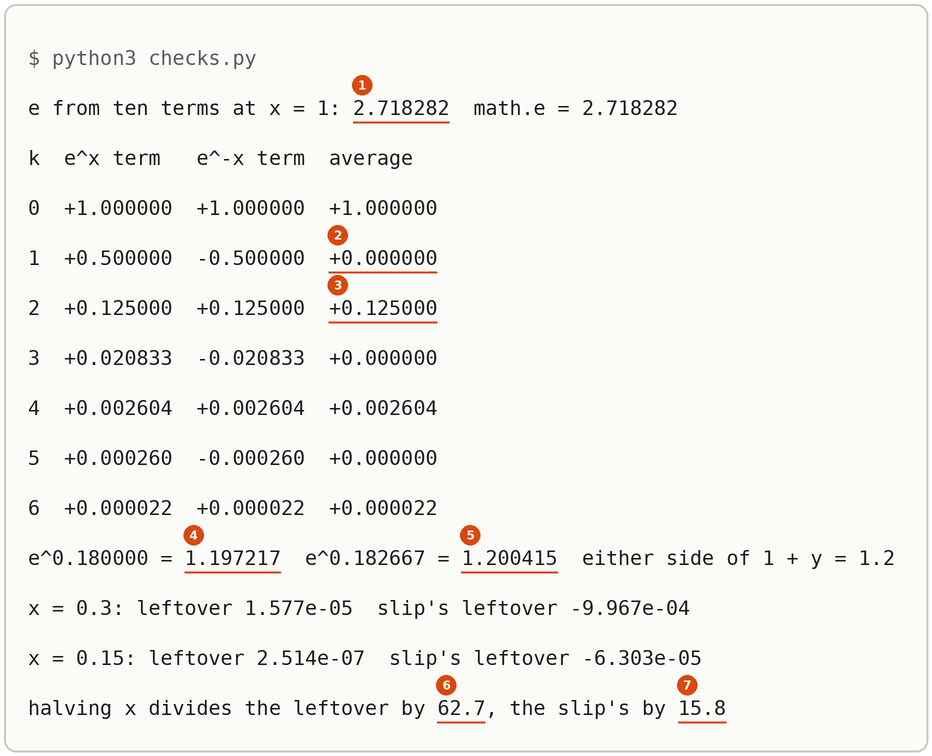

# Maclaurin Series

Up: [[Sequences And Series]] · [[The Limit That Defines E]] ➡️

Mathematics, Calculus, Sequences And Series. Needs: [[The Exponent Rules]], what a [factorial](../../references/textbooks/calculus/calculus-textbook.pdf#page=627) is ($4! = 1 \cdot 2 \cdot 3 \cdot 4 = 24$, and $0! = 1$), and the [natural log](../../references/textbooks/algebra/algebra-handbook.pdf#page=111) as the power you raise e to.

> [!warning] Unfinished
> - The three drawn pictures (the form, the mechanism, the deep-dive sheet) are waiting: prompts 1 to 3 in the vault's `.prompts/Maclaurin Series.md`, for `render-diagrams` to draw.
> - The scripts were run with the system `python3` (standard library only), not through the prepared environment `~/.vault-sandbox/bin/python`, which this machine (the cluster) does not have. Make it once with `uv venv ~/.vault-sandbox` then `uv pip install --python ~/.vault-sandbox/bin/python pandas numpy scipy matplotlib statsmodels openpyxl`, and run the two scripts there.
> - No quiz page covers this note yet.

Claims marked stated: 1.

**A Maclaurin series writes a function as a polynomial that never ends, so a value such as $e^{0.5}$ becomes a sum of small numbers you can add by hand, and a function of a function can be expanded by putting one series inside the other.** This note works three series, for $e^x$, $\cosh x$ and $\log(1 + y)$, and composes the last two into $\log\cosh x = \frac{x^2}{2} - \frac{x^4}{12} + \cdots$. The [[Central Limit Theorem]] runs on exactly these steps: the log of a fingerprint that sits just above 1.

**Where you work.** Any terminal with Python 3 and a new empty folder. The two scripts use the standard library only, and every number in them is made up.

## Table of contents

- [[#The form of a Maclaurin series]]
- [[#The series for e^x]]
- [[#The series for cosh x]]
- [[#The series for log(1 + y), and log cosh composed from it]]
- [[#Check the series with the scripts]]
- [[#Reading the series output]]
- [[#Other ways to get a series]]
- [[#Why the series matter]]
- [[#The series taught in, applied in]]

## The form of a Maclaurin series

Navigation: 📋 [[#Table of contents|TOC]] | [[#The series for e^x]] ➡️

Textbook: [calculus textbook, Definition 9.8.1, p. 684](../../references/textbooks/calculus/calculus-textbook.pdf#page=684).

**Maclaurin series**, also the Taylor series about 0: the polynomial whose value, slope, bend and every higher rate of change at $x = 0$ all match the function's. Its $k$-th term is the function's $k$-th [derivative](../../references/textbooks/calculus/calculus-textbook.pdf#page=217) at 0, divided by $k!$, times $x^k$. Stopping after the $x^n$ term gives the **partial sum through $n$**, the Maclaurin polynomial of degree $n$.

```text
f(x) = f(0) + f'(0) x + f''(0)/2! x^2 + f'''(0)/3! x^3 + ... + f^(k)(0)/k! x^k + ...
       k = 0   k = 1     k = 2           k = 3                  k, the term's index
partial sum through n: stop after the x^n term
```

**Why each term divides by $k!$.** Take a polynomial $c_0 + c_1 x + c_2 x^2 + \cdots$ and differentiate it $k$ times. A power below $x^k$ has gone to 0. The term $c_k x^k$ has become $c_k \cdot k(k-1)\cdots 1 = c_k\,k!$. A power above $x^k$ still carries a factor of $x$, which is 0 at $x = 0$. So the $k$-th derivative at 0 is $c_k\,k!$, and matching it to $f^{(k)}(0)$ gives $c_k = f^{(k)}(0)/k!$. For $k = 2$: $\frac{d^2}{dx^2}(c_2 x^2) = 2c_2$, and $2! = 2$. *Derived.*

> 🖼️ **Picture on its way**: the form, the series as a row of term cards with each slot named, beside the partial sums of $e^x$ at $x = 0.5$ climbing to 1.648721. <!-- slot: assets/maclaurin-series-the-form.webp · prompt: .prompts/Maclaurin Series.md#prompt-1-subject-maclaurin-series-the-form -->

## The series for e^x

Navigation: ⬅️ [[#The form of a Maclaurin series]] | 📋 [[#Table of contents|TOC]] | [[#The series for cosh x]] ➡️

Textbook: [calculus textbook, Example 2 of section 9.7, p. 675](../../references/textbooks/calculus/calculus-textbook.pdf#page=675), where the coefficients are found, and [Example 1(a), p. 684](../../references/textbooks/calculus/calculus-textbook.pdf#page=684), where the series is named.

### What the e^x series is and why it is here

The number e raised to any power is a sum: 1, plus the power, plus the power squared shared out over 2, plus the cube shared out over 6, and so on. Each new term is the one before it times the power, divided by the next counting number. The sum is here because a [[Moment Generating Function#What the fingerprint is|fingerprint]] is the average of e raised to a random power, and this sum turns that one average into a list of averages of powers, the moments.

**The series for $e^x$**, also the exponential series:

$$e^x = 1 + x + \frac{x^2}{2!} + \frac{x^3}{3!} + \frac{x^4}{4!} + \cdots = \sum_{k=0}^{\infty} \frac{x^k}{k!}$$

Every derivative of $e^x$ is $e^x$, and $e^0 = 1$, so $f^{(k)}(0) = 1$ for every $k$ and the form gives the coefficient $1/k!$. *Derived*, and *cited* on p. 675. The sum equals $e^x$ for every real $x$, not only small ones. *Cited:* [Example 3 of section 9.9, p. 696](../../references/textbooks/calculus/calculus-textbook.pdf#page=696).

### e^x worked at x = 0.5

Each term is the previous one times $x/k$, so nothing past a multiplication and a division is needed.

| $k$ | $x^k$ | $k!$ | term $x^k/k!$ | partial sum |
|---|---|---|---|---|
| 0 | 1 | 1 | 1.000000 | 1.000000 |
| 1 | 0.5 | 1 | $1 \times 0.5/1 = 0.500000$ | 1.500000 |
| 2 | 0.25 | 2 | $0.5 \times 0.5/2 = 0.125000$ | 1.625000 |
| 3 | 0.125 | 6 | $0.125 \times 0.5/3 = 0.020833$ | 1.645833 |
| 4 | 0.0625 | 24 | $0.020833 \times 0.5/4 = 0.002604$ | 1.648438 |
| 5 | 0.03125 | 120 | $0.002604 \times 0.5/5 = 0.000260$ | 1.648698 |

Against $e^{0.5} = 1.648721$, the partial sum through $k = 5$ is short by 0.000023. The next term, $0.5^6/6! = 0.015625/720 = 0.0000217$, is about that size. The [Remainder Estimation Theorem](../../references/textbooks/calculus/calculus-textbook.pdf#page=679), applied to $e^x$ on [p. 696](../../references/textbooks/calculus/calculus-textbook.pdf#page=696), bounds the shortfall by $e^{0.5} \times 0.0000217 = 0.0000358$. *Shown* by markers 1 and 2 of the run, and *cited* for the bound.

### The method for e^x, step by step

1. Write the first term as 1.
2. Make the next term from the one before: multiply by $x$, divide by the new $k$.
3. Add it to the running sum.
4. Stop when the next term is smaller than the accuracy you need. For $0 < x \le 1$ the shortfall is at most $e^x$ times the next term, by the bound above.
5. Check the sum by a second route, as in [[#Check the e^x series]].

**Redo it on new numbers.** Find $e^1$ through $k = 9$, and $e^{-0.5}$ through $k = 5$.

> [!example]- Answers, with every value
> - $e^1$: partial sums 1.000000, 2.000000, 2.500000, 2.666667, 2.708333, 2.716667, 2.718056, 2.718254, 2.718279, 2.718282. The last one is e to six places, the textbook's ten-term value on [p. 697](../../references/textbooks/calculus/calculus-textbook.pdf#page=697).
> - $e^{-0.5}$: the terms alternate in sign, $1, -0.5, 0.125, -0.020833, 0.002604, -0.000260$, so the partial sums 1.000000, 0.500000, 0.625000, 0.604167, 0.606771, 0.606510 land either side of $e^{-0.5} = 0.606531$.

### Where the e^x series goes wrong: leaving off the factorials

Dividing by $k$ in place of $k!$ gives $1 + 0.5 + \frac{0.25}{2} + \frac{0.125}{3} + \frac{0.0625}{4} + \frac{0.03125}{5} = 1 + 0.5 + 0.125 + 0.041667 + 0.015625 + 0.00625 = 1.688542$, which is 0.039821 above $e^{0.5} = 1.648721$. *Shown* by marker 3.

More terms do not rescue it. The terms $\frac{x^k}{k}$ for $k \ge 1$ are the series of $-\log(1 - x)$ ([equation (11) on p. 697](../../references/textbooks/calculus/calculus-textbook.pdf#page=697) with its signs flipped), so the slip adds up toward $1 - \log 0.5 = 1.693147$, a different number. The tell is how slowly the terms shrink: the fifth is 0.00625, 24 times the right 0.000260, because $5! = 120$ is 24 times 5.

### Check the e^x series

Two routes. The run puts the partial sum beside `math.exp(0.5)` (markers 1 and 2). The second script adds ten terms at $x = 1$ and prints 2.718282, equal to `math.e` (marker 1 of the second run) and to the textbook's 2.71828 on [p. 697](../../references/textbooks/calculus/calculus-textbook.pdf#page=697). *Shown* and *cited*.

## The series for cosh x

Navigation: ⬅️ [[#The series for e^x]] | 📋 [[#Table of contents|TOC]] | [[#The series for log(1 + y), and log cosh composed from it]] ➡️

Textbook: [calculus textbook, Definition 6.9.1 of the hyperbolic functions, p. 498](../../references/textbooks/calculus/calculus-textbook.pdf#page=498).

### What the cosh series is and why it is here

The hyperbolic cosine of a number is the average of e raised to that number and e raised to minus that number. Its series is the series of $e^x$ with every odd power struck out, because the odd powers arrive from the two halves with opposite signs and cancel. It is here because the fingerprint of a fair coin that lands on $+1$ or $-1$ is $\frac12 e^{\lambda} + \frac12 e^{-\lambda}$, which is $\cosh\lambda$ ([[Moment Generating Function#Where variance cannot tell two shapes apart|the coin's fingerprint]]), so any limit about sums of such coins runs through this series.

**The series for $\cosh x$**:

$$\cosh x = \frac{e^x + e^{-x}}{2} = 1 + \frac{x^2}{2!} + \frac{x^4}{4!} + \frac{x^6}{6!} + \cdots = \sum_{j=0}^{\infty} \frac{x^{2j}}{(2j)!}$$

### cosh worked at x = 0.5

Write $e^{-x}$ by putting $-x$ into the $e^x$ series: $(-x)^k = x^k$ when $k$ is even and $-x^k$ when $k$ is odd. Then average the two, term by term.

| $k$ | $e^{x}$ term | $e^{-x}$ term | average |
|---|---|---|---|
| 0 | $+1.000000$ | $+1.000000$ | $+1.000000$ |
| 1 | $+0.500000$ | $-0.500000$ | $0$ |
| 2 | $+0.125000$ | $+0.125000$ | $+0.125000$ |
| 3 | $+0.020833$ | $-0.020833$ | $0$ |
| 4 | $+0.002604$ | $+0.002604$ | $+0.002604$ |
| 5 | $+0.000260$ | $-0.000260$ | $0$ |
| 6 | $+0.000022$ | $+0.000022$ | $+0.000022$ |

The surviving terms are $\frac{0.25}{2} = 0.125$, $\frac{0.0625}{24} = 0.00260417$ and $\frac{0.015625}{720} = 0.0000217014$. The partial sums through $x^0$, $x^2$, $x^4$ and $x^6$ are 1.00000000, 1.12500000, 1.12760417 and 1.12762587, against $\cosh 0.5 = 1.12762597$. The shortfall, 0.00000010, is the size of the next term $0.5^8/8! = 0.0000000969$. *Derived*, and *shown* by markers 4 and 5 of the run and by the second run's table.

### The method for cosh, step by step

1. Write the $e^x$ series to the power you need.
2. Write the $e^{-x}$ series by flipping the sign of every odd-power term.
3. Add the two term by term and halve. The even terms come through unchanged and the odd terms are 0.
4. Add the even terms. Each one is the previous times $\frac{x^2}{(2j-1)(2j)}$: from $\frac{x^2}{2}$ to $\frac{x^4}{24}$ is a factor $\frac{x^2}{3 \cdot 4}$.
5. Check that the sum is at least 1, then check it by a second route.

**Redo it on new numbers.** Find $\cosh 0.2$ through $x^6$.

> [!example]- Answer, with every value
> $x^2 = 0.04$, $x^4 = 0.0016$, $x^6 = 0.000064$. The terms are $1$, $\frac{0.04}{2} = 0.02$, $\frac{0.0016}{24} = 0.00006667$, $\frac{0.000064}{720} = 0.0000000889$, so the partial sums are 1.00000000, 1.02000000, 1.02006667, 1.02006676, against $\cosh 0.2 = 1.02006676$.

### Where the cosh series goes wrong: the cosine's signs

The cosine has a series with the same powers and alternating signs, $1 - \frac{x^2}{2!} + \frac{x^4}{4!} - \cdots$ ([p. 684, Example 1(c)](../../references/textbooks/calculus/calculus-textbook.pdf#page=684)). Borrowing those signs gives $1 - 0.125 + 0.002604 = 0.87760417$ at $x = 0.5$, which is $\cos 0.5 = 0.877583$ to four places and nowhere near $\cosh 0.5 = 1.12762597$. *Shown* by marker 6.

The tell is the value below 1. The average of $e^{x}$ and $e^{-x}$ is the average of a positive number and its reciprocal, and that is never below their [[Arithmetic And Geometric Mean#What it is and why it is here|geometric mean]], $\sqrt{e^x e^{-x}} = 1$. So $\cosh x \ge 1$ for every $x$, and any partial sum that drops below 1 has a wrong sign in it. *Derived.*

### Check the cosh series

The second script prints the term-by-term table above (markers 2 and 3 there): every odd row averages to $+0.000000$ and every even row keeps its $e^x$ term. The run puts the sum through $x^6$ beside `math.cosh(0.5)` (markers 4 and 5). *Shown.*

## The series for log(1 + y), and log cosh composed from it

Navigation: ⬅️ [[#The series for cosh x]] | 📋 [[#Table of contents|TOC]] | [[#Check the series with the scripts]] ➡️

Textbook: [calculus textbook, equation (10), p. 697](../../references/textbooks/calculus/calculus-textbook.pdf#page=697), and the same step to two terms inside [Chan's proof of the central limit theorem, p. 390](../../references/textbooks/statistics/introduction-to-probability-for-data-science.pdf#page=390).

### What the log series is and why it is here

The natural log of a number a little above 1 is about how far above 1 it is, less half the square of that distance, plus a third of its cube, and so on with the signs alternating. It is here because the central limit theorem takes the log of a fingerprint that sits just above 1 and needs that log to two terms. The same series turns $\log\cosh x$ into a polynomial: $\cosh x$ is 1 plus a small amount $y$, so $\log\cosh x$ is $\log(1 + y)$.

**The series for $\log(1 + y)$**, also the Mercator series:

$$\log(1 + y) = y - \frac{y^2}{2} + \frac{y^3}{3} - \frac{y^4}{4} + \cdots \qquad (-1 < y \le 1)$$

**Where the coefficients come from.** Put $f(y) = \log(1 + y)$ into the form. The derivative of $\log(1 + y)$ is $\frac{1}{1 + y} = (1 + y)^{-1}$, and each further derivative brings down the power: $f'' = -(1 + y)^{-2}$, $f''' = 2(1 + y)^{-3}$, $f'''' = -6(1 + y)^{-4}$. At $y = 0$ these are $0, 1, -1, 2, -6$ for $f, f', f'', f''', f''''$. Divided by $0!, 1!, 2!, 3!, 4!$ they give $0, 1, -\frac12, \frac13, -\frac14$. *Derived*, and *cited* on p. 697. The series only holds for $-1 < y \le 1$: at $y = 2$ the terms $2, -2, 2.667, -4, 6.4, -10.667$ grow without end.

**$\log\cosh x$, composed.** With $y = \cosh x - 1 = \frac{x^2}{2} + \frac{x^4}{24} + \cdots$, keeping powers up to $x^4$:

$$\log\cosh x = \frac{x^2}{2} - \frac{x^4}{12} + \cdots$$

### log(1 + y) worked at y = 0.2, and log cosh at x = 0.3

**The log.** $y = 0.2$, $\frac{y^2}{2} = \frac{0.04}{2} = 0.02$, $\frac{y^3}{3} = \frac{0.008}{3} = 0.002667$. Two terms give $0.2 - 0.02 = 0.180000$ and three give $0.180000 + 0.002667 = 0.182667$, against $\log 1.2 = 0.182322$. The two partial sums sit either side of the true value, and the fourth term, $-\frac{0.0016}{4} = -0.0004$, brings the sum back under it to 0.182267. *Shown* by markers 7 and 8.

**The composition**, in four lines:

$$
\begin{aligned}
y &= \frac{x^2}{2} + \frac{x^4}{24} + \cdots && \text{(the cosh series, less its 1)} \\
\frac{y^2}{2} &= \frac12\left(\frac{x^4}{4} + \frac{2 \cdot x^2 \cdot x^4}{2 \cdot 24} + \cdots\right) = \frac{x^4}{8} + (\text{powers } x^6 \text{ and up}) && \text{(square, keep the lowest power)} \\
\frac{y^3}{3} &= \frac{x^6}{24} + \cdots && \text{(starts past } x^4\text{, dropped)} \\
\log\cosh x &= \frac{x^2}{2} + \frac{x^4}{24} - \frac{x^4}{8} = \frac{x^2}{2} + \frac{1 - 3}{24}x^4 = \frac{x^2}{2} - \frac{x^4}{12}
\end{aligned}
$$

At $x = 0.3$: $x^2 = 0.09$ and $\frac{x^2}{2} = 0.045$; $x^4 = 0.0081$ and $\frac{x^4}{12} = 0.000675$; so $0.045 - 0.000675 = 0.04432500$, against $\log\cosh 0.3 = 0.04434077$. The shortfall is 0.0000158. *Derived*, and *shown* by markers 9 and 10.

### The method for composing a series, step by step

1. Write the inner function as $1 + y$, where $y$ is the part that is small near 0.
2. Choose the top power of $x$ you will keep.
3. Write $y$ as its series up to that power.
4. Find the lowest power of $x$ in each of $y, y^2, y^3, \ldots$. Keep only those whose lowest power is at or below the top power. Here $y$ starts at $x^2$, $y^2$ at $x^4$ and $y^3$ at $x^6$, so $y^3$ is dropped.
5. Expand the kept terms and drop every power above the top one.
6. Collect equal powers and add their coefficients.
7. Check at a small $x$, and check how the shortfall shrinks when $x$ is halved ([[#Check the log series and the composition]]).

**Redo it on new numbers.** Find $\log 1.1$ to three terms. Then compose $\log(e^x)$ to $x^3$, from $y = e^x - 1 = x + \frac{x^2}{2} + \frac{x^3}{6}$, where the answer has to come out as $x$.

> [!example]- Answers, with every value
> - $\log 1.1$: $0.1$, then $0.1 - \frac{0.01}{2} = 0.095000$, then $0.095000 + \frac{0.001}{3} = 0.095333$, against $\log 1.1 = 0.095310$.
> - $\log(e^x)$: $y$ starts at $x$, $y^2 = x^2 + x^3 + \cdots$ (from $x \cdot x$ and $2 \cdot x \cdot \frac{x^2}{2}$) and $y^3 = x^3 + \cdots$. So $y - \frac{y^2}{2} + \frac{y^3}{3} = x + \left(\frac12 - \frac12\right)x^2 + \left(\frac16 - \frac12 + \frac13\right)x^3 = x + 0 + 0$. The log undoes e, as it must.

### Where the composition goes wrong: dropping the -y^2/2 term

Treating $\log(1 + y)$ as just $y$ keeps $\frac{x^2}{2} + \frac{x^4}{24}$. At $x = 0.3$ that is $0.045 + 0.0081/24 = 0.045 + 0.0003375 = 0.04533750$, which is 0.000997 above $\log\cosh 0.3 = 0.04434077$, 63 times the shortfall of the right answer. The $x^4$ coefficient comes out $+\frac{1}{24}$ where it should be $-\frac{1}{12}$, so even its sign is wrong. *Shown* by marker 11.

The square term matters here because $y$ starts at $x^2$, so $y^2$ starts at $x^4$, the same power as the second term of $y$ itself. Whenever the top power kept is at least twice the lowest power of $y$, $-\frac{y^2}{2}$ has to stay.

### Check the log series and the composition

**The log.** Raise e to each partial sum and see whether 1.2 comes back. The second run prints $e^{0.180000} = 1.197217$ and $e^{0.182667} = 1.200415$ (markers 4 and 5 there), one under 1.2 and one over, as the partial sums of a series with alternating signs should be.

**The composition, by halving $x$.** If the first power the answer leaves out is $x^6$, the shortfall is about $c\,x^6$, and halving $x$ divides it by $2^6 = 64$. The second run prints the shortfall at $x = 0.3$ and $x = 0.15$ and divides: 62.7 for $\frac{x^2}{2} - \frac{x^4}{12}$, close to 64, and 15.8 for the slip, close to $2^4 = 16$, which says the slip is already wrong at $x^4$ (markers 6 and 7 there). *Shown* and *derived*.

## Check the series with the scripts

Navigation: ⬅️ [[#The series for log(1 + y), and log cosh composed from it]] | 📋 [[#Table of contents|TOC]] | [[#Reading the series output]] ➡️

`series.py` works the four series and their slips; `checks.py` takes the second routes.

1. **What you need, and the check.** Python 3.8 or later: `python3 --version`. This run printed `Python 3.12.10`.
2. **When it is missing.** Install Python 3 from python.org or the system's package manager (*stated*), or use `~/.vault-sandbox/bin/python` in place of `python3`. Nothing else is needed: both scripts import only `math`.
3. **The setup.** Make an empty folder and work in it:

   ```bash
   mkdir -p ~/playground/sandbox/maclaurin-series && cd ~/playground/sandbox/maclaurin-series
   ```

   Save this as `series.py`:

   ```python
   import math

   x = 0.5
   print("e^x at x = 0.5")
   total = 0.0
   for k in range(6):
       term = x ** k / math.factorial(k)
       total += term
       print(f"  k = {k}: term {term:.6f}  sum {total:.6f}")
   print(f"  math.exp(0.5) = {math.exp(x):.6f}")
   slip = 1 + sum(x ** k / k for k in range(1, 6))
   print(f"  slip, x^k / k with no factorial: {slip:.6f}")

   print("cosh x at x = 0.5, even powers only")
   total = 0.0
   for p in [0, 2, 4, 6]:
       total += x ** p / math.factorial(p)
       print(f"  through x^{p}: {total:.8f}")
   print(f"  math.cosh(0.5) = {math.cosh(x):.8f}")
   print(f"  slip, cos signs 1 - x^2/2 + x^4/24 = {1 - x ** 2 / 2 + x ** 4 / 24:.8f}")

   y = 0.2
   print("log(1 + y) at y = 0.2")
   print(f"  y - y^2/2         = {y - y ** 2 / 2:.6f}")
   print(f"  y - y^2/2 + y^3/3 = {y - y ** 2 / 2 + y ** 3 / 3:.6f}")
   print(f"  math.log(1.2)     = {math.log(1 + y):.6f}")

   x = 0.3
   print("log cosh x at x = 0.3")
   print(f"  x^2/2 - x^4/12           = {x ** 2 / 2 - x ** 4 / 12:.8f}")
   print(f"  math.log(math.cosh(0.3)) = {math.log(math.cosh(x)):.8f}")
   print(f"  slip, -y^2/2 dropped     = {x ** 2 / 2 + x ** 4 / 24:.8f}")
   ```

   Save this as `checks.py`:

   ```python
   import math

   e_ten = sum(1 / math.factorial(k) for k in range(10))
   print(f"e from ten terms at x = 1: {e_ten:.6f}  math.e = {math.e:.6f}")

   x = 0.5
   print("k  e^x term   e^-x term  average")
   for k in range(7):
       plus = x ** k / math.factorial(k)
       minus = (-x) ** k / math.factorial(k)
       print(f"{k}  {plus:+.6f}  {minus:+.6f}  {(plus + minus) / 2:+.6f}")

   print(f"e^0.180000 = {math.exp(0.18):.6f}  e^0.182667 = {math.exp(0.182667):.6f}  either side of 1 + y = 1.2")

   left = {}
   for x in [0.3, 0.15]:
       good = math.log(math.cosh(x)) - (x ** 2 / 2 - x ** 4 / 12)
       slip = math.log(math.cosh(x)) - (x ** 2 / 2 + x ** 4 / 24)
       left[x] = (good, slip)
       print(f"x = {x}: leftover {good:.3e}  slip's leftover {slip:.3e}")
   print(f"halving x divides the leftover by {left[0.3][0] / left[0.15][0]:.1f}, the slip's by {left[0.3][1] / left[0.15][1]:.1f}")
   ```

4. **A look before.** Before running anything, work the first three $e^x$ partial sums at $x = 0.5$ by hand from [[#e^x worked at x = 0.5]]: you should predict 1, 1.5 and 1.625.
5. **The failure without the method.** Three lines of the run are slips: no factorials (marker 3), the cosine's signs (marker 6) and the dropped square term (marker 11). Each lands visibly off its true value on the line above it.
6. **The run.** `python3 series.py` prints the picture below; [[#Reading the series output]] reads it marker by marker.

   

7. **Another way to the same answers.** `python3 checks.py` prints:

   

8. **More worked examples on the same setup.** The redo answers under each method can be checked by editing the numbers in `series.py`: `x = 1` and `range(10)` for e, `x = -0.5` for $e^{-0.5}$, `x = 0.2` for $\cosh 0.2$, and `y = 0.1` for $\log 1.1$.
9. **The clean-up**, proven by looking for the folder afterwards:

   ```bash
   cd ~ && rm -r ~/playground/sandbox/maclaurin-series
   ls ~/playground/sandbox/maclaurin-series; echo $?
   ```

   You should see `No such file or directory`, then `2`.

> 🖼️ **Picture on its way**: the mechanism, the $e^x$ and $e^{-x}$ term rows meeting so the odd terms cancel into the cosh series, then the cosh series feeding $y$ into $\log(1 + y)$, where $-\frac{y^2}{2}$ turns $+\frac{x^4}{24}$ into $-\frac{x^4}{12}$. <!-- slot: assets/maclaurin-series-the-mechanism.webp · prompt: .prompts/Maclaurin Series.md#prompt-2-subject-maclaurin-series-the-mechanism -->

> 🖼️ **Picture on its way**: the deep-dive sheet composing the form, the cancelling and composing mechanism, seven lines of the `series.py` run with their markers, the reading cards and the two slips. <!-- slot: assets/maclaurin-series-deep-dive-sheet.webp · prompt: .prompts/Maclaurin Series.md#prompt-3-subject-capstone-maclaurin-series-the-deep-dive-sheet -->

## Reading the series output

Navigation: ⬅️ [[#Check the series with the scripts]] | 📋 [[#Table of contents|TOC]] | [[#Other ways to get a series]] ➡️

The numbers match the markers on the two pictures above.

| # | Field | This run | How to read it | Backing |
|---|---|---|---|---|
| run 1 | `sum` at `k = 5` | 1.648698 | six terms of the $e^x$ series at 0.5 | derived in [[#e^x worked at x = 0.5]] |
| run 2 | `math.exp(0.5)` | 1.648721 | the true value; field 1 is short by 0.000023, inside the bound 0.0000358 | cited, p. 696 |
| run 3 | no-factorial slip | 1.688542 | 0.039821 too high, heading for $1 - \log 0.5 = 1.693147$ instead | derived in [[#Where the e^x series goes wrong: leaving off the factorials]] |
| run 4 | cosh through $x^6$ | 1.12762587 | four even terms | derived in [[#cosh worked at x = 0.5]] |
| run 5 | `math.cosh(0.5)` | 1.12762597 | field 4 is short by 0.00000010, the size of the $x^8$ term | shown |
| run 6 | cosine-sign slip | 0.87760417 | below 1, which no value of cosh can be | derived in [[#Where the cosh series goes wrong: the cosine's signs]] |
| run 7 | three log terms | 0.182667 | above the true log; two terms, 0.180000, were below it | shown |
| run 8 | `math.log(1.2)` | 0.182322 | the true value, between the two partial sums | shown |
| run 9 | $\frac{x^2}{2} - \frac{x^4}{12}$ | 0.04432500 | the composed series at 0.3 | derived in [[#log(1 + y) worked at y = 0.2, and log cosh at x = 0.3]] |
| run 10 | `math.log(math.cosh(0.3))` | 0.04434077 | field 9 is short by 0.0000158 | shown |
| run 11 | slip, $-\frac{y^2}{2}$ dropped | 0.04533750 | 0.000997 too high, 63 times field 9's shortfall | derived in [[#Where the composition goes wrong: dropping the -y^2/2 term]] |
| checks 1 | e from ten terms | 2.718282 | equals `math.e` and the textbook's 2.71828 | shown; cited, p. 697 |
| checks 2 | average at $k = 1$ | +0.000000 | the odd terms of $e^x$ and $e^{-x}$ cancel | derived in [[#The series for cosh x]] |
| checks 3 | average at $k = 2$ | +0.125000 | the even terms come through unchanged | derived there |
| checks 4, 5 | $e^{0.180000}$, $e^{0.182667}$ | 1.197217, 1.200415 | one under 1.2 and one over: the partial sums bracket $\log 1.2$ | shown |
| checks 6 | halving ratio, right answer | 62.7 | close to $2^6 = 64$: the first power left out is $x^6$ | derived in [[#Check the log series and the composition]] |
| checks 7 | halving ratio, slip | 15.8 | close to $2^4 = 16$: the slip is already wrong at $x^4$ | derived there |

## Other ways to get a series

Navigation: ⬅️ [[#Reading the series output]] | 📋 [[#Table of contents|TOC]] | [[#Why the series matter]] ➡️

**Differentiate directly.** The form gives any coefficient as $f^{(k)}(0)/k!$. It is the only route when no known series fits, and it is how the $\log(1 + y)$ coefficients were found above. For $\log\cosh x$ it means differentiating four times through the chain rule, where composing needs one square.

**Substitute into a known series.** Putting $-x$ into $e^x$ gave $e^{-x}$, and putting $\frac{\lambda^2}{2}$ into $e^x$ gives the standard normal's fingerprint as a series ([[Moment Generating Function#Why it is called moment generating]]). It wins whenever the function is a known one evaluated at something else.

**Expand about another point.** A Taylor series about $x_0 \ne 0$ ([p. 684, formula (1)](../../references/textbooks/calculus/calculus-textbook.pdf#page=684)) is the route when $x$ is far from 0, for example $\log(1 + y)$ at $y = 2$, where the series about 0 does not converge.

## Why the series matter

Navigation: ⬅️ [[#Other ways to get a series]] | 📋 [[#Table of contents|TOC]] | [[#The series taught in, applied in]] ➡️

A fingerprint is $\mathbb{E}[e^{\lambda Z}]$, and the $e^x$ series is what turns it into the list of moments. The coin's fingerprint is $\cosh\lambda$, so its series is the coin's list of moments. The central limit theorem looks at $n \log M(\lambda/\sqrt n)$ for a fingerprint $M$ that is $1 + (\text{small})$, and $\log(1 + y) = y - \frac{y^2}{2} + \cdots$, used exactly as in the $\log\cosh$ composition here, is what shows that only the $\lambda^2/2$ survives ([[Central Limit Theorem#The central limit theorem through fingerprints]]). The limit that finishes that argument is [[The Limit That Defines E]].

## The series taught in, applied in

Navigation: ⬅️ [[#Why the series matter]] | 📋 [[#Table of contents|TOC]]

**Taught in.** No plan or chapter in the learning tree teaches these four series. Two places lean on them:

- the from-scratch-to-SDXL journey's [simple-maths chapter 2, Taylor to the order that matters](/home-mscluster/mmolefe/goal-setting/learning/deep-learning/diffusion-models/00-from-scratch-to-sdxl/textbook/l0-simple-maths/02-taylor-and-the-laplace-method.md#definitions): the Taylor polynomial in general, worked on tanh; the series for $e^x$ is not written there.
- the PoE composition journey's [plan 26, from log-sum-exp to the log-cosh term](/home-mscluster/mmolefe/goal-setting/learning/deep-learning/diffusion-models/05-poe-composition-diffusion/plans/26-log-sum-exp-to-log-cosh.md): derives $\log\cosh$ as the potential of a symmetric two-Gaussian mixture; its expansion near 0 is [[#The series for log(1 + y), and log cosh composed from it]].

**Applied in:** nothing yet.

**Used by other notes:** [[Moment Generating Function#Why it is called moment generating]] (the $e^x$ series read as moments) and [[Central Limit Theorem#The central limit theorem through fingerprints]] (the log series to two terms).

> [!note]- How this was checked
> Written on 2026-10-21 on the cluster (mscluster, Linux) by vault-writer, from a quiz-preparation gap fill for the Moment Generating Function quiz, whose audit found no passage teaching the series for $e^x$, for $\cosh x$, or for $\log(1 + y)$ and $\log\cosh x$. Both scripts were run with the system Python 3.12.10, standard library only, in the empty folder `~/playground/sandbox/maclaurin-series`, each exiting 0; the folder was removed afterwards and the clean-up check returned 2. The prepared environment `~/.vault-sandbox` does not exist on this machine. Every number the brief gave (1.000000 to 1.648698 against 1.648721; 1.688542; 1.00000000 to 1.12762587 against 1.12762597; 0.180000, 0.182667 against 0.182322; 0.04432500 against 0.04434077; 0.04533750) was printed by the run. The redo answers (the $e^1$ and $e^{-0.5}$ partial sums, $\cosh 0.2$, $\log 1.1$), the bound 0.0000358, $1 - \log 0.5 = 1.693147$, $\cos 0.5 = 0.877583$ and the ratio 63 were recomputed with Python's `math` module to the digits shown. The two output pictures were rendered from the captured text with Pillow in DejaVu Sans Mono, never drawn, and each was opened before filing.
>
> Textbook pages opened and read as text with PyMuPDF before linking: the calculus textbook's PDF pp. 217 (the derivative of ln x), 498 (Definition 6.9.1), 627 (n factorial, $0! = 1$), 675 (Example 2, the Maclaurin polynomials of $e^x$), 679 (the Remainder Estimation Theorem), 684 (Definition 9.8.1 and Example 1), 696 (Example 3, the $e^x$ series converges for all $x$) and 697 (the ten-term value of e and equations (10) and (11)); the algebra handbook's p. 111 (e and the natural log); Chan's p. 390.
>
> Claims marked stated, 1: that Python 3 can be installed from python.org or a package manager (step 2 of the check). The learner's LibreOffice notes are not reachable from the cluster, so none was read for this note. No tldr-pages entry covers this.
