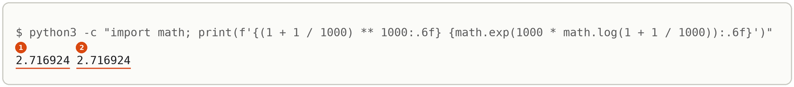

# The Limit That Defines E

Up: [[Sequences And Series]] · ⬅️ [[Maclaurin Series]]

Mathematics, Calculus, Sequences And Series. Needs: [[Maclaurin Series#The series for log(1 + y), and log cosh composed from it|the series for log(1 + y)]], and [[The Exponent Rules#Power of a power|the power of a power rule]].

> [!warning] Unfinished
> - The three drawn pictures (the form, the mechanism, the deep-dive sheet) are waiting: prompts 1 to 3 in the vault's `.prompts/The Limit That Defines E.md`, for `render-diagrams` to draw.
> - The script was run with the system `python3` (standard library only), not through the prepared environment `~/.vault-sandbox/bin/python`, which this machine (the cluster) does not have. Make it once with `uv venv ~/.vault-sandbox` then `uv pip install --python ~/.vault-sandbox/bin/python pandas numpy scipy matplotlib statsmodels openpyxl`, and run `limit.py` there.
> - No quiz page covers this note yet.

Claims marked stated: 1.

**A number just above 1, raised to a large power, can land anywhere: what decides it is the power times how far the base sits above 1. When the base is $1 + \frac{a}{n}$ and the power is $n$, that product is always $a$, and the result settles on $e^a$.** The route is through logs: $n\log(1 + \frac{a}{n}) = a - \frac{a^2}{2n} + \cdots$, which tends to $a$. The same steps survive extra terms inside the bracket that shrink faster than $\frac1n$, and that is the last step of the [[Central Limit Theorem]].

**Where you work.** Any terminal with Python 3 and a new empty folder. The script uses the standard library only.

## Table of contents

- [[#What the limit says and why it is here]]
- [[#The limit worked at a = 1 and a = -0.3]]
- [[#The method through logs, step by step]]
- [[#Where it goes wrong: the base tends to 1]]
- [[#Check the limit with the script]]
- [[#Reading the limit output]]
- [[#Other ways to the limit]]
- [[#Why the limit matters]]
- [[#The limit taught in, applied in]]

## What the limit says and why it is here

Navigation: 📋 [[#Table of contents|TOC]] | [[#The limit worked at a = 1 and a = -0.3]] ➡️

Textbook: [calculus textbook, Theorem 5.10.8 and its proof, p. 426](../../references/textbooks/calculus/calculus-textbook.pdf#page=426), and [Table 0.5.2, p. 79](../../references/textbooks/calculus/calculus-textbook.pdf#page=79).

A bank pays 100% interest a year. Paid once, 1 becomes 2. Paid as 50% twice, it becomes $1.5 \times 1.5 = 2.25$. Paid as $\frac{1}{n}$ of 100% at each of $n$ moments, it becomes $(1 + \frac1n)^n$, and however finely the year is cut the amount never passes about 2.718282. That ceiling is the number e. A rate of $a$ in place of 100% gives $e^a$, and a negative rate, a steady loss, gives $e^a$ below 1.

**The limit that defines e**, also the compound interest limit:

$$\lim_{n \to \infty}\left(1 + \frac{a}{n}\right)^n = e^a \qquad \text{for every real } a$$

The textbook proves the case $a = 1$ (Theorem 5.10.8, *cited*); [[#The method through logs, step by step]] proves every $a$ the same way (*derived*).

**Why it is here.** The [[Central Limit Theorem#The central limit theorem through fingerprints|central limit theorem through fingerprints]] ends with a fingerprint of the form $\left(1 + \frac{\lambda^2}{2n} + \text{smaller}\right)^n$, and this limit is what turns it into the bell's $e^{\lambda^2/2}$. Chan writes that step as $\left(1 + \frac{s^2}{2N}\right)^N \to e^{s^2/2}$ ([p. 390](../../references/textbooks/statistics/introduction-to-probability-for-data-science.pdf#page=390)).

```text
( 1  +  a / n ) ^ n        ->   e^a        as n grows
  |     |   |     |
  |     |   |     the power: how many times the base is multiplied
  |     |   the number of pieces the change is cut into
  |     the whole change, shared over the n pieces
  one, the starting amount
power x (base - 1) = n x (a / n) = a, the same for every n
```

> 🖼️ **Picture on its way**: the form, the bracket with its four slots named, beside the powers at $n = 1, 10, 100, 1000$ climbing to e for $a = 1$ and settling from below on $e^{-0.3}$ for $a = -0.3$. <!-- slot: assets/limit-for-e-the-form.webp · prompt: .prompts/The Limit That Defines E.md#prompt-1-subject-the-limit-for-e-the-form -->

## The limit worked at a = 1 and a = -0.3

Navigation: ⬅️ [[#What the limit says and why it is here]] | 📋 [[#Table of contents|TOC]] | [[#The method through logs, step by step]] ➡️

Each row takes the base $1 + \frac{a}{n}$, its log times $n$, the two-term prediction $a - \frac{a^2}{2n}$ of that log, and the power itself, which is $e^{n\log(\text{base})}$.

**$a = 1$**, against $e = 2.718282$:

| $n$ | base | $n\log(\text{base})$ | $a - \frac{a^2}{2n}$ | power |
|---|---|---|---|---|
| 1 | 2.000000 | 0.693147 | 0.500000 | 2.000000 |
| 10 | 1.100000 | $10 \times 0.0953102 = 0.953102$ | $1 - \frac{1}{20} = 0.950000$ | 2.593742 |
| 100 | 1.010000 | $100 \times 0.00995033 = 0.995033$ | $1 - \frac{1}{200} = 0.995000$ | 2.704814 |
| 1000 | 1.001000 | $1000 \times 0.000999500 = 0.999500$ | $1 - \frac{1}{2000} = 0.999500$ | 2.716924 |

**$a = -0.3$**, against $e^{-0.3} = 0.740818$:

| $n$ | base | $n\log(\text{base})$ | $a - \frac{a^2}{2n}$ | power |
|---|---|---|---|---|
| 1 | 0.700000 | $-0.356675$ | $-0.345000$ | 0.700000 |
| 10 | 0.970000 | $-0.304592$ | $-0.304500$ | 0.737424 |
| 100 | 0.997000 | $-0.300451$ | $-0.300450$ | 0.740484 |
| 1000 | 0.999700 | $-0.300045$ | $-0.300045$ | 0.740785 |

Three things to read off. The log column closes in on $a$, and from $n = 10$ the two-term prediction matches it to three or more decimals. The power approaches from below in both tables, because $-\frac{a^2}{2n}$ is negative for any $a$. The remaining gap is about $e^a \times \frac{a^2}{2n}$: at $a = 1$, $n = 1000$ it is $2.718282 - 2.716924 = 0.001358$ against $2.718282 \times 0.0005 = 0.001359$. At $n = 1$ the prediction is poor because $\frac{a}{n} = 1$ sits at the edge of where the log series holds. *Shown* by markers 1 to 6 of the run, and *derived* in the next section.

## The method through logs, step by step

Navigation: ⬅️ [[#The limit worked at a = 1 and a = -0.3]] | 📋 [[#Table of contents|TOC]] | [[#Where it goes wrong: the base tends to 1]] ➡️

Textbook: [calculus textbook, equation (10), p. 697](../../references/textbooks/calculus/calculus-textbook.pdf#page=697), and [Theorem 1.5.5, p. 138](../../references/textbooks/calculus/calculus-textbook.pdf#page=138).

1. **Write the base as $1 + \frac{a}{n}$**, and read $a$ off as the power times how far the base sits above 1: $a = n \times (\text{base} - 1)$.
2. **Move the power into an exponent.** The base equals $e^{\log(\text{base})}$, so by the power of a power rule
   $$\left(1 + \frac{a}{n}\right)^n = \left(e^{\log(1 + a/n)}\right)^n = e^{\,n\log(1 + a/n)}$$
3. **Expand the log** with $y = \frac{a}{n}$, which lies inside $-1 < y \le 1$ once $n \ge |a|$:
   $$\log\left(1 + \frac{a}{n}\right) = \frac{a}{n} - \frac{a^2}{2n^2} + \frac{a^3}{3n^3} - \cdots$$
4. **Multiply by $n$.** Each term loses one power of $n$ from its denominator:
   $$n\log\left(1 + \frac{a}{n}\right) = a - \frac{a^2}{2n} + \frac{a^3}{3n^2} - \cdots$$
5. **Let $n$ grow.** The first term is $a$ and does not depend on $n$. Every later term has $n$ in its denominator, so it shrinks to 0, and the sum tends to $a$.
6. **Pass the limit through the exponential.** $e^u$ is continuous, so a limit can move inside it ([Theorem 1.5.5](../../references/textbooks/calculus/calculus-textbook.pdf#page=138)): $e^{n\log(1 + a/n)} \to e^{a}$. *Derived*; the textbook runs the same two moves for $a = 1$ on p. 426 (*cited*).
7. **If the bracket holds more terms**, check that each shrinks faster than $\frac1n$, and repeat steps 3 to 5. With $1 + \frac{a}{n} + \frac{c}{n^2}$, the log is $\frac{a}{n} + \frac{c}{n^2} - \frac{a^2}{2n^2} + (\text{terms in } n^{-3})$, and times $n$ it is $a + \frac{c - a^2/2}{n} + \cdots$, which still tends to $a$. The extra term moves the gap, never the limit.
8. **Check numerically** at a few $n$, as in [[#Check the limit with the script]].

**The extra term, worked.** At $a = 1$, $c = 3$, step 7 predicts $n\log(1 + \frac1n + \frac{3}{n^2}) \approx 1 + \frac{2.5}{n}$: 1.25, 1.025 and 1.0025 at $n = 10, 100, 1000$. The run prints 1.222176, 1.024732 and 1.002497 (marker 9). In the central limit theorem the extra terms are of size $n^{-3/2}$, which also shrinks faster than $\frac1n$: times $n$ it is $n^{-1/2}$, and that goes to 0.

**Redo it on new numbers.** Take $a = 2$ at $n = 100$, then Chan's bracket $\left(1 + \frac{s^2}{2N}\right)^N$ at $s = 1$, $N = 100$.

> [!example]- Answers, with every value
> - $a = 2$, $n = 100$: base 1.02; $100\log 1.02 = 1.980263$ against $2 - \frac{4}{200} = 1.980000$; the power $1.02^{100} = 7.244646$ against $e^2 = 7.389056$.
> - Chan's bracket: $a = \frac{s^2}{2} = 0.5$, so the base is $1 + \frac{0.5}{100} = 1.005$; $100\log 1.005 = 0.498754$ against $0.5 - \frac{0.25}{200} = 0.498750$; the power $1.005^{100} = 1.646668$ against $e^{0.5} = 1.648721$.

## Where it goes wrong: the base tends to 1

Navigation: ⬅️ [[#The method through logs, step by step]] | 📋 [[#Table of contents|TOC]] | [[#Check the limit with the script]] ➡️

**The slip:** "the base $1 + \frac{a}{n}$ tends to 1, and 1 to any power is 1, so the limit is 1." The run says otherwise. $1.001^{1000} = 2.716924$, not 1 (marker 7's line). The slip takes the limit of the base before the power, when the two grow together.

The numbers show what decides the answer, the power times how far the base sits above 1:

| base | power | power $\times$ (base $-$ 1) | result | $e^{\text{that product}}$ |
|---|---|---|---|---|
| 1.001 | 1000 | 1 | 2.716924 | $e^1 = 2.718282$ |
| 1.001 | 10000 | 10 | 21916.681339 | $e^{10} = 22026.465795$ |
| 1.0001 | 1000 | 0.1 | 1.105165 | $e^{0.1} = 1.105171$ |

A base held at 1.001 while the power grows runs off to infinity; a base that closes in on 1 faster than the power grows gives back 1. Only the pairing $1 + \frac{a}{n}$ with power $n$ holds the product at $a$, and that is what pins the result at $e^a$. *Shown* by markers 7 and 8, with the $e$ column *derived* from steps 2 to 6.

## Check the limit with the script

Navigation: ⬅️ [[#Where it goes wrong: the base tends to 1]] | 📋 [[#Table of contents|TOC]] | [[#Reading the limit output]] ➡️

1. **What you need, and the check.** Python 3.8 or later: `python3 --version`. This run printed `Python 3.12.10`.
2. **When it is missing.** Install Python 3 from python.org or the system's package manager (*stated*), or use `~/.vault-sandbox/bin/python` in place of `python3`. The script imports only `math`.
3. **The setup.** Make an empty folder and work in it:

   ```bash
   mkdir -p ~/playground/sandbox/limit-for-e && cd ~/playground/sandbox/limit-for-e
   ```

   Save this as `limit.py`:

   ```python
   import math

   for a in [1, -0.3]:
       print(f"a = {a}: e^a = {math.exp(a):.6f}")
       for n in [1, 10, 100, 1000]:
           base = 1 + a / n
           print(f"  n = {n:4d}: base {base:.6f}  n log(base) {n * math.log(base):.6f}"
                 f"  a - a^2/(2n) {a - a * a / (2 * n):.6f}  power {base ** n:.6f}")

   print("slip, the base goes to 1 so the power goes to 1:")
   for base, n in [(1.001, 1000), (1.001, 10000), (1.0001, 1000)]:
       print(f"  {base} ^ {n} = {base ** n:.6f}")

   print("an extra 3/n^2 inside, a = 1:")
   for n in [10, 100, 1000]:
       print(f"  n = {n:4d}: n log(1 + 1/n + 3/n^2) = {n * math.log(1 + 1 / n + 3 / n ** 2):.6f}")
   ```

4. **A look before.** Before running, predict the $a = 1$, $n = 10$ row by hand: $1.1^{10}$ is $1.1^2 = 1.21$, squared to $1.4641$, squared to $2.143589$, times $1.21$ is 2.593742.
5. **The failure without the method.** The three `slip` lines are the slip from [[#Where it goes wrong: the base tends to 1]]: none of them is 1.
6. **The run.** `python3 limit.py` prints:

   

7. **Another way to the same answer.** Compute the power directly and through its log, which is step 2 of the method:

   ```bash
   python3 -c "import math; print(f'{(1 + 1 / 1000) ** 1000:.6f} {math.exp(1000 * math.log(1 + 1 / 1000)):.6f}')"
   ```

   

   The textbook's Table 0.5.2 on [p. 79](../../references/textbooks/calculus/calculus-textbook.pdf#page=79) lists $(1 + \frac1x)^x$ as 2.000000, 2.593742, 2.704814 and 2.716924 at $x = 1, 10, 100, 1000$, the run's $a = 1$ column to six places. *Cited.*
8. **More worked examples on the same setup.** The redo answers in [[#The method through logs, step by step]] come from changing `[1, -0.3]` to `[2]` or `[0.5]` and reading the `n = 100` row.
9. **The clean-up**, proven by looking for the folder afterwards:

   ```bash
   cd ~ && rm -r ~/playground/sandbox/limit-for-e
   ls ~/playground/sandbox/limit-for-e; echo $?
   ```

   You should see `No such file or directory`, then `2`.

> 🖼️ **Picture on its way**: the mechanism, the power moved into an exponent and the log expanded, with the $n$ cancelling one power of $n$ from each term so only $a$ survives, then $e$ raised to it. <!-- slot: assets/limit-for-e-the-mechanism.webp · prompt: .prompts/The Limit That Defines E.md#prompt-2-subject-the-limit-for-e-the-mechanism -->

> 🖼️ **Picture on its way**: the deep-dive sheet composing the form, the log route, four lines of the `limit.py` run with their markers, the reading cards and the step where the central limit theorem uses the limit. <!-- slot: assets/limit-for-e-deep-dive-sheet.webp · prompt: .prompts/The Limit That Defines E.md#prompt-3-subject-capstone-the-limit-for-e-the-deep-dive-sheet -->

## Reading the limit output

Navigation: ⬅️ [[#Check the limit with the script]] | 📋 [[#Table of contents|TOC]] | [[#Other ways to the limit]] ➡️

| # | Field | This run | How to read it | Backing |
|---|---|---|---|---|
| 1 | `e^a` at $a = 1$ | 2.718282 | the target, e | shown |
| 2 | `n log(base)` at $n = 1000$ | 0.999500 | the log of the power, closing in on $a = 1$ | derived in step 4 |
| 3 | `a - a^2/(2n)` at $n = 1000$ | 0.999500 | the two-term prediction, equal to field 2 to six places | derived in step 4 |
| 4 | `power` at $n = 1000$ | 2.716924 | $e^{0.999500}$, short of e by 0.001358 | shown; cited, p. 79 |
| 5 | `e^a` at $a = -0.3$ | 0.740818 | the target for a steady loss | shown |
| 6 | `power` at $n = 1000$, $a = -0.3$ | 0.740785 | short by 0.000033, which is $0.740818 \times \frac{0.09}{2000}$ | derived |
| 7 | $1.001^{10000}$ | 21916.681339 | the base held fixed while the power grows: no limit at all | shown |
| 8 | $1.0001^{1000}$ | 1.105165 | the base closing in faster: about $e^{0.1}$, near 1 | shown |
| 9 | the extra-term line at $n = 1000$ | 1.002497 | $1 + \frac{2.5}{1000}$ to four places: the extra $\frac{3}{n^2}$ moves the gap and the limit is still 1 | derived in step 7 |
| check 1, 2 | the power, two ways | 2.716924 twice | $(1 + \frac1n)^n$ and $e^{n\log(1 + 1/n)}$ are the same number | derived in step 2 |

## Other ways to the limit

Navigation: ⬅️ [[#Reading the limit output]] | 📋 [[#Table of contents|TOC]] | [[#Why the limit matters]] ➡️

**The derivative of the log at 1.** The textbook's proof on [p. 426](../../references/textbooks/calculus/calculus-textbook.pdf#page=426) uses $\lim_{x \to 0} \frac{\log(1 + x)}{x} = 1$, which is the slope of $\log$ at 1, in place of the series. It needs only one term, and it gives no size for the gap.

**The binomial expansion.** Expanding $(1 + \frac{a}{n})^n$ term by term gives $1 + a + \frac{n(n-1)}{n^2}\frac{a^2}{2!} + \cdots$, which approaches the $e^a$ series as $n$ grows (*stated*). It shows where the factorials come from, and it is longer to make rigorous than the log route.

## Why the limit matters

Navigation: ⬅️ [[#Other ways to the limit]] | 📋 [[#Table of contents|TOC]] | [[#The limit taught in, applied in]] ➡️

A fingerprint of a scaled sum of $n$ independent draws is a power $M(\cdot)^n$, and each factor sits just above 1. Whether that power settles, blows up, or flattens to 1 is exactly the question this note answers, and the answer depends on how the base's distance from 1 compares with $\frac1n$. Scaling by $\frac{1}{\sqrt n}$ puts the distance at $\frac{\lambda^2}{2n}$, and the limit gives $e^{\lambda^2/2}$; [[Central Limit Theorem#Where it goes wrong: the wrong scaling]] shows the other two outcomes with numbers.

## The limit taught in, applied in

Navigation: ⬅️ [[#Why the limit matters]] | 📋 [[#Table of contents|TOC]]

**Taught in.** No plan or chapter in the learning tree teaches this limit.

**Applied in:** nothing yet.

**Used by other notes:** [[Central Limit Theorem#The method, step by step]], whose last two steps are this note's steps 4 to 6.

> [!note]- How this was checked
> Written on 2026-10-21 on the cluster (mscluster, Linux) by vault-writer, from a quiz-preparation gap fill for the Moment Generating Function quiz, whose audit found no passage teaching $(1 + \frac{a}{n})^n \to e^a$ or the extra-term step. `limit.py` and the one-line second route were run with the system Python 3.12.10, standard library only, in the empty folder `~/playground/sandbox/limit-for-e`, each exiting 0; the folder was removed afterwards and the clean-up check returned 2. The prepared environment `~/.vault-sandbox` does not exist on this machine. Every number the brief gave (2.000000, 2.593742, 2.704814, 2.716924 against 2.718282; 0.700000, 0.737424, 0.740484, 0.740785 against 0.740818) was printed by the run. The gap 0.001358 and its prediction 0.001359, $e^{10} = 22026.465795$, $e^{0.1} = 1.105171$, the hand value $1.1^{10}$ and the redo answers were recomputed with Python's `math` module to the digits shown. The two output pictures were rendered from the captured text with Pillow in DejaVu Sans Mono, never drawn, and each was opened before filing.
>
> Textbook pages opened and read as text with PyMuPDF before linking: the calculus textbook's PDF pp. 79 (Table 0.5.2), 138 (Theorem 1.5.5), 426 (Theorem 5.10.8 and its proof) and 697 (equation (10)); Chan's p. 390.
>
> Claims marked stated, 1: that the binomial expansion of $(1 + \frac{a}{n})^n$ approaches the $e^a$ series as $n$ grows ([[#Other ways to the limit]]); not checked here. The learner's LibreOffice notes are not reachable from the cluster, so none was read for this note. A video segment on continuous compounding (Professor Leonard, Precalculus 65, from the [video lessons index](../../references/videos/Video%20Lessons.md)) is a row for `video-pulse` to copy in.
