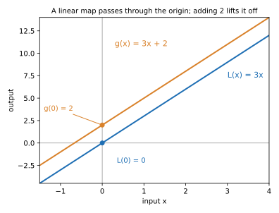
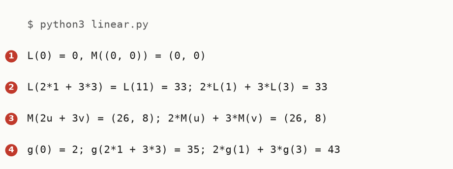

# Linear Map

Up: [[Linear Algebra]] · ⬅️ [[Matrix]] · [[Affine Map]] ➡️

Mathematics, Linear Algebra. Needs: [[Vector]], and a [[Matrix]] times a vector. [[Affine Map]] builds on it by adding a fixed vector.

**A linear map sends a weighted sum of inputs to the same weighted sum of their outputs, so it always sends 0 to 0.**

> [!question]- Test yourself
> No quiz page covers this note yet.

> [!warning]- Unfinished
> - The three drawn pictures (the form, the mechanism and the deep-dive sheet) are waiting: prompts 1 to 3 in the vault's `.prompts/Linear Map.md`.
> - No quiz page for this note yet.

Claims marked stated: 0.

Colour key for every equation in this note: $\color{#1f6fb4}{\text{blue}}$ is the map, $\color{#2e8b57}{\text{green}}$ are the weights, $\color{#d9822b}{\text{orange}}$ is a fixed number added after the map, which a linear map never has.

## Table of contents

- [[#What a linear map is]]
- [[#Try a linear map yourself]]
- [[#Reading the linear-map output]]
- [[#How a linear map works]]
- [[#Other ways to say linear]]
- [[#Why linear maps matter]]
- [[#Linear map taught in, applied in]]
- [[#Where to learn this]]

## What a linear map is

Navigation: 📋 [[#Table of contents|TOC]] | [[#Try a linear map yourself]] ➡️

Textbook: [Mathematics for machine learning, Definition 2.15, PDF p. 54](../references/textbooks/machine-learning/mathematics-for-machine-learning.pdf#page=54) · [Linear algebra textbook, section 8.1, Definition 1, PDF p. 461](../references/textbooks/linear-algebra/linear-algebra-textbook.pdf#page=461) · [its Theorem 8.1.1, T(0) = 0, PDF p. 462](../references/textbooks/linear-algebra/linear-algebra-textbook.pdf#page=462)

**Linear map**, also a linear mapping or linear transformation: a rule $f$ from vectors to vectors with $f(a\,u + b\,v) = a\,f(u) + b\,f(v)$ for every pair of inputs $u, v$ and every pair of numbers $a, b$. *Cited:* Definition 2.15.

**When to reach for it.** Whenever you want to know whether you may mix inputs first and apply the rule after, or apply the rule first and mix after. A linear map gives the same answer both ways. A rule that adds a fixed number after multiplying, such as $g(x) = 3x + 2$, does not, and treating it as linear is the slip [[Affine Map]] is about.

### Map

A map is a rule that takes one input and returns one output: a vector in, a vector out. Multiplying a number by 3 is a map from numbers to numbers.

### Linear

Linear names the promise the map keeps: weighted sums pass through it unchanged in shape. Scale an input and the output scales by the same number. Add two inputs and the outputs add.

### All the words together: the formula

$$
f(a\,u + b\,v) = a\,f(u) + b\,f(v)
$$

$$
\underbrace{\color{#1f6fb4}{f}\big(\color{#2e8b57}{a}\,u + \color{#2e8b57}{b}\,v\big)}_{\text{mix the inputs, then map}}
\;=\;
\underbrace{\color{#2e8b57}{a}\,\color{#1f6fb4}{f}(u) + \color{#2e8b57}{b}\,\color{#1f6fb4}{f}(v)}_{\text{map each input, then mix the outputs}}
$$

**What the equation says.** Mixing the inputs and then mapping gives the same vector as mapping each input and mixing the outputs with the same weights. The weights $a$ and $b$ are any numbers at all, including negative ones and ones that do not add to 1.

**Why the sum is there.** It says a linear map has no favourite point to measure from. With $f(x) = 3x$, $a = 2$, $b = 3$, $u = 1$ and $v = 3$: mixing first gives $f(2 + 9) = f(11) = 33$, and mapping first gives $2 \times 3 + 3 \times 9 = 33$. The same 33 (output line 2 of the run below).

### The consequence: 0 goes to 0

Put $a = 0$: $f(0) = f(0 \cdot u) = 0 \cdot f(u) = 0$. *Derived* here, and stated as part (a) of [Theorem 8.1.1](../references/textbooks/linear-algebra/linear-algebra-textbook.pdf#page=462). So any rule with $f(0) \neq 0$ is not linear, which is the quickest test there is: $g(x) = 3x + 2$ gives $g(0) = 2$.

<table>
<tr><th>rule</th><th>f(0)</th><th>mix first: f(2·1 + 3·3)</th><th>map first: 2·f(1) + 3·f(3)</th><th>linear?</th></tr>
<tr style="background:#eef5fc"><td><code>L(x) = 3x</code></td><td><b>0</b></td><td><b>33</b></td><td><b>33</b></td><td>yes</td></tr>
<tr><td><code>g(x) = 3x + 2</code></td><td><b>2</b></td><td>35</td><td>43</td><td>no</td></tr>
</table>

**How to read this table.** Each row is one rule, tried on the inputs 1 and 3 with weights 2 and 3. The two middle columns are the two orders of the equation above.

**What to look for.** The blue row agrees with itself and sends 0 to 0. The second row misses on both counts, and its two orders differ by 8, which is the 2 it adds counted $2 + 3 - 1 = 4$ times over ([[Affine Map#How an affine map works]] derives that count).



```python
import matplotlib
matplotlib.use("Agg")
import matplotlib.pyplot as plt
xs = [-1.5, 4]
fig, ax = plt.subplots(figsize=(5.5, 4.2))
ax.axhline(0, color="#999", lw=0.8); ax.axvline(0, color="#999", lw=0.8)
ax.plot(xs, [3 * x for x in xs], color="#1f6fb4", lw=2)
ax.plot(xs, [3 * x + 2 for x in xs], color="#d9822b", lw=2)
ax.text(3.0, 7.3, "L(x) = 3x", color="#1f6fb4", fontsize=11)
ax.text(0.3, 10.8, "g(x) = 3x + 2", color="#d9822b", fontsize=11)
ax.plot([0], [0], "o", color="#1f6fb4"); ax.annotate("L(0) = 0", (0, 0), (0.35, -2.2), fontsize=10, color="#1f6fb4")
ax.plot([0], [2], "o", color="#d9822b"); ax.annotate("g(0) = 2", (0, 2), (-1.4, 3.6), fontsize=10, color="#d9822b",
                                                     arrowprops=dict(arrowstyle="-", color="#d9822b"))
ax.set_xlabel("input x"); ax.set_ylabel("output")
ax.set_title("A linear map passes through the origin; adding 2 lifts it off", fontsize=10)
ax.set_xlim(-1.5, 4); ax.set_ylim(-4.5, 14)
fig.tight_layout(); fig.savefig("assets/linear-map-through-the-origin.svg")
```

**How to read this.** The x axis is the input, the y axis the output, and each line is one rule drawn over inputs from −1.5 to 4. Look at where each line crosses x = 0: the blue line at 0, the orange one at 2.

*🖼️ Diagram wanted: the form, a weighted sum of two arrows going into the map and the same weighted sum of their images coming out. Prompt 1 in the vault's `.prompts/Linear Map.md`.*

## Try a linear map yourself

Navigation: ⬅️ [[#What a linear map is]] | 📋 [[#Table of contents|TOC]] | [[#Reading the linear-map output]] ➡️

**1. What you need.** Python 3.6 or later:

```bash
python3 --version
```

You should see a version line. This run printed `Python 3.12.3`.

**2. When it is missing.** Install Python 3 from python.org, or run `uv python install 3.12`. Not run on this machine, which already has it.

**3. Make something to act on.** Make an empty folder and go into it:

```bash
mkdir -p ~/playground/sandbox/linear-map && cd ~/playground/sandbox/linear-map
```

Save this as `linear.py`. Lines 2 to 5 are the two linear maps: multiply by 3, and the matrix $\begin{pmatrix}2 & 1\\ 0 & 1\end{pmatrix}$ times a two-number vector. Line 13 is a rule that is not linear, for contrast.

```python
# Check the linear-map rule f(a*u + b*v) = a*f(u) + b*f(v) on a number line and on the plane.
def L(x):                     # one dimension: multiply by 3
    return 3 * x
def M(v):                     # two dimensions: the matrix [[2, 1], [0, 1]] times v
    return (2 * v[0] + 1 * v[1], 0 * v[0] + 1 * v[1])
def comb(a, u, b, v):         # a*u + b*v for two-number vectors
    return (a * u[0] + b * v[0], a * u[1] + b * v[1])
a, b = 2, 3
print(f"L(0) = {L(0)}, M((0, 0)) = {M((0, 0))}")
print(f"L(2*1 + 3*3) = L(11) = {L(a * 1 + b * 3)}; 2*L(1) + 3*L(3) = {a * L(1) + b * L(3)}")
u, v = (3, 1), (1, 2)
print(f"M(2u + 3v) = {M(comb(a, u, b, v))}; 2*M(u) + 3*M(v) = {comb(a, M(u), b, M(v))}")
g = lambda x: 3 * x + 2       # not linear: it adds 2 after multiplying
print(f"g(0) = {g(0)}; g(2*1 + 3*3) = {g(a * 1 + b * 3)}; 2*g(1) + 3*g(3) = {a * g(1) + b * g(3)}")
```

**4. A look before.** Run it:

```bash
python3 linear.py
```

You should see:



Line 1 (script line 9) is the look before anything is mixed: both linear maps send the zero input to zero.

**5. The failure without the technique.** Line 4 (script line 14) treats $g(x) = 3x + 2$ as if it were linear: mixing first gives 35 and mapping first gives 43. The rule $g$ adds 2 after multiplying, so $g(0) = 2$ and the two orders part.

**6. The technique.** Line 2 (script line 10) runs the rule on $L(x) = 3x$: $L(11) = 33$ and $2 \times 3 + 3 \times 9 = 33$.

**7. Another way to get the same answer.** Line 3 (script line 12) runs it on the plane with a matrix in place of 3. With $u = (3, 1)$ and $v = (1, 2)$, $2u + 3v = (9, 8)$ and $M(9, 8) = (2 \cdot 9 + 8,\ 8) = (26, 8)$. Mapping first gives $M(u) = (7, 1)$ and $M(v) = (4, 2)$, and $2(7, 1) + 3(4, 2) = (26, 8)$.

**8. More worked examples on the same setup.** Change line 8 to `a, b = 0.5, 0.5` and run again. The printed labels still say `2*1 + 3*3`, because they are fixed text; the numbers after them are the new ones. Lines 2 and 3 still agree (`6.0` against `6.0`, and `(5.5, 1.5)` against `(5.5, 1.5)`), and line 4 now agrees too (`8.0` against `8.0`), because weights that add to 1 are the one case where $g$ also behaves. That case is [[Affine Map#Affine combination]].

**9. Clean up, and prove it.**

```bash
cd ~ && rm -r ~/playground/sandbox/linear-map
ls ~/playground/sandbox/linear-map; echo $?
```

You should see `No such file or directory`, then `2`.

## Reading the linear-map output

Navigation: ⬅️ [[#Try a linear map yourself]] | 📋 [[#Table of contents|TOC]] | [[#How a linear map works]] ➡️

| # | Field | This run | How to read it | Backing |
|---|---|---|---|---|
| 1 | `L(0)`, `M((0, 0))` | `0`, `(0, 0)` | the zero input lands on zero, as every linear map must | shown, derived above |
| 2 | `L(11)` against `2*L(1) + 3*L(3)` | `33` and `33` | mix then map equals map then mix, on a number line | shown |
| 3 | `M(2u + 3v)` against `2*M(u) + 3*M(v)` | `(26, 8)` and `(26, 8)` | the same on the plane, with a matrix as the map | shown |
| 4 | `g(0)`; `g(11)` against `2*g(1) + 3*g(3)` | `2`; `35` and `43` | a rule with an added 2 misses 0 and the two orders differ by 8 | shown; the 8 derived in [[Affine Map#How an affine map works]] |

## How a linear map works

Navigation: ⬅️ [[#Reading the linear-map output]] | 📋 [[#Table of contents|TOC]] | [[#Other ways to say linear]] ➡️

Textbook: [Linear algebra textbook, Theorem 1.8.3, PDF p. 93](../references/textbooks/linear-algebra/linear-algebra-textbook.pdf#page=93)

The rule splits into two properties, each the full rule with one weight set aside:

$$
\begin{aligned}
f(u + v) &= f(u) + f(v) && \text{put } a = b = 1 \\
f(a\,u) &= a\,f(u) && \text{put } b = 0 \\
f(0) &= f(0 \cdot u) = 0 \cdot f(u) = 0 && \text{put } a = 0 \text{ in the line above}
\end{aligned}
$$

The linear algebra textbook calls the first additivity and the second homogeneity ([Definition 1, PDF p. 461](../references/textbooks/linear-algebra/linear-algebra-textbook.pdf#page=461)).

**Every linear map from $\mathbb{R}^n$ to $\mathbb{R}^m$ is a matrix times the vector.** That is [Theorem 1.8.3](../references/textbooks/linear-algebra/linear-algebra-textbook.pdf#page=93), and the matrix's columns are where the map sends the basis vectors $(1, 0, \dots)$, $(0, 1, \dots)$ and so on. *Cited.* The worked numbers: $M$ in the sandbox sends $(1, 0)$ to $(2, 0)$ and $(0, 1)$ to $(1, 1)$, which are its two columns, so $M(9, 8) = 9\,(2, 0) + 8\,(1, 1) = (26, 8)$, field 3.

**The method, to test a rule on new numbers.**

1. Compute $f(0)$. If it is not 0, stop: the rule is not linear.
2. Pick two inputs and two weights that do not add to 1, say 2 and 3.
3. Mix first and map; then map first and mix. Linear rules give the same vector.
4. A pass on one try is evidence, not proof. Proof is showing the rule is a matrix product.

*🖼️ Diagram wanted: the mechanism, the basis arrows (1, 0) and (0, 1) carried to the matrix's columns (2, 0) and (1, 1), and (9, 8) rebuilt from them. Prompt 2 in the vault's `.prompts/Linear Map.md`.*

*🖼️ Diagram wanted: the deep-dive sheet composing the form, the mechanism and the run. Prompt 3 in the same file.*

## Other ways to say linear

Navigation: ⬅️ [[#How a linear map works]] | 📋 [[#Table of contents|TOC]] | [[#Why linear maps matter]] ➡️

- **A matrix transformation**, the linear algebra textbook's name for $x \mapsto A x$ ([section 1.8, PDF p. 91](../references/textbooks/linear-algebra/linear-algebra-textbook.pdf#page=91)); for maps between $\mathbb{R}^n$ and $\mathbb{R}^m$ the two names mean the same thing, by Theorem 1.8.3.
- **A vector space homomorphism**, Mathematics for Machine Learning's formal name in Definition 2.15.
- **"Linear function" in school algebra** means $y = mx + b$, which is an [[Affine Map]] unless $b = 0$. The same word, two meanings, so this note does not take it as an alias.

## Why linear maps matter

Navigation: ⬅️ [[#Other ways to say linear]] | 📋 [[#Table of contents|TOC]] | [[#Linear map taught in, applied in]] ➡️

Every layer of a neural network starts with one (a weight matrix times the input), and every argument that "the output of a sum is the sum of the outputs" needs the map to be linear. When there is a fixed vector added after the matrix, as there is in almost every layer, the argument only survives for weights that add to 1, which is what [[Affine Map]] works out.

## Linear map taught in, applied in

Navigation: ⬅️ [[#Why linear maps matter]] | 📋 [[#Table of contents|TOC]] | [[#Where to learn this]] ➡️

**Taught in:** no plan or chapter teaches it yet. The goal that will is "spaces and linear maps" in the [linear algebra master plan](/home/molef/goal-setting/learning/mathematics/linear-algebra/MASTER_PLAN.md).

**Applied in:** the and-vector idea walk in the poe_repair_min research repository (`artifacts/ideas/the-and-vector-as-a-third-expert/`, claim 1), which asked whether SDXL's noise prediction passes a sum of prompt encodings through like a linear map. It does not, and the closest property that could hold is the affine one, in [[Affine Map#Affine map taught in, applied in]].

## Where to learn this

Navigation: ⬅️ [[#Linear map taught in, applied in]] | 📋 [[#Table of contents|TOC]]

**Linear map**, a rule that passes weighted sums through. Also: linear mapping, linear transformation, matrix transformation.

**Textbooks**

- Mathematics for machine learning, section 2.7, Definition 2.15: [page 54](../references/textbooks/machine-learning/mathematics-for-machine-learning.pdf#page=54). The definition Φ(λx + ψy) = λΦ(x) + ψΦ(y), and that linear mappings can be written as matrices.
- Linear algebra textbook, section 1.8: [pages 91 to 93](../references/textbooks/linear-algebra/linear-algebra-textbook.pdf#page=91). Matrix transformations, their four properties (Theorem 1.8.1), and Theorem 1.8.3 on page 93: every linear transformation from Rⁿ to Rᵐ is a matrix transformation.
- Linear algebra textbook, section 8.1: [pages 461 to 464](../references/textbooks/linear-algebra/linear-algebra-textbook.pdf#page=461). Linear transformations between general vector spaces, T(0) = 0 (Theorem 8.1.1, page 462), and Example 8 on page 464, translation is not linear.
- Algebra handbook, linear combination of functions: [page 53](../references/textbooks/algebra/algebra-handbook.pdf#page=53). The weighted sum a₁f₁ + … + aₙfₙ that a linear map passes through, written for functions.

**Videos**

- 3Blue1Brown, Linear transformations and matrices (Essence of linear algebra, chapter 3), Linearity properties, 2:30 to 3:32: [watch](https://www.youtube.com/watch?v=kYB8IZa5AuE&t=150s). Lines stay lines and the origin stays fixed, the picture of what linear means. Chapter-timed.
- 3Blue1Brown, the same video, Basis vectors and matrices, 3:32 to 6:18: [watch](https://www.youtube.com/watch?v=kYB8IZa5AuE&t=212s). The map read off from where the two basis vectors land, which is Theorem 1.8.3. Chapter-timed.

**Our plans and chapters**

- [The linear algebra master plan](/home/molef/goal-setting/learning/mathematics/linear-algebra/MASTER_PLAN.md), mathematics/linear-algebra. Its goal "spaces and linear maps" is where a plan teaching this will sit.

> [!note]- How this was checked
> `linear.py` was run on 2026-10-28 on the PC (WSL2 Ubuntu), with Python 3.12.3 and the standard library only, by vault-writer, in the empty folder `~/playground/sandbox/linear-map` with `HOME` pointed at a scratch folder, so every command above ran byte for byte and nothing was written outside the vault. It was run twice and printed the same four lines. The folder was removed afterwards and the clean-up check returned 2. Step 8's change of weights was worked by hand: $L(0.5 + 1.5) = L(2) = 6$ and $0.5 \cdot 3 + 0.5 \cdot 9 = 6$, and $g(2) = 8 = 0.5 \cdot 5 + 0.5 \cdot 11$. The terminal picture was rendered from the captured text by a script in DejaVu Sans Mono, never drawn, and opened before filing. The figure script above was run with `~/.vault-sandbox/bin/python` (matplotlib 3.11.2) and its picture opened. Every textbook page was opened with pdftotext and read: MML PDF p. 54 (Definition 2.15), the linear algebra textbook PDF pp. 91 to 93 (section 1.8, Theorem 1.8.3 on p. 93), p. 461 (Definition 1), p. 462 (Theorem 8.1.1) and p. 464 (Example 8); the algebra handbook p. 53. The 3Blue1Brown chapter times come from the cached chapter list `~/.claude/cache/video-chapters/kYB8IZa5AuE.json` and describe only the chapter titles. "linear map" appears in 14 learning-tree files and "linear transformation" in 210, sampled as meaning this idea; "linear function" is left out because school algebra uses it for y = mx + b.
