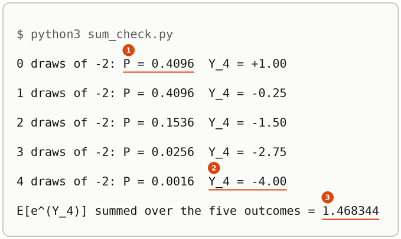

# Central Limit Theorem

Up: [[Statistics]] · ⬅️ [[Moment Generating Function]] · [[Distributions]] ➡️

Mathematics, Statistics. Needs: [[Moment Generating Function]] for the fingerprint and its product rule, [[Maclaurin Series#The series for log(1 + y), and log cosh composed from it|the series for log(1 + y)]], [[The Limit That Defines E#The method through logs, step by step|the limit (1 + a/n)^n to e^a]], [[Variance#Scaling a draw scales its variance by the square|how scaling moves a variance]] and [[The Average Of A Product Of Independent Variables#What independence does to the average of a product|the average of a product of independent variables]].

> [!warning] Unfinished
> - The three drawn pictures (the form, the mechanism, the deep-dive sheet) are waiting: prompts 1 to 3 in the vault's `.prompts/Central Limit Theorem.md`, for `render-diagrams` to draw.
> - The scripts were run with the system `python3` (standard library only), not through the prepared environment `~/.vault-sandbox/bin/python`, which this machine (the cluster) does not have. Make it once with `uv venv ~/.vault-sandbox` then `uv pip install --python ~/.vault-sandbox/bin/python pandas numpy scipy matplotlib statsmodels openpyxl`, and run the three scripts there.
> - No quiz page covers this note yet.

Claims marked stated: 1.

**Add up many independent draws of almost any variable, scale the sum by one over the square root of how many there are, and the sum's distribution approaches the standard bell, whatever shape a single draw had.** This note shows the fingerprints of a lopsided variable's scaled sums closing in on the bell's $e^{\lambda^2/2}$, says what that does and does not prove, and reaches the same conclusion a second way, through the fourth moment of a sum.

**Where you work.** Any terminal with Python 3 and a new empty folder. The three scripts use the standard library only, and the variable in them is made up.

## Table of contents

- [[#The central limit theorem through fingerprints]]
- [[#The fourth moment of a sum]]
- [[#Check the theorem with the scripts]]
- [[#Reading the theorem output]]
- [[#Other ways to see the bell arrive]]
- [[#Why the theorem matters]]
- [[#The theorem taught in, applied in]]

## The central limit theorem through fingerprints

Navigation: 📋 [[#Table of contents|TOC]] | [[#The fourth moment of a sum]] ➡️

Textbook: [probability for data science, Theorem 6.19, p. 388](../references/textbooks/statistics/introduction-to-probability-for-data-science.pdf#page=388), and the proof by fingerprints on [pp. 390 to 391](../references/textbooks/statistics/introduction-to-probability-for-data-science.pdf#page=390).

### What the theorem says and why it is here

A single draw can have any shape: lopsided, lumpy, two spikes. Add $n$ independent draws and the total drifts and spreads, its spread growing like $\sqrt n$. Shift the total so its average is 0 and divide by its spread, so that it has mean 0 and variance 1 at every $n$. As $n$ grows, the shape of that standardised total becomes the standard bell, and the single draw's own shape is forgotten. That is why a sum of many small independent noises can be replaced by one Gaussian draw, and why an interval for a sample average can be read off the bell ([Corollary 6.3, p. 389](../references/textbooks/statistics/introduction-to-probability-for-data-science.pdf#page=389)).

**Central limit theorem**, also the CLT: let $X_1, \ldots, X_n$ be independent draws of one variable with mean $\mu$, variance $\sigma^2$ and $\mathbb{E}|X^3| < \infty$. The standardised sum $Z_n = \frac{1}{\sigma\sqrt n}\sum_{i=1}^{n}(X_i - \mu)$ has a cumulative distribution function that tends to the standard normal's, $\Phi(z)$, at every $z$. *Cited:* Theorem 6.19. For a variable already shifted and scaled to mean 0 and variance 1, the standardised sum is

$$Y_n = \frac{1}{\sqrt n}\left(X_1 + X_2 + \cdots + X_n\right)$$

**Its mean is 0 and its variance is 1 at every $n$.** The [average of a sum](../references/textbooks/statistics/introduction-to-probability-for-data-science.pdf#page=147) is the sum of the averages, so $\mathbb{E}[Y_n] = \frac{1}{\sqrt n}(0 + \cdots + 0) = 0$. Variances of independent draws add ([[Sums Of Independent Gaussians#Why independence kills the cross term|why independence kills the cross term]]), so $X_1 + \cdots + X_n$ has variance $n$, and scaling by $\frac{1}{\sqrt n}$ multiplies that by $\frac{1}{n}$, giving 1. *Derived.*

> 🖼️ **Picture on its way**: the form, $n$ lopsided draws feeding a sum, the scale $\frac{1}{\sqrt n}$ on it, and the fingerprint $M_X(\lambda/\sqrt n)^n$ climbing to the bell's $e^{1/2}$ at $\lambda = 1$. <!-- slot: assets/clt-the-form.webp · prompt: .prompts/Central Limit Theorem.md#prompt-1-subject-the-central-limit-theorem-the-form -->

### Worked on a lopsided variable

**The variable.** $X$ is $-2$ with probability 0.2 and $0.5$ with probability 0.8. Its first four moments, each a weighted sum:

$$
\begin{aligned}
\mathbb{E}[X] &= 0.2(-2) + 0.8(0.5) = -0.4 + 0.4 = 0 \\
\mathbb{E}[X^2] &= 0.2(4) + 0.8(0.25) = 0.8 + 0.2 = 1 \\
\mathbb{E}[X^3] &= 0.2(-8) + 0.8(0.125) = -1.6 + 0.1 = -1.5 \\
\mathbb{E}[X^4] &= 0.2(16) + 0.8(0.0625) = 3.2 + 0.05 = 3.25
\end{aligned}
$$

The standard bell has third moment 0 and fourth moment 3 ([[Moment Generating Function#Why it is called moment generating]]). $X$ has mean 0 and variance 1 like the bell, and its third moment of $-1.5$ says it leans hard to one side. *Shown* by markers 1 to 3 of the first run.

**Its fingerprint.** $M_X(t) = 0.2\,e^{-2t} + 0.8\,e^{0.5t}$. At $t = 1$: $0.2 \times 0.135335 + 0.8 \times 1.648721 = 0.027067 + 1.318977 = 1.346044$.

**The scaled sum's fingerprint.** $e^{\lambda Y_n} = e^{(\lambda/\sqrt n)X_1}\cdots e^{(\lambda/\sqrt n)X_n}$, and the draws are independent, so by [[Moment Generating Function#The fingerprint of a sum is the product|the product rule]]

$$M_{Y_n}(\lambda) = M_X\!\left(\frac{\lambda}{\sqrt n}\right)^{n}$$

At $\lambda = 1$, against the bell's $e^{1/2} = 1.648721$:

| $n$ | $t = 1/\sqrt n$ | $e^{-2t}$ | $e^{0.5t}$ | $M_X(t)$ | $n \log M_X(t)$ | $M_X(t)^n$ | short of $e^{1/2}$ |
|---|---|---|---|---|---|---|---|
| 1 | 1 | 0.135335 | 1.648721 | 1.346044 | 0.297170 | 1.346044 | 18.358% |
| 4 | 0.5 | 0.367879 | 1.284025 | 1.100796 | 0.384135 | 1.468344 | 10.940% |
| 16 | 0.25 | 0.606531 | 1.133148 | 1.027825 | 0.439117 | 1.551337 | 5.907% |
| 100 | 0.1 | 0.818731 | 1.051271 | 1.004763 | 0.475172 | 1.608291 | 2.452% |
| 10000 | 0.01 | 0.980199 | 1.005013 | 1.000050 | 0.497501 | 1.644606 | 0.250% |

Each $M_X(t)$ is $0.2 \times$ the third column $+ 0.8 \times$ the fourth. The log column climbs toward $\frac{\lambda^2}{2} = 0.5$, and each hundredfold step in $n$ cuts the shortfall about tenfold (2.452% to 0.250%), the $\frac{1}{\sqrt n}$ rate the method predicts. *Shown* by markers 4 to 8 of the first run.

### The method, step by step

1. **Standardise the variable** to mean 0 and variance 1 (subtract $\mu$, divide by $\sigma$). The lopsided $X$ already is.
2. **Write the scaled sum's fingerprint** as $M_X(\lambda/\sqrt n)^n$, by the product rule and [[Moment Generating Function#Scaling a draw|scaling a draw]].
3. **Expand $M_X(t)$ with the $e^x$ series** ([[Maclaurin Series#The series for e^x]]) and average term by term:
   $$M_X(t) = 1 + t\,\mathbb{E}[X] + \frac{t^2}{2}\mathbb{E}[X^2] + \frac{t^3}{6}\mathbb{E}[X^3] + \frac{t^4}{24}\mathbb{E}[X^4] + \cdots = 1 + \frac{t^2}{2} + \frac{\mathbb{E}[X^3]}{6}t^3 + \cdots$$
   At $t = 0.1$ for the lopsided $X$: $1 + 0.005 - 0.00025 + 0.0000135 = 1.0047635$, against $M_X(0.1) = 1.0047630$.
4. **Take the log**, with $y = \frac{t^2}{2} + \frac{\mathbb{E}[X^3]}{6}t^3 + \cdots$ in $\log(1 + y) = y - \frac{y^2}{2} + \cdots$. $y^2$ starts at $t^4$, so up to $t^3$:
   $$\log M_X(t) = \frac{t^2}{2} + \frac{\mathbb{E}[X^3]}{6}t^3 + (\text{powers } t^4 \text{ and up})$$
5. **Put $t = \lambda/\sqrt n$ and multiply by $n$.** $t^2 = \frac{\lambda^2}{n}$ and $t^3 = \frac{\lambda^3}{n^{3/2}}$, so
   $$n\log M_X\!\left(\frac{\lambda}{\sqrt n}\right) = \frac{\lambda^2}{2} + \frac{\mathbb{E}[X^3]\,\lambda^3}{6\sqrt n} + \cdots$$
6. **Let $n$ grow.** The $\lambda^3$ term has $\sqrt n$ below it and every later term a higher power of $n$, so the sum tends to $\frac{\lambda^2}{2}$. This is step 7 of [[The Limit That Defines E#The method through logs, step by step|the limit for e]], with the extra terms of size $n^{-3/2}$.
7. **Exponentiate.** $e^u$ is continuous, so $M_{Y_n}(\lambda) \to e^{\lambda^2/2}$, the [[Moment Generating Function#The standard normal's fingerprint|standard normal's fingerprint]]. *Derived*, and *cited*: Chan runs steps 3 to 7 to second order on [p. 390](../references/textbooks/statistics/introduction-to-probability-for-data-science.pdf#page=390).
8. **Read the gap at finite $n$.** The exponent is short of $\frac{\lambda^2}{2}$ by about $\frac{\mathbb{E}[X^3]\lambda^3}{6\sqrt n}$. At $\lambda = 1$, $n = 100$: $0.5 + \frac{-1.5}{60} = 0.475$, and $e^{0.475} = 1.608014$ against the exact 1.608291 (markers 7 and 8 show the same pair at $n = 10000$).

### Where it goes wrong: the wrong scaling

Only $\frac{1}{\sqrt n}$ keeps the variance at 1, and the fingerprint shows what each other scaling does.

**No scaling.** The plain sum $X_1 + \cdots + X_n$ has fingerprint $M_X(\lambda)^n$. At $\lambda = 1$ that is $1.346044^n$: $3.282745$ at $n = 4$ and $116.131085$ at $n = 16$ (marker 9). Its log is $n \times 0.297170$, which grows without bound, because the base sits a fixed 0.346044 above 1 while the power grows ([[The Limit That Defines E#Where it goes wrong: the base tends to 1|the base held fixed]]). The sum's variance is $n$, so there is no single shape to settle on.

**Scaling by $\frac1n$.** The average $\frac1n(X_1 + \cdots + X_n)$ has fingerprint $M_X(\lambda/n)^n$. At $\lambda = 1$: 1.030740 at $n = 16$, 1.004987 at $n = 100$ and 1.000050 at $n = 10000$ (marker 10). By steps 4 and 5 with $t = \frac{1}{n}$, the log is $n \cdot \frac{1}{2n^2} + \cdots = \frac{1}{2n} + \cdots$, which goes to 0: the fingerprint goes to $e^0 = 1$, the fingerprint of the constant 0. The average settles on the mean, which is the [weak law of large numbers](../references/textbooks/statistics/introduction-to-probability-for-data-science.pdf#page=370), and its bell shape has shrunk to a point. Chan's Bernoulli remark on [pp. 391 to 392](../references/textbooks/statistics/introduction-to-probability-for-data-science.pdf#page=391) works the same average and keeps the $\frac{1}{N}$ term to recover a narrow Gaussian around $p$.

Seen through [[The Limit That Defines E]]: the base's distance above 1, times the power $n$, is a fixed 0.346044 times $n$ with no scaling, $\frac{\lambda^2}{2n} \times n = \frac{\lambda^2}{2}$ with $\frac{1}{\sqrt n}$, and $\frac{\lambda^2}{2n^2} \times n \to 0$ with $\frac1n$.

### What the fingerprints prove, and what they do not

The method proves that $M_{Y_n}(\lambda) \to e^{\lambda^2/2}$ for each $\lambda$: the fingerprints converge. The theorem claims more, that the cumulative distribution function of $Y_n$ tends to $\Phi$. Chan says plainly that the proof by fingerprints "does not prove the convergence of the CDF as the theorem claims; it only proves that the moment-generating function converges", and that the formal route is the Berry-Esseen theorem, $\sup_z |F_{Z_N}(z) - \Phi(z)| \le C\frac{\beta}{\sigma^3\sqrt N}$, which the book does not prove ([pp. 390 to 391](../references/textbooks/statistics/introduction-to-probability-for-data-science.pdf#page=390)). This note does not prove it either: it is *cited*. Its $\frac{1}{\sqrt N}$ is the same rate as the $\frac{\mathbb{E}[X^3]\lambda^3}{6\sqrt n}$ gap in step 8.

Two more limits on what is shown. The lopsided $Y_n$ only ever takes $n + 1$ values (the second run lists the five values of $Y_4$), so it never has a bell-shaped density; what approaches the bell is the probability of every interval ([p. 388](../references/textbooks/statistics/introduction-to-probability-for-data-science.pdf#page=388)). And the method needs the fingerprint to exist near 0, which a heavy-tailed variable can lack ([[Moment Generating Function#Other ways to pin down a distribution|the characteristic function]] is then the tool).

### Check the fingerprint by counting the sum directly

The product rule can be skipped: list the scaled sum's own outcomes and average $e^{Y_4}$ over them. With $j$ of the four draws at $-2$, the sum is $-2j + 0.5(4 - j)$, so $Y_4 = \frac{2 - 2.5j}{2} = 1 - 1.25j$, with probability $\binom{4}{j}0.2^j\,0.8^{4-j}$ ([[The Binomial Theorem#What the binomial theorem says|the binomial coefficients]]):

| $j$ | $P$ | $Y_4$ | $P \cdot e^{Y_4}$ |
|---|---|---|---|
| 0 | $1 \times 0.4096 = 0.4096$ | $+1.00$ | $0.4096 \times 2.718282 = 1.113408$ |
| 1 | $4 \times 0.2 \times 0.512 = 0.4096$ | $-0.25$ | $0.4096 \times 0.778801 = 0.318997$ |
| 2 | $6 \times 0.04 \times 0.64 = 0.1536$ | $-1.50$ | $0.1536 \times 0.223130 = 0.034273$ |
| 3 | $4 \times 0.008 \times 0.8 = 0.0256$ | $-2.75$ | $0.0256 \times 0.063928 = 0.001637$ |
| 4 | $1 \times 0.0016 = 0.0016$ | $-4.00$ | $0.0016 \times 0.018316 = 0.000029$ |

The last column adds to 1.468344, the same as $M_X(0.5)^4$ in the table above. *Shown* by the second run. [[#The fourth moment of a sum]] is a second route to the theorem's conclusion that uses no fingerprint at all.

## The fourth moment of a sum

Navigation: ⬅️ [[#The central limit theorem through fingerprints]] | 📋 [[#Table of contents|TOC]] | [[#Check the theorem with the scripts]] ➡️

Textbook: [probability for data science, Theorem 5.5, p. 279](../references/textbooks/statistics/introduction-to-probability-for-data-science.pdf#page=279), the average of a product of independent variables.

### What the fourth moment of a sum is and why it is here

The fourth moment, the average of the fourth power, measures how much weight sits far out in the tails, and the standard bell's is 3. If a scaled sum's fourth moment heads to 3, its tails are taking the bell's weight, and that is a check on the central limit theorem using nothing but averages of powers. The formula below gives the fourth moment of any sum of independent zero-mean variables from two numbers about one variable.

**Fourth moment of a sum**: for $S = X_1 + \cdots + X_n$ with the $X_i$ independent, each with mean 0, the same $\mathbb{E}[X^2]$ and the same $\mathbb{E}[X^4]$,

$$\mathbb{E}[S^4] = n\,\mathbb{E}[X^4] + 3n(n - 1)\big(\mathbb{E}[X^2]\big)^2$$

The first part is the **single term** and the second the **pair term**.

### Worked on three fair coins

Three independent coins, each $+1$ or $-1$ with probability $\frac12$: $\mathbb{E}[X^2] = 1$ and $\mathbb{E}[X^4] = 1$. The formula gives

$$\mathbb{E}[S^4] = 3 \times 1 + 3 \times 3 \times 2 \times 1^2 = 3 + 18 = 21$$

**By counting.** The 8 equally likely outcomes give sums $-3$ (one way), $-1$ (three ways), $1$ (three ways) and $3$ (one way), so $\mathbb{E}[S^4] = \frac{81 + 3 \times 1 + 3 \times 1 + 81}{8} = \frac{168}{8} = 21$. The two routes agree.

**Scaled.** $Y_3 = S/\sqrt 3$ has $\mathbb{E}[Y_3^4] = \frac{21}{(\sqrt 3)^4} = \frac{21}{9} = 2.333333 = 3 - \frac23$, below the bell's 3.

**The lopsided $X$.** $\mathbb{E}[X^4] = 3.25$ and $\mathbb{E}[X^2] = 1$, so $\mathbb{E}[Y_n^4] = \frac{3.25n + 3n(n - 1)}{n^2} = \frac{3n^2 + 0.25n}{n^2} = 3 + \frac{0.25}{n}$: 3.25 at $n = 1$, 3.083333 at $n = 3$, 3.025 at $n = 10$, 3.0025 at $n = 100$. It heads to 3 from above. *Derived*, and *shown* by the third run.

### The fourth-moment method, step by step

1. **Write the fourth power as a sum of products.** $S^4 = (X_1 + \cdots + X_n)^4$ is the sum of $X_iX_jX_kX_l$ over every choice of an index for each of the four factors: $n^4$ products.
2. **Average each product.** For independent variables the average of a product is the product of the averages ([[The Average Of A Product Of Independent Variables#How the average of a product factors|how the average of a product factors]]).
3. **Strike every product with a lone index.** If some index appears exactly once, its factor averages to $\mathbb{E}[X] = 0$ and the whole product is 0. That removes the patterns 3 + 1, 2 + 1 + 1 and 1 + 1 + 1 + 1.
4. **Count the survivors.** All four indices equal: $n$ products, each averaging $\mathbb{E}[X^4]$. Two different indices, each twice: the four places split into two pairs in 3 ways ({1st, 2nd} with {3rd, 4th}, {1st, 3rd} with {2nd, 4th}, {1st, 4th} with {2nd, 3rd}), the first pair takes any of $n$ indices and the second any of the other $n - 1$, so $3n(n - 1)$ products, each averaging $\mathbb{E}[X^2]\,\mathbb{E}[X^2]$.
5. **Add**: $\mathbb{E}[S^4] = n\,\mathbb{E}[X^4] + 3n(n - 1)(\mathbb{E}[X^2])^2$.
6. **Scale.** $\mathbb{E}[Y_n^4] = \frac{\mathbb{E}[S^4]}{n^2}$. With $\mathbb{E}[X^2] = 1$ this is $\frac{\mathbb{E}[X^4]}{n} + \frac{3(n - 1)}{n} = 3 + \frac{\mathbb{E}[X^4] - 3}{n}$, which tends to 3 for any $\mathbb{E}[X^4]$.
7. **Check by counting outcomes** for a small $n$, as in [[#Check the fourth moment by counting outcomes]].

At $n = 2$ the formula gives $2\,\mathbb{E}[X^4] + 6(\mathbb{E}[X^2])^2$; for two coins that is $2 + 6 = 8$, the fourth moment of two flips in [[Moment Generating Function#Where variance cannot tell two shapes apart]]. *Derived.*

### Where the fourth moment goes wrong: dropping the pair term

Keeping only the $n\,\mathbb{E}[X^4]$ term gives 3 for three coins, and $\frac{3}{9} = 0.333333$ scaled, against the right 2.333333. Scaled, the slip is $\frac{\mathbb{E}[X^4]}{n}$, which goes to 0 as $n$ grows: it says the scaled sum loses its tails entirely, where the bell keeps 3. *Shown* by marker 4 of the third run.

The tell is the value below 1. A scaled sum has $\mathbb{E}[Y^2] = 1$, and $\mathbb{E}[Y^4] - (\mathbb{E}[Y^2])^2$ is the [[Variance|variance]] of $Y^2$, which cannot be negative, so $\mathbb{E}[Y^4] \ge 1$. Any fourth moment under 1 has lost a term. *Derived.*

### Check the fourth moment by counting outcomes

The third run lists the eight coin sums, averages their fourth powers to 21.0 and prints the formula's 21 beside it (markers 1 and 2). For the lopsided $X$ at $n = 3$ it walks all 8 outcomes with their probabilities ($0.8^3 = 0.512$ for three draws of 0.5, down to $0.2^3 = 0.008$ for three of $-2$) and averages $(S/\sqrt 3)^4$ to 3.083333, equal to $3 + \frac{0.25}{3}$ (marker 5). *Shown.*

## Check the theorem with the scripts

Navigation: ⬅️ [[#The fourth moment of a sum]] | 📋 [[#Table of contents|TOC]] | [[#Reading the theorem output]] ➡️

1. **What you need, and the check.** Python 3.8 or later: `python3 --version`. This run printed `Python 3.12.10`.
2. **When it is missing.** Install Python 3 from python.org or the system's package manager (*stated*), or use `~/.vault-sandbox/bin/python` in place of `python3`. The scripts import only `math` and `itertools`.
3. **The setup.** Make an empty folder and work in it:

   ```bash
   mkdir -p ~/playground/sandbox/central-limit-theorem && cd ~/playground/sandbox/central-limit-theorem
   ```

   Save this as `clt.py`:

   ```python
   import math

   values, probs = [-2.0, 0.5], [0.2, 0.8]
   for k in [1, 2, 3, 4]:
       print(f"E[X^{k}] = {sum(p * v ** k for v, p in zip(values, probs)):.6f}")


   def M(t):
       return sum(p * math.exp(t * v) for v, p in zip(values, probs))


   target = math.exp(0.5)
   print(f"the bell's fingerprint at lambda = 1: e^(1/2) = {target:.6f}")
   for n in [1, 4, 16, 100, 10000]:
       fp = M(1 / math.sqrt(n)) ** n
       guess = math.exp(0.5 - 1.5 / (6 * math.sqrt(n)))
       print(f"n = {n:5d}: M_X(1/sqrt n)^n = {fp:.6f}  short by {100 * (target - fp) / target:6.3f}%"
             f"  e^(1/2 + E[X^3]/(6 sqrt n)) = {guess:.6f}")

   print(f"slip, no scaling: M_X(1)^4 = {M(1) ** 4:.6f}  M_X(1)^16 = {M(1) ** 16:.6f}")
   print("slip, scaled by 1/n: " + "  ".join(f"n = {n}: {M(1 / n) ** n:.6f}" for n in [16, 100, 10000]))
   ```

   Save this as `sum_check.py`:

   ```python
   import math

   n = 4
   total = 0.0
   for j in range(n + 1):
       prob = math.comb(n, j) * 0.2 ** j * 0.8 ** (n - j)
       y = (-2.0 * j + 0.5 * (n - j)) / math.sqrt(n)
       total += prob * math.exp(y)
       print(f"{j} draws of -2: P = {prob:.4f}  Y_4 = {y:+.2f}")
   print(f"E[e^(Y_4)] summed over the five outcomes = {total:.6f}")
   ```

   Save this as `fourth.py`:

   ```python
   import itertools
   import math

   n = 3
   sums = [sum(flips) for flips in itertools.product([-1, 1], repeat=n)]
   print("three coins, the eight sums:", sorted(sums))
   counted = sum(s ** 4 for s in sums) / len(sums)
   print(f"E[S^4] counted = {counted}  formula n*1 + 3n(n-1)*1^2 = {n * 1 + 3 * n * (n - 1) * 1}")
   print(f"scaled by 1/9: {counted / 9:.6f}  slip, pair term dropped: {n * 1 / 9:.6f}")

   values, probs = [-2.0, 0.5], [0.2, 0.8]
   counted = 0.0
   for draws in itertools.product(range(2), repeat=n):
       p = math.prod(probs[d] for d in draws)
       counted += p * (sum(values[d] for d in draws) / math.sqrt(n)) ** 4
   print(f"lopsided X, n = 3: counted over 8 outcomes {counted:.6f}  3 + 0.25/n = {3 + 0.25 / n:.6f}")
   for n in [1, 10, 100]:
       print(f"lopsided X, n = {n}: (3.25n + 3n(n-1))/n^2 = {(3.25 * n + 3 * n * (n - 1)) / n ** 2:.6f}")
   ```

4. **A look before.** Before running, work $M_X(1) = 0.2e^{-2} + 0.8e^{0.5}$ by hand from [[#Worked on a lopsided variable]]: you should predict 1.346044, the $n = 1$ line.
5. **The failure without the method.** The last two lines of `clt.py` are the two wrong scalings, and the `slip` on the third line of `fourth.py` is the dropped pair term.
6. **The run.** `python3 clt.py` prints:

   

7. **Another way to the same answer.** `python3 sum_check.py` counts the scaled sum's five outcomes, and `python3 fourth.py` takes the fourth-moment route:

   

   ![The run of fourth.py with markers 1 to 6: E[S^4] counted 21.0 beside the formula's 21, scaled 2.333333 beside the slip 0.333333, the lopsided n = 3 count 3.083333, and 3.002500 at n = 100|800](assets/clt-fourth-moment-counted.png)

8. **More worked examples on the same setup.** The direct count works at any $n$. At $n = 16$ the sum has 17 outcomes, $Y_{16} = \frac{0.5 \times 16 - 2.5j}{4}$, and the count should match the $n = 16$ line of `clt.py`:

   ```bash
   python3 -c "import math; n = 16; print(f'{sum(math.comb(n, j) * 0.2 ** j * 0.8 ** (n - j) * math.exp((0.5 * n - 2.5 * j) / math.sqrt(n)) for j in range(n + 1)):.6f}')"
   ```

   It prints `1.551337`, the same as $M_X(0.25)^{16}$.
9. **The clean-up**, proven by looking for the folder afterwards:

   ```bash
   cd ~ && rm -r ~/playground/sandbox/central-limit-theorem
   ls ~/playground/sandbox/central-limit-theorem; echo $?
   ```

   You should see `No such file or directory`, then `2`.

> 🖼️ **Picture on its way**: the mechanism, $\log M_X(t)$ expanded as $\frac{t^2}{2} + \frac{\mathbb{E}[X^3]}{6}t^3$, the substitution $t = \lambda/\sqrt n$ and the multiplication by $n$ that keeps $\frac{\lambda^2}{2}$ and leaves $\frac{-1.5}{6\sqrt n}$ to shrink, beside the three scalings ending at infinity, $e^{1/2}$ and 1. <!-- slot: assets/clt-the-mechanism.webp · prompt: .prompts/Central Limit Theorem.md#prompt-2-subject-the-central-limit-theorem-the-mechanism -->

> 🖼️ **Picture on its way**: the deep-dive sheet composing the lopsided variable, the log route, five lines of the `clt.py` run with their markers, the three scalings and the fourth moment of a sum. <!-- slot: assets/clt-deep-dive-sheet.webp · prompt: .prompts/Central Limit Theorem.md#prompt-3-subject-capstone-the-central-limit-theorem-the-deep-dive-sheet -->

## Reading the theorem output

Navigation: ⬅️ [[#Check the theorem with the scripts]] | 📋 [[#Table of contents|TOC]] | [[#Other ways to see the bell arrive]] ➡️

| # | Field | This run | How to read it | Backing |
|---|---|---|---|---|
| clt 1 | `E[X^2]` | 1.000000 | variance 1, since the mean (line above) is 0 | derived in [[#Worked on a lopsided variable]] |
| clt 2 | `E[X^3]` | -1.500000 | the lean to one side; the bell's is 0 | derived there |
| clt 3 | `E[X^4]` | 3.250000 | the bell's is 3 | derived there |
| clt 4 | `e^(1/2)` | 1.648721 | the bell's fingerprint at $\lambda = 1$, the target | derived in [[Moment Generating Function#The standard normal's fingerprint]] |
| clt 5 | fingerprint at $n = 1$ | 1.346044 | $M_X(1)$ itself, 18.358% short | shown |
| clt 6 | shortfall at $n = 4$ | 10.940% | about halved by $n = 16$ (5.907%): multiplying $n$ by 4 halves $\frac{1}{\sqrt n}$ | derived in step 8 |
| clt 7 | fingerprint at $n = 10000$ | 1.644606 | 0.250% short: the fingerprints converge | derived in steps 3 to 7 |
| clt 8 | `e^(1/2 + E[X^3]/(6 sqrt n))` | 1.644605 | the step-8 prediction, one in the sixth place from field 7 | derived in step 8 |
| clt 9 | `M_X(1)^16` | 116.131085 | no scaling: the plain sum spreads out and has no limit | derived in [[#Where it goes wrong: the wrong scaling]] |
| clt 10 | $M_X(1/n)^n$ at $n = 10000$ | 1.000050 | scaled by $\frac1n$: the average collapses onto its mean | derived there; cited, p. 370 |
| count 1 | `P` with no draws of $-2$ | 0.4096 | $0.8^4$ | derived in [[#Check the fingerprint by counting the sum directly]] |
| count 2 | `Y_4` with four draws of $-2$ | -4.00 | $Y_4$ lives on five points only, so it has no bell density | cited, p. 388 |
| count 3 | the summed average | 1.468344 | equals $M_X(0.5)^4$: the product rule, checked | shown |
| fourth 1, 2 | `E[S^4]` counted, formula | 21.0, 21 | the two routes agree | derived in [[#The fourth-moment method, step by step]] |
| fourth 3 | scaled by $\frac19$ | 2.333333 | $3 - \frac23$, under the bell's 3 | derived in [[#Worked on three fair coins]] |
| fourth 4 | slip, pair term dropped | 0.333333 | under 1, which no scaled sum can be | derived in [[#Where the fourth moment goes wrong: dropping the pair term]] |
| fourth 5 | lopsided $n = 3$, counted | 3.083333 | equals $3 + \frac{0.25}{3}$ | shown |
| fourth 6 | lopsided $n = 100$ | 3.002500 | $3 + \frac{0.25}{100}$: heading to the bell's 3 | derived in step 6 |

## Other ways to see the bell arrive

Navigation: ⬅️ [[#Reading the theorem output]] | 📋 [[#Table of contents|TOC]] | [[#Why the theorem matters]] ➡️

**Simulate and histogram.** Draw many scaled sums and plot them over the bell, as Chan's Figure 6.20 does with a binomial ([p. 389](../references/textbooks/statistics/introduction-to-probability-for-data-science.pdf#page=389)). It shows the shape directly and proves nothing at a finite $n$.

**Compare distribution functions.** Work $F_{Y_n}(z)$ exactly from the outcome list, as the second script lists $Y_4$, and compare it with $\Phi(z)$. This is the convergence the theorem actually claims, and the Berry-Esseen bound sizes its worst gap.

**The characteristic function.** The same method with $\mathbb{E}[e^{j\omega X}]$ in place of the fingerprint works for every variable with a variance ([[Moment Generating Function#Other ways to pin down a distribution]]).

## Why the theorem matters

Navigation: ⬅️ [[#Other ways to see the bell arrive]] | 📋 [[#Table of contents|TOC]] | [[#The theorem taught in, applied in]] ➡️

A total built from many small independent contributions is close to a bell whatever the contributions look like, so a noise model can use one Gaussian draw in place of the whole sum, and a sample average gets an interval from $\Phi$ alone ([Corollary 6.3](../references/textbooks/statistics/introduction-to-probability-for-data-science.pdf#page=389)). The scaling is the part that is easy to get wrong: by $\frac{1}{\sqrt n}$ the shape converges, by $\frac1n$ it collapses to the mean, and unscaled it spreads without end. The fourth moment, $3 + \frac{\mathbb{E}[X^4] - 3}{n}$ after scaling, says how far from the bell's tails a sum of $n$ terms still is.

## The theorem taught in, applied in

Navigation: ⬅️ [[#Why the theorem matters]] | 📋 [[#Table of contents|TOC]]

**Taught in.** No plan or chapter in the learning tree teaches the theorem yet. The sampling journey's [master plan](/home-mscluster/mmolefe/goal-setting/learning/mathematics/statistics/sampling/MASTER_PLAN.md) names the central limit theorem as its second objective, with no plans written for it.

**Applied in:** nothing yet.

**Used by other notes:** nothing yet.

> [!note]- How this was checked
> Written on 2026-10-21 on the cluster (mscluster, Linux) by vault-writer, from a quiz-preparation gap fill for the Moment Generating Function quiz, whose audit found no passage teaching the central limit theorem through fingerprints or the fourth moment of a sum. The three scripts were run with the system Python 3.12.10, standard library only, in the empty folder `~/playground/sandbox/central-limit-theorem`, each exiting 0; the folder was removed afterwards and the clean-up check returned 2. The prepared environment `~/.vault-sandbox` does not exist on this machine. Every number the brief gave (the moments 0, 1, $-1.5$, 3.25; 1.346044, 1.468344, 1.551337, 1.608291, 1.644606 with shortfalls 18.358%, 10.940%, 5.907%, 2.452%, 0.250%; 3.282745 and 116.131085; 1.030740, 1.004987, 1.000050; 21, 2.333333, 0.333333; $3 + 0.25/n$) was printed by the runs. The intermediate values in the two tables, the series check at $t = 0.1$ (1.0047635 against 1.0047630) and $e^{0.475} = 1.608014$ were recomputed with Python's `math` module to the digits shown. The three output pictures were rendered from the captured text with Pillow in DejaVu Sans Mono, never drawn, and each was opened before filing.
>
> Textbook pages opened and read as text with PyMuPDF before linking: probability for data science PDF pp. 147 (linearity of the average), 279 (Theorem 5.5), 370 (the weak law, from the shelf index), 388 (Theorem 6.19), 389 (Corollary 6.3, Figure 6.20), 390 (the proof by fingerprints and its $\log(1 + x)$ step), 391 (the limitation, the Berry-Esseen theorem, the Bernoulli remark) and 392 (the Bernoulli remark's end).
>
> Claims marked stated, 1: that Python 3 can be installed from python.org or a package manager (step 2 of the check). The learner's LibreOffice notes are not reachable from the cluster, so none was read for this note.
