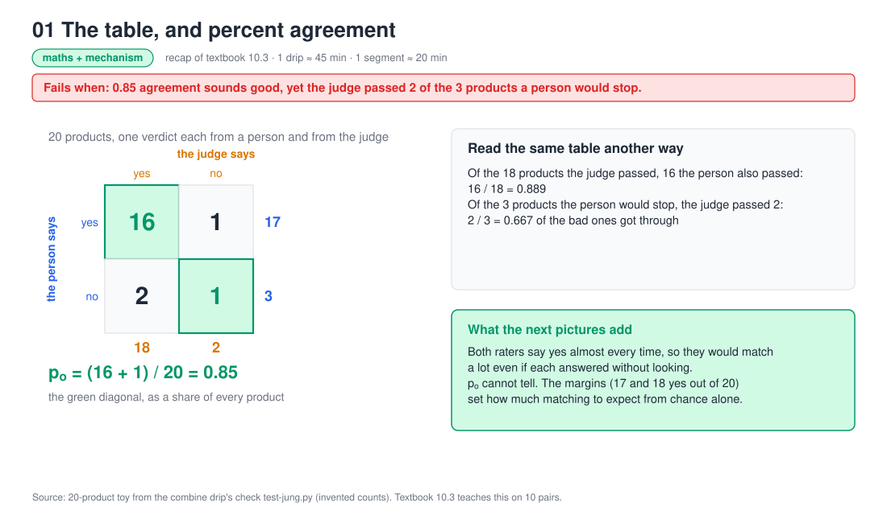
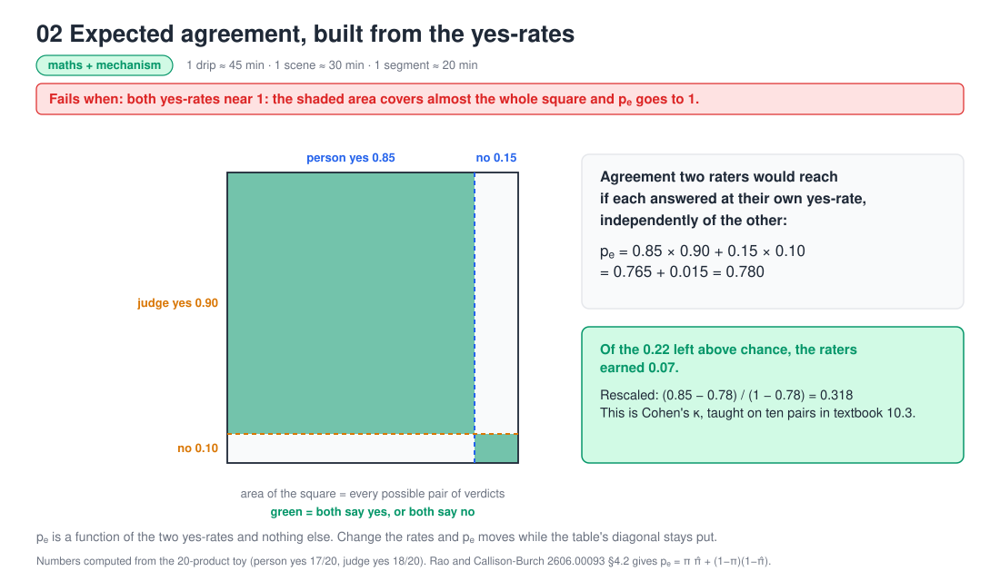
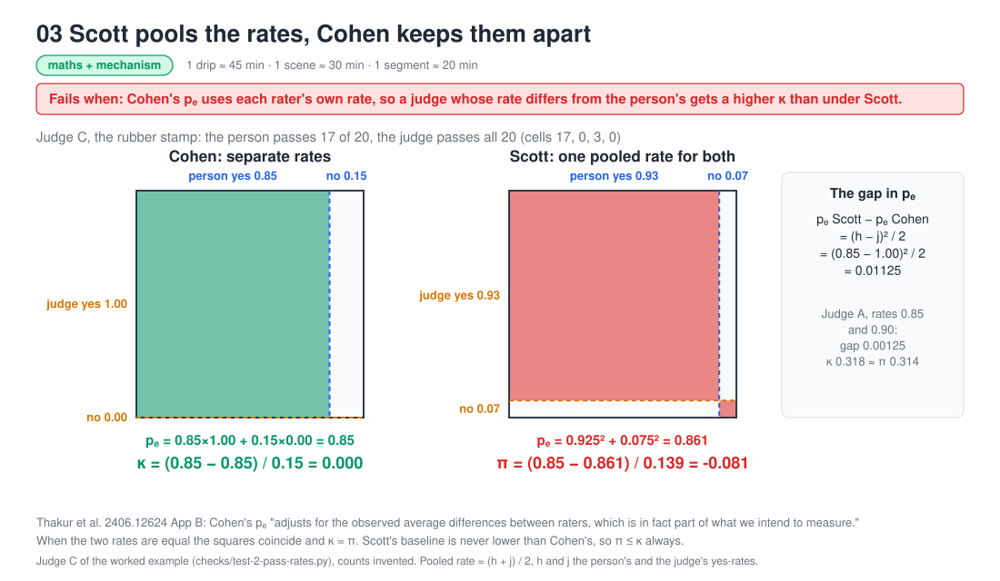
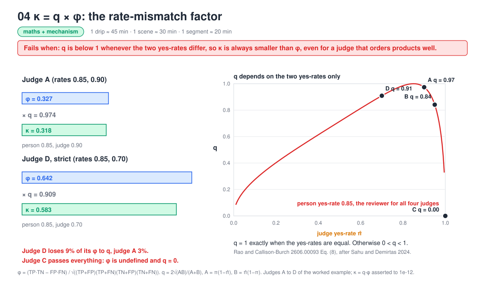
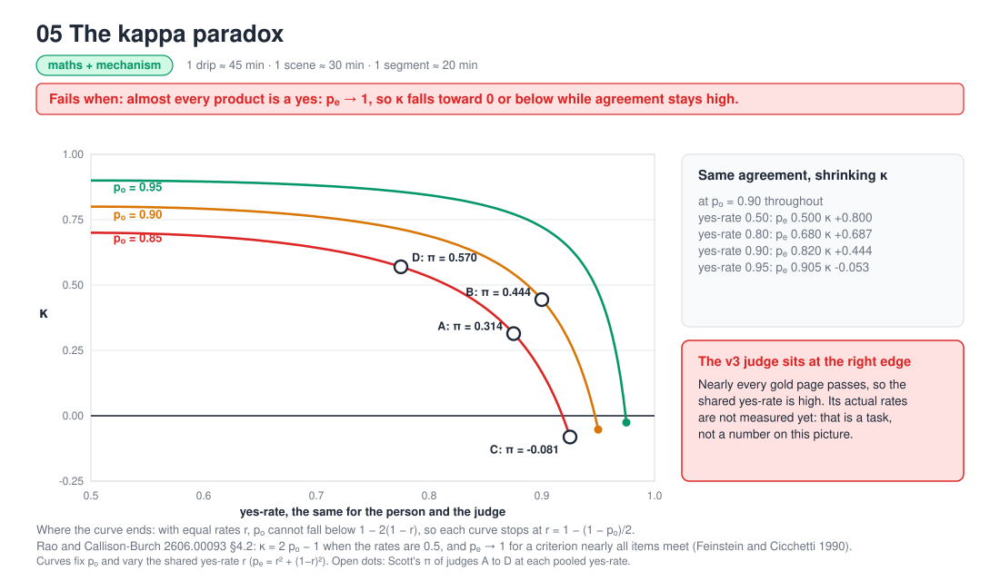
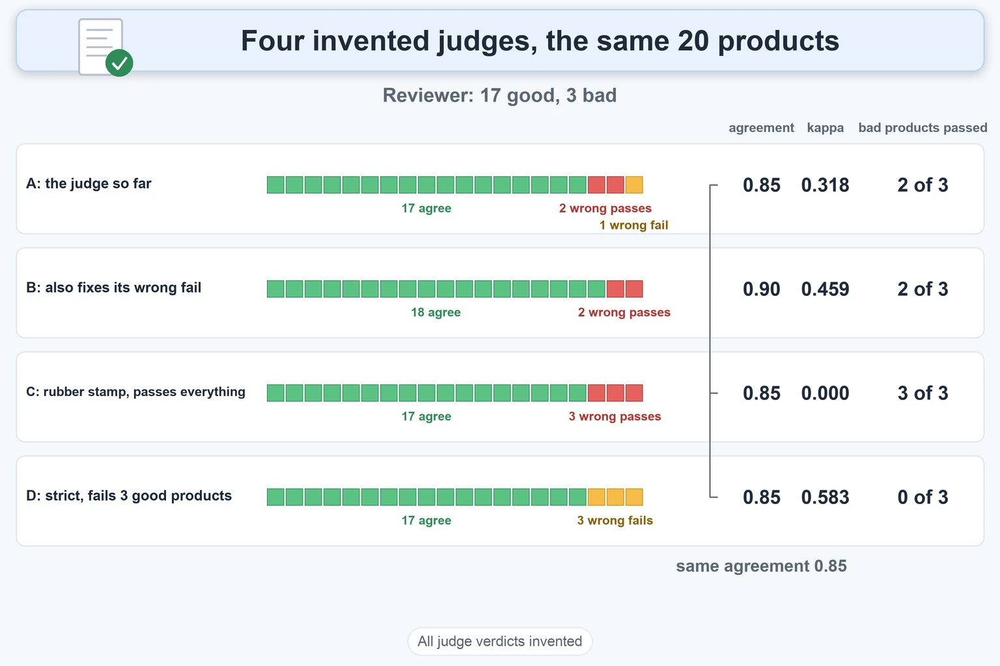
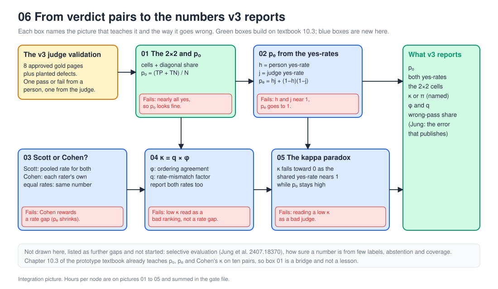

# Chance-Corrected Agreement

Up: [[Statistics]]

Mathematics, Statistics. This note is the map of its folder: the four sections after the four-judge table summarise four child notes, listed under [[#Notes in this folder]]. Needs: nothing else in the vault yet. The prototype textbook's section 10.3 teaches the first three numbers below on ten pairs.

> [!question] Test yourself
> [Judge Agreement Quiz](https://claude.ai/artifact/RthoGPnogcnYFtTDMgPvqM) covers this folder and [[Selective Evaluation]].

> [!warning] Unfinished
> - The three drawn pictures per section (form, mechanism, deep-dive sheet) are not drawn. Six script-drawn pictures in `assets/` stand in for them.
> - No quiz page yet, and no nine-part sandbox: the scripts and their outputs are inline instead. The child notes carry the same gaps: no drawn pictures, no output pictures, no quiz page. No plotting library was available because the prepared environment `~/.vault-sandbox` is missing on this machine. To make it: `uv venv ~/.vault-sandbox` then `uv pip install --python ~/.vault-sandbox/bin/python pandas numpy scipy matplotlib statsmodels openpyxl`.
> - 1 claim is marked stated and keeps nothing unfinished: it is counted in the closing box.

**Chance-corrected agreement** is how far two raters agree beyond what their own yes-rates would give by luck. This note takes one judge and one reviewer on 20 products and builds, one number at a time, percent agreement, Cohen's kappa, Scott's pi, phi, the factor that links kappa to phi, and the kappa paradox, all from the same 2 by 2 table.

**Where you work.** Any folder with Python 3. One check at the end of the phi section uses scikit-learn (`uv add scikit-learn`); every other script is plain Python. Counts are invented to show the arithmetic.

## Table of contents

- [The table and observed agreement](#the-table-and-observed-agreement)
- [Expected agreement](#expected-agreement)
- [Cohen's kappa](#cohens-kappa)
- [Scott's pi](#scotts-pi)
- [Kappa as q times phi](#kappa-as-q-times-phi)
- [The kappa paradox](#the-kappa-paradox)
- [Which way the judge errs](#which-way-the-judge-errs)
- [Four judges on the same 20 products](#four-judges-on-the-same-20-products)
- [Judge leniency](#judge-leniency)
- [The 105-row gold set](#the-105-row-gold-set)
- [When the judge will not answer](#when-the-judge-will-not-answer)
- [How sure kappa is](#how-sure-kappa-is)
- [What to read off](#what-to-read-off)
- [Notes in this folder](#notes-in-this-folder)
- [Other ways](#other-ways)
- [Taught in, applied in](#taught-in-applied-in)
- [How this was checked](#how-this-was-checked)

## The table and observed agreement

Navigation: 📋 [[#Table of contents]] | [[#Expected agreement]] ➡️

**Observed agreement** is the share of products where the two raters give the same verdict, also called percent agreement.

The scenario: a judge reads each enriched product record and says pass or fail, and a reviewer applies the same rulebook. A pass publishes automatically, so the costly mistake is a product the judge passes and the reviewer would have stopped. The reviewer would pass 17 of 20 and fail 3.

| | judge passes | judge fails | reviewer total |
|---|---:|---:|---:|
| reviewer passes | 16 | 1 (wrong fail) | 17 |
| reviewer fails | **2 (wrong pass)** | 1 | 3 |
| judge total | 18 | 2 | 20 |

A wrong fail sends a good product back for rework. A wrong pass publishes a bad one. Everything below summarises this one table.

$$
\begin{aligned}
p_o &= \frac{16 + 1}{20} \\[4pt]
&= 0.85
\end{aligned}
$$



**The count cannot tell a careful judge from a rubber stamp.** 17 of the 20 products are good, so a judge that passes everything also matches 17 times. That is the failure the next sections fix.

**Why this matters.** A pass publishes, so a number that cannot see wrong passes is not enough on its own. Backing: shown (the table), derived (the line above).

## Expected agreement

Navigation: ⬅️ [[#The table and observed agreement]] | 📋 [[#Table of contents]] | [[#Cohen's kappa]] ➡️

**Expected agreement**, $p_e$, is the matching two raters would get from their own yes-rates alone, without reading a single product.

Deal the judge's 20 verdicts (18 passes, 2 fails) to the 20 products at random, ignore the products, and count matches with the reviewer. Repeating that 100,000 times gives a mean of about 15.6 matches of 20, which is 0.78.

The formula gives the same number. The reviewer passes with probability $h = 0.85$ and the judge with $j = 0.90$. They match on pass with probability $hj$ and on fail with probability $(1-h)(1-j)$.

$$
\begin{aligned}
p_e &= hj + (1-h)(1-j) \\[4pt]
&= 0.85 \cdot 0.90 + 0.15 \cdot 0.10 \\[4pt]
&= 0.765 + 0.015 \\[4pt]
&= 0.78
\end{aligned}
$$



**When almost everything passes, almost everything matches**, so the baseline is high: 0.78 of the 0.85 observed.

Try it yourself, in `expected.py`:

```python
import random

reviewer = [1] * 17 + [0] * 3
judge = [1] * 18 + [0] * 2
h, j = sum(reviewer) / 20, sum(judge) / 20
print(f"formula: {h * j + (1 - h) * (1 - j):.3f}")
random.seed(0)
hits = 0
for _ in range(100_000):
    random.shuffle(judge)
    hits += sum(r == v for r, v in zip(reviewer, judge))
print(f"shuffled: {hits / 100_000 / 20:.3f}")
```

You should see:

```text
formula: 0.780
shuffled: 0.780
```

**Why this matters.** When both rates sit near 1, $p_e$ approaches 1 and leaves almost no room to show skill; see [[#The kappa paradox]]. Backing: shown (the run), derived (the formula).

## Cohen's kappa

Navigation: ⬅️ [[#Expected agreement]] | 📋 [[#Table of contents]] | [[#Scott's pi]] ➡️

**Cohen's kappa**, $\kappa$, is the share of the agreement left above luck that the raters actually earned.

The observed 0.85 sits above the luck level 0.78, and the most any pair can reach is 1.00. So $1 - 0.78 = 0.22$ is the room above luck, and the judge used $0.85 - 0.78 = 0.07$ of it.

$$
\begin{aligned}
\kappa &= \frac{p_o - p_e}{1 - p_e} \\[4pt]
&= \frac{0.85 - 0.78}{1 - 0.78} \\[4pt]
&= \frac{7}{22} \\[4pt]
&\approx 0.318
\end{aligned}
$$

**One means all the room was used, zero means none, and below zero means worse than luck.** Conventional bands call 0.21 to 0.40 "fair" (stated). Those bands are conventions and do not replace asking which error is costly.

**Why this matters.** It separates a judge that read the products from one that matched on the base rate. Backing: derived (the line above), cited (the formula is Cohen 1960 as given in Thakur et al. Appendix B).

## Scott's pi

Navigation: ⬅️ [[#Cohen's kappa]] | 📋 [[#Table of contents]] | [[#Kappa as q times phi]] ➡️

**Scott's pi**, $\pi_S$, changes only the baseline: it pools the two raters' yes-rates into one rate and uses it for both.

$$
\begin{aligned}
\bar r &= \frac{h + j}{2} = \frac{0.85 + 0.90}{2} = 0.875 \\[4pt]
p_e^{\text{Scott}} &= \bar r^{\,2} + (1-\bar r)^2 = 0.765625 + 0.015625 = 0.78125 \\[4pt]
\pi_S &= \frac{0.85 - 0.78125}{1 - 0.78125} = \frac{11}{35} \approx 0.314
\end{aligned}
$$

**Scott's baseline is never lower than Cohen's, by an exact amount.** Write $h = \bar r + d$ and $j = \bar r - d$, with $d = (h-j)/2$. Then $hj = \bar r^2 - d^2$ and $(1-h)(1-j) = (1-\bar r)^2 - d^2$, so:

$$
\begin{aligned}
p_e^{\text{Scott}} - p_e^{\text{Cohen}} &= 2d^2 \\[4pt]
&= \frac{(h-j)^2}{2}
\end{aligned}
$$

Here that is $0.05^2 / 2 = 0.00125$, and $0.78125 - 0.78 = 0.00125$.



**Thakur et al. prefer Scott's pi** (PDF page 14). Cohen builds its baseline from each rater's own rate, so how differently the judge and the people lean is treated as background, when it is part of what is being measured. Scott's pooled baseline does not forgive it. When the two rates are close, as here, the two numbers are almost equal (0.318 and 0.314), and they are identical when the rates are equal.

**Why this matters.** A report that says "agreement 0.31" without saying which one cannot be compared with another paper's. Backing: derived, cited (Thakur et al., arXiv 2406.12624, Appendix B and its footnote 2).

## Kappa as q times phi

Navigation: ⬅️ [[#Scott's pi]] | 📋 [[#Table of contents]] | [[#The kappa paradox]] ➡️

**Kappa equals phi shrunk by a factor $q$ that depends only on the two yes-rates.** This is Rao and Callison-Burch's Eq. (8), credited there to Sahu and Demirtas (2024).

### phi

**Phi**, $\phi$, is the correlation between the two 0/1 verdict columns. It is the same number as the binary Matthews correlation coefficient. Its formula is derived from covariance and the variance of a yes-or-no variable in [[Correlation Coefficient#The method in numbered steps]]. On this table:

$$
\begin{aligned}
\phi &= \frac{TP\cdot TN - FP\cdot FN}{\sqrt{(TP+FP)(TP+FN)(TN+FP)(TN+FN)}} \\[4pt]
&= \frac{16\cdot 1 - 2\cdot 1}{\sqrt{18 \cdot 17 \cdot 3 \cdot 2}} \\[4pt]
&= \frac{14}{\sqrt{1836}} \approx 0.327
\end{aligned}
$$

### q

**$q$, the rate-mismatch factor.** The full steps are in [[Phi And Q]]; this section is the summary. Let $A = (TP+FN)(FN+TN)$ and $B = (TP+FP)(FP+TN)$. Multiplying the top and bottom of $\kappa$ by $N^2$ gives $\kappa = 2(TP\,TN - FP\,FN) / (A + B)$, and the denominator of $\phi$ is $\sqrt{AB}$, so:

$$
\kappa = q\,\phi, \qquad q = \frac{2\sqrt{AB}}{A+B}
$$

Because $A + B \ge 2\sqrt{AB}$, $q \le 1$, with equality exactly when the two pass rates are equal. Here $A = 34$ and $B = 54$:

$$
q = \frac{2\sqrt{34 \cdot 54}}{34 + 54} \approx 0.974, \qquad q\,\phi \approx 0.974 \cdot 0.327 \approx 0.318 = \kappa
$$



**Phi asks only whether the two columns move together. Kappa also asks whether they pass at the same rate**, and punishes a mismatch through $q$. A judge that passes far more or far less often than people sees $\kappa$ pulled well below its $\phi$, even if it orders products perfectly.

Try it yourself, in `q_phi.py` (needs `uv add scikit-learn`):

```python
from math import sqrt
from sklearn.metrics import cohen_kappa_score, matthews_corrcoef

tp, fn, fp, tn = 16, 1, 2, 1
A, B = (tp + fn) * (fn + tn), (tp + fp) * (fp + tn)
top = tp * tn - fp * fn
phi = top / sqrt((tp + fp) * (tp + fn) * (tn + fp) * (tn + fn))
q, kappa = 2 * sqrt(A * B) / (A + B), 2 * top / (A + B)
reviewer = [1] * 17 + [0] * 3
judge = [1] * 16 + [0] * 1 + [1] * 2 + [0] * 1
assert abs(kappa - cohen_kappa_score(reviewer, judge)) < 1e-12
assert abs(phi - matthews_corrcoef(reviewer, judge)) < 1e-12
print(f"phi {phi:.4f} q {q:.4f} kappa {kappa:.4f}")
```

You should see:

```text
phi 0.3267 q 0.9738 kappa 0.3182
```

**Why this matters.** A low kappa can be a poor ordering, a different pass rate, or both, and only $\phi$ and $q$ side by side tell them apart. On binary verdicts Pearson, Spearman, Kendall's $\tau_b$, $\phi$ and MCC are the same number, so report one of them. Backing: derived, shown (the run), cited (Rao and Callison-Burch, arXiv 2606.00093, sections 4.1 and 4.2).

## The kappa paradox

Navigation: ⬅️ [[#Kappa as q times phi]] | 📋 [[#Table of contents]] | [[#Which way the judge errs]] ➡️

**The kappa paradox** is high raw agreement alongside a low kappa, when almost every item gets the same verdict.

Hold $p_o$ at 0.90 and give both raters the same yes-rate $r$. Then $p_e = r^2 + (1-r)^2$, and at $r = 0.5$ the formula collapses to $\kappa = 2p_o - 1$:

$$
\begin{aligned}
r = 0.50:\quad p_e &= 0.500, & \kappa &= 0.800 \\[4pt]
r = 0.80:\quad p_e &= 0.680, & \kappa &\approx 0.687 \\[4pt]
r = 0.90:\quad p_e &= 0.820, & \kappa &\approx 0.444 \\[4pt]
r = 0.95:\quad p_e &= 0.905, & \kappa &\approx -0.053
\end{aligned}
$$

The agreement is 0.90 in every row. Only the rate moved.



**Why it falls.** As $p_e \to 1$ the room above luck, $1 - p_e$, goes to nothing, so the same raw agreement earns a smaller and smaller share of it. Each curve in the picture stops where the rates can no longer be equal at that $p_o$, at $r = 1 - (1 - p_o)/2$.

**Why this matters.** On a criterion nearly every product meets, a low kappa does not by itself mean a bad judge, and compared across criteria it is attenuated by construction unless the yes-rates are comparable. Backing: derived, cited (Rao and Callison-Burch, section 4.2, after Feinstein and Cicchetti 1990).

## Which way the judge errs

Navigation: ⬅️ [[#The kappa paradox]] | 📋 [[#Table of contents]] | [[#Four judges on the same 20 products]] ➡️

**Kappa and pi compare the whole table, so neither says which kind of mistake the judge makes.** When a pass publishes, two numbers read the single row and column that matter.

$$
\begin{aligned}
\text{wrong-pass share} &= \frac{FP}{TP + FP} = \frac{2}{18} \approx 0.111 \\[4pt]
\text{bad products passed} &= \frac{FP}{FP + TN} = \frac{2}{3} \approx 0.667
\end{aligned}
$$

The first is what a customer sees: 1 published product in 9 was one the reviewer would have stopped. It looks small because 17 of 20 were good. The second looks only at the 3 bad products and shows the weakness: the judge caught one of them.

**Exchanging the two error cells changes neither kappa nor pi.** With cells 16, 2, 1, 1, kappa stays 0.318 and pi 0.314, while the wrong-pass share becomes $1/17 = 0.059$ and the bad products passed become $1/2$. Rao and Callison-Burch make the point: accuracy, kappa and phi are unchanged when false passes and false fails are exchanged, so only the full table separates a judge that lets bad products through from one that over-rejects.

**Why this matters.** A judge can look fine on the first number and poor on the second whenever bad products are rare, and three bad products is very few to count. Backing: derived, shown (below), cited (Rao and Callison-Burch, PDF page 3).

## Four judges on the same 20 products

Navigation: ⬅️ [[#Which way the judge errs]] | 📋 [[#Table of contents]] | [[#Judge leniency]] ➡️

**The same 20 products and the same reviewer verdicts (17 good, 3 bad), with only the judge changed.**

| Judge | wrong pass | wrong fail | judge passes | $p_o$ | Cohen $\kappa$ | Scott $\pi_S$ | wrong-pass share | bad products passed |
|---|---:|---:|---:|---:|---:|---:|---:|---:|
| A: the judge so far | 2 | 1 | 18 | 0.850 | 0.318 | 0.314 | 0.111 | 2 of 3 |
| B: also fixes its wrong fail | 2 | 0 | 19 | 0.900 | 0.459 | 0.444 | 0.105 | 2 of 3 |
| C: rubber stamp, passes everything | 3 | 0 | 20 | 0.850 | **0.000** | **−0.081** | 0.150 | **3 of 3** |
| D: strict, fails 3 good products | **0** | 3 | 14 | 0.850 | 0.583 | 0.570 | **0.000** | **0 of 3** |

**C, the rubber stamp.** It matches 17 of 20, the same $p_o$ as A. Its kappa is exactly 0, because it passes at rate 1, so the luck baseline is $0.85 \cdot 1 + 0.15 \cdot 0 = 0.85$. Its pi is slightly negative since the pooled baseline is 0.861. Phi is undefined, because the judge's column never changes. This is the case the raw count cannot see.

**D against A.** Both match on 17 of 20. D makes all its mistakes by failing good products, and A makes two of its three on the costly side. Kappa is 0.583 for D against 0.318 for A, and the wrong-pass share is 0 against 0.111. For an auto-publishing pass, the judge that errs on the safe side is better even though its raw agreement is the same.

**B against A.** B fixes the one wrong fail and nothing else. Kappa rises from 0.318 to 0.459, yet the wrong-pass share barely moves (0.111 to 0.105) and two of three bad products still get through. A rising kappa does not mean fewer wrong passes.


*All judge verdicts and confidences in this picture are invented.*

**Why this matters.** The four rows are the ones to rerun when a real judge's table arrives. Backing: shown (the scripts in the learning tree, outputs in the check box), derived.

## Judge leniency

Navigation: ⬅️ [[#Four judges on the same 20 products]] | 📋 [[#Table of contents]] | [[#The 105-row gold set]] ➡️

**Judge leniency** is the share of a judge's verdicts that ignore the rubric and say pass anyway. Thakur et al. model each verdict as correct with probability $P_c$, and otherwise a coin that says pass with probability $P_+$ (section 5.4, equations 4, 5 and 18). Solved from the table, $P_c = t_P/s + t_N/(1-s) - 1$.

On the four judges above, C the rubber stamp is exactly $P_c = 0$, $P_+ = 1$, and D the strict judge is $P_c = 0.824$, $P_+ = 0$. Judge A is $P_c = 0.275$ and $P_+ = 0.919$, but 20 products cannot pin that down: resampling them gives a 90% range of 0 to 1. The equations, the four-judge table and the bootstrap are in [[Judge Leniency And The Gold Set#Thakur's leniency model]].

**Why this matters.** It separates judges whose kappa and accuracy are the same by saying which way their mistakes lean. Backing: cited, shown in the child note.

## The 105-row gold set

Navigation: ⬅️ [[#Judge leniency]] | 📋 [[#Table of contents]] | [[#When the judge will not answer]] ➡️

**The gold set** here is 8 approved pages plus 97 copies each broken by one planted defect, 105 rows with 92% bad. Luck now favours "fail", so a judge that fails every row has raw agreement 0.924 and kappa exactly 0, and fails all 8 approved pages. Jung's wrong-pass share misleads on this mix: a judge that misses only 3 of 97 bad products still has 30% of its passes wrong, since 3 of its 10 passes are bad. All judge outcomes on these rows are invented. See [[The 105-Row Gold Set#The 105-row design]].

**Why this matters.** On a mix this skewed, quote the share of bad products missed and the share of good pages failed together. Backing: shown in the child note.

## When the judge will not answer

Navigation: ⬅️ [[#The 105-row gold set]] | 📋 [[#Table of contents]] | [[#How sure kappa is]] ➡️

**An abstention**, a review verdict, needs a rule before agreement is scored: drop those rows (exclusion), count them as fail (negative recoding), or keep them as a third label (three-class retention). On an invented judge that sends 25 of 105 rows to review, the three rules give accuracy 0.963, 0.962 and 0.733. Accuracy over all 105 rows is only known to lie in [0.733, 0.971] (Rao and Callison-Burch, equation 10). See [[Abstention In Agreement Scores]].

**Why this matters.** Two reports of the same decisions can differ by 23 points. Backing: shown and cited in the child note.

## How sure kappa is

Navigation: ⬅️ [[#When the judge will not answer]] | 📋 [[#Table of contents]] | [[#What to read off]] ➡️

**How sure kappa is** is measured by resampling. Rao and Callison-Burch put the standard error of kappa at 0.04 to 0.06 for 300 binary decisions and advise resampling whole items. On the 105 rows an invented calibrated judge has kappa 0.341, with a 90% range of 0.14 to 0.53 when rows are resampled and 0.20 to 0.51 when whole products are. See [[How Sure Kappa Is]].

**Why this matters.** Gaps of a few points between judges on this many rows are within noise. Backing: shown and cited in the child note.

## What to read off

Navigation: ⬅️ [[#How sure kappa is]] | 📋 [[#Table of contents]] | [[#Notes in this folder]] ➡️

| Number | The question it answers | On judge A | Its blind spot |
|---|---|---|---|
| $p_o$ | How often did they match? | 0.85 | a rubber stamp scores the same |
| Cohen's $\kappa$ | What share of the room above luck did the judge use? | 0.318 | does not say which error it makes |
| Scott's $\pi_S$ | The same, with the difference in leaning counted against the judge | 0.314 | the same blind spot |
| $q$ | How far apart are the two pass rates? | 0.974 | none, but only a rate comparison |
| wrong-pass share | Of what was published, how much was wrong? | 0.111 | small whenever most products are good |
| bad products passed | Of the bad products, how many got through? | 2 of 3 | needs enough bad products to count |



**For an auto-publishing judge, the last two are the ones about the costly error, and the first four say whether it is doing anything beyond the base rate.** A judge is worth auto-publishing when the last two are low and kappa shows it is not a rubber stamp.

## Notes in this folder

Navigation: ⬅️ [[#What to read off]] | 📋 [[#Table of contents]] | [[#Other ways]] ➡️

Read them in this order.

- [[Phi And Q]]: kappa equals q times phi in full steps, from kappa's definition to the product, with what q records and a check on four judges.
- [[Judge Leniency And The Gold Set]]: Thakur's model of how often a judge ignores the rubric and which way it guesses, with the algebra from its equations 4 and 5 to equation 18 in numbered steps.
- [[The 105-Row Gold Set]]: the 105 rows of 8 approved pages and 97 planted copies, why a judge that fails everything scores 0.924 raw agreement, and what the rows can certify.
- [[Abstention In Agreement Scores]]: the three rules for a row the judge will not decide, and the bound on accuracy over all rows.
- [[How Sure Kappa Is]]: the noise in kappa from few labels, resampling rows against whole products, and when two kappa values are inside each other's noise (the resampling itself is in [[Bootstrap]]).
- [[Selective Evaluation]]: choosing the confidence cut-off so that the answers a judge does give agree with people at a stated rate.

## Other ways

Navigation: ⬅️ [[#Notes in this folder]] | 📋 [[#Table of contents]] | [[#Taught in, applied in]] ➡️

**Other chance corrections substitute different baselines.** Rao and Callison-Burch's footnote 2 names Brennan and Prediger (1981), Gwet (2008), and Byrt, Bishop and Carlin (1993), and says none removes the need for the marginals and the contingency table. Krippendorff's alpha is the agreement measure their survey lists for human annotators. This note does not teach them. Choosing a confidence cut-off by a guarantee is [[Selective Evaluation]].

**More than two verdicts.** The v3 judge in the project below gives pass, warning, review or fail, and the table here is the two-class case. Rao and Callison-Burch cover weighted kappa for ordinal scales and a reduction to two classes. Not taught here yet. The review verdict as an abstention is taught in [[Abstention In Agreement Scores]].

## Taught in, applied in

Navigation: ⬅️ [[#Other ways]] | 📋 [[#Table of contents]] | [[#How this was checked]] ➡️

**Taught in.**

- [The chance-corrected agreement chapter](/home/molef/goal-setting/learning/ai-engineering/chance-corrected-agreement/textbook/00-INDEX.md), five sections with build scripts: the table and observed agreement, expected agreement, Scott's pi and kappa, kappa as q times phi, and the paradox with which way the judge errs.
- [The combined reading of validating an LLM judge](/Users/molefemolefe/goal-setting/learning/ai-engineering/prototype-product-data-validation-end-to-end/drips/combine-validating-an-llm-judge/COMBINE_MAP.md), the comparison of Thakur et al., Rao and Callison-Burch, and Jung et al. behind the four child notes.
- [Textbook section 10.3](/home/molef/goal-setting/learning/ai-engineering/prototype-product-data-validation-end-to-end/textbook/10-measurement.md#103-two-labellers-and-how-far-they-agree), observed agreement, expected agreement and kappa on ten pairs.
- [The worked example](/home/molef/goal-setting/learning/ai-engineering/chance-corrected-agreement/artifacts/notes/the-20-product-worked-example/README.md) this note is built from, with its two scripts.

**Applied in.**

- The v3 product-content judge in the Dis-Chem product data repo: a judge that passes nearly every approved gold page, validated against 8 gold pages plus planted defects, where raw agreement is high from the start and kappa could sit near zero. Its real yes-rates are not measured yet.

## How this was checked

Navigation: ⬅️ [[#Taught in, applied in]] | 📋 [[#Table of contents]]

> [!note]- How this was checked
> The two scripts behind the numbers, `test-jung.py` and `test-2-pass-rates.py`, were run on 2026-10-18 on a Mac with Python 3.12, and their saved outputs match every number in the four-judge table (kappa 0.318, 0.459, 0.000, 0.583; Scott pi 0.314, 0.444, −0.081, 0.570). Judge B's exact kappa is 0.4595. The identity $\kappa = q\phi$ and the scikit-learn cross-check were run in the learning tree's chapter scripts. The page claims about Thakur et al. and Rao and Callison-Burch were read from the PDFs. The child notes' scripts were rerun from empty folders the same day and match the learning tree's saved outputs. The six pictures are script-drawn from the same counts. The counts are invented, and none is a measurement of the v3 judge. The note has not been rendered in Obsidian.
> Claims marked stated, 1: the "fair" band label, which is a convention and not derived here.
