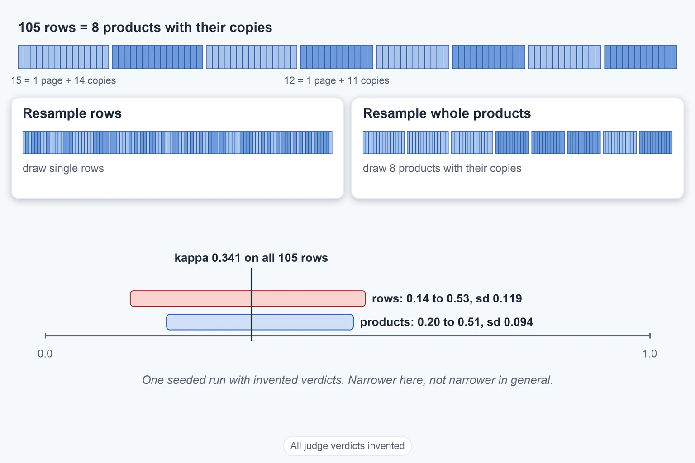

# How Sure Kappa Is

Up: [[Chance-Corrected Agreement]] · ⬅️ [[Abstention In Agreement Scores]]

Mathematics, Statistics, Chance-Corrected Agreement. Needs: [[Chance-Corrected Agreement]], the 105-row design in [[The 105-Row Gold Set]], and [[Bootstrap]] for the resampling loop itself.

> [!warning] Unfinished
> - The three drawn pictures (form, mechanism, deep-dive sheet) are not drawn, and no output picture is rendered: `~/.vault-sandbox` is missing on this machine, so there was no plotting library. To make it: `uv venv ~/.vault-sandbox` then `uv pip install --python ~/.vault-sandbox/bin/python pandas numpy scipy matplotlib statsmodels openpyxl`.
> - No quiz page yet.
> - 3 claims are marked stated and keep nothing unfinished: they are counted in the closing box.

**How sure kappa is** depends on how many independent items it rests on, and on what you resample to measure that. This note takes Rao and Callison-Burch's advice on sampling noise and shows, on the 105-row design, how far apart two ways of resampling land.

**Where you work.** Any folder with Python 3 and nothing installed. The confidences and verdicts are invented and seeded.

## Table of contents

- [What the paper says about sampling noise](#what-the-paper-says-about-sampling-noise)
- [Rows against whole products](#rows-against-whole-products)
- [When two kappa values are inside each other's noise](#when-two-kappa-values-are-inside-each-others-noise)
- [Other ways](#other-ways)
- [Taught in, applied in](#taught-in-applied-in)
- [How this was checked](#how-this-was-checked)

## What the paper says about sampling noise

Navigation: 📋 [[#Table of contents]] | [[#Rows against whole products]] ➡️

Textbook: [Introduction to probability for data science, 9.2 bootstrapping, p. 576](../../references/textbooks/statistics/introduction-to-probability-for-data-science.pdf#page=576)

**Standard error** is the typical distance between a number computed on a sample and the value it would take on all the data. For kappa, Rao and Callison-Burch say (section 4.3, PDF page 7) that at $N = 300$ binary decisions the delta-method standard error of $\hat\kappa$ falls between 0.04 and 0.06 for most tables, so gaps of a few points between judges are within sampling noise. Their advice: resample whole items, not individual verdicts.

**Resampling** (the bootstrap, taught in full steps in [[Bootstrap]]) draws a new sample of the same size with replacement from the items, recomputes kappa on it, and repeats. The spread of the results measures the noise. On real data the paper resamples 2,238 decisions with replacement and gets, for kappa 0.402, a percentile interval of [0.343, 0.460] (page 7). That is a width of 0.117 at $N = 2{,}238$.

**Why this matters.** A kappa from 105 rows has a spread more than twice that, so two judges differing by a few points cannot be told apart. Backing: cited (Rao and Callison-Burch, arXiv 2606.00093, section 4.3 and page 7).

## Rows against whole products

Navigation: ⬅️ [[#What the paper says about sampling noise]] | 📋 [[#Table of contents]] | [[#When two kappa values are inside each other's noise]] ➡️

**A planted copy is not an independent item.** The 105 rows are 8 products, each a good page with its planted copies. Resampling rows treats every copy as a fresh draw, so it understates the noise. Resampling whole products, a page with all its copies, follows the paper's advice. Two invented judges: a calibrated one, right with probability equal to its confidence, and an underconfident one that disagrees only 0.2 as often as its confidence implies.

Save as `kappa_resampling.py` in an empty folder:

```python
# How sure is kappa on the 105-row design? Confidences and verdicts are INVENTED (seeded).
# Resample rows one at a time, then resample whole products (a good page with its planted copies).
import random
from math import sqrt

products = [14] * 3 + [11] * 5  # planted copies per product: 3 x 14 + 5 x 11 = 97
rows = []
for i, nbad in enumerate(products):
    rows.append((i, 1))
    rows += [(i, 0)] * nbad
assert len(rows) == 105


def make(sharp, seed=1):
    """Row = (product, reviewer verdict, judge verdict). The judge is right with
    probability 1 - (1 - c) * sharp, where c is its confidence."""
    rnd = random.Random(seed)
    data = []
    for p, g in rows:
        c = 0.5 + 0.5 * rnd.random() ** 0.5
        right = rnd.random() < 1 - (1 - c) * sharp
        data.append((p, g, g if right else 1 - g))
    return data


def kappa(sample):
    tp = sum(1 for _, g, v in sample if g == 1 and v == 1)
    fn = sum(1 for _, g, v in sample if g == 1 and v == 0)
    fp = sum(1 for _, g, v in sample if g == 0 and v == 1)
    tn = sum(1 for _, g, v in sample if g == 0 and v == 0)
    n = tp + fn + fp + tn
    a, b = (tp + fn) / n, (tp + fp) / n
    if a in (0, 1) or b in (0, 1):
        return None  # a column that never changes leaves kappa undefined
    po = (tp + tn) / n
    pe = a * b + (1 - a) * (1 - b)
    return (po - pe) / (1 - pe)


for name, sharp in {"calibrated": 1.0, "underconfident": 0.2}.items():
    data = make(sharp)
    agree = sum(1 for _, g, v in data if g == v)
    print(f"{name}: agrees on {agree} of 105, kappa {kappa(data):.3f}")
    rnd = random.Random(7)
    by = {i: [d for d in data if d[0] == i] for i in range(8)}
    for mode in ("rows", "products"):
        ks = []
        for _ in range(5000):
            if mode == "rows":
                s = [rnd.choice(data) for _ in data]
            else:
                s = [d for i in [rnd.randrange(8) for _ in range(8)] for d in by[i]]
            k = kappa(s)
            if k is not None:
                ks.append(k)
        ks.sort()
        m = sum(ks) / len(ks)
        sd = sqrt(sum((x - m) ** 2 for x in ks) / len(ks))
        print(f"  resample {mode:8s}: {len(ks)} usable of 5000, "
              f"90% range {ks[int(.05 * len(ks))]:.2f} to {ks[int(.95 * len(ks)) - 1]:.2f}, sd {sd:.3f}")
```

Run it:

```bash
python3 kappa_resampling.py
```

You should see:

```text
calibrated: agrees on 88 of 105, kappa 0.341
  resample rows    : 4997 usable of 5000, 90% range 0.14 to 0.53, sd 0.119
  resample products: 5000 usable of 5000, 90% range 0.20 to 0.51, sd 0.094
underconfident: agrees on 103 of 105, kappa 0.879
  resample rows    : 4997 usable of 5000, 90% range 0.71 to 1.00, sd 0.091
  resample products: 5000 usable of 5000, 90% range 0.78 to 1.00, sd 0.066
```

**Reading the output.**

| Field | Calibrated | Underconfident | How to read it |
|---|---|---|---|
| agrees on | 88 of 105 | 103 of 105 | rows where judge and reviewer match |
| kappa | 0.341 | 0.879 | on all 105 rows |
| rows: usable of 5000 | 4,997 | 4,997 | a resample with no good page, or a judge column that never changes, leaves kappa undefined and is dropped |
| rows: 90% range | 0.14 to 0.53 | 0.71 to 1.00 | the middle 90% of 5,000 resampled kappas |
| rows: sd | 0.119 | 0.091 | standard deviation of the resampled kappas |
| products: 90% range | 0.20 to 0.51 | 0.78 to 1.00 | same, drawing 8 whole products with replacement |
| products: sd | 0.094 | 0.066 | spread when copies stay with their page |

**Reading the comparison.** For the calibrated judge kappa is 0.341 and the spread is a standard deviation of 0.119 over rows. The paper's 0.04 to 0.06 at 300 decisions is about half of that, so 105 rows give roughly twice the spread (the walk's own comparison). Resampling whole products gives a narrower range (0.20 to 0.51) than resampling rows (0.14 to 0.53) here. This run does not say why. One untested reading (inferred): every product resample holds exactly 8 good pages, while a row resample holds 8 plus or minus about 2.7, and the number of good pages moves kappa. The invented verdicts were drawn independently per row, so copies of a product do not move together here; real verdicts would be correlated, which is why Rao advises resampling whole items. The product-level figure is the one to quote, though it is built on only 8 products. The narrower product range is a feature of this seeded run and the 8-product draw; it does not mean whole-product resampling is always narrower (stated).


*All judge verdicts and confidences in this picture are invented.*

**Why this matters.** A kappa of 0.341 from these rows is compatible with anything from 0.20 to 0.51, so a validation claim needs more than 8 products. Backing: shown (the run), cited (the resample-whole-items advice).

<!-- worked-examples-table: resampling-the-bootstrap rev=2 -->
Problems on resampling one small data set with replacement to get a standard error or an interval for a statistic, from the easiest to the hardest. They are meant to serve the Judge Agreement Quiz questions that need resampling: I1, I2, I3, I4, E5, G4 and X2.

| Order | What it asks | Kind | Where | Difficulty | Full-steps solution | Quiz question |
|---|---|---|---|---|---|---|
| 1 | Resample ten exam scores (72, 69, 75, 58, 67, 70, 60, 71, 59, 65) with replacement 1,000 times, take the median of each resample, and read off the bootstrapped variance, standard error and interval. Also: why sampling with replacement and not a shuffle | Worked example, with Python code: `bootstrap_se(x, stat, K)` | [[introduction-to-probability-for-data-science.pdf#page=578\|Chan 9.2, the method, PDF pp. 578 to 580]] and [[introduction-to-probability-for-data-science.pdf#page=581\|the code, PDF pp. 581 to 582]] | Easy | Partial. The book gives the algorithm, the code and the formulas (9.20 to 9.23) and prints no resulting number for these scores: none: to be written for the numbers | I1, I2 |
| 2 | Five invented record decisions, three right and two wrong: draw five cards with replacement by hand, then list all 3,125 resamples in code and read the 95% percentile interval, which comes out 0.2 to 1.0 | Tutorial, Python: `bootstrap_toy.py`, with `empirical_quantile(values, q)` | [the measurement chapter, section 10.4, "Rehearse bootstrap sampling"](/Users/molefemolefe/goal-setting/learning/ai-engineering/prototype-product-data-validation-end-to-end/textbook/10-measurement.md#104-the-prototypes-baseline-scored-with-mlflow) | Easy | In the chapter: the formula (10.16), the script and its expected output (accuracy 0.6000, interval 0.2000 to 1.0000) | I1, G4, I2 |
| 3 | A lognormal sample of 100 values: bootstrap a 95% interval for its skewness, with resample sizes 30, 70 and 10, and plot the histograms. A statistic that is not a mean, so no formula gives its spread | Programming exercise, Python or MATLAB: `bootstrap_ci_skewness(y, K, B)` | [[introduction-to-probability-for-data-science.pdf#page=624\|Chan, Exercise 4, PDF p. 624]] | Medium | none: to be written | X2 (practice only: its solution is still to be written) |
| 4 | Resample the 20 products behind one judge's agreement table (16 both pass, 1 reviewer-only pass, 2 judge-only passes, 1 both fail) 10,000 times and report the 5th, 50th and 95th percentiles of the agreement score P+, dropping resamples where it is undefined | Tutorial, Python (standard library): `bootstrap_pplus(items, n_resamples)` | [the check script, last line of test 3](/Users/molefemolefe/goal-setting/learning/ai-engineering/prototype-product-data-validation-end-to-end/drips/combine-validating-an-llm-judge/checks/test-3-and-gold-design.py) | Medium | Partial. Running the script prints 9,489 usable of 10,000, 5th percentile 0.00, median 0.92, 95th percentile 1.00; the script has no written steps: none: to be written for the steps | E5, X2 |
| 5 | Compare two systems scored on the same products: resample the products once per replicate, score both systems on that one resample, and take the interval of the difference. Then the exact paired test on the 15-case table | Tutorial | [the measurement chapter, section 10.4, "Bootstrap a paired change"](/Users/molefemolefe/goal-setting/learning/ai-engineering/prototype-product-data-validation-end-to-end/textbook/10-measurement.md#104-the-prototypes-baseline-scored-with-mlflow) | Medium | Partial. The chapter gives the formulas and the paired table; it works the exact test and not a bootstrap run: none: to be written for the bootstrap numbers | I3, I4 |
| 6 | The largest of 50 uniform draws on (0, θ) with θ = 1 estimates θ: find its distribution, show it equals θ with probability zero, and bootstrap its histogram to see where resampling fails | Programming exercise, Python or MATLAB: `bootstrap_max_hist(x, K)` | [[introduction-to-probability-for-data-science.pdf#page=624\|Chan, Exercise 5, PDF p. 624]] | Hard | none: to be written | G4 (practice only: its solution is still to be written) |

No row resamples a correlation coefficient: the nearest statistics are a median, a skewness and the agreement score P+, and the correlation case still has to be written. The kappa case is worked in the note this block sits in. The Rao and Callison-Burch interval for kappa 0.402 (page 7 of the paper) is a reported result with no steps, so it is not a row. Row 3 asks for subsamples of size B inside 100 values, which is a variant of the full-size resampling that row 1 describes.
Read in full: Chan PDF pp. 575 to 582 and 621 to 625, the measurement chapter's section 10.4 from "Rehearse bootstrap sampling" to the paired table, and the check script, which was also run. Only found: the bootstrap mentions in Bishop (PDF pp. 42, 661 and 671, which are bagging and error bars in a paragraph), the Goodfellow deep learning book (PDF p. 272) and Understanding Deep Learning (PDF p. 160), none of which works an example. No solutions exist on the shelf for Chan's exercises 4 and 5.
<!-- /worked-examples-table -->

## When two kappa values are inside each other's noise

Navigation: ⬅️ [[#Rows against whole products]] | 📋 [[#Table of contents]] | [[#Other ways]] ➡️

Needs: [[Bootstrap]] for the resampling loop, and the four judges in [[Chance-Corrected Agreement#Four judges on the same 20 products]]. All judge outcomes below are invented.

In plain words: two judges get two kappa values, and one is higher. A higher number says the judge did better on these products. It does not say the judge is better, because a different set of 20 products would have moved both numbers, and perhaps moved them past each other. **Two kappa values are inside each other's noise** when the gap between them is smaller than the amount the gap itself would move on another sample of the same products. Resampling measures that movement.

**The two judges.** Judge A is the table 16, 1, 2, 1 (TP, FN, FP, TN). Judge B is 17, 0, 2, 1: it passes the one good product A wrongly fails, and agrees with A on the other 19 products. Both are scored against the same reviewer on the same 20 products.

Judge B by hand: $p_o = (17+1)/20 = 0.90$; reviewer pass rate $17/20 = 0.85$; judge B pass rate $19/20 = 0.95$; $p_e = 0.85 \cdot 0.95 + 0.15 \cdot 0.05 = 0.8075 + 0.0075 = 0.815$.

$$
\kappa_B = \frac{0.90 - 0.815}{1 - 0.815} = \frac{0.085}{0.185} = 0.4595, \qquad \kappa_B - \kappa_A = 0.4595 - 0.3182 = 0.1413
$$

**A paired bootstrap.** Each resample draws 20 product numbers with replacement, once. Judge A and judge B are both scored on that one resample, and the difference $\kappa_B - \kappa_A$ is recorded. The three first resamples (seed 5) show why pairing matters:

| Resample | Product 17 drawn | Judge A table | $\kappa_A$ | Judge B table | $\kappa_B$ | Difference |
|---|---|---|---|---|---|---|
| 1 | 1 time | 16, 1, 2, 1 | 0.3182 | 17, 0, 2, 1 | 0.4595 | 0.1413 |
| 2 | 0 times | 18, 0, 0, 2 | 1.0000 | 18, 0, 0, 2 | 1.0000 | 0 |
| 3 | 0 times | 16, 0, 2, 2 | 0.6154 | 16, 0, 2, 2 | 0.6154 | 0 |

Product 17 is the only product on which A and B differ. In a resample that leaves it out the two judges have the same table, so the difference is exactly 0 however much both kappas moved. Resample 3 by hand: $p_o = 18/20 = 0.90$, pass rates $16/20 = 0.80$ and $18/20 = 0.90$, $p_e = 0.72 + 0.02 = 0.74$, $\kappa = 0.16/0.26 = 0.6154$.

**Ten thousand paired resamples.**

```text
  kappa A            : 6370 usable of 10000, 90% range 0.138 to 0.828
  kappa B            : 6370 usable of 10000, 90% range 0.273 to 1.000
  B minus A (paired) : 6370 usable of 10000, 90% range 0.000 to 0.385
  share of paired resamples with B minus A exactly 0: 0.369
  share of resamples that left out the one product where A and B differ: 0.358
```

**Reading it.** 3,630 resamples are dropped because one of the two kappas is undefined (a column that never changes; judge B fails only product 20, so any resample without product 20 gives B a constant column). The 90% range of the difference is 0.000 to 0.385. Its lower end is 0, so **it contains 0 and the two judges are not distinguishable**. In 36.9% of the usable resamples B gains nothing over A. The expected figure for leaving out product 17 is $(19/20)^{20} = 0.358$ (derived); the run's 0.369 is a little higher because the dropped resamples are not a random subset. The unpaired test agrees: the ranges 0.138 to 0.828 and 0.273 to 1.000 overlap from 0.273 to 0.828.

**The 105-row case.** The same two tests on the two invented judges from [[#Rows against whole products]], scored on the same 105 rows, resampling whole products (`kappa_compare.py`, seed 7):

```text
point values: calibrated 0.341, underconfident 0.879, difference 0.538
  calibrated         : 5000 usable of 5000, 90% range 0.198 to 0.498
  underconfident     : 5000 usable of 5000, 90% range 0.779 to 1.000
  difference (paired): 5000 usable of 5000, 90% range 0.385 to 0.712
  share of paired resamples with the difference at or below 0: 0.0000
```

The paired range 0.385 to 0.712 excludes 0, and the two single ranges do not overlap, so these two are **separated**. In every resampling of these two judges (rows: 0.14 to 0.53 against 0.71 to 1.00; products: 0.20 to 0.51 against 0.78 to 1.00; and this paired run) the calibrated range ends below the point where the underconfident range starts. This script draws its resamples in a different order from `kappa_resampling.py`, so its product ranges differ from the ones above in the second decimal.

### The rule for telling two kappa values apart

1. **Check the judges were scored on the same units.** The same products, with both judges' verdicts and the reviewer's verdict kept together. If so, use the paired steps 2 to 6. If not, go to step 7.
2. **Compute both kappa values** on the original data and write down the difference $d = \kappa_B - \kappa_A$.
3. **Draw one resample of the units** with replacement, the same size as the original. Score both judges on that same resample and record $\kappa_B - \kappa_A$.
4. **Repeat at least 2,000 times.** Drop a resample where either kappa is undefined, and count the drops.
5. **Sort the differences** and read the values at positions $0.05K$ and $0.95K$. That is the 90% range of the difference.
6. **Decide.** If both ends have the same sign, the range excludes 0 and the two kappa values are distinguishable. If the range contains 0, they are not, whatever $d$ is.
7. **Unpaired, a cruder test.** Resample each judge on its own, read each judge's 90% range, and call the judges distinguishable when the two ranges do not overlap. Overlap does not prove the judges are alike, because the paired difference cancels the noise both judges share and can be narrower than the ranges suggest (stated).
8. **Read the size of the noise against Rao and Callison-Burch.** At 300 decisions the standard error of kappa is 0.04 to 0.06 (section 4.3, page 7), so one kappa's 90% range is about $\pm 1.645 \cdot 0.04 = \pm 0.066$ to $\pm 1.645 \cdot 0.06 = \pm 0.099$ if the spread is read as Gaussian (stated). A gap of a few points between two judges at 300 decisions is inside that.

### Where it goes wrong: comparing two kappa values by their point values

**Reading 0.459 against 0.318 as "judge B is better".** The gap is 0.141, and it comes from one product. The paired range is 0.000 to 0.385, and in 36.9% of the resamples B is no better than A. With 20 products the standard error of each kappa is 0.30 (see [[Bootstrap#Worked example two: kappa on 20 products]]), against the paper's 0.04 to 0.06 at 300 decisions. Rao and Callison-Burch's same-table point applies too: B fixing its wrong fail raises kappa while two of the three bad products still pass ([[Chance-Corrected Agreement#Four judges on the same 20 products]]), so a higher kappa is not even a safer judge. Backing: shown (the run), cited (page 7).

**Check.** Run `python3 -I kappa_compare.py` from an empty folder, with [kappa_compare.py](sandbox/kappa_compare.py) copied in, and compare with [kappa_compare-output.txt](assets/kappa_compare-output.txt). The hand count is $\kappa_B = 0.085/0.185 = 0.4595$ above. A second route for the 105-row separation is the existing run: the calibrated range's top (0.53 for rows, 0.51 for products) sits below the underconfident range's bottom (0.71, 0.78).

**Why this matters.** A validation report that says "judge B beats judge A by 0.14" on 20 products claims a win the data cannot back. The paired range is what to report alongside the point values. Backing: shown (the run), derived (the pairing argument), cited (Rao and Callison-Burch, page 7).

## Other ways

Navigation: ⬅️ [[#When two kappa values are inside each other's noise]] | 📋 [[#Table of contents]] | [[#Taught in, applied in]] ➡️

**The delta-method standard error.** A formula for the standard error of kappa that needs no resampling. The paper reports its value (0.04 to 0.06 at 300 decisions) without giving the formula in the pages read for this note.

**Comparing phi instead of kappa.** Kappa equals $q$ times phi ([[Phi And Q#What q records]]), and phi is a correlation coefficient ([[Correlation Coefficient]]). The same paired loop gives the range of a phi difference; no run is written for it here.

**A guarantee instead of a range.** [[Selective Evaluation#Fixed-sequence testing and the guarantee]] bounds a judge's disagreement rate from a calibration set with a stated probability, where resampling gives a spread around one observed number.

**A bound instead of an interval for skipped rows.** Missing rows add an uncertainty that resampling does not capture: [[Abstention In Agreement Scores#Accuracy over all rows is only bounded]].

## Taught in, applied in

Navigation: ⬅️ [[#Other ways]] | 📋 [[#Table of contents]] | [[#How this was checked]] ➡️

**Taught in.**

- [The combined reading of validating an LLM judge](/Users/molefemolefe/goal-setting/learning/ai-engineering/prototype-product-data-validation-end-to-end/drips/combine-validating-an-llm-judge/COMBINE_MAP.md), idea 6, how sure a number is from few labels, with its worked example Part 4.
- [The measurement chapter, section 10.4](/Users/molefemolefe/goal-setting/learning/ai-engineering/prototype-product-data-validation-end-to-end/textbook/10-measurement.md#104-the-prototypes-baseline-scored-with-mlflow), "Bootstrap a paired change": resample the products once and score both systems on it, the form used for the two-kappa comparison.

**Applied in.**

- The v3 product-content judge in the Dis-Chem product data repo: 8 gold pages with planted copies. The question was how wide kappa's range is when 97 of the 105 rows are copies of 8 products. Outcomes here are invented.

## How this was checked

Navigation: ⬅️ [[#Taught in, applied in]] | 📋 [[#Table of contents]]

> [!note]- How this was checked
> `kappa_resampling.py` was run on 2026-10-18 on a Mac with Python 3.12 (standard library only) with `python3 -I`, from an empty folder that was removed afterwards. Its numbers match the saved output of the learning tree's `test-5-threshold-walk.py` (kappa 0.341 and 0.879; ranges 0.14 to 0.53 and 0.20 to 0.51 for the calibrated judge). The standard error sentence and the 2,238-decision interval were read from Rao and Callison-Burch, PDF page 7. The prepared environment `~/.vault-sandbox` does not exist on this machine, so the standard library interpreter was used. The note has not been rendered in Obsidian. The script is also saved in this folder's `sandbox/`.
>
> `kappa_compare.py` was run on 2026-10-18 on the same Mac with `python3 -I`, from an empty folder that was removed afterwards, seeds 5 (the 20 products) and 7 (the 105 rows). Its judge A and B tables reproduce kappa 0.3182 and 0.4595, the values in the four-judge table. Its 105-row point values (0.341 and 0.879) match `kappa_resampling.py`.
>
> Claims marked stated, 3: that the narrower product range is particular to this run; that overlapping single ranges can hide a real difference the paired range shows; that one kappa's range is about 1.645 standard errors either side if the spread is read as Gaussian.
