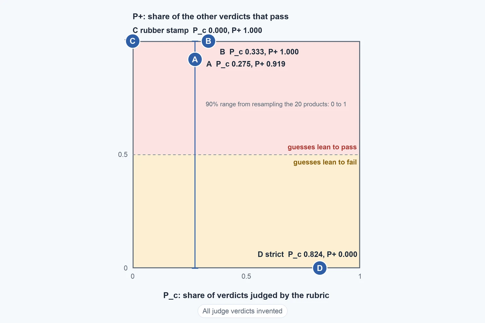

# Judge Leniency And The Gold Set

Up: [[Chance-Corrected Agreement]] · ⬅️ [[Phi And Q]] · [[The 105-Row Gold Set]] ➡️

Mathematics, Statistics, Chance-Corrected Agreement. Needs: [[Chance-Corrected Agreement]], whose 20-product table and four judges are used again here.

> [!warning] Unfinished
> - The three drawn pictures (form, mechanism, deep-dive sheet) are not drawn, and no output picture is rendered: `~/.vault-sandbox` is missing on this machine, so there was no plotting library. To make it: `uv venv ~/.vault-sandbox` then `uv pip install --python ~/.vault-sandbox/bin/python pandas numpy scipy matplotlib statsmodels openpyxl`.
> - No quiz page yet.

**Judge leniency** is the share of a judge's verdicts that ignore the rubric and say pass anyway. This note estimates it from a 2 by 2 table, solves Thakur's two equations for it step by step, and shows how little 20 products pin it down. The 105-row gold set, where 92% of the rows are bad, is in [[The 105-Row Gold Set]].

**Where you work.** Any folder with Python 3 and nothing installed. Every judge outcome below is invented. The 20-product counts are the ones in [[Chance-Corrected Agreement]]; the judge outcomes are made up.

## Table of contents

- [Thakur's leniency model](#thakurs-leniency-model)
- [The algebra from equations 4 and 5 to equation 18](#the-algebra-from-equations-4-and-5-to-equation-18)
- [How sure the leniency estimate is](#how-sure-the-leniency-estimate-is)
- [Other ways](#other-ways)
- [Taught in, applied in](#taught-in-applied-in)
- [How this was checked](#how-this-was-checked)

## Thakur's leniency model

Navigation: 📋 [[#Table of contents]] | [[#The algebra from equations 4 and 5 to equation 18]] ➡️

**Leniency**, $P_+$, is the probability that a judge says "correct" on an item it did not judge by the rubric, and $P_c$ is the probability that it did judge by the rubric. Thakur et al. model each verdict as one of two things (section 5.4, PDF pages 7 and 8): with probability $P_c$ the judge gives the right verdict, and with probability $1 - P_c$ it flips a coin that says "correct" with probability $P_+$, whatever the item is.

Write $s$ for the share of items that are truly good, and $t_P$, $t_N$ for the shares of all items that are good-and-passed and bad-and-failed. The model says (their equations 4 and 5, derived in Appendix O, PDF page 26):

$$
\begin{aligned}
t_P &= s\,[P_c + (1-P_c)P_+] \\[4pt]
t_N &= (1-s)\,[P_c + (1-P_c)(1-P_+)]
\end{aligned}
$$

Solving them for $P_c$ and $P_+$ takes seven short steps, written out in [[#The algebra from equations 4 and 5 to equation 18]]. The result, which is the paper's equation 18 and the line before it:

$$
P_c = \frac{t_P}{s} + \frac{t_N}{1-s} - 1, \qquad P_+ = \frac{1 - t_N/(1-s)}{1 - P_c}
$$

$t_P/s$ is the share of good products the judge passed, and $t_N/(1-s)$ the share of bad products it stopped. A judge that guessed on every item would have those two add to exactly 1, so $P_c = 0$. What they add above 1 is the share of items judged by the rubric. The leftover is guessed, and $P_+$ says which way.

On the four judges of the 20-product table ($s = 0.85$ for all four):

| Judge | passed good products | stopped bad products | $P_c$ | $P_+$ |
|---|---:|---:|---:|---:|
| A: the judge so far | 16 of 17 = 0.941 | 1 of 3 = 0.333 | 0.275 | 0.919 |
| B: also fixes its wrong fail | 17 of 17 = 1.000 | 1 of 3 = 0.333 | 0.333 | 1.000 |
| C: rubber stamp | 17 of 17 = 1.000 | 0 of 3 = 0.000 | 0.000 | 1.000 |
| D: strict | 14 of 17 = 0.824 | 3 of 3 = 1.000 | 0.824 | 0.000 |

C is exactly $P_c = 0$, $P_+ = 1$: no rubric, always pass. D is the mirror: it applies the rubric on 82% of products and fails the rest. A applies the rubric on about a quarter of products and passes nearly all the others. This separates A, C and D, which Rao and Callison-Burch say the summary numbers cannot do alone, because accuracy, kappa and phi are unchanged when false passes and false fails are exchanged (page 3, as in [[Chance-Corrected Agreement#Which way the judge errs]]).


*All judge verdicts and confidences in this picture are invented.*

**Why this matters.** The model names which way a judge's mistakes lean, which is the question an auto-publishing pass depends on. Backing: cited (Thakur et al., arXiv 2406.12624, equations 4, 5 and 18), derived (the line above), shown (the run below).

## The algebra from equations 4 and 5 to equation 18

Navigation: ⬅️ [[#Thakur's leniency model]] | 📋 [[#Table of contents]] | [[#How sure the leniency estimate is]] ➡️

**Two counts you can read off the judge's table, and two things you cannot see, are linked by two equations, and adding the equations makes one of the unseen things disappear.** The counts are the share of good products the judge passed and the share of bad products it stopped. The unseen things are how often the judge really used the rubric ($P_c$) and, on the rest, how often it guessed "pass" ($P_+$). A guess that says "pass" helps the first count and hurts the second by the same amount, so adding the two counts cancels the guess and leaves only the rubric share. Every judge outcome below is invented.

**What the symbols stand for.** $s$ is the share of all items that are truly good. $t_P$ is the share of all items that are good and that the judge passed. $t_N$ is the share of all items that are bad and that the judge failed. Equations 4 and 5 of Thakur et al. (Appendix O, PDF page 26) are the ones above:

$$
t_P = s\,[P_c + (1-P_c)P_+] \quad (4), \qquad t_N = (1-s)\,[P_c + (1-P_c)(1-P_+)] \quad (5)
$$

**The seven steps.** Each line is what you write; the reason is in the words after it.

1. Divide equation 4 by $s$. The $s$ on the right cancels:
$$
\frac{t_P}{s} = P_c + (1-P_c)P_+ \qquad (4')
$$
2. Divide equation 5 by $1-s$. The $1-s$ on the right cancels:
$$
\frac{t_N}{1-s} = P_c + (1-P_c)(1-P_+) \qquad (5')
$$
3. Open the bracket $(1-P_c)(1-P_+)$ in $(5')$. It is $(1-P_c)\cdot 1 - (1-P_c)P_+$, so
$$
\frac{t_N}{1-s} = P_c + (1-P_c) - (1-P_c)P_+ = 1 - (1-P_c)P_+ \qquad (5'')
$$
because $P_c + (1-P_c) = 1$.
4. Add $(4')$ and $(5'')$. The left sides give $t_P/s + t_N/(1-s)$. On the right, $+(1-P_c)P_+$ and $-(1-P_c)P_+$ are equal and opposite, so they cancel and $P_c + 1$ is left:
$$
\frac{t_P}{s} + \frac{t_N}{1-s} = 1 + P_c
$$
5. Take 1 from both sides:
$$
P_c = \frac{t_P}{s} + \frac{t_N}{1-s} - 1 \qquad \text{(the paper's equation 18)}
$$
6. Get $P_+$ from $(4')$. Move $P_c$ across: $(1-P_c)P_+ = t_P/s - P_c$. Divide both sides by $1-P_c$, which is allowed only when $P_c \neq 1$:
$$
P_+ = \frac{t_P/s - P_c}{1 - P_c}
$$
7. Show this is Thakur's form. Put step 5's $P_c$ into the top: $t_P/s - P_c = t_P/s - t_P/s - t_N/(1-s) + 1 = 1 - t_N/(1-s)$. So
$$
P_+ = \frac{1 - t_N/(1-s)}{1 - P_c} \qquad \text{(the paper's equation 13)}
$$

*Derived.* The paper reaches the same two formulas by the other order: it solves equation 5 for $P_+$ (its lines 6 to 13) and puts that into equation 4 (lines 14 to 17, where $t_P/s = P_c + 1 - t_N/(1-s)$ is step 5 with the terms moved). Step 3's $(5'')$ gives its equation 13 in one move: $(1-P_c)P_+ = 1 - t_N/(1-s)$, then divide by $1 - P_c$.

**Where the minus 1 comes from.** Step 4 shows the two counts add to $1 + P_c$. A judge that never uses the rubric (rubber stamp C: 17 of 17 good passed, 0 of 3 bad stopped) has $t_P/s + t_N/(1-s) = 1 + 0 = 1$, so its $P_c$ is $1 - 1 = 0$. Without the minus 1 it would score 1, the score of a perfect judge. A perfect judge has the counts add to 2.

**Judge A through the seven steps.** Judge A of the 20-product table has cells $(TP, FN, FP, TN) = (16, 1, 2, 1)$, so $n = 20$, $s = 17/20 = 0.85$, $t_P = 16/20 = 0.80$, $t_N = 1/20 = 0.05$.

| Step | What is computed | Value |
|---|---|---:|
| 1 | $t_P/s = 0.80 / 0.85$ | 0.9412 (exactly 16/17) |
| 2 | $t_N/(1-s) = 0.05 / 0.15$ | 0.3333 (exactly 1/3) |
| 4 | $t_P/s + t_N/(1-s) = 0.9412 + 0.3333$ | 1.2745 (exactly 65/51) |
| 5 | $P_c = 1.2745 - 1$ | 0.2745 (exactly 14/51) |
| 6 | $1 - P_c = 1 - 0.2745$ | 0.7255 (exactly 37/51) |
| 6 | $t_P/s - P_c = 0.9412 - 0.2745$ | 0.6667 (exactly 2/3) |
| 6 | $P_+ = 0.6667 / 0.7255$ | 0.9189 (exactly 34/37) |
| 7 | $1 - t_N/(1-s) = 1 - 0.3333$ | 0.6667, the same top as step 6 |
| 7 | $P_+ = 0.6667 / 0.7255$ | 0.9189, the same answer |

The four-judge table in [[#Thakur's leniency model]] rounds these to $P_c = 0.275$ and $P_+ = 0.919$.

**One way it goes wrong: a judge with $P_c = 1$.** A perfect judge on the same 20 products has cells $(17, 0, 0, 3)$. Then $t_P/s = 1$, $t_N/(1-s) = 1$, and step 5 gives $P_c = 1 + 1 - 1 = 1$. Step 6 divides by $1 - P_c = 0$, and the top, $1 - t_N/(1-s)$, is also 0. $P_+ = 0/0$ is undefined, and the reason is in equation 4: with $P_c = 1$ the term $(1-P_c)P_+$ is 0 whatever $P_+$ is. Putting in $P_+ = 0$, $1/2$ and $1$ gives $t_P = 0.85$ and $t_N = 0.15$ every time. A judge that follows the rubric on every verdict has no leniency to estimate, and the run below shows Python refusing the division. A judge near this ($P_c$ close to 1) divides a tiny top by a tiny bottom, so its $P_+$ moves a lot for a small change in the counts.

**Check.** The script [leniency_algebra.py](sandbox/leniency_algebra.py) in this folder's `sandbox/` repeats the steps on judge A with exact fractions, puts $P_c$ and $P_+$ back into equations 4 and 5 and compares them with the table, and then runs the rubber stamp and the perfect judge. Copy it to an empty folder and run:

```bash
python3 -I leniency_algebra.py
```

You should see:

```text
judge A (16, 1, 2, 1) n = 20
s                                0.8500   exact 17/20
tP                               0.8000   exact 4/5
tN                               0.0500   exact 1/20
steps 1 and 2: divide equation 4 by s and equation 5 by (1 - s)
tP/s                             0.9412   exact 16/17
tN/(1-s)                         0.3333   exact 1/3
steps 3 and 4: open the bracket in equation 5, then add; the P+ terms cancel
tP/s + tN/(1-s)                  1.2745   exact 65/51
step 5: the sum is 1 + Pc, so take 1 away
Pc                               0.2745   exact 14/51
step 6: P+ from equation 4
1 - Pc                           0.7255   exact 37/51
tP/s - Pc                        0.6667   exact 2/3
P+ from equation 4               0.9189   exact 34/37
step 7: P+ in Thakur's form
1 - tN/(1-s)                     0.6667   exact 2/3
P+ in Thakur's form              0.9189   exact 34/37
the two forms equal: True
check: put Pc and P+ back into equations 4 and 5
equation 4 gives tP              0.8000   exact 4/5
equation 5 gives tN              0.0500   exact 1/20
both match the table: True
why the 1 is taken away: rubber stamp (17, 0, 3, 0)
tP/s + tN/(1-s) = 1  so Pc = 0
failure: a perfect judge (17, 0, 0, 3)
Pc = 1  1 - Pc = 0  numerator 1 - tN/(1-s) = 0
P+ = 0/0 -> ZeroDivisionError
P+ = 0: equation 4 gives tP = 0.85, equation 5 gives tN = 0.15
P+ = 1/2: equation 4 gives tP = 0.85, equation 5 gives tN = 0.15
P+ = 1: equation 4 gives tP = 0.85, equation 5 gives tN = 0.15
```

| Field | Value | How to read it |
|---|---|---|
| `exact` | a fraction | the same number kept as a fraction, so the equalities are tested without rounding |
| `the two forms equal: True` | step 6 and step 7 agree | the two ways to write $P_+$ give the same fraction, 34/37 |
| `both match the table: True` | equations 4 and 5 return $t_P$ and $t_N$ | $P_c = 14/51$ and $P_+ = 34/37$ are consistent with the counts they came from |
| `P+ = 0/0 -> ZeroDivisionError` | the perfect judge | no $P_+$ exists to estimate; every $P_+$ fits the counts |

*Backing:* derived (the seven steps), cited (Thakur et al., arXiv 2406.12624, PDF page 26: equations 4, 5, 13 and 18), shown (the run).

**Why this matters.** A reader who can redo these steps can check any leniency number a paper or a judge report gives, and sees at once that a perfect judge, or one close to it, has a leniency that the counts cannot pin down. The 20-product estimate in the next section is this same arithmetic repeated on resampled products.

## How sure the leniency estimate is

Navigation: ⬅️ [[#The algebra from equations 4 and 5 to equation 18]] | 📋 [[#Table of contents]] | [[#Other ways]] ➡️

**Twenty products cannot pin down $P_+$ for judge A.** Only 3 of the 20 are bad, so the estimate rests on 3 products. Resampling the 20 products 10,000 times (seed 0) leaves 9,489 usable resamples, because some resamples have no bad product and $P_+$ is then undefined. They give a middle value of 0.92 and a 90% range from 0.00 to 1.00. The method is sound and the sample is too small for it.

Save as `leniency.py` in an empty folder:

```python
# Thakur's leniency model (equations 4, 5, 18) on four judges, then a bootstrap for judge A.
# Cell order everywhere: (reviewer pass and judge pass, reviewer pass and judge fail,
#                         reviewer fail and judge pass, both fail).
import random


def thakur(tp, fn, fp, tn):
    n = tp + fn + fp + tn
    s = (tp + fn) / n  # share of items that are truly good
    t_p, t_n = tp / n, tn / n  # joint shares, as in Thakur's tP and tN
    pc = t_p / s + t_n / (1 - s) - 1
    pplus = (1 - t_n / (1 - s)) / (1 - pc) if pc < 1 else float("nan")
    return s, pc, pplus


judges = {
    "A": (16, 1, 2, 1),
    "B": (17, 0, 2, 1),
    "C rubber stamp": (17, 0, 3, 0),
    "D strict": (14, 3, 0, 3),
}
for name, c in judges.items():
    s, pc, pp = thakur(*c)
    print(f"{name:15s} {c}  s={s:.3f}  Pc={pc:.3f}  P+={pp:.3f}")

random.seed(0)
items = [(1, 1)] * 16 + [(1, 0)] * 1 + [(0, 1)] * 2 + [(0, 0)] * 1  # (reviewer pass, judge pass)
values = []
for _ in range(10000):
    r = [random.choice(items) for _ in items]
    tp = sum(1 for x, y in r if x and y)
    fn = sum(1 for x, y in r if x and not y)
    fp = sum(1 for x, y in r if not x and y)
    tn = sum(1 for x, y in r if not x and not y)
    if tp + fn == 0 or fp + tn == 0:
        continue
    pp = thakur(tp, fn, fp, tn)[2]
    if pp == pp:  # drop nan
        values.append(pp)
values.sort()
print(
    f"A bootstrap P+ ({len(values)} usable of 10000): "
    f"5%={values[int(.05 * len(values))]:.2f} "
    f"median={values[len(values) // 2]:.2f} "
    f"95%={values[int(.95 * len(values)) - 1]:.2f}"
)
```

Run it:

```bash
python3 leniency.py
```

You should see:

```text
A               (16, 1, 2, 1)  s=0.850  Pc=0.275  P+=0.919
B               (17, 0, 2, 1)  s=0.850  Pc=0.333  P+=1.000
C rubber stamp  (17, 0, 3, 0)  s=0.850  Pc=0.000  P+=1.000
D strict        (14, 3, 0, 3)  s=0.850  Pc=0.824  P+=0.000
A bootstrap P+ (9489 usable of 10000): 5%=0.00 median=0.92 95%=1.00
```

| Field | Value | How to read it |
|---|---|---|
| `(16, 1, 2, 1)` | cells of judge A | reviewer pass and judge pass, reviewer pass and judge fail, reviewer fail and judge pass, both fail |
| `s` | 0.850 | share of the 20 products the reviewer passes |
| `Pc` | 0.275 | share of verdicts judged by the rubric |
| `P+` | 0.919 | where the other verdicts go: nearly all to pass |
| `P+ ... 5%=0.00 median=0.92 95%=1.00` | 9,489 usable of 10,000 | the 90% range of $P_+$ over resampled products is the whole interval from 0 to 1 |

**Why this matters.** A lean estimated from three bad products should not move a decision. Backing: shown (the run).

## Other ways

Navigation: ⬅️ [[#How sure the leniency estimate is]] | 📋 [[#Table of contents]] | [[#Taught in, applied in]] ➡️

**Choose the cut-off instead of reporting a rate.** When the judge can send rows to review, [[Selective Evaluation]] picks the confidence cut-off so the answered rows agree with people at a stated rate.

**Rows the judge will not answer.** The review verdict changes what the numbers above mean: see [[Abstention In Agreement Scores]].

**How sure kappa is on these rows.** See [[How Sure Kappa Is]].

**The gold set.** Why 92% bad rows change what raw agreement and the wrong-pass share mean, and what the rows can certify: [[The 105-Row Gold Set]].

## Taught in, applied in

Navigation: ⬅️ [[#Other ways]] | 📋 [[#Table of contents]] | [[#How this was checked]] ➡️

**Taught in.**

- [The combined reading of validating an LLM judge](/Users/molefemolefe/goal-setting/learning/ai-engineering/prototype-product-data-validation-end-to-end/drips/combine-validating-an-llm-judge/COMBINE_MAP.md), idea 3, which way the judge errs, and its worked example Parts 2 and 3.
- [The validating-an-llm-judge journey](/Users/molefemolefe/goal-setting/learning/ai-engineering/agent-evaluation/validating-an-llm-judge/MASTER_PLAN.md), which teaches the judge-validation steps these notes feed.

**Applied in.**

- The v3 product-content judge in the Dis-Chem product data repo: its leniency, which way its mistakes lean, is read with this model. No real judge has been run, so every outcome here is invented.

## How this was checked

Navigation: ⬅️ [[#Taught in, applied in]] | 📋 [[#Table of contents]]

> [!note]- How this was checked
> `leniency.py` was run on 2026-10-18 on a Mac with Python 3.12 (standard library only) with `python3 -I`, from an empty folder that was removed afterwards. Its output matches the saved output of the learning tree's `test-3-and-gold-design.py` on every number quoted (including 9,489 usable resamples). The equations were read from Thakur et al., PDF pages 7 and 8 and Appendix O on page 26. `leniency_algebra.py` (the section on the algebra) was run on 2026-10-18 on the same Mac with `python3 -I` from an empty folder that was removed afterwards, and its printed lines are the ones in the note; the paper's lines 4, 5, 13, 17 and 18 were read from the same page with PyMuPDF. The prepared environment `~/.vault-sandbox` does not exist on this machine, so the standard library interpreter was used. The note has not been rendered in Obsidian. The scripts are also saved in this folder's `sandbox/`. The gold-set sections were split out to The 105-Row Gold Set on 2026-10-18.
