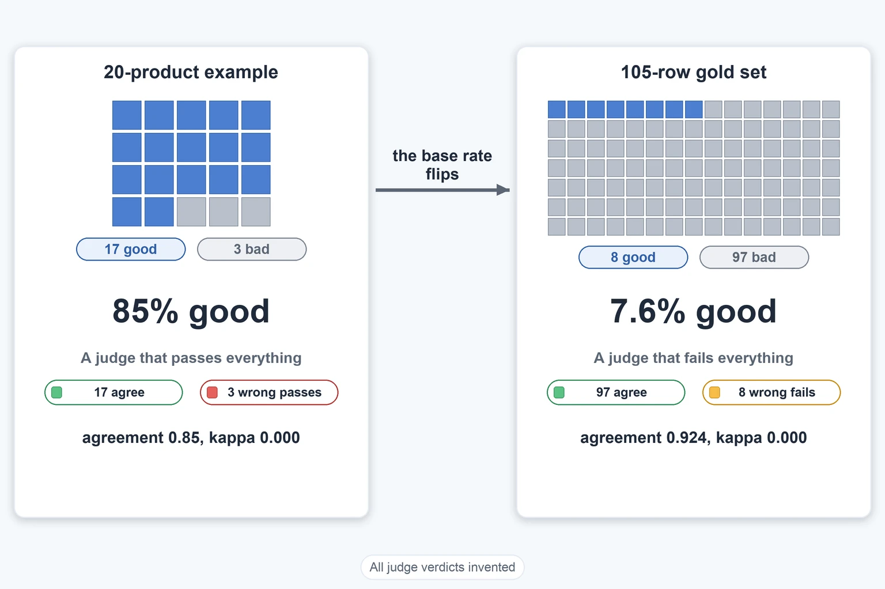
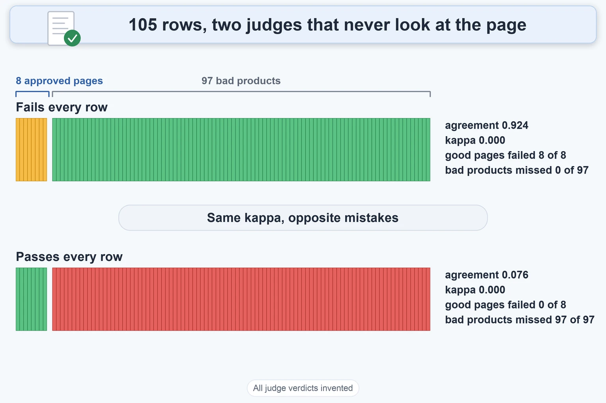

# The 105-Row Gold Set

Up: [[Chance-Corrected Agreement]] · ⬅️ [[Judge Leniency And The Gold Set]] · [[Abstention In Agreement Scores]] ➡️

Mathematics, Statistics, Chance-Corrected Agreement. Needs: [[Chance-Corrected Agreement]], whose 20-product table and four judges are used again here, and [[Judge Leniency And The Gold Set#Thakur's leniency model]] for the two leniency numbers in the first table.

> [!warning] Unfinished
> - No output picture is rendered: `~/.vault-sandbox` is missing on this machine, so there was no plotting library. To make it: `uv venv ~/.vault-sandbox` then `uv pip install --python ~/.vault-sandbox/bin/python pandas numpy scipy matplotlib statsmodels openpyxl`.
> - No quiz page yet.
> - 1 claim is marked stated and keeps nothing unfinished: it is counted in the closing box.

**The gold set** is the 105 rows (8 approved pages and 97 broken copies of them) on which a judge for auto-publishing is checked. This note shows why the same 2 by 2 table behaves differently when 92% of the rows are bad: raw agreement flatters a judge that fails everything, the wrong-pass share is dominated by the mix, and the rows can certify only a bound of a few percent.

**Where you work.** Any folder with Python 3 and nothing installed. Every judge outcome below is invented. The 20-product counts are the ones in [[Chance-Corrected Agreement]]; the shape of the 105 rows is real, the judge's answers on them are not.

## Table of contents

- [The 105-row design](#the-105-row-design)
- [The fail-everything judge](#the-fail-everything-judge)
- [Why the wrong-pass share misleads on this mix](#why-the-wrong-pass-share-misleads-on-this-mix)
- [What the counts can certify](#what-the-counts-can-certify)
- [Other ways](#other-ways)
- [Taught in, applied in](#taught-in-applied-in)
- [How this was checked](#how-this-was-checked)

## The 105-row design

Navigation: 📋 [[#Table of contents]] | [[#The fail-everything judge]] ➡️

**The 105-row design** is 8 approved product pages, known to be good, plus broken copies of them: each approved page gets copies with one rule broken on purpose, from 15 kinds of defect (D1 to D15). Ten kinds have 8 copies, four kinds have 3 and one kind has 5, so the bad rows number $8 \times 10 + 3 \times 4 + 5 \times 1 = 97$, and the rows number $8 + 97 = 105$.

**The base rate flips.** In the 20-product example 85% of products were good. Here $8/105 = 7.6\%$ are, so luck now favours "fail", and the luck baseline in kappa moves with it. No judge has been run on these rows yet, so each judge below is invented. Cell order is (reviewer pass and judge pass, reviewer pass and judge fail, reviewer fail and judge pass, both fail).

| Invented judge | cells | $p_o$ | Cohen $\kappa$ | Scott $\pi_S$ | bad products missed | good pages failed |
|---|---|---:|---:|---:|---:|---:|
| V2-like: catches about half | (8, 0, 48, 49) | 0.543 | 0.135 | −0.079 | 48 of 97 (0.495) | 0 of 8 |
| good judge | (7, 1, 3, 94) | 0.962 | 0.757 | 0.757 | 3 of 97 (0.031) | 1 of 8 |
| rubber stamp: passes all 105 | (8, 0, 97, 0) | 0.076 | 0.000 | −0.858 | 97 of 97 | 0 of 8 |
| fail-everything: fails all 105 | (0, 8, 0, 97) | **0.924** | 0.000 | −0.040 | 0 of 97 | **8 of 8** |

[[Judge Leniency And The Gold Set#Thakur's leniency model|Thakur's model]] on the V2-like judge gives $P_c = 0.505$ and $P_+ = 1.0$: it applies its checks on half the cases, and the half with no check always passes. That matches the planted-defect note's count of about 7 of 15 defects checked by v2 (stated: that count is from the project's note, not rerun here).


*All judge verdicts and confidences in this picture are invented.*

**Why this matters.** The set has two numbers it must report together, the share of bad products missed and the share of good pages failed, because neither raw agreement nor kappa shows both. Backing: shown (the run below), derived.

## The fail-everything judge

Navigation: ⬅️ [[#The 105-row design]] | 📋 [[#Table of contents]] | [[#Why the wrong-pass share misleads on this mix]] ➡️

**A judge that fails every row has raw agreement 0.924 and kappa exactly 0.** It matches all 97 bad rows, so $p_o = 97/105 = 0.924$. It never passes, so its pass rate is 0 and the luck baseline is $p_e = 0.076 \cdot 0 + 0.924 \cdot 1 = 0.924$:

$$
\kappa = \frac{p_o - p_e}{1 - p_e} = \frac{0.924 - 0.924}{1 - 0.924} = 0
$$

This is the kappa paradox from [[Chance-Corrected Agreement#The kappa paradox]] on the other side: the rubber stamp of the 20-product table passed everything and matched 0.85, and this one fails everything and matches 0.924. It also fails all 8 approved pages. Raw agreement cannot show that, and neither can kappa, which is 0 for both.


*All judge verdicts and confidences in this picture are invented.*

**Why this matters.** A judge that fails everything is harmless to publish and useless to run, and only the good-pages-failed column shows it. Backing: derived, shown (the run below).

## Why the wrong-pass share misleads on this mix

Navigation: ⬅️ [[#The fail-everything judge]] | 📋 [[#Table of contents]] | [[#What the counts can certify]] ➡️

**The wrong-pass share is the part of a judge's passes that were wrong**, $FP/(TP+FP)$, the number the customer sees on a mix that matches production. On the 105 rows it is dominated by the mix.

| Judge | passes | wrong passes | wrong-pass share | bad products missed |
|---|---:|---:|---:|---:|
| good judge | 10 | 3 | 0.300 | 3 of 97 = 0.031 |
| rubber stamp | 105 | 97 | 0.924 | 1.000 |
| fail-everything | 0 | 0 | undefined | 0.000 |

The good judge misses 3.1% of bad products, yet 30% of what it passes is wrong, because 92% of the rows are bad and so 3 of its 10 passes are bad products. The same judge on a production mix that is mostly good would show a far smaller share. Fail-everything has no passes, so the share is undefined and not 0. On this set, quote the share of bad products missed. Use the wrong-pass share only on a sample with the production mix (the walk's own reading of the arithmetic, derived from the cells).

**Why this matters.** One number answers a different question on a different mix, so the set's base rate decides which number to quote. Backing: derived, shown.

## What the counts can certify

Navigation: ⬅️ [[#Why the wrong-pass share misleads on this mix]] | 📋 [[#Table of contents]] | [[#Other ways]] ➡️

Textbook: [Introduction to probability for data science, 3.5.2 binomial random variable, p. 159](../../references/textbooks/statistics/introduction-to-probability-for-data-science.pdf#page=159)

**The 90% upper bound on a rate** after $k$ events in $n$ cases is the exact binomial bound, defined in [[Selective Evaluation#The exact binomial upper bound]]. With $k = 0$ it is $1 - 0.1^{1/n}$.

Save as `gold_set.py` in an empty folder:

```python
# The 105-row design: 8 approved pages (good) and 97 planted-defect copies (bad).
# Every judge outcome below is INVENTED. Cell order: (tp, fn, fp, tn), reviewer first.
from math import comb


def agreement(tp, fn, fp, tn):
    n = tp + fn + fp + tn
    a, b = (tp + fn) / n, (tp + fp) / n
    po = (tp + tn) / n
    pe = a * b + (1 - a) * (1 - b)
    kappa = (po - pe) / (1 - pe) if pe < 1 else float("nan")
    pool = (a + b) / 2
    pes = pool**2 + (1 - pool) ** 2
    pi = (po - pes) / (1 - pes)
    wrong_pass_of_passes = fp / (tp + fp) if tp + fp else float("nan")
    miss = fp / (fp + tn)  # share of bad products the judge passed
    false_fail = fn / (tp + fn)  # share of good pages the judge failed
    return po, kappa, pi, wrong_pass_of_passes, miss, false_fail


def thakur(tp, fn, fp, tn):
    n = tp + fn + fp + tn
    s = (tp + fn) / n
    pc = (tp / n) / s + (tn / n) / (1 - s) - 1
    return pc, (1 - (tn / n) / (1 - s)) / (1 - pc) if pc < 1 else float("nan")


def cp_upper(k, n, conf=0.90):
    """Exact one-sided upper bound on a rate after k events in n trials."""
    lo, hi = 0.0, 1.0
    for _ in range(100):
        mid = (lo + hi) / 2
        cdf = sum(comb(n, i) * mid**i * (1 - mid) ** (n - i) for i in range(k + 1))
        if cdf > 1 - conf:
            lo = mid
        else:
            hi = mid
    return hi


design = {
    "V2-like, catches about half": (8, 0, 48, 49),
    "good judge, 3 wrong passes, 1 wrong fail": (7, 1, 3, 94),
    "rubber stamp, passes all 105": (8, 0, 97, 0),
    "fail-everything, fails all 105": (0, 8, 0, 97),
}
for name, c in design.items():
    po, kappa, pi, wps, miss, ff = agreement(*c)
    pc, pp = thakur(*c)
    print(name, c)
    print(f"  po={po:.3f} kappa={kappa:.3f} pi={pi:.3f} wrong-of-passes={wps:.3f} "
          f"bad-missed={miss:.3f} good-failed={ff:.3f} Pc={pc:.3f} P+={pp:.3f}")

print("90% upper bound on a rate")
for label, k, n in [("bad missed 0 of 97", 0, 97), ("bad missed 3 of 97", 3, 97),
                    ("bad missed 0 of 8", 0, 8), ("bad missed 0 of 5", 0, 5),
                    ("bad missed 0 of 3", 0, 3), ("good failed 0 of 8", 0, 8),
                    ("good failed 1 of 8", 1, 8)]:
    print(f"  {label:20s} {cp_upper(k, n):.3f}")
need = next(n for n in range(1, 500) if cp_upper(0, n) <= 0.05)
print(f"bad cases needed for a 5% bound with 0 misses: {need}")
```

Run it:

```bash
python3 gold_set.py
```

You should see:

```text
V2-like, catches about half (8, 0, 48, 49)
  po=0.543 kappa=0.135 pi=-0.079 wrong-of-passes=0.857 bad-missed=0.495 good-failed=0.000 Pc=0.505 P+=1.000
good judge, 3 wrong passes, 1 wrong fail (7, 1, 3, 94)
  po=0.962 kappa=0.757 pi=0.757 wrong-of-passes=0.300 bad-missed=0.031 good-failed=0.125 Pc=0.844 P+=0.198
rubber stamp, passes all 105 (8, 0, 97, 0)
  po=0.076 kappa=0.000 pi=-0.858 wrong-of-passes=0.924 bad-missed=1.000 good-failed=0.000 Pc=0.000 P+=1.000
fail-everything, fails all 105 (0, 8, 0, 97)
  po=0.924 kappa=0.000 pi=-0.040 wrong-of-passes=nan bad-missed=0.000 good-failed=1.000 Pc=0.000 P+=0.000
90% upper bound on a rate
  bad missed 0 of 97   0.023
  bad missed 3 of 97   0.068
  bad missed 0 of 8    0.250
  bad missed 0 of 5    0.369
  bad missed 0 of 3    0.536
  good failed 0 of 8   0.250
  good failed 1 of 8   0.406
bad cases needed for a 5% bound with 0 misses: 45
```

| Field | Value | How to read it |
|---|---|---|
| `po`, `kappa`, `pi` | as in the table above | agreement numbers from the cells in brackets |
| `wrong-of-passes` | 0.300 for the good judge | wrong passes as a share of the judge's passes; `nan` when there are no passes |
| `bad-missed` | 0.031 for the good judge | bad products passed, as a share of the 97 |
| `good-failed` | 0.125 for the good judge | good pages failed, as a share of the 8 |
| `Pc`, `P+` | 0.844 and 0.198 for the good judge | leniency model on the same cells |
| `bad missed 0 of 97 ... 0.023` | 90% upper bound | with no misses in 97 the true miss rate could still be 2.3% |

**What this does and does not allow.** The pooled 97 supports a bound of a few percent: 2.3% with no misses, 6.8% with 3. A single defect type cannot, since each has only 3 to 8 cases and 0 misses in 8 still allows 25%. Two cautions apply to the pooled figure. The 97 copies are 8 products with one change each, so they are less independent than 97 separate products and the true bound is looser. And 0 of 8 good pages failed still allows a false-fail rate as high as 25%. A bound of 5% on misses needs 45 bad cases with none missed.

**Why this matters.** It sets how much a claim about the v3 judge can say before any real judge has run. Backing: shown (the run), derived (the zero case), cited (the bound is Jung, Brahman and Choi's equation 4).

## Other ways

Navigation: ⬅️ [[#What the counts can certify]] | 📋 [[#Table of contents]] | [[#Taught in, applied in]] ➡️

**Choose the cut-off instead of reporting a rate.** When the judge can send rows to review, [[Selective Evaluation]] picks the confidence cut-off so the answered rows agree with people at a stated rate.

**Rows the judge will not answer.** The review verdict changes what the numbers above mean: see [[Abstention In Agreement Scores]].

**How sure kappa is on these rows.** See [[How Sure Kappa Is]].

**Which way the judge errs.** The leniency model behind the $P_c$ and $P_+$ columns is in [[Judge Leniency And The Gold Set]].

## Taught in, applied in

Navigation: ⬅️ [[#Other ways]] | 📋 [[#Table of contents]] | [[#How this was checked]] ➡️

**Taught in.**

- [The combined reading of validating an LLM judge](/Users/molefemolefe/goal-setting/learning/ai-engineering/prototype-product-data-validation-end-to-end/drips/combine-validating-an-llm-judge/COMBINE_MAP.md), idea 3, which way the judge errs, and its worked example Parts 2 and 3.
- [The validating-an-llm-judge journey](/Users/molefemolefe/goal-setting/learning/ai-engineering/agent-evaluation/validating-an-llm-judge/MASTER_PLAN.md), which teaches the judge-validation steps these notes feed.

**Applied in.**

- The v3 product-content judge in the Dis-Chem product data repo: validated on 8 approved gold pages plus 97 planted-defect copies, where the base rate is 92% bad and raw agreement flatters a judge that fails everything. No real judge has been run on the set, so every outcome here is invented.

## How this was checked

Navigation: ⬅️ [[#Taught in, applied in]] | 📋 [[#Table of contents]]

> [!note]- How this was checked
> `gold_set.py` was run on 2026-10-18 on a Mac with Python 3.12 (standard library only) with `python3 -I`, from an empty folder that was removed afterwards. Its output matches the saved outputs of the learning tree's `test-3-and-gold-design.py` on every number quoted (including the bounds 0.023, 0.068, 0.250, 0.369, 0.536, 0.406). The bound's equation was read from Jung, Brahman and Choi, PDF pages 2 and 3. The prepared environment `~/.vault-sandbox` does not exist on this machine, so the standard library interpreter was used. The note has not been rendered in Obsidian. The script is also saved in this folder's `sandbox/`. This note was split out of Judge Leniency And The Gold Set on 2026-10-18; the section text and the run are unchanged.
>
> Claims marked stated, 1: the count of about 7 of 15 defects checked by v2, taken from the project's planted-defect note and not rerun.
