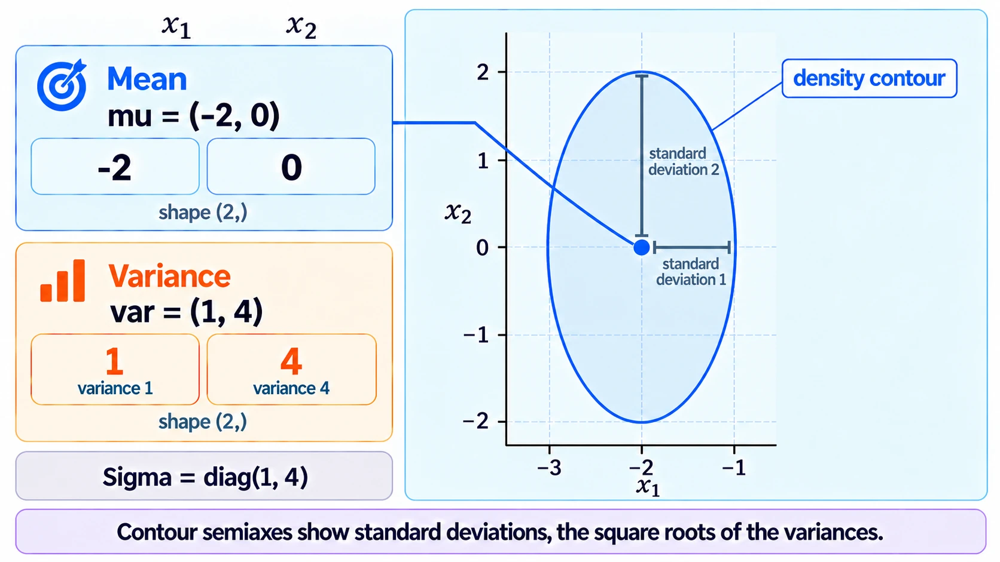
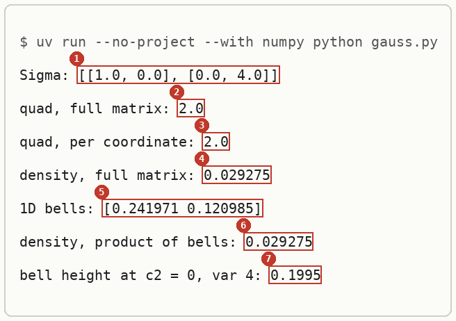
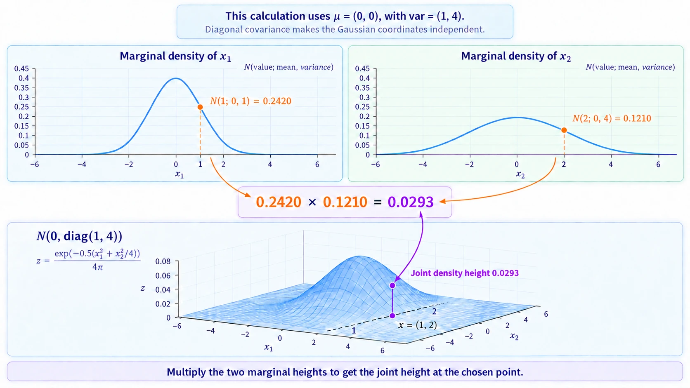
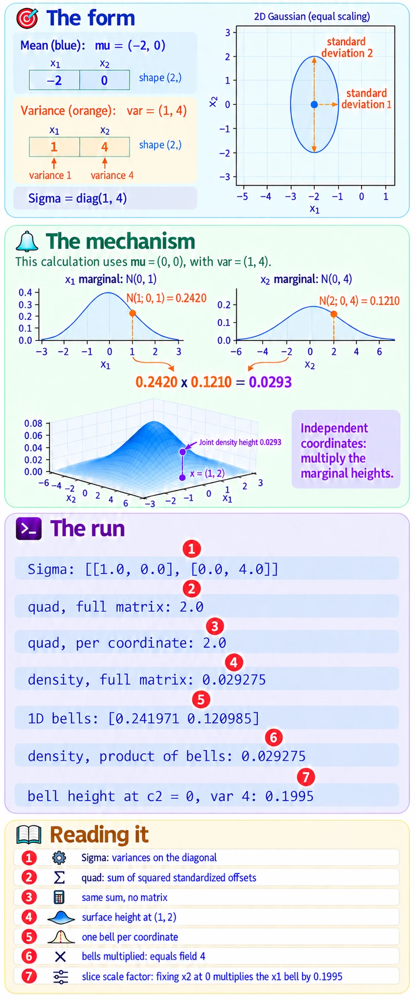

# Diagonal Covariance

Up: [[Multivariate Normal Distribution]] · [[Sampling A Diagonal Gaussian]] ➡️

Mathematics, Statistics, Distributions, Multivariate Normal Distribution. Needs: the one-dimensional normal density, which the learner's [Gaussian Bowl Sketchpad](https://claude.ai/artifact/2TarMifiFoFyoB23eQFR64) lets you drag by its mean and variance.

> [!question] Test yourself
> [The diagonal Gaussian quiz](https://claude.ai/artifact/Vmd1FBg7oWwZq1onu9Jofa) covers this note, with the rest of the [[Multivariate Normal Distribution]] folder. Your attempts are saved on the page.

> [!warning] Unfinished
>
> Stated, not checked: 1 claim, marked where it sits.

**When $\Sigma$ is diagonal, the Gaussian is one independent bell per coordinate, so it is stored as two short arrays: the mean, and one variance per coordinate.** In two dimensions that is a pair of arrays of shape `(2,)`, and the covariance matrix never has to be written out.

## Where you work

The setup is in [[Multivariate Normal Distribution#Where you work]].

## Table of contents

- [[#Diagonal Gaussian]]
- [[#When to reach for it]]
- [[#The form]]
- [[#Try it yourself]]
- [[#Reading the output]]
- [[#How it works]]
- [[#Other ways]]
- [[#Why this matters]]
- [[#Taught in, applied in]]

## Diagonal Gaussian

Navigation: 📋 [[#Table of contents|TOC]] | [[#When to reach for it]] ➡️

**A diagonal Gaussian is a multivariate normal whose covariance is $\operatorname{diag}(\sigma_1^2, \dots, \sigma_d^2)$.** Its contours are ellipses lined up with the axes, never tilted. It is fully given by $(\mu, \sigma^2)$, two vectors of length $d$: in code, `(mu, var)`.

The learner's [Gaussian Bowl Sketchpad](https://claude.ai/artifact/2TarMifiFoFyoB23eQFR64), piece 1a-4 "the equation you can grab", shows this density as rings from above, and its slices through the surface as the one-dimensional bells scaled. The numbers it prints are the ones checked in [[#Try it yourself]] below.

<!-- video-table: multivariate-normal rev=1 -->
Stanford CS229, then ritvikmath, on the multivariate normal and its covariance matrix, in the order to watch:

| Order | What it covers | Kind | Watch |
|---|---|---|---|
| 1 | The multivariate Gaussian density, written with a mean vector and a covariance matrix | Intuition | [Stanford CS229, Autumn 2018, lecture 5, 8:11 to 18:57](https://www.youtube.com/watch?v=nt63k3bfXS0&t=491s) |
| 2 | What a covariance matrix holds: each coordinate's variance on the diagonal, each pair's covariance off it | Intuition | [ritvikmath, The Covariance Matrix, 2:40 to 5:23](https://www.youtube.com/watch?v=152tSYtiQbw&t=160s) |
| 3 | Computing a covariance matrix from data | Worked example | [ritvikmath, The Covariance Matrix, 5:23 to 10:59](https://www.youtube.com/watch?v=152tSYtiQbw&t=323s) |

Neither video takes a diagonal covariance apart into one bell per coordinate. Times are chapter boundaries read from each video's chapter list, not from captions, so each is good to the chapter and the sentence inside it is not checked.
<!-- /video-table -->

## When to reach for it

Navigation: ⬅️ [[#Diagonal Gaussian]] | 📋 [[#Table of contents|TOC]] | [[#The form]] ➡️

When each coordinate spreads on its own and no two move together. Toy models of composition use it because the product of two diagonal Gaussians is again diagonal, and every step is one-dimensional arithmetic per coordinate. Writing a full $\Sigma$ for such a model hides that and costs a matrix inverse where a division would do.

## The form

Navigation: ⬅️ [[#When to reach for it]] | 📋 [[#Table of contents|TOC]] | [[#Try it yourself]] ➡️

$$
x \sim \mathcal{N}\!\left( \mu, \operatorname{diag}(\sigma_1^2, \sigma_2^2) \right)
\quad\Longleftrightarrow\quad
\texttt{mu} = (\mu^{(1)}, \mu^{(2)}), \;\; \texttt{var} = (\sigma_1^2, \sigma_2^2)
$$

```text
mu  = np.array([<mean of coordinate 1>, <mean of coordinate 2>])          shape (2,)
var = np.array([<variance of coordinate 1>, <variance of coordinate 2>])  shape (2,), every entry above 0
np.diag(var)                                                              the full 2 x 2 covariance, when a formula needs it
```

The arrays must be NumPy arrays, never lists, for the arithmetic below to work: see [[Arrays Versus Python Lists]].

<!-- video-table: numpy-arrays rev=1 -->
freeCodeCamp's NumPy course on arrays against lists, in the order to watch:

| Order | What it covers | Kind | Code it writes | Watch |
|---|---|---|---|---|
| 1 | Why a NumPy array beats a Python list, in speed and in what it can do | Intuition | | [freeCodeCamp, Python NumPy Tutorial for Beginners, 1:35 to 9:17](https://www.youtube.com/watch?v=QUT1VHiLmmI&t=95s) |
| 2 | Making an array and reading its shape, size and data type | Code walk | `np.array` and its `.shape`, `.size`, `.dtype` | [freeCodeCamp, Python NumPy Tutorial for Beginners, 11:08 to 16:08](https://www.youtube.com/watch?v=QUT1VHiLmmI&t=668s) |
| 3 | Arithmetic that acts on every entry at once | Code walk | `+`, `*` and `/` between arrays | [freeCodeCamp, Python NumPy Tutorial for Beginners, 35:45 to 38:20](https://www.youtube.com/watch?v=QUT1VHiLmmI&t=2145s) |

The course does not cover broadcasting by name or the seeded generator `np.random.default_rng`; it draws random numbers with the older global `np.random` functions. Times are chapter boundaries read from each video's chapter list, not from captions, so each is good to the chapter and the sentence inside it is not checked.
<!-- /video-table -->



*The form, an axis-aligned ellipse with its mean dot and the two variances read off its two axes.*
## Try it yourself

Navigation: ⬅️ [[#The form]] | 📋 [[#Table of contents|TOC]] | [[#Reading the output]] ➡️

**1. Make something to act on.** In the sandbox folder, save this as `gauss.py`. It evaluates the density of $\mathcal{N}(0, \operatorname{diag}(1, 4))$ at $x = (1, 2)$ two ways: with the full matrix, and as a product of one bell per coordinate.

```python
import numpy as np

mu, var = np.array([0.0, 0.0]), np.array([1.0, 4.0])
x = np.array([1.0, 2.0])

Sigma = np.diag(var)
u = x - mu
quad = u @ np.linalg.inv(Sigma) @ u
full = np.exp(-quad / 2) / np.sqrt((2 * np.pi) ** 2 * np.linalg.det(Sigma))
print("Sigma:", Sigma.tolist())
print("quad, full matrix:", quad)
print("quad, per coordinate:", np.sum(u**2 / var))
print("density, full matrix:", round(float(full), 6))

bells = np.exp(-u**2 / (2 * var)) / np.sqrt(2 * np.pi * var)
print("1D bells:", bells.round(6))
print("density, product of bells:", round(float(np.prod(bells)), 6))
print("bell height at c2 = 0, var 4:", round(1 / np.sqrt(2 * np.pi * 4.0), 4))
```

**2. The failure without the diagonal form.** Hand the variance array to a formula that wants the full matrix:

```bash
uv run --no-project --with numpy python -c "import numpy as np; np.linalg.inv(np.array([1.0, 4.0]))"
```

You should see the last line of an error:

```text
numpy.linalg.LinAlgError: 1-dimensional array given. Array must be at least two-dimensional
```

`var` is not $\Sigma$. Either rebuild the matrix with `np.diag(var)`, or skip the matrix and divide per coordinate.

**3. The technique.**

```bash
uv run --no-project --with numpy python gauss.py
```

You should see:



The full-matrix route and the per-coordinate route agree on every line. These are the sketchpad's numbers: $u^\top \Sigma^{-1} u = 2.0$ at $x = (1, 2)$, density $0.0293$, and the wall bell's peak $0.1995$ for $\sigma_2^2 = 4$.

**4. Another way to get the same answer.** SciPy reads a one-dimensional `cov` as the diagonal of $\Sigma$:

```bash
uv run --no-project --with numpy --with scipy python -c "from scipy.stats import multivariate_normal as mvn; print(round(float(mvn(mean=[0, 0], cov=[1, 4]).pdf([1, 2])), 6))"
```

```text
0.029275
```

**5. More worked examples: three clouds on a plane.** Plan 13 of the PoE derivation foundations journey, and the `drip-read` walk of the Mechanisms of Projective Composition paper, use four diagonal Gaussians, each stored as `(mu, var)`:

| Name | `mu` | `var` | What it looks like |
|---|---|---|---|
| background $p_b$ | `(0, 0)` | `(4, 4)` | a wide round cloud at the origin |
| expert 1 | `(-2, 0)` | `(1, 4)` | to the left, narrow left to right and tall |
| expert 2, "shared" | `(2, 0)` | `(4, 1)` | to the right, wide and flat |
| expert 2, "split" | `(0, 2)` | `(4, 1)` | the same shape, moved up instead of right |

Read the means against the background's `(0, 0)`. In "shared", expert 1 and expert 2 both move coordinate 1. In "split", expert 1 moves coordinate 1 and expert 2 moves coordinate 2, so each owns its own coordinate. The diagonal store makes that visible from the arrays alone: compare which entries of `mu` differ from the background's. The full code, and the composed means it gives, are in [[Arrays Versus Python Lists#Try it yourself]].

The peak of each cloud's density sits at its mean, where the exponent is 0, so its height is $1/(2\pi\sqrt{\sigma_1^2 \sigma_2^2})$: $1/(2\pi \cdot 4) = 0.0398$ for the background and $1/(2\pi \cdot 2) = 0.0796$ for each expert. These are the heights of the walk's 3D density surfaces. *Derived:* the density formula in [[#How it works]] at $u = 0$.

**6. Clean up, and prove it.**

```bash
cd ~ && rm -r ~/playground/sandbox/numpy-arrays
ls ~/playground/sandbox/numpy-arrays; echo $?
```

You should see `No such file or directory`, then `2`.

## Reading the output

Navigation: ⬅️ [[#Try it yourself]] | 📋 [[#Table of contents|TOC]] | [[#How it works]] ➡️

| # | Field | This run | How to read it | Backing |
|---|---|---|---|---|
| 1 | Sigma | `[[1.0, 0.0], [0.0, 4.0]]` | `np.diag(var)`: the variances on the diagonal, zeros everywhere else | shown |
| 2 | quad, full matrix | `2.0` | $u^\top \Sigma^{-1} u$, the squared distance from the mean measured in standard deviations | shown |
| 3 | quad, per coordinate | `2.0` | the same sum as $1^2/1 + 2^2/4$, no matrix needed | derived below |
| 4 | density, full matrix | `0.029275` | the height of the 2D surface at $x = (1, 2)$ | shown |
| 5 | 1D bells | `[0.241971 0.120985]` | $\mathcal{N}(1; 0, 1)$ and $\mathcal{N}(2; 0, 4)$, one bell per coordinate | shown |
| 6 | density, product of bells | `0.029275` | the two bells multiplied: equal to field 4 | derived below |
| 7 | bell height at c2 = 0, var 4 | `0.1995` | $1/\sqrt{2\pi \cdot 4}$, the factor the sketchpad's slices are scaled by | derived below |

## How it works

Navigation: ⬅️ [[#Reading the output]] | 📋 [[#Table of contents|TOC]] | [[#Other ways]] ➡️

Textbook: [Introduction to probability for data science, section 5.6, p. 307](../../../references/textbooks/statistics/introduction-to-probability-for-data-science.pdf#page=307)

With $\Sigma = \operatorname{diag}(\sigma_1^2, \sigma_2^2)$ and $u = x - \mu$:

$$
\begin{aligned}
\Sigma^{-1} &= \operatorname{diag}\!\left( \tfrac{1}{\sigma_1^2}, \tfrac{1}{\sigma_2^2} \right), \qquad \det \Sigma = \sigma_1^2 \sigma_2^2 \\
u^\top \Sigma^{-1} u &= \frac{(u^{(1)})^2}{\sigma_1^2} + \frac{(u^{(2)})^2}{\sigma_2^2} \\
\mathcal{N}(x; \mu, \Sigma) &= \frac{1}{2\pi \sqrt{\sigma_1^2 \sigma_2^2}} \exp\!\left( -\frac{(u^{(1)})^2}{2\sigma_1^2} - \frac{(u^{(2)})^2}{2\sigma_2^2} \right) \\
&= \frac{1}{\sqrt{2\pi\sigma_1^2}} e^{-(u^{(1)})^2 / 2\sigma_1^2} \cdot \frac{1}{\sqrt{2\pi\sigma_2^2}} e^{-(u^{(2)})^2 / 2\sigma_2^2} \\
&= \mathcal{N}(x^{(1)}; \mu^{(1)}, \sigma_1^2) \cdot \mathcal{N}(x^{(2)}; \mu^{(2)}, \sigma_2^2)
\end{aligned}
$$

So a diagonal Gaussian is exactly a product of independent one-dimensional bells, and the pair `(mu, var)` loses nothing.

The worked numbers, for $\mu = (0, 0)$, $\sigma^2 = (1, 4)$, $x = (1, 2)$:

$$
\begin{aligned}
u^\top \Sigma^{-1} u &= \tfrac{1^2}{1} + \tfrac{2^2}{4} = 1 + 1 = 2 \\
\mathcal{N}(x; \mu, \Sigma) &= \frac{e^{-1}}{2\pi \cdot 2} = \frac{0.367879}{12.566371} = 0.029275 \\
\frac{1}{\sqrt{2\pi \cdot 4}} &= \frac{1}{5.013257} = 0.1995
\end{aligned}
$$



*The mechanism, the 2D bell cut along each axis into its two 1D bells, whose heights multiply to the surface's height.*


*The deep-dive sheet composing the form, the mechanism and the run.*
## Other ways

Navigation: ⬅️ [[#How it works]] | 📋 [[#Table of contents|TOC]] | [[#Why this matters]] ➡️

- **A full covariance**, when coordinates move together. The contours tilt, and nothing factorises per coordinate.
- **An isotropic Gaussian**, $\sigma^2 I$, when every coordinate has the same variance: one number instead of an array. The background $p_b$ above is one, with $\sigma^2 = 4$.
- **A Cholesky factor**, when sampling from a full covariance. The learner's LibreOffice note samples 50 points this way. *Stated:* not re-run here.

## Why this matters

Navigation: ⬅️ [[#Other ways]] | 📋 [[#Table of contents|TOC]] | [[#Taught in, applied in]] ➡️

Composition by product of experts multiplies densities. With diagonal Gaussians that product stays diagonal and is computed one coordinate at a time, which is why the toy models of composition use them: every composed mean and variance can be checked by hand, as plan 13 does.

## Taught in, applied in

Navigation: ⬅️ [[#Why this matters]] | 📋 [[#Table of contents|TOC]]

**Taught in:**

- the `drip-read` walk of [the Mechanisms of Projective Composition paper note](../../../../deep-learning/01-poe-derivation-foundations/papers/mechanisms-of-projective-composition), step 1 of 3 up to the object, where the three clouds were written as `(mu, var)` pairs of shape `(2,)`
- the PoE derivation foundations journey's [plan 13](/home/molef/goal-setting/learning/deep-learning/diffusion-models/01-poe-derivation-foundations/plans/13-poe-on-two-gaussians.md), lines 69 to 70, 147 to 148, 173 to 174, 284 to 285 and 290 to 291
- the same journey's [plan 08](/home/molef/goal-setting/learning/deep-learning/diffusion-models/01-poe-derivation-foundations/plans/08-score-of-a-gaussian.md), line 192, with $\Sigma = \operatorname{diag}(1, 4)$
- the same journey's [plan 14](/home/molef/goal-setting/learning/deep-learning/diffusion-models/01-poe-derivation-foundations/plans/14-kl-and-mutual-information.md), line 171, with $\operatorname{diag}(1, 1)$ and $\operatorname{diag}(4, 1)$

**Applied in:** step 2 of the parts-world rebuild walk in the reduce-reuse-recycle research repository (`artifacts/drips/simple-distributions-rebuild/04-the-parts-world.md#step-2-a-diagonal-gaussian-expert`), where the cat expert over a 4 × 4 image is tight on the eight head pixels (variance 0.01) and loose on the eight body pixels (variance 1), so it prefers the all-cat image to the all-dog image by 1600 + 16 = 1616 nats.

**Before this note:** the learner's LibreOffice note `Mathematics/Statistics/Distributions/Multivariate Normal Distribution/Multivariate Normal Distribution.odt` defines the distribution by its mean and covariance matrix, and records that zero covariance means independent variables, with an example of $\mathcal{N}(0, I)$.

> [!note]- How this was checked
> Every output in this note was run by the writer in an empty folder, `~/playground/sandbox/numpy-arrays`, on the PC: Ubuntu under WSL2, Python 3.12.3, NumPy 2.4.6 and SciPy through uv 0.8.13, on 2026-10-04. The folder was removed afterwards and the check in step 6 returned 2.
