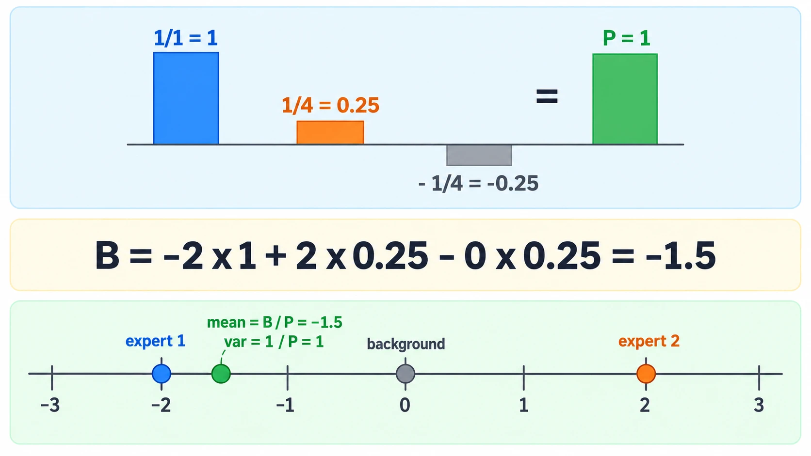
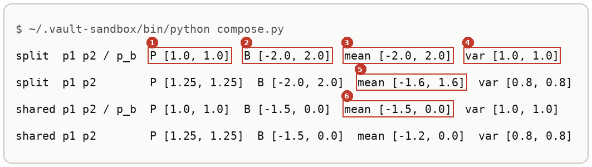
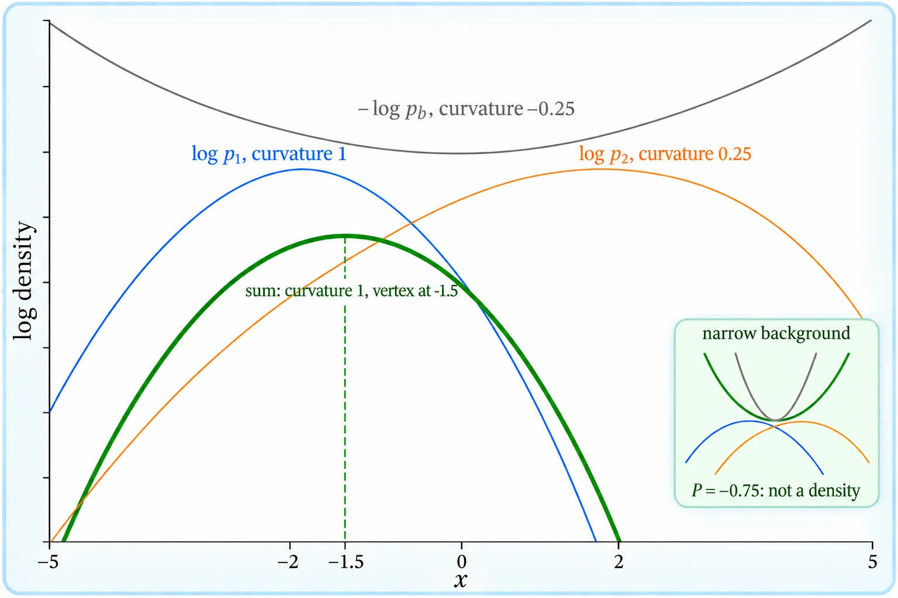
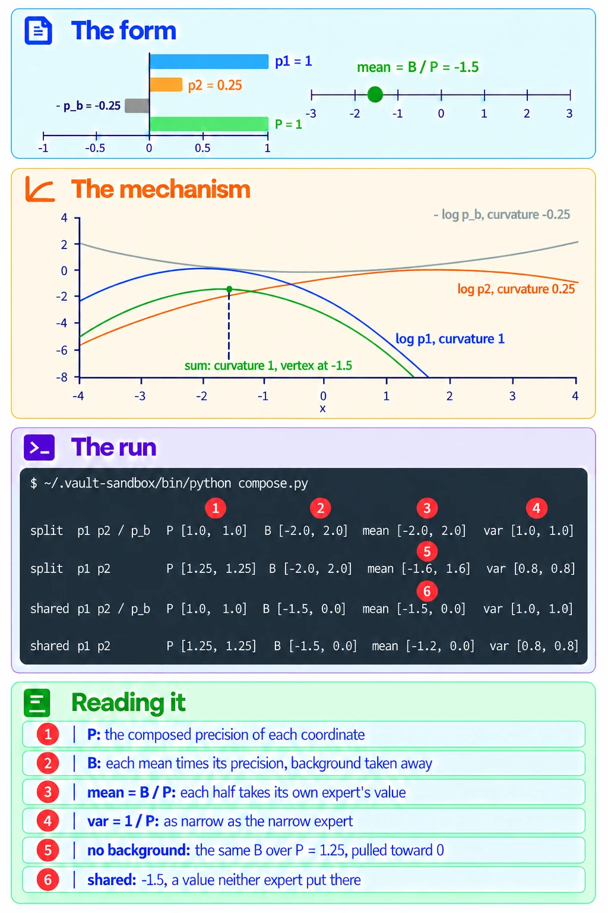

# Products And Quotients Of Diagonal Gaussians

Up: [[Multivariate Normal Distribution]] · ⬅️ [[Sampling A Diagonal Gaussian]] · [[The Area A Product Loses]] ➡️

Mathematics, Statistics, Distributions, Multivariate Normal Distribution. Needs: [[Diagonal Covariance]].

> [!question] Test yourself
> [The diagonal Gaussian quiz](https://claude.ai/artifact/Vmd1FBg7oWwZq1onu9Jofa) covers this note, with the rest of the [[Multivariate Normal Distribution]] folder. Your attempts are saved on the page.

> [!warning] Unfinished
> - The deep-dive sheet is being redrawn: its mechanism pane labelled the background's curve with curvature 0.25 where the maths has -0.25, in a side legend. The current picture stays until prompt 8 in the vault's `.prompts/Multivariate Normal Distribution.md` renders again.

**Multiplying two Gaussian densities adds their precisions, one over each variance, and dividing by a third subtracts its precision, so $p_1 p_2 / p_b$ is again a Gaussian.** Per coordinate, its precision is $P = 1/v_1 + 1/v_2 - 1/v_b$, its variance is $1/P$, and its mean is $B/P$ with $B = m_1/v_1 + m_2/v_2 - m_b/v_b$. The result is a density only while $P > 0$.

## Where you work

The setup is in [[Multivariate Normal Distribution#Where you work]].

## Table of contents

- [[#When to reach for precisions]]
- [[#The form of a composed Gaussian]]
- [[#Try composing yourself]]
- [[#Reading the composed output]]
- [[#How the product works]]
- [[The Area A Product Loses]]
- [[Powers Of Gaussians]]
- [[#Other ways to compose]]
- [[#Why precisions matter]]
- [[#Precisions taught in, applied in]]

## When to reach for precisions

Navigation: 📋 [[#Table of contents|TOC]] | [[#The form of a composed Gaussian]] ➡️

When densities are multiplied: composing experts as a product, dividing out a shared background as in [[Composing Models With A Background]], or a prior times a likelihood. Without the formula you multiply the densities on a grid and search for the peak, which works in one or two dimensions and gives no rule to reason with. Step 6 below does it that way, as a check.

## The form of a composed Gaussian

Navigation: ⬅️ [[#When to reach for precisions]] | 📋 [[#Table of contents|TOC]] | [[#Try composing yourself]] ➡️

```text
P    = 1/v1 + 1/v2 - 1/vb       the composed precision, per coordinate; must be above 0
B    = m1/v1 + m2/v2 - mb/vb    each mean weighted by its own precision, summed the same way
mean = B / P                    the composed mean
var  = 1 / P                    the composed variance
```

For a plain product $p_1 p_2$, drop the two terms with $b$ in them.



*The form, three precision bars adding and subtracting into one, with the means pulled by their weights.*

## Try composing yourself

Navigation: ⬅️ [[#The form of a composed Gaussian]] | 📋 [[#Table of contents|TOC]] | [[#Reading the composed output]] ➡️

**1. What you need, and when it is missing.** The same as steps 1 and 2 of [[Sampling A Diagonal Gaussian#Try sampling yourself]].

**2. Make something to act on.** In `~/playground/sandbox/gaussian-clouds`, with the `toy.py` of [[Sampling A Diagonal Gaussian#Try sampling yourself]] step 3 saved there.

**3. Look at it before: where do the two experts overlap?** Before plotting, the walk asked where expert 1 and expert 2 overlap. The walk's answer key, `checks/overlap.py`, multiplies the two experts with no background. Save it as `overlap.py`:

```python
# Step 3a's prediction: where blue and orange overlap (the peak of p_1 * p_2) and how much (the integral of p_1 * p_2).
import numpy as np
from toy import shared, split
for name, ps in [("shared", shared), ("split", split)]:
    (m1, v1), (m2, v2) = ps[1], ps[2]
    prec = 1 / v1 + 1 / v2                                   # precisions add when densities multiply
    centre = (m1 / v1 + m2 / v2) / prec                      # precision-weighted average of the two means
    amount = np.prod(np.exp(-0.5 * (m1 - m2)**2 / (v1 + v2)) / np.sqrt(2 * np.pi * (v1 + v2)))
    print(f"{name}: overlap centre {np.round(centre, 2).tolist()}, overlap amount {amount:.4f}")
```

```bash
~/.vault-sandbox/bin/python overlap.py
```

```text
shared: overlap centre [-1.2, 0.0], overlap amount 0.0064
split: overlap centre [-1.6, 1.6], overlap amount 0.0143
```

Neither overlap is centred on the origin, and the split pair overlaps more than twice as much as the shared pair. What these two points mean for composition, and why the background changes them, is in [[Composing Models With A Background]].

**4. The failure: a background narrower than the experts.** Save this as `narrow.py`. It composes one coordinate with a background of variance 0.5, narrower than both experts:

```python
import numpy as np

(mb, vb), (m1, v1), (m2, v2) = (0.0, 0.5), (-2.0, 1.0), (2.0, 4.0)
P = 1 / v1 + 1 / v2 - 1 / vb
B = m1 / v1 + m2 / v2 - mb / vb
print("P", P, "B", B)
for x in (0.0, 5.0, 10.0):
    print("x", x, "log C + const", round(-P / 2 * x**2 + B * x, 2))
```

```bash
~/.vault-sandbox/bin/python narrow.py
```

```text
P -0.75 B -1.5
x 0.0 log C + const 0.0
x 5.0 log C + const 1.88
x 10.0 log C + const 22.5
```

The precision is negative, so the log of the result grows without limit as $x$ moves away from 0. No constant can make it integrate to 1, and "divide by the background" has returned something that is not a probability density. This is plan 13's narrow-unconditional case.

**5. The technique.** Save this as `compose.py`. It composes both versions with and without the background, one coordinate per array entry:

```python
import numpy as np
from toy import shared, split

def compose(ps, divide_background=True):
    (mb, vb), (m1, v1), (m2, v2) = ps
    k = 1 if divide_background else 0
    P = 1 / v1 + 1 / v2 - k / vb
    B = m1 / v1 + m2 / v2 - k * mb / vb
    return P, B, B / P, 1 / P

for name, ps in [("split", split), ("shared", shared)]:
    for wall in (True, False):
        P, B, mean, var = compose(ps, wall)
        label = "p1 p2 / p_b" if wall else "p1 p2      "
        print(f"{name:6} {label}  P {P.tolist()}  B {B.tolist()}  mean {mean.tolist()}  var {var.tolist()}")
```

```bash
~/.vault-sandbox/bin/python compose.py
```

You should see:



Lines 2 and 4 are the overlap centres of step 3. Dividing out the background moves split from $(-1.6, 1.6)$ to $(-2, 2)$ and shared from $(-1.2, 0)$ to $(-1.5, 0)$. These match the walk's answer key, `checks/compose.py`, and plan 13.

**6. Another way to get the same answer.** Save this as `grid_check.py`. It never uses the formula: it evaluates $\log p_1 + \log p_2 - \log p_b$ on 24,001 points per coordinate, turns it into weights, and measures the mean and variance of the weights:

```python
import numpy as np
from scipy.stats import norm
from toy import shared, split

g = np.linspace(-12, 12, 24_001)
for name, ps in [("split", split), ("shared", shared)]:
    (mb, vb), (m1, v1), (m2, v2) = ps
    out = []
    for c in (0, 1):
        logc = (norm.logpdf(g, m1[c], np.sqrt(v1[c])) + norm.logpdf(g, m2[c], np.sqrt(v2[c]))
                - norm.logpdf(g, mb[c], np.sqrt(vb[c])))
        w = np.exp(logc - logc.max())
        w /= w.sum()
        m = (w * g).sum()
        out.append((round(float(m), 4), round(float((w * (g - m) ** 2).sum()), 4)))
    print(name, "grid mean, var per coordinate:", out)
```

```bash
~/.vault-sandbox/bin/python grid_check.py
```

```text
split grid mean, var per coordinate: [(-2.0, 1.0), (2.0, 1.0)]
shared grid mean, var per coordinate: [(-1.5, 1.0), (-0.0, 1.0)]
```

The grid agrees with the formula on all eight numbers.

**7. Clean up, and prove it.**

```bash
cd ~ && rm -r ~/playground/sandbox/gaussian-clouds
ls ~/playground/sandbox/gaussian-clouds; echo $?
```

You should see `No such file or directory`, then `2`.

## Reading the composed output

Navigation: ⬅️ [[#Try composing yourself]] | 📋 [[#Table of contents|TOC]] | [[#How the product works]] ➡️

From step 5, the first line (split, background divided out), then what differs on the others:

| # | Field | This run | How to read it | Backing |
|---|---|---|---|---|
| 1 | P | `[1.0, 1.0]` | the composed precision of each coordinate: how sharply the result is peaked | derived below |
| 2 | B | `[-2.0, 2.0]` | each mean times its own precision, summed with the background's taken away | derived below |
| 3 | mean | `[-2.0, 2.0]` | $B/P$: each coordinate lands where its own expert put it | derived below |
| 4 | var | `[1.0, 1.0]` | $1/P$: as narrow as the narrow expert on each coordinate | derived below |
| 5 | split, no background, mean | `[-1.6, 1.6]` | the same $B$ over a larger $P$ of 1.25, so both coordinates are pulled 20% toward 0 | derived below |
| 6 | shared, background divided out, mean | `[-1.5, 0.0]` | coordinate 1 lands between $-2$ and $+2$, at a value neither expert put there | derived below |

## How the product works

Navigation: ⬅️ [[#Reading the composed output]] | 📋 [[#Table of contents|TOC]] | [[The Area A Product Loses]] ➡️

For one coordinate, write each density through its logarithm, which drops the constant in front:

$$
\log \mathcal{N}(x; m, v) = -\frac{(x - m)^2}{2v} + \text{const}
$$

Multiplying densities adds logs, and dividing subtracts:

$$
\begin{aligned}
\log C &= \log p_1 + \log p_2 - \log p_b + \text{const} \\
&= -\frac{(x - m_1)^2}{2 v_1} - \frac{(x - m_2)^2}{2 v_2} + \frac{(x - m_b)^2}{2 v_b} + \text{const}
\end{aligned}
$$

Expand each square, $(x - m)^2 = x^2 - 2mx + m^2$, and collect the powers of $x$. The $m^2$ terms join the constant.

$$
\begin{aligned}
x^2 \text{ coefficient: } & -\tfrac{1}{2}\left( \tfrac{1}{v_1} + \tfrac{1}{v_2} - \tfrac{1}{v_b} \right) = -\tfrac{1}{2} P \\
x \text{ coefficient: } & \tfrac{m_1}{v_1} + \tfrac{m_2}{v_2} - \tfrac{m_b}{v_b} = B \\
\log C &= -\tfrac{P}{2} x^2 + B x + \text{const}
\end{aligned}
$$

Complete the square:

$$
\begin{aligned}
-\tfrac{P}{2} x^2 + B x &= -\tfrac{P}{2}\left( x^2 - \tfrac{2B}{P} x \right) \\
&= -\tfrac{P}{2}\left( x - \tfrac{B}{P} \right)^2 + \tfrac{B^2}{2P}
\end{aligned}
$$

So $\log C = -\frac{(x - B/P)^2}{2 \cdot (1/P)} + \text{const}$, which is the log of a Gaussian with mean $B/P$ and variance $1/P$, provided $P > 0$. When $P < 0$ the square enters with a plus sign and step 4's growth follows.

The worked numbers, from the walk:

$$
\begin{aligned}
\text{split, right half: } P &= \tfrac{1}{4} + \tfrac{1}{1} - \tfrac{1}{4} = 1, & B &= \tfrac{0}{4} + \tfrac{2}{1} - \tfrac{0}{4} = 2, & \text{mean } 2,\ \text{var } 1 \\
\text{shared, left half: } P &= \tfrac{1}{1} + \tfrac{1}{4} - \tfrac{1}{4} = 1, & B &= \tfrac{-2}{1} + \tfrac{2}{4} - \tfrac{0}{4} = -1.5, & \text{mean } {-1.5},\ \text{var } 1 \\
\text{split, right half, no background: } P &= \tfrac{1}{4} + \tfrac{1}{1} = 1.25, & B &= 2, & \text{mean } 1.6,\ \text{var } 0.8 \\
\text{narrow background, step 4: } P &= \tfrac{1}{1} + \tfrac{1}{4} - \tfrac{1}{0.5} = -0.75 & &
\end{aligned}
$$

In the split right half, expert 1's $\frac{1}{4}$ cancels the background's $-\frac{1}{4}$: expert 1 says nothing there that the background did not already say, so dividing removes it and expert 2 decides alone.

The overlap amount of step 3 is the integral of the plain product, one coordinate at a time: $\int \mathcal{N}(x; m_1, v_1)\,\mathcal{N}(x; m_2, v_2)\,dx = \mathcal{N}(m_1; m_2, v_1 + v_2)$, the leftover constant of the completed square. *Derived* in [[The Area A Product Loses]]. For shared:

$$
\begin{aligned}
\mathcal{N}(-2; 2, 5) &= \frac{e^{-16/10}}{\sqrt{2\pi \cdot 5}} = \frac{0.2019}{5.6050} = 0.03602 \\
\mathcal{N}(0; 0, 5) &= \frac{1}{5.6050} = 0.17841 \\
0.03602 \times 0.17841 &= 0.0064
\end{aligned}
$$

and for split, $\mathcal{N}(-2; 0, 5)\,\mathcal{N}(0; 2, 5) = 0.11959^2 = 0.0143$. Both match step 3's run.



*The mechanism, the three log-parabolas adding into one whose vertex is the composed mean.*



*The deep-dive sheet composing the form, the mechanism and the run.*

## The area a product loses

Navigation: ⬅️ [[#How the product works]] | 📋 [[#Table of contents|TOC]] | [[Powers Of Gaussians]] ➡️

**Two densities multiplied point by point no longer have area 1. The area left is $\mathcal{N}(m_1; m_2, v_1 + v_2)$, and averaging the two instead keeps area 1. Dividing the product by its area moves its log by a constant, so the slope of the log, the score, does not change.** Taught in full in [[The Area A Product Loses]].

## Powers of Gaussians

Navigation: ⬅️ [[The Area A Product Loses]] | 📋 [[#Table of contents|TOC]] | [[#Other ways to compose]] ➡️

**Raising a Gaussian density to a power $w$ multiplies its precision by $w$, so $q_a^{w_a} q_b^{w_b}$ is a Gaussian with precision $P = w_a / v_a + w_b / v_b$ and mean $(w_a m_a / v_a + w_b m_b / v_b) / P$, provided $P > 0$.** Taught in full in [[Powers Of Gaussians]].

## Other ways to compose

Navigation: ⬅️ [[Powers Of Gaussians]] | 📋 [[#Table of contents|TOC]] | [[#Why precisions matter]] ➡️

- **On a grid**, as in step 6, when the densities are not Gaussian. It costs one evaluation per grid point per coordinate and gives numbers, not a formula.
- **With full covariances**, when coordinates are correlated: the precision matrices add and subtract the same way, $\Lambda = \Sigma_1^{-1} + \Sigma_2^{-1} - \Sigma_b^{-1}$, and the mean is $\Lambda^{-1}(\Sigma_1^{-1}\mu_1 + \Sigma_2^{-1}\mu_2 - \Sigma_b^{-1}\mu_b)$, valid while every eigenvalue of $\Lambda$ is above 0. *Cited:* plan 13, lines 67 to 69 and 173 to 182.
- **Through scores**, the gradients of the logs, which add and subtract with no normalising constant at all. This is how a diffusion model composes: see [[Composing Models With A Background]].

## Why precisions matter

Navigation: ⬅️ [[#Other ways to compose]] | 📋 [[#Table of contents|TOC]] | [[#Precisions taught in, applied in]] ➡️

Each density's pull on the composed mean is its precision. In the shared left half, expert 1 has precision 1 and expert 2 has precision $\frac{1}{4}$, so the composed mean $-1.5$ sits much nearer expert 1's $-2$ than expert 2's $+2$. The background's subtraction can also take the precision below 0, and step 4 shows that the result then stops being a distribution at all.

The same arithmetic composes four experts as readily as two. The paper's exact-score toy multiplies four Gaussians in 8 dimensions and divides out one background three times.


> **Figure 12.** Bayes composition vs. projective composition. All experiments use exact scores, which is possible since the diffusion-noised distributions are Gaussian mixtures. (Left) Distributions follow (17): each conditional $p_i$ activates index $i$ only, unconditional $p_u$ averages over the $p_i$, and background $p_b$ is all-zeros. We attempt to compose the conditions $p_0, p_2, p_4, p_6$ and hope to obtain the result $[1, 0, 1, 0, 1, 0]$. This requires length-generalization, since each of the conditionals $p_i$ contains only a single 1. The composition using the empty background $p_b$ (top) achieves this goal, while the Bayes composition using the unconditional $p_u$ (bottom) does not. Note that $[p_b, p_1, p_2, \ldots]$ satisfy Definition 5.2 while $[p_u, p_1, p_2, \ldots]$ does not.
>
> *Bradley et al., Mechanisms of Projective Composition of Diffusion Models, ICML 2025, [arXiv 2502.04549](https://arxiv.org/abs/2502.04549), Figure 12, left panel only; the caption's sentences on the right panel are left out with it. arXiv non-exclusive distribution licence; copied for study with citation.*

Equation (17) of the paper makes each expert an isotropic Gaussian, $p_i = \mathcal{N}(e_i, \sigma^2 I)$ with $e_i$ the vector holding a single 1 at index $i$, and the background $p_b = \mathcal{N}(0, \sigma^2 I)$. *Cited:* the paper, Appendix G, equation (17). Four experts over one background divide it out three times, so per coordinate $j$:

$$
\begin{aligned}
P &= \tfrac{4}{\sigma^2} - \tfrac{3}{\sigma^2} = \tfrac{1}{\sigma^2} \\
B_j &= \tfrac{1}{\sigma^2} \ \text{ for } j \in \{0, 2, 4, 6\}, \qquad B_j = 0 \ \text{ otherwise} \\
\text{mean}_j &= B_j / P = 1 \ \text{ for } j \in \{0, 2, 4, 6\}, \qquad 0 \ \text{ otherwise}, \qquad \text{var} = \sigma^2
\end{aligned}
$$

At coordinate 0 only $p_0$ has mean 1. The other three experts have mean 0 there, the background's mean, at the background's variance, so they cancel its three copies, the way expert 1 cancels the background in the toy's split right half. The composed mean is $(1, 0, 1, 0, 1, 0, 1, 0)$, and the top-right heatmap lights exactly columns 0, 2, 4 and 6 in every sampled row. *Derived* above, and *shown* in the figure. The Bayes composition below it divides by $p_u$, a mixture of eight Gaussians, which this precision rule does not cover.

## Precisions taught in, applied in

Navigation: ⬅️ [[#Why precisions matter]] | 📋 [[#Table of contents|TOC]]

**Taught in:**

- the `drip-read` walk of [the Mechanisms of Projective Composition paper note](../../../../deep-learning/01-poe-derivation-foundations/papers/mechanisms-of-projective-composition), step 3a, the overlap prediction and the re-teach that followed it, where the learner traced the per-coordinate derivation above on paper
- the PoE derivation foundations journey's plan 13, `plans/13-poe-on-two-gaussians.md`, lines 150 to 152 (the precision-sum formula), 173 to 182 (the wide and the narrow background) and 277 to 294 (the product on paper), with its textbook chapter `textbook/10-completing-the-square.md`, sections 10.1 and 10.2
- the `drip-read` walk of Du et al., Reduce, Reuse, Recycle, section 3, paragraph 2, chunk 34: the product of $\mathcal{N}(-1, 0.5)$ and $\mathcal{N}(1, 0.8)$ peaks at the precision-weighted mean $-0.23$, where the experts stand at 55% and 39% of their own peaks. Worked in [[The Product As An Intersection]]. The walk's paper note, `deep-learning/diffusion-models/02-sampler-correctors-for-composition/papers/reduce-reuse-recycle/reduce-reuse-recycle.md` in this vault, is not written yet; link it here when it is.

**Applied in:** nothing yet.

> [!note]- How this was checked
> Every output in [[Sampling A Diagonal Gaussian]] and this note was run by the writer in an empty folder, `~/playground/sandbox/gaussian-clouds`, on the PC: Ubuntu under WSL2, through the prepared environment `~/.vault-sandbox/bin/python` (Python 3.11.13, NumPy 2.4.6, SciPy 1.17.1, Matplotlib 3.11.2), on 2026-10-04. `samples.py` was also run through `uv run --no-project --with numpy python` (uv 0.8.13) and printed the same three lines. The folder was removed afterwards and the clean-up check returned 2.
