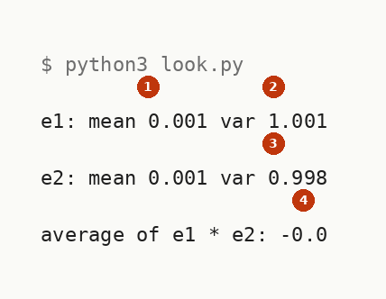
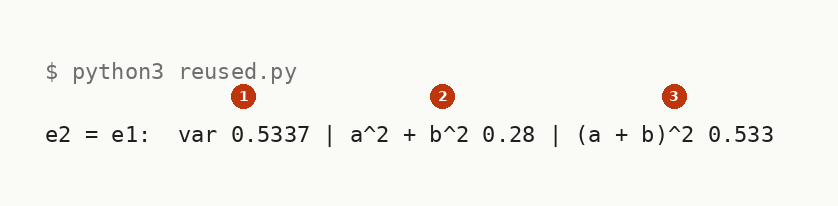
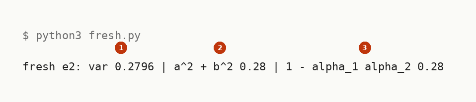
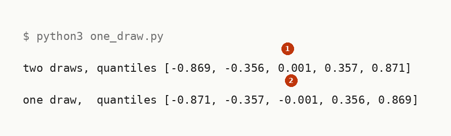
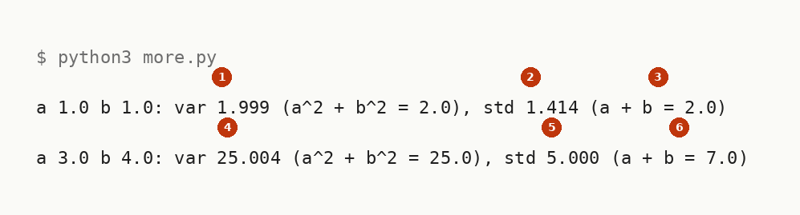
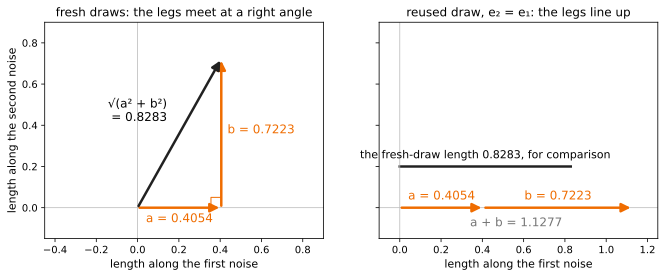

# Running Sums Of Independent Gaussians

Up: [[Multivariate Normal Distribution]] · ⬅️ [[Sums Of Independent Gaussians]] · [[Products And Quotients Of Diagonal Gaussians]] ➡️

Mathematics, Statistics, Distributions, Multivariate Normal Distribution. Needs: [[Sums Of Independent Gaussians]], the rule these runs check.

**The sum rule run in an empty folder, from two fresh draws to a reused draw, one draw against two and the exact sums over every outcome.**

> [!question]- Test yourself
> [The diagonal Gaussian quiz](https://claude.ai/artifact/Vmd1FBg7oWwZq1onu9Jofa) covers the [[Multivariate Normal Distribution]] folder. This note's runs are not in it yet.

> [!warning]- Unfinished
> - The folder's quiz page does not cover this note's runs yet.

Claims marked stated: 0.

**How each run is read.** Every output is read field by field in [[#Reading the sums output]]. The toy numbers are the table in [[Sums Of Independent Gaussians#Independent Gaussian noises add their variances]], and every field marked derived is derived in [[Sums Of Independent Gaussians#How the rule works]].

**Colours in this note.** <span style="color:#6a1b9a">**Purple is a unit draw, $e_1$, $e_2$ or $\varepsilon$**</span>, <span style="color:#ef6c00">**orange is a noise scale, $a$, $b$ or $\sqrt{a^2 + b^2}$**</span>, and <span style="color:#c62828">**red is the cross term $e_1 e_2$**</span>, as in [[Sums Of Independent Gaussians]].

## Try the rule yourself

Navigation: [[#Reading the sums output]] ➡️

**Where you work.** The setup is in [[Multivariate Normal Distribution#Where you work]]: any terminal with Python 3 and NumPy, and a new empty folder. The commands below use `python3`; where the prepared environment exists, `~/.vault-sandbox/bin/python` runs every script unchanged.

**The toy numbers.** The forward-process numbers run through every step: $\alpha_1 = 0.9$, $\alpha_2 = 0.8$, so $a = \sqrt{0.8 \times 0.1} = \sqrt{0.08}$ and $b = \sqrt{1 - 0.8} = \sqrt{0.2}$. Every NumPy script draws one million values from a generator seeded with 0, so a rerun prints the same lines.

**1. What you need, and the check.**

```bash
python3 -c "import numpy; print(numpy.__version__)"
```

You should see a version number. This run printed `2.4.3`. With the prepared environment the check is `~/.vault-sandbox/bin/python -c "import numpy; print(numpy.__version__)"`, not run on this machine, which lacks it.

**2. When it is missing.** Make the environment once on this machine, by hand:

```bash
uv venv ~/.vault-sandbox
uv pip install --python ~/.vault-sandbox/bin/python pandas numpy scipy matplotlib statsmodels openpyxl
```

Not run on this machine, whose `python3` already has NumPy.

**3. Make an empty folder and work in it.**

```bash
mkdir -p ~/playground/sandbox/sum-of-gaussians && cd ~/playground/sandbox/sum-of-gaussians
```

**4. A look before: two fresh draws.** Save this as `look.py`. It prints each draw's mean and variance and the average of their product, the cross term's expectation:

```python
import numpy as np

rng = np.random.default_rng(0)
N = 1_000_000
e1 = rng.standard_normal(N)
e2 = rng.standard_normal(N)
print("e1: mean", round(float(e1.mean()), 3), "var", round(float(e1.var()), 3))
print("e2: mean", round(float(e2.mean()), 3), "var", round(float(e2.var()), 3))
print("average of e1 * e2:", round(float((e1 * e2).mean()), 3))
```

```bash
python3 look.py
```

You should see:



**The band it should land in.** Each mean near 0, each variance near 1 and the average product near 0, each within about 0.003 for a million draws (derived: the standard error of a mean of a million unit-variance values is $1/\sqrt{10^6} = 0.001$). Every printed value is inside it.

**5. The failure: the second noise reuses the first.** Save this as `reused.py`:

```python
import numpy as np

rng = np.random.default_rng(0)
N = 1_000_000
a, b = np.sqrt(0.8 * 0.1), np.sqrt(1 - 0.8)
e1 = rng.standard_normal(N)
z = a * e1 + b * e1
print("e2 = e1:  var", round(float(z.var()), 4), "| a^2 + b^2", round(a**2 + b**2, 4), "| (a + b)^2", round((a + b) ** 2, 4))
```

```bash
python3 reused.py
```

You should see:



**The band it should land in.** The measured variance sits near $(a + b)^2 = 0.5330$, not near $a^2 + b^2 = 0.28$, within about 0.002 (derived: the standard error of a sample variance is about $\sigma^2\sqrt{2/N} = 0.000754$ here). It printed 0.5337, 0.0007 above.

**The picture.** Why the cross term averages away for fresh draws and stays for a reused one, on 2000 pairs:

```python
import numpy as np
import matplotlib.pyplot as plt

X_COL, GREY = "#c62828", "#757575"
rng = np.random.default_rng(0)
e1 = rng.standard_normal(2000)
e2 = rng.standard_normal(2000)
fig, (left, right) = plt.subplots(1, 2, figsize=(11, 5.6), sharey=True)
for ax, second, title in [(left, e2, "fresh e₂"), (right, e1, "reused, e₂ = e₁")]:
    p = e1 * second
    ax.scatter(e1[p > 0], second[p > 0], s=6, color=X_COL, alpha=0.5)
    ax.scatter(e1[p < 0], second[p < 0], s=6, color=GREY, alpha=0.5)
    for sx, sy in [(1, 1), (-1, 1), (-1, -1), (1, -1)]:
        inside = (np.sign(e1) == sx) & (np.sign(second) == sy)
        if inside.any():
            ax.text(1.6 * sx, 3.35 * sy, f"{inside.sum()} points\nsum of e₁e₂ {p[inside].sum():+.0f}", ha="center",
                    va="center", color=X_COL if sx * sy > 0 else GREY, fontsize=10, bbox=dict(fc="white", ec="none", alpha=0.85, pad=1))
    ax.set_title(f"{title}: average of e₁e₂ = {p.mean():+.3f}", fontsize=12)
    ax.axhline(0, color="#9e9e9e", lw=0.8); ax.axvline(0, color="#9e9e9e", lw=0.8)
    ax.set_xlim(-3.9, 3.9); ax.set_ylim(-3.9, 3.9); ax.set_aspect("equal")
    ax.set_xlabel("e₁", fontsize=11)
left.set_ylabel("e₂", fontsize=11)
fig.savefig("sums-the-quadrants-cancel.svg", format="svg", bbox_inches="tight")
```


**How to read this.** Each point is one pair of draws, $e_1$ across and $e_2$ up, red where the product $e_1 e_2$ is positive and grey where it is negative. On the left the four quadrants hold about 500 points each and their sums of $e_1 e_2$, $+293$, $-348$, $+341$ and $-320$, nearly cancel, so the average is $-0.017$, within one standard error ($1/\sqrt{2000} = 0.022$) of 0. On the right a reused draw puts every point on the diagonal, every product is a square, and the average is $+1.001$.

**6. The technique: a fresh second noise.** Save this as `fresh.py`:

```python
import numpy as np

rng = np.random.default_rng(0)
N = 1_000_000
a, b = np.sqrt(0.8 * 0.1), np.sqrt(1 - 0.8)
e1 = rng.standard_normal(N)
e2 = rng.standard_normal(N)
z = a * e1 + b * e2
print("fresh e2: var", round(float(z.var()), 4), "| a^2 + b^2", round(a**2 + b**2, 4), "| 1 - alpha_1 alpha_2", round(1 - 0.9 * 0.8, 4))
```

```bash
python3 fresh.py
```

You should see:



**The band it should land in.** The measured variance sits near 0.28, within about 0.001 (derived: $0.28\sqrt{2/10^6} = 0.000396$), and the last two fields print `0.28` exactly. It printed 0.2796, 0.0004 below, and both closed forms print 0.28.

**7. Another way to get the same answer: one draw.** Save this as `one_draw.py`. It compares the two-draw sum with one draw scaled by $\sqrt{a^2 + b^2}$, quantile by quantile, so the shapes are compared as well as the variances:

```python
import numpy as np

rng = np.random.default_rng(0)
N = 1_000_000
a, b = np.sqrt(0.08), np.sqrt(0.2)
two = a * rng.standard_normal(N) + b * rng.standard_normal(N)
one = np.sqrt(a**2 + b**2) * rng.standard_normal(N)
q = [0.05, 0.25, 0.5, 0.75, 0.95]
print("two draws, quantiles", np.round(np.quantile(two, q), 3).tolist())
print("one draw,  quantiles", np.round(np.quantile(one, q), 3).tolist())
```

```bash
python3 one_draw.py
```

You should see:



**The band it should land in.** Both lines sit near the quantiles of $\mathcal{N}(0, 0.28)$: $-0.870$, $-0.357$, $0$, $0.357$, $0.870$ (computed by the writer with Python's `statistics.NormalDist(0, 0.28 ** 0.5).inv_cdf`). Every printed value is within 0.001 of its quantile.

**The picture.** The same draws as histograms, with the reused draw beside them:

```python
import numpy as np
import matplotlib.pyplot as plt

S_COL, GREY = "#ef6c00", "#757575"
rng = np.random.default_rng(0)                            # the same draws as one_draw.py, then one more
N = 1_000_000
a, b = np.sqrt(0.08), np.sqrt(0.2)
two = a * rng.standard_normal(N) + b * rng.standard_normal(N)
one = np.sqrt(a**2 + b**2) * rng.standard_normal(N)
reused = (a + b) * rng.standard_normal(N)                 # the same draw twice: (a + b) e_1
x = np.linspace(-2.6, 2.6, 521)
def bell(v):
    return np.exp(-x ** 2 / (2 * v)) / np.sqrt(2 * np.pi * v)
fig, (left, right) = plt.subplots(1, 2, figsize=(11, 4.6), sharey=True)
left.hist(two, bins=130, range=(-2.6, 2.6), density=True, color=S_COL, alpha=0.35)
left.hist(one, bins=130, range=(-2.6, 2.6), density=True, histtype="step", color="#212121", lw=1)
left.plot(x, bell(0.28), color=S_COL, lw=2)
left.text(-2.5, 1.0, f"N(0, 0.28) curve\nshaded: a e₁ + b e₂, var {two.var():.4f}\noutline: √0.28 ε, var {one.var():.4f}", va="top", fontsize=10)
left.set_title("two fresh draws, and one scaled draw", fontsize=12)
right.hist(reused, bins=130, range=(-2.6, 2.6), density=True, color=GREY, alpha=0.4)
right.plot(x, bell(0.28), color=S_COL, lw=2)
right.plot(x, bell((a + b) ** 2), color=GREY, lw=2, ls="--")
right.text(-2.5, 1.0, f"shaded: (a + b) e₁, var {reused.var():.4f}\ndashed: N(0, {(a + b) ** 2:.4f})\nsolid: N(0, 0.28)", va="top", fontsize=10)
right.set_title("the same draw used twice", fontsize=12)
for ax in (left, right):
    ax.set_xlabel("value of the summed noise", fontsize=11)
left.set_ylabel("density", fontsize=11); left.set_ylim(0, 1.05)
fig.savefig("sums-one-draw-against-two-histograms.svg", format="svg", bbox_inches="tight")
```


**How to read this.** The x-axis is the value of the summed noise and the y-axis its density; each histogram is a million draws in 130 bins, and each curve a normal density. On the left the shaded two-draw sum and the outlined one-draw replacement both fill the orange $\mathcal{N}(0, 0.28)$ curve, with variances 0.2796 and 0.2798. On the right the reused draw fills the dashed $\mathcal{N}(0, 0.5330)$ instead, peak about 0.55 against the orange curve's 0.75.

**8. More worked examples on the same setup.** Save this as `more.py`. It runs the two hand examples, equal weights and the 3-4-5 case, and prints each variance beside $a^2 + b^2$ and each standard deviation beside the wrong guess $a + b$:

```python
import numpy as np

rng = np.random.default_rng(0)
N = 1_000_000
for a, b in [(1.0, 1.0), (3.0, 4.0)]:
    z = a * rng.standard_normal(N) + b * rng.standard_normal(N)
    print(f"a {a} b {b}: var {z.var():.3f} (a^2 + b^2 = {a * a + b * b}), std {z.std():.3f} (a + b = {a + b})")
```

```bash
python3 more.py
```

You should see:



**The band it should land in.** The first line near variance 2 and standard deviation 1.414, against $a + b = 2$, and the second near variance 25 and standard deviation 5, against $a + b = 7$. Both landed there.

**Then one by hand, before running anything.** Two forward steps with $\alpha_1 = 0.95$ and $\alpha_2 = 0.7$. Compute the noise variance both ways, $\alpha_2(1 - \alpha_1) + (1 - \alpha_2)$ and $1 - \alpha_1\alpha_2$.

> [!example]- The answer
> $0.7 \times 0.05 + 0.3 = 0.035 + 0.3 = 0.335$, and $1 - 0.95 \times 0.7 = 1 - 0.665 = 0.335$. To check it with the sandbox, add `(np.sqrt(0.7 * 0.05), np.sqrt(1 - 0.7))` to the list in `more.py`; its variance should sit near 0.335.

**Then the rule with no sampling at all.** Save this as `exact_sums.py`. It needs only the standard library. It lists every equally likely outcome and averages over them, so each number is exact: two independent $\pm 1$ coins, the same coin used twice ($Y = X$), and the noise scales of the 100-step cosine schedule at $t = 25$ and $t = 50$ applied to two independent four-value draws ($\pm\sqrt{1.5}$, $\pm\sqrt{0.5}$, each a quarter of the time, mean 0 and mean square 1):

```python
from itertools import product
from math import sqrt
from statistics import fmean

coin = [1.0, -1.0]
pairs = list(product(coin, coin))                     # four equally likely outcomes
print("sums", [x + y for x, y in pairs], "squares", [(x + y) ** 2 for x, y in pairs], "mean", fmean([(x + y) ** 2 for x, y in pairs]))
print("cross products", [x * y for x, y in pairs], "average", fmean([x * y for x, y in pairs]))
print("Y = X: X + Y is", [2 * x for x in coin], "variance", fmean([(2 * x) ** 2 for x in coin]), "cross term", fmean([x * x for x in coin]))

four = [sqrt(1.5), -sqrt(1.5), sqrt(0.5), -sqrt(0.5)]  # each a quarter of the time: mean 0, mean square 1
a, b = 0.4054, 0.7223                                  # noise scales at t = 25 and t = 50
z = [a * u + b * v for u, v in product(four, four)]   # sixteen equally likely outcomes
var = fmean([v * v for v in z])
print(f"mean {fmean(z):.4f}  variance {var:.4f}  a^2 + b^2 {a * a + b * b:.4f}  typical miss {sqrt(var):.4f}  a + b {a + b:.4f}")
```

```bash
python3 exact_sums.py
```


### Standard deviations add like legs

**Why a triangle.** [[Sums Of Independent Gaussians#The consequence for the cross term: reuse the draw]] shows the variance of two noises has the form of the law of cosines, with independence as a right angle. The same schedule weights, drawn both ways:

```python
import matplotlib.pyplot as plt

S_COL, GREY = "#ef6c00", "#757575"
a, b = 0.4054, 0.7223
fig, (left, right) = plt.subplots(1, 2, figsize=(11, 5.2), sharey=True)
arrow = dict(arrowstyle="-|>", lw=2.5, mutation_scale=18)
left.annotate("", (a, 0), (0, 0), arrowprops=dict(color=S_COL, **arrow))
left.annotate("", (a, b), (a, 0), arrowprops=dict(color=S_COL, **arrow))
left.annotate("", (a, b), (0, 0), arrowprops=dict(color="#212121", **arrow))
left.plot([a - 0.05, a - 0.05, a], [0, 0.05, 0.05], color=S_COL, lw=1)
left.text(a / 2, -0.07, f"a = {a}", ha="center", color=S_COL, fontsize=12)
left.text(a + 0.03, b / 2, f"b = {b}", color=S_COL, fontsize=12)
left.text(a / 2 - 0.06, b / 2 + 0.06, f"√(a² + b²)\n= {(a * a + b * b) ** 0.5:.4f}", ha="right", fontsize=12)
left.set_title("fresh draws: the legs meet at a right angle", fontsize=12)
right.annotate("", (a, 0), (0, 0), arrowprops=dict(color=S_COL, **arrow))
right.annotate("", (a + b, 0), (a, 0), arrowprops=dict(color=S_COL, **arrow))
right.text(a / 2, 0.04, f"a = {a}", ha="center", color=S_COL, fontsize=12)
right.text(a + b / 2, 0.04, f"b = {b}", ha="center", color=S_COL, fontsize=12)
right.text((a + b) / 2, -0.09, f"a + b = {a + b:.4f}", ha="center", color=GREY, fontsize=12)
r = (a * a + b * b) ** 0.5
right.plot([0, r], [0.2, 0.2], color="#212121", lw=2.5)
right.text(r / 2, 0.24, f"the fresh-draw length {r:.4f}, for comparison", ha="center", fontsize=11)
right.set_title("reused draw, e₂ = e₁: the legs line up", fontsize=12)
left.set_xlim(-0.45, 0.9); right.set_xlim(-0.1, 1.25)
for ax in (left, right):
    ax.set_ylim(-0.15, 0.9); ax.set_aspect("equal")
    ax.axhline(0, color="#bdbdbd", lw=0.8); ax.axvline(0, color="#bdbdbd", lw=0.8)
    ax.set_xlabel("length along the first noise", fontsize=11)
left.set_ylabel("length along the second noise", fontsize=11)
fig.savefig("sums-standard-deviations-add-like-legs.svg", format="svg", bbox_inches="tight")
```



**How to read this.** Each orange arrow is one noise term drawn with its standard deviation as its length, on the schedule's weights. On the left the two are at a right angle, so the black arrow, the standard deviation of the sum, is $\sqrt{0.4054^2 + 0.7223^2} = 0.8283$, the typical miss `exact_sums.py` prints. On the right a reused draw lines them up, and the sum's standard deviation is $0.4054 + 0.7223 = 1.1277$, longer than the black 0.8283 bar.

**9. Clean up, and prove it.**

```bash
cd ~ && rm -r ~/playground/sandbox/sum-of-gaussians
ls ~/playground/sandbox/sum-of-gaussians; echo $?
```

You should see `No such file or directory`, then `2`. This run printed `ls: cannot access '/home-mscluster/mmolefe/playground/sandbox/sum-of-gaussians': No such file or directory`, then `2`.

## Reading the sums output

Navigation: ⬅️ [[#Try the rule yourself]]

From the NumPy runs of steps 4 to 8, numbered by step:

| # | Field | This run | How to read it | Backing |
|---|---|---|---|---|
| 1 | step 4, `e1` and `e2` mean and var | `0.001` and `1.001`; `0.001` and `0.998` | each draw alone: means near 0 and variances near 1, each within about 1.4 standard errors (0.001 for a mean, $\sqrt{2/10^6} = 0.0014$ for a variance) | derived |
| 2 | step 4, average of `e1 * e2` | `-0.0` | the cross term's expectation; near 0 because the draws are independent. The minus sign is a tiny negative, $-0.0002$, rounded to three places | derived |
| 3 | step 5, `e2 = e1: var` | `0.5337` | near 0.5330: reusing the draw puts the cross term $2ab = 0.252982$ back; 0.95 standard errors above | derived |
| 4 | step 6, `fresh e2: var` | `0.2796` | near 0.28: the cross term is gone and the variances add; 0.89 standard errors below | derived |
| 5 | step 6, `1 - alpha_1 alpha_2` | `0.28` | the one-jump variance; equal to field 4's closed form for any two alphas | derived |
| 6 | step 7, both quantile lines | `[-0.869, -0.356, 0.001, 0.357, 0.871]`, `[-0.871, -0.357, -0.001, 0.356, 0.869]` | the same five numbers to about two decimals: one scaled draw has the same distribution as the two-draw sum | cited in [[Sums Of Independent Gaussians#How the rule works]] (the shape step) |
| 7 | step 8, `std` beside `a + b` | `1.414` against `2.0`; `5.000` against `7.0` | standard deviations do not add; the variances `1.999` and `25.004` sit near 2 and 25 | derived |

From `exact_sums.py`, numbered as on its picture:

| # | Field | This run | How to read it | Backing |
|---|---|---|---|---|
| 1 | coins, mean of the squared sums | `2.0` | the sums 2, 0, 0, $-2$ square to 4, 0, 0, 4; the mean is 0, so their average is the variance, $2 = 1 + 1$ | shown |
| 2 | cross products, average | `0.0` | $xy$ is $+1$ on two outcomes and $-1$ on two, so the cross term averages to 0 | shown |
| 3 | Y = X, variance | `4.0` | $X + X = 2X$, and the scaling rule in [[The Scaling Rule For Variance#Scaling a draw scales its variance by the square]] gives $2^2 \times 1 = 4$, not 2 | derived |
| 4 | Y = X, cross term | `1.0` | $x \cdot x = 1$ on both faces: the cross term no longer cancels, and $1 + 2 \times 1 + 1 = 4$ | derived |
| 5 | schedule noises, variance | `0.6861` | $0.4054^2 + 0.7223^2 = 0.1644 + 0.5217$, exact over the sixteen outcomes even though the draws are not Gaussian | derived |
| 6 | typical miss | `0.8283` | $\sqrt{0.6861}$, the standard deviation of the sum | shown |
| 7 | a + b | `1.1277` | the wrong route, adding the typical misses; it overstates 0.8283 by 36% | shown |

> [!note]- How this was checked
> The five NumPy scripts of steps 4 to 8 (`look.py`, `reused.py`, `fresh.py`, `one_draw.py`, `more.py`) and `exact_sums.py` were copied out of this note byte for byte and run on 2026-10-21 on mscluster (Linux) with Python 3.12.10 and NumPy 2.4.3, in the empty folder `~/playground/sandbox/sum-of-gaussians`, by vault-writer. Each was run twice and printed identical lines. The folder was removed afterwards and the step 9 check returned 2. The prepared environment `~/.vault-sandbox` is missing on this machine; the system `python3` has NumPy and ran the scripts. The unrounded values behind the reading table (for example the step 5 variance 0.533699 and the step 6 variance 0.279648) were printed by a separate script with the same seed, and the standard-error counts are computed from them. The six terminal pictures were rendered from the captured text by a script in DejaVu Sans Mono, never drawn, and each was opened before filing.
>
> The three figure scripts were run on 2026-10-21 on mscluster with Python 3.12.10, matplotlib 3.10.8 and numpy 2.4.3 in an empty scratch folder, and each SVG was opened (through a PNG copy made by the same script) before filing. The histograms' first two variances, 0.2796 and 0.2798, come from the same seeded draws as `one_draw.py`, and the first equals step 6's variance because `fresh.py` draws the same values. The [NumPy reference](https://numpy.org/doc/stable/reference/random/generated/numpy.random.Generator.standard_normal.html) (BSD 3-Clause) and the Python [statistics module](https://docs.python.org/3/library/statistics.html) documentation each answered 200 on 2026-10-21. No tldr-pages entry covers this.
