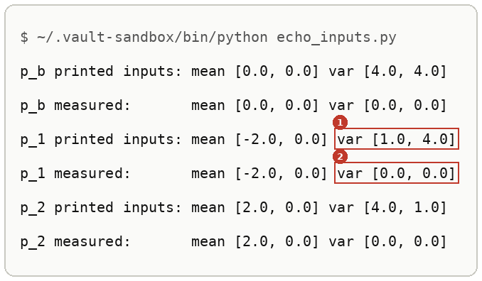
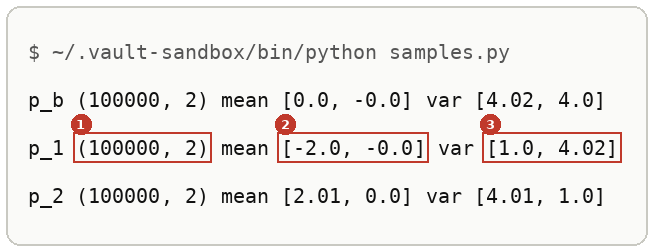
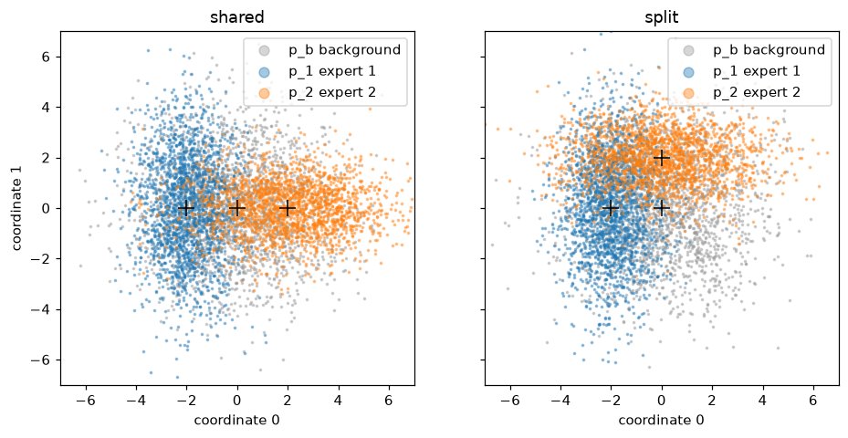
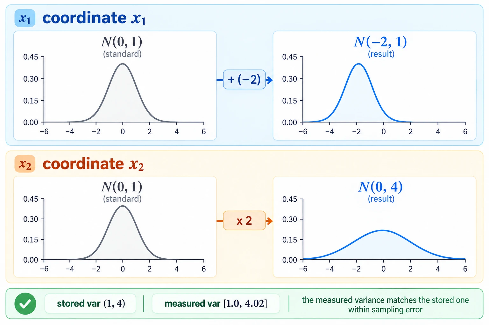

# Sampling A Diagonal Gaussian

Up: [[Multivariate Normal Distribution]] · ⬅️ [[Diagonal Covariance]] · [[Products And Quotients Of Diagonal Gaussians]] ➡️

Mathematics, Statistics, Distributions, Multivariate Normal Distribution. Needs: [[Diagonal Covariance]], and [[Random Numbers From A Seeded Generator]] for the draws.

> [!question] Test yourself
> [The diagonal Gaussian quiz](https://claude.ai/artifact/Vmd1FBg7oWwZq1onu9Jofa) covers this note, with the rest of the [[Multivariate Normal Distribution]] folder. Your attempts are saved on the page.

> [!warning] Unfinished
> - Two pictures are stuck after three revisions: the form (prompt 3) and the deep-dive sheet (prompt 5), in the vault's `.prompts/Multivariate Normal Distribution.md`.

**To draw $n$ points from $\mathcal{N}(\mu, \operatorname{diag}(\sigma^2))$, draw $n$ standard-normal points and compute `mu + np.sqrt(var) * eps`: the mean moves every point, and the square root of each variance stretches its own axis.** One line does it for all $n$ points at once, because `mu` and `var` of shape `(2,)` are reused for every row of the `(n, 2)` matrix of draws. That reuse is [[Broadcasting]].

## Where you work

The setup is in [[Multivariate Normal Distribution#Where you work]].

## Table of contents

- [[#When to reach for sampling]]
- [[#The form of a sample]]
- [[#Try sampling yourself]]
- [[#Reading the sampled output]]
- [[#How sampling works]]
- [[#Other ways to sample]]
- [[#Why sampling matters]]
- [[#Sampling taught in, applied in]]

## When to reach for sampling

Navigation: 📋 [[#Table of contents|TOC]] | [[#The form of a sample]] ➡️

When you want to see a distribution as a cloud of points, or check that the arrays you stored mean what you think: draw many points, measure their mean and variance, and compare them with the arrays. The check only works if it prints what it measured. Printing the arrays you passed in reports the input back to you, so a broken sampler looks perfect. Step 4 below shows one.

## The form of a sample

Navigation: ⬅️ [[#When to reach for sampling]] | 📋 [[#Table of contents|TOC]] | [[#Try sampling yourself]] ➡️

```text
rng = np.random.default_rng(<seed>)        one seeded generator, made once per file
eps = rng.standard_normal((<n>, <d>))      n points from N(0, I), shape (n, d)
x   = <mu> + np.sqrt(<var>) * eps          shape (n, d); mu and var, shape (d,), apply to every row
x.mean(0), x.var(0)                        the measured mean and variance of each coordinate, shape (d,)
```

`np.sqrt(var)` is the standard deviation. Multiplying by the variance itself is the usual slip, and step 6 shows what it does. Why the generator is made once and every draw comes from it is in [[Random Numbers From A Seeded Generator]].

*🖼️ Diagram wanted: the form, a cloud of standard-normal points moved by the mean and stretched per axis by the standard deviation. Prompt 3 in the vault's `.prompts/Multivariate Normal Distribution.md`.*

## Try sampling yourself

Navigation: ⬅️ [[#The form of a sample]] | 📋 [[#Table of contents|TOC]] | [[#Reading the sampled output]] ➡️

**1. What you need.** Python with NumPy, SciPy and Matplotlib. The commands below use the prepared environment `~/.vault-sandbox/bin/python`:

```bash
~/.vault-sandbox/bin/python -c "import numpy; print(numpy.__version__)"
```

You should see a version number. This run printed `2.4.6`.

**2. When it is missing.** Make it once, by hand: `uv venv ~/.vault-sandbox`, then `uv pip install --python ~/.vault-sandbox/bin/python pandas numpy scipy matplotlib statsmodels openpyxl`. Those two commands were not run here, since the environment already existed. Or write `uv run --no-project --with numpy python` wherever a command below says `~/.vault-sandbox/bin/python`: `samples.py` printed the same three lines that way.

**3. Make something to act on.** Make an empty folder and go into it:

```bash
mkdir -p ~/playground/sandbox/gaussian-clouds && cd ~/playground/sandbox/gaussian-clouds
```

Save the learner's `toy.py`, which stores the walk's four clouds as `(mean, variance)` pairs, the [[Diagonal Covariance#Diagonal Gaussian]] form:

```python
import numpy as np

A = np.array
p_b = (A([0., 0.]), A([4., 4.]))       # background: wide and round
p_1 = (A([-2., 0.]), A([1., 4.]))      # expert 1: moves coordinate 0
p_2 = (A([2., 0.]), A([4., 1.]))       # expert 2, shared: moves coordinate 0 too
p_2s = (A([0., 2.]), p_2[1])           # expert 2, split: moves coordinate 1 instead

shared = [p_b, p_1, p_2]
split = [p_b, p_1, p_2s]

if __name__ == "__main__":
    for name, ps in [("shared", shared), ("split", split)]:
        print(name, [(m.tolist(), v.tolist()) for m, v in ps])
```

Look at it before sampling:

```bash
~/.vault-sandbox/bin/python toy.py
```

```text
shared [([0.0, 0.0], [4.0, 4.0]), ([-2.0, 0.0], [1.0, 4.0]), ([2.0, 0.0], [4.0, 1.0])]
split [([0.0, 0.0], [4.0, 4.0]), ([-2.0, 0.0], [1.0, 4.0]), ([0.0, 2.0], [4.0, 1.0])]
```

**4. The failure: printing what you passed in.** Save this as `echo_inputs.py`. Its sampler is broken on purpose: every point sits on the mean, with no spread at all. It prints each expert twice, once from the arrays it was given and once from the points it made:

```python
import numpy as np
from toy import shared

def sample(mu, var, n):
    return mu * np.ones((n, len(mu)))          # a broken sampler: no spread at all

for name, (mu, var) in zip(["p_b", "p_1", "p_2"], shared):
    x = sample(mu, var, 100_000)
    print(name, "printed inputs: mean", mu.tolist(), "var", var.tolist())
    print(name, "measured:       mean", x.mean(0).tolist(), "var", x.var(0).tolist())
```

```bash
~/.vault-sandbox/bin/python echo_inputs.py
```

You should see:



Marker 1 is what a print of the inputs shows: exactly the variances you asked for. Marker 2 is what the points actually have: none. A check that prints its inputs cannot fail, so it checks nothing.

**5. The technique.** Save this as `samples.py`. Every random number comes from the one seeded generator `rng`:

```python
import numpy as np
from toy import shared

rng = np.random.default_rng(0)
N = 100_000

def sample(mu, var, n):
    return mu + np.sqrt(var) * rng.standard_normal((n, len(mu)))

if __name__ == "__main__":
    for name, (mu, var) in zip(["p_b", "p_1", "p_2"], shared):
        x = sample(mu, var, N)
        print(name, x.shape, "mean", np.round(x.mean(0), 2).tolist(), "var", np.round(x.var(0), 2).tolist())
```

```bash
~/.vault-sandbox/bin/python samples.py
```

You should see:



Run it again and the same three lines come back digit for digit, because the generator was seeded with 0. These are the walk's answer-key numbers at seed 0.

**6. Another way to get the same answer.** The generator's `normal` method takes the mean and the standard deviation and does the shift and stretch itself:

```bash
~/.vault-sandbox/bin/python -c "import numpy as np; rng = np.random.default_rng(0); x = rng.normal([-2.0, 0.0], np.sqrt([1.0, 4.0]), size=(100_000, 2)); print(x.shape, np.round(x.mean(0), 2).tolist(), np.round(x.var(0), 2).tolist())"
```

```text
(100000, 2) [-2.0, -0.0] [1.0, 4.0]
```

Its second argument, `scale`, is a standard deviation. Hand it the variance and the spread is squared:

```bash
~/.vault-sandbox/bin/python -c "import numpy as np; rng = np.random.default_rng(0); x = rng.normal([-2.0, 0.0], [1.0, 4.0], size=(100_000, 2)); print('scale given the variance:', np.round(x.var(0), 2).tolist())"
```

```text
scale given the variance: [1.0, 16.01]
```

The first coordinate hides the slip, since $\sqrt{1} = 1$. SciPy's `multivariate_normal` takes the variances directly, as a one-dimensional `cov`:

```bash
~/.vault-sandbox/bin/python -c "from scipy.stats import multivariate_normal as mvn; import numpy as np; x = mvn(mean=[-2, 0], cov=[1, 4]).rvs(size=100_000, random_state=0); print(x.shape, np.round(x.mean(0), 2).tolist(), np.round(x.var(0), 2).tolist())"
```

```text
(100000, 2) [-1.99, 0.0] [1.0, 3.99]
```

**7. More worked examples: the experts as clouds.** The walk's step 3a draws 2,000 points from each cloud and plots shared beside split. This is the walk's answer key, `checks/clouds.py`, run here unchanged. Save it as `clouds.py`:

```python
# Step 3a: the three experts as point clouds, shared beside split. Number: each cloud's spread (std) per axis.
import numpy as np, matplotlib; matplotlib.use("Agg"); import matplotlib.pyplot as plt
from toy import shared, split
rng = np.random.default_rng(0)
n = 2_000
names, colors = ["p_b background", "p_1 expert 1", "p_2 expert 2"], ["0.6", "tab:blue", "tab:orange"]
fig, axes = plt.subplots(1, 2, figsize=(10, 5), sharex=True, sharey=True)
for ax, (title, ps) in zip(axes, [("shared", shared), ("split", split)]):
    for (mu, var), name, c in zip(ps, names, colors):
        x = mu + np.sqrt(var) * rng.standard_normal((n, 2))
        ax.scatter(*x.T, s=2, alpha=0.4, c=c, label=name); ax.plot(*mu, "k+", ms=12)
        print(title, name, "std", np.round(x.std(0), 2).tolist())
    ax.set(title=title, xlim=(-7, 7), ylim=(-7, 7), aspect="equal", xlabel="coordinate 0"); ax.legend(loc="upper right", markerscale=5)
axes[0].set_ylabel("coordinate 1"); fig.savefig("clouds.png", dpi=110, bbox_inches="tight")
```

```bash
~/.vault-sandbox/bin/python clouds.py
```

```text
shared p_b background std [2.0, 1.99]
shared p_1 expert 1 std [1.02, 1.99]
shared p_2 expert 2 std [1.97, 1.0]
split p_b background std [1.98, 1.99]
split p_1 expert 1 std [0.98, 2.0]
split p_2 expert 2 std [2.0, 0.99]
```

and `clouds.png`:



The printed numbers are standard deviations, the square roots of the variances: about 2 where the variance is 4 and about 1 where it is 1. In "shared" the orange cloud sits to the right of the origin, on the same axis as the blue one. In "split" it sits above the origin instead.

**8. Clean up, and prove it.** Keep the folder if you are going on to [[Products And Quotients Of Diagonal Gaussians#Try composing yourself]], which uses `toy.py` again. Otherwise:

```bash
cd ~ && rm -r ~/playground/sandbox/gaussian-clouds
ls ~/playground/sandbox/gaussian-clouds; echo $?
```

You should see `No such file or directory`, then `2`.

## Reading the sampled output

Navigation: ⬅️ [[#Try sampling yourself]] | 📋 [[#Table of contents|TOC]] | [[#How sampling works]] ➡️

From step 5, the `p_1` line:

| # | Field | This run | How to read it | Backing |
|---|---|---|---|---|
| 1 | shape | `(100000, 2)` | one row per point, one column per coordinate | shown |
| 2 | mean | `[-2.0, -0.0]` | the measured mean of each column, against the stored $(-2, 0)$; `-0.0` is a small negative number rounded to two places | shown |
| 3 | var | `[1.0, 4.02]` | the measured variance of each column, against the stored $(1, 4)$; 4.02 is about one standard error above 4 | derived below |

From step 4, the difference that matters:

| # | Field | This run | How to read it | Backing |
|---|---|---|---|---|
| 1 | printed inputs, var | `[1.0, 4.0]` | the array handed to the sampler, so it is right whatever the sampler does | shown |
| 2 | measured, var | `[0.0, 0.0]` | the spread of the points the sampler made: none, which exposes the bug | shown |

## How sampling works

Navigation: ⬅️ [[#Reading the sampled output]] | 📋 [[#Table of contents|TOC]] | [[#Other ways to sample]] ➡️

One coordinate at a time. Take $\varepsilon \sim \mathcal{N}(0, 1)$ and set $x = m + s\,\varepsilon$:

$$
\begin{aligned}
\mathbb{E}[x] &= m + s\,\mathbb{E}[\varepsilon] = m + s \cdot 0 = m \\
\operatorname{Var}[x] &= s^2 \operatorname{Var}[\varepsilon] = s^2 \cdot 1 = s^2 \\
s = \sqrt{\sigma^2} \;&\Rightarrow\; \operatorname{Var}[x] = \sigma^2
\end{aligned}
$$

A shifted and scaled normal variable is again normal, so $x \sim \mathcal{N}(m, \sigma^2)$. *Cited:* the Normal distribution page in the sources. The columns of `eps` are independent, so the columns of `x` are too, and the cloud is the diagonal Gaussian $\mathcal{N}(\mu, \operatorname{diag}(\sigma^2))$.

The worked numbers for `p_1`, $\mu = (-2, 0)$ and $\sigma^2 = (1, 4)$:

$$
\begin{aligned}
\text{coordinate 1: } & x = -2 + \sqrt{1}\,\varepsilon \sim \mathcal{N}(-2, 1) \\
\text{coordinate 2: } & x = 0 + \sqrt{4}\,\varepsilon = 2\varepsilon \sim \mathcal{N}(0, 4)
\end{aligned}
$$

How far a measured value may sit from the truth: with $n$ points, the standard error of a measured mean is $\sqrt{\sigma^2/n}$, and of a measured variance $\sigma^2\sqrt{2/(n-1)}$ for normal data. *Cited:* the Variance page in the sources. For $\sigma^2 = 4$ and $n = 100{,}000$:

$$
\begin{aligned}
\sqrt{4 / 100000} &= 0.0063 \\
4\sqrt{2 / 99999} &= 0.0179
\end{aligned}
$$

So 4.02 sits about one standard error from 4, which is ordinary, and the walk's tolerance of 0.05 is close to three standard errors.



*The mechanism, one standard-normal bell moved by $m$ and widened by $s = \sqrt{\sigma^2}$, once per axis.*

*🖼️ Diagram wanted: the deep-dive sheet composing the form, the mechanism and the run. Prompt 5 in the same file.*

## Other ways to sample

Navigation: ⬅️ [[#How sampling works]] | 📋 [[#Table of contents|TOC]] | [[#Why sampling matters]] ➡️

- **`rng.normal(mu, np.sqrt(var), size=(n, d))`**, when you would rather not write the shift and stretch. Its `scale` is a standard deviation, as step 6 shows.
- **SciPy's `multivariate_normal(mean, cov).rvs(...)`**, when the same object should also give densities. A one-dimensional `cov` is read as the variances.
- **A Cholesky factor of a full covariance**, when the coordinates are correlated; see [[Diagonal Covariance#Other ways]] under the diagonal case.

## Why sampling matters

Navigation: ⬅️ [[#Other ways to sample]] | 📋 [[#Table of contents|TOC]] | [[#Sampling taught in, applied in]] ➡️

Every later step of the walk starts from a cloud: noising it in [[The Forward Process]], and composing it with others in [[Composing Models With A Background]]. A sampler whose measured numbers you have checked is one you can trust when a later number looks wrong.

## Sampling taught in, applied in

Navigation: ⬅️ [[#Why sampling matters]] | 📋 [[#Table of contents|TOC]]

**Taught in:**

- the `drip-read` walk of [the Mechanisms of Projective Composition paper note](../../../../deep-learning/01-poe-derivation-foundations/papers/mechanisms-of-projective-composition), step 2, where the learner's `sample(mu, var, n)` measured all three clouds within 0.05 of their arrays (`p_1 (100000, 2) mean [-2.0, -0.0] var [1.0, 4.02]`) once the walk had corrected two slips: printing the input arrays instead of the measured numbers, and drawing from `np.random` instead of the seeded `rng`; and step 3a, the experts as clouds
- the PoE derivation foundations journey's plan 09, `plans/09-the-forward-process.md`, line 148, which draws 200,000 samples from the closed form the same way

**Applied in:** nothing yet.

> [!note]- How this was checked
> Every output in this note and [[Products And Quotients Of Diagonal Gaussians]] was run by the writer in an empty folder, `~/playground/sandbox/gaussian-clouds`, on the PC: Ubuntu under WSL2, through the prepared environment `~/.vault-sandbox/bin/python` (Python 3.11.13, NumPy 2.4.6, SciPy 1.17.1, Matplotlib 3.11.2), on 2026-10-04. `samples.py` was also run through `uv run --no-project --with numpy python` (uv 0.8.13) and printed the same three lines. The folder was removed afterwards and the clean-up check returned 2.
