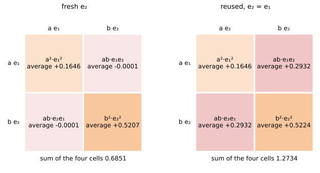

# Sums Of Independent Gaussians

Up: [[Multivariate Normal Distribution]] · ⬅️ [[Sampling A Diagonal Gaussian]] · [[Running Sums Of Independent Gaussians]] ➡️

Mathematics, Statistics, Distributions, Multivariate Normal Distribution. Needs: [[Sampling A Diagonal Gaussian]] for what one scaled draw $\sqrt{v}\,\varepsilon$ is.

**Independent Gaussian noises add their variances, so two weighted draws can be replaced by one.**

> [!question]- Test yourself
> [The diagonal Gaussian quiz](https://claude.ai/artifact/Vmd1FBg7oWwZq1onu9Jofa) covers the [[Multivariate Normal Distribution]] folder. This note's sections are not in it yet.

> [!warning]- Unfinished
> - The folder's quiz page does not cover this note's sections yet.

Stated claims in this note: 2, each marked *stated* where it sits.

**The rule in one line.** If $e_1$ and $e_2$ are independent draws from $\mathcal{N}(0, 1)$ and $a$, $b$ are fixed numbers, then $Z = a\,e_1 + b\,e_2$ is Gaussian with mean 0 and variance $a^2 + b^2$. So it can be replaced by one draw, $\sqrt{a^2 + b^2}\;\varepsilon$ with $\varepsilon \sim \mathcal{N}(0, 1)$. *Derived* in [[#How the rule works]].

**Variances add, standard deviations do not.** $a = 3$, $b = 4$ gives variance 25 and [standard deviation](../../../references/textbooks/statistics/introduction-to-probability-for-data-science.pdf#page=150) 5, where adding the standard deviations would give 7.

**Colours in this note.** <span style="color:#6a1b9a">**Purple is a unit draw, $e_1$, $e_2$ or $\varepsilon$**</span>, <span style="color:#ef6c00">**orange is a noise scale, $a$, $b$ or $\sqrt{a^2 + b^2}$**</span>, <span style="color:#2e7d32">**green is a kept signal share, $\alpha_t$ or $\bar\alpha_t$**</span>, and <span style="color:#c62828">**red is the cross term $2ab\,e_1 e_2$**</span>. The first three mean the same as in [[The Scaling Rule For Variance]] and on the one-expert rebuild's step 4 page.

## Table of contents

- [[#Independent Gaussian noises add their variances]]
- [[#When to reach for the rule]]
- [[#The form of the rule]]
- [[#Try the rule yourself]]
- [[#How the rule works]]
- [[#Other ways to combine noises]]
- [[#Why the rule matters]]
- [[#The rule taught in, applied in]]

## Independent Gaussian noises add their variances

Navigation: 📋 [[#Table of contents|TOC]] | [[#When to reach for the rule]] ➡️

**Sum of independent Gaussians**, also the variance of a sum, the sum of independent normals or the Bienaymé formula: the weighted sum $a\,e_1 + b\,e_2$ of two independent standard normal draws is a Gaussian of variance $a^2 + b^2$.

**The toy numbers.** Every example in this note is one row of this table, computed by code.

<table>
<tr><th>case</th><th style="color:#ef6c00"><i>a</i></th><th style="color:#ef6c00"><i>b</i></th><th><i>a</i>²</th><th><i>b</i>²</th><th><i>a</i>² + <i>b</i>²</th><th style="color:#ef6c00">√(<i>a</i>² + <i>b</i>²)</th><th><i>a</i> + <i>b</i></th><th>variance of the sum</th></tr>
<tr><td>equal weights</td><td>1</td><td>1</td><td>1</td><td>1</td><td>2</td><td>1.414214</td><td>2</td><td>2</td></tr>
<tr><td>3 and 4</td><td>3</td><td>4</td><td>9</td><td>16</td><td>25</td><td style="border:2px solid #212121">5</td><td style="border:2px solid #212121">7</td><td>25</td></tr>
<tr style="background:#fff8e1"><td><b>the schedule, <i>t</i> = 25 and <i>t</i> = 50</b></td><td><b>0.4054</b></td><td><b>0.7223</b></td><td>0.1644</td><td>0.5217</td><td style="border:2px solid #212121"><b>0.6861</b></td><td style="border:2px solid #212121"><b>0.8283</b></td><td style="border:2px solid #212121"><b>1.1277</b></td><td><b>0.6861</b></td></tr>
<tr><td>two forward steps, α<sub>1</sub> = 0.9, α<sub>2</sub> = 0.8</td><td>√0.08 = 0.282843</td><td>√0.2 = 0.447214</td><td>0.08</td><td>0.2</td><td style="border:2px solid #212121">0.28</td><td>0.529150</td><td>0.730056</td><td>0.28</td></tr>
<tr><td>the same draw twice, <i>e</i><sub>2</sub> = <i>e</i><sub>1</sub></td><td>0.282843</td><td>0.447214</td><td>0.08</td><td>0.2</td><td>0.28</td><td>0.529150</td><td style="border:2px dashed #212121">0.730056</td><td style="border:2px dashed #212121">0.532982</td></tr>
</table>

**How to read this table.** Each row is one pair of weights. The orange columns are noise scales, the squared columns are their variances, and the last column is the variance of the sum: $a^2 + b^2$ for fresh draws in the first four rows, $(a + b)^2$ for the reused draw in the last. The schedule's $a$ and $b$ are $\sqrt{1 - \bar\alpha_{25}}$ and $\sqrt{1 - \bar\alpha_{50}}$ of the 100-step cosine schedule, and its $a^2 = 1 - 0.8356 = 0.1644$ (the rounded $0.4054^2$ prints 0.1643).

**What to look for.** In every fresh row the typical miss is the boxed $\sqrt{a^2 + b^2}$, smaller than $a + b$: 0.8283 against 1.1277 on the highlighted row, 5 against 7 above it. Only in the dashed last row is $a + b$ the real typical miss.

### The base word: sum

**What the word means.** A sum adds two draws outcome by outcome, so every outcome of $Z$ is one value of $a\,e_1$ plus one value of $b\,e_2$ from the same trial.

$$
\underbrace{Z}_{\text{the summed noise}}
=
\underbrace{\textcolor{#ef6c00}{a}\,\textcolor{#6a1b9a}{e_1}}_{\text{first term}}
+
\underbrace{\textcolor{#ef6c00}{b}\,\textcolor{#6a1b9a}{e_2}}_{\text{second term}}
$$

**What it means.** Two $\pm 1$ coins with $a = b = 1$ have four equally likely outcomes, and their sums are 2, 0, 0 and $-2$.

### The qualifier: independent

**What the word means.** $e_2$ is drawn knowing nothing of $e_1$, so [the average of their product is the product of their averages](../../../references/textbooks/statistics/introduction-to-probability-for-data-science.pdf#page=280), worked on dice in [[The Average Of A Product Of Independent Variables#What independence does to the average of a product]].

$$
\underbrace{\mathbb{E}[\textcolor{#6a1b9a}{e_1}\,\textcolor{#6a1b9a}{e_2}]}_{\text{average of the product}}
=
\underbrace{\mathbb{E}[\textcolor{#6a1b9a}{e_1}]\;\mathbb{E}[\textcolor{#6a1b9a}{e_2}]}_{\text{product of the averages}}
=
0 \times 0 = 0
$$

**What it means.** On the two coins the products $e_1 e_2$ are 1, $-1$, $-1$ and 1, and they average to 0.

### The qualifier: Gaussian

**What the word means.** Each $e_k$ is a standard normal draw, the bell with mean 0 and variance 1 that [[Sampling A Diagonal Gaussian]] scales and shifts.

$$
\underbrace{\textcolor{#6a1b9a}{e_k}}_{\text{one unit draw}} \sim \underbrace{\mathcal{N}(0, 1)}_{\text{mean 0, variance 1, bell-shaped}}
$$

**What it means.** The variances add for any independent inputs, coins included. The bell shape of the sum needs Gaussian inputs: two coins give only $-2$, 0 and 2, which is no bell.

### All the words together: the formula

$$
\underbrace{\textcolor{#ef6c00}{a}\,\textcolor{#6a1b9a}{e_1} + \textcolor{#ef6c00}{b}\,\textcolor{#6a1b9a}{e_2}}_{\text{sum of two independent Gaussians}}
\sim
\mathcal{N}\big(\underbrace{0}_{\text{mean}},\ \underbrace{\textcolor{#ef6c00}{a}^2 + \textcolor{#ef6c00}{b}^2}_{\text{the variances add}}\big)
$$

**What the equation says.** The sum is again a bell centred on 0, and its variance is the sum of the two terms' variances. On the schedule row that is $0.1644 + 0.5217 = 0.6861$.

### The consequence: one draw replaces two

$$
\textcolor{#ef6c00}{a}\,\textcolor{#6a1b9a}{e_1} + \textcolor{#ef6c00}{b}\,\textcolor{#6a1b9a}{e_2}
\ \text{ has the same distribution as }\
\underbrace{\textcolor{#ef6c00}{\sqrt{a^2 + b^2}}}_{\text{one scale}}\;\underbrace{\textcolor{#6a1b9a}{\varepsilon}}_{\text{one draw}}
$$

**What it means.** The schedule's $0.4054\,\varepsilon_a + 0.7223\,\varepsilon_b$ is drawn as $0.8283\,\varepsilon$. On the two-step toy, $\sqrt{0.08}\,e_1 + \sqrt{0.2}\,e_2$ and $\sqrt{0.28}\,\varepsilon$ print the same five quantiles to two decimals in [[Running Sums Of Independent Gaussians#Try the rule yourself|step 7 of the sandbox]].

## When to reach for the rule

Navigation: ⬅️ [[#Independent Gaussian noises add their variances]] | 📋 [[#Table of contents|TOC]] | [[#The form of the rule]] ➡️

**Several noises land on one number.** Reach for it when two or more independent noises land on the same number and you want to know how spread out the total is, or want to draw it once instead of several times.

**The case that matters here.** In [the diffusion forward process](../../../../../PhD/reduce-reuse-recycle/artifacts/drips/simple-distributions-rebuild/01-one-expert-from-scratch.md#step4-variances-add) each small step adds fresh noise. Collapsing two steps into one leaves $\sqrt{\alpha_2(1 - \alpha_1)}\,e_1 + \sqrt{1 - \alpha_2}\,e_2$, which this rule turns into a single draw of variance $1 - \alpha_1\alpha_2$.

**The slip it prevents.** The natural guess adds the coefficients, $\sqrt{0.08} + \sqrt{0.2} = 0.730056$, and calls that the standard deviation. That number is right only when the two noises are the same draw. For fresh draws the standard deviation is $\sqrt{0.28} = 0.529150$, so the guess overstates the spread by 38%.

## The form of the rule

Navigation: ⬅️ [[#When to reach for the rule]] | 📋 [[#Table of contents|TOC]] | [[#Try the rule yourself]] ➡️

$$
\begin{aligned}
Z &= a\,e_1 + b\,e_2 && e_1, e_2 \sim \mathcal{N}(0, 1) \text{ drawn independently; } a, b \text{ fixed} \\
\operatorname{Var}(Z) &= a^2 + b^2 \\
Z &\sim \sqrt{a^2 + b^2}\;\varepsilon && \varepsilon \sim \mathcal{N}(0, 1) \\
\operatorname{Cov}(Z) &= (a^2 + b^2)\,I && \text{in } \mathbb{R}^d, \text{ with } e_k \sim \mathcal{N}(0, I)
\end{aligned}
$$

$$
\begin{aligned}
\operatorname{Var}(\textcolor{#ef6c00}{a}\,\textcolor{#6a1b9a}{e_1} + \textcolor{#ef6c00}{b}\,\textcolor{#6a1b9a}{e_2})
&= \underbrace{\textcolor{#ef6c00}{a}^2 + \textcolor{#ef6c00}{b}^2}_{\text{square each weight, then add; never add the weights}} \\
\textcolor{#ef6c00}{a}\,\textcolor{#6a1b9a}{e_1} + \textcolor{#ef6c00}{b}\,\textcolor{#6a1b9a}{e_2}
&\sim \underbrace{\textcolor{#ef6c00}{\sqrt{a^2 + b^2}}\;\textcolor{#6a1b9a}{\varepsilon}}_{\text{one draw does the work of two}} \\
\operatorname{Cov}(Z) &= \underbrace{(\textcolor{#ef6c00}{a}^2 + \textcolor{#ef6c00}{b}^2)\,I}_{\text{the same on every coordinate, none correlated}}
\end{aligned}
$$

**What the equation says.** The square of the sum's spread is the sum of the squared spreads, because the cross term averages to zero. So one draw scaled by the root of that sum has the same distribution as the two-draw sum.

**Independent, the word the rule rests on.** It means $e_2$ is drawn knowing nothing of $e_1$. Make it false by reusing the draw, $e_2 = e_1$, and on the forward-process numbers the variance goes from 0.28 to 0.532982.

```python
import matplotlib.pyplot as plt

S_COL, GREY = "#ef6c00", "#757575"
a2, b2 = 1 - 0.835621, 1 - 0.478265                      # the noise shares at t = 25 and t = 50
a, b = 0.4054, 0.7223                                     # their square roots, the noise scales, to four places
fig, (left, right) = plt.subplots(1, 2, figsize=(11, 4.8))
left.bar(0, a2, width=0.5, color=S_COL, alpha=0.35, ec=S_COL)
left.bar(0, b2, width=0.5, bottom=a2, color=S_COL, alpha=0.8, ec=S_COL)
left.text(0, a2 / 2, f"a² = {a2:.4f}", ha="center", va="center", fontsize=11)
left.text(0, a2 + b2 / 2, f"b² = {b2:.4f}", ha="center", va="center", fontsize=11, color="white")
left.text(0.3, a2 + b2, f"a² + b² = {a2 + b2:.4f}", va="center", fontsize=11)
left.axhline((a + b) ** 2, color=GREY, ls="--", lw=1.5)
left.text(-0.45, (a + b) ** 2 + 0.03, f"(a + b)² = {(a + b) ** 2:.4f}: only a reused draw", color=GREY, fontsize=11)
left.set_xlim(-0.5, 1.2); left.set_ylim(0, 1.45); left.set_xticks([])
left.set_ylabel("variance", fontsize=11); left.set_title("fresh draws: the variances stack", fontsize=12)
right.bar(0, (a2 + b2) ** 0.5, width=0.5, color=S_COL, alpha=0.8, ec=S_COL)
right.text(0, (a2 + b2) ** 0.5 + 0.03, f"√(a² + b²) = {(a2 + b2) ** 0.5:.4f}", ha="center", fontsize=11)
right.bar(1, a, width=0.5, color=GREY, alpha=0.35, ec=GREY)
right.bar(1, b, width=0.5, bottom=a, color=GREY, alpha=0.6, ec=GREY)
right.text(1, a / 2, f"a = {a}", ha="center", va="center", fontsize=11)
right.text(1, a + b / 2, f"b = {b}", ha="center", va="center", fontsize=11)
right.text(1, a + b + 0.03, f"a + b = {a + b:.4f}", ha="center", color=GREY, fontsize=11)
right.set_xticks([0, 1], ["root of the stacked variance", "the weights stacked"], fontsize=11)
right.set_xlim(-0.5, 1.5); right.set_ylim(0, 1.45)
right.set_ylabel("standard deviation, the typical miss", fontsize=11)
right.set_title("the square root, against adding the weights", fontsize=12)
fig.savefig("sums-the-form-variances-stack.svg", format="svg", bbox_inches="tight")
```


**How to read this.** Both panels use the schedule row. On the left the y-axis is variance: the two orange pieces are $a^2 = 0.1644$ and $b^2 = 0.5217$, and the bar they stack into is 0.6861, well under the dashed 1.2717 that only a reused draw reaches. On the right the y-axis is standard deviation: the root of the stacked variance is 0.8283, while stacking the weights themselves gives the grey 1.1277.

## Try the rule yourself

Navigation: ⬅️ [[#The form of the rule]] | 📋 [[#Table of contents|TOC]] | [[#How the rule works]] ➡️

**In two lines.** Nine steps in an empty folder, from two fresh draws to the reused draw, one draw against two and the exact sums over every outcome, each with its output read field by field, are in [[Running Sums Of Independent Gaussians#Try the rule yourself]]. The steps this note cites by number (5, 6, 7 and 8) are the reused draw, the fresh draw, one draw against two and the worked examples there.

## How the rule works

Navigation: ⬅️ [[#Try the rule yourself]] | 📋 [[#Table of contents|TOC]] | [[#Other ways to combine noises]] ➡️

Textbook: [mathematics for machine learning, section 6.4.5, p. 200](../../../references/textbooks/machine-learning/mathematics-for-machine-learning.pdf#page=200) for $V[x + y] = V[x] + V[y]$ when $x$ and $y$ are independent, and [probability for data science, Theorem 5.12, p. 299](../../../references/textbooks/statistics/introduction-to-probability-for-data-science.pdf#page=299) for the sum of two Gaussians being Gaussian.

**The mean first.** Set up $Z = a\,e_1 + b\,e_2$ with $a$, $b$ fixed and $e_1$, $e_2$ independent standard normals. By [linearity of expectation](../../../references/textbooks/machine-learning/probabilistic-machine-learning-an-introduction.pdf#page=66), and each $e_k$ having mean 0, $\mathbb{E}[Z] = a\,\mathbb{E}[e_1] + b\,\mathbb{E}[e_2] = 0$.

**Then the variance, in one line.** $\operatorname{Var}(Z) = \mathbb{E}[Z^2] - (\mathbb{E}[Z])^2 = a^2 + b^2$. Taken apart, one move per brace:

$$
\begin{aligned}
\operatorname{Var}(Z)
&=
\underbrace{\mathbb{E}[Z^2] - (\mathbb{E}[Z])^2}_{\text{second moment minus the squared mean}}
=
\underbrace{\mathbb{E}\big[(\textcolor{#ef6c00}{a}\,\textcolor{#6a1b9a}{e_1} + \textcolor{#ef6c00}{b}\,\textcolor{#6a1b9a}{e_2})^2\big]}_{\text{the mean of } Z \text{ is } 0} \\
&=
\underbrace{\mathbb{E}\big[\textcolor{#ef6c00}{a}^2\textcolor{#6a1b9a}{e_1}^2 + \textcolor{#c62828}{2ab\,e_1 e_2} + \textcolor{#ef6c00}{b}^2\textcolor{#6a1b9a}{e_2}^2\big]}_{\text{multiply out } (x + y)^2} \\
&=
\underbrace{\textcolor{#ef6c00}{a}^2\,\mathbb{E}[\textcolor{#6a1b9a}{e_1}^2] + \textcolor{#c62828}{2ab\,\mathbb{E}[e_1 e_2]} + \textcolor{#ef6c00}{b}^2\,\mathbb{E}[\textcolor{#6a1b9a}{e_2}^2]}_{\text{an average of a sum is the sum of averages}} \\
&=
\underbrace{\textcolor{#ef6c00}{a}^2 \cdot 1 + \textcolor{#c62828}{2ab \cdot 0} + \textcolor{#ef6c00}{b}^2 \cdot 1}_{\mathbb{E}[e_k^2] = 1;\ \text{independent: } \mathbb{E}[e_1 e_2] = \mathbb{E}[e_1]\,\mathbb{E}[e_2] = 0}
=
\textcolor{#ef6c00}{a}^2 + \textcolor{#ef6c00}{b}^2
\end{aligned}
$$

**The rules each brace uses.** [The variance is the second moment minus the squared mean](../../../references/textbooks/statistics/introduction-to-probability-for-data-science.pdf#page=200). The multiplying out is the [perfect square](../../../references/textbooks/algebra/algebra-handbook.pdf#page=66) $(x + y)^2 = x^2 + 2xy + y^2$. A standard normal has mean 0 and variance 1, so its second moment is $\mathbb{E}[e_k^2] = 1$, and for independent draws [the expectation of a product is the product of the expectations](../../../references/textbooks/statistics/introduction-to-probability-for-data-science.pdf#page=280).

$$
\boxed{\operatorname{Var}(\textcolor{#ef6c00}{a}\,\textcolor{#6a1b9a}{e_1} + \textcolor{#ef6c00}{b}\,\textcolor{#6a1b9a}{e_2}) = \textcolor{#ef6c00}{a}^2 + \textcolor{#ef6c00}{b}^2}
$$

**What the equation says.** The square of the sum has three averages in it, and independence sends the middle one to zero. What is left is each weight squared, added.

**Why the square on the sum is there.** Variance averages squared misses, and squaring the sum is what makes the cross term $2ab\,e_1 e_2$ appear. Without the square the average of $Z$ itself is 0 for any weights (the coins' sums 2, 0, 0, $-2$ average 0); with it the coins give 2, and on the schedule the cross term carries the coefficient $2 \times 0.4054 \times 0.7223 = 0.5856$.

**Why the expectation is there.** One outcome of two coins has cross product $+1$ or $-1$, so a single squared sum is 4 or 0. Averaged over the four outcomes the cross products 1, $-1$, $-1$, 1 come to 0 and the squares 4, 0, 0, 4 to 2.

**Why independence is there.** It is the one move that sets $\mathbb{E}[e_1 e_2]$ to 0. With $e_2 = e_1$ the cross term averages to 1, and the schedule variance becomes $0.6861 + 2 \times 0.4054 \times 0.7223 = 0.6861 + 0.5856 = 1.2717$ instead of 0.6861.

**Why the square root in $\sqrt{a^2 + b^2}$ is there.** The one draw needs a multiplier whose square is the variance, by [[The Scaling Rule For Variance#Scaling a draw scales its variance by the square|the scaling rule]]. With the root the schedule multiplier is 0.8283 and the variance comes back 0.6861; using 0.6861 itself as the multiplier gives variance $0.6861^2 = 0.4707$.

**Why the weights are squared before adding.** Squared then added, the schedule gives variance 0.6861 and typical miss 0.8283. Added then squared, it gives $1.1277^2 = 1.2717$ and typical miss 1.1277, 36% too wide; on 3 and 4 it is 7 against 5.

**In $\mathbb{R}^d$.** With spherical noise, $e_k \sim \mathcal{N}(0, I)$, the same moves run coordinate by coordinate, and the cross term between two different coordinates vanishes for the same reason. So the covariance is $a^2 I + b^2 I = (a^2 + b^2)\,I$. *Derived.*

**The shape is a separate step.** The moves above give the variance of any sum of independent zero-mean, unit-variance draws, Gaussian or not. That the sum is still a bell, so one draw $\sqrt{a^2 + b^2}\,\varepsilon$ can replace it, needs Gaussian inputs.

**How the shape is shown.** The [chapter 9.1](/home/molef/goal-setting/learning/deep-learning/diffusion-models/01-poe-derivation-foundations/textbook/09-the-forward-process-by-hand.md#91-independent-gaussian-noises-add-their-variances) derivation does it in steps 5 to 7 with the [[Moment Generating Function#What the fingerprint is|moment generating function]], $\mathbb{E}[e^{\lambda e_1}] = e^{\lambda^2/2}$ by [completing the square](../../../references/textbooks/algebra/algebra-handbook.pdf#page=74) in the exponent. The textbook's Theorem 5.12 does it by convolution. *Derived* in [[Moment Generating Function#The fingerprint of a sum is the product]]; *cited:* Theorem 5.12, in the textbook line above.

**Two coins show where the two rules part.** Their sum has variance $1 + 1 = 2$, as the moves say, but it only takes the values $-2$, 0 and 2, so it is not $\mathcal{N}(0, 2)$. Its moment generating function at $\lambda = 1$ is $\cosh(1)^2 = 2.381098$, against $e^{1} = 2.718282$ for $\mathcal{N}(0, 2)$, run in [[Moment Generating Function#Where variance cannot tell two shapes apart]].

**So the two halves need different inputs.** Variances add for any independent inputs. The one-draw replacement holds only when the inputs are Gaussian.

### Why independence kills the cross term

**The whole rule hangs on one move.** If the second noise reuses the first, $e_2 = e_1$, then $\mathbb{E}[e_1 e_2] = \mathbb{E}[e_1^2] = 1$, the cross term stays at $2ab$, and

$$
\operatorname{Var}\big((a + b)\,e_1\big) = (a + b)^2 = a^2 + b^2 + 2ab
$$

$$
\operatorname{Var}\big(\underbrace{(\textcolor{#ef6c00}{a} + \textcolor{#ef6c00}{b})\,\textcolor{#6a1b9a}{e_1}}_{\text{one draw used twice}}\big)
=
\underbrace{(\textcolor{#ef6c00}{a} + \textcolor{#ef6c00}{b})^2}_{\text{scaling rule}}
=
\underbrace{\textcolor{#ef6c00}{a}^2 + \textcolor{#ef6c00}{b}^2}_{\text{the fresh-draw variance}}
+
\underbrace{\textcolor{#c62828}{2ab}}_{\text{cross term, now averaging to } 2ab}
$$

**What the equation says.** A reused draw is one draw scaled by $a + b$, so the standard deviations add instead of the variances. The extra variance is exactly the cross term that independence would have zeroed.

**The worked numbers on the two-step toy.** The two routes through the forward process, and the reused draw, with each piece named:

$$
\underbrace{\textcolor{#2e7d32}{\alpha_2}(1 - \textcolor{#2e7d32}{\alpha_1})}_{a^2 = 0.8 \times 0.1 = 0.08}
+
\underbrace{1 - \textcolor{#2e7d32}{\alpha_2}}_{b^2 = 1 - 0.8 = 0.2}
=
0.28
=
\underbrace{1 - \textcolor{#2e7d32}{\alpha_1}\textcolor{#2e7d32}{\alpha_2}}_{\text{one jump: } 1 - 0.72},
\qquad
\underbrace{0.28}_{a^2 + b^2}
+
\underbrace{\textcolor{#c62828}{2\sqrt{0.08}\sqrt{0.2}}}_{2ab = 0.252982}
=
\underbrace{0.532982}_{(a + b)^2,\ a + b = 0.282843 + 0.447214 = 0.730056}
$$

**Why the two routes agree for any alphas.** $\alpha_2(1 - \alpha_1) + (1 - \alpha_2) = \alpha_2 - \alpha_1\alpha_2 + 1 - \alpha_2 = 1 - \alpha_1\alpha_2$. *Derived;* every number above was recomputed by the writer, and the other rows are in the table at the top.

```python
import numpy as np
import matplotlib.pyplot as plt
from matplotlib.patches import Rectangle

S_COL, X_COL = "#ef6c00", "#c62828"
a, b = 0.4054, 0.7223
rng = np.random.default_rng(0)
e1 = rng.standard_normal(1_000_000)
e2 = rng.standard_normal(1_000_000)
fig, axes = plt.subplots(1, 2, figsize=(11, 5.2))
for ax, second, title in [(axes[0], e2, "fresh e₂"), (axes[1], e1, "reused, e₂ = e₁")]:
    rows = [a * e1, b * second]                           # the two terms of the sum
    names = [["a²·e₁²", "ab·e₁e₂"], ["ab·e₂e₁", "b²·e₂²"]]
    cells = np.array([[np.mean(rows[i] * rows[j]) for j in range(2)] for i in range(2)])
    for i in range(2):
        for j in range(2):
            col = S_COL if i == j else X_COL
            ax.add_patch(Rectangle((j, 1 - i), 1, 1, color=col, alpha=0.12 + 0.5 * abs(cells[i, j]), ec="white", lw=3))
            ax.text(j + 0.5, 1.5 - i, f"{names[i][j]}\naverage {cells[i, j]:+.4f}", ha="center", va="center", fontsize=12)
    for k, lab in enumerate(["a e₁", "b e₂"]):
        ax.text(-0.08, 1.5 - k, lab, ha="right", va="center", fontsize=12)
        ax.text(k + 0.5, 2.06, lab, ha="center", fontsize=12)
    ax.text(1, -0.15, f"sum of the four cells {cells.sum():.4f}", ha="center", fontsize=12)
    ax.set_title(title, fontsize=13, pad=26)
    ax.set_xlim(-0.35, 2.05); ax.set_ylim(-0.3, 2.2); ax.set_aspect("equal"); ax.axis("off")
fig.savefig("sums-the-four-cells-of-the-squared-sum.svg", format="svg", bbox_inches="tight")
```



**How to read this.** Each grid is the square of $a\,e_1 + b\,e_2$ on the schedule's weights, one cell per product of a row term and a column term, and each number is that product averaged over a million draws. Orange diagonal cells are $a^2 e_1^2$ and $b^2 e_2^2$; red off-diagonal cells are the two halves of the cross term. Look at the red cells: $-0.0001$ each for fresh draws, so the four cells sum to 0.6851, near 0.6861; $+0.2932 = ab$ each for a reused draw, so they sum to 1.2734, near 1.2717.

### The base word of cross term: term

**What the word means.** A term is one of the pieces added together once an expression is multiplied out. The squared sum has three.

$$
Z^2 = \underbrace{a^2 e_1^2}_{\text{term 1}} + \underbrace{2ab\,e_1 e_2}_{\text{term 2}} + \underbrace{b^2 e_2^2}_{\text{term 3}}
$$

**What it means.** On the schedule row the three terms average to 0.1644, 0 and 0.5217.

### The qualifier of cross term: cross

**What the word means.** Cross means the term multiplies one piece of the sum by the other piece, so it crosses the two draws. The other two terms each square a single draw.

$$
\underbrace{\textcolor{#c62828}{2ab\,e_1 e_2}}_{\text{one } e_1 \text{ times one } e_2,\ \text{counted twice}}
$$

**What it means.** The 2 counts the two red cells of the grid above, $ab\,e_1 e_2$ and $ab\,e_2 e_1$.

### All the words of cross term together: the formula

$$
\mathbb{E}[\textcolor{#c62828}{2ab\,e_1 e_2}]
=
\underbrace{2ab}_{\text{fixed, comes out}}\;\underbrace{\mathbb{E}[e_1 e_2]}_{\text{the covariance } \rho \text{ of two unit draws}}
$$

**What the equation says.** The cross term's average is $2ab$ times the covariance of the two draws. It is 0 for independent draws, $2ab$ for a reused one, and $2ab\rho$ in between.

### The consequence for the cross term: reuse the draw

**What changes.** Reuse the draw and $\rho = 1$, so the cross term adds $2ab$ and the standard deviations add like lengths laid end to end. With fresh draws $\rho = 0$, and they add like the legs of a right triangle.

**Why the triangle is exact.** The variance $a^2 + b^2 + 2ab\rho$ of [[#Other ways to combine noises|correlated noises]] has the form of the law of cosines with $\rho$ as the cosine of the angle between the two noises. Independence makes that angle 90°, and the length of the long side is then the [Pythagorean theorem's](../../../references/textbooks/geometry/geometry-handbook.pdf#page=80) $\sqrt{a^2 + b^2}$. *Derived.*

**The picture.** Both triangles, fresh and reused, are drawn on the schedule's weights in [[Running Sums Of Independent Gaussians#Standard deviations add like legs]]: a right angle gives 0.8283, the legs laid end to end give 1.1277.

## Other ways to combine noises

Navigation: ⬅️ [[#How the rule works]] | 📋 [[#Table of contents|TOC]] | [[#Why the rule matters]] ➡️

**Correlated noises.** When the draws are not independent, the expectation step keeps $\mathbb{E}[e_1 e_2]$, which for unit-variance, zero-mean draws is their [covariance](../../../references/textbooks/statistics/introduction-to-probability-for-data-science.pdf#page=278) $\rho$, and the variance is $a^2 + b^2 + 2ab\rho$. Independence is $\rho = 0$, and the reused draw is $\rho = 1$. *Derived* from the expectation and independence moves of [[#How the rule works]]; the textbook's Theorem 5.4 on that page states $\operatorname{Var}[X + Y] = \operatorname{Var}[X] + 2\operatorname{Cov}(X, Y) + \operatorname{Var}[Y]$.

**Many noises at once.** For $n$ independent unit draws, $\operatorname{Var}\big(\sum_k c_k e_k\big) = \sum_k c_k^2$, by the same moves with every cross term zero. *Derived.* This is the step the forward process repeats when it collapses $t$ steps into one.

**Unequal variances.** For independent $X \sim \mathcal{N}(\mu_1, \sigma_1^2)$ and $Y \sim \mathcal{N}(\mu_2, \sigma_2^2)$, $X + Y \sim \mathcal{N}(\mu_1 + \mu_2, \sigma_1^2 + \sigma_2^2)$. Write each as its mean plus $\sigma_k e_k$ and the rule applies with $a = \sigma_1$, $b = \sigma_2$. *Cited:* Theorem 5.12, linked in [[#How the rule works]].

**Sampling instead of algebra.** Draw both noises and measure the variance, as in [[Running Sums Of Independent Gaussians#Try the rule yourself|step 6 of the sandbox]]. It needs no derivation but only agrees to within the sampling error, about $\sigma^2\sqrt{2/N}$.

## Why the rule matters

Navigation: ⬅️ [[#Other ways to combine noises]] | 📋 [[#Table of contents|TOC]] | [[#The rule taught in, applied in]] ➡️

**Every forward step draws fresh noise.** Every step of a diffusion model's forward process adds noise drawn fresh, independent of all earlier draws (*stated*; it is how the process is defined, with $\varepsilon_t$ drawn anew at each step, in Ho et al.'s equation (2)).

**That independence is what makes the one jump possible.** It lets $t$ steps collapse into the one-jump form $x_t = \sqrt{\bar\alpha_t}\,x_0 + \sqrt{1 - \bar\alpha_t}\,\varepsilon$ in [[The Forward Process#How the jump works]], where the variance of the noise part is the sum of every step's squared weight. Training draws a noised point at any level in one line because of it.

**A reused draw fails quietly.** A sampler or a training loop that reuses a noise draw by mistake still runs and still prints plausible numbers. On the two-step toy the reused draw nearly doubles the noise variance, 0.533 against 0.28, so the clouds come out wider than the schedule says (*stated*; the variance numbers are derived above and measured in [[Running Sums Of Independent Gaussians#Try the rule yourself|step 5 of the sandbox]], the claim that the code still runs is the writer's).

## The rule taught in, applied in

Navigation: ⬅️ [[#Why the rule matters]] | 📋 [[#Table of contents|TOC]]

**Taught in:**

- the PoE derivation foundations journey's [chapter 9, section 9.1](/home/molef/goal-setting/learning/deep-learning/diffusion-models/01-poe-derivation-foundations/textbook/09-the-forward-process-by-hand.md#91-independent-gaussian-noises-add-their-variances), lines 24 to 128: the statement, the five-step variance derivation, the moment generating function for the shape, worked example 9.1 (two forward steps with $\alpha_1 = 0.9$, $\alpha_2 = 0.8$, both ways 0.28) and the reused-draw failure, walked as piece 1 of 5 of the `drip --math` walk in `artifacts/drips/forward-process-by-hand/`
- the `/drip --math` walk of the forward process and the score in the reduce-reuse-recycle research repository (`artifacts/drips/forward-process-and-the-score/`), piece 1, rung 2: $\operatorname{Var}(X + Y) = \operatorname{Var}(X) + \operatorname{Var}(Y)$ for independent zero-mean draws, derived by expanding $(X + Y)^2$ and killing $2\,\mathbb{E}[XY]$ by independence; two $\pm 1$ coins with mean square 2 and cross products averaging 0; $Y = X$ giving 4; and $0.4054\,\varepsilon_a + 0.7223\,\varepsilon_b$ with variance 0.6861 and typical miss 0.8283, against 1.1277 for added scales
- the same journey's [plan 09](/home/molef/goal-setting/learning/deep-learning/diffusion-models/01-poe-derivation-foundations/plans/09-the-forward-process.md), instructions 3.1, 3.3 and 3.4 at lines 236 to 264: the video's claim that independent spherical Gaussians combine with covariances adding, the sentence on why two noise terms become one draw, and the 0.28 computed both ways

**Applied in:** [step 4 of the one-expert rebuild walk, the second rule](../../../../../PhD/reduce-reuse-recycle/artifacts/drips/simple-distributions-rebuild/01-one-expert-from-scratch.md#step4-variances-add) in the reduce-reuse-recycle research repository, merging the noise of two forward steps on the 100-step cosine schedule: $0.4054\,\varepsilon_a + 0.7223\,\varepsilon_b$ has variance 0.6861 and typical miss 0.8283, against 1.1277 for added scales.

**Used by other notes:** [[The Forward Process#How the jump works]], where the noise part's variance is $1 - \bar\alpha$; [[Kinds Of Composition#Mosaic, blend or two animals from one product]], where noising a pixel's cat and dog turns $\mathcal{N}(\mu, v)$ into $\mathcal{N}(\sqrt{\bar\alpha}\,\mu, \bar\alpha v + 1 - \bar\alpha)$; and [[When Neither Training Set Holds A And B]], where a trained expert's smoothing adds $h^2$ to each ring mode's variance.

> [!note]- How this was checked
> This note was written on 2026-10-20 on the cluster (mscluster, Linux) from piece 1 of the `drip --math` walk of chapter 9, and brought to vault-note v2 on 2026-10-21 by vault-writer. Every number in [[#How the rule works]] and the toy table was recomputed that day with the cluster's Python 3.12.10 (`math.sqrt` and `statistics.NormalDist`), and matches the walk's turn and chapter 9.1; the chapter's answer key, `checks/09_forward_closed_form.py`, is not on this machine. The schedule's 0.4054 and 0.7223 are $\sqrt{1 - \bar\alpha_{25}}$ and $\sqrt{1 - \bar\alpha_{50}}$ of the 100-step cosine schedule in `rebuild/out/walk-numbers.json` of the reduce-reuse-recycle repository; the table's $a^2 = 0.1644$ and the form figure's bars use the exact shares $1 - 0.835621$ and $1 - 0.478265$, which is why they print 0.1644 where $0.4054^2$ prints 0.1643. The sandbox outputs this note cites are in [[Running Sums Of Independent Gaussians]].
>
> The two figure scripts in this note were run on 2026-10-21 on mscluster with Python 3.12.10, matplotlib 3.10.8 and numpy 2.4.3 in an empty scratch folder, by vault-writer, and each SVG was opened (through a PNG copy made by the same script) before filing. The grid's measured sums, 0.6851 and 1.2734, sit about one standard error ($0.6861\sqrt{2/10^6} = 0.0010$ and $1.2717\sqrt{2/10^6} = 0.0018$) from 0.6861 and 1.2717. The form figure replaces drawn prompt 12 and the grid replaces prompt 13 in the vault's `.prompts/Multivariate Normal Distribution.md`, whose faithfulness notes asked for exact bar heights and cell values; prompt 14, the deep-dive sheet, is replaced by those two figures with the toy table and the worked-numbers display, because its faithfulness note asked for bars to the exact scale 0.08 : 0.2 : 0.28.
>
> Each textbook page linked in this note was opened on the cluster with PyMuPDF and read before linking: mathematics for machine learning p. 200 (section 6.4.5, $V[x + y] = V[x] + V[y]$ for independent variables); probability for data science p. 150 (Definition 3.7, the standard deviation), p. 200 (Definition 4.6 and the $E[X^2] - \mu^2$ shortcut), p. 278 (Definition 5.12 and Theorem 5.4, the variance of a sum with its covariance term), p. 280 (the proof that $E[XY] = E[X]E[Y]$ for independent variables) and p. 299 (Theorem 5.12, the sum of two Gaussians); probabilistic machine learning p. 66 (equation 2.25, linearity of expectation); the algebra handbook p. 66 (perfect squares, $a^2 + 2ab + b^2 = (a + b)^2$) and p. 74 (completing the square); the geometry handbook p. 80 (the Pythagorean theorem, $a^2 + b^2 = c^2$). The moment generating function's pages (probability for data science pp. 340 to 345) are linked from [[Moment Generating Function]], which teaches it. The coin-flip numbers 2.381098 and 2.718282 are that note's step 6 output. The three sources' addresses each answered 200 on 2026-10-21.
>
> The learner's LibreOffice notes are not reachable from the cluster, so none was read for this note.
