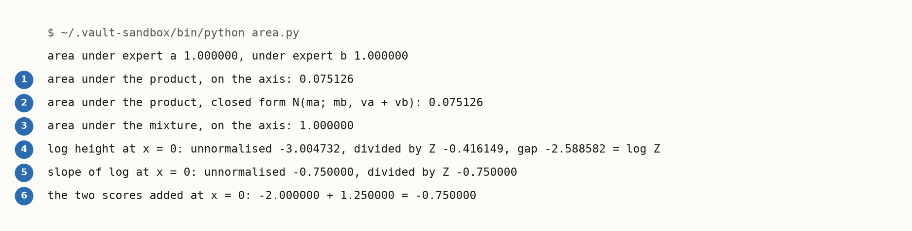

# The Area A Product Loses

Up: [[Multivariate Normal Distribution]] · ⬅️ [[Products And Quotients Of Diagonal Gaussians]] · [[Powers Of Gaussians]] ➡️

Mathematics, Statistics, Distributions, Multivariate Normal Distribution. Needs: [[Products And Quotients Of Diagonal Gaussians]].

> [!question] Test yourself
> [The diagonal Gaussian quiz](https://claude.ai/artifact/Vmd1FBg7oWwZq1onu9Jofa) covers the [[Multivariate Normal Distribution]] folder. This note's sections are not in it yet.

> [!warning] Unfinished
> - One picture is waiting to be drawn: prompt 9 in the vault's `.prompts/Multivariate Normal Distribution.md`.

Textbook: [[matrix-cookbook.pdf#page=42|Matrix Cookbook, section 8.1.8, p. 42]]

**Two densities multiplied point by point no longer have area 1. The area left is $\mathcal{N}(m_1; m_2, v_1 + v_2)$, and averaging the two instead keeps area 1. Dividing the product by its area moves its log by a constant, so the slope of the log, the score, does not change.** For expert a, $\mathcal{N}(-1, 0.5)$, and expert b, $\mathcal{N}(1, 0.8)$, the product's area is 0.075126 and the mixture's is 1.000000.

This is why most ways of combining models, other than guidance, were first studied on energy-based models. Du et al. put it this way: "These ideas have been studied primarily in the context of EBMs because most compositional operators leave the resulting distribution unnormalized." An energy-based model never promised an area of 1, so a combination that loses it costs nothing there. *Cited:* Du et al., Reduce, Reuse, Recycle, section 3, paragraph 1 (`text/method.tex`, line 6 of the arXiv source).

**When to reach for it.** When you multiply two densities and then use the result as a density: read off a probability, compare its height with another density's, or weight it in a mixture. Without the division, every height is 0.075126 times too small on this pair. When you need only the score, as a diffusion sampler does, you can skip the division, because the score does not depend on the area.

**Try it on one pair.**

1. What you need: the prepared environment, as in step 1 of [[Sampling A Diagonal Gaussian#Try sampling yourself]].
2. Make an empty folder and work in it:

   ```bash
   mkdir -p ~/playground/sandbox/product-area && cd ~/playground/sandbox/product-area
   ```

3. Save this as `area.py`. It measures the area of the product and of the mixture on a grid, checks the product's area against the closed form, and reads the slope of the log before and after dividing by the area:

   ```python
   # The area under a product of two densities, and under their mixture, and what the missing area does to the slope of the log.
   import numpy as np

   (ma, va), (mb, vb) = (-1.0, 0.5), (1.0, 0.8)            # expert a and expert b: mean, variance
   x = np.linspace(-8, 8, 1601)
   dx = x[1] - x[0]

   def gauss(x, m, v):
       return np.exp(-(x - m) ** 2 / (2 * v)) / np.sqrt(2 * np.pi * v)

   qa, qb = gauss(x, ma, va), gauss(x, mb, vb)
   raw = qa * qb                                           # multiply the heights, point by point
   mix = 0.5 * qa + 0.5 * qb                               # average the heights, one half each
   Z = raw.sum() * dx
   print(f"area under expert a {qa.sum() * dx:.6f}, under expert b {qb.sum() * dx:.6f}")
   print(f"area under the product, on the axis: {Z:.6f}")
   print(f"area under the product, closed form N(ma; mb, va + vb): {gauss(ma, mb, va + vb):.6f}")
   print(f"area under the mixture, on the axis: {mix.sum() * dx:.6f}")

   i = int(np.argmin(np.abs(x - 0.0)))                     # read every slope at x = 0
   h = 1e-4
   def slope_of_log(f, at):
       return (np.log(f(at + h)) - np.log(f(at - h))) / (2 * h)
   unnormalised = lambda t: gauss(t, ma, va) * gauss(t, mb, vb)
   normalised = lambda t: unnormalised(t) / Z
   print(f"log height at x = 0: unnormalised {np.log(raw[i]):.6f}, divided by Z {np.log(raw[i] / Z):.6f}, gap {np.log(Z):.6f} = log Z")
   print(f"slope of log at x = 0: unnormalised {slope_of_log(unnormalised, 0.0):.6f}, divided by Z {slope_of_log(normalised, 0.0):.6f}")
   print(f"the two scores added at x = 0: {-(0 - ma) / va:.6f} + {-(0 - mb) / vb:.6f} = {-(0 - ma) / va - (0 - mb) / vb:.6f}")
   ```

4. Run it:

   ```bash
   ~/.vault-sandbox/bin/python area.py
   ```

   You should see:

   

   Line 2 is the failure: treat the raw product as a density and it holds 0.075126 of the probability it should. Line 3 is another way to the same number, with no grid.

5. Clean up, and prove it:

   ```bash
   cd ~ && rm -r ~/playground/sandbox/product-area
   ls ~/playground/sandbox/product-area; echo $?
   ```

   You should see `No such file or directory`, then `2`.

**Reading the output.**

| # | Field | This run | How to read it | Backing |
|---|---|---|---|---|
| 1 | area under the product, on the axis | `0.075126` | the sum of the heights times the grid spacing 0.01: the area the product actually has | shown |
| 2 | area under the product, closed form | `0.075126` | the height at $-1$ of a Gaussian with mean 1 and variance $0.5 + 0.8 = 1.3$; agrees with field 1 to six places | derived below |
| 3 | area under the mixture | `1.000000` | half of each expert's area 1, added | derived below |
| 4 | log height at 0, and the gap | `-3.004732`, `-0.416149`, gap `-2.588582` | dividing by $Z$ adds $-\log Z = 2.588582$ to the log at every point, here at $x = 0$ | derived below |
| 5 | slope of the log at 0 | `-0.750000` both | the same slope before and after the division, measured by nudging $x$ by $10^{-4}$ either side | shown |
| 6 | the two scores added | `-2.000000 + 1.250000 = -0.750000` | each expert's score $-(x - m)/v$ at 0, added; equals field 5 | derived below |

**How the area works.** Write the product with its constants kept, which [[Products And Quotients Of Diagonal Gaussians#How the product works]] dropped. With $P = 1/v_1 + 1/v_2$ and $B = m_1/v_1 + m_2/v_2$ as there:

$$
\begin{aligned}
\mathcal{N}(x; m_1, v_1)\,\mathcal{N}(x; m_2, v_2)
&= \frac{1}{2\pi\sqrt{v_1 v_2}} \exp\!\left( -\frac{(x - m_1)^2}{2v_1} - \frac{(x - m_2)^2}{2v_2} \right) \\
&= \frac{1}{2\pi\sqrt{v_1 v_2}} \exp\!\left( -\frac{P}{2}\left(x - \frac{B}{P}\right)^2 + \frac{B^2}{2P} - \frac{1}{2}\left(\frac{m_1^2}{v_1} + \frac{m_2^2}{v_2}\right) \right)
\end{aligned}
$$

The leftover terms do not depend on $x$. Multiply them by $2P$ and expand $B^2$:

$$
\begin{aligned}
B^2 - P\left(\frac{m_1^2}{v_1} + \frac{m_2^2}{v_2}\right)
&= \frac{m_1^2}{v_1^2} + \frac{2 m_1 m_2}{v_1 v_2} + \frac{m_2^2}{v_2^2} - \frac{m_1^2}{v_1^2} - \frac{m_1^2}{v_1 v_2} - \frac{m_2^2}{v_1 v_2} - \frac{m_2^2}{v_2^2} \\
&= -\frac{(m_1 - m_2)^2}{v_1 v_2}
\end{aligned}
$$

Divide back by $2P$, using $\frac{1}{P} = \frac{v_1 v_2}{v_1 + v_2}$:

$$
\frac{B^2}{2P} - \frac{1}{2}\left(\frac{m_1^2}{v_1} + \frac{m_2^2}{v_2}\right) = -\frac{(m_1 - m_2)^2}{2(v_1 + v_2)}
$$

The bell that is left integrates to $\sqrt{2\pi / P}$, so the area is

$$
\begin{aligned}
Z &= \frac{1}{2\pi\sqrt{v_1 v_2}} \sqrt{\frac{2\pi v_1 v_2}{v_1 + v_2}}\; e^{-(m_1 - m_2)^2 / (2(v_1 + v_2))} \\
&= \frac{1}{\sqrt{2\pi (v_1 + v_2)}}\; e^{-(m_1 - m_2)^2 / (2(v_1 + v_2))} \\
&= \mathcal{N}(m_1; m_2, v_1 + v_2)
\end{aligned}
$$

*Derived.* The Matrix Cookbook states the same result as $c_c$ in its equation (371) and adds "the product is not normalized as a density of x". *Cited:* the `Textbook:` page above. On this pair:

$$
\begin{aligned}
v_1 + v_2 &= 0.5 + 0.8 = 1.3, \qquad (m_1 - m_2)^2 = (-1 - 1)^2 = 4 \\
e^{-4 / 2.6} &= e^{-1.538462} = 0.214711 \\
\sqrt{2\pi \times 1.3} &= \sqrt{8.168141} = 2.857996 \\
Z &= 0.214711 / 2.857996 = 0.075126
\end{aligned}
$$

**How the mixture keeps its area.** An integral of a sum is the sum of the integrals:

$$
\int \left( \tfrac12 q_a + \tfrac12 q_b \right) dx = \tfrac12 \int q_a\, dx + \tfrac12 \int q_b\, dx = \tfrac12 + \tfrac12 = 1
$$

*Derived.* Any weights that are positive and add to 1 keep the area 1 the same way.

**How the score ignores the area.** Dividing by $Z$ subtracts $\log Z$ from the log at every point:

$$
\begin{aligned}
\log \frac{q_a(x)\, q_b(x)}{Z} &= \log q_a(x) + \log q_b(x) - \log Z \\
\frac{d}{dx} \log \frac{q_a(x)\, q_b(x)}{Z} &= \frac{d}{dx}\log q_a(x) + \frac{d}{dx}\log q_b(x) - 0
\end{aligned}
$$

$\log Z$ is one number, the same at every $x$, and a constant has slope 0. *Derived.* At $x = 0$ the scores are $-(0 + 1)/0.5 = -2$ and $-(0 - 1)/0.8 = 1.25$, and their sum $-0.75$ equals the score of the normalised product $\mathcal{N}(-0.230769, 0.307692)$: $-(0 + 0.230769)/0.307692 = -0.75$. Field 4 shows the shift, $-3.004732 + 2.588582 = -0.416150$, which matches the printed $-0.416149$ to rounding in the last place, and field 5 shows the slope unchanged.

*🖼️ Diagram wanted: the two experts, their product as a small bump of area 0.075126 and the same bump rescaled to area 1, beside the two log curves, parallel, with the same slope at 0. Prompt 9 in the vault's `.prompts/Multivariate Normal Distribution.md`.*

**Other ways.** The ratio of two densities, such as dividing out a background, loses its area the same way, and can lose it entirely: step 4 of [[Products And Quotients Of Diagonal Gaussians#Try composing yourself]] gives a quotient with no finite area at all. A mixture keeps its area but needs each expert's true height to weight its score, which [[The Energy Parameterisation#How the energy works]] works out on this same pair.

**Why this matters.** Adding two diffusion models' scores gives exactly the score of their normalised product on clean data, whatever the product's area, because the area only moves the log by a constant. So when summed scores give wrong samples, as in [[The Order Of Multiplying And Noising]], the missing area is not the cause. That section shows what is: noising the product and multiplying the noised experts give different curves. *Derived* above for the clean case; the noised case is *shown* there.

**Taught in:**

- the `drip-read` walk of Du et al., Reduce, Reuse, Recycle, section 3, paragraph 1. The walk's paper note, `deep-learning/diffusion-models/02-sampler-correctors-for-composition/papers/reduce-reuse-recycle/reduce-reuse-recycle.md` in this vault, is not written yet; link it here when it is.
- the sampler correctors for composition journey's plan 4, `plans/04-energy-and-the-missing-normaliser.md`, lines 49 (the product's area is 0.075126), 63 (why the normaliser has slope 0 in $x$), 133 to 137 (the broken run and its fix) and 179 to 189 (the area as a Gaussian height)

**Applied in:** nothing yet.

> [!note]- How this was checked
> Every output in this note was run by the writer in an empty folder, `~/playground/sandbox/product-area`, on the PC: Ubuntu under WSL2, through the prepared environment `~/.vault-sandbox/bin/python` (Python 3.11.13, NumPy 2.4.6), on 2026-10-13. Its area 0.075126 and mixture area 1.000000 match the walk's answer keys `checks/step6_product.out` and `checks/mixture_score.out` in the journey's `sources/reduce-reuse-recycle/`; both keys were re-run in the same folder and their output matched the saved files byte for byte. The worked numbers in the derivation were computed in the same environment. The folder was removed afterwards and the clean-up check returned 2. The terminal picture was rendered from the captured text by a script in DejaVu Sans Mono. The quotation from Du et al. was read in the journey's staged arXiv source, `paper/source/text/method.tex`, line 6, and the Matrix Cookbook's equation (371) on PDF page 42 of the shelf copy.
