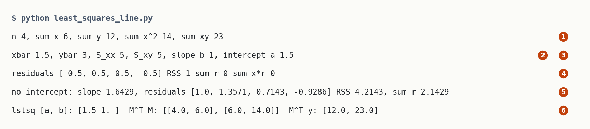
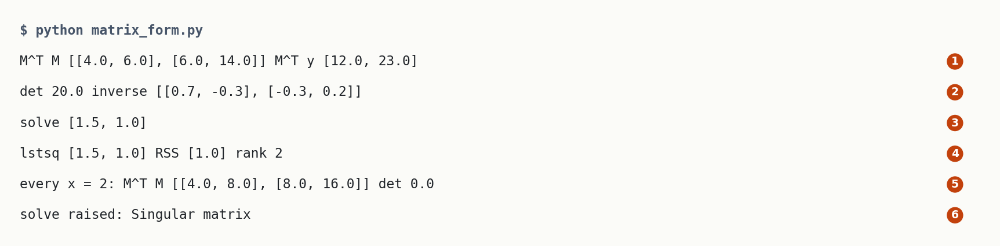
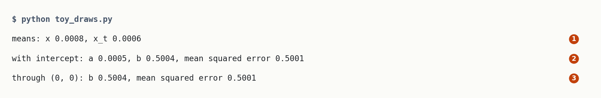
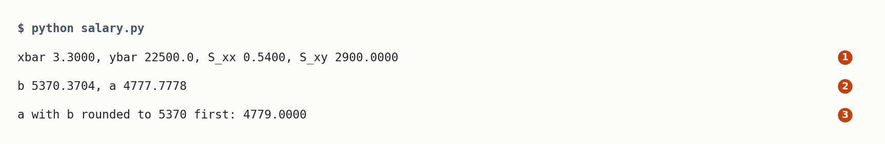

# Least Squares Line

Up: [[Statistics]] · ⬅️ [[Scaling And Shifting A Random Variable]] · [[Variance]] ➡️

Mathematics, Statistics. Needs: the mean as a weighted average, and setting a derivative to zero to find a minimum, which the [conditional-expectation chapter's Example 3, step 3](../../../goal-setting/learning/mathematics/statistics/conditional-expectation/textbook/05-the-conditional-mean-is-the-best-guess.md#worked-examples) does for a line through the origin.

> [!question] Test yourself
> Quiz 1.1 of the composition ladder asks this note's method, through its least-squares question and banked problems B3.2, B3.3, B3.4 and B3.6. Its page is not published yet.

> [!warning] Unfinished
> - The three drawn pictures (the form, the mechanism and the deep-dive sheet) are waiting: prompts 1 to 3 in the vault's `.prompts/Least Squares Line.md`.

Claims marked stated: 0.

**A least-squares line is the straight line $y = a + bx$ that makes the sum of squared vertical misses to the data points as small as possible.** Setting the two partial derivatives of that sum to zero gives two linear equations, the normal equations, and their solution is $b = S_{xy}/S_{xx}$ and $a = \bar y - b\,\bar x$. On the four points $(0, 1), (1, 3), (2, 4), (3, 4)$ the line is $y = 1.5 + x$, and its squared misses add up to 1.0.

## Where you work

Any terminal with Python 3 and NumPy, and a new empty folder. The hand route uses the standard library; NumPy only checks it.

## Table of contents

- [[#When to reach for it]]
- [[#The form of the fit]]
- [[#Try the fit yourself]]
- [[#Reading the fit output]]
- [[#How the line is found]]
- [[#Where the fit goes wrong]]
- [[#Why the least-squares line matters]]
- [[#The least-squares line taught in, applied in]]

## When to reach for it

Navigation: 📋 [[#Table of contents|TOC]] | [[#The form of the fit]] ➡️

When points scatter around a straight-line trend and you want the one line that sums up how $y$ moves with $x$: a slope and an intercept you can read and predict from. Squared misses are chosen because they are smooth to differentiate and they punish one large miss more than several small ones.

## The form of the fit

Navigation: ⬅️ [[#When to reach for it]] | 📋 [[#Table of contents|TOC]] | [[#Try the fit yourself]] ➡️

$$
\min_{a,\,b}\ \sum_{i=1}^{n} \big(y_i - a - b\,x_i\big)^2,
\qquad
b = \frac{S_{xy}}{S_{xx}},\quad a = \bar y - b\,\bar x,
\qquad
S_{xy} = \sum_i (x_i - \bar x)(y_i - \bar y),\quad S_{xx} = \sum_i (x_i - \bar x)^2 .
$$

In matrix form, with $M$ the $n \times 2$ matrix whose rows are $(1, x_i)$ and $\theta = (a, b)$, the two equations are $M^\top M\,\theta = M^\top y$ ([Anton, Theorem 6.5.1](../references/textbooks/linear-algebra/linear-algebra-textbook.pdf#page=403); [Chan, equation 7.7](../references/textbooks/statistics/introduction-to-probability-for-data-science.pdf#page=415)). Here $M^\top$ is the [transpose](../references/textbooks/linear-algebra/linear-algebra-textbook.pdf#page=49) of $M$, its rows turned into columns, and $M^\top M$ is a [matrix product](../references/textbooks/linear-algebra/linear-algebra-textbook.pdf#page=43).

*🖼️ Diagram wanted: the form, four points under the line y = 1.5 + x with each vertical miss drawn as a dashed segment and its square drawn on it, the four squares of area 0.25 adding to 1.0, and each piece of the sum's formula pointing at its part. Prompt 1 in the vault's `.prompts/Least Squares Line.md`.*

## Try the fit yourself

Navigation: ⬅️ [[#The form of the fit]] | 📋 [[#Table of contents|TOC]] | [[#Reading the fit output]] ➡️

**1. What you need.** Python 3 with NumPy: `python -c "import numpy; print(numpy.__version__)"` prints a version number. This run printed `2.4.3`.

**When NumPy is missing.** Install it into a virtual environment with `uv pip install numpy`, or use the prepared environment `~/.vault-sandbox/bin/python`, which has it. Not run on this machine, which already has NumPy.

**2. Make something to act on.** Make an empty folder and go into it, `mkdir least_squares_demo && cd least_squares_demo`, then save the script below as `least_squares_line.py`. It is the copy in `sandbox/least_squares_line.py` beside this note.

```python
# Fit y = a + b x to four points by the normal equations, by hand sums, then check with numpy.
import numpy as np

xs = [0.0, 1.0, 2.0, 3.0]
ys = [1.0, 3.0, 4.0, 4.0]
n = len(xs)
sx, sy = sum(xs), sum(ys)
sxx = sum(x * x for x in xs)
sxy = sum(x * y for x, y in zip(xs, ys))
print(f"n {n}, sum x {sx:g}, sum y {sy:g}, sum x^2 {sxx:g}, sum xy {sxy:g}")
xbar, ybar = sx / n, sy / n
Sxx = sum((x - xbar) ** 2 for x in xs)
Sxy = sum((x - xbar) * (y - ybar) for x, y in zip(xs, ys))
b = Sxy / Sxx
a = ybar - b * xbar
print(f"xbar {xbar:g}, ybar {ybar:g}, S_xx {Sxx:g}, S_xy {Sxy:g}, slope b {b:g}, intercept a {a:g}")
r = [y - (a + b * x) for x, y in zip(xs, ys)]
print("residuals", [round(v, 4) for v in r], f"RSS {sum(v * v for v in r):g}",
      f"sum r {sum(r):g}", f"sum x*r {sum(x * v for x, v in zip(xs, r)):g}")
b0 = sxy / sxx
r0 = [y - b0 * x for x, y in zip(xs, ys)]
print(f"no intercept: slope {b0:.4f}, residuals", [round(v, 4) for v in r0],
      f"RSS {sum(v * v for v in r0):.4f}, sum r {sum(r0):.4f}")
M = np.column_stack((np.ones(n), xs))
print("lstsq [a, b]:", np.round(np.linalg.lstsq(M, np.array(ys), rcond=None)[0], 4),
      " M^T M:", (M.T @ M).tolist(), " M^T y:", (M.T @ np.array(ys)).tolist())
```

**3. Run it.** `python least_squares_line.py`. You should see:

```text
n 4, sum x 6, sum y 12, sum x^2 14, sum xy 23
xbar 1.5, ybar 3, S_xx 5, S_xy 5, slope b 1, intercept a 1.5
residuals [-0.5, 0.5, 0.5, -0.5] RSS 1 sum r 0 sum x*r 0
no intercept: slope 1.6429, residuals [1.0, 1.3571, 0.7143, -0.9286] RSS 4.2143, sum r 2.1429
lstsq [a, b]: [1.5 1. ]  M^T M: [[4.0, 6.0], [6.0, 14.0]]  M^T y: [12.0, 23.0]
```



**4. Another way: the matrix route, and the case it cannot solve.** Save as `matrix_form.py`. It builds $M$, forms $M^\top M$ and $M^\top y$, inverts, solves, asks `lstsq`, then repeats with every $x$ equal to 2:

```python
import numpy as np

x = np.array([0, 1, 2, 3], dtype=float)
y = np.array([1, 3, 4, 4], dtype=float)
M = np.column_stack([np.ones(len(x)), x])  # column of 1s for the intercept, then x for the slope
print("M^T M", (M.T @ M).tolist(), "M^T y", (M.T @ y).tolist())
print("det", round(np.linalg.det(M.T @ M), 6), "inverse", np.round(np.linalg.inv(M.T @ M), 6).tolist())
print("solve", np.round(np.linalg.solve(M.T @ M, M.T @ y), 6).tolist())
v, rss, rank, _ = np.linalg.lstsq(M, y, rcond=None)
print("lstsq", np.round(v, 6).tolist(), "RSS", np.round(rss, 6).tolist(), "rank", rank)
M2 = np.column_stack([np.ones(4), [2.0, 2.0, 2.0, 2.0]])
print("every x = 2: M^T M", (M2.T @ M2).tolist(), "det", abs(round(np.linalg.det(M2.T @ M2), 6)))
try:
    np.linalg.solve(M2.T @ M2, M2.T @ y)
except np.linalg.LinAlgError as error:
    print("solve raised:", error)
```

`python matrix_form.py` prints:

```text
M^T M [[4.0, 6.0], [6.0, 14.0]] M^T y [12.0, 23.0]
det 20.0 inverse [[0.7, -0.3], [-0.3, 0.2]]
solve [1.5, 1.0]
lstsq [1.5, 1.0] RSS [1.0] rank 2
every x = 2: M^T M [[4.0, 8.0], [8.0, 16.0]] det 0.0
solve raised: Singular matrix
```



**5. The form the conditional-expectation plans use: a slope fitted on simulated draws.** [Plan 05, task 3.1.3](/home-mscluster/mmolefe/goal-setting/learning/mathematics/statistics/conditional-expectation/plans/05-the-conditional-mean-is-the-best-guess.md#3--build-the-check-script) fits the toy's slope by least squares on a million draws. Here the clean point $x$ is $-1$ or $+1$, the noisy point is $x_t = x + g$ with $g$ standard normal, and $x$ is fitted on $x_t$, so $x_t$ plays the part of the input and $x$ the part of $y$. Save as `toy_draws.py`:

```python
import numpy as np

rng = np.random.default_rng(0)
N = 1_000_000
x = rng.choice([-1.0, 1.0], size=N)  # the clean point, -1 or +1
xt = x + rng.standard_normal(N)      # the noisy point you observe at t = 1
M = np.column_stack([np.ones(N), xt])
(a, b), *_ = np.linalg.lstsq(M, x, rcond=None)
print(f"means: x {x.mean():.4f}, x_t {xt.mean():.4f}")
print(f"with intercept: a {a:.4f}, b {b:.4f}, mean squared error {np.mean((x - a - b * xt) ** 2):.4f}")
b0 = (xt @ x) / (xt @ xt)
print(f"through (0, 0): b {b0:.4f}, mean squared error {np.mean((x - b0 * xt) ** 2):.4f}")
```

`python toy_draws.py` prints:

```text
means: x 0.0008, x_t 0.0006
with intercept: a 0.0005, b 0.5004, mean squared error 0.5001
through (0, 0): b 0.5004, mean squared error 0.5001
```



**6. New points: six salaries against an education score.** The data of [Introduction to Statistics, Example 6.4](../references/textbooks/statistics/introduction-to-statistics.pdf#page=131), fitted by the steps in [[#How the line is found]]. Save as `salary.py`:

```python
ed = [2.8, 3.4, 3.2, 3.8, 3.2, 3.4]               # education score, the x column
sal = [20000, 24500, 23000, 25000, 20000, 22500]  # starting salary in dollars, the y column
n = len(ed)
xbar, ybar = sum(ed) / n, sum(sal) / n
S_xx = sum((e - xbar) ** 2 for e in ed)
S_xy = sum((e - xbar) * (s - ybar) for e, s in zip(ed, sal))
b = S_xy / S_xx
a = ybar - b * xbar
print(f"xbar {xbar:.4f}, ybar {ybar:.1f}, S_xx {S_xx:.4f}, S_xy {S_xy:.4f}")
print(f"b {b:.4f}, a {a:.4f}")
print(f"a with b rounded to 5370 first: {ybar - 5370 * xbar:.4f}")
```

`python salary.py` prints:

```text
xbar 3.3000, ybar 22500.0, S_xx 0.5400, S_xy 2900.0000
b 5370.3704, a 4777.7778
a with b rounded to 5370 first: 4779.0000
```



**7. Clean up, and prove it.** From inside `least_squares_demo`:

```bash
cd .. && rm -r least_squares_demo && ls least_squares_demo; echo $?
```

You should see `No such file or directory`, then `2`.

## Reading the fit output

Navigation: ⬅️ [[#Try the fit yourself]] | 📋 [[#Table of contents|TOC]] | [[#How the line is found]] ➡️

| # | Field | This run | How to read it |
|---|---|---|---|
| 1 | the four sums | 6, 12, 14, 23 | everything the line needs from the data: $\sum x$, $\sum y$, $\sum x^2$, $\sum xy$ |
| 2 | means and centred sums | $\bar x = 1.5$, $\bar y = 3$, $S_{xx} = 5$, $S_{xy} = 5$ | the slope is their ratio, $5/5 = 1$ |
| 3 | the line | $a = 1.5$, $b = 1$ | $y = 1.5 + x$, Anton's printed answer |
| 4 | residuals | $-0.5, 0.5, 0.5, -0.5$, sum of squares 1 | they add to 0, and $\sum x_i r_i = 0$: the two normal equations, read off the misses |
| 5 | no intercept | slope 1.6429, sum of squares 4.2143 | the failure below |
| 6 | NumPy | $[1.5, 1]$, $M^\top M = [[4, 6], [6, 14]]$, $M^\top y = [12, 23]$ | a second route to the same line |

From step 4, `matrix_form.py`:

| # | Field | This run | How to read it | Backing |
|---|---|---|---|---|
| 1 | `M^T M`, `M^T y` | `[[4, 6], [6, 14]]`, `[12, 23]` | the four sums of field 1 above, arranged as the two normal equations' left and right sides | derived, [[#The same equations as one matrix product]] |
| 2 | `det`, `inverse` | 20, `[[0.7, -0.3], [-0.3, 0.2]]` | $4 \times 14 - 6 \times 6 = 20$, and the inverse is $\frac{1}{20}[[14, -6], [-6, 4]]$; Anton prints it as $\frac{1}{10}[[7, -3], [-3, 2]]$ | derived, cited |
| 3 | `solve` | `[1.5, 1.0]` | the inverse times $M^\top y$: $0.7 \times 12 - 0.3 \times 23 = 1.5$ and $-0.3 \times 12 + 0.2 \times 23 = 1$ | derived |
| 4 | `lstsq` | `[1.5, 1.0]`, RSS `[1.0]`, rank 2 | NumPy's least-squares solver, given $M$ and $y$ with no normal equations written; rank 2 says the two columns of $M$ point different ways | shown |
| 5 | `every x = 2` | `[[4, 8], [8, 16]]`, det 0 | the second row is twice the first, so the two equations are one equation | shown |
| 6 | `solve raised` | `Singular matrix` | no inverse exists, so no single line is the answer | shown |

From step 5, `toy_draws.py`. The input is the noisy point $x_t$ and the output is the clean point $x$:

| # | Field | This run | How to read it | Backing |
|---|---|---|---|---|
| 1 | `means` | 0.0008, 0.0006 | both means are 0 up to sampling noise from a million draws | shown |
| 2 | `with intercept` | $a = 0.0005$, $b = 0.5004$, error 0.5001 | the intercept $\bar y - b\,\bar x$ is 0 when both means are 0, and the slope and error match the chapter's $1/2$ and $0.5$ | derived, shown |
| 3 | `through (0, 0)` | $b = 0.5004$, error 0.5001 | dropping the intercept costs nothing here, because the intercept it drops is already 0 | shown |

From step 6, `salary.py`:

| # | Field | This run | How to read it | Backing |
|---|---|---|---|---|
| 1 | means, $S_{xx}$, $S_{xy}$ | 3.3, 22500, 0.54, 2900 | the book's $65.88 - 19.8^2/6 = 0.54$ and $448400 - 19.8 \times 135000/6 = 2900$ | cited, PDF p. 131 |
| 2 | `b`, `a` | 5370.3704, 4777.7778 | 5,370 dollars more starting salary per point of education score, and the line's height at score 0 | shown |
| 3 | `a with b rounded to 5370 first` | 4779.0000 | the book's printed intercept, off by 1.22 dollars because it rounded $b$ before step 5 of [[#The normal equations|the method]] | shown |

## How the line is found

Navigation: ⬅️ [[#Reading the fit output]] | 📋 [[#Table of contents|TOC]] | [[#Where the fit goes wrong]] ➡️

Textbook: [Introduction to Statistics, section 6.7, equations 6.14 to 6.17, PDF pp. 128 to 130](../references/textbooks/statistics/introduction-to-statistics.pdf#page=128) · [Chan, section 7.1.2, Theorem 7.1 and equation 7.7, PDF pp. 413 to 415](../references/textbooks/statistics/introduction-to-probability-for-data-science.pdf#page=413) · [Anton, section 6.5, Theorem 6.5.1 and Example 1, PDF pp. 403 and 404](../references/textbooks/linear-algebra/linear-algebra-textbook.pdf#page=403). The page numbers are the PDF files' own; the books print numbers 1 lower (Introduction to Statistics), 16 lower (Chan) and 14 lower (Anton).

### The normal equations

**The normal equations**, also the normal equation in its matrix form $M^\top M\,\theta = M^\top y$, are the two linear equations that the slope and intercept of the least-squares line satisfy. They come from setting both partial derivatives of the residual sum of squares to zero.

The method, which you can redo on any points, each step worked on $(0, 1), (1, 3), (2, 4), (3, 4)$:

1. **Write the quantity to make small.** $E(a, b) = \sum_i (y_i - a - b\,x_i)^2$, the residual sum of squares.
2. **Differentiate in $a$ and set it to zero.** Take the [partial derivative](../references/textbooks/calculus/calculus-textbook.pdf#page=951) in $a$, holding $b$ fixed: the [chain rule](../references/textbooks/calculus/calculus-textbook.pdf#page=198) turns each $(y_i - a - b x_i)^2$ into $2(y_i - a - b x_i) \times (-1)$, and at a minimum [both partial derivatives are zero](../references/textbooks/calculus/calculus-textbook.pdf#page=1003). $\partial E/\partial a = -2\sum_i (y_i - a - b x_i) = 0$, so $\sum y_i = n\,a + b \sum x_i$. Here $12 = 4a + 6b$. Dividing by $n$ says the line passes through $(\bar x, \bar y) = (1.5, 3)$ ([Introduction to Statistics, equation 6.14](../references/textbooks/statistics/introduction-to-statistics.pdf#page=129)).
3. **Differentiate in $b$ and set it to zero.** $\partial E/\partial b = -2\sum_i x_i (y_i - a - b x_i) = 0$, so $\sum x_i y_i = a \sum x_i + b \sum x_i^2$. Here $23 = 6a + 14b$ (equation 6.15).
4. **Solve the pair for the slope.** Substitute $a = \bar y - b\,\bar x$ from step 2 into step 3, which gives $b = S_{xy}/S_{xx}$ ([equation 6.17](../references/textbooks/statistics/introduction-to-statistics.pdf#page=130)). Here $S_{xx} = (-1.5)^2 + (-0.5)^2 + 0.5^2 + 1.5^2 = 5$ and $S_{xy} = (-1.5)(-2) + (-0.5)(0) + (0.5)(1) + (1.5)(1) = 5$, so $b = 1$.
5. **Get the intercept.** $a = \bar y - b\,\bar x = 3 - 1 \times 1.5 = 1.5$.
6. **Confirm it is a minimum.** $\partial^2 E/\partial a^2 = 2n = 8 > 0$ and $\partial^2 E/\partial b^2 = 2\sum x_i^2 = 28 > 0$, and $E$ is a bowl in $(a, b)$ ([Chan, the remark after Theorem 7.1](../references/textbooks/statistics/introduction-to-probability-for-data-science.pdf#page=414)).


*Left, the least-squares line with its intercept: the dashed misses balance, two up and two down. Right, the same points with the line forced through $(0, 0)$: every miss but one is positive and the squared misses quadruple.*

The line through the origin is the one-parameter case of the same method: drop step 2, and step 3 alone gives $b = \sum x_i y_i / \sum x_i^2$. The conditional-expectation chapter's [Example 3](../../../goal-setting/learning/mathematics/statistics/conditional-expectation/textbook/05-the-conditional-mean-is-the-best-guess.md#worked-examples) does exactly that for a population, $a = \mathbb E[x\,x_t]/\mathbb E[x_t^2] = 1/2$.

**Why the chapter could drop the intercept.** The chapter calls its slope $a$; in this note $a$ is the intercept. Step 5 of the method above gives the intercept as $\bar y - b\,\bar x$, and in the chapter's toy the clean point and the noisy point both have mean 0, so the intercept is $0 - b \times 0 = 0$ and the line through the origin loses nothing. Step 5 of [[#Try the fit yourself]] fits both lines to a million toy draws: intercept 0.0005, slope 0.5004 with or without it, mean squared error 0.5001, which are the chapter's $1/2$ and $0.5$. On the four points here, $\bar x = 1.5$ and $\bar y = 3$ are not 0, and dropping the intercept adds $4.2143 - 1.0 = 3.2143$ to the squared misses.

*🖼️ Diagram wanted: the mechanism, the two normal equations as two balances under the same four points: with the intercept the residuals add to 0 and the x-weighted residuals add to 0; forced through (0, 0) the first balance tips to 2.1429 and the squares grow from 1.0 to 4.2143. Prompt 2 in the vault's `.prompts/Least Squares Line.md`.*

### The same equations as one matrix product

Write the four equations $y_i = a + b\,x_i$ as one, $y = M\theta$:

$$
M = \begin{bmatrix}1&0\\1&1\\1&2\\1&3\end{bmatrix},\qquad \theta = \begin{bmatrix}a\\b\end{bmatrix},\qquad y = \begin{bmatrix}1\\3\\4\\4\end{bmatrix}.
$$

No line passes through all four points, so no $\theta$ solves it exactly. Multiplying both sides by $M^\top$ gives the two normal equations at once ([Chan, equation 7.7](../references/textbooks/statistics/introduction-to-probability-for-data-science.pdf#page=415)):

$$
\begin{aligned}
M^\top M &= \begin{bmatrix}1&1&1&1\\0&1&2&3\end{bmatrix}\begin{bmatrix}1&0\\1&1\\1&2\\1&3\end{bmatrix} = \begin{bmatrix}4&6\\6&14\end{bmatrix} = \begin{bmatrix}n&\sum x_i\\\sum x_i&\sum x_i^2\end{bmatrix},\\[4pt]
M^\top y &= \begin{bmatrix}1+3+4+4\\0+3+8+12\end{bmatrix} = \begin{bmatrix}12\\23\end{bmatrix} = \begin{bmatrix}\sum y_i\\\sum x_i y_i\end{bmatrix}.
\end{aligned}
$$

The first row of $M^\top M\,\theta = M^\top y$ is $4a + 6b = 12$, step 2's equation, and the second row is $6a + 14b = 23$, step 3's. The determinant of $M^\top M$ is $4 \times 14 - 6 \times 6 = 20$, which is not 0, so the [inverse of the 2 by 2 matrix](../references/textbooks/linear-algebra/linear-algebra-textbook.pdf#page=59) exists:

$$
\begin{aligned}
(M^\top M)^{-1} &= \frac{1}{20}\begin{bmatrix}14&-6\\-6&4\end{bmatrix} = \begin{bmatrix}0.7&-0.3\\-0.3&0.2\end{bmatrix},\\[4pt]
\theta = (M^\top M)^{-1}M^\top y &= \begin{bmatrix}0.7 \times 12 - 0.3 \times 23\\-0.3 \times 12 + 0.2 \times 23\end{bmatrix} = \begin{bmatrix}8.4 - 6.9\\-3.6 + 4.6\end{bmatrix} = \begin{bmatrix}1.5\\1\end{bmatrix}.
\end{aligned}
$$

That is $a = 1.5$ and $b = 1$ again, Anton's Example 1 ([PDF p. 404](../references/textbooks/linear-algebra/linear-algebra-textbook.pdf#page=404)), and `matrix_form.py` in step 4 of [[#Try the fit yourself]] prints every line of it. Chan orders the columns the other way, $X = [x, 1]$ with the slope first, which swaps the rows of the answer and nothing else.

*🖼️ Diagram wanted: the deep-dive sheet composing the form, the mechanism and the run of `least_squares_line.py`, with six numbered field cards. Prompt 3 in the same file.*

## Where the fit goes wrong

Navigation: ⬅️ [[#How the line is found]] | 📋 [[#Table of contents|TOC]] | [[#Why the least-squares line matters]] ➡️

**Leaving out the intercept.** Fitting $y = b\,x$ to these points gives $b = 23/14 = 1.6429$ and a residual sum of squares of 4.2143, more than four times the 1.0 of the line with its intercept. The sign of the trouble is in the residuals: they add to 2.1429 instead of 0, because the equation that would have balanced them (step 2) was never imposed. In code the same slip is forgetting the column of ones in $M$.

**All the $x$ values equal.** If every $x_i$ is 2, then $S_{xx} = 0$, $M^\top M = [[4, 8], [8, 16]]$ has determinant 0, and step 4 divides by zero: no single slope fits a vertical stack of points (Anton's theorem asks for points "not all lying on a vertical line"). Step 4 of [[#Try the fit yourself]] prints it: `det 0.0`, then `solve raised: Singular matrix`.

**Rounding the slope before the intercept.** [Introduction to Statistics, Example 6.4](../references/textbooks/statistics/introduction-to-statistics.pdf#page=130) rounds the slope to 5,370 and then prints the intercept 4,779; the unrounded slope 5,370.37 gives 4,777.78. Keep full precision until the last step.

**The check.** Three routes agree on these points: the hand sums (steps 1 to 5), NumPy's `lstsq`, which prints $[1.5, 1]$, and Anton's printed answer $y = 1.5 + x$. The residuals also check themselves: $\sum r_i = 0$ and $\sum x_i r_i = 0$ are the two normal equations, so any proposed line whose residuals fail either test is not the least-squares line.

<!-- worked-examples-table: least-squares-regression rev=1 -->
Problems on choosing a guess or a line by minimising squared error: the best constant is the mean, the best line solves the normal equations, and the best function of the input is the conditional mean, from the easiest to the hardest:

| Order | What it asks | Kind | Where | Difficulty | Full-steps solution | Quiz question |
|---|---|---|---|---|---|---|
| 1 | The best constant guess for a fair die under squared error is 3.5, with error 2.9167; guesses 3 and 4 both cost 3.1667 | Tutorial | [the conditional-expectation chapter, section 1, Example 1](/home-mscluster/mmolefe/goal-setting/learning/mathematics/statistics/conditional-expectation/textbook/01-expectation-and-the-best-constant-guess.md#worked-examples) | Easy | In the chapter, with a face-by-face check | quiz 1.1, B3.1 |
| 2 | The least-squares line through $(0, 1), (1, 3), (2, 4), (3, 4)$ is $y = 1.5 + x$ | Worked example | [[linear-algebra-textbook.pdf#page=404\|Anton, section 6.5, Example 1, PDF p. 404]] | Easy | In the book, PDF p. 404 | quiz 1.1, B3.2 |
| 3 | Starting salary against education score for six people, by the normal equations: 5,370 dollars per score point | Worked example | [[introduction-to-statistics.pdf#page=130\|Introduction to Statistics, Example 6.4, PDF pp. 130 to 131]] | Medium | In the book, PDF p. 131; its intercept 4,779 uses the rounded slope, and the unrounded one gives 4,777.78 | quiz 1.1, B3.3 |
| 4 | Example 6.4 without its sixth person: re-estimate both coefficients and predict the salary at score 2.8 | Exercise without one | [[introduction-to-statistics.pdf#page=132\|Introduction to Statistics, Exercise 6.5, PDF p. 132]] | Medium | [S6 in the quiz 1.1 solutions](/home-mscluster/mmolefe/PhD/reduce-reuse-recycle/artifacts/drips/simple-distributions-rebuild/.quiz-prep/quiz-1-1-solutions.md#s6-example-64-without-its-sixth-person-b34-introduction-to-statistics-65): slope 5,492.42, intercept 4,484.85, 19,863.64 dollars at 2.8 | quiz 1.1, B3.4 |
| 5 | Write `fit_line(x, y)` with `np.linalg.lstsq` on the columns $(x, 1)$ and confirm the answer solves $X^\top X\theta = X^\top y$ on row 2's points | Programming exercise, Python: `fit_line(x, y)` | [[introduction-to-probability-for-data-science.pdf#page=414\|Chan, Theorem 7.1 and the Python listing, PDF pp. 414 to 416]] | Medium | [S7 in the quiz 1.1 solutions](/home-mscluster/mmolefe/PhD/reduce-reuse-recycle/artifacts/drips/simple-distributions-rebuild/.quiz-prep/quiz-1-1-solutions.md#s7-a-line-fitted-by-lstsq-solves-the-normal-equations-b36-chan-theorem-71) | quiz 1.1, B3.6 |

The two-point toy's best line against its conditional mean (the conditional-expectation chapter, section 5, Example 3) is banked by quiz 1.2 in [[#The squared-error optimum is the conditional mean]]. No row reaches ridge regression: Chan's Exercise 10 (PDF p. 480) turns noisy inputs into a ridge penalty, and no passage teaches ridge to the full-steps standard yet. The vector-target version of row 5 (Bishop, Exercises 1.25 and 1.26, PDF p. 83) is quiz 1.2's.
Read in full: the conditional-expectation chapter's section 5 Example 3, Anton PDF pp. 401 to 404, Introduction to Statistics PDF pp. 128 to 135, and Chan PDF pp. 412 to 416, 475 to 476 and 480. Only found: the deep learning textbook's linear least squares example (PDF p. 112) and Mathematics for Machine Learning's chapter 9 (PDF p. 295), which has no exercises.
<!-- /worked-examples-table -->

## Why the least-squares line matters

Navigation: ⬅️ [[#Where the fit goes wrong]] | 📋 [[#Table of contents|TOC]] | [[#The least-squares line taught in, applied in]] ➡️

Training a network by mean squared error is least squares with a far larger family than straight lines. Layer 1 of the composition ladder trains its noise predictor by least squares on the noise that was added, and the best such fit over all functions is the conditional mean of that noise given the noisy point.

## The least-squares line taught in, applied in

Navigation: ⬅️ [[#Why the least-squares line matters]] | 📋 [[#Table of contents|TOC]]

**Taught in:** the books in this note's sources, and for the line through the origin:

- the conditional-expectation journey's [chapter 5, Example 3, step 3](/home-mscluster/mmolefe/goal-setting/learning/mathematics/statistics/conditional-expectation/textbook/05-the-conditional-mean-is-the-best-guess.md#worked-examples), which expands the squared error of a line through the origin, sets its derivative to zero and finds the slope $1/2$ with error 0.5
- the same journey's [plan 05, task 2.3.4](/home-mscluster/mmolefe/goal-setting/learning/mathematics/statistics/conditional-expectation/plans/05-the-conditional-mean-is-the-best-guess.md#2--prove-it-cold-and-work-both-examples), the best linear predictor worked by hand

**Applied in:** quiz 1.1 of the composition ladder in the reduce-reuse-recycle research repository, whose least-squares question and banked problems B3.2, B3.3, B3.4 and B3.6 lean on the normal equations; and step 8 of that ladder's one-expert walk, the denoising loss, which is a least-squares regression of the noise on the noisy point.

- [Plan 05, task 3.1.3](/home-mscluster/mmolefe/goal-setting/learning/mathematics/statistics/conditional-expectation/plans/05-the-conditional-mean-is-the-best-guess.md#3--build-the-check-script) of the conditional-expectation journey: the toy's clean point fitted on its noisy point over simulated draws, to check the slope $1/2$ against the tanh predictor's lower error.
- [Plan 07, task 4.1.3](/home-mscluster/mmolefe/goal-setting/learning/mathematics/statistics/conditional-expectation/plans/07-jointly-gaussian-vectors.md#4--build-the-check-script) of the same journey: a million 2D draws through a tilted covariance, $x$ fitted on $x_t$ by least squares to read off a gain matrix.

> [!note]- How this was checked
> `least_squares_line.py` was run on 2026-10-20 on mscluster (Linux), Python 3.10.20 with NumPy from the co3 environment, in an empty scratch folder; it was run twice and printed the same five lines both times. A copy sits at `sandbox/least_squares_line.py` beside this note. The two-panel picture was rendered from the same numbers by vault-writer earlier the same day and opened before filing; its labels match the printed output. The all-equal case ($M^\top M = [[4, 8], [8, 16]]$, determinant 0) is a hand count, and the salary figures 5,370.37 and 4,777.78 are printed by the quiz 1.1 solutions check script (`.quiz-prep/quiz-1-1-solutions-check.py` in the reduce-reuse-recycle repository). Anton PDF pages 403 and 404, Introduction to Statistics PDF pages 128 to 131 and Chan PDF pages 413 to 416 were opened with PyMuPDF and read. Written by prep-cadence under quiz-prep-pulse --build, after vault-writer stopped with the figures made and the note unwritten.
>
> Steps 4 to 7 of the sandbox were added by vault-writer on 2026-10-20 on mscluster (Linux), with Python 3.12.10 and NumPy 2.4.3 from the default `python` and `python3`, in the empty folder `least_squares_demo` made inside the session scratchpad. `least_squares_line.py` was rerun with `python` in a second empty scratchpad folder, removed afterwards, and printed the five lines above exactly. `matrix_form.py`, `toy_draws.py` and `salary.py` were run with `python3`, rerun with `python`, and printed the same lines all three times; the folder was then removed and the clean-up check printed `No such file or directory` and `2`. The prepared environment `~/.vault-sandbox` is missing on this machine; the default interpreter already had NumPy, so nothing was installed. The four output pictures were rendered from the captured text by a script in DejaVu Sans Mono, never drawn, and each was opened before filing. The calculus textbook's PDF pages 198, 951 and 1003 and Anton's PDF pages 43, 49 and 59 were opened with PyMuPDF and read: the chain rule, the partial derivative (Definition 13.3.1), both partial derivatives zero at a relative extremum (Theorem 13.8.4), the matrix product (Definition 5), the transpose (Definition 7) and the inverse of a 2 by 2 matrix (Theorem 1.4.5).
