# Moment Generating Function

Up: [[Statistics]] · ⬅️ [[Scaling And Shifting A Random Variable]] · [[Central Limit Theorem]] ➡️

Mathematics, Statistics. Needs: [[Variance]] for the second moment, [[The Exponent Rules#Product of powers]] for $e^{a}e^{b} = e^{a+b}$, and [[The Front Factor Of A Gaussian Density#The front factor from the bell's area]] for why a Gaussian density encloses area 1.

> [!question] Test yourself
> The [Moment Generating Function Quiz](https://claude.ai/artifact/MSsd7qs9qEhiAiHkVJb4cU): 31 questions on every section, with a read-first list of the material behind each one.

> [!warning] Unfinished
> - Two drawn pictures are stuck on their pixel checks and wait for a word on how to redraw them: the form (prompt 1, the purple $e^{\lambda^2}$ curve misses its heights) and the deep-dive sheet (prompt 3, the bells in pane 2 come out too narrow), in the vault's `.prompts/Moment Generating Function.md`. The mechanism picture is drawn and embedded.
> - One concept picture waits to be drawn: a large dial reads the tails (prompt 4 in the same file).

Claims marked stated: 2.

**The moment generating function of a random variable $Z$ is $M_Z(\lambda) = \mathbb{E}[e^{\lambda Z}]$, one number for every value of the dial $\lambda$, and it works as the distribution's fingerprint: two variables whose functions agree on an interval around $\lambda = 0$ have the same distribution.** A standard normal's fingerprint is $e^{\lambda^2/2}$, found by completing the square in one integral. The fingerprint of a sum of independent variables is the product of their fingerprints, which is how a sum of independent Gaussians is shown to be Gaussian again, and how a sum of coin flips is shown not to be.

## Where you work

Any terminal with Python 3.8 or later, and a new empty folder. The scripts use the standard library only (`math`, `random` and `itertools`), so nothing is installed. Every number in them is made up.

## Table of contents

- [[#What the fingerprint is]]
- [[#When to reach for the fingerprint]]
- [[#The form of the fingerprint]]
- [[#Try the fingerprint yourself]]
- [[#Reading the fingerprint output]]
- [[#How the fingerprint works]]
- [[#Other ways to pin down a distribution]]
- [[#Why the fingerprint matters]]
- [[#The fingerprint taught in, applied in]]

## What the fingerprint is

Navigation: 📋 [[#Table of contents|TOC]] | [[#When to reach for the fingerprint]] ➡️

Textbook: [probability for data science, Definition 6.1, p. 340](../references/textbooks/statistics/introduction-to-probability-for-data-science.pdf#page=340), and [introduction to statistics, Definition 12, p. 83](../references/textbooks/statistics/introduction-to-statistics.pdf#page=83) for the uniqueness property.

**Moment generating function**, also the MGF or the distribution's fingerprint: for a random variable $Z$ and a real number $\lambda$, $M_Z(\lambda) = \mathbb{E}[e^{\lambda Z}]$, the [average](../references/textbooks/machine-learning/mathematics-for-machine-learning.pdf#page=193) of $e^{\lambda Z}$ over the distribution of $Z$. It is a function of $\lambda$, not of $Z$: the variable is averaged out. Chan writes $s$ for the dial and the statistics text writes $t$; the walk and this note write $\lambda$. *Cited:* both definitions above.

For a variable with a density $f$, the average is an integral, $M_Z(\lambda) = \int e^{\lambda u} f(u)\,du$. For a variable with a list of values, it is a weighted sum, $M_Z(\lambda) = \sum_u e^{\lambda u}\,P(Z = u)$. At $\lambda = 0$ every fingerprint is 1, because $e^{0} = 1$ and the probabilities add to 1.

**The name, taken apart.** A *moment* is $\mathbb{E}[Z^k]$: the first is the mean, the second is the mean square that [[Variance]] is built from. *Generating* means the function holds every moment as a coefficient. The [series for $e^x$](../references/textbooks/calculus/calculus-textbook.pdf#page=684) gives

$$e^{\lambda Z} = 1 + \lambda Z + \frac{\lambda^2 Z^2}{2!} + \frac{\lambda^3 Z^3}{3!} + \cdots$$

and averaging term by term gives

$$M_Z(\lambda) = 1 + \lambda\,\mathbb{E}[Z] + \frac{\lambda^2}{2!}\,\mathbb{E}[Z^2] + \frac{\lambda^3}{3!}\,\mathbb{E}[Z^3] + \cdots$$

so $\mathbb{E}[Z^k]$ is $k!$ times the coefficient of $\lambda^k$. *Cited:* the equivalent derivative form, $\mathbb{E}[Z^k] = M_Z^{(k)}(0)$, is [Theorem 6.1, p. 341](../references/textbooks/statistics/introduction-to-probability-for-data-science.pdf#page=341).

### Computing a fingerprint from a list of values

**A fingerprint from a list of values**, also the weighted-sum form or the MGF of a discrete variable: when a variable can land on only a few values, its fingerprint at one setting of the dial is one sum with a term per value. Each value's weight is its probability times $e$ raised to the dial times the value. Every later section, the coin and the yes-or-no variable included, computes fingerprints this way.

**Worked on numbers.** Take $Z$ on $-1$, $0$ and $2$ with probabilities $0.2$, $0.5$ and $0.3$, and set $\lambda = 0.5$.

| value $u$ | probability | $\lambda u$ | $e^{\lambda u}$ | term |
|---|---|---|---|---|
| $-1$ | 0.2 | $-0.5$ | 0.606531 | $0.2 \times 0.606531 = 0.121306$ |
| $0$ | 0.5 | $0$ | 1.000000 | $0.5 \times 1 = 0.500000$ |
| $2$ | 0.3 | $1$ | 2.718282 | $0.3 \times 2.718282 = 0.815485$ |

Adding the terms, $M_Z(0.5) = 0.121306 + 0.500000 + 0.815485 = 1.436791$.

**The method.**

1. List every value $u$ with its probability $P(Z = u)$, and check the probabilities add to 1.
2. Multiply each value by $\lambda$, keeping its sign: $0.5 \times (-1) = -0.5$.
3. Raise $e$ to each product.
4. Multiply each power by its probability. That product is the value's term.
5. Add the terms. The total is $M_Z(\lambda)$ at this one $\lambda$, and another $\lambda$ means another pass from step 2.

**Where it goes wrong.** Dropping the minus sign on the value $-1$ weights it by $e^{+0.5} = 1.648721$, so its term becomes $0.2 \times 1.648721 = 0.329744$ and the total comes out $1.645229$, which is $0.208438$ too high. The number looks plausible, and the free check below does not catch it, because at $\lambda = 0$ every value is multiplied by 0 and its sign stops mattering. Only a second route, such as the script, shows the slip.

**The check.** At $\lambda = 0$ every power is $e^{0} = 1$, so $M_Z(0) = 0.2 + 0.5 + 0.3 = 1$; any other total means a probability is missing or wrong. Then save this as `weighted_sum.py` in the folder from step 3 of [[#Try the fingerprint yourself]]:

```python
import math

values = [-1, 0, 2]
probs = [0.2, 0.5, 0.3]
lam = 0.5

total = 0.0
for u, p in zip(values, probs):
    term = p * math.exp(lam * u)
    total += term
    print(f"u {u:2d}  p {p}  e^(lam u) {math.exp(lam * u):.6f}  term {term:.6f}")
print(f"M(0.5) = {total:.6f}")

slip = sum(p * math.exp(lam * abs(u)) for u, p in zip(values, probs))
print(f"minus sign dropped on -1: {slip:.6f}")
print(f"M(0) = {sum(p * math.exp(0 * u) for u, p in zip(values, probs)):.6f}")
```

```bash
python3 weighted_sum.py
```

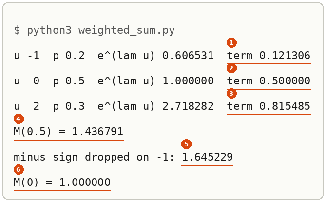

Markers 1 to 3 are the three terms of the table, marker 4 the total, marker 5 the slipped total and marker 6 the free check. *Shown.*

### Same fingerprint, same distribution

If $M_X(\lambda)$ and $M_Y(\lambda)$ both exist and agree for every $\lambda$ in an interval $[-h, h]$ with $h > 0$, then $X$ and $Y$ have the same distribution. This is a theorem above the school floor, and this note states it without proving it. *Cited:* property 2 under Definition 12 on [p. 83 of introduction to statistics](../references/textbooks/statistics/introduction-to-statistics.pdf#page=83), which also gives the interval condition. It is what turns the fingerprint from a summary into an identity check: once a sum's fingerprint is shown to equal $e^{v\lambda^2/2}$, the sum is $\mathcal{N}(0, v)$.

**Using it as a tool.** The property turns "what distribution is this?" into a comparison of two functions, and the comparison is often one line of algebra.

1. Compute the fingerprint of the variable you have, $M_X(\lambda)$.
2. Compute the fingerprint of the distribution you suspect, $M_Y(\lambda)$, from [[#The standard normal's fingerprint]], [[#Scaling a draw]] or a table such as Chan's Table 6.1.
3. Show the two are equal for every $\lambda$ in some interval $[-h, h]$ with $h > 0$. An algebraic identity, true for every $\lambda$, does this. A list of matching numbers does not.
4. Conclude that $X$ has the distribution of $Y$.

**Worked use: the two forward-process noises.** Step 1: the sum $a e_1 + b e_2$ with $a^2 = 0.08$ and $b^2 = 0.2$ has fingerprint $e^{0.04\lambda^2} e^{0.1\lambda^2}$, by [[#The fingerprint of a sum is the product]]. Step 2: $\mathcal{N}(0, 0.28)$ has fingerprint $e^{0.28\lambda^2/2} = e^{0.14\lambda^2}$. Step 3: by the [exponent rules](../references/textbooks/algebra/algebra-handbook.pdf#page=109), $e^{0.04\lambda^2} e^{0.1\lambda^2} = e^{(0.04 + 0.1)\lambda^2} = e^{0.14\lambda^2}$ for every $\lambda$, so on every interval. Step 4: the sum is $\mathcal{N}(0, 0.28)$. The script below prints the two side by side from $\lambda = -1$ to $1$, equal on every row (1.150274, 1.035620, 1.000000, 1.035620, 1.150274); the rows illustrate step 3, and the identity is what proves it. *Derived*, with step 4 *cited*.

**Where it goes wrong: agreement at a few points proves nothing.** Take the fair $\pm 1$ coin, fingerprint $\cosh\lambda$, and the bell $\mathcal{N}(0, v)$ with $v = 2\log\cosh 1 = 0.867562$, fingerprint $e^{v\lambda^2/2}$. At $\lambda = 0$ both are 1, as every fingerprint is. At $\lambda = 1$ the bell gives $e^{v/2} = e^{\log\cosh 1} = \cosh 1 = 1.543081$, the coin's value exactly, because $v$ was chosen to make it so. Two agreements, and the two variables are different: the coin lands only on $\pm 1$. At $\lambda = 2$ the coin gives $\cosh 2 = 3.762196$ and the bell $e^{2v} = 5.669627$, and at $\lambda = 0.5$ they already differ, $1.127626$ against $1.114544$. One free parameter can match any single point, so a few matching points are no evidence. The theorem asks for a whole interval.

**The check.** Evaluate both fingerprints at several $\lambda$. One $\lambda$ where they differ settles that the distributions differ, because equal distributions have equal fingerprints everywhere. Agreement has to come from the identity of step 3. Save this as `uniqueness.py`:

```python
import math

v = 2 * math.log(math.cosh(1))
print(f"v = 2 log cosh 1 = {v:.6f}")
for lam in [0.0, 0.5, 1.0, 2.0]:
    print(f"lam {lam}: coin cosh {math.cosh(lam):.6f}  bell e^(v lam^2/2) {math.exp(v * lam * lam / 2):.6f}")

print("forward process:")
for lam in [-1.0, -0.5, 0.0, 0.5, 1.0]:
    prod = math.exp(0.04 * lam * lam) * math.exp(0.1 * lam * lam)
    print(f"lam {lam:4.1f}: product {prod:.6f}  N(0, 0.28) {math.exp(0.28 * lam * lam / 2):.6f}")
```

```bash
python3 uniqueness.py
```

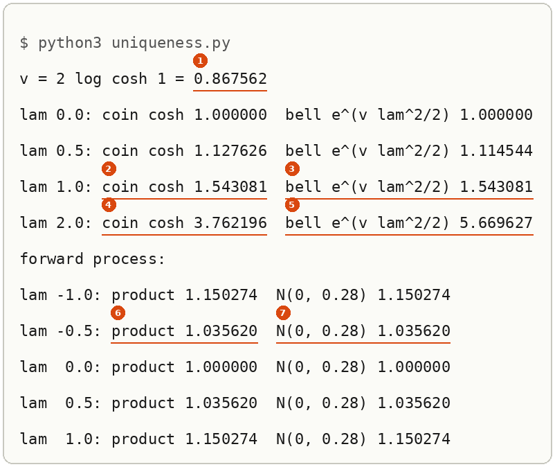

Marker 1 is $v$, markers 2 and 3 the match at $\lambda = 1$, markers 4 and 5 the split at $\lambda = 2$, markers 6 and 7 one row of the forward-process identity. *Shown.*

## When to reach for the fingerprint

Navigation: ⬅️ [[#What the fingerprint is]] | 📋 [[#Table of contents|TOC]] | [[#The form of the fingerprint]] ➡️

When you need the *shape* of a sum of independent variables, not only its mean and variance. The mean and variance of a sum come from linearity and the cross-term argument in [[Sums Of Independent Gaussians#How the rule works]], and those hold for any independent variables. Whether the sum is still a bell needs the whole distribution, and computing it directly means a convolution integral. The fingerprint swaps that integral for a product, because $e^{\lambda(X + Y)} = e^{\lambda X} e^{\lambda Y}$.

Without it, the natural check is to compare variances, and variances cannot tell two shapes apart. The sum of two independent $\pm 1$ coin flips has mean 0 and variance 2, exactly like $\mathcal{N}(0, 2)$, yet it only ever lands on $-2$, $0$ or $2$. Step 5 below runs that failure, and step 6 shows the fingerprints separating the two: 2.381098 against 2.718282 at $\lambda = 1$.

## The form of the fingerprint

Navigation: ⬅️ [[#When to reach for the fingerprint]] | 📋 [[#Table of contents|TOC]] | [[#Try the fingerprint yourself]] ➡️

```text
M_Z(lambda) = E[ e^(lambda Z) ]          Z a random variable; lambda a real number you choose
            = integral e^(lambda u) f(u) du      Z with density f
eps ~ N(0, 1):      M(lambda) = e^(lambda^2 / 2)
s * eps ~ N(0, s^2): M(lambda) = e^(s^2 lambda^2 / 2)    the variance is the coefficient of lambda^2 / 2
X, Y independent:   M_{X+Y}(lambda) = M_X(lambda) * M_Y(lambda)
```

**Reading the slots.** $\lambda$ is a dial, not a parameter of the distribution: you choose it, and each choice gives one number. $e^{\lambda u}$ is a weight that leans the average toward large $u$ when $\lambda > 0$. A Gaussian's fingerprint is $e^{(\text{variance})\lambda^2/2}$, so the variance can be read straight off the exponent.

> 🖼️ **Picture on its way**: the form, a bell curve with the weight $e^{\lambda u}$ drawn over it and the shaded product whose area is $M(\lambda)$, beside the two fingerprint curves $e^{\lambda^2/2}$ and $e^{\lambda^2}$. <!-- slot: assets/mgf-the-form.webp · prompt: .prompts/Moment Generating Function.md#prompt-1-subject-the-fingerprint-the-form -->

## Try the fingerprint yourself

Navigation: ⬅️ [[#The form of the fingerprint]] | 📋 [[#Table of contents|TOC]] | [[#Reading the fingerprint output]] ➡️

Every script computes the standard normal's fingerprint as a grid sum, step $h = 0.001$ from $-12$ to $12$, so you can see the integral being added up rather than trusting a library.

**1. What you need, and the check.**

```bash
python3 --version
```

You should see `Python 3.8` or later; this run printed `Python 3.12.10`.

**2. When it is missing.** Install Python 3 with your system's package manager, or use the prepared environment `~/.vault-sandbox/bin/python` in place of `python3` in every command below.

**3. Make an empty folder and work in it.**

```bash
mkdir -p ~/playground/sandbox/moment-generating-function && cd ~/playground/sandbox/moment-generating-function
```

**4. A look before: the integrand is a shifted bell.** At $\lambda = 1$, the thing being integrated, $e^{\lambda u}\varphi(u)$, should equal $e^{\lambda^2/2}\varphi(u - \lambda)$ at every $u$, which is what completing the square predicts. Save this as `look.py`:

```python
import math


def phi(u):
    return math.exp(-u * u / 2) / math.sqrt(2 * math.pi)


lam = 1.0
print("   u  phi(u)    e^(lam u) phi(u)  e^(lam^2/2) phi(u - lam)")
for u in [-1.0, 0.0, 1.0, 1.5, 2.0, 3.0]:
    left = math.exp(lam * u) * phi(u)
    right = math.exp(lam * lam / 2) * phi(u - lam)
    print(f"{u:4.1f}  {phi(u):.6f}  {left:.6f}          {right:.6f}")
```

```bash
python3 look.py
```

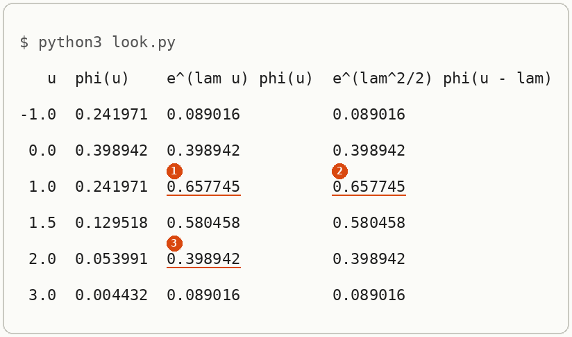

**5. The failure: comparing only variances.** Two independent $\pm 1$ coin flips, summed, against $\mathcal{N}(0, 2)$. Save this as `variance_only.py`:

```python
import itertools

outcomes = [(c1 + c2, 0.25) for c1, c2 in itertools.product([-1, 1], repeat=2)]
mean = sum(s * p for s, p in outcomes)
var = sum((s - mean) ** 2 * p for s, p in outcomes)
values = sorted({s for s, _ in outcomes})
print("sum of two coin flips: values", values, "mean", mean, "variance", var)
print("N(0, 2):               every real value, mean 0.0 variance 2.0")
print("variance alone says:   the same")
```

```bash
python3 variance_only.py
```

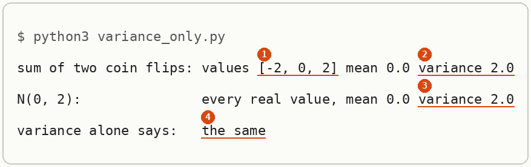

**6. The technique: compare fingerprints.** Save this as `fingerprint.py`. It adds up the standard normal's fingerprint on the grid beside the closed form, then computes the coin sum's fingerprint from its four equally likely outcomes beside $\cosh(\lambda)^2$ and the $\mathcal{N}(0, 2)$ fingerprint $e^{\lambda^2}$:

```python
import itertools
import math


def phi(u):
    return math.exp(-u * u / 2) / math.sqrt(2 * math.pi)


def mgf_normal_grid(lam, h=0.001, L=12.0):
    n = round(2 * L / h)
    return h * sum(math.exp(lam * (-L + i * h)) * phi(-L + i * h) for i in range(n + 1))


for lam in [1.0, 2.0]:
    print(f"N(0,1) lam {lam}: grid {mgf_normal_grid(lam):.6f}  e^(lam^2/2) {math.exp(lam * lam / 2):.6f}")

for lam in [1.0, 2.0]:
    two = sum(0.25 * math.exp(lam * (c1 + c2)) for c1, c2 in itertools.product([-1, 1], repeat=2))
    print(f"coins  lam {lam}: two flips {two:.6f}  cosh(lam)^2 {math.cosh(lam) ** 2:.6f}  N(0,2) e^(lam^2) {math.exp(lam * lam):.6f}")
```

```bash
python3 fingerprint.py
```

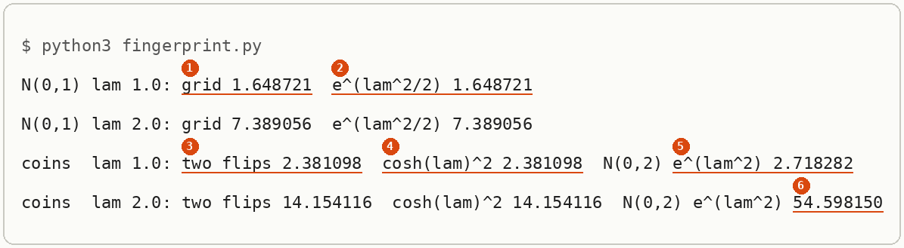

**7. Another way to get the same answer: sampling.** The fingerprint is an average, so draw a million standard normals and average $e^{\lambda \varepsilon}$. Save this as `sampled.py`:

```python
import math
import random

N = 1_000_000
rng = random.Random()
for lam in [1.0, 2.0]:
    rng.seed(0)
    avg = sum(math.exp(lam * rng.gauss(0.0, 1.0)) for _ in range(N)) / N
    print(f"lam {lam}: average of e^(lam eps) over {N} draws {avg:.4f}  e^(lam^2/2) {math.exp(lam * lam / 2):.4f}")
```

```bash
python3 sampled.py
```

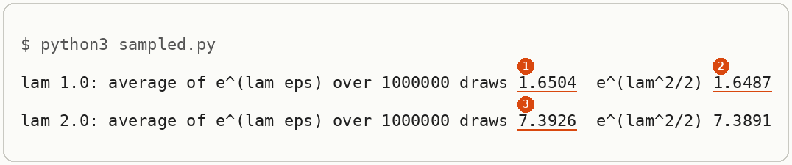

**How far off the sampled average can be.** **The spread of $e^{\lambda\varepsilon}$**, also the variance of a sampled fingerprint's draws: an average of $N$ draws misses its target by about one [[Bootstrap#Standard error|standard error]], the spread of a single draw divided by $\sqrt{N}$. So the sampling route is only as good as the spread of one draw of $e^{\lambda\varepsilon}$, and the fingerprint itself supplies that spread in four lines.

1. By the [variance shortcut](../references/textbooks/statistics/introduction-to-probability-for-data-science.pdf#page=151), $\mathrm{Var}(Y) = \mathbb{E}[Y^2] - \mathbb{E}[Y]^2$. Take $Y = e^{\lambda\varepsilon}$.
2. By the [power of a power rule](../references/textbooks/algebra/algebra-handbook.pdf#page=109), $(e^{\lambda\varepsilon})^2 = e^{2\lambda\varepsilon}$, so $\mathbb{E}[Y^2] = \mathbb{E}[e^{(2\lambda)\varepsilon}] = M(2\lambda)$, the fingerprint at twice the dial.
3. $\mathbb{E}[Y] = M(\lambda)$, so $\mathbb{E}[Y]^2 = M(\lambda)^2$.
4. Put them together, with $M(2\lambda) = e^{(2\lambda)^2/2} = e^{2\lambda^2}$ and $M(\lambda)^2 = e^{\lambda^2}$:

$$\mathrm{Var}\big(e^{\lambda\varepsilon}\big) = M(2\lambda) - M(\lambda)^2 = e^{2\lambda^2} - e^{\lambda^2}$$

**Worked at $\lambda = 0.5$ with $N = 10{,}000$ draws.** $e^{2 \times 0.25} - e^{0.25} = 1.648721 - 1.284025 = 0.364696$. The spread of one draw is $\sqrt{0.364696} = 0.603901$, and the standard error of the average is $0.603901/\sqrt{10{,}000} = 0.603901/100 = 0.006039$. *Derived.*

**Where it goes wrong.** Subtracting $M(\lambda)$ where the shortcut needs its square: $e^{0.5} - e^{0.125} = 1.648721 - 1.133148 = 0.515573$, whose square root is $0.718034$, and the standard error comes out $0.007180$, 19% too large. The shortcut subtracts the square of the mean, and $M(\lambda)$ is the mean itself.

**The check.** Draw the 10,000-draw average many times and measure how much the averages spread. Save this as `spread.py`; it takes about 2 seconds:

```python
import math
import random

lam, N = 0.5, 10_000
M = lambda t: math.exp(t * t / 2)
sd = math.sqrt(M(2 * lam) - M(lam) ** 2)
print(f"spread of one draw {sd:.6f}  standard error {sd / math.sqrt(N):.6f}")
print(f"M(lam) not squared: {math.sqrt(M(2 * lam) - M(lam)) / math.sqrt(N):.6f}")

rng = random.Random(1)
avgs = [sum(math.exp(lam * rng.gauss(0.0, 1.0)) for _ in range(N)) / N for _ in range(500)]
mean = sum(avgs) / len(avgs)
spread = math.sqrt(sum((a - mean) ** 2 for a in avgs) / (len(avgs) - 1))
print(f"500 averages of {N} draws: mean {mean:.6f}  spread {spread:.6f}")
```

```bash
python3 spread.py
```

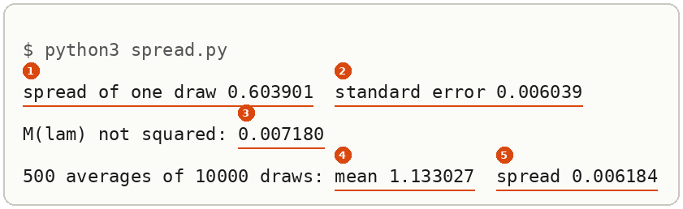

The 500 averages spread by $0.006184$ (marker 5), 2.4% above the predicted $0.006039$ (marker 2). A spread measured from 500 averages is itself an estimate, good to about $1/\sqrt{2 \times 499} = 3.2\%$ (*stated*), so 2.4% is inside it, and the slipped $0.007180$ (marker 3), 16% above the measured spread, is not. The averages centre on $1.133027$ (marker 4) against $M(0.5) = e^{0.125} = 1.133148$. [[#A large dial weighs the tails]] says why this error grows so fast with $\lambda$.

**8. More worked examples on the same setup.** The three forms chapter 9.1 uses: a scaled draw, the product for a sum, and moments read off the series. Save this as `more.py`:

```python
import math


def phi(u):
    return math.exp(-u * u / 2) / math.sqrt(2 * math.pi)


def grid(f, h=0.001, L=12.0):
    n = round(2 * L / h)
    return h * sum(f(-L + i * h) * phi(-L + i * h) for i in range(n + 1))


s = math.sqrt(0.28)
print(f"scaled:  s = sqrt(0.28), grid E[e^(s eps)] {grid(lambda u: math.exp(s * u)):.6f}  e^(s^2/2) {math.exp(0.28 / 2):.6f}")
a, b = math.sqrt(0.08), math.sqrt(0.2)
print(f"product: e^(a^2/2) e^(b^2/2) {math.exp(a * a / 2) * math.exp(b * b / 2):.6f} = e^0.04 {math.exp(0.04):.6f} x e^0.1 {math.exp(0.1):.6f}")
for k in [1, 2, 3, 4]:
    print(f"moment:  grid E[eps^{k}] {round(grid(lambda u: u ** k), 6) + 0.0:.6f}")
print("series:  e^(lam^2/2) = 1 + lam^2/2 + lam^4/8 + ..., so E[eps^2] = 2! x 1/2 = 1, E[eps^4] = 4! x 1/8 = 3")
print("coins:   fourth moment of two flips", 0.25 * 16 + 0.25 * 16, "| N(0, 2):", 3 * 2 ** 2)
```

```bash
python3 more.py
```

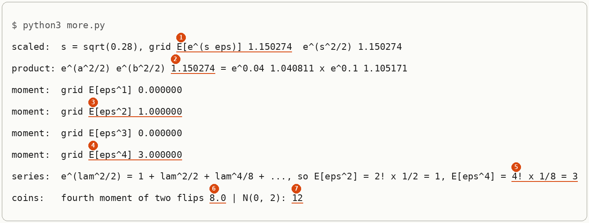

Then one by hand, before running anything: what is the fingerprint of $\mathcal{N}(0, 4)$ at $\lambda = 1$, and of one $\pm 1$ coin flip at $\lambda = 0$?

> [!example]- The answer
> $\mathcal{N}(0, 4)$ is $2\varepsilon$, so $M(1) = e^{4 \times 1^2/2} = e^2 = 7.389056$, the same number as the standard normal at $\lambda = 2$ in step 6, because $M_{2\varepsilon}(1) = M_\varepsilon(2)$. Every fingerprint is 1 at $\lambda = 0$, so the coin's is $\cosh 0 = 1$.

**9. Clean up, and prove it.**

```bash
cd ~ && rm -r ~/playground/sandbox/moment-generating-function
ls ~/playground/sandbox/moment-generating-function; echo $?
```

You should see `No such file or directory`, then `2`.

## Reading the fingerprint output

Navigation: ⬅️ [[#Try the fingerprint yourself]] | 📋 [[#Table of contents|TOC]] | [[#How the fingerprint works]] ➡️

| # | Field | This run | How to read it | Backing |
|---|---|---|---|---|
| look 1 | `e^(lam u) phi(u)` at $u = 1$ | 0.657745 | the integrand's peak sits at $u = \lambda = 1$, not at 0: the weight drags the bell right | shown |
| look 2 | `e^(lam^2/2) phi(u - lam)` at $u = 1$ | 0.657745 | equal to field 1 here and on all six rows: the integrand is the bell shifted by $\lambda$ and scaled by $e^{0.5} = 1.648721$ | derived in [[#The standard normal's fingerprint]] |
| look 3 | integrand at $u = 2$ | 0.398942 | equals the value at $u = 0$, so the integrand is symmetric about $u = 1$ | shown |
| variance 1 | `values [-2, 0, 2]` | three values | the coin sum is not a bell: it has three possible values | shown |
| variance 2, 3 | `variance 2.0` twice | 2.0 and 2.0 | the variances agree, so a variance check cannot tell these two apart | shown; the general rule in [[Sums Of Independent Gaussians#How the rule works]] |
| variance 4 | `the same` | the same | the wrong verdict, which step 6 corrects | shown by step 6 |
| fingerprint 1 | `grid` at $\lambda = 1$ | 1.648721 | the integral added up on 24,001 grid points | shown |
| fingerprint 2 | `e^(lam^2/2)` at $\lambda = 1$ | 1.648721 | the closed form agrees with the grid to six decimals; at $\lambda = 2$ both read 7.389056 | derived below |
| fingerprint 3 | `two flips` at $\lambda = 1$ | 2.381098 | the coin sum's fingerprint from its four outcomes | shown |
| fingerprint 4 | `cosh(lam)^2` | 2.381098 | the product of two one-flip fingerprints, $\cosh(1)^2$, equals field 3 | derived in [[#Where variance cannot tell two shapes apart]] |
| fingerprint 5 | `N(0,2) e^(lam^2)` | 2.718282 | the fingerprint the sum would have if it were $\mathcal{N}(0, 2)$; it differs from field 3, so by the uniqueness property the coin sum is not $\mathcal{N}(0, 2)$ | cited, [[#Same fingerprint, same distribution]] |
| fingerprint 6 | $\mathcal{N}(0, 2)$ at $\lambda = 2$ | 54.598150 | against 14.154116 for the coins: the gap grows with $\lambda$, because large $\lambda$ weighs the tails and the bell has tails past $\pm 2$ | shown |
| sampled 1, 2 | the average at $\lambda = 1$ | 1.6504 against 1.6487 | 0.78 standard errors high, inside the sampling error of 0.00216 | derived: the standard error is $\sqrt{M(2) - M(1)^2}/\sqrt{N} = \sqrt{e^2 - e}/1000$ |
| sampled 3 | the average at $\lambda = 2$ | 7.3926 against 7.3891 | 0.07 standard errors high; the standard error is 0.0541, 25 times larger than at $\lambda = 1$ because $e^{2\varepsilon}$ is dominated by rare large draws | derived: $\sqrt{e^8 - e^4}/1000$ |
| more 1 | grid `E[e^(s eps)]`, $s = \sqrt{0.28}$ | 1.150274 | the scaled draw's fingerprint at $\lambda = 1$ is $e^{0.14}$, so $s\varepsilon$ is $\mathcal{N}(0, 0.28)$ | derived in [[#Scaling a draw]] |
| more 2 | product $e^{0.04} \times e^{0.1}$ | 1.150274 | the two forward-process noises' fingerprints multiply to the same number as field 1 | derived in [[#The fingerprint of a sum is the product]] |
| more 3, 4 | grid `E[eps^2]`, `E[eps^4]` | 1.000000, 3.000000 | the second and fourth moments of $\mathcal{N}(0, 1)$; the odd moments print 0 | shown |
| more 5 | `4! x 1/8 = 3` | 3 | the same fourth moment read off the series of $e^{\lambda^2/2}$ | derived in [[#Why it is called moment generating]] |
| more 6, 7 | fourth moments `8.0` and `12` | 8 against 12 | the coin sum and $\mathcal{N}(0, 2)$ share their second moment and part at the fourth | derived in [[#Where variance cannot tell two shapes apart]] |
| list 1 to 3 | `term` on each value | 0.121306, 0.500000, 0.815485 | probability times $e^{0.5u}$ for $u = -1, 0, 2$; the value 0 contributes its probability whatever the dial | shown, [[#Computing a fingerprint from a list of values]] |
| list 4 | `M(0.5)` | 1.436791 | the sum of the three terms | shown |
| list 5 | `minus sign dropped` | 1.645229 | 0.208438 too high, from weighting $-1$ by $e^{+0.5}$ | shown |
| list 6 | `M(0)` | 1.000000 | the probabilities add to 1; this check cannot see a sign slip | derived |
| moments 1 to 4 | `coefficient` and `k! x coefficient` for $\mathcal{N}(0, 4)$ | 2.0 and 4.0; 2.0 and 48.0 | the bare coefficient is the slip, the product with $k!$ is the moment | derived in [[#Why it is called moment generating]] |
| moments 5, 6 | grid `E[Z^4]`, `3 sigma^4` | 48.000000, 48 | two other routes to the fourth moment agree with $4! \times 2$ | shown |
| unique 1 | `v = 2 log cosh 1` | 0.867562 | the bell's variance, chosen so it matches the coin at $\lambda = 1$ | derived in [[#Same fingerprint, same distribution]] |
| unique 2, 3 | coin and bell at $\lambda = 1$ | 1.543081 and 1.543081 | a match made by choosing $v$, which proves nothing | shown |
| unique 4, 5 | coin and bell at $\lambda = 2$ | 3.762196 against 5.669627 | one point of disagreement is enough to show the distributions differ | shown; the property *cited* |
| unique 6, 7 | `product` and `N(0, 0.28)` at $\lambda = -0.5$ | 1.035620 and 1.035620 | one row of the identity $e^{0.04\lambda^2}e^{0.1\lambda^2} = e^{0.14\lambda^2}$; every row matches | derived |
| slip 1 to 3 | `left`, `right`, `slipped` at $u = 0.5$, $\lambda = 2$ | 0.875, 0.875, $-3.125$ | the correct completed square agrees with the left side; the sign slip does not | derived in [[#A sign slip in step 2]] |
| slip 4 | `slipped` at $u = 3$ | $-2.5$ | against 1.5 on both correct sides | shown |
| slip 5, 6 | `e^(-2)` and `grid sum` | 0.135335 against 7.389056 | what the slip would report for $M(2)$, against the integral added up | shown |
| half 1 | `grid` over $u > 0$ at $\lambda = 1$ | 1.387143 | the half-line integral added up at 12,000 midpoints | shown |
| half 2, 3 | `P(V > -lam)` and the product | 0.841345; 1.387143 | the shift moves the lower end to $-\lambda$, and the formula matches the grid | derived in [[#Why step 4's limits stay infinite]] |
| half 4 | `limit left at 0` | 0.824361 | half of $e^{0.5}$: the lower end forgotten, about 59% of the true value | shown |
| half 5, 6 | the same at $\lambda = 2$ | 7.220954 against 3.694528 | the slip still halves $e^{\lambda^2/2}$, so it is about half the true value | shown |
| scale 1 to 3 | `e^(b lam)`, `M_eps(1.0)`, `product` | 7.389056, 1.648721, 12.182494 | the slide factor, the stretch read at the dial $a\lambda = 1$, and their product, which is $e^{2.5}$ | derived in [[#Scaling a draw]] |
| scale 4 | grid `E[e^(lam (1 + 0.5 eps))]` | 12.182494 | the integral added up agrees | shown |
| scale 5, 6 | `scale outside` at $\lambda = 2$ and 0 | 3.694528 and 0.500000 | the slip, and the free check that exposes it | shown |
| reuse 1, 2 | `X + X` outcomes and fingerprint | $[-2, 2]$, 1.543081 | one coin used twice is $2c$, fingerprint $\cosh(2\lambda)$ | derived in [[#The fingerprint of a sum is the product]] |
| reuse 3 | `product rule` | 1.271540 | the product rule applied without independence | shown |
| reuse 4, 5 | `two separate flips` | $[-2, 0, 2]$, 1.271540 | the variable the product actually describes | shown |
| spread 1, 2 | `spread of one draw`, `standard error` | 0.603901, 0.006039 | $\sqrt{e^{0.5} - e^{0.25}}$, then divided by $\sqrt{10{,}000} = 100$ | derived in [[#Try the fingerprint yourself]], step 7 |
| spread 3 | `M(lam) not squared` | 0.007180 | the slip, 19% too large | shown |
| spread 4, 5 | 500 averages: `mean`, `spread` | 1.133027, 0.006184 | the averages centre on $M(0.5) = 1.133148$ and spread 2.4% above the prediction, inside the 3.2% a 500-average estimate allows | shown; the 3.2% *stated* |
| tails 1, 2 | `ratio` and grid share at $\lambda = 0.5$ | 1.0049, 0.0668 | the small dial sees mostly the middle, where coin and bell agree | shown, [[#A large dial weighs the tails]] |
| tails 3, 4 | `bell` and `ratio` at $\lambda = 2.5$ | 22.759895, 3.7115 | against 6.132289 for the coin | shown |
| tails 5, 6 | grid share and `P(V > 2 - lam)` at $\lambda = 2.5$ | 0.6915 and 0.6915 | the share above 2 comes from the shifted bell | derived |
| yes-no 1 | `1 - p + p e^lam` at $\lambda = 1$ | 1.343656 | the yes-or-no fingerprint with $p = 0.2$ | derived in [[#A yes-or-no variable and reading probabilities off a fingerprint]] |
| yes-no 2, 3 | `p e^lam alone` at $\lambda = 1$ and 0 | 0.543656, 0.200000 | the dropped 0-term, caught at $\lambda = 0$ | shown |
| yes-no 4 | `product` | $0.48 + 0.44e^{\lambda} + 0.08e^{2\lambda}$ | the two fingerprints multiplied out | derived |
| yes-no 5 | `sum` | {0: 0.48, 1: 0.44, 2: 0.08} | the four listed outcomes give the probabilities the product's coefficients say | shown |
| yes-no 6, 7 | `product` and `from the list` at $\lambda = 1$ | 2.267168 and 2.267168 | the two routes agree | shown |

## How the fingerprint works

Navigation: ⬅️ [[#Reading the fingerprint output]] | 📋 [[#Table of contents|TOC]] | [[#Other ways to pin down a distribution]] ➡️

Textbook: [completing the square, algebra handbook p. 74](../references/textbooks/algebra/algebra-handbook.pdf#page=74), and [Table 6.1 in probability for data science, p. 342](../references/textbooks/statistics/introduction-to-probability-for-data-science.pdf#page=342), which lists the Gaussian's fingerprint $\exp(\mu s + \sigma^2 s^2/2)$.

### The standard normal's fingerprint

Take $\varepsilon \sim \mathcal{N}(0, 1)$ with [density](../references/textbooks/machine-learning/mathematics-for-machine-learning.pdf#page=204) $\varphi(u) = \frac{1}{\sqrt{2\pi}} e^{-u^2/2}$. Five steps.

1. Write the average as an integral, and join the two powers of $e$ by the [exponent rules](../references/textbooks/algebra/algebra-handbook.pdf#page=109):

   $$M_\varepsilon(\lambda) = \int_{-\infty}^{\infty} e^{\lambda u}\,\frac{1}{\sqrt{2\pi}}\,e^{-u^2/2}\,du = \int_{-\infty}^{\infty} \frac{1}{\sqrt{2\pi}}\,e^{\lambda u - u^2/2}\,du$$

2. Complete the square in the exponent. Expanding $(u - \lambda)^2 = u^2 - 2\lambda u + \lambda^2$ gives $u^2 - 2\lambda u = (u - \lambda)^2 - \lambda^2$, so

   $$\lambda u - \frac{u^2}{2} = -\frac{u^2 - 2\lambda u}{2} = -\frac{(u - \lambda)^2}{2} + \frac{\lambda^2}{2}$$

   Check at $\lambda = 1$: $u = 1.5$ gives $1.5 - 1.125 = 0.375$ on the left and $-0.125 + 0.5 = 0.375$ on the right; $u = -1$ gives $-1 - 0.5 = -1.5$ and $-2 + 0.5 = -1.5$.

3. $e^{\lambda^2/2}$ does not depend on $u$, so it comes out of the integral:

   $$M_\varepsilon(\lambda) = e^{\lambda^2/2} \int_{-\infty}^{\infty} \frac{1}{\sqrt{2\pi}}\,e^{-(u - \lambda)^2/2}\,du$$

4. [Substitute](../references/textbooks/calculus/calculus-textbook.pdf#page=415) $v = u - \lambda$. Then $dv = du$, and the limits stay $-\infty$ to $\infty$, so the integral is $\int \varphi(v)\,dv$, the area under a standard normal density, which is 1 ([[The Front Factor Of A Gaussian Density#The front factor from the bell's area]]). [[#Why step 4's limits stay infinite]] shows what changes when they do not.

5. So

   $$\boxed{M_\varepsilon(\lambda) = e^{\lambda^2/2}}$$

At $\lambda = 1$ this is $e^{0.5} = 1.648721$ and at $\lambda = 2$ it is $e^2 = 7.389056$; step 6's grid sums print the same six decimals. Step 4's table is steps 2 and 3 run on numbers: the integrand at each $u$ equals $1.648721 \times \varphi(u - 1)$. *Derived.*

#### A sign slip in step 2

Completing the square moves a $\lambda^2$ from inside the square to outside it, and its sign flips on the way: $u^2 - 2\lambda u = (u - \lambda)^2 - \lambda^2$, and multiplying by $-\frac12$ turns the $-\lambda^2$ into $+\frac{\lambda^2}{2}$. The slip is to forget the flip and write

$$\lambda u - \frac{u^2}{2} \overset{?}{=} -\frac{(u - \lambda)^2}{2} - \frac{\lambda^2}{2}$$

**Caught by a one-point check.** At $\lambda = 2$ and $u = 0.5$: the left side is $2 \times 0.5 - 0.25/2 = 1 - 0.125 = 0.875$; the correct right side is $-(0.5 - 2)^2/2 + 4/2 = -1.125 + 2 = 0.875$; the slipped right side is $-1.125 - 2 = -3.125$. At $u = 3$: left $6 - 4.5 = 1.5$, correct $-(3 - 2)^2/2 + 2 = -0.5 + 2 = 1.5$, slipped $-0.5 - 2 = -2.5$. The two sides of a true identity agree at every point, so one point where they differ proves the slip.

**What the slip costs.** Carried through steps 3 to 5, it reports $M_\varepsilon(\lambda) = e^{-\lambda^2/2}$, which at $\lambda = 2$ is $e^{-2} = 0.135335$. The grid sum prints $7.389056$. The slipped fingerprint also shrinks as $\lambda$ grows, the opposite of step 6's run. Save this as `sign_slip.py`:

```python
import math


def phi(u):
    return math.exp(-u * u / 2) / math.sqrt(2 * math.pi)


lam = 2.0
for u in [0.5, 3.0]:
    left = lam * u - u * u / 2
    right = -(u - lam) ** 2 / 2 + lam * lam / 2
    slipped = -(u - lam) ** 2 / 2 - lam * lam / 2
    print(f"u {u}: left {left}  right {right}  slipped {slipped}")

h, L = 0.001, 12.0
grid = h * sum(math.exp(lam * (-L + i * h)) * phi(-L + i * h) for i in range(round(2 * L / h) + 1))
print(f"slip reports M(2) = e^(-2) = {math.exp(-lam * lam / 2):.6f}  grid sum {grid:.6f}")
```

```bash
python3 sign_slip.py
```

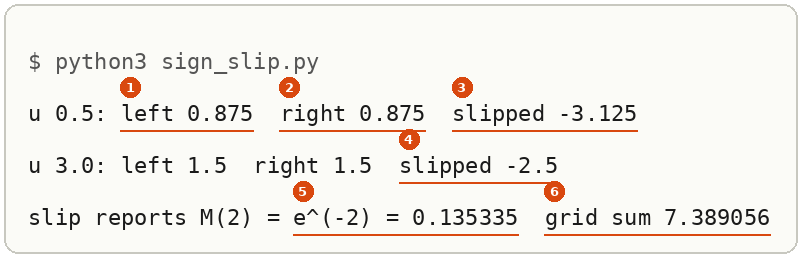

Markers 1 to 3 are the check at $u = 0.5$, marker 4 the slipped side at $u = 3$, markers 5 and 6 the slipped fingerprint against the grid. *Shown.*

#### Why step 4's limits stay infinite

A shift slides every point of the line by the same amount. Over the whole line the ends are $-\infty$ and $\infty$, and sliding infinity by $\lambda$ leaves infinity, so the shifted integral still covers the whole line and the area under the bell is still 1. Over part of the line the ends move, and so does the answer.

**Worked on a half line.** Take the integral of $e^{\lambda u}\varphi(u)$ over $u$ from 0 to $\infty$. Steps 1 to 3 go through unchanged and give $e^{\lambda^2/2}\int_0^\infty \varphi(u - \lambda)\,du$. In step 4 the lower end $u = 0$ becomes $v = 0 - \lambda = -\lambda$, and the upper end stays $\infty$:

$$\int_0^\infty e^{\lambda u}\varphi(u)\,du = e^{\lambda^2/2}\int_{-\lambda}^{\infty}\varphi(v)\,dv = e^{\lambda^2/2}\,P(V > -\lambda)$$

where $V$ is a standard normal draw. $P(V > -\lambda)$ is the area to the right of $-\lambda$, which Python computes from the [standard normal's CDF](../references/textbooks/statistics/introduction-to-probability-for-data-science.pdf#page=230) as `0.5 * math.erfc(-lam / math.sqrt(2))`. At $\lambda = 1$ it is $0.841345$ and the integral is $1.648721 \times 0.841345 = 1.387143$. At $\lambda = 2$ it is $0.977250$ and the integral is $7.389056 \times 0.977250 = 7.220954$. *Derived.*

**The method, for a shift on any interval.**

1. Name the new variable $v = u - \lambda$. Then $dv = du$, so nothing multiplies the integrand.
2. Move each limit by the same rule: a lower end $a$ becomes $a - \lambda$, an upper end $b$ becomes $b - \lambda$, and $\pm\infty$ stays $\pm\infty$.
3. Rewrite the integrand in $v$ and integrate between the moved limits.

**Where it goes wrong.** Leaving the lower limit at 0 after the shift integrates $\varphi(v)$ from 0, which is $P(V > 0) = 0.5$, and gives $1.648721 \times 0.5 = 0.824361$ at $\lambda = 1$ and $7.389056 \times 0.5 = 3.694528$ at $\lambda = 2$, about half the true $1.387143$ and $7.220954$. On the whole line there is no finite limit to forget, which is why step 4 can say the limits stay.

**The check.** A grid sum of the half-line integral, midpoints from 0 to 12. Save this as `half_line.py`:

```python
import math


def phi(u):
    return math.exp(-u * u / 2) / math.sqrt(2 * math.pi)


def above(x):
    return 0.5 * math.erfc(x / math.sqrt(2))


h, L = 0.001, 12.0
for lam in [1.0, 2.0]:
    grid = h * sum(math.exp(lam * (i + 0.5) * h) * phi((i + 0.5) * h) for i in range(round(L / h)))
    front = math.exp(lam * lam / 2)
    print(f"lam {lam}: grid {grid:.6f}  e^(lam^2/2) {front:.6f} x P(V > -lam) {above(-lam):.6f} = {front * above(-lam):.6f}  limit left at 0: {front * 0.5:.6f}")
```

```bash
python3 half_line.py
```

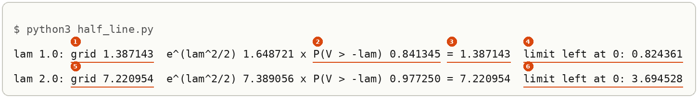

Marker 1 is the grid sum at $\lambda = 1$, markers 2 and 3 the moved-limit formula that matches it, marker 4 the forgotten limit; markers 5 and 6 are the same pair at $\lambda = 2$. *Shown.*

### Scaling a draw

For a fixed number $s$, $e^{\lambda (s\varepsilon)} = e^{(s\lambda)\varepsilon}$, so the fingerprint of $s\varepsilon$ is the standard one evaluated at $s\lambda$:

$$M_{s\varepsilon}(\lambda) = M_\varepsilon(s\lambda) = e^{s^2\lambda^2/2}$$

$s\varepsilon$ is $\mathcal{N}(0, s^2)$ by [[Scaling And Shifting A Random Variable]], so $\mathcal{N}(0, s^2)$ has fingerprint $e^{s^2\lambda^2/2}$: the variance is the coefficient of $\lambda^2/2$. With $s = \sqrt{0.28}$ and $\lambda = 1$ that is $e^{0.14} = 1.150274$, step 8's first line. A shift by $\mu$ multiplies the fingerprint by $e^{\mu\lambda}$, since $e^{\lambda(\mu + s\varepsilon)} = e^{\mu\lambda} e^{\lambda s\varepsilon}$, which gives Chan's $\exp(\mu\lambda + \sigma^2\lambda^2/2)$. *Derived.*

**The rule for any variable.** **The fingerprint of $aX + b$**, also the MGF of a linear transformation: stretching a variable by $a$ and sliding it by $b$ changes its fingerprint in two separate ways. The slide multiplies the whole fingerprint by a fixed factor, and the stretch turns the dial. For any $X$ with a fingerprint,

$$M_{aX+b}(\lambda) = \mathbb{E}\big[e^{\lambda(aX + b)}\big] = e^{b\lambda}\,\mathbb{E}\big[e^{(a\lambda)X}\big] = e^{b\lambda}\,M_X(a\lambda)$$

*Cited:* property 4 under Definition 12, [p. 83 of introduction to statistics](../references/textbooks/statistics/introduction-to-statistics.pdf#page=83), where it reads $M_Y(t) = e^{bt}M_X(at)$.

1. Split the power: $e^{\lambda(aX + b)} = e^{b\lambda}\,e^{(a\lambda)X}$ by the exponent rules.
2. Take the slide out: $e^{b\lambda}$ is a fixed number for a given $\lambda$, so it comes out of the average.
3. Put the stretch into the dial: what is left, $\mathbb{E}[e^{(a\lambda)X}]$, is $X$'s fingerprint read at the dial $a\lambda$.
4. Multiply the two.

**Worked: $Y = 1 + 0.5\varepsilon$ at $\lambda = 2$.** Here $a = 0.5$ and $b = 1$. Step 2: $e^{1 \times 2} = e^{2} = 7.389056$. Step 3: $a\lambda = 0.5 \times 2 = 1$, and $M_\varepsilon(1) = e^{1/2} = 1.648721$. Step 4: $7.389056 \times 1.648721 = 12.182494$, which is $e^{2 + 0.5} = e^{2.5}$. As a check on the Gaussian form, $Y$ is $\mathcal{N}(1, 0.25)$ and $\exp(1 \times 2 + 0.25 \times 4/2) = e^{2.5}$, the same number. *Derived.*

**Where it goes wrong.** Putting the stretch outside, as $a\,M_X(\lambda)$, in place of inside the dial: $0.5\,M_\varepsilon(2) = 0.5 \times 7.389056 = 3.694528$, before the slide is even applied. The free check catches it, because at $\lambda = 0$ it gives $0.5 \times 1 = 0.5$, and every fingerprint is 1 there. The stretch lives inside the exponent, $e^{\lambda a X}$, so it can only change where the fingerprint is read.

**The check.** A grid sum of $e^{2(1 + 0.5u)}\varphi(u)$. Save this as `scale_shift.py`:

```python
import math


def phi(u):
    return math.exp(-u * u / 2) / math.sqrt(2 * math.pi)


a, b, lam = 0.5, 1.0, 2.0
shift = math.exp(b * lam)
inner = math.exp((a * lam) ** 2 / 2)
print(f"e^(b lam) {shift:.6f}  M_eps(a lam) = M_eps({a * lam}) {inner:.6f}  product {shift * inner:.6f}  e^2.5 {math.exp(2.5):.6f}")

h, L = 0.001, 12.0
grid = h * sum(math.exp(lam * (b + a * (-L + i * h))) * phi(-L + i * h) for i in range(round(2 * L / h) + 1))
print(f"grid E[e^(lam (1 + 0.5 eps))] {grid:.6f}")
for t in [2.0, 0.0]:
    print(f"scale outside, a M_eps(lam) at lam {t}: {a * math.exp(t * t / 2):.6f}")
```

```bash
python3 scale_shift.py
```

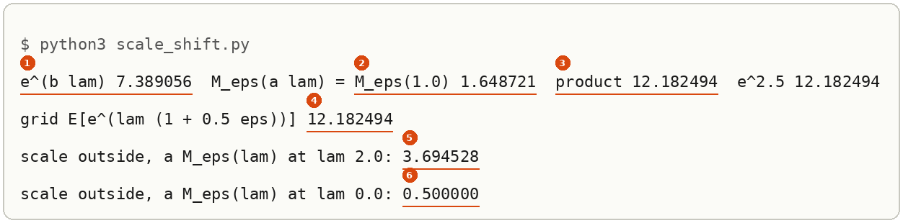

Markers 1 to 3 are steps 2 to 4, marker 4 the grid sum that matches them, markers 5 and 6 the slip and the free check that exposes it. *Shown.*

### Why it is called moment generating

Expand the standard normal's fingerprint with the [series for $e^x$](../references/textbooks/calculus/calculus-textbook.pdf#page=684), putting $x = \lambda^2/2$:

$$e^{\lambda^2/2} = 1 + \frac{\lambda^2}{2} + \frac{\lambda^4}{8} + \cdots$$

Match it against $1 + \lambda\,\mathbb{E}[\varepsilon] + \frac{\lambda^2}{2!}\mathbb{E}[\varepsilon^2] + \frac{\lambda^3}{3!}\mathbb{E}[\varepsilon^3] + \frac{\lambda^4}{4!}\mathbb{E}[\varepsilon^4] + \cdots$. There is no $\lambda$ or $\lambda^3$ term, so $\mathbb{E}[\varepsilon] = 0$ and $\mathbb{E}[\varepsilon^3] = 0$. The $\lambda^2$ coefficient gives $\mathbb{E}[\varepsilon^2] = 2! \times \frac12 = 1$, which is the variance 1 a standard normal must have. The $\lambda^4$ coefficient gives $\mathbb{E}[\varepsilon^4] = 4! \times \frac18 = 3$. Step 8's grid prints 0, 1, 0, 3. *Derived.*

**The method.**

1. Write the fingerprint as a power series in $\lambda$. For a Gaussian, put its exponent in place of $x$ in the series for $e^x$.
2. Read the coefficient $c_k$ of $\lambda^k$. A power that does not appear has coefficient 0.
3. Multiply by $k!$: $\mathbb{E}[Z^k] = k!\,c_k$.

**A second example: $\mathcal{N}(0, 4)$.** It is $2\varepsilon$, so by [[#Scaling a draw]] its fingerprint is $e^{4\lambda^2/2} = e^{2\lambda^2}$. Step 1: put $x = 2\lambda^2$ in the series, $1 + 2\lambda^2 + \frac{(2\lambda^2)^2}{2!} + \cdots = 1 + 2\lambda^2 + \frac{4\lambda^4}{2} + \cdots = 1 + 2\lambda^2 + 2\lambda^4 + \cdots$. Step 2: $c_2 = 2$ and $c_4 = 2$. Step 3: $\mathbb{E}[Z^2] = 2! \times 2 = 4$, the variance 4 the name promises, and $\mathbb{E}[Z^4] = 4! \times 2 = 24 \times 2 = 48$. *Derived.*

**Where it goes wrong.** Leaving off the $k!$ reads each coefficient as the moment and gives 2 for both $\mathbb{E}[Z^2]$ and $\mathbb{E}[Z^4]$. The first already contradicts the variance 4 of $\mathcal{N}(0, 4)$, and the second is 24 times too small. The $k!$ belongs there because the series for $e^{\lambda Z}$ divides its $\lambda^k$ term by $k!$, so each moment arrives divided by it.

**The check.** A second route to the fourth moment: $Z = 2\varepsilon$, so $\mathbb{E}[Z^4] = 2^4\,\mathbb{E}[\varepsilon^4] = 16 \times 3 = 48$, which is $3\sigma^4 = 3 \times 16$ with $\sigma^2 = 4$. And a grid sum of $u^k$ against the $\mathcal{N}(0, 4)$ density, $e^{-u^2/8}/\sqrt{8\pi}$. Save this as `moments.py`:

```python
import math


def f(u):
    return math.exp(-u * u / 8) / math.sqrt(8 * math.pi)


def grid(g, h=0.001, L=24.0):
    n = round(2 * L / h)
    return h * sum(g(-L + i * h) * f(-L + i * h) for i in range(n + 1))


for k in [2, 4]:
    j = k // 2
    coef = 2 ** j / math.factorial(j)
    print(f"k {k}: coefficient of lam^{k} {coef}  k! x coefficient {math.factorial(k) * coef}  grid E[Z^{k}] {grid(lambda u: u ** k):.6f}")
print("3 sigma^4 =", 3 * 4 ** 2)
```

The line `coef = 2 ** j / math.factorial(j)` is step 1 in code: the $\lambda^{2j}$ term of $e^{2\lambda^2}$ is $\frac{(2\lambda^2)^j}{j!}$.

```bash
python3 moments.py
```

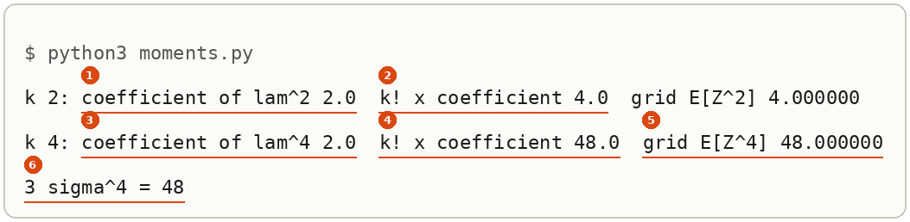

Markers 1 and 3 are the bare coefficients the slip would report, markers 2 and 4 the moments after the $k!$, markers 5 and 6 the two checks. *Shown.*

### The fingerprint of a sum is the product

Textbook: [Theorem 6.2, p. 343](../references/textbooks/statistics/introduction-to-probability-for-data-science.pdf#page=343).

For independent $X$ and $Y$, $e^{\lambda(X + Y)} = e^{\lambda X}e^{\lambda Y}$, and the [average of a product of independent variables is the product of their averages](../references/textbooks/statistics/introduction-to-probability-for-data-science.pdf#page=280), so

$$M_{X+Y}(\lambda) = \mathbb{E}\big[e^{\lambda X}\big]\,\mathbb{E}\big[e^{\lambda Y}\big] = M_X(\lambda)\,M_Y(\lambda)$$

The sum turned into a product, and that is the reason to use this tool on sums. For the two forward-process noises in [[Sums Of Independent Gaussians]], $a = \sqrt{0.08}$ and $b = \sqrt{0.2}$, the product is $e^{0.04\lambda^2}e^{0.1\lambda^2} = e^{0.28\lambda^2/2}$, which is the fingerprint of $\mathcal{N}(0, 0.28)$; at $\lambda = 1$, $1.040811 \times 1.105171 = 1.150274$. By [[#Same fingerprint, same distribution]], the two-draw sum is $\mathcal{N}(0, 0.28)$. *Derived*, with the last step *cited*.

**The method.**

1. Check the two variables are independent: separate draws or separate flips, where knowing one tells you nothing about the other.
2. Find each fingerprint on its own.
3. Multiply them at the same $\lambda$.
4. To name the sum's distribution, compare the product with a known fingerprint, as in [[#Same fingerprint, same distribution]].

**Where it goes wrong: one draw used twice.** Take one fair $\pm 1$ coin $c$ and add it to itself, $X + X = 2c$. Its outcomes are $-2$ and $2$, each with probability $\frac12$, so its fingerprint is $\frac12 e^{-2\lambda} + \frac12 e^{2\lambda} = \cosh(2\lambda)$. At $\lambda = 0.5$ that is $\frac12 e^{-1} + \frac12 e^{1} = 0.183940 + 1.359141 = \cosh 1 = 1.543081$. Step 3 applied anyway would give $\cosh(0.5)^2 = 1.127626^2 = 1.271540$, which is the fingerprint of two *separate* flips, a variable that can also land on 0. The step that breaks is the one that splits the average: $\mathbb{E}[e^{\lambda c}\,e^{\lambda c}] = \mathbb{E}[e^{2\lambda c}]$, and that equals $\mathbb{E}[e^{\lambda c}]^2$ only when the two factors come from independent draws.

**The check.** List the outcomes. The reused coin has two, $-2$ and $2$; two separate flips have three, $-2$, $0$ and $2$, with probabilities $\frac14, \frac12, \frac14$. Save this as `reused_coin.py`:

```python
import itertools
import math

lam = 0.5
reused = sum(0.5 * math.exp(lam * (c + c)) for c in [-1, 1])
print("X + X: outcomes", sorted({c + c for c in [-1, 1]}), f"fingerprint {reused:.6f}  cosh(2 lam) {math.cosh(2 * lam):.6f}")
print(f"product rule cosh(lam)^2 {math.cosh(lam) ** 2:.6f}")
indep = sum(0.25 * math.exp(lam * (c1 + c2)) for c1, c2 in itertools.product([-1, 1], repeat=2))
print("two separate flips: outcomes", sorted({c1 + c2 for c1, c2 in itertools.product([-1, 1], repeat=2)}), f"fingerprint {indep:.6f}")
```

```bash
python3 reused_coin.py
```

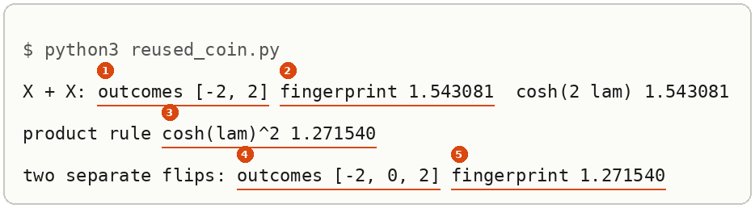

Markers 1 and 2 are the reused coin's outcomes and fingerprint, marker 3 the wrong product, markers 4 and 5 the separate flips the product actually describes. *Shown.*

### A yes-or-no variable and reading probabilities off a fingerprint

Textbook: [Definition 3.8, the Bernoulli random variable, p. 153](../references/textbooks/statistics/introduction-to-probability-for-data-science.pdf#page=153).

**A yes-or-no variable**, also a Bernoulli variable, is 1 with probability $p$ and 0 otherwise: a pass or a fail, a pixel on or off. Its list has two values, so its fingerprint is the two-term sum of [[#Computing a fingerprint from a list of values]]:

$$M(\lambda) = (1 - p)\,e^{\lambda \times 0} + p\,e^{\lambda \times 1} = 1 - p + p\,e^{\lambda}$$

*Cited:* the same fingerprint is worked in Practice Exercise 6.3 on [p. 342](../references/textbooks/statistics/introduction-to-probability-for-data-science.pdf#page=342).

**Worked: $p = 0.2$ at $\lambda = 1$.** $M(1) = 0.8 + 0.2 \times 2.718282 = 0.8 + 0.543656 = 1.343656$.

1. Write the two values, 0 and 1, with probabilities $1 - p$ and $p$.
2. The value 0 contributes $(1 - p)\,e^{0} = 1 - p$, whatever $\lambda$ is.
3. The value 1 contributes $p\,e^{\lambda}$.
4. Add.

**Where it goes wrong.** Writing $p\,e^{\lambda}$ alone, on the thought that the value 0 contributes nothing. The value adds nothing to the mean, but its weight $e^{\lambda \times 0} = 1$ is not zero. The slip gives $0.543656$ at $\lambda = 1$, and at $\lambda = 0$ it gives $0.2$ in place of 1, which the free check catches.

**Reading probabilities off a product.** Two independent yes-or-no variables, with $p = 0.2$ and $p = 0.4$. By [[#The fingerprint of a sum is the product]], their sum has fingerprint

$$(0.8 + 0.2e^{\lambda})(0.6 + 0.4e^{\lambda}) = 0.48 + (0.8 \times 0.4 + 0.2 \times 0.6)\,e^{\lambda} + 0.08\,e^{2\lambda} = 0.48 + 0.44\,e^{\lambda} + 0.08\,e^{2\lambda}$$

using $e^{\lambda}e^{\lambda} = e^{2\lambda}$. Read backwards, the list formula says a fingerprint $\sum_k q_k e^{k\lambda}$ belongs to a variable on the values $k$ with probabilities $q_k$, and by [[#Same fingerprint, same distribution]] no other distribution has it. So the sum is 0, 1 or 2 with probabilities $0.48$, $0.44$ and $0.08$.

1. Expand the product into terms $c\,e^{k\lambda}$.
2. Collect the terms with the same power $k$.
3. Each term $c\,e^{k\lambda}$ says the value $k$ has probability $c$.
4. Check the probabilities add to 1: $0.48 + 0.44 + 0.08 = 1$.

**The check.** List the four outcomes of the pair: $(0, 0)$ with $0.8 \times 0.6 = 0.48$; $(0, 1)$ with $0.8 \times 0.4 = 0.32$; $(1, 0)$ with $0.2 \times 0.6 = 0.12$; $(1, 1)$ with $0.2 \times 0.4 = 0.08$. The sum is 1 on two of them, $0.32 + 0.12 = 0.44$. Save this as `yes_no.py`:

```python
import itertools
import math

p = 0.2
for lam in [1.0, 0.0]:
    print(f"lam {lam}: 1 - p + p e^lam {1 - p + p * math.exp(lam):.6f}  p e^lam alone {p * math.exp(lam):.6f}")

p1, p2 = 0.2, 0.4
q1, q2 = 1 - p1, 1 - p2
print(f"product: {q1 * q2:.2f} + {q1 * p2 + p1 * q2:.2f} e^lam + {p1 * p2:.2f} e^(2 lam)")
dist = {}
for x1, x2 in itertools.product([0, 1], repeat=2):
    prob = (p1 if x1 else q1) * (p2 if x2 else q2)
    print(f"x1 {x1}  x2 {x2}  sum {x1 + x2}  probability {prob:.2f}")
    dist[x1 + x2] = dist.get(x1 + x2, 0.0) + prob
print("sum:", {k: round(v, 2) for k, v in sorted(dist.items())})
lam = 1.0
print(f"at lam 1: product {(q1 + p1 * math.exp(lam)) * (q2 + p2 * math.exp(lam)):.6f}  from the list {sum(v * math.exp(lam * k) for k, v in dist.items()):.6f}")
```

```bash
python3 yes_no.py
```


Marker 1 is the worked fingerprint, markers 2 and 3 the slip and the free check that catches it, marker 4 the expanded product, marker 5 the probabilities from listing, markers 6 and 7 the product and the list agreeing at $\lambda = 1$. *Shown.*

### Where variance cannot tell two shapes apart

A coin $c$ that is $+1$ or $-1$ with probability $\frac12$ each has fingerprint

$$M_c(\lambda) = \tfrac12 e^{\lambda} + \tfrac12 e^{-\lambda} = \cosh\lambda$$

by the [definition of the hyperbolic cosine](../references/textbooks/calculus/calculus-handbook.pdf#page=79). Two independent flips sum to $S = c_1 + c_2$ with fingerprint $\cosh(\lambda)^2$ by the product rule. Directly, $S$ is $-2$, $0$ or $2$ with probabilities $\frac14, \frac12, \frac14$, and $\frac14 e^{-2\lambda} + \frac12 + \frac14 e^{2\lambda} = \big(\frac{e^{\lambda} + e^{-\lambda}}{2}\big)^2$, the same function.

Its variance is $1 + 1 = 2$, because variances add for any independent variables. Its fingerprint at $\lambda = 1$ is $\cosh(1)^2 = 2.381098$, and the fingerprint of $\mathcal{N}(0, 2)$ there is $e^{1} = 2.718282$. Expanding, $\cosh(\lambda)^2 = 1 + \lambda^2 + \frac{\lambda^4}{3} + \cdots$ against $e^{\lambda^2} = 1 + \lambda^2 + \frac{\lambda^4}{2} + \cdots$: the $\lambda^2$ terms agree (second moment 2 for both), and the $\lambda^4$ terms give fourth moments $4!/3 = 8$ and $4!/2 = 12$. *Derived.*

So the variance rule holds for any independent inputs, and staying a bell needs Gaussian inputs. The product of two Gaussian fingerprints is again of the form $e^{v\lambda^2/2}$; the product of two $\cosh$ fingerprints is not.

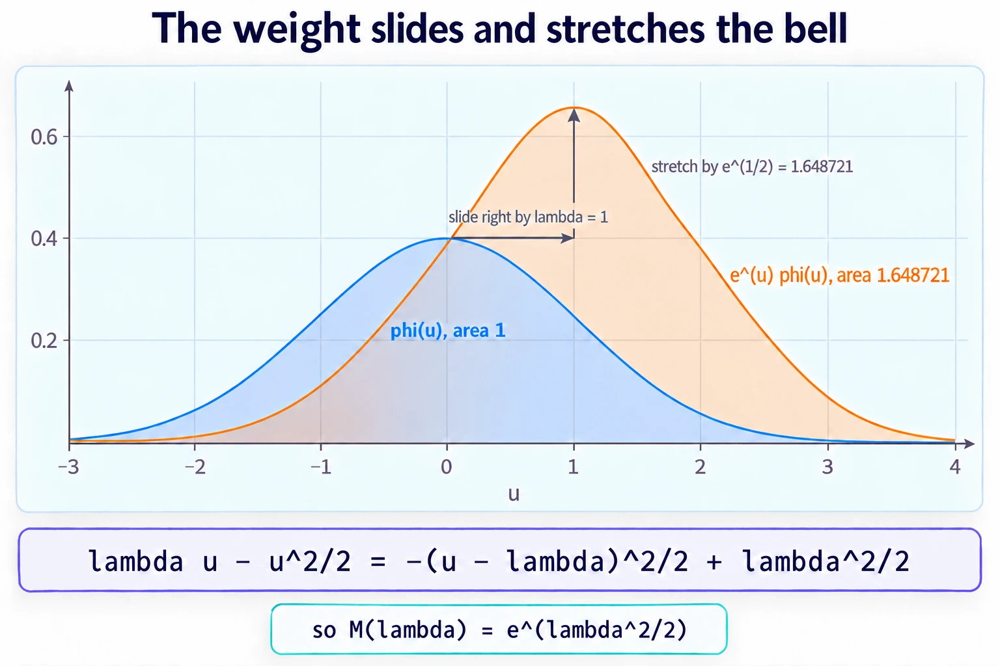

*Look at the two widths: the orange bell is as wide as the blue one, so the weight only moves and scales the bell, and the scale factor $e^{1/2} = 1.648721$ is the area, which is $M(1)$.*

### A large dial weighs the tails

**A large dial weighs the tails**: the weight $e^{\lambda u}$ grows fast in $u$, and the larger the dial, the more of the average comes from rare large values. A fingerprint at a small $\lambda$ mostly reads the middle of a distribution, and at a large $\lambda$ it mostly reads the far right. Two shapes that share a middle and differ in their tails agree closely at a small $\lambda$ and part at a large one. The same weighting is why the sampled average of step 7 gets worse as $\lambda$ grows: its value is carried by draws a finite sample rarely meets.

**Worked: one fair coin against $\mathcal{N}(0, 1)$.** Both have mean 0 and variance 1. The coin's fingerprint is $\cosh\lambda$ and the bell's $e^{\lambda^2/2}$:

| $\lambda$ | coin, $\cosh\lambda$ | bell, $e^{\lambda^2/2}$ | bell ÷ coin | share of the bell's fingerprint from draws above 2 |
|---|---|---|---|---|
| 0.5 | 1.127626 | 1.133148 | 1.0049 | $P(V > 1.5) = 0.0668$ |
| 1 | 1.543081 | 1.648721 | 1.0685 | $P(V > 1) = 0.1587$ |
| 2.5 | 6.132289 | 22.759895 | 3.7115 | $P(V > -0.5) = 0.6915$ |

The coin never goes past 1, so it has no draws above 2 at all. At $\lambda = 2.5$, more than two thirds of the bell's fingerprint comes from draws the coin can never make.

**Where the share comes from.** The part of the bell's fingerprint from draws above 2 is $\int_2^\infty e^{\lambda u}\varphi(u)\,du$. Steps 1 to 3 of [[#The standard normal's fingerprint]] turn it into $e^{\lambda^2/2}\int_2^\infty \varphi(u - \lambda)\,du$, and the shift of [[#Why step 4's limits stay infinite]] moves the lower end from 2 to $2 - \lambda$:

$$\int_2^\infty e^{\lambda u}\varphi(u)\,du = e^{\lambda^2/2}\,P(V > 2 - \lambda), \qquad \text{share} = \frac{e^{\lambda^2/2}\,P(V > 2 - \lambda)}{e^{\lambda^2/2}} = P(V > 2 - \lambda)$$

*Derived.*

**The method, to see what one dial setting reads.**

1. Compute both fingerprints at the $\lambda$ in question.
2. Divide one by the other. A ratio near 1 says the two agree on the region this $\lambda$ weighs.
3. Name that region. For a Gaussian the weighted integrand is the bell slid to $u = \lambda$ (the mechanism picture above), so the dial reads values around $u = \lambda$, and the share above a cut $c$ is $P(V > c - \lambda)$.

**Where it goes wrong.** Judging two shapes equal from a small dial. At $\lambda = 0.5$ the ratio is $1.0049$, under half a percent apart, because only $6.68\%$ of the bell's fingerprint comes from beyond 2. A comparison stopped there would call a coin a bell. At $\lambda = 2.5$ the same pair is $3.7115$ times apart.

**The check.** A grid sum of $e^{\lambda u}\varphi(u)$ over $u > 2$, divided by the whole $e^{\lambda^2/2}$. Save this as `tails.py`:

```python
import math


def phi(u):
    return math.exp(-u * u / 2) / math.sqrt(2 * math.pi)


h, L = 0.001, 12.0
for lam in [0.5, 1.0, 2.5]:
    coin, bell = math.cosh(lam), math.exp(lam * lam / 2)
    tail = h * sum(math.exp(lam * (2 + (i + 0.5) * h)) * phi(2 + (i + 0.5) * h) for i in range(round(L / h)))
    above = 0.5 * math.erfc((2 - lam) / math.sqrt(2))
    print(f"lam {lam}: coin {coin:.6f}  bell {bell:.6f}  ratio {bell / coin:.4f}  share above 2: grid {tail / bell:.4f}  P(V > 2 - lam) {above:.4f}")
```

```bash
python3 tails.py
```

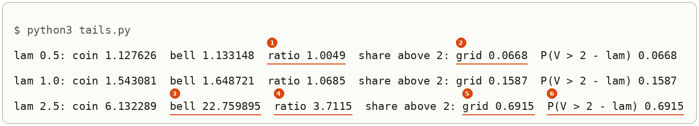

Markers 1 and 2 are the small dial, where the two agree and the tail carries little; markers 3 to 6 are $\lambda = 2.5$, where the bell is 22.759895, the ratio 3.7115, and the grid share equals $P(V > 2 - \lambda)$. *Shown.*

> 🖼️ **Picture on its way**: a large dial reads the tails, two panes at $\lambda = 0.5$ and $\lambda = 2.5$, each with the slid bell $\varphi(u - \lambda)$, its area beyond $u = 2$ shaded (0.0668 and 0.6915), and the coin's two bars at $-1$ and $1$. <!-- slot: assets/mgf-a-large-dial-reads-the-tails.webp · prompt: .prompts/Moment Generating Function.md#prompt-4-subject-the-fingerprint-a-large-dial-weighs-the-tails -->

> 🖼️ **Picture on its way**: the deep-dive sheet composing the form, the mechanism, step 6's run with its six markers, the reading cards and the forward-process product $e^{0.04} \times e^{0.1} = e^{0.14}$. <!-- slot: assets/mgf-deep-dive-sheet.webp · prompt: .prompts/Moment Generating Function.md#prompt-3-subject-capstone-the-fingerprint-the-deep-dive-sheet -->

<!-- worked-examples-table: moment-generating-function rev=1 -->
Problems on the moment generating function, from computing one on a list of values to proving the central limit theorem with it on coin flips, from the easiest to the hardest:

| Order | What it asks | Kind | Where | Difficulty | Full-steps solution | Quiz question |
|---|---|---|---|---|---|---|
| 1 | The fingerprint of a variable on 0, 1 and 2 with masses 2/6, 3/6 and 1/6 | Worked example | [[introduction-to-probability-for-data-science.pdf#page=340\|Chan, Example 6.1, PDF pp. 340 to 341]] | Easy | In the book, PDF p. 341: $1/3 + e^s/2 + e^{2s}/6$; the value at $s = 1$ is worked on the quiz page | MGF quiz, P1 |
| 2 | The first two moments of a Bernoulli variable from $1 - p + pe^s$ | Exercise with the book's solution | [[introduction-to-probability-for-data-science.pdf#page=342\|Chan, Practice Exercise 6.3, PDF p. 342]] | Easy | In the book, PDF p. 342, by derivatives at 0: $E[X] = E[X^2] = p$; the series route is on the quiz page | MGF quiz, P2 |
| 3 | A sum of $N$ independent Bernoulli($p$) variables is Binomial($N$, $p$), by matching fingerprints | Worked example (a theorem with its proof) | [[introduction-to-probability-for-data-science.pdf#page=343\|Chan, Theorem 6.3, PDF pp. 343 to 344]] | Medium | In the book, PDF pp. 343 to 344, every step; its sum on p. 344 runs over $n$ where the terms use $k$ | MGF quiz, P3 |
| 4 | The fingerprint of $Y = aX + b$ is $e^{bt}M_X(at)$, used on $3 + 2\varepsilon$ | Exercise without a solution | [[introduction-to-statistics.pdf#page=83\|Introduction to Statistics, section 4.3, property 4 under Definition 12, PDF p. 83]] | Medium | None in the book; written on the quiz page with a check against Chan's Table 6.1 | MGF quiz, P4 |
| 5 | A sum of independent Gaussians is Gaussian, with the means and the variances added | Worked example (a theorem with its proof) | [[introduction-to-probability-for-data-science.pdf#page=345\|Chan, Theorem 6.6, PDF p. 345]] | Medium | In the book, PDF p. 345, taking the Gaussian fingerprint as given; restated on two variables with numbers on the quiz page | MGF quiz, P5 |
| 6 | How fast the fingerprint of $Y_n = \frac{1}{\sqrt n}\sum c_i$, for fair $\pm 1$ coins, approaches $e^{s^2/2}$ | Exercise without a solution (video only) | [[introduction-to-probability-for-data-science.pdf#page=403\|Chan, chapter 6 problems, Exercise 20, PDF pp. 403 to 404]] | Hard | None in the book; written on the quiz page, $n = 3$ and $n = 4$ worked | MGF quiz, P6 |
| 7 | Exercise 20 itself: $E[Y_n] = 0$, $\mathrm{Var}[Y_n] = 1$, and $M_{Y_n}(s) \to e^{s^2/2}$ by the limit Chan uses on PDF p. 390 | Exercise without a solution (video only) | [[introduction-to-probability-for-data-science.pdf#page=403\|Chan, chapter 6 problems, Exercise 20, PDF pp. 403 to 404]] | Hard | None in the book; written on the quiz page, with the limit step of [[introduction-to-probability-for-data-science.pdf#page=390\|Chan's proof of the central limit theorem, PDF p. 390]] | MGF quiz, P7 |

The note that teaches the concept is [[Moment Generating Function]]. Exercise 20 is on PDF pp. 403 to 404 (printed 387 to 388); PDF pp. 387 to 388 hold the central limit theorem's own text. Not banked: Chan's Practice Exercises 6.1 and 6.2 (the Poisson and exponential fingerprints, PDF p. 341) and Theorems 6.4 and 6.5 (sums of binomials and of Poissons, PDF p. 344), each with the book's solution, kept as further practice.
Read in full (by the coverage audit of the moment generating function quiz): Chan PDF pp. 22, 280, 340 to 345, 387 to 391, 403 and 404; Introduction to Statistics PDF pp. 82 to 84. Only found: Chan's characteristic-function pages, PDF pp. 345 to 346.
<!-- /worked-examples-table -->

## Other ways to pin down a distribution

Navigation: ⬅️ [[#How the fingerprint works]] | 📋 [[#Table of contents|TOC]] | [[#Why the fingerprint matters]] ➡️

- **Convolution.** The density of $X + Y$ is $\int f_X(u) f_Y(z - u)\,du$. It gives the density itself rather than a fingerprint, at the cost of an integral per sum. *Cited:* [p. 340](../references/textbooks/statistics/introduction-to-probability-for-data-science.pdf#page=340) introduces the MGF as the way around this integral, and Theorem 5.12 on [p. 299](../references/textbooks/statistics/introduction-to-probability-for-data-science.pdf#page=299) does the Gaussian sum by convolution.
- **The characteristic function**, $\mathbb{E}[e^{j\omega Z}]$, the same average with an imaginary dial. It exists for every distribution, where the MGF can fail to: a heavy-tailed distribution such as the Cauchy has no MGF on any interval around 0 (*stated*). *Cited:* Definition 6.2 and the remark that not all densities have a Laplace transform, on [p. 345](../references/textbooks/statistics/introduction-to-probability-for-data-science.pdf#page=345).
- **Comparing moments one at a time.** Steps 5 and 8 do this: the second moments agree and the fourth moments do not. It needs no integral, but a finite list of agreeing moments never proves two distributions equal.
- **Sampling.** Step 7: average $e^{\lambda Z}$ over draws. It needs no algebra and is only good to the standard error $\sqrt{M(2\lambda) - M(\lambda)^2}/\sqrt{N}$, which grows fast with $\lambda$.

## Why the fingerprint matters

Navigation: ⬅️ [[#Other ways to pin down a distribution]] | 📋 [[#Table of contents|TOC]] | [[#The fingerprint taught in, applied in]] ➡️

The diffusion forward process collapses many noise steps into one draw, $x_t = \sqrt{\bar\alpha_t}\,x_0 + \sqrt{1 - \bar\alpha_t}\,\varepsilon$. The variance of the collapsed noise comes from the variance rule alone, but writing it as *one Gaussian draw* needs the shape, and the shape comes from multiplying Gaussian fingerprints ([[Sums Of Independent Gaussians#How the rule works]]). The coin flips show the step is not free: their variance adds the same way and their sum is not a bell.

## The fingerprint taught in, applied in

Navigation: ⬅️ [[#Why the fingerprint matters]] | 📋 [[#Table of contents|TOC]]

**Taught in:**

- the PoE derivation foundations journey's [chapter 9, section 9.1](/home/molef/goal-setting/learning/deep-learning/diffusion-models/01-poe-derivation-foundations/textbook/09-the-forward-process-by-hand.md#91-independent-gaussian-noises-add-their-variances), steps 5 to 7 at lines 50 to 89: the standard normal's fingerprint by completing the square, the product for the sum $a e_1 + b e_2$, and the uniqueness property stated; walked in the chapter's `drip --math` walk as piece 1, child "why the sum is still a bell curve", first part "the bell curve's fingerprint", with the coin-flip sum added as the run that breaks without a Gaussian input

**Applied in:** nothing yet.

**Used by other notes:** [[Sums Of Independent Gaussians#How the rule works]], whose shape step is the product of two Gaussian fingerprints.

> [!note]- How this was checked
> The five scripts were run on 2026-10-20 on mscluster (Linux), with Python 3.12.10 and the standard library only, in the empty folder `~/playground/sandbox/moment-generating-function`, by vault-writer. Every script exited 0. The folder was removed afterwards and the clean-up check returned 2. The prepared environment `~/.vault-sandbox` is missing on this machine and was not needed. The five terminal pictures were rendered from the captured text by a script in DejaVu Sans Mono, never drawn, and each was opened before filing. Every number from the walk's turn (1.648721, 7.389056, 1.150274, 2.381098, 2.718282 and the completing-the-square checks 0.375 and $-1.5$) was reproduced by these runs.
>
> Ten more scripts were run on 2026-10-21 on mscluster (Linux), with Python 3.12.10 and the standard library only, in a fresh empty `~/playground/sandbox/moment-generating-function`, by vault-writer: `weighted_sum.py`, `moments.py`, `uniqueness.py`, `sign_slip.py`, `half_line.py`, `scale_shift.py`, `reused_coin.py`, `tails.py`, `spread.py` (about 2 seconds) and `yes_no.py`. Every one exited 0, and every number the preparation audit asked these passages to carry (1.436791, 1.645229, 48, 0.867562, 5.669627, 0.135335, 1.387143, 0.824361, 12.182494, 1.543081 against 1.271540, the ratios 1.0049 and 3.7115, the shares 0.0668 to 0.6915, 0.006039 against 0.007180, 1.343656 and 0.48, 0.44, 0.08) came out of these runs. The folder was removed afterwards and the clean-up check returned 2. Their ten pictures were rendered from the captured text by a script in DejaVu Sans Mono and opened before filing.
>
> Textbook pages opened and read as text with PyMuPDF before linking: probability for data science pp. 340 (Definition 6.1), 341 (Theorem 6.1), 342 (Table 6.1), 343 (Theorem 6.2), 345 (Theorem 6.6, Definition 6.2), 280 and 299; introduction to statistics p. 83 (Definition 12 and the uniqueness property); the algebra handbook pp. 74 and 109; the calculus textbook pp. 415 (substitution in a definite integral) and 684 (the Maclaurin series for $e^x$); the calculus handbook p. 79 (the hyperbolic functions); mathematics for machine learning pp. 193 and 204. For the 2026-10-21 passages: probability for data science pp. 151 (Theorem 3.5, the variance shortcut), 153 (Definition 3.8, the Bernoulli variable), 230 (Definition 4.15, the standard Gaussian's CDF and its link to `erf`) and 342 (Practice Exercise 6.3, the Bernoulli fingerprint), and the algebra handbook p. 109 again for the power of a power rule.
>
> References: [Moment-generating function](https://en.wikipedia.org/wiki/Moment-generating_function) on Wikipedia (CC BY-SA 4.0), and the Python [math](https://docs.python.org/3/library/math.html) and [random](https://docs.python.org/3/library/random.html) module documentation, each answered 200 on 2026-10-20. No tldr-pages entry covers this. The learner's LibreOffice notes are not reachable from the cluster, so none was read for this note.
