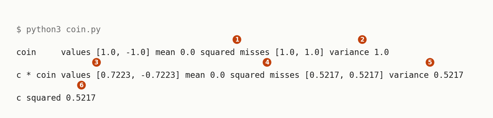
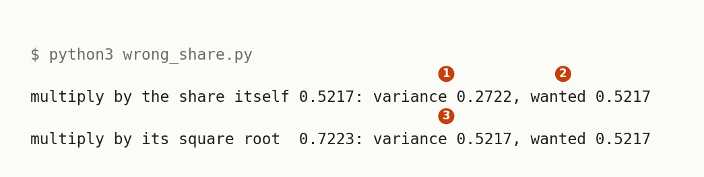
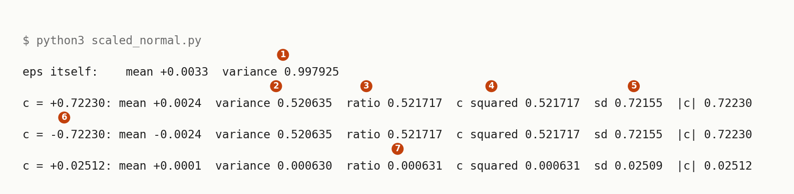
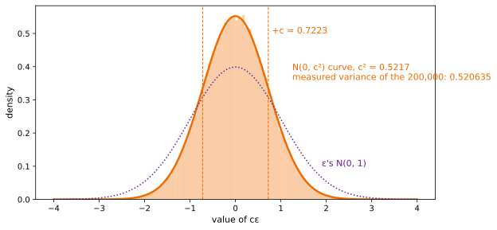
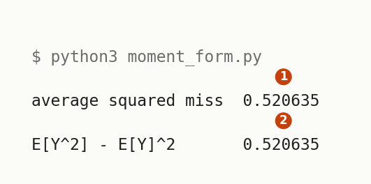
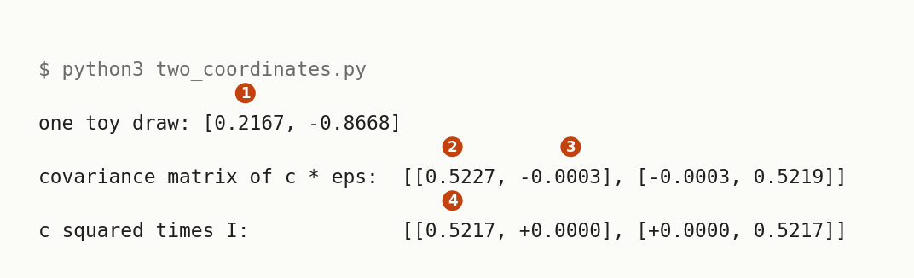
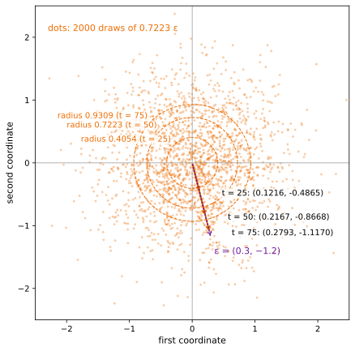
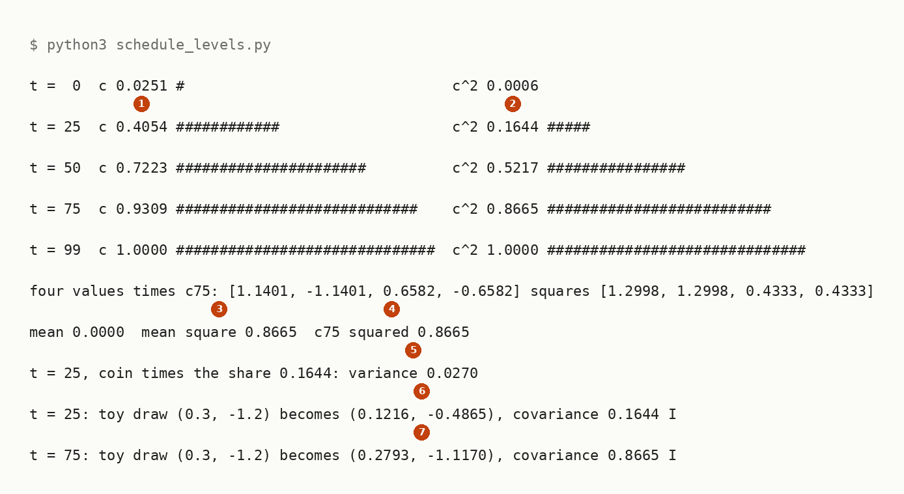

# Running The Scaling Rule For Variance

Up: [[Statistics]] · ⬅️ [[The Scaling Rule For Variance]] · [[Scaling And Shifting A Random Variable]] ➡️

Mathematics, Statistics. Needs: [[The Scaling Rule For Variance]], the rule these runs check.

**The scaling rule run in an empty folder, from a two-faced coin to 200,000 scaled draws and the whole noise schedule.**

> [!question]- Test yourself
> No quiz page covers this note yet.

> [!warning]- Unfinished
> - No quiz page for this note yet.

Claims marked stated: 0.

**How each run is read.** Every output is read field by field in [[#Reading the scaled output]]. The toy numbers are the table in [[The Scaling Rule For Variance#Scaling a draw scales its variance by the square]].

**Colours in this note.** <span style="color:#6a1b9a">**Purple is the standard normal draw $\varepsilon$**</span>, <span style="color:#2e7d32">**green is the kept signal share $\bar\alpha_t$**</span>, and <span style="color:#ef6c00">**orange is the multiplier $c = \sqrt{1 - \bar\alpha_t}$**</span>, as in [[The Scaling Rule For Variance]].

## Try the scaling rule yourself

Navigation: [[#Reading the scaled output]] ➡️

**Where you work.** Any terminal with Python 3.8 or later (`statistics.fmean` arrived in 3.8), and a new empty folder. The scripts use the standard library only, so nothing is installed.

**Where the numbers come from.** Every number in the scripts is made up or comes from a public noise schedule. The figure scripts beside the explanations also need matplotlib and numpy.

**1. What you need.** Python 3.8 or later:

```bash
python3 --version
```

You should see a version line. This run printed `Python 3.12.10`.

**2. When it is missing.** Install Python 3 from python.org, or run `uv python install 3.12`. Not run on this machine, which already has it. Where the prepared environment exists, `~/.vault-sandbox/bin/python` runs every script below unchanged.

**3. Make something to act on.** Make an empty folder and go into it:

```bash
mkdir -p ~/playground/sandbox/variance-scaling && cd ~/playground/sandbox/variance-scaling
```

**4. A look before: the coin, then the coin times $c$.** Save this as `coin.py`. The number $c = 0.7223$ is the noise scale at code step $t = 50$ of a 100-step cosine schedule, where the clean point keeps $\bar\alpha_{50} = 0.4783$ of the variance:

```python
from statistics import fmean

def variance(values):
    mean = fmean(values)
    return fmean([(v - mean) ** 2 for v in values])

coin = [1.0, -1.0]          # a fair coin that pays +1 or -1, each face equally likely
c = 0.7223                  # the noise scale at code step t = 50
scaled = [c * v for v in coin]
for name, x in [("coin    ", coin), ("c * coin", scaled)]:
    mean = fmean(x)
    misses = [round((v - mean) ** 2, 4) for v in x]
    print(name, "values", x, "mean", mean, "squared misses", misses, "variance", round(variance(x), 4))
print("c squared", round(c ** 2, 4))
```

Both faces are equally likely, so the plain average over the two faces is the exact expectation.

```bash
python3 coin.py
```

You should see:



**5. The failure: multiplying by the variance share instead of its root.** The noise at $t = 50$ should carry the share $1 - \bar\alpha_{50} = 0.5217$ of the variance. Save this as `wrong_share.py`:

```python
from statistics import fmean

def variance(values):
    mean = fmean(values)
    return fmean([(v - mean) ** 2 for v in values])

coin = [1.0, -1.0]
share = 1 - 0.4783          # the noise share of the variance at t = 50
for name, factor in [("the share itself", share), ("its square root ", share ** 0.5)]:
    scaled = [factor * v for v in coin]
    print(f"multiply by {name} {factor:.4f}: variance {variance(scaled):.4f}, wanted {share:.4f}")
```

```bash
python3 wrong_share.py
```



Multiplying by the share squares it again, $0.5217^2 = 0.2722$, so the noise carries about half the variance it should.

**6. The technique: scale many standard-normal draws.** Save this as `scaled_normal.py`. It draws 200,000 values of $\varepsilon$ from one seeded generator and scales the same draws by three numbers: $c = 0.7223$, its negative, and $c = \sqrt{\beta_0} = \sqrt{0.000631} = 0.02512$, the noise scale of the schedule's first step:

```python
import random
from statistics import fmean, pvariance, pstdev

rng = random.Random(0)
eps = [rng.gauss(0.0, 1.0) for _ in range(200_000)]
print(f"eps itself:    mean {fmean(eps):+.4f}  variance {pvariance(eps):.6f}")
for c in [0.7223, -0.7223, 0.02512]:
    y = [c * e for e in eps]
    ratio = pvariance(y) / pvariance(eps)
    print(f"c = {c:+.5f}: mean {fmean(y):+.4f}  variance {pvariance(y):.6f}  ratio {ratio:.6f}  c squared {c * c:.6f}  sd {pstdev(y):.5f}  |c| {abs(c):.5f}")
```

```bash
python3 scaled_normal.py
```

You should see:



Run it again and the same four lines come back, because the generator is seeded with 0.

**The picture.** The same 200,000 draws times 0.7223, as a histogram:

```python
import random
import numpy as np
import matplotlib.pyplot as plt

EPS_COL, C_COL = "#6a1b9a", "#ef6c00"
rng = random.Random(0)                                    # the same draws as scaled_normal.py
eps = np.array([rng.gauss(0.0, 1.0) for _ in range(200_000)])
c = 0.7223
y = c * eps
x = np.linspace(-4, 4, 801)
fig, ax = plt.subplots(figsize=(9, 4.4))
ax.hist(y, bins=160, range=(-4, 4), density=True, color=C_COL, alpha=0.35)
ax.plot(x, np.exp(-x ** 2 / (2 * c * c)) / (c * np.sqrt(2 * np.pi)), color=C_COL, lw=2.5)
ax.plot(x, np.exp(-x ** 2 / 2) / np.sqrt(2 * np.pi), color=EPS_COL, lw=1.5, ls=":")
for s in (-c, c):
    ax.axvline(s, color=C_COL, ls="--", lw=1)
ax.text(c + 0.08, 0.5, f"+c = {c}", color=C_COL, fontsize=11)
ax.text(1.25, 0.36, f"N(0, c²) curve, c² = {c * c:.4f}\nmeasured variance of the 200,000: {y.var():.6f}",
        color=C_COL, fontsize=11)
ax.text(1.9, 0.1, "ε's N(0, 1)", color=EPS_COL, fontsize=11)
ax.set_xlabel("value of cε", fontsize=11); ax.set_ylabel("density", fontsize=11)
fig.savefig("scaling-rule-200000-scaled-draws.svg", format="svg", bbox_inches="tight")
```



**How to read this.** The x-axis is the value of $c\varepsilon$ and the y-axis the density; the shaded bars are the 200,000 scaled draws in 160 bins, and the orange curve is $\mathcal{N}(0, c^2)$ with $c^2 = 0.5217$. The bars fill the orange curve, not the dotted purple $\mathcal{N}(0, 1)$. The number to look at is the measured variance, 0.520635, the same as step 6's second line.

**7. Another way to get the same answer: the moment form.** The variance is also $\mathbb{E}[Y^2] - \mathbb{E}[Y]^2$ (Theorem 3.5 (i) on [PDF p. 151](../references/textbooks/statistics/introduction-to-probability-for-data-science.pdf#page=151)). Save this as `moment_form.py`:

```python
import random
from statistics import fmean, pvariance

rng = random.Random(0)
c = 0.7223
y = [c * rng.gauss(0.0, 1.0) for _ in range(200_000)]
print(f"average squared miss  {pvariance(y):.6f}")
print(f"E[Y^2] - E[Y]^2       {fmean([v * v for v in y]) - fmean(y) ** 2:.6f}")
```

```bash
python3 moment_form.py
```



The two agree to six places, and both equal step 6's variance for $c = 0.7223$, since the seed and the draws are the same.

**8. More worked examples on the same folder.** Two more runs, one per form the teaching uses: a 2D draw, and the rule at all five levels of the schedule.

### Two coordinates scaled together

**Why two coordinates.** The forward process noises a 2D point, so $\varepsilon$ has two independent standard-normal coordinates and both are multiplied by the same $c$. Save this as `two_coordinates.py`; its first line scales the walk's toy draw $\varepsilon = (0.3, -1.2)$:

```python
import random
from statistics import fmean

rng = random.Random(1)
c = 0.7223
print("one toy draw:", [round(c * e, 4) for e in (0.3, -1.2)])
pairs = [(rng.gauss(0.0, 1.0), rng.gauss(0.0, 1.0)) for _ in range(200_000)]
y1 = [c * a for a, b in pairs]
y2 = [c * b for a, b in pairs]
m1, m2 = fmean(y1), fmean(y2)
var1 = fmean([(v - m1) ** 2 for v in y1])
var2 = fmean([(v - m2) ** 2 for v in y2])
cov12 = fmean([(a - m1) * (b - m2) for a, b in zip(y1, y2)])
print(f"covariance matrix of c * eps:  [[{var1:.4f}, {cov12:+.4f}], [{cov12:+.4f}, {var2:.4f}]]")
print(f"c squared times I:             [[{c * c:.4f}, +0.0000], [+0.0000, {c * c:.4f}]]")
```

```bash
python3 two_coordinates.py
```



**The picture.** The same pairs as a cloud, with the toy draw scaled at three levels:

```python
import random
import numpy as np
import matplotlib.pyplot as plt

EPS_COL, C_COL = "#6a1b9a", "#ef6c00"
rng = random.Random(1)                                    # the same pairs as two_coordinates.py
cloud = np.array([(rng.gauss(0.0, 1.0), rng.gauss(0.0, 1.0)) for _ in range(2000)])
eps = np.array([0.3, -1.2])                               # the walk's toy draw
abar = {25: 0.835621, 50: 0.478265, 75: 0.133495}          # the 100-step cosine schedule
levels = {t: np.sqrt(1 - a) for t, a in abar.items()}
fig, ax = plt.subplots(figsize=(7, 7))
ax.scatter(*(0.7223 * cloud).T, s=4, color=C_COL, alpha=0.25)
angle = np.linspace(0, 2 * np.pi, 361)
for t, c in levels.items():
    ax.plot(c * np.cos(angle), c * np.sin(angle), color=C_COL, lw=1, ls="--")
    ax.text(-c * 0.71 - 0.05, c * 0.71 + 0.05, f"radius {c:.4f} (t = {t})", ha="right", color=C_COL,
            fontsize=10, bbox=dict(fc="white", ec="none", alpha=0.8, pad=1))
    ax.annotate("", c * eps, (0, 0), arrowprops=dict(arrowstyle="->", color=C_COL, lw=2))
    x, y = c * eps
    ax.text(x + 0.35, y, f"t = {t}: ({x:.4f}, {y:.4f})", va="center", fontsize=10,
            bbox=dict(fc="white", ec="none", alpha=0.8, pad=1))
ax.annotate("", eps, (0, 0), arrowprops=dict(arrowstyle="->", color=EPS_COL, lw=1.5, ls=":"))
ax.text(0.35, -1.45, "ε = (0.3, −1.2)", color=EPS_COL, fontsize=11)
ax.text(-2.3, 2.1, "dots: 2000 draws of 0.7223 ε", color=C_COL, fontsize=11)
ax.axhline(0, color="#9e9e9e", lw=0.8); ax.axvline(0, color="#9e9e9e", lw=0.8)
ax.set_xlim(-2.5, 2.5); ax.set_ylim(-2.5, 2.5); ax.set_aspect("equal")
ax.set_xlabel("first coordinate", fontsize=11); ax.set_ylabel("second coordinate", fontsize=11)
fig.savefig("scaling-rule-the-toy-draw-in-two-dimensions.svg", format="svg", bbox_inches="tight")
```



**How to read this.** The axes are the two coordinates of the draw, on one scale. Each orange dot is one pair from `two_coordinates.py` times 0.7223, each dashed circle has radius $c$ at one level, and each arrow is the toy draw $\varepsilon = (0.3, -1.2)$ times that level's $c$. The number to look at is the arrow tip at $t = 50$, $(0.2167, -0.8668)$: the same direction as $\varepsilon$, 0.7223 times as long.

### The rule at every level of the schedule

**The run.** Save this as `schedule_levels.py`. It holds five $\bar\alpha_t$ values of the 100-step cosine schedule, draws $c$ and $c^2$ side by side as bars of `#`, scales a four-value draw that is not a coin, repeats step 5's slip at $t = 25$, and scales the toy draw at $t = 25$ and $t = 75$:

```python
from math import sqrt
from statistics import fmean

abar = {0: 0.999369, 25: 0.835621, 50: 0.478265, 75: 0.133495, 99: 0.0}   # the 100-step cosine schedule
for t, a in abar.items():
    c = sqrt(1 - a)
    print(f"t = {t:2d}  c {c:.4f} {'#' * round(30 * c):<30}  c^2 {c * c:.4f} {'#' * round(30 * c * c)}")

c75 = sqrt(1 - abar[75])
four = [sqrt(1.5), -sqrt(1.5), sqrt(0.5), -sqrt(0.5)]   # each a quarter of the time: mean 0, mean square 1
scaled = [c75 * v for v in four]
print("four values times c75:", [round(v, 4) for v in scaled], "squares", [round(v * v, 4) for v in scaled])
print(f"mean {fmean(scaled):.4f}  mean square {fmean([v * v for v in scaled]):.4f}  c75 squared {c75 ** 2:.4f}")

share = 1 - abar[25]
print(f"t = 25, coin times the share {share:.4f}: variance {fmean([(share * v) ** 2 for v in (1.0, -1.0)]):.4f}")

for t in (25, 75):
    c = sqrt(1 - abar[t])
    print(f"t = {t}: toy draw (0.3, -1.2) becomes ({c * 0.3:.4f}, {c * -1.2:.4f}), covariance {c * c:.4f} I")
```

```bash
python3 schedule_levels.py
```



**The bars are the point to see.** For every $c$ below 1, $c^2$ is smaller than $c$, so at $t = 25$ the noise already moves a point 0.4054 on a typical draw while holding only 16% of the variance.

**The picture.** The same five levels as curves over all 100 steps, beside step 5's slip:

```python
import numpy as np
import matplotlib.pyplot as plt

C_COL = "#ef6c00"
def cosine_beta_schedule(timesteps, s=0.008):            # as in rebuild/model.py
    x = np.linspace(0, timesteps, timesteps + 1, dtype=np.float64)
    ac = np.cos(((x / timesteps) + s) / (1 + s) * np.pi * 0.5) ** 2
    ac = ac / ac[0]
    return np.clip(1 - ac[1:] / ac[:-1], 0, 0.999)
abar = np.cumprod(1 - cosine_beta_schedule(100))
t = np.arange(100)
c = np.sqrt(1 - abar)
posts = [0, 25, 50, 75, 99]
fig, (left, right) = plt.subplots(1, 2, figsize=(11, 4.4), sharey=True)
left.plot(t, c, color=C_COL, lw=2.5)
left.plot(t, c ** 2, color=C_COL, lw=2, ls="--")
left.plot(posts, c[posts], "o", color=C_COL); left.plot(posts, c[posts] ** 2, "s", color=C_COL, mfc="white")
for p in (25, 50, 75):
    left.text(p + 2, c[p] + 0.02, f"{c[p]:.4f}", fontsize=10)
    left.text(p + 2, c[p] ** 2 - 0.07, f"{c[p] ** 2:.4f}", fontsize=10)
left.text(4, 0.62, r"$c=\sqrt{1-\bar\alpha_t}$, the multiplier", color=C_COL, fontsize=11)
left.text(40, 0.12, "c², the variance it gives", color=C_COL, fontsize=11)
left.set_title("the multiplier runs ahead of the variance", fontsize=12)
right.plot(t, c ** 2, color=C_COL, lw=2, ls="--")
right.text(2, 0.62, "multiply by c:\nthe variance is c²", color=C_COL, fontsize=11)
right.plot(t, c ** 4, color="#757575", lw=2)
for p in (25, 50):
    right.plot([p, p], [c[p] ** 4, c[p] ** 2], "o-", color="#424242", lw=1)
    right.text(p + 2, c[p] ** 2, f"wanted {c[p] ** 2:.4f}", fontsize=10)
    right.text(p + 2, c[p] ** 4 - 0.06, f"got {c[p] ** 4:.4f}", fontsize=10)
right.text(2, 0.8, "multiply by the share c²:\nthe variance comes out c⁴", color="#616161", fontsize=11)
right.set_title("multiplying by the share instead of its root", fontsize=12)
for ax in (left, right):
    ax.set_xlabel("code step t of the 100-step cosine schedule", fontsize=11)
left.set_ylabel("value", fontsize=11)
fig.savefig("scaling-rule-c-and-c-squared-across-the-schedule.svg", format="svg", bbox_inches="tight")
```


**How to read this.** The x-axis is code step $t$ of the 100-step cosine schedule. On the left the solid curve is the multiplier $c$ and the dashed curve its square $c^2$, the variance it gives, with the five levels marked; on the right the dashed curve is the wanted variance $c^2$ and the grey curve the variance $c^4$ that multiplying by the share $c^2$ gives. Look at the vertical lines: at $t = 25$ the slip gives 0.0270 for a wanted 0.1644, and at $t = 50$ it gives 0.2722 for 0.5217.

**9. Clean up, and prove it.**

```bash
cd ~ && rm -r ~/playground/sandbox/variance-scaling
ls ~/playground/sandbox/variance-scaling; echo $?
```

You should see `No such file or directory`, then `2`.

## Reading the scaled output

Navigation: ⬅️ [[#Try the scaling rule yourself]]

**Where "derived" points.** Every field marked derived is derived in [[The Scaling Rule For Variance#How the scaling rule works]].

From step 4, the coin:

| # | Field | This run | How to read it | Backing |
|---|---|---|---|---|
| 1 | coin, squared misses | `[1.0, 1.0]` | each face misses the mean 0 by 1, and $1^2 = 1$ | shown |
| 2 | coin, variance | `1.0` | the average of the squared misses; the coin has variance 1, like $\varepsilon$ | shown |
| 3 | c * coin, values | `[0.7223, -0.7223]` | each face multiplied by $c$; the mean stays 0, since $c \times 0 = 0$ | shown |
| 4 | c * coin, squared misses | `[0.5217, 0.5217]` | each miss is $c$ times the old miss, so its square is $c^2$ times the old square | derived |
| 5 | c * coin, variance | `0.5217` | the average of two copies of $c^2$ is $c^2$ | derived |
| 6 | c squared | `0.5217` | $0.7223^2$, equal to field 5, and equal to the noise share $1 - \bar\alpha_{50} = 1 - 0.4783$ | shown |

From step 6, the scaled standard-normal draws. Only what differs from the coin is new:

| # | Field | This run | How to read it | Backing |
|---|---|---|---|---|
| 1 | eps itself, variance | `0.997925` | the measured variance of 200,000 draws whose true variance is 1; a measured variance has standard error $\sqrt{2/n} = 0.0032$ here, so it sits 0.66 standard errors low | derived in [[Sampling A Diagonal Gaussian#How sampling works]] |
| 2 | c = +0.72230, variance | `0.520635` | the scaled draws' variance, a little under 0.5217 only because eps's own measured variance is a little under 1 | shown |
| 3 | ratio | `0.521717` | field 2 over field 1: exactly $c^2$, because the rule holds for the average over any list of numbers, not only in expectation | derived |
| 4 | c squared | `0.521717` | equal to field 3 in all six places | shown |
| 5 | sd against \|c\| | `0.72155` against `0.72230` | the standard deviation is multiplied by $\lvert c\rvert$: $0.72230 \times \sqrt{0.997925} = 0.72155$ | derived |
| 6 | the line for c = -0.72230 | same variance, ratio and sd | the square erases the sign of $c$; only the mean's sign flips | shown |
| 7 | c = +0.02512, ratio | `0.000631` | $0.02512^2 = 0.000631 = \beta_0$, the noise share at $t = 0$ | shown |

From step 8, `two_coordinates.py`:

| # | Field | This run | How to read it | Backing |
|---|---|---|---|---|
| 1 | one toy draw | `[0.2167, -0.8668]` | $0.7223 \times 0.3$ and $0.7223 \times (-1.2)$: each coordinate is scaled by the same $c$ | shown |
| 2 | the two diagonal entries | `0.5227`, `0.5219` | each coordinate's variance, near $c^2 = 0.5217$; the standard error of each is $0.5217\sqrt{2/n} = 0.0016$, so the first sits 0.6 standard errors above it and the second 0.1 | derived |
| 3 | the off-diagonal entry | `-0.0003` | the covariance of the two coordinates, near 0 because they were drawn independently | derived |
| 4 | c squared times I | `[[0.5217, ...], [..., 0.5217]]` | the covariance the rule predicts, $c^2 I$ | derived |

From `schedule_levels.py`, numbered as on its picture:

| # | Field | This run | How to read it | Backing |
|---|---|---|---|---|
| 1 | t = 25, c | `0.4054` | $\sqrt{1 - 0.835621}$, the noise's typical miss at $t = 25$ | shown |
| 2 | t = 25, c^2 | `0.1644` | its variance, $1 - \bar\alpha_{25}$; the bar is under half the length of the $c$ bar, because $c^2 < c$ whenever $0 < c < 1$ | derived |
| 3 | mean square | `0.8665` | the four values $\pm 1.2247$, $\pm 0.7071$ have mean 0 and mean square $(1.5 + 0.5)/2 = 1$, so after scaling the mean square is the variance | shown |
| 4 | c75 squared | `0.8665` | equal to field 3: the rule needs only mean 0 and variance 1, not a coin and not a bell | derived |
| 5 | coin times the share | `0.0270` | step 5's slip at $t = 25$: $0.1644^2 = 0.0270$, a sixth of the 0.1644 wanted | shown |
| 6 | t = 25 toy draw | `(0.1216, -0.4865)` | each coordinate times 0.4054; covariance $0.1644\,I$ | shown |
| 7 | t = 75 toy draw | `(0.2793, -1.1170)` | each coordinate times 0.9309; covariance $0.8665\,I$. Rounding $c$ to 0.9309 first gives $-1.1171$ and 0.8666, a last-place difference | shown |

> [!note]- How this was checked
> The five stdlib scripts of steps 4 to 8 (`coin.py`, `wrong_share.py`, `scaled_normal.py`, `moment_form.py`, `two_coordinates.py`) were run on 2026-10-20 on mscluster (Linux), with Python 3.12.10 and the standard library only, in the empty folder `~/playground/sandbox/variance-scaling`, by vault-writer. `schedule_levels.py` was run on 2026-10-21 the same way, twice, with identical output; its five $\bar\alpha_t$ values were recomputed from the rebuild's `cosine_beta_schedule` (`rebuild/model.py`, $s = 0.008$, 100 steps) and match `rebuild/out/walk-numbers.json` to its four places. All six were re-run on 2026-10-21 in an empty scratch folder and printed the same lines; `scaled_normal.py` prints the same lines on every run because its generator is seeded. The folder was removed afterwards and the clean-up check returned 2. The three figure scripts were run on 2026-10-21 on mscluster with Python 3.12.10, matplotlib 3.10.8 and numpy 2.4.3 in an empty scratch folder, and each SVG was opened (through a PNG copy made by the same script) before filing; the histogram's measured variance, 0.520635, equals step 6's. The prepared environment `~/.vault-sandbox` is missing on this machine; the system `python3` has matplotlib and numpy and drew the figures. The six terminal pictures were rendered from the captured text by a script in DejaVu Sans Mono, never drawn, and each was opened before filing. The textbook's PDF page 151 was opened and read as text. The Python [statistics module](https://docs.python.org/3/library/statistics.html) documentation answered 200 on 2026-10-20.
