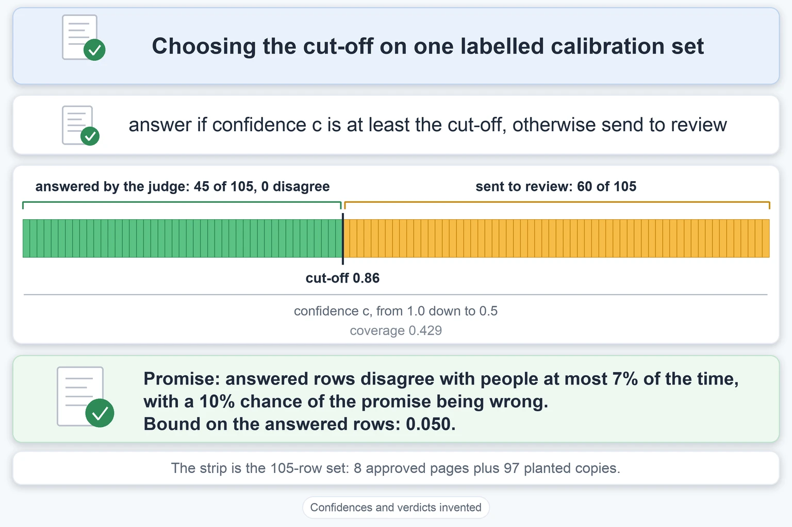
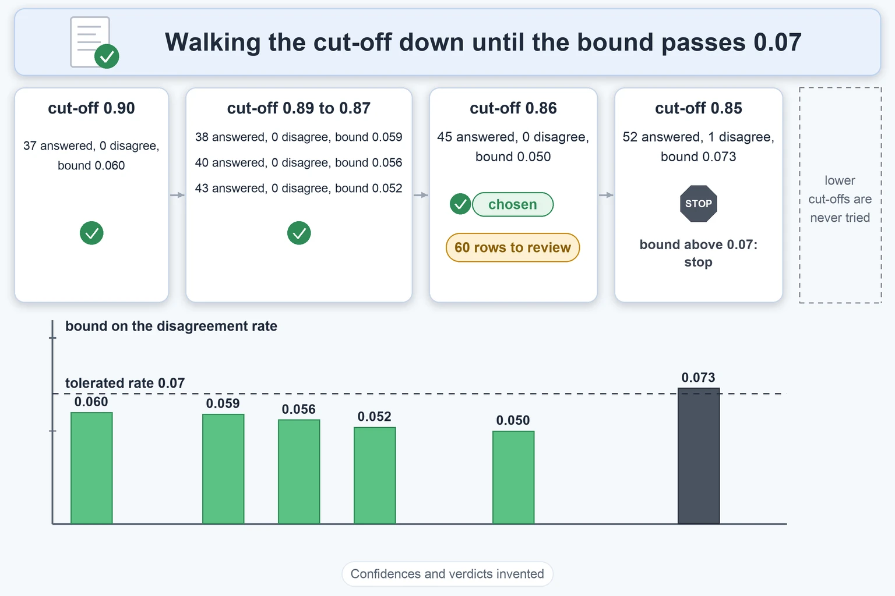

# Selective Evaluation

Up: [[Statistics]]

Mathematics, Statistics. Needs: [[Chance-Corrected Agreement]], whose 2 by 2 table and wrong-pass counts this note keeps using.

> [!warning] Unfinished
> - The three drawn pictures (the form, the mechanism, the deep-dive sheet) are not drawn, and the two concept pictures are written as prompts 1 and 2 in the vault's `.prompts/Selective Evaluation.md` and wait to be drawn.
> - No output picture is rendered: the sandbox ran on the standard library only, and the prepared environment `~/.vault-sandbox` is missing on this machine (to make it: `uv venv ~/.vault-sandbox` then `uv pip install --python ~/.vault-sandbox/bin/python pandas numpy scipy matplotlib statsmodels openpyxl`).
> - No quiz page yet.
> - 2 claims are marked stated and keep nothing unfinished: they are counted in the closing box.

**Selective evaluation** lets a judge answer only the items it is confident about and hand the rest to a person, and picks the confidence cut-off from a small labelled set so that the answers it does give agree with people at a rate you chose in advance, with a stated chance of being wrong about that promise. This note builds the cut-off from Jung, Brahman and Choi's method (section 2 and 2.1) and walks it on 105 rows whose judge outcomes are invented.

**Where you work.** Any folder with Python 3 and nothing else installed; the script uses the standard library. Every judge outcome, confidence and count below is invented to show the arithmetic. None measures the v3 judge.

## Table of contents

- [The selective evaluator](#the-selective-evaluator)
- [Coverage and risk](#coverage-and-risk)
- [The exact binomial upper bound](#the-exact-binomial-upper-bound)
- [Fixed-sequence testing and the guarantee](#fixed-sequence-testing-and-the-guarantee)
- [Walking the threshold on 105 rows](#walking-the-threshold-on-105-rows)
- [Other ways](#other-ways)
- [Taught in, applied in](#taught-in-applied-in)
- [How this was checked](#how-this-was-checked)

## The selective evaluator

Navigation: 📋 [[#Table of contents]] | [[#Coverage and risk]] ➡️

**A selective evaluator** is a judge $f$ plus a confidence measure $c$, with a cut-off $\lambda$: it returns the judge's verdict when the confidence reaches the cut-off, and nothing (written $\varnothing$, an abstention) otherwise. Jung et al. write it as their equation (1):

$$
(f, c)(x) =
\begin{cases}
f(x) & \text{if } c(x) \ge \lambda \\
\varnothing & \text{otherwise}
\end{cases}
$$

Here $x$ is one item to judge, $f(x)$ the verdict (for us pass or fail), and $c(x)$ a number from 0 to 1 saying how sure the judge is. One example the paper gives of $c$ is the probability the judge assigns to its own verdict. In the sections below, an item with $c(x) < \lambda$ goes to review, so a person decides it.


*All judge verdicts and confidences in this picture are invented.*

**Why this matters.** In the v3 judge a review verdict plays the part of $\varnothing$. Choosing $\lambda$ is choosing how much goes to a person. Backing: cited (Jung, Brahman and Choi 2024, arXiv 2407.18370, PDF page 2, equation 1).

## Coverage and risk

Navigation: ⬅️ [[#The selective evaluator]] | 📋 [[#Table of contents]] | [[#The exact binomial upper bound]] ➡️

**Coverage** is the share of items the judge answers, and the **selective risk** here is the share of those answered items where the judge disagrees with the reviewer. Raising $\lambda$ answers fewer items and tends to lower the risk, which is the trade the paper describes between precision and coverage (page 3).

On a labelled calibration set $D_{\text{cal}}$ (the small set of items that have a reviewer verdict), with $n(\lambda)$ the number of items with $c(x) \ge \lambda$:

$$
\hat R(\lambda) = \frac{1}{n(\lambda)} \sum_{(x,\,y) \in D_{\text{cal}}} \mathbf 1\{f(x) \ne y \;\wedge\; c(x) \ge \lambda\},
\qquad
\text{coverage}(\lambda) = \frac{n(\lambda)}{|D_{\text{cal}}|}
$$

$\mathbf 1\{\cdot\}$ is 1 when the condition holds and 0 otherwise. This is the paper's equation (3); the word "selective risk" and the coverage formula are this note's names for the quantities the paper uses (stated). The guarantee the paper wants is equation (2): the probability of agreeing with people, among answered items, is at least $1 - \alpha$.

**Why this matters.** Reporting agreement without coverage hides the items that were quietly sent away. Rao and Callison-Burch make the same point in section 5.2: accuracy 0.90 says little if the judge abstains on half the cases, see [[Abstention In Agreement Scores]]. Backing: cited (Jung et al. page 3, equations 2 and 3).

## The exact binomial upper bound

Navigation: ⬅️ [[#Coverage and risk]] | 📋 [[#Table of contents]] | [[#Fixed-sequence testing and the guarantee]] ➡️

Textbook: [Introduction to probability for data science, 3.5.2 binomial random variable, p. 159](../references/textbooks/statistics/introduction-to-probability-for-data-science.pdf#page=159)

**The exact binomial upper bound** is the largest true disagreement rate $R$ that would still, with probability at least $\delta$, show as few disagreements as you saw. Among $n$ answered rows, the number of disagreements is a binomial count with $n$ trials, so the paper's equation (4) is:

$$
\hat R^{+}(\lambda) = \sup\{R : P(\mathrm{Bin}(n(\lambda), R) \le k) \ge \delta\}, \qquad k = \lceil n(\lambda)\,\hat R(\lambda) \rceil
$$

$k$ is the number of disagreements seen, $\delta$ the chance you accept of the bound being wrong, and $P(\mathrm{Bin}(n,R) \le k)$ the chance that $n$ rows with true rate $R$ show $k$ or fewer disagreements. The bound is exact because it uses the binomial itself and not a normal approximation (Jung et al. page 3). It is also called the Clopper-Pearson upper bound (stated).

**Zero disagreements is not zero risk.** With $k = 0$ the chance of seeing none is $(1-R)^n$, so the condition $(1-R)^n \ge \delta$ gives:

$$
R \le 1 - \delta^{1/n}, \qquad \delta = 0.10:\quad n = 22 \Rightarrow 1 - 0.1^{1/22} \approx 0.099
$$

The script below prints this for several $n$. A tolerance of 10% needs 22 answered rows with no disagreement, and 5% needs 45. How those numbers are solved for, step by step with logarithms, is in [[Solving For The Exponent With Logarithms]].

**Why this matters.** With 8 good pages and 97 copies of them, the answered side is small whenever $\lambda$ is high, so the bound, not the observed rate, decides what can be promised. Backing: cited (equation 4), derived (the zero case), shown (the run below).

## Fixed-sequence testing and the guarantee

Navigation: ⬅️ [[#The exact binomial upper bound]] | 📋 [[#Table of contents]] | [[#Walking the threshold on 105 rows]] ➡️

**Fixed-sequence testing** tries the cut-offs from the highest down, in an order fixed before the data is looked at, and stops the first time the bound exceeds $\alpha$. Jung et al. say the risk "tends to increase as $\lambda$ decreases", so each step down answers more rows and usually adds disagreements. The chosen cut-off is their equation (5):

$$
\hat\lambda = \inf\{\lambda : \hat R^{+}(\lambda') \le \alpha \ \text{ for all } \lambda' \ge \lambda\}
$$

Read it as: the lowest $\lambda$ such that every cut-off at or above it passed the bound test.

**The guarantee.** Theorem 1 of the paper: a selective evaluator run at $\hat\lambda$ satisfies equation (2), meaning the true chance of agreeing with people among answered items is at least $1-\alpha$, with probability at least $1-\delta$ over the draw of the calibration set. The proof is in the paper's Appendix A.1 and is not reproduced here. The paper chooses this over a Bonferroni correction (testing every cut-off at a stricter level) because that "may be too conservative for a large hypothesis space".

**Two cautions for the v3 design.** The guarantee assumes the calibration set is a draw from the same distribution as the items judged later (the paper writes $D_{\text{cal}} \sim P(x, y_{\text{human}})$). The 97 planted copies are 8 products with one change each, so they are less independent than 97 separate products, and the true bound is looser than the one computed (the walk's own reading of the design, inferred). The second caution is that "an order fixed before the data is looked at" is the standard requirement of fixed-sequence testing and is not quoted from the paper (stated).

**Why this matters.** The promise holds because the walk stops at the first failure and never goes back to try a lower cut-off after seeing the data. Backing: cited (equations 2 and 5, Theorem 1, page 3), stated for the ordering requirement.

## Walking the threshold on 105 rows

Navigation: ⬅️ [[#Fixed-sequence testing and the guarantee]] | 📋 [[#Table of contents]] | [[#Other ways]] ➡️

**The setup.** The 105-row design from [[The 105-Row Gold Set]]: 8 approved pages and 97 planted copies. Each row gets an invented confidence $c$ from 0.5 to 1 and an invented verdict. Two invented judges: a calibrated one, right with probability $c$, and an underconfident one that disagrees only 0.2 as often as its confidence implies.

Save the script as `threshold_walk.py` in an empty folder.

```python
# Jung's fixed-sequence walk on the 105-row design. Confidences and verdicts are INVENTED (seeded).
# Usage: python3 threshold_walk.py 0.10     (the tolerated disagreement rate alpha)
import random
import sys
from math import comb

products = [14] * 3 + [11] * 5  # 8 products, each one good page plus its planted copies
rows = []
for i, nbad in enumerate(products):
    rows.append((i, 1))
    rows += [(i, 0)] * nbad


def make(sharp, seed=1):
    """Each row gets a confidence c from 0.5 to 1. The judge is right with probability
    1 - (1 - c) * sharp: sharp 1 is calibrated, sharp 0.2 is right more often than c claims."""
    rnd = random.Random(seed)
    data = []
    for p, g in rows:
        c = 0.5 + 0.5 * rnd.random() ** 0.5
        right = rnd.random() < 1 - (1 - c) * sharp
        data.append((c, int(right)))  # (confidence, agrees with the reviewer)
    return data


def upper_bound(k, n, delta=0.10):
    """Largest rate R for which seeing k or fewer disagreements in n rows still has chance >= delta."""
    if n == 0:
        return 1.0
    lo, hi = 0.0, 1.0
    for _ in range(100):
        mid = (lo + hi) / 2
        cdf = sum(comb(n, i) * mid**i * (1 - mid) ** (n - i) for i in range(k + 1))
        if cdf >= delta:
            lo = mid
        else:
            hi = mid
    return lo


def counts(data, lam):
    answered = [agree for c, agree in data if c >= lam]
    return len(answered), sum(1 for a in answered if not a)


def walk(data, alpha, start):
    """Test lambda from `start` downward in steps of 0.01. Stop at the first bound above alpha."""
    steps, last_ok, lam = [], None, start
    while lam >= 0.50:
        n, k = counts(data, lam)
        ub = upper_bound(k, n)
        steps.append((lam, n, k, ub))
        if ub > alpha:
            break
        last_ok = steps[-1]
        lam = round(lam - 0.01, 2)
    return steps, last_ok


def observed_rule(data, alpha):
    """The rule that ignores the bound: lowest lambda whose observed disagreement rate is <= alpha."""
    best, lam = None, 0.99
    while lam >= 0.50:
        n, k = counts(data, lam)
        if n and k / n <= alpha:
            best = lam
        lam = round(lam - 0.01, 2)
    return best


alpha = float(sys.argv[1])
for name, sharp in {"calibrated": 1.0, "underconfident": 0.2}.items():
    data = make(sharp)
    print(f"\n{name}: agrees with the reviewer on {sum(a for _, a in data)} of 105, alpha {alpha}")
    for start in (0.99, 0.90):
        steps, ok = walk(data, alpha, start)
        first = steps[0]
        line = f"  start {start}: first step answers {first[1]}, {first[2]} disagree, bound {first[3]:.3f}"
        if ok:
            lam, n, k, ub = ok
            line += f"; last passing lambda {lam:.2f} answers {n} of 105 (coverage {n / 105:.3f}), {k} disagree, bound {ub:.3f}"
        else:
            line += "; nothing certified"
        print(line)
    lam = observed_rule(data, alpha)
    n, k = counts(data, lam)
    print(f"  observed-rate rule: lambda {lam:.2f}, answers {n}, {k} disagree "
          f"({k / n:.3f} observed), bound {upper_bound(k, n):.3f}")

print("\nworst rate you can defend after zero disagreements in n answered rows (delta 0.10):")
for n in (4, 11, 22, 45):
    print(f"  n {n}: {upper_bound(0, n):.3f}   formula 1 - 0.1^(1/n) = {1 - 0.1 ** (1 / n):.3f}")
print("\nanswered rows needed with zero disagreements:")
for a in (0.20, 0.10, 0.05):
    print(f"  alpha {a}: {next(n for n in range(1, 500) if upper_bound(0, n) <= a)} rows")
```

Run it for $\alpha = 0.10$ and then $\alpha = 0.07$, with $\delta = 0.10$ fixed inside the script:

```bash
python3 threshold_walk.py 0.10
python3 threshold_walk.py 0.07
```

You should see:

```text

calibrated: agrees with the reviewer on 88 of 105, alpha 0.1
  start 0.99: first step answers 4, 0 disagree, bound 0.438; nothing certified
  start 0.9: first step answers 37, 2 disagree, bound 0.138; nothing certified
  observed-rate rule: lambda 0.76, answers 72, 7 disagree (0.097 observed), bound 0.158

underconfident: agrees with the reviewer on 103 of 105, alpha 0.1
  start 0.99: first step answers 4, 0 disagree, bound 0.438; nothing certified
  start 0.9: first step answers 37, 0 disagree, bound 0.060; last passing lambda 0.50 answers 105 of 105 (coverage 1.000), 2 disagree, bound 0.050
  observed-rate rule: lambda 0.50, answers 105, 2 disagree (0.019 observed), bound 0.050

worst rate you can defend after zero disagreements in n answered rows (delta 0.10):
  n 4: 0.438   formula 1 - 0.1^(1/n) = 0.438
  n 11: 0.189   formula 1 - 0.1^(1/n) = 0.189
  n 22: 0.099   formula 1 - 0.1^(1/n) = 0.099
  n 45: 0.050   formula 1 - 0.1^(1/n) = 0.050

answered rows needed with zero disagreements:
  alpha 0.2: 11 rows
  alpha 0.1: 22 rows
  alpha 0.05: 45 rows

calibrated: agrees with the reviewer on 88 of 105, alpha 0.07
  start 0.99: first step answers 4, 0 disagree, bound 0.438; nothing certified
  start 0.9: first step answers 37, 2 disagree, bound 0.138; nothing certified
  observed-rate rule: lambda 0.79, answers 64, 4 disagree (0.062 observed), bound 0.121

underconfident: agrees with the reviewer on 103 of 105, alpha 0.07
  start 0.99: first step answers 4, 0 disagree, bound 0.438; nothing certified
  start 0.9: first step answers 37, 0 disagree, bound 0.060; last passing lambda 0.86 answers 45 of 105 (coverage 0.429), 0 disagree, bound 0.050
  observed-rate rule: lambda 0.50, answers 105, 2 disagree (0.019 observed), bound 0.050

worst rate you can defend after zero disagreements in n answered rows (delta 0.10):
  n 4: 0.438   formula 1 - 0.1^(1/n) = 0.438
  n 11: 0.189   formula 1 - 0.1^(1/n) = 0.189
  n 22: 0.099   formula 1 - 0.1^(1/n) = 0.099
  n 45: 0.050   formula 1 - 0.1^(1/n) = 0.050

answered rows needed with zero disagreements:
  alpha 0.2: 11 rows
  alpha 0.1: 22 rows
  alpha 0.05: 45 rows
```

**Reading the output, field by field.**

| Field | Value in this run | How to read it |
|---|---|---|
| `start 0.99`, first step | answers 4, 0 disagree, bound 0.438 | the first cut-off tried keeps only 4 rows. Four clean rows still allow a true rate of 43.8%, above any $\alpha$ used, so the walk stops with nothing certified |
| `start 0.9`, calibrated, $\alpha$ 0.10 | answers 37, 2 disagree, bound 0.138 | the first step already exceeds 0.10, so no cut-off is certified |
| `start 0.9`, underconfident, $\alpha$ 0.10 | last passing $\lambda$ 0.50, 105 of 105 answered, 2 disagree, bound 0.050 | every step passes, so the walk reaches the lowest cut-off and the judge answers every row |
| `start 0.9`, underconfident, $\alpha$ 0.07 | last passing $\lambda$ 0.86, 45 of 105 answered, 0 disagree, bound 0.050 | the next step (0.85) answers 52 rows with 1 disagreement and a bound of 0.073, above 0.07, so the walk stops at 0.86 and 60 rows go to review |
| observed-rate rule, calibrated, $\alpha$ 0.10 | $\lambda$ 0.76, 72 answered, 7 disagree (0.097 observed), bound 0.158 | picks the lowest cut-off whose observed rate is at most $\alpha$. The observed rate meets 0.10 and the bound on the true rate is 0.158, so the promise would be broken |
| rows needed with zero disagreements | 11, 22, 45 | for $\alpha$ 0.20, 0.10 and 0.05 |

**What the walk says.** A calibrated judge on 105 rows cannot be certified at $\alpha = 0.10$, because its disagreements arrive faster than the bound allows. A judge that is right more often than it claims can be, and the tighter the promise, the fewer rows it answers: 105 at $\alpha$ 0.10, 45 at $\alpha$ 0.07. Choosing $\lambda$ from the observed rate alone gives a cut-off that looks fine on the calibration set and carries no promise about the next items.


*All judge verdicts and confidences in this picture are invented.*

**Why this matters.** For the v3 judge, review plays the part of abstention, and this walk is how many rows can be answered by the judge while still keeping a bounded wrong-answer rate. Backing: shown (the run), cited (Jung et al. section 2.1).

## Other ways

Navigation: ⬅️ [[#Walking the threshold on 105 rows]] | 📋 [[#Table of contents]] | [[#Taught in, applied in]] ➡️

**Report after the fact.** Rao and Callison-Burch (section 5.2, equation 10) do not choose a cut-off. They take the coverage and covered accuracy as measured and bound the accuracy on all items between two values. That is the right tool when the cut-off is already fixed, see [[Abstention In Agreement Scores]].

**More than one judge.** The paper's cascade tries a cheap judge first and escalates to a stronger one when the cheap one is under its own cut-off, with a cut-off calibrated for each judge. Not taught here.

**Where the invented confidences come from.** The script's line `c = 0.5 + 0.5 * rnd.random() ** 0.5` is inverse transform sampling: it draws $c$ with CDF $4(c-0.5)^2$ on 0.5 to 1, and [[Inverse Transform Sampling#Check it with 100000 draws]] checks it on 100000 draws.

**Confidence measures.** The paper tests the judge's own probability and a method it proposes, Simulated Annotators (section 2.2). This note takes the confidence as given.

## Taught in, applied in

Navigation: ⬅️ [[#Other ways]] | 📋 [[#Table of contents]] | [[#How this was checked]] ➡️

**Taught in.**

- [The combined reading of validating an LLM judge](/Users/molefemolefe/goal-setting/learning/ai-engineering/prototype-product-data-validation-end-to-end/drips/combine-validating-an-llm-judge/COMBINE_MAP.md), idea 5, choosing the threshold so that passes agree with people, and the threshold walk on 105 rows.
- [The selective-evaluation journey](/Users/molefemolefe/goal-setting/learning/ai-engineering/agent-evaluation/selective-evaluation/diagram-gate.md), built to the picture gate and waiting for the learner's approval.

**Applied in.**

- The v3 product-content judge in the Dis-Chem product data repo: a judge that gives pass, warning, review or fail, validated on 8 gold pages plus planted defects. The question was how many rows it can answer while its wrong answers stay under a stated rate. No real judge has been run on the set, so every number here is invented.

## How this was checked

Navigation: ⬅️ [[#Taught in, applied in]] | 📋 [[#Table of contents]]

> [!note]- How this was checked
> `threshold_walk.py` was run twice on 2026-10-18 on a Mac with Python 3.12 (standard library only), from an empty folder that was removed afterwards, with `python3 -I`. Its alpha 0.10 and alpha 0.07 outputs match the saved outputs of the learning tree's `test-5-threshold-walk.py` on every number quoted (37 rows with 2 disagreements and bound 0.138; lambda 0.76 with bound 0.158; lambda 0.86 covering 45 of 105). The equations were read from Jung, Brahman and Choi, PDF pages 2 and 3. Appendix A.1, the proof, was not read for this note. The prepared environment `~/.vault-sandbox` does not exist on this machine, so the standard library interpreter was used. The note has not been rendered in Obsidian.
>
> Claims marked stated, 2: the names "selective risk" and "Clopper-Pearson" for the quantities Jung et al. use, and the requirement that the order of cut-offs be fixed before the data is seen.
