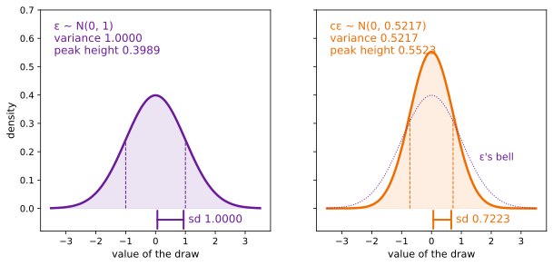
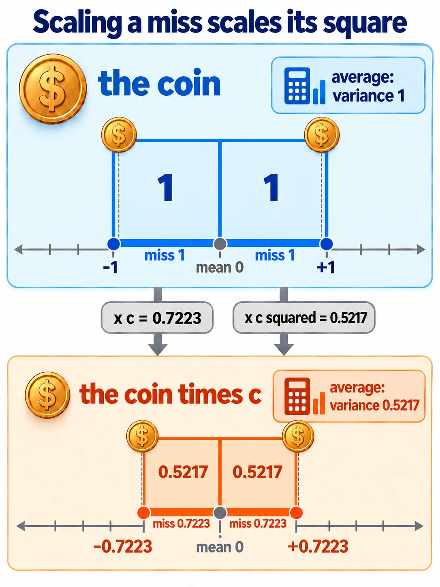

# The Scaling Rule For Variance

Up: [[Statistics]] · ⬅️ [[Variance]] · [[Running The Scaling Rule For Variance]] ➡️

Mathematics, Statistics. Needs: [[Variance#What variance measures|variance]], the average squared miss from the mean, and [[Variance#The name standard deviation|standard deviation]], its square root.

**Multiplying a draw by a fixed number $c$ multiplies its variance by $c^2$.**

> [!question]- Test yourself
> No quiz page covers this note yet.

> [!warning]- Unfinished
> - No quiz page for this note yet.

Claims marked stated: 0.

**And its standard deviation by $|c|$.** That is why a formula that wants noise of variance $v$ multiplies a unit-variance draw by $\sqrt{v}$, never by $v$.

**Colours in this note.** <span style="color:#6a1b9a">**Purple is the standard normal draw $\varepsilon$**</span>, <span style="color:#2e7d32">**green is the kept signal share $\bar\alpha_t$**</span>, <span style="color:#ef6c00">**orange is the multiplier $c$, the noise scale $\sqrt{1 - \bar\alpha_t}$**</span>, <span style="color:#3949ab">**indigo is a general draw $X$**</span>, and <span style="color:#827717">**olive is its mean $\mu$**</span>. The first three mean the same as on the one-expert rebuild's step 4 page.

## Table of contents

- [[#Scaling a draw scales its variance by the square]]
- [[#When to reach for the scaling rule]]
- [[#The form of the scaling rule]]
- [[#Try the scaling rule yourself]]
- [[#How the scaling rule works]]
- [[#Other ways to change a spread]]
- [[#Why the scaling rule matters]]
- [[#The scaling rule taught in, applied in]]

## Scaling a draw scales its variance by the square

Navigation: 📋 [[#Table of contents|TOC]] | [[#When to reach for the scaling rule]] ➡️

Textbook: [Introduction to probability for data science, Theorem 3.5 (ii), PDF p. 151](../references/textbooks/statistics/introduction-to-probability-for-data-science.pdf#page=151) · [its proof, PDF p. 152](../references/textbooks/statistics/introduction-to-probability-for-data-science.pdf#page=152) · [$\mathbb{E}[cX] = c\,\mathbb{E}[X]$, Theorem 3.4, PDF p. 147](../references/textbooks/statistics/introduction-to-probability-for-data-science.pdf#page=147).

**Scaling rule for variance**, also the scale property of variance or $\operatorname{Var}(cX) = c^2 \operatorname{Var}(X)$: multiplying a random draw by a fixed number $c$ multiplies its variance by $c^2$ and its standard deviation by $|c|$. *Cited:* Theorem 3.5 (ii). *Derived* in [[#How the scaling rule works]].

**The toy numbers.** Every example below uses one 100-step cosine noise schedule and the walk's toy draw $\varepsilon = (0.3, -1.2)$, the same ones [[The Forward Process]] uses.

<table>
<tr><th>step <i>t</i></th><th style="color:#2e7d32">ᾱ<sub><i>t</i></sub></th><th style="color:#ef6c00"><i>c</i> = √(1 − ᾱ<sub><i>t</i></sub>)</th><th>variance <i>c</i>²</th><th>toy draw <i>c</i> · <span style="color:#6a1b9a">ε</span></th></tr>
<tr><td>0</td><td>0.9994</td><td style="border:2px solid #212121">0.0251</td><td style="border:2px solid #212121">0.0006</td><td>(0.0075, −0.0302)</td></tr>
<tr><td>25</td><td>0.8356</td><td>0.4054</td><td>0.1644</td><td>(0.1216, −0.4865)</td></tr>
<tr style="background:#fff8e1"><td><b>50</b></td><td style="border:2px solid #212121"><b>0.4783</b></td><td style="border:2px solid #212121"><b>0.7223</b></td><td style="border:2px solid #212121"><b>0.5217</b></td><td style="border:2px dashed #212121"><b>(0.2167, −0.8668)</b></td></tr>
<tr><td>75</td><td>0.1335</td><td>0.9309</td><td>0.8665</td><td>(0.2793, −1.1170)</td></tr>
<tr><td>99</td><td>0</td><td>1.0000</td><td>1.0000</td><td>(0.3000, −1.2000)</td></tr>
</table>

**How to read this table.** Each row is one code step of the schedule. Green ᾱ<sub>t</sub> is the share of the clean point's variance still kept, orange $c$ is the multiplier the noise gets, $c^2$ is the variance that multiplier gives a unit-variance draw, and the last column is the toy draw times $c$.

**What to look for.** The highlighted row is the one worked by hand below: $1 - 0.4783 = 0.5217 = 0.7223^2$. At $t = 0$ the boxed $c^2$ prints 0.0006 to four places; to six it is $0.000631 = \beta_0$, the noise share of the schedule's first step, and $c = \sqrt{0.000631} = 0.02512$.

### The base word: rule

**What the word means.** A rule here is an identity that holds for every draw and every fixed number. It gives the variance after a change from the variance before, with no new averaging.

$$
\underbrace{\operatorname{Var}(\text{draw})}_{\text{known before}}
\;\xrightarrow{\ \text{rule}\ }\;
\underbrace{\operatorname{Var}(\text{changed draw})}_{\text{read off, no new averaging}}
$$

**What it means.** On the coin of [[Variance#What variance measures]] the rule turns variance 1 into 0.5217 without listing the scaled faces. [[Running The Scaling Rule For Variance#Try the scaling rule yourself|Step 4 of the sandbox]] lists them and gets the same number.

### The qualifier: scaling

**What the word means.** Scaling is multiplying every value of a draw by one fixed number $c$.

$$
Y = \underbrace{\textcolor{#ef6c00}{c}}_{\text{one fixed number}}\;\underbrace{\textcolor{#3949ab}{X}}_{\text{every value of the draw}}
$$

**What it means.** At $c = 0.7223$ the coin's faces $\pm 1$ become $\pm 0.7223$. A negative $c$ also swaps each face to the other side of 0.

### All the words together: the formula

$$
\operatorname{Var}(cX) = c^2 \operatorname{Var}(X)
$$

$$
\operatorname{Var}\big(\underbrace{\textcolor{#ef6c00}{c}\,\textcolor{#3949ab}{X}}_{\text{scaled draw}}\big)
=
\underbrace{\textcolor{#ef6c00}{c}^2}_{\text{square of the multiplier}}
\;
\underbrace{\operatorname{Var}(\textcolor{#3949ab}{X})}_{\text{variance before}}
$$

**What the equation says.** The variance after scaling is the variance before, times the square of the multiplier. At $c = 0.7223$ and $\operatorname{Var}(X) = 1$ it is 0.5217.

### The consequence: a wanted variance needs its square root

$$
\textcolor{#ef6c00}{c} = \sqrt{v}
\quad\Longrightarrow\quad
\operatorname{Var}(\textcolor{#ef6c00}{c}\,\textcolor{#6a1b9a}{\varepsilon}) = (\sqrt{v})^2 \cdot 1 = v
$$

**What it means.** To give a unit-variance draw the variance $v = 1 - \bar\alpha_{50} = 0.5217$, multiply it by $\sqrt{0.5217} = 0.7223$. Multiplying by 0.5217 itself gives $0.5217^2 = 0.2722$, the slip of [[Running The Scaling Rule For Variance#Try the scaling rule yourself|step 5 of the sandbox]].

**Why this matters.** Every noise term in the diffusion notes is a unit-variance draw times a multiplier, so this one identity decides every multiplier's square root.

## When to reach for the scaling rule

Navigation: ⬅️ [[#Scaling a draw scales its variance by the square]] | 📋 [[#Table of contents|TOC]] | [[#The form of the scaling rule]] ➡️

**A formula multiplies a draw.** Reach for it whenever a formula multiplies a random draw by a number and you need the spread of the result, or need the number that gives a wanted spread.

**Where it turns up.** The forward process multiplies $\varepsilon$ by $\sqrt{1 - \bar\alpha_t}$ ([[The Forward Process#How the jump works]]). Sampling a Gaussian multiplies it by $\sqrt{\sigma^2}$ ([[Sampling A Diagonal Gaussian#How sampling works]]). An average divides a sum by $N$, which divides its variance by $N^2$.

**The slip it prevents.** Multiplying by the variance you want instead of its square root squares the variance a second time. [[Running The Scaling Rule For Variance#Try the scaling rule yourself|Step 5 of the sandbox]] shows it.

## The form of the scaling rule

Navigation: ⬅️ [[#When to reach for the scaling rule]] | 📋 [[#Table of contents|TOC]] | [[#Try the scaling rule yourself]] ➡️

$$
\begin{aligned}
Y &= cX && c \text{ a fixed number, } X \text{ a random draw} \\
\mathbb{E}[Y] &= c\,\mathbb{E}[X] \\
\operatorname{Var}(Y) &= c^2 \operatorname{Var}(X) \\
\operatorname{sd}(Y) &= |c| \operatorname{sd}(X) \\
c &= \sqrt{v} && \text{a wanted variance } v \text{ from a draw of variance } 1
\end{aligned}
$$

$$
\begin{aligned}
\mathbb{E}[\textcolor{#ef6c00}{c}\,\textcolor{#3949ab}{X}] &= \underbrace{\textcolor{#ef6c00}{c}}_{\text{the mean is multiplied by } c}\,\mathbb{E}[\textcolor{#3949ab}{X}] \\
\operatorname{Var}(\textcolor{#ef6c00}{c}\,\textcolor{#3949ab}{X}) &= \underbrace{\textcolor{#ef6c00}{c}^2}_{\text{the variance by } c^2}\,\operatorname{Var}(\textcolor{#3949ab}{X}) \\
\operatorname{sd}(\textcolor{#ef6c00}{c}\,\textcolor{#3949ab}{X}) &= \underbrace{|\textcolor{#ef6c00}{c}|}_{\text{the sd by } |c|}\,\operatorname{sd}(\textcolor{#3949ab}{X}) \\
\textcolor{#ef6c00}{c} &= \underbrace{\sqrt{v}}_{\text{the root of the wanted variance}}
\end{aligned}
$$

**What the equation says.** Scaling a draw by $c$ scales its mean by $c$, its variance by $c^2$ and its standard deviation by $|c|$. Read backwards, a wanted variance $v$ from a unit-variance draw needs the multiplier $\sqrt{v}$.

**Why the $c^2$ is there.** The variance averages squared misses, and scaling multiplies each miss by $c$, so each square by $c^2$. On the coin at $c = 0.7223$ the variance is 0.5217, the squared misses [[Running The Scaling Rule For Variance#Try the scaling rule yourself|step 4]] prints; a factor of $c$ in its place would give 0.7223, which is the standard deviation.

**Why the $|c|$ is there.** A standard deviation is a length, so it is never negative. At $c = -0.7223$ [[Running The Scaling Rule For Variance#Try the scaling rule yourself|step 6]] prints sd 0.72155, the same as at $+0.7223$; without the bars the rule would give $-0.7223 \times \sqrt{0.997925} = -0.72155$, a negative length.

**Why the square root is there.** At $t = 50$ the wanted variance is 0.5217. With the root the multiplier is 0.7223 and the variance comes out 0.5217; without it the multiplier is 0.5217 and the variance comes out 0.2722.

```python
import numpy as np
import matplotlib.pyplot as plt

EPS_COL, C_COL = "#6a1b9a", "#ef6c00"
c = 0.7223                                   # the noise scale at t = 50
x = np.linspace(-3.5, 3.5, 701)
def bell(x, sd):
    return np.exp(-x ** 2 / (2 * sd ** 2)) / (sd * np.sqrt(2 * np.pi))
fig, (left, right) = plt.subplots(1, 2, figsize=(10, 4.4), sharey=True)
for ax, sd, col, name in [(left, 1.0, EPS_COL, "ε ~ N(0, 1)"), (right, c, C_COL, "cε ~ N(0, 0.5217)")]:
    ax.plot(x, bell(x, sd), color=col, lw=2.5)
    ax.fill_between(x, bell(x, sd), color=col, alpha=0.12)
    for s in (-sd, sd):
        ax.plot([s, s], [0, bell(s, sd)], color=col, ls="--", lw=1)
    ax.annotate("", (sd, -0.04), (0, -0.04), arrowprops=dict(arrowstyle="|-|", color=col, lw=2),
                annotation_clip=False)
    ax.text(sd + 0.1, -0.05, f"sd {sd:.4f}", color=col, fontsize=12)
    ax.text(-3.4, 0.66, f"{name}\nvariance {sd * sd:.4f}\npeak height {bell(0, sd):.4f}",
            va="top", color=col, fontsize=12)
    ax.set_xlabel("value of the draw", fontsize=11)
right.plot(x, bell(x, 1.0), color=EPS_COL, lw=1, ls=":")
right.text(1.6, 0.17, "ε's bell", color=EPS_COL, fontsize=11)
left.set_ylabel("density", fontsize=11)
left.set_ylim(-0.08, 0.7)
fig.savefig("scaling-rule-the-unit-bell-stretched-by-c.svg", format="svg", bbox_inches="tight")
```



**How to read this.** The x-axis is the value of the draw and the y-axis its density; each curve is one distribution. The dashed lines and the bracket under each bell mark one standard deviation, 1 on the left and 0.7223 on the right. Look at the right panel: the orange bell is 0.7223 times as wide as the dotted purple one and $1/0.7223 = 1.384$ times as tall, $0.5523 / 0.3989$, so its area stays 1.

## Try the scaling rule yourself

Navigation: ⬅️ [[#The form of the scaling rule]] | 📋 [[#Table of contents|TOC]] | [[#How the scaling rule works]] ➡️

**In two lines.** Nine steps in an empty folder, from the coin to 200,000 scaled draws, two coordinates and all five levels of the schedule, each with its output read field by field, are in [[Running The Scaling Rule For Variance#Try the scaling rule yourself]]. The steps this note cites by number (4, 5 and 6) are the coin, the share slip and the 200,000 draws there.

## How the scaling rule works

Navigation: ⬅️ [[#Try the scaling rule yourself]] | 📋 [[#Table of contents|TOC]] | [[#Other ways to change a spread]] ➡️

**The derivation, one step per line.** Write $\mu = \mathbb{E}[X]$ and $Y = cX$. The mean first, then the variance, one step per line:

$$
\begin{aligned}
\mathbb{E}[Y] &= \mathbb{E}[cX] = c\,\mathbb{E}[X] = c\mu \\
Y - \mathbb{E}[Y] &= cX - c\mu = c\,(X - \mu) \\
(Y - \mathbb{E}[Y])^2 &= c^2\,(X - \mu)^2 \\
\operatorname{Var}(Y) &= \mathbb{E}\big[c^2 (X - \mu)^2\big] = c^2\,\mathbb{E}\big[(X - \mu)^2\big] = c^2 \operatorname{Var}(X) \\
\operatorname{sd}(Y) &= \sqrt{c^2 \operatorname{Var}(X)} = |c|\,\operatorname{sd}(X)
\end{aligned}
$$

$$
\begin{aligned}
\operatorname{Var}(\textcolor{#ef6c00}{c}\,\textcolor{#3949ab}{X})
&= \underbrace{\mathbb{E}\big[(\textcolor{#ef6c00}{c}\,\textcolor{#3949ab}{X} - \textcolor{#ef6c00}{c}\,\textcolor{#827717}{\mu})^2\big]}_{\text{definition; the mean of } cX \text{ is } c\mu} \\
&= \underbrace{\mathbb{E}\big[\textcolor{#ef6c00}{c}^2\,(\textcolor{#3949ab}{X} - \textcolor{#827717}{\mu})^2\big]}_{(ca)^2 = c^2 a^2} \\
&= \underbrace{\textcolor{#ef6c00}{c}^2\,\mathbb{E}\big[(\textcolor{#3949ab}{X} - \textcolor{#827717}{\mu})^2\big]}_{\text{a fixed factor comes out of an average}} \\
&= \underbrace{\textcolor{#ef6c00}{c}^2 \operatorname{Var}(\textcolor{#3949ab}{X})}_{\text{the definition again}}
\end{aligned}
$$

**What the equation says.** The variance of $cX$ is the average squared miss of $cX$ from its mean $c\mu$. Pulling $c$ out of the miss, then $c^2$ out of the average, leaves $c^2$ times the variance of $X$.

**One fact used twice.** Lines 1 and 4 of the plain block use one fact twice: a fixed number comes out of an average (Theorem 3.4). Line 3 is $(ca)^2 = c^2 a^2$.

**Why the fixed factor can leave the average.** Averaging is adding and dividing, and $(c^2 a + c^2 b)/2 = c^2 (a + b)/2$. On the coin the scaled squares 0.5217 and 0.5217 average to 0.5217, which is $0.5217 \times$ the average of 1 and 1.

**No line uses the shape of the distribution.** So the rule holds for the coin, for $\varepsilon$, and for any list of numbers averaged with equal weights. That last case is why [[Running The Scaling Rule For Variance#Try the scaling rule yourself|step 6]]'s ratio is $c^2$ to every printed place, while the variance itself is not.

```python
from math import sqrt
import matplotlib.pyplot as plt
from matplotlib.patches import Rectangle

C_COL = "#ef6c00"
abar = {25: 0.835621, 50: 0.478265, 75: 0.133495}         # the 100-step cosine schedule
fig, (left, right) = plt.subplots(1, 2, figsize=(12, 4.6), gridspec_kw={"width_ratios": [1.8, 1], "wspace": 0.25})
left.add_patch(Rectangle((0, 0), 1, 1, fill=False, ec="#3949ab", lw=2))
left.text(1.03, 1.0, "miss 1: side 1, area 1", va="center", color="#3949ab", fontsize=11)
for t in (75, 50, 25):                                    # one miss of 1, scaled by c
    c = sqrt(1 - abar[t])
    left.add_patch(Rectangle((0, 0), c, c, color=C_COL, alpha=0.18, ec=C_COL, lw=1.5))
    left.plot([c, 1.02], [c, c], color="#9e9e9e", lw=0.8, ls=":")
    left.text(1.03, c, f"t = {t}: side {c:.4f}, area {c * c:.4f}", va="center", fontsize=11)
left.set_xlim(-0.05, 1.95); left.set_ylim(-0.05, 1.1); left.set_aspect("equal")
left.set_xlabel("the miss after scaling, c × 1", fontsize=11)
left.set_ylabel("the same length again", fontsize=11)
left.set_title("the side grows by c, the area by c²", fontsize=12)
c = sqrt(1 - abar[50])
for side in (c, -c):                                      # a negative c flips the miss, not the square
    right.add_patch(Rectangle((min(0, side), 0), abs(side), abs(side), color=C_COL, alpha=0.18, ec=C_COL))
    right.text(side / 2, c / 2, f"c = {side:+.4f}\narea {side * side:.4f}", ha="center", fontsize=11)
right.axvline(0, color="#9e9e9e", lw=1)
right.set_xlim(-0.9, 0.9); right.set_ylim(-0.05, 1.1); right.set_aspect("equal")
right.set_xlabel("the miss after scaling, c × 1", fontsize=11)
right.set_title("c = −0.7223: the same area", fontsize=12)
fig.savefig("scaling-rule-one-miss-scaled-by-c.svg", format="svg", bbox_inches="tight")
```


**How to read this.** Each square stands on one miss: its side is the miss after scaling and its area the squared miss. On the left, a miss of 1 is scaled by the three schedule values of $c$, and each area is $c^2$: 0.8665, 0.5217 and 0.1644. On the right, $c = +0.7223$ and $c = -0.7223$ put the miss on opposite sides of 0 with the same area 0.5217, which is why the standard deviation scales by $|c|$.



**The worked numbers.** For a standard normal draw, $\operatorname{Var}(\varepsilon) = 1$, so $\operatorname{Var}(c\varepsilon) = c^2$:

$$
\begin{aligned}
t = 25: \quad & c = \sqrt{1 - \bar\alpha_{25}} = \sqrt{1 - 0.8356} = \sqrt{0.1644} = 0.4054, & \operatorname{Var}(c\varepsilon) &= 0.4054^2 \times 1 = 0.1644 \\
t = 50: \quad & c = \sqrt{1 - \bar\alpha_{50}} = \sqrt{1 - 0.4783} = \sqrt{0.5217} = 0.7223, & \operatorname{Var}(c\varepsilon) &= 0.7223^2 \times 1 = 0.5217 \\
t = 75: \quad & c = \sqrt{1 - \bar\alpha_{75}} = \sqrt{1 - 0.1335} = \sqrt{0.8665} = 0.9309, & \operatorname{Var}(c\varepsilon) &= 0.9309^2 \times 1 = 0.8665 \\
t = 0: \quad & c = \sqrt{\beta_0} = \sqrt{0.000631} = 0.02512, & \operatorname{Var}(c\varepsilon) &= 0.02512^2 \times 1 = 0.000631
\end{aligned}
$$

$$
\operatorname{Var}\big(\underbrace{\textcolor{#ef6c00}{0.7223}}_{\sqrt{1 - \bar\alpha_{50}}}\,\textcolor{#6a1b9a}{\varepsilon}\big)
=
\underbrace{0.7223^2}_{c^2}
\times
\underbrace{1}_{\operatorname{Var}(\varepsilon)}
=
0.5217
=
\underbrace{1 - \textcolor{#2e7d32}{\bar\alpha_{50}}}_{\text{noise share}}
$$

**What the equation says.** At $t = 50$ the noise term's variance is exactly the noise share $1 - \bar\alpha_{50}$, which is what the forward formula asks of it. The root inside $c$ and the square in the rule cancel.

**Why the root inside $c$ is there.** Without it the multiplier at $t = 50$ is 0.5217 and the variance $0.5217^2 = 0.2722$ instead of 0.5217; at $t = 25$ the multiplier 0.1644 gives 0.0270 instead of 0.1644. Both slips are drawn as curves across the schedule in [[Running The Scaling Rule For Variance#The rule at every level of the schedule]].

**The rule at $t = 75$, with four values you can square by hand.** Take a draw that is $\pm\sqrt{1.5} = \pm 1.2247$ or $\pm\sqrt{0.5} = \pm 0.7071$, each a quarter of the time. Its mean is 0 and its mean square is $(1.5 + 0.5)/2 = 1$, so it is neither a coin nor a bell. Multiply it by the exact $c = \sqrt{1 - 0.1335} = \sqrt{0.8665}$, which is 0.9309 to four places:

$$
\pm 1.2247 \to \pm 1.1401, \qquad \pm 0.7071 \to \pm 0.6582, \qquad \frac{1.29976 + 0.43325}{2} = 0.8665 = c^2
$$

$$
\underbrace{\frac{\overbrace{1.29976}^{1.1401^2} + \overbrace{0.43325}^{0.6582^2}}{2}}_{\text{mean square of the scaled draw}}
=
0.8665
=
\underbrace{\textcolor{#ef6c00}{c}^2}_{1 - \textcolor{#2e7d32}{\bar\alpha_{75}}}
$$

**What the equation says.** Each scaled value is squared, and the four squares (two of each) average to 0.8665, which is $c^2 = 1 - \bar\alpha_{75}$. The draw's mean stays 0, so its mean square is its variance.

**Why the exact $c$ is there.** Rounding $c$ to 0.9309 before squaring gives 0.8666; the exact multiplier gives 0.8665. [[Running The Scaling Rule For Variance#The rule at every level of the schedule]] prints the four values and their squares.

**Two coordinates.** With $\varepsilon = (\varepsilon_1, \varepsilon_2)$ independent and each of variance 1, scaling both by $c$ gives each coordinate variance $c^2$. The covariance of the two stays $c^2 \operatorname{Cov}(\varepsilon_1, \varepsilon_2) = c^2 \times 0 = 0$.

**The same rule as a matrix.** The covariance matrix is $c^2 I$, the matrix form $\operatorname{Var}[Ax] = A \operatorname{Var}[x] A^\top$ of [the matrix cookbook's linear forms](../references/textbooks/linear-algebra/matrix-cookbook.pdf#page=35) with $A = cI$. [[Running The Scaling Rule For Variance#Two coordinates scaled together]] measures it on 200,000 pairs.

$$
\operatorname{Cov}(c\,\varepsilon) = c^2 I
$$

$$
\operatorname{Cov}(\textcolor{#ef6c00}{0.7223}\,\textcolor{#6a1b9a}{\varepsilon})
=
\underbrace{\textcolor{#ef6c00}{0.7223}^2}_{\text{the rule, on each entry}}
\underbrace{\begin{pmatrix} 1 & 0 \\ 0 & 1 \end{pmatrix}}_{\operatorname{Cov}(\varepsilon) = I}
=
\begin{pmatrix} 0.5217 & 0 \\ 0 & 0.5217 \end{pmatrix}
$$

**What the equation says.** Every entry of the covariance matrix is an average of a product of two misses, so each is multiplied by $c^2$. The diagonal becomes 0.5217 and the zero off the diagonal stays zero.

**Why the identity is there.** $I$ is $\varepsilon$'s own covariance: variance 1 on each coordinate, and 0 between them because they are drawn independently. The run measures $-0.0003$ off the diagonal, against the 0 this predicts; with dependent coordinates the off-diagonal would be $c^2$ times their own covariance instead.

## Other ways to change a spread

Navigation: ⬅️ [[#How the scaling rule works]] | 📋 [[#Table of contents|TOC]] | [[#Why the scaling rule matters]] ➡️

**Shifting.** $X + c$ moves the mean and leaves the variance alone (Theorem 3.5 (iii), [PDF p. 151](../references/textbooks/statistics/introduction-to-probability-for-data-science.pdf#page=151)). That is why $\mu + \sigma\varepsilon$ has variance $\sigma^2$: the shift by $\mu$ adds nothing to the spread. [[Scaling And Shifting A Random Variable#How scaling and shifting work]] derives the scale and the shift together, $aX + b$, and works them on a fair die.

**Adding an independent draw.** $X + Y$ adds the variances, $\operatorname{Var}(X + Y) = \operatorname{Var}(X) + 2\operatorname{Cov}(X, Y) + \operatorname{Var}(Y)$, and the covariance is 0 when they are independent ([Theorem 5.4, PDF p. 278](../references/textbooks/statistics/introduction-to-probability-for-data-science.pdf#page=278); [Theorem 5.5, PDF p. 279](../references/textbooks/statistics/introduction-to-probability-for-data-science.pdf#page=279)). With the scaling rule this gives $\operatorname{Var}(aX + bY) = a^2\operatorname{Var}(X) + b^2\operatorname{Var}(Y)$, the line [[The Forward Process#How the jump works]] uses. The sum rule has its own note, [[Sums Of Independent Gaussians#How the rule works]].

**A matrix instead of a number.** $Ax$ multiplies the covariance on both sides, $A \Sigma A^\top$, when the coordinates must be mixed rather than only stretched. The number $c$ is the case $A = cI$.

## Why the scaling rule matters

Navigation: ⬅️ [[#Other ways to change a spread]] | 📋 [[#Table of contents|TOC]] | [[#The scaling rule taught in, applied in]] ➡️

**The square root in the forward formula.** The rule is why $x_t = \sqrt{\bar\alpha_t}\,x_0 + \sqrt{1 - \bar\alpha_t}\,\varepsilon$ multiplies $\varepsilon$ by $\sqrt{1 - \bar\alpha_t}$ and not by $1 - \bar\alpha_t$. The formula multiplies a draw, so it needs a standard deviation, and the variance share has to be square-rooted to become one.

**The same root in every sampler.** The same reason puts `np.sqrt(var)` in every Gaussian sampler.

## The scaling rule taught in, applied in

Navigation: ⬅️ [[#Why the scaling rule matters]] | 📋 [[#Table of contents|TOC]]

**Taught in:**

- the `/drip --math` walk of the forward process and the score in the reduce-reuse-recycle research repository, piece 1, rung 1: the definition as the average squared miss, the coin times $c = 0.7223$ with variance 0.5217, the $t = 0$ level with variance 0.000631, the toy draw $(0.3, -1.2)$ becoming $(0.2167, -0.8668)$, and [why the forward formula takes a square root](../../../PhD/reduce-reuse-recycle/artifacts/drips/simple-distributions-rebuild/01-one-expert-from-scratch.md#step4-the-scaling-rule); then its worked example on the schedule: $c = 0.4054$ with variance 0.1644 at $t = 25$, $c = 0.9309$ with variance 0.8665 at $t = 75$, a four-value draw $\pm 1.2247$, $\pm 0.7071$ scaled by 0.9309, the share slip at $t = 25$ giving 0.0270, the toy draw at $t = 25$ and $t = 75$, and the bars of $c$ beside $c^2$ at five levels
- the sampling journey's [chapter 10, section 10.6](/home/molef/goal-setting/learning/mathematics/statistics/sampling/textbook/10-the-tangent-line-and-one-input.md#106-one-standard-error-through-the-slope), which applies Theorem 3.5 (ii) to the tangent line to carry one standard error through a slope
- the sampling journey's [chapter 6, section 6.2](/home/molef/goal-setting/learning/mathematics/statistics/sampling/textbook/06-the-normal-interval.md#62-the-standard-error), where dividing a sum by $N$ divides its variance by $N^2$
- the from-scratch-to-SDXL journey's [plan 06](/home/molef/goal-setting/learning/deep-learning/diffusion-models/00-from-scratch-to-sdxl/plans/06-latent-diffusion-on-mnist-latents.md), line 124: latents with standard deviation $s$ leave signal $s^2\bar\alpha_n$, so the noise levels are wrong unless $s = 1$

**Applied in:** [step 4 of the one-expert rebuild walk](../../../PhD/reduce-reuse-recycle/artifacts/drips/simple-distributions-rebuild/01-one-expert-from-scratch.md#step-4-the-forward-process-and-the-cosine-schedule) in the reduce-reuse-recycle research repository, which noises 2D points along a 100-step cosine schedule: the noise term's standard deviation is 0.7223 at $t = 50$ and 0.0251 at $t = 0$, so its variance is the noise share, 0.5217 and 0.000631.

> [!note]- How this was checked
> Every number in the derivation, the worked numbers, the four-value draw and the toy table matches the outputs of the scripts in [[Running The Scaling Rule For Variance]], re-run on 2026-10-21 on mscluster (Linux) with Python 3.12.10; the table's five rows were recomputed that day from the rebuild's `cosine_beta_schedule` (`rebuild/model.py`, $s = 0.008$, 100 steps) and match `rebuild/out/walk-numbers.json` ($\bar\alpha_{50} = 0.4783$, $\beta_0 = 0.000631$, noise scales 0.7223 and 0.0251). The two figure scripts were run on 2026-10-21 on mscluster with Python 3.12.10, matplotlib 3.10.8 and numpy 2.4.3 in an empty scratch folder, by vault-writer, and each SVG was opened (through a PNG copy made by the same script) before filing; the nested-squares script takes $c$ from the exact $\bar\alpha_t$, so its areas are 0.8665 and 0.1644, not the 0.8666 and 0.1643 that the rounded $c$ would give. The prepared environment `~/.vault-sandbox` is missing on this machine; the system `python3` has matplotlib and numpy and drew the figures. The textbook's PDF pages 147, 151, 152, 278 and 279 and the matrix cookbook's page 35 were opened and read as text. [Variance](https://en.wikipedia.org/wiki/Variance) on Wikipedia (CC BY-SA 4.0) and the Python [statistics module](https://docs.python.org/3/library/statistics.html) documentation each answered 200 on 2026-10-20. No tldr-pages entry covers this.
