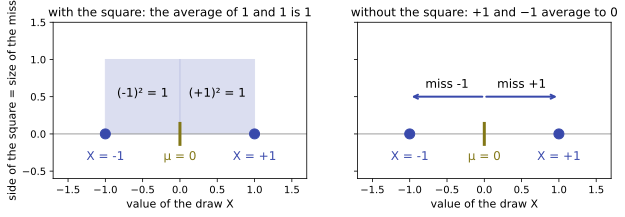
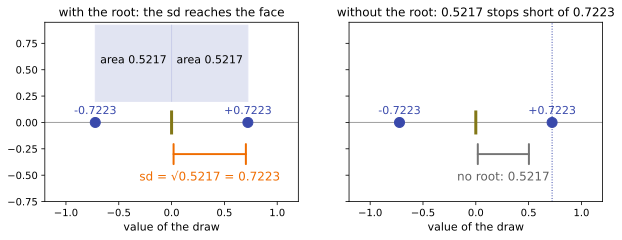

# Variance

Up: [[Statistics]] · [[The Scaling Rule For Variance]] ➡️

Mathematics, Statistics. Needs: the mean of a random variable, its [expectation](../references/textbooks/statistics/introduction-to-probability-for-data-science.pdf#page=141), read as a long-run average.

**Variance is the average squared miss of a draw from its mean.**

> [!question]- Test yourself
> No quiz page covers this note yet.

> [!warning]- Unfinished
> - No drawn pictures for the definition yet: the form, the mechanism and the deep-dive sheet have no prompts in the vault's `.prompts/Variance.md`.
> - No quiz page for this note yet.

Claims marked stated: 1.

**Its square root.** The square root of the variance is the standard deviation, a typical miss in the units of the draw itself.

**What multiplying a draw does.** What happens to both numbers when a draw is multiplied by a fixed number is its own note, [[The Scaling Rule For Variance]].

**Colours in this note.** <span style="color:#3949ab">**Indigo is the draw $X$**</span>, <span style="color:#827717">**olive is its mean $\mu$**</span>, <span style="color:#6a1b9a">**purple is a standard normal draw $\varepsilon$**</span>, and <span style="color:#ef6c00">**orange is the fixed multiplier $c$**</span>. Purple and orange mean the same as in [[The Scaling Rule For Variance]] and on the one-expert rebuild's step 4 page.

## Table of contents

- [[#What variance measures]]
- [[#The name standard deviation]]
- [[#Scaling a draw scales its variance by the square]]
- [[#Variance taught in]]

## What variance measures

Navigation: 📋 [[#Table of contents|TOC]] | [[#The name standard deviation]] ➡️

Textbook: [Introduction to probability for data science, Definition 3.7, PDF p. 150](../references/textbooks/statistics/introduction-to-probability-for-data-science.pdf#page=150) · [the continuous case, Definition 4.6, PDF p. 200](../references/textbooks/statistics/introduction-to-probability-for-data-science.pdf#page=200). The book prints page numbers 16 lower (PDF page 150 prints 134).

**Variance**, also $\operatorname{Var}(X)$ or $\sigma^2$, is how far a random draw $X$ lands from its mean $\mu = \mathbb{E}[X]$ on average, measured as the average of the squared miss. *Cited:* Definition 3.7.

$$
\operatorname{Var}(X) = \mathbb{E}\big[(X - \mu)^2\big]
$$

$$
\operatorname{Var}(\textcolor{#3949ab}{X})
=
\underbrace{\mathbb{E}}_{\text{average over all draws}}
\Big[
\underbrace{\big(
\underbrace{\textcolor{#3949ab}{X} - \textcolor{#827717}{\mu}}_{\text{the miss of one draw}}
\big)^2}_{\text{squared: a positive area}}
\Big]
$$

**What the equation says.** $X - \mu$ is the miss, how far one draw lands from the mean, and the square turns it into a positive area. $\mathbb{E}$ averages that area over every draw, each weighted by its chance.

**Why the square is there.** The plain misses average to nothing: $\mathbb{E}[X - \mu] = \mathbb{E}[X] - \mu = 0$ for every $X$. On the coin below, without the square the misses $+1$ and $-1$ average to 0; with it, $1$ and $1$ average to 1. Squaring makes a miss below the mean count as much as one above it (*derived* here).

**Why the $\mathbb{E}$ is there.** One draw's squared miss depends on which value came up. Take a draw that is $\pm\sqrt{1.5}$ or $\pm\sqrt{0.5}$, each a quarter of the time: one draw alone gives a squared miss of 1.5 or 0.5, and the average over all four gives $(1.5 + 1.5 + 0.5 + 0.5)/4 = 1$, one number for the whole draw.

**Worked by hand: a fair coin that pays $+1$ or $-1$.** Each face has probability $\tfrac12$.

$$
\begin{aligned}
\mu &= \tfrac12(+1) + \tfrac12(-1) = 0 \\
\text{misses} &= +1 - 0 = +1, \qquad -1 - 0 = -1 \\
\text{squared misses} &= 1, \qquad 1 \\
\operatorname{Var}(X) &= \tfrac12(1) + \tfrac12(1) = 1, \qquad \sigma = \sqrt{1} = 1
\end{aligned}
$$

$$
\operatorname{Var}(\textcolor{#3949ab}{X})
=
\underbrace{\tfrac12}_{\text{chance of heads}}
\big(\underbrace{\textcolor{#3949ab}{+1} - \textcolor{#827717}{0}}_{\text{miss }+1}\big)^2
+
\underbrace{\tfrac12}_{\text{chance of tails}}
\big(\underbrace{\textcolor{#3949ab}{-1} - \textcolor{#827717}{0}}_{\text{miss }-1}\big)^2
=
\underbrace{\tfrac12 \cdot 1 + \tfrac12 \cdot 1}_{\text{squares weighted by chance}}
=
1
$$

**What the equation says.** The expectation of a draw with two values is a sum of two terms, each a squared miss times its chance. Both squared misses are 1, so their weighted average is 1.

**Why the $\tfrac12$ is there.** It is the chance of each face, and it makes the sum an average. Without the two halves the sum is $1 + 1 = 2$, which counts the faces instead of averaging them.

<table>
<tr><th>draw</th><th>face</th><th>chance</th><th style="color:#3949ab">value <i>X</i></th><th>miss <i>X</i> − <i style="color:#827717">μ</i></th><th>squared miss (<i>X</i> − <i>μ</i>)²</th></tr>
<tr><td>coin</td><td>heads</td><td>½</td><td>+1</td><td>+1</td><td style="border:2px solid #212121">1</td></tr>
<tr><td>coin</td><td>tails</td><td>½</td><td>−1</td><td>−1</td><td style="border:2px solid #212121">1</td></tr>
<tr style="background:#fff8e1"><td><b>coin</b></td><td><b>average</b></td><td></td><td><i style="color:#827717">μ</i> = 0</td><td style="border:2px dashed #212121"><b>0</b></td><td style="border:2px solid #212121"><b>Var = 1</b></td></tr>
<tr><td>coin × <span style="color:#ef6c00"><i>c</i></span></td><td>heads</td><td>½</td><td>+0.7223</td><td>+0.7223</td><td>0.5217</td></tr>
<tr><td>coin × <span style="color:#ef6c00"><i>c</i></span></td><td>tails</td><td>½</td><td>−0.7223</td><td>−0.7223</td><td>0.5217</td></tr>
<tr><td>coin × <span style="color:#ef6c00"><i>c</i></span></td><td>average</td><td></td><td><i style="color:#827717">μ</i> = 0</td><td>0</td><td style="border:2px solid #212121">Var = 0.5217</td></tr>
</table>

**How to read this table.** Each row is one face of a draw, with its chance, its value, its miss from the mean and that miss squared. The average rows weight each face by its chance: the miss column averages to the dashed 0, and the squared-miss column averages to the variance.

**What to look for.** The highlighted row is the coin worked above: misses that average to 0 and squares that average to 1. The bottom three rows are the coin times $c = 0.7223$, the noise scale at code step 50 of a 100-step cosine schedule, used in [[#The name standard deviation]].

```python
import matplotlib.pyplot as plt
from matplotlib.patches import Rectangle

X_COL, MU_COL = "#3949ab", "#827717"        # the draw X, its mean mu
faces = [1.0, -1.0]                          # the fair coin, each face half the time
mu = sum(faces) / 2                          # 0.0
fig, (left, right) = plt.subplots(1, 2, figsize=(10, 4.2), sharey=True)
for ax in (left, right):
    ax.axhline(0, color="#9e9e9e", lw=1)
    ax.plot(faces, [0, 0], "o", color=X_COL, ms=10, zorder=3)
    ax.plot([mu], [0], "|", color=MU_COL, ms=24, mew=3)
    ax.text(mu, -0.35, "μ = 0", ha="center", color=MU_COL, fontsize=12)
    for x in faces:
        ax.text(x, -0.35, f"X = {x:+.0f}", ha="center", color=X_COL, fontsize=12)
    ax.set_xlim(-1.7, 1.7); ax.set_ylim(-0.6, 1.5); ax.set_aspect("equal")
    ax.set_xlabel("value of the draw X", fontsize=11)
left.set_ylabel("side of the square = size of the miss", fontsize=11)
for x in faces:                              # with the square: side |miss|, area miss squared
    miss = x - mu
    left.add_patch(Rectangle((min(mu, x), 0), abs(miss), abs(miss), color=X_COL, alpha=0.18))
    left.text(mu + miss / 2, 0.5, f"({miss:+.0f})² = {miss ** 2:.0f}", ha="center", fontsize=12)
left.set_title("with the square: the average of 1 and 1 is 1", fontsize=12)
for x in faces:                              # without the square: the signed misses
    right.annotate("", (x, 0.5), (mu, 0.5), arrowprops=dict(arrowstyle="->", color=X_COL, lw=2))
    right.text(mu + (x - mu) / 2, 0.62, f"miss {x - mu:+.0f}", ha="center", fontsize=12)
right.set_title("without the square: +1 and −1 average to 0", fontsize=12)
fig.savefig("variance-the-coin-squared-misses.svg", format="svg", bbox_inches="tight")
```



**How to read this.** The x-axis is the value of the draw, with the coin's faces at $-1$ and $+1$ and the mean at 0. On the left each miss carries a square whose side is the miss and whose area is the squared miss, 1 each; on the right the same misses are signed arrows. The number to look at is the average: 1 on the left, 0 on the right.

**The coin stands in for $\varepsilon$.** A standard normal draw $\varepsilon \sim \mathcal{N}(0, 1)$ has the same two numbers, mean 0 and variance 1, by the definition of $\mathcal{N}(0, 1)$. Only the mean and the variance enter the scaling rule, so the coin is a fair stand-in for $\varepsilon$ there. *Derived* in [[The Scaling Rule For Variance#How the scaling rule works]], where no step uses the shape of the distribution.

**Why this matters.** Every spread rule in these notes, from [[The Scaling Rule For Variance]] to the sum rule in [[Sums Of Independent Gaussians#How the rule works]], is a statement about this one average. Knowing it as an average of squared misses is what lets a number like 0.5217 be checked by hand on a coin.

## The name standard deviation

Navigation: ⬅️ [[#What variance measures]] | 📋 [[#Table of contents|TOC]] | [[#Scaling a draw scales its variance by the square]] ➡️

**Standard deviation**, also $\operatorname{sd}(X)$ or $\sigma$, is the square root of the variance, and is in the same units as $X$. *Cited:* [Definition 3.7, PDF p. 150](../references/textbooks/statistics/introduction-to-probability-for-data-science.pdf#page=150).

### The base word: deviation

**What the word means.** A deviation is one draw's miss from the mean, with its sign.

$$
\underbrace{\textcolor{#3949ab}{X} - \textcolor{#827717}{\mu}}_{\text{deviation of one draw}}
$$

**What it means.** On the coin the deviations are $+1$ and $-1$, and on the coin times 0.7223 they are $\pm 0.7223$. Averaged plainly they always give 0, as [[#What variance measures]] shows.

### The qualifier: standard

**What the word means.** "Standard" names the one typical size that stands for all the deviations at once: the root of their average square, also called the root mean square. *Stated.*

$$
\underbrace{\text{standard size}}_{\text{one number}} = \sqrt{\underbrace{\text{average of } (\text{deviation})^2}_{\text{the variance}}}
$$

**What it means.** For the coin times 0.7223 that is $\sqrt{(0.5217 + 0.5217)/2} = \sqrt{0.5217} = 0.7223$. Both faces sit exactly that far from the mean, so the typical size is their distance.

### All the words together: the formula

$$
\operatorname{sd}(X) = \sigma = \sqrt{\operatorname{Var}(X)} = \sqrt{\mathbb{E}\big[(X - \mu)^2\big]}
$$

$$
\operatorname{sd}(\textcolor{#3949ab}{X})
=
\underbrace{\sqrt{\underbrace{\mathbb{E}\big[(\textcolor{#3949ab}{X} - \textcolor{#827717}{\mu})^2\big]}_{\text{variance, in squared units}}}}_{\text{square root: back to the units of }X}
$$

**What the equation says.** The standard deviation is the square root of the variance. The root undoes the square inside, so the result is a length on the same axis as the draw.

**Why the square root is there.** On the coin times 0.7223 the variance is 0.5217. With the root the standard deviation is $\sqrt{0.5217} = 0.7223$, the distance each face actually lands from the mean; without it the spread would read 0.5217, a distance no face reaches, in squared units.

### The consequence: the spread comes back in the units of the draw

$$
\underbrace{\sigma = 0.7223}_{\text{units of }X}
\qquad
\underbrace{\sigma^2 = 0.5217}_{\text{units of }X\text{ squared}}
$$

**What it means.** A variance is an area, and a standard deviation is the side of that area. That is why a formula that multiplies a draw needs a standard deviation, and why [[The Scaling Rule For Variance]] puts a square root on every variance it is handed.

```python
import matplotlib.pyplot as plt
from matplotlib.patches import Rectangle

X_COL, MU_COL, C_COL = "#3949ab", "#827717", "#ef6c00"
c = 0.7223
faces = [c, -c]                              # the coin times c, each face half the time
var = sum(f * f for f in faces) / 2          # average squared miss: 0.5217
sd = var ** 0.5                              # its square root: 0.7223
fig, (left, right) = plt.subplots(1, 2, figsize=(10, 4.2), sharey=True)
for ax in (left, right):
    ax.axhline(0, color="#9e9e9e", lw=1)
    ax.plot(faces, [0, 0], "o", color=X_COL, ms=10, zorder=3)
    ax.plot([0], [0], "|", color=MU_COL, ms=24, mew=3)
    for x in faces:
        ax.text(x, 0.08, f"{x:+.4f}", ha="center", color=X_COL, fontsize=11)
    ax.set_xlim(-1.2, 1.2); ax.set_ylim(-0.75, 0.95); ax.set_aspect("equal")
    ax.set_xlabel("value of the draw", fontsize=11)
for x in faces:                              # the squares whose average area is the variance
    left.add_patch(Rectangle((min(0, x), 0.2), abs(x), abs(x), color=X_COL, alpha=0.15))
    left.text(x / 2, 0.2 + abs(x) / 2, f"area {x * x:.4f}", ha="center", fontsize=11)
left.annotate("", (sd, -0.3), (0, -0.3), arrowprops=dict(arrowstyle="|-|", color=C_COL, lw=2))
left.text(sd / 2, -0.55, f"sd = √{var:.4f} = {sd:.4f}", ha="center", color=C_COL, fontsize=12)
left.set_title("with the root: the sd reaches the face", fontsize=12)
right.annotate("", (var, -0.3), (0, -0.3), arrowprops=dict(arrowstyle="|-|", color="#757575", lw=2))
right.text(var / 2, -0.55, f"no root: {var:.4f}", ha="center", color="#616161", fontsize=12)
right.axvline(sd, color=X_COL, ls=":", lw=1)
right.set_title("without the root: 0.5217 stops short of 0.7223", fontsize=12)
fig.savefig("variance-the-standard-deviation-is-a-length.svg", format="svg", bbox_inches="tight")
```



**How to read this.** The x-axis is the value of the draw, with faces at $\pm 0.7223$ and the mean at 0. On the left the squares have area 0.5217 each, and the orange bracket under the axis is their side, the standard deviation 0.7223, ending on the face. On the right the grey bracket is the variance read as a length, 0.5217, stopping short of the dotted line through the face.

## Scaling a draw scales its variance by the square

Navigation: ⬅️ [[#The name standard deviation]] | 📋 [[#Table of contents|TOC]] | [[#Variance taught in]] ➡️

**In two lines.** Multiplying a draw by a fixed number $c$ multiplies its variance by $c^2$ and its standard deviation by $|c|$: $\operatorname{Var}(cX) = c^2 \operatorname{Var}(X)$. Its name taken apart, its form, its sandbox and its derivation are in [[The Scaling Rule For Variance#Scaling a draw scales its variance by the square]].

## Variance taught in

Navigation: ⬅️ [[#Scaling a draw scales its variance by the square]] | 📋 [[#Table of contents|TOC]]

**Taught in:**

- the one-expert rebuild walk in the reduce-reuse-recycle research repository, step 4, where [variance is written as the average squared miss](../../../PhD/reduce-reuse-recycle/artifacts/drips/simple-distributions-rebuild/01-one-expert-from-scratch.md#step4-the-scaling-rule) with an underbrace on the average and on the squared miss, before the scaling rule is derived from it
- the forward-process-and-the-score walk's [kept rung on the one-shot draw and its density](../../../PhD/reduce-reuse-recycle/artifacts/drips/forward-process-and-the-score/kept/04-the-one-shot-draw-and-its-density.md), which links its standard deviation 0.7223 at step 50 here

> [!note]- How this was checked
> The coin, the four-value draw and every number in the table were worked by hand and match the outputs of `coin.py` and `schedule_levels.py` in [[Running The Scaling Rule For Variance#Try the scaling rule yourself]], re-run on 2026-10-21 on mscluster (Linux) with Python 3.12.10. The two figure scripts were run on 2026-10-21 on mscluster with Python 3.12.10, matplotlib 3.10.8 and numpy 2.4.3, in an empty scratch folder, by vault-writer; each SVG was opened (through a PNG copy made by the same script) before filing. The prepared environment `~/.vault-sandbox` is missing on this machine, so the system `python3`, which has matplotlib and numpy, drew them. The textbook's PDF pages 150 and 200 were opened and read as text. [Variance](https://en.wikipedia.org/wiki/Variance) on Wikipedia (CC BY-SA 4.0) answered 200 on 2026-10-20.
