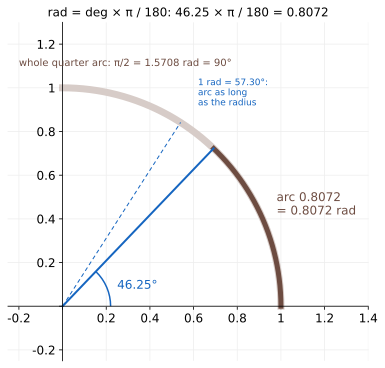
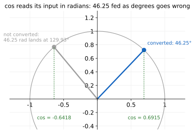

# Radians

Up: [[Trigonometry]] · ⬅️ [[The Unit Circle]] · [[The Cosine Wave]] ➡️

Mathematics, Trigonometry. Needs: [[The Unit Circle#The angle: one line from the origin|an angle as one line turned from the origin]].

> [!question] Test yourself
> No quiz page covers this note yet.

> [!warning] Unfinished
> - No quiz page for this note yet.

Stated claims: 0.

**A radian measures an angle by the length of arc it cuts from a circle of radius 1.** So 46.25° is 0.8072 radians, and the quarter turn, 90°, is π/2 = 1.5708.

**Colours, the same in every equation and figure.** Purple is arc length, the angle in radians. Blue is the line from the origin and the angle in degrees. Green is the cosine. Grey is a case drawn for comparison.

## Where you work

Python 3 with matplotlib, in the folder [[The Unit Circle#Try the unit circle yourself]] makes, with its `plane.py`.

## Table of contents

- [[#The angle as a length]]
- [[#Try radians yourself]]
- [[#Reading the radians output]]
- [[#How radians work]]
- [[#Other ways to convert an angle]]
- [[#Why radians matter]]
- [[#Radians taught in, applied in]]

## The angle as a length

Navigation: 📋 [[#Table of contents|TOC]] | [[#Try radians yourself]] ➡️

Textbook: [Whitney, Trigonometry handbook, radians and degrees, PDF p. 7](../references/textbooks/trigonometry/trigonometry-handbook.pdf#page=7)

### The angles and their arcs

<table>
<tr><th>degrees</th><th style="color:#6a1b9a">radians</th><th style="color:#6a1b9a">string on a 10 cm radius</th></tr>
<tr><td>0°</td><td>0</td><td>0 cm</td></tr>
<tr><td>15°</td><td>0.2618</td><td>2.62 cm</td></tr>
<tr><td>45°</td><td>0.7854</td><td>7.85 cm</td></tr>
<tr style="background:#fff8e1"><td><b>46.25°</b></td><td style="border:2px solid #212121"><b>0.8072</b></td><td style="border:2px solid #212121">8.07 cm</td></tr>
<tr><td>57.30°</td><td style="border:2px dashed #212121">1</td><td>10 cm, one radius</td></tr>
<tr><td>90°</td><td style="border:2px solid #212121">π/2 = 1.5708</td><td style="border:2px solid #212121">15.71 cm</td></tr>
<tr><td>180°</td><td>π = 3.1416</td><td>31.42 cm</td></tr>
<tr><td>360°</td><td>2π = 6.2832</td><td>62.83 cm</td></tr>
</table>

**How to read this table.** Each row is one angle measured twice: with a protractor in degrees, and with a string laid along the arc. The string column is the radian column times 10, because the radius is 10 cm.

**What to look for.** The boxed cells are the ones the cosine schedule uses: 46.25° at post 51 and the whole quarter turn. The dashed cell is one radian, the arc as long as the radius.

### The base word: radian

$$
\underbrace{\textcolor{#6a1b9a}{s}}_{\text{arc length}}
=
\underbrace{r}_{\text{radius}}\;
\underbrace{\textcolor{#6a1b9a}{\theta}}_{\text{angle in radians}},
\qquad
\textcolor{#6a1b9a}{0.8072} = 1 \cdot \textcolor{#6a1b9a}{0.8072}
$$

**What the equation says.** On a circle of radius $r$, an angle of θ radians cuts an [arc of length](../references/textbooks/trigonometry/trigonometry-handbook.pdf#page=7) $r\theta$. With $r = 1$ the arc and the angle are the same number.

**Why the radius is there.** Draw the same 46.25° on a circle of radius 10 cm and the arc is $10 \cdot 0.8072 = 8.07$ cm. Dividing the arc by the radius, [θ = s / r](../references/textbooks/calculus/calculus-textbook.pdf#page=1207), gives 0.8072 at any size.

### Then the conversion: degrees to radians

$$
\underbrace{\textcolor{#6a1b9a}{\theta_{\text{rad}}}}_{\text{arc on radius }1}
=
\underbrace{\textcolor{#1565c0}{\theta_{\text{deg}}}}_{\text{protractor reading}}
\cdot
\underbrace{\frac{\pi}{180}}_{\text{radians per degree}}
=
46.25 \cdot 0.017453
=
\textcolor{#6a1b9a}{0.8072}
$$

**What the equation says.** Multiply degrees by π/180 to get radians. A quarter turn is $90 \cdot \pi/180 = \pi/2 = 1.5708$.

**Why π/180 is there.** A whole turn is 360° and also the whole circumference, $2\pi r$, which is $2\pi$ on radius 1. So one degree is $2\pi / 360 = \pi / 180$ of a radian.

```python
import math
from plane import plane, save, circle, angle, rad, BLUE, PURPLE, LIGHT_PURPLE

for deg in (46.25, 90, math.degrees(1)):
    print(f"{deg:8.4f} deg  x pi / 180 = {deg * math.pi / 180:.4f} rad  = arc length on radius 1")

fig, ax = plane((-0.25, 1.4), (-0.25, 1.3))
circle(ax, upto=90)
for upto, lw, color in ((90, 7, LIGHT_PURPLE), (46.25, 5, PURPLE)):
    ts = [rad(d / 10) for d in range(0, int(upto * 10) + 1)]
    ax.plot([math.cos(t) for t in ts], [math.sin(t) for t in ts], color=color, lw=lw)
ax.plot([0, math.cos(rad(46.25))], [0, math.sin(rad(46.25))], color=BLUE, lw=2)
ax.plot([0, math.cos(1)], [0, math.sin(1)], color=BLUE, lw=1, ls=(0, (4, 3)))
angle(ax, 46.25, r=0.22)
ax.text(0.25, 0.08, "46.25°", color=BLUE)
ax.text(0.98, 0.42, "arc 0.8072\n= 0.8072 rad", color=PURPLE)
ax.text(0.62, 0.92, "1 rad = 57.30°:\narc as long\nas the radius", color=BLUE, fontsize=9)
ax.text(-0.2, 1.1, "whole quarter arc: π/2 = 1.5708 rad = 90°", color=PURPLE, fontsize=10)
ax.set_title("rad = deg × π / 180: 46.25 × π / 180 = 0.8072", fontsize=12)
save(fig, "t4-degrees-and-radians-arc.svg")
```



**How to read this.** Both axes are in units of the radius. The dark purple arc is the angle 46.25° as a length, 0.8072 of a radius. The pale arc continues to the y-axis, the whole quarter turn, 1.5708. The dashed blue line marks where the arc reaches exactly one radius, at 57.30°.

### The consequence: degrees fed in as radians

Python's [`math.cos`](https://docs.python.org/3/library/math.html#math.cos) reads its input as radians. Give it the degree reading and it turns 46.25 radians instead:

$$
\underbrace{46.25\ \text{rad}}_{\text{the degree number, read as radians}}
=
\underbrace{7 \cdot 2\pi}_{\text{seven whole turns}}
+
\underbrace{2.2677\ \text{rad}}_{129.93^\circ}
\quad\Longrightarrow\quad
\cos(46.25) = \textcolor{#9e9e9e}{-0.6418}
\ \text{ against }\
\cos(0.8072) = \textcolor{#2e7d32}{0.6915}
$$

**What goes wrong.** Whole turns change nothing, so the line ends at 129.93°, in the upper-left quarter, and its cosine is negative. Every later number built on it is wrong too: its square, 0.4119, is not the 0.4782 the schedule needs.

```python
import math
from plane import plane, save, circle, rad, GREEN, BLUE, GREY

right = rad(46.25)
wrong = 46.25 % (2 * math.pi)
print(f"math.cos(math.radians(46.25)) = {math.cos(right):.4f}")
print(f"math.cos(46.25)               = {math.cos(46.25):.4f}  (46.25 rad = 7 turns + {wrong:.4f} rad = {math.degrees(wrong):.2f} deg)")

fig, ax = plane((-1.3, 1.3), (-0.45, 1.3))
circle(ax)
for t, color, label, dx in ((right, BLUE, "converted: 46.25°", 0.05), (wrong, GREY, f"not converted:\n46.25 rad lands at {math.degrees(wrong):.2f}°", -0.75)):
    x, y = math.cos(t), math.sin(t)
    ax.plot([0, x], [0, y], color=color, lw=2.5)
    ax.plot(x, y, "o", color=color, ms=8)
    ax.plot([x, x], [0, y], ":", color=GREEN)
    ax.text(x + dx, y + 0.08, label, color=color, fontsize=10)
    ax.text(x, -0.3, f"cos = {math.cos(t):.4f}", color=GREEN, ha="center", fontsize=10)
ax.set_title("cos reads its input in radians: 46.25 fed as degrees goes wrong", fontsize=12)
save(fig, "t8-degrees-fed-as-radians.svg")
```



**How to read this.** The x-axis runs from −1.3 to 1.3, so a point left of the y-axis has a negative cosine. The blue line is the angle converted first; the grey one is the same number taken as radians. Look at the two green readings: 0.6915 against −0.6418.

## Try radians yourself

Navigation: ⬅️ [[#The angle as a length]] | 📋 [[#Table of contents|TOC]] | [[#Reading the radians output]] ➡️

**1. What you need.** Python 3 with matplotlib, checked by [[The Unit Circle#Try the unit circle yourself]], step 1.

**2. When it is missing.** Step 2 there says how to make the prepared environment.

**3. The setup.** Work in the folder that note's step 3 makes, with [plane.py](sandbox/plane.py) in it. Save the two scripts above as `t4_radians.py` and `t8_forgot_radians.py`.

**4. A look before: three angles as arcs.**

```bash
python3 t4_radians.py
```

```text
 46.2500 deg  x pi / 180 = 0.8072 rad  = arc length on radius 1
 90.0000 deg  x pi / 180 = 1.5708 rad  = arc length on radius 1
 57.2958 deg  x pi / 180 = 1.0000 rad  = arc length on radius 1
saved t4-degrees-and-radians-arc.svg
```

**5. The failure: degrees fed in as radians.**

```bash
python3 t8_forgot_radians.py
```

```text
math.cos(math.radians(46.25)) = 0.6915
math.cos(46.25)               = -0.6418  (46.25 rad = 7 turns + 2.2677 rad = 129.93 deg)
saved t8-degrees-fed-as-radians.svg
```

**6. The technique: multiply by π/180, or let `math.radians` do it.**

```bash
python3 -c "import math; print(46.25 * math.pi / 180, math.radians(46.25))"
```

```text
0.8072147790473774 0.8072147790473774
```

**7. Another way: measure the string.** On a 10 cm radius the arc is 10 times the radians:

```bash
python3 -c "import math; print(round(10 * math.radians(46.25), 2), round(10 * math.pi / 2, 2))"
```

```text
8.07 15.71
```

**8. More worked examples: back from radians to degrees.**

```bash
python3 -c "import math; print(round(math.degrees(1), 4), round(math.degrees(0.8072), 4))"
```

```text
57.2958 46.2492
```

**9. Clean up, and prove it.** [[The Unit Circle#Try the unit circle yourself]], step 9, removes the folder and checks it is gone.

## Reading the radians output

Navigation: ⬅️ [[#Try radians yourself]] | 📋 [[#Table of contents|TOC]] | [[#How radians work]] ➡️

| Step | Field | This run | How to read it | Backing |
|---|---|---|---|---|
| 4 | `46.2500 deg` | `0.8072 rad` | the arc post 51's angle cuts on radius 1 | derived below |
| 4 | `90.0000 deg` | `1.5708 rad` | the whole quarter arc, π/2 | derived below |
| 4 | `57.2958 deg` | `1.0000 rad` | one radian, the arc as long as the radius | derived below |
| 5 | `math.cos(46.25)` | `-0.6418` | 46.25 read as radians: 7 turns plus 2.2677 rad, at 129.93° | shown |
| 6 | both columns | `0.8072147790473774` | the formula and `math.radians` agree to the last digit | shown |
| 7 | `8.07 15.71` | cm | the string on a 10 cm radius for 46.25° and 90° | derived below |
| 8 | `46.2492` | deg | 0.8072 is a rounded radian, so it comes back 0.0008° short | shown |

## How radians work

Navigation: ⬅️ [[#Reading the radians output]] | 📋 [[#Table of contents|TOC]] | [[#Other ways to convert an angle]] ➡️

1. The circumference of a circle of radius $r$ is $2\pi r$. One whole turn sweeps all of it.
2. An angle that sweeps a fraction of the turn sweeps the same fraction of the circumference: $s = 2\pi r \cdot \frac{\theta}{2\pi} = r\theta$, with θ in radians, as the [handbook derives](../references/textbooks/trigonometry/trigonometry-handbook.pdf#page=7).
3. A whole turn is both 360° and $2\pi$ radians, so $1^\circ = \pi/180$ and $1\ \text{rad} = 180/\pi = 57.2958^\circ$.
4. Worked: $46.25 \cdot \pi / 180 = 0.8072$; $90 \cdot \pi/180 = \pi/2 = 1.5708$; on a 10 cm radius, $10 \cdot 0.8072 = 8.07$ cm.

## Other ways to convert an angle

Navigation: ⬅️ [[#How radians work]] | 📋 [[#Table of contents|TOC]] | [[#Why radians matter]] ➡️

- **NumPy**, for many angles at once: `numpy.deg2rad` and `numpy.rad2deg`.
- **Stay in fractions of a turn.** The schedule's code writes the angle as a position from 0 to 1 times `math.pi / 2`, so it never passes through degrees: [[The Quarter Circle Under The Cosine Schedule#Step 1: the position ruler|the position ruler]].
- **Drag it.** The scene Dissolving the Dog, [frame "radians"](https://claude.ai/artifact/X7QGLTxssbz41G7iTiRxC9#timetable-radians), measures the angle both ways.

## Why radians matter

Navigation: ⬅️ [[#Other ways to convert an angle]] | 📋 [[#Table of contents|TOC]] | [[#Radians taught in, applied in]] ➡️

Every `cos` in code takes radians, so the π/2 in the cosine schedule's formula is the quarter turn written as an arc. Calculus [measures trigonometric angles in radians](../references/textbooks/calculus/calculus-textbook.pdf#page=193) too, and that is what makes the slope of $\cos\theta$ equal $-\sin\theta$, which [[The Cosine Wave]] uses to show where $\cos^2$ is flat.

## Radians taught in, applied in

Navigation: ⬅️ [[#Why radians matter]] | 📋 [[#Table of contents|TOC]]

**Taught in:**

- the `drip --math` walk of the forward process and the score in the reduce-reuse-recycle research repository (`artifacts/drips/forward-process-and-the-score/`), piece 2, rung 1: degrees and radians, the string along the arc, and the quarter turn as π/2
- step 4 of the one-expert rebuild walk in the same repository (`artifacts/drips/simple-distributions-rebuild/01-one-expert-from-scratch.md`), "On paper 3: measure the angle twice"

**Applied in:** [[The Quarter Circle Under The Cosine Schedule]] and [[The Cosine Noise Schedule]], whose formula multiplies a position by π/2.

> [!note]- How this was checked
> The two figure scripts and the three one-line commands were run on 2026-10-21 on mscluster (Linux), with Python 3.12.10 and matplotlib 3.10.8 from the machine's `python3`, in the empty folder `~/playground/sandbox/unit-circle-figures`, by vault-writer, which was removed afterwards (clean-up check returned 2). The prepared environment `~/.vault-sandbox` is missing on this machine. Every output above is that run's text. Each SVG was rasterised with PyMuPDF and opened, and a matplotlib PNG twin was opened to check the dashed line. The square 0.4119 is $0.6418^2$.
>
> The trigonometry handbook's PDF page 7 (360° and 2π in one rotation, one radian as the radius wrapped along the circle, S = rθ) and the calculus textbook's PDF pages 1207 (θ = s / r) and 193 (the variable in sin x and cos x measured in radians) were opened and read as text with PyMuPDF. The Python documentation's math page states that `math.cos(x)` returns the cosine of x radians. The scene frame anchor is as the walk's `dispatch.md` records it. No tldr-pages entry covers this.
