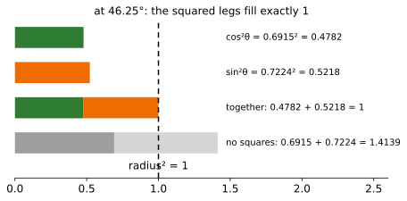

# The Cosine Wave

Up: [[Trigonometry]] · ⬅️ [[Radians]]

Mathematics, Trigonometry. Needs: [[The Unit Circle]] for the cosine as the point's x-coordinate, and [[Radians]] for the angle as a length.

> [!question] Test yourself
> No quiz page covers this note yet.

> [!warning] Unfinished
> - No quiz page for this note yet.

Stated claims: 0.

**Walk the point once round the unit circle and its x-coordinate, plotted against the angle, is the cosine wave; its square is the share of 1 that the horizontal leg holds.** Over the quarter turn from 0 to π/2 that share falls from 1 to 0, slowly at both ends and fastest in the middle. The cosine schedule is built on exactly that stretch.

**Colours, the same in every equation and figure.** Green is $\cos\theta$, solid, and its square $\cos^2\theta$, dashed or as a bar. Orange is $\sin\theta$ and its square. Blue marks the quarter turn. Grey is a case drawn for comparison.

## Where you work

Python 3 with matplotlib, in the folder [[The Unit Circle#Try the unit circle yourself]] makes, with its `plane.py`.

## Table of contents

- [[#The square of the cosine]]
- [[#Try the cosine wave yourself]]
- [[#Reading the cosine-wave output]]
- [[#How the cosine wave works]]
- [[#Other ways to see the quarter turn]]
- [[#Why the cosine wave matters]]
- [[#The cosine wave taught in, applied in]]

## The square of the cosine

Navigation: 📋 [[#Table of contents|TOC]] | [[#Try the cosine wave yourself]] ➡️

Textbook: [Whitney, Trigonometry handbook, graphs of the parent functions, PDF p. 16](../references/textbooks/trigonometry/trigonometry-handbook.pdf#page=16)

### The quarter turn and its table

<table>
<tr><th>angle</th><th>radians</th><th style="color:#2e7d32">cos θ</th><th style="color:#2e7d32">cos² θ</th><th>drop from the row above</th><th>slope of cos² θ</th></tr>
<tr><td>0°</td><td>0</td><td>1</td><td style="border:2px solid #212121">1</td><td></td><td style="border:2px solid #212121">0</td></tr>
<tr><td>15°</td><td>0.2618</td><td>0.9659</td><td>0.933</td><td style="border:2px dashed #212121">0.067</td><td>−0.5</td></tr>
<tr><td>30°</td><td>0.5236</td><td>0.8660</td><td>0.75</td><td>0.183</td><td>−0.8660</td></tr>
<tr><td>45°</td><td>0.7854</td><td>0.7071</td><td>0.5</td><td style="border:2px dashed #212121">0.25</td><td style="border:2px solid #212121">−1</td></tr>
<tr style="background:#fff8e1"><td><b>46.25°</b></td><td>0.8072</td><td>0.6915</td><td style="border:2px solid #212121"><b>0.4782</b></td><td></td><td>−0.9990</td></tr>
<tr><td>60°</td><td>1.0472</td><td>0.5</td><td>0.25</td><td style="border:2px dashed #212121">0.25</td><td>−0.8660</td></tr>
<tr><td>75°</td><td>1.3090</td><td>0.2588</td><td>0.067</td><td>0.183</td><td>−0.5</td></tr>
<tr><td>90°</td><td>1.5708</td><td>0</td><td style="border:2px solid #212121">0</td><td style="border:2px dashed #212121">0.067</td><td style="border:2px solid #212121">0</td></tr>
</table>

**How to read this table.** Each row is one angle of the quarter turn. The drop column is how much $\cos^2$ lost since the row 15° earlier; the 46.25° row sits between two 15° rows, so it has no drop. The last column is the slope $-2\cos\theta\sin\theta$, in share per radian.

**What to look for.** The solid boxes: $\cos^2$ starts at 1 and ends at 0 with slope 0 at both ends, and is steepest, −1, at 45°. The dashed boxes: the drops are 0.067 at the ends and 0.25 in the middle.

### The two shares

[Pythagoras](../references/textbooks/geometry/geometry-handbook.pdf#page=80) on [[The Unit Circle#The point: from length and angle to x and y|the triangle with hypotenuse 1]] gives the [Pythagorean identity](../references/textbooks/trigonometry/trigonometry-handbook.pdf#page=9):

$$
\underbrace{\textcolor{#2e7d32}{\cos^2\theta}}_{\text{horizontal leg, squared}}
+
\underbrace{\textcolor{#ef6c00}{\sin^2\theta}}_{\text{vertical leg, squared}}
=
\underbrace{1}_{\text{radius squared}},
\qquad
\textcolor{#2e7d32}{0.4782} + \textcolor{#ef6c00}{0.5218} = 1
$$

**What the equation says.** The two squared legs split 1 into two shares, at every angle. When one share grows the other shrinks by the same amount.

**Why the squares are there.** The legs themselves do not add to 1: $0.6915 + 0.7224 = 1.4139$. Only their squares do. This split of 1 is what the cosine schedule uses: [[The Quarter Circle Under The Cosine Schedule#Step 2: the point is the two multipliers|the kept share and the noise share]] are $\cos^2$ and $\sin^2$ of one angle.

```python
import math
import matplotlib.pyplot as plt
from plane import save, rad, GREEN, ORANGE, GREY, LIGHT_GREY

c, s = math.cos(rad(46.25)), math.sin(rad(46.25))
print(f"cos^2 {c * c:.4f} + sin^2 {s * s:.4f} = {c * c + s * s:.4f}   without the squares: {c:.4f} + {s:.4f} = {c + s:.4f}")

fig, ax = plt.subplots(figsize=(7.5, 3.2))
rows = [(3, 0, c * c, GREEN, f"cos²θ = 0.6915² = {c * c:.4f}"),
        (2, 0, s * s, ORANGE, f"sin²θ = 0.7224² = {s * s:.4f}"),
        (1, 0, c * c, GREEN, ""), (1, c * c, s * s, ORANGE, f"together: {c * c:.4f} + {s * s:.4f} = 1"),
        (0, 0, c, GREY, ""), (0, c, s, LIGHT_GREY, f"no squares: 0.6915 + 0.7224 = {c + s:.4f}")]
for y, left, width, color, label in rows:
    ax.barh(y, width, left=left, color=color, height=0.6)
    if label:
        ax.text(1.47, y, label, va="center", fontsize=10)
ax.axvline(1, color="black", ls=(0, (4, 3)))
ax.text(1.0, -0.75, "radius² = 1", ha="center")
ax.set_xlim(0, 2.6)
ax.set_ylim(-1, 3.5)
ax.set_yticks([])
ax.spines[["top", "right", "left"]].set_visible(False)
ax.set_title("at 46.25°: the squared legs fill exactly 1", fontsize=12)
save(fig, "t6-pythagoras-shares.svg")
```



**How to read this.** The x-axis is length from 0, and the dashed line is 1. The third bar is the first two placed end to end and stops exactly on the line. The grey bar, the legs without their squares, overshoots to 1.4139.

### The base word: wave

Walk the angle all the way round, from 0 to $2\pi$, and plot the point's x-coordinate against it. The [graph of cosine](../references/textbooks/trigonometry/trigonometry-handbook.pdf#page=16) rises and falls between 1 and −1 and repeats every $2\pi$, its [period](../references/textbooks/trigonometry/trigonometry-handbook.pdf#page=17).

$$
\underbrace{\textcolor{#2e7d32}{\cos\theta}}_{\text{x-coordinate at angle }\theta}
\qquad\text{and}\qquad
\underbrace{\textcolor{#2e7d32}{\cos^2\theta}}_{\text{share held by the horizontal leg}},
\qquad
\theta \in \underbrace{[0,\ 2\pi]}_{\text{one full turn}}
$$

**What the equation says.** The solid curve is the cosine itself; it goes negative in the left half of the circle. The dashed curve is its square, never negative, and it repeats twice per turn.

**Why the quarter turn is shaded.** From 0 to π/2 the cosine falls from 1 to 0 without going negative, so on that stretch $\cos^2$ is a share falling from all of 1 to none of it. That stretch is the one the cosine schedule uses.

### The quarter turn: where the square is flat

The slope of $\cos^2\theta$ comes from the [derivative of the cosine](../references/textbooks/calculus/calculus-textbook.pdf#page=193) and the [chain rule](../references/textbooks/calculus/calculus-textbook.pdf#page=198), with θ in radians:

$$
\frac{d}{d\theta}\,\textcolor{#2e7d32}{\cos^2\theta}
=
\underbrace{2\cos\theta}_{\text{outer square}}
\cdot
\underbrace{(-\sin\theta)}_{\text{inner cosine}}
=
-2\cos\theta\sin\theta
=
\underbrace{-\sin 2\theta}_{\text{double angle}}
$$

**What the equation says.** The slope is a product of the two legs. At 0 the vertical leg is 0, and at π/2 the horizontal leg is 0, so either way the product is 0 and the curve is flat.

**Why the 2 is there.** It is the outer square's own slope, $2u$ for $u^2$. Halfway, at 45°, the legs are both 0.7071 and the slope is $-2 \cdot 0.7071 \cdot 0.7071 = -1$, the steepest the square ever falls. At 46.25° it is −0.9990.

```python
import math
import matplotlib.pyplot as plt
from plane import save, GREEN, BLUE, LIGHT_BLUE

ts = [i * 2 * math.pi / 720 for i in range(721)]
for name, t in (("0", 0), ("pi/4", math.pi / 4), ("pi/2", math.pi / 2)):
    c, s = math.cos(t), math.sin(t)
    print(f"theta {name:4s}  cos {c:.4f}  cos^2 {c * c:.4f}  slope of cos {round(-s, 4) + 0:.4f}  slope of cos^2 {round(-2 * c * s, 4) + 0:.4f}")

fig, ax = plt.subplots(figsize=(9, 4.2))
ax.axvspan(0, math.pi / 2, color=LIGHT_BLUE)
ax.text(math.pi / 4, -1.2, "the quarter turn, 0 to π/2", color=BLUE, ha="center", fontsize=10)
ax.plot(ts, [math.cos(t) for t in ts], color=GREEN, lw=2.5)
ax.plot(ts, [math.cos(t) ** 2 for t in ts], color=GREEN, lw=2, ls=(0, (5, 3)))
ax.text(4.0, -0.75, "cos θ", color=GREEN, fontsize=12)
ax.text(3.2, 0.82, "cos² θ (dashed)", color=GREEN, fontsize=12)
for t0, label in ((0, "flat at 0:\nslope −2 cos θ sin θ = 0"), (math.pi / 2, "flat at π/2:\nslope 0")):
    y0 = math.cos(t0) ** 2
    ax.plot([t0 - 0.35, t0 + 0.35], [y0, y0], color="black", lw=1.5)
    ax.plot(t0, y0, "o", color="black", ms=6)
    ax.text(t0 + 0.4, y0 + 0.05, label, fontsize=9)
ax.plot([math.pi / 2 - 0.3, math.pi / 2 + 0.3], [0.3, -0.3], color="black", lw=1, ls=(0, (2, 2)))
ax.text(math.pi / 2 + 0.3, -0.45, "cos alone has slope −1 here", fontsize=9)
ax.axhline(0, color="black", lw=0.8)
ax.set_xticks([0, math.pi / 2, math.pi, 3 * math.pi / 2, 2 * math.pi], ["0\n0°", "π/2\n90°", "π\n180°", "3π/2\n270°", "2π\n360°"])
ax.set_xlim(-0.1, 2 * math.pi + 0.1)
ax.set_ylim(-1.35, 1.35)
ax.spines[["top", "right"]].set_visible(False)
ax.grid(color="#eeeeee")
ax.set_xlabel("θ in radians")
ax.set_title("one full turn of cos θ, and its square", fontsize=12)
save(fig, "t7-cosine-wave-quarter-turn.svg")
```


**How to read this.** The x-axis is the angle in radians, with degrees under each tick; the y-axis runs from −1.35 to 1.35. The solid curve is $\cos\theta$, the dashed curve $\cos^2\theta$. Look at the two black dots: the short black lines through them are flat, slope 0, at 0 and at π/2.

### The consequence: drop the square

Without the square, the quarter turn still starts flat, since the slope of $\cos\theta$ is $-\sin\theta = 0$ at 0. It does not end flat: at π/2 the slope is $-\sin(\pi/2) = -1$, the dashed tangent in the figure. A schedule built on $\cos$ alone would lose its last bit of signal at full speed instead of easing in, and its value would be a multiplier, 0.6915 at 46.25°, rather than a share, 0.4782.

## Try the cosine wave yourself

Navigation: ⬅️ [[#The square of the cosine]] | 📋 [[#Table of contents|TOC]] | [[#Reading the cosine-wave output]] ➡️

**1. What you need.** Python 3 with matplotlib, checked by [[The Unit Circle#Try the unit circle yourself]], step 1.

**2. When it is missing.** Step 2 there says how to make the prepared environment.

**3. The setup.** Work in the folder that note's step 3 makes, with [plane.py](sandbox/plane.py) in it. Save the two scripts above as `t6_shares.py` and `t7_wave.py`.

**4. A look before: the square every 15°, and its drops.**

```bash
python3 -c "import math; xs = [round(math.cos(math.radians(d)) ** 2, 3) for d in range(0, 91, 15)]; print(xs); print([round(a - b, 3) for a, b in zip(xs, xs[1:])])"
```

```text
[1.0, 0.933, 0.75, 0.5, 0.25, 0.067, 0.0]
[0.067, 0.183, 0.25, 0.25, 0.183, 0.067]
```

**5. The failure: adding the legs without squaring them.**

```bash
python3 t6_shares.py
```

```text
cos^2 0.4782 + sin^2 0.5218 = 1.0000   without the squares: 0.6915 + 0.7224 = 1.4139
saved t6-pythagoras-shares.svg
```

**6. The technique: the slope at the two ends and the middle.**

```bash
python3 t7_wave.py
```

```text
theta 0     cos 1.0000  cos^2 1.0000  slope of cos 0.0000  slope of cos^2 0.0000
theta pi/4  cos 0.7071  cos^2 0.5000  slope of cos -0.7071  slope of cos^2 -1.0000
theta pi/2  cos 0.0000  cos^2 0.0000  slope of cos -1.0000  slope of cos^2 0.0000
saved t7-cosine-wave-quarter-turn.svg
```

**7. Another way to the slope: a tiny step either side.**

```bash
python3 -c "import math; h = 1e-6; f = lambda t: math.cos(t) ** 2; print([round((f(t + h) - f(t - h)) / (2 * h), 4) + 0 for t in (0, math.pi / 4, math.pi / 2)])"
```

```text
[0.0, -1.0, 0.0]
```

**8. More worked examples: the slope at 46.25°, two ways.**

```bash
python3 -c "import math; t = math.radians(46.25); print(round(-2 * math.cos(t) * math.sin(t), 4), round(-math.sin(2 * t), 4))"
```

```text
-0.999 -0.999
```

**9. Clean up, and prove it.** [[The Unit Circle#Try the unit circle yourself]], step 9, removes the folder and checks it is gone.

## Reading the cosine-wave output

Navigation: ⬅️ [[#Try the cosine wave yourself]] | 📋 [[#Table of contents|TOC]] | [[#How the cosine wave works]] ➡️

| Step | Field | This run | How to read it | Backing |
|---|---|---|---|---|
| 4 | first list | `1.0` to `0.0` | $\cos^2$ at 0°, 15°, …, 90° | shown |
| 4 | second list | `0.067` … `0.25, 0.25` … `0.067` | slow at both ends, fastest in the middle | derived below |
| 5 | `cos^2 + sin^2` | `0.4782 + 0.5218 = 1.0000` | the two shares at 46.25° | derived below |
| 5 | `without the squares` | `1.4139` | the legs alone overshoot 1 by 0.4139 | shown |
| 6 | `slope of cos^2` at 0 and π/2 | `0.0000` | flat at both ends of the quarter turn | derived below |
| 6 | `slope of cos^2` at π/4 | `-1.0000` | the steepest point | derived below |
| 6 | `slope of cos` at π/2 | `-1.0000` | without the square the end is not flat | derived below |
| 7 | the list | `[0.0, -1.0, 0.0]` | the slope measured by stepping $10^{-6}$ either side agrees with step 6 | shown |
| 8 | both | `-0.999` | $-2\cos\theta\sin\theta = -\sin 2\theta$ at 46.25° | derived below |

## How the cosine wave works

Navigation: ⬅️ [[#Reading the cosine-wave output]] | 📋 [[#Table of contents|TOC]] | [[#Other ways to see the quarter turn]] ➡️

Textbook: [Whitney, Trigonometry handbook, the Pythagorean identities, PDF p. 9](../references/textbooks/trigonometry/trigonometry-handbook.pdf#page=9)

**The identity.** A point $(x, y)$ at distance $r$ satisfies $x^2 + y^2 = r^2$ by Pythagoras. Divide by $r^2$ and use $x / r = \cos\theta$, $y / r = \sin\theta$:

$$
\frac{x^2}{r^2} + \frac{y^2}{r^2} = 1
\quad\Longrightarrow\quad
\cos^2\theta + \sin^2\theta = 1,
\qquad
0.6915^2 + 0.7224^2 = 0.47819 + 0.52181 = 1.
$$

**The wave.** As θ grows past π/2 the point moves into the left half of the circle, so $\cos\theta$ goes negative; past $2\pi$ it is back where it started, so the curve repeats.

**The slope.** $\frac{d}{d\theta}\cos\theta = -\sin\theta$ when θ is in radians, and the chain rule on $u^2$ with $u = \cos\theta$ gives $2u \cdot u' = -2\cos\theta\sin\theta$. The double-angle rule $\sin 2\theta = 2\sin\theta\cos\theta$ rewrites it as $-\sin 2\theta$: 0 at 0 and π/2, −1 at π/4.

**The drops.** Over 15° the square falls by about the slope times 0.2618 rad, so the small slopes near the ends give the 0.067 drops and the slopes near −1 give the 0.25 drops.

## Other ways to see the quarter turn

Navigation: ⬅️ [[#How the cosine wave works]] | 📋 [[#Table of contents|TOC]] | [[#Why the cosine wave matters]] ➡️

- **The unit circle**, read at 15° steps: each drop in $\cos^2$ is a drop in the squared horizontal leg, as in [[The Unit Circle#The circle: every point at distance 1]].
- **Drag it.** The scene Dissolving the Dog, [frame "the quarter turn"](https://claude.ai/artifact/X7QGLTxssbz41G7iTiRxC9#timetable-quarter-turn), moves the point at 15° presets.

## Why the cosine wave matters

Navigation: ⬅️ [[#Other ways to see the quarter turn]] | 📋 [[#Table of contents|TOC]] | [[#The cosine wave taught in, applied in]] ➡️

The cosine noise schedule keeps the share $\cos^2\theta_k$ of the clean signal at post $k$, with the angle walking this quarter turn. The flat start means the first steps add very little noise and the flat end means the last bit of signal goes gently. Nichol and Dhariwal designed it for "a linear drop-off of ᾱt in the middle of the process, while changing very little near the extremes" (*cited*, [section 3.2, p. 4](https://arxiv.org/pdf/2102.09672#page=4)). [[The Quarter Turn And The Fraction#Step 3: the quarter turn, squared|Step 3 of the schedule build]] plots it at all 101 posts.

## The cosine wave taught in, applied in

Navigation: ⬅️ [[#Why the cosine wave matters]] | 📋 [[#Table of contents|TOC]]

**Taught in:**

- the `drip --math` walk of the forward process and the score in the reduce-reuse-recycle research repository (`artifacts/drips/forward-process-and-the-score/`), piece 2, rung 1: the two squared legs adding to 1, the quarter turn at 15° presets with its drops, and why $\cos^2$ is flat at 0 and π/2
- step 4 of the one-expert rebuild walk in the same repository (`artifacts/drips/simple-distributions-rebuild/01-one-expert-from-scratch.md`), "On paper 2" (the two shares) and "On paper 5: play with the quarter turn"

**Applied in:** [[The Quarter Circle Under The Cosine Schedule]] and [[The Cosine Noise Schedule]], whose boundary values are $\cos^2$ on this quarter turn.

> [!note]- How this was checked
> The two figure scripts and the three one-line commands were run on 2026-10-21 on mscluster (Linux), with Python 3.12.10 and matplotlib 3.10.8 from the machine's `python3`, in the empty folder `~/playground/sandbox/unit-circle-figures`, by vault-writer, which was removed afterwards (clean-up check returned 2). The prepared environment `~/.vault-sandbox` is missing on this machine. Every output above is that run's text. Each SVG was rasterised with PyMuPDF and opened, and a matplotlib PNG twin was opened to check the dashed curve and tangents, which PyMuPDF's SVG reader does not draw dashed.
>
> The table's slope column is $-2\cos\theta\sin\theta$ at each angle, computed from the cosine and sine columns. The textbook pages were opened and read as text with PyMuPDF: the trigonometry handbook's PDF pages 9 (the Pythagorean identities), 16 (graphs of the parent functions, cosine and secant) and 17 (period 2π for cosine); the geometry handbook's page 80; the calculus textbook's pages 193 (section 2.5, x in radians) and 198 (section 2.6, the chain rule). The scene frame anchor is as the walk's `dispatch.md` records it. No tldr-pages entry covers this.
