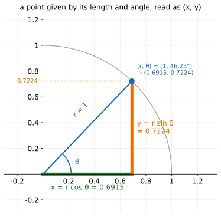

# The Unit Circle

Up: [[Trigonometry]] · [[Radians]] ➡️

Mathematics, Trigonometry. Needs: dividing two decimals, and the [theorem of Pythagoras](../references/textbooks/geometry/geometry-handbook.pdf#page=80), $a^2 + b^2 = c^2$ on a right triangle.

> [!question] Test yourself
> No quiz page covers this note yet.

> [!warning] Unfinished
> - No quiz page for this note yet.

Stated claims: 0.

**The cosine of an angle is how far right of the centre a point at that angle sits on a circle of radius 1.** Every number here is worked at one angle, 46.25°, the angle of post 51 in [[The Quarter Circle Under The Cosine Schedule]].

**Colours, the same in every equation and figure.** Green is $\cos\theta$, the horizontal leg. Orange is $\sin\theta$, the vertical leg. Blue is the line from the origin and its angle. Grey is a case drawn for comparison.

## Where you work

Python 3 with matplotlib, in a new empty folder; nothing here touches a real project. Every figure script below imports `plane.py`, saved in [[#Try the unit circle yourself]], step 3.

## Table of contents

- [[#The cosine on the unit circle]]
- [[#Try the unit circle yourself]]
- [[#Reading the unit-circle output]]
- [[#How the unit circle works]]
- [[#Other ways to get a cosine]]
- [[#Why the unit circle matters]]
- [[#The unit circle taught in, applied in]]

## The cosine on the unit circle

Navigation: 📋 [[#Table of contents|TOC]] | [[#Try the unit circle yourself]] ➡️

Textbook: [Whitney, Trigonometry handbook, the unit circle, PDF p. 10](../references/textbooks/trigonometry/trigonometry-handbook.pdf#page=10)

### The angles and their table

<table>
<tr><th>angle θ</th><th style="color:#2e7d32">x = cos θ</th><th style="color:#ef6c00">y = sin θ</th><th style="color:#2e7d32">x²</th><th style="color:#ef6c00">y²</th><th>x² + y²</th></tr>
<tr><td>0°</td><td>1</td><td>0</td><td>1</td><td>0</td><td>1</td></tr>
<tr><td>15°</td><td>0.9659</td><td>0.2588</td><td>0.9330</td><td>0.0670</td><td>1</td></tr>
<tr><td>30°</td><td style="border:2px dashed #212121">0.8660</td><td>0.5</td><td>0.75</td><td>0.25</td><td>1</td></tr>
<tr><td>45°</td><td>0.7071</td><td>0.7071</td><td>0.5</td><td>0.5</td><td>1</td></tr>
<tr style="background:#fff8e1"><td><b>46.25°</b></td><td style="border:2px solid #212121"><b>0.6915</b></td><td style="border:2px solid #212121"><b>0.7224</b></td><td style="border:2px solid #212121">0.4782</td><td style="border:2px solid #212121">0.5218</td><td style="border:2px solid #212121">1</td></tr>
<tr><td>60°</td><td>0.5</td><td>0.8660</td><td>0.25</td><td>0.75</td><td>1</td></tr>
<tr><td>75°</td><td>0.2588</td><td>0.9659</td><td>0.0670</td><td>0.9330</td><td>1</td></tr>
<tr><td>90°</td><td>0</td><td>1</td><td>0</td><td>1</td><td>1</td></tr>
</table>

**How to read this table.** Each row is one point on the circle of radius 1. The x column is how far right of the centre it sits, the y column how far up, and the last column is always 1. The squared columns are [[The Cosine Wave#The two shares|the two shares]].

**What to look for.** The highlighted row is the toy angle used in every figure. The dashed cell is the one t2 labels on the circle.

### The base word: cosine, on a right triangle

The school definition, from the [ratios of a right triangle](../references/textbooks/calculus/calculus-textbook.pdf#page=1207):

$$
\underbrace{\textcolor{#2e7d32}{\cos\theta}}_{\text{cosine of the angle}}
=
\frac{\underbrace{\textcolor{#2e7d32}{\text{adjacent}}}_{\text{leg beside }\theta}}{\underbrace{\textcolor{#1565c0}{\text{hypotenuse}}}_{\text{side facing the right angle}}}
=
\frac{\textcolor{#2e7d32}{0.6915}}{\textcolor{#1565c0}{1}}
=
0.6915
$$

**What the equation says.** The cosine is a ratio of two sides, so it has no unit. At 46.25° the side beside the angle is 0.6915 of the longest side.

**Why the ratio is there.** A triangle twice the size has the same angles, and both sides double: $1.3830 / 2 = 0.6915$. Without the division, the answer would depend on how big you drew the triangle.

**Why hypotenuse 1.** With the longest side equal to 1, the ratio is the adjacent side itself, so the cosine is a length you can measure with a ruler.

```python
import math
from plane import plane, save, angle, rad, GREEN, ORANGE, BLUE, GREY

theta = 46.25
for hyp in (1, 2):
    adj, opp = hyp * math.cos(rad(theta)), hyp * math.sin(rad(theta))
    print(f"hypotenuse {hyp}: adjacent {adj:.4f}  opposite {opp:.4f}  adjacent / hypotenuse {adj / hyp:.4f}")

fig, ax = plane((-0.1, 1.6), (-0.25, 1.55))
adj, opp = math.cos(rad(theta)), math.sin(rad(theta))
ax.plot([0, 2 * adj, 2 * adj, 0], [0, 0, 2 * opp, 0], color=GREY, ls=(0, (5, 4)), lw=1.2)
ax.text(2 * adj + 0.03, 1.2, "hypotenuse 2:\n1.3830 / 2 = 0.6915", color=GREY, fontsize=10)
ax.plot([0, adj], [0, 0], color=GREEN, lw=4)
ax.plot([adj, adj], [0, opp], color=ORANGE, lw=4)
ax.plot([0, adj], [0, opp], color=BLUE, lw=2.5)
ax.plot([adj - 0.05, adj - 0.05, adj], [0, 0.05, 0.05], color="black", lw=1)
ax.text(adj / 2, -0.19, "adjacent 0.6915", color=GREEN, ha="center")
ax.text(adj + 0.03, opp / 2, "opposite\n0.7224", color=ORANGE, va="center")
ax.text(adj / 2 - 0.12, opp / 2 + 0.05, "hypotenuse 1", color=BLUE, rotation=theta, ha="center")
angle(ax, theta)
ax.text(0.22, 0.07, "θ = 46.25°", color=BLUE, fontsize=11)
ax.set_title("cos θ = adjacent / hypotenuse = 0.6915 / 1 = 0.6915", fontsize=12)
save(fig, "t1-right-triangle-cosine.svg")
```


**How to read this.** Both axes are lengths in units of the hypotenuse. The green segment on the x-axis is the adjacent side, 0.6915, and the dashed grey triangle is the same shape at twice the size. Look at the grey label: its ratio is still 0.6915.

### The circle: every point at distance 1

Stand every hypotenuse of length 1 at its angle from the origin and the far ends trace the [unit circle](../references/textbooks/trigonometry/trigonometry-handbook.pdf#page=10), the circle of radius 1. Each point's x-coordinate is its cosine.

$$
\underbrace{x^2 + y^2}_{\text{squared distance from the origin}} = \underbrace{1}_{\text{radius }1\text{, squared}}
$$

**What the equation says.** A point is on the circle exactly when its squared distance from the origin is 1. At 30° the point is $(0.866, 0.5)$, and $0.75 + 0.25 = 1$.

```python
import math
from plane import plane, save, circle, rad, GREEN, BLUE

fig, ax = plane((-1.45, 1.45), (-1.45, 1.45))
circle(ax)
for deg in range(0, 360, 15):
    x, y = math.cos(rad(deg)), math.sin(rad(deg))
    ax.plot(x, y, "o", color=BLUE, ms=6)
    ax.text(1.18 * x, 1.18 * y, f"{deg}°", ha="center", va="center", fontsize=9, color=BLUE)
    if deg <= 90:
        print(f"{deg:3d} deg  point ({x:.3f}, {y:.3f})  x^2 + y^2 = {x * x + y * y:.3f}")
x, y = math.cos(rad(30)), math.sin(rad(30))
ax.plot([x, x], [0, y], ":", color=GREEN)
ax.text(x - 0.03, 0.06, "cos 30° = 0.866", color=GREEN, ha="right", fontsize=10)
ax.set_title("the unit circle, radius 1: a point every 15°", fontsize=12)
save(fig, "t2-unit-circle-sampled-points.svg")
```


**How to read this.** Both axes run from −1.45 to 1.45, with the origin at the centre. Each dot is one angle, counted anticlockwise from the positive x-axis. Look at 30°: the green drop meets the x-axis at 0.866, its cosine.

### The angle: one line from the origin

An angle in [standard position](../references/textbooks/trigonometry/trigonometry-handbook.pdf#page=8) starts on the positive x-axis, its initial side, and turns anticlockwise to its terminal side. On the unit circle the terminal side is a line of length 1 from the origin.

$$
\underbrace{\textcolor{#1565c0}{\theta}}_{\text{turn from the initial side}} = 46.25^\circ
\quad\Longrightarrow\quad
\underbrace{\textcolor{#1565c0}{(0.6915,\ 0.7224)}}_{\text{where the terminal side meets the circle}}
$$

**Why anticlockwise.** The handbook counts a polar angle as positive when it turns anticlockwise. A clockwise 46.25° is −46.25°, which lands below the x-axis at $(0.6915, -0.7224)$.

```python
import math
from plane import plane, save, circle, angle, rad, BLUE, LIGHT_BLUE

theta = 46.25
x, y = math.cos(rad(theta)), math.sin(rad(theta))
print(f"ray at {theta} deg ends at ({x:.4f}, {y:.4f}), distance {math.hypot(x, y):.4f} from the origin")

fig, ax = plane((-0.25, 1.35), (-0.25, 1.25))
circle(ax, upto=90)
ax.plot([0, 1.2], [0, 0], color=LIGHT_BLUE, lw=4)
ax.plot([0, x], [0, y], color=BLUE, lw=3)
ax.plot(x, y, "o", color=BLUE, ms=8)
angle(ax, theta, r=0.25)
ax.text(0.28, 0.1, "θ = 46.25°", color=BLUE)
ax.text(0.85, 0.04, "initial side:\nthe positive x-axis", color=BLUE, fontsize=10)
ax.text(x / 2 - 0.05, y / 2 + 0.05, "terminal side, length 1", color=BLUE, fontsize=10, rotation=theta, ha="center")
ax.text(x + 0.05, y + 0.03, "the point at 46.25°", color=BLUE, fontsize=10)
ax.set_title("one line from the origin, turned 46.25° anticlockwise", fontsize=12)
save(fig, "t3-line-from-origin-angle.svg")
```


**How to read this.** The light blue band is where every angle starts. The dark blue line is the same length 1 at any angle; only its turn, 46.25°, changes where it ends.

### The point: from length and angle to x and y

The same point can be named two ways: by its length and angle, its [polar coordinates](../references/textbooks/trigonometry/trigonometry-handbook.pdf#page=68) $(r, \theta)$, or by its $(x, y)$.

$$
\underbrace{\textcolor{#2e7d32}{x}}_{\text{horizontal leg}} = \underbrace{r}_{\text{length}}\ \textcolor{#2e7d32}{\cos\theta} = 1 \cdot 0.6915,
\qquad
\underbrace{\textcolor{#ef6c00}{y}}_{\text{vertical leg}} = r\ \textcolor{#ef6c00}{\sin\theta} = 1 \cdot 0.7224
$$

**What the equation says.** Drop a vertical from the point to the x-axis and you have a right triangle with hypotenuse $r$. Its legs are $r\cos\theta$ and $r\sin\theta$.

**Why the $r$ is there.** On the unit circle $r = 1$, so the legs are the cosine and sine themselves. A point at the same angle but twice as far out sits at $(1.3830, 1.4447)$.

```python
import math
from plane import plane, save, circle, angle, rad, GREEN, ORANGE, BLUE

r, theta = 1, 46.25
x, y = r * math.cos(rad(theta)), r * math.sin(rad(theta))
print(f"polar (r = {r}, theta = {theta} deg)  ->  cartesian ({x:.4f}, {y:.4f})")

fig, ax = plane((-0.3, 1.35), (-0.3, 1.25))
circle(ax, upto=90)
ax.plot([0, x], [0, y], color=BLUE, lw=2)
ax.plot([0, x], [0, 0], color=GREEN, lw=5)
ax.plot([x, x], [0, y], color=ORANGE, lw=5)
ax.plot([0, x], [y, y], ":", color=ORANGE)
ax.plot(x, y, "o", color=BLUE, ms=8)
angle(ax, theta, r=0.22)
ax.text(0.25, 0.08, "θ", color=BLUE)
ax.text(x / 2, -0.12, "x = r cos θ = 0.6915", color=GREEN, ha="center")
ax.text(x + 0.04, y / 2, "y = r sin θ\n= 0.7224", color=ORANGE, va="center")
ax.text(-0.04, y, "0.7224", color=ORANGE, ha="right", va="center", fontsize=10)
ax.text(x / 2 - 0.12, y / 2 + 0.08, "r = 1", color=BLUE, rotation=theta)
ax.text(x + 0.04, y + 0.05, "(r, θ) = (1, 46.25°)\n→ (0.6915, 0.7224)", color=BLUE, fontsize=10)
ax.set_title("a point given by its length and angle, read as (x, y)", fontsize=12)
save(fig, "t5-polar-to-cartesian.svg")
```



**How to read this.** The blue line is $r = 1$ at angle θ. The green leg along the x-axis ends at 0.6915 and the orange leg ends level with 0.7224 on the y-axis. Those two numbers are the point's $(x, y)$.

### Where this goes next

The two legs at 46.25° square to $0.4782 + 0.5218 = 1$. That split of 1 into two shares is [[The Cosine Wave#The two shares|the Pythagorean identity]], and the schedule reads its kept share and its noise share off it.

## Try the unit circle yourself

Navigation: ⬅️ [[#The cosine on the unit circle]] | 📋 [[#Table of contents|TOC]] | [[#Reading the unit-circle output]] ➡️

**1. What you need.** Python 3 with matplotlib:

```bash
python3 -c "import matplotlib; print(matplotlib.__version__)"
```

This run printed `3.10.8`.

**2. When it is missing.** Make the prepared environment once, `uv venv ~/.vault-sandbox` then `uv pip install --python ~/.vault-sandbox/bin/python pandas numpy scipy matplotlib statsmodels openpyxl`, and run every script below with `~/.vault-sandbox/bin/python` in place of `python3`. Not run on this machine, whose `python3` already has matplotlib.

**3. The setup: an empty folder and the plane.** Make the folder and confirm it is empty:

```bash
mkdir -p ~/playground/sandbox && mkdir ~/playground/sandbox/unit-circle-figures && cd ~/playground/sandbox/unit-circle-figures && ls -A | wc -l
```

You should see `0`. Copy [plane.py](sandbox/plane.py) from the `sandbox/` folder beside this note into it. It draws Cartesian axes through the origin with equal scales, so a circle looks round, holds the colours, and saves each figure as SVG with `save`; `angle` draws the arc that marks an angle and `circle` draws the unit circle up to a given degree.

Save each script from [[#The cosine on the unit circle]] under the name in its last line, with `.py` for `.svg` and `_` for `-`: `t1_triangle.py`, `t2_circle.py`, `t3_ray.py`, `t5_polar.py`.

**4. A look before: the circle every 15°.**

```bash
python3 t2_circle.py
```

```text
  0 deg  point (1.000, 0.000)  x^2 + y^2 = 1.000
 15 deg  point (0.966, 0.259)  x^2 + y^2 = 1.000
 30 deg  point (0.866, 0.500)  x^2 + y^2 = 1.000
 45 deg  point (0.707, 0.707)  x^2 + y^2 = 1.000
 60 deg  point (0.500, 0.866)  x^2 + y^2 = 1.000
 75 deg  point (0.259, 0.966)  x^2 + y^2 = 1.000
 90 deg  point (0.000, 1.000)  x^2 + y^2 = 1.000
saved t2-unit-circle-sampled-points.svg
```

**5. The failure: reading a side without dividing by the hypotenuse.**

```bash
python3 t1_triangle.py
```

```text
hypotenuse 1: adjacent 0.6915  opposite 0.7224  adjacent / hypotenuse 0.6915
hypotenuse 2: adjacent 1.3830  opposite 1.4447  adjacent / hypotenuse 0.6915
saved t1-right-triangle-cosine.svg
```

On the triangle twice the size, the adjacent side alone reads 1.3830, which is no cosine at all. The ratio stays 0.6915.

**6. The technique: polar to Cartesian.**

```bash
python3 t5_polar.py
```

```text
polar (r = 1, theta = 46.25 deg)  ->  cartesian (0.6915, 0.7224)
saved t5-polar-to-cartesian.svg
```

**7. Another way to the same point: turn a line of length 1.**

```bash
python3 t3_ray.py
```

```text
ray at 46.25 deg ends at (0.6915, 0.7224), distance 1.0000 from the origin
saved t3-line-from-origin-angle.svg
```

**8. More worked examples.** Step 4 already printed the point at seven angles, 0° to 90° every 15°, each one row of the table at the top of this note.

[[Radians]] and [[The Cosine Wave]] run their scripts in this same folder.

**9. Clean up, and prove it.**

```bash
cd ~ && rm -r ~/playground/sandbox/unit-circle-figures
ls ~/playground/sandbox/unit-circle-figures; echo $?
```

You should see `ls: cannot access '/home-mscluster/mmolefe/playground/sandbox/unit-circle-figures': No such file or directory` (with your own home folder in the path), then `2`.

## Reading the unit-circle output

Navigation: ⬅️ [[#Try the unit circle yourself]] | 📋 [[#Table of contents|TOC]] | [[#How the unit circle works]] ➡️

| Step | Field | This run | How to read it | Backing |
|---|---|---|---|---|
| 4 | `x^2 + y^2` | `1.000` on every row | each sampled point is at distance 1 from the origin | derived below |
| 4 | `30 deg  point` | `(0.866, 0.500)` | the dashed cell of the table: cos 30° and sin 30° | shown |
| 5 | `adjacent`, hypotenuse 2 | `1.3830` | a side alone depends on the triangle's size | shown |
| 5 | `adjacent / hypotenuse` | `0.6915` for both sizes | the ratio depends on the angle only | derived below |
| 6 | `cartesian` | `(0.6915, 0.7224)` | $x = r\cos\theta$, $y = r\sin\theta$ with $r = 1$ | cited, trigonometry handbook p. 68 |
| 7 | `ends at` | `(0.6915, 0.7224)` | the same point as step 6, reached by turning a line | shown |
| 7 | `distance` | `1.0000` | `math.hypot(x, y)`, the length of the line | shown |

## How the unit circle works

Navigation: ⬅️ [[#Reading the unit-circle output]] | 📋 [[#Table of contents|TOC]] | [[#Other ways to get a cosine]] ➡️

Textbook: [Whitney, Trigonometry handbook, cos θ = x / r, PDF p. 9](../references/textbooks/trigonometry/trigonometry-handbook.pdf#page=9)

1. Scaling a right triangle by a factor multiplies every side by that factor, so adjacent / hypotenuse does not change: $1.3830 / 2 = 0.6915 / 1$. The cosine is a function of the angle alone.
2. Put the angle at the origin with its initial side on the positive x-axis. The hypotenuse runs to the point $(x, y)$ and has length $r = \sqrt{x^2 + y^2}$, so $\cos\theta = x / r$ and $\sin\theta = y / r$.
3. Multiply both by $r$: $x = r\cos\theta$ and $y = r\sin\theta$. With $r = 1$, $x = \cos\theta$.
4. Pythagoras on the same triangle gives $x^2 + y^2 = r^2$, which is why every row of step 4 printed 1 for $r = 1$. Dividing by $r^2$ turns it into the identity [[The Cosine Wave#How the cosine wave works|derived in The Cosine Wave]].

## Other ways to get a cosine

Navigation: ⬅️ [[#How the unit circle works]] | 📋 [[#Table of contents|TOC]] | [[#Why the unit circle matters]] ➡️

- **`math.cos` in Python**, after converting the angle: `math.cos(math.radians(46.25))` gives `0.6915`. Feeding it 46.25 itself goes wrong, as [[Radians#The consequence: degrees fed in as radians]] shows.
- **The key angles by heart**: $\cos 30^\circ = \sqrt3/2$, $\cos 45^\circ = \sqrt2/2$, $\cos 60^\circ = 1/2$, read off the [unit circle diagram](../references/textbooks/trigonometry/trigonometry-handbook.pdf#page=10).
- **Drag it.** The scene Dissolving the Dog, [frame "the plane"](https://claude.ai/artifact/X7QGLTxssbz41G7iTiRxC9#timetable-plane) and [frame "polar coordinates"](https://claude.ai/artifact/X7QGLTxssbz41G7iTiRxC9#timetable-polar), moves the point round the quarter circle.

## Why the unit circle matters

Navigation: ⬅️ [[#Other ways to get a cosine]] | 📋 [[#Table of contents|TOC]] | [[#The unit circle taught in, applied in]] ➡️

Two numbers whose squares add to 1 are a point on this circle, and the forward process of a diffusion model mixes a clean image and noise with exactly such a pair. At step 50 of the cosine schedule the pair is $(0.6916, 0.7223)$, the point at 46.25° to within 0.0001, which is why [[The Quarter Circle Under The Cosine Schedule]] can draw the whole schedule on this circle.

## The unit circle taught in, applied in

Navigation: ⬅️ [[#Why the unit circle matters]] | 📋 [[#Table of contents|TOC]]

**Taught in:**

- the `drip --math` walk of the forward process and the score in the reduce-reuse-recycle research repository (`artifacts/drips/forward-process-and-the-score/`), piece 2, rung 1: the learner's request to see the cosine from the high-school triangle up, on Cartesian planes with sampled points and lines, before the cosine schedule
- step 4 of the one-expert rebuild walk in the same repository (`artifacts/drips/simple-distributions-rebuild/01-one-expert-from-scratch.md`), "On paper 1" and "On paper 2": the plane, the quarter circle, polar coordinates, the two legs and Pythagoras

**Applied in:** [[The Quarter Circle Under The Cosine Schedule]], where the point at post 51 is step 50's two multipliers.

> [!note]- How this was checked
> The four figure scripts were run on 2026-10-21 on mscluster (Linux), with Python 3.12.10 and matplotlib 3.10.8 from the machine's `python3`, in the empty folder `~/playground/sandbox/unit-circle-figures`, by vault-writer. The prepared environment `~/.vault-sandbox` is missing on this machine. Every output above is that run's text. Each SVG was rasterised with PyMuPDF and opened, and a PNG twin drawn by matplotlib from the same figure was opened to check the dashed lines, which PyMuPDF's SVG reader does not draw. The folder was removed afterwards and the clean-up check returned 2.
>
> The textbook pages were opened and read as text with PyMuPDF: the trigonometry handbook's PDF pages 8 (standard position, initial and terminal side, polar angle positive anticlockwise), 9 (cos θ = x / r, the Pythagorean identities), 10 (the unit circle, x is the cosine and y the sine) and 68 (polar coordinates, x = r cos θ, y = r sin θ); the calculus textbook's PDF page 1207 (Appendix B, cos θ = side adjacent / hypotenuse); the geometry handbook's PDF page 80 ($a^2 + b^2 = c^2$). The scene frame anchors are as the walk's `dispatch.md` records them. No tldr-pages entry covers this.
